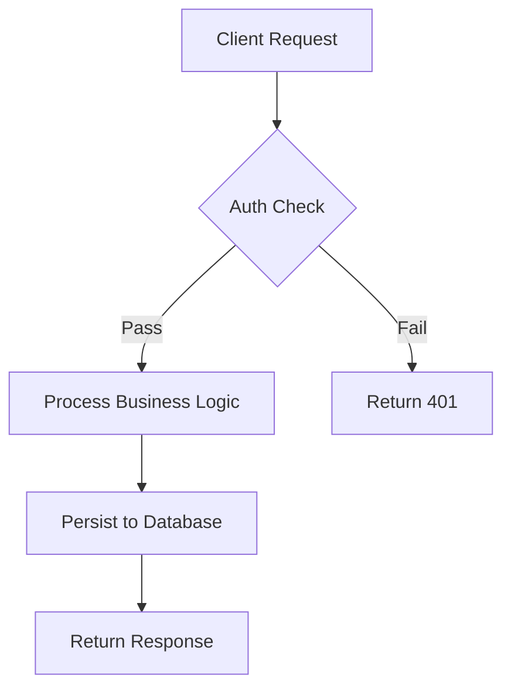
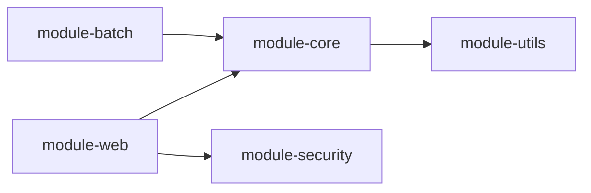

# Documentation Requirements — Java Project

You are a Java development and code analysis expert. Please write detailed **User Guide** and **Developer Guide**
documentation according to the following specifications.

---

## 1. General Requirements

| Item              | Description                                                                                     |
|-------------------|-------------------------------------------------------------------------------------------------|
| Format            | All content must be in **Markdown** format                                                      |
| Root Directory    | `docs/` (relative to project root)                                                              |
| Languages         | Bilingual: **English** (default) and **Chinese**; each language stored in **independent files** |
| Naming Convention | English version: `filename.md`; Chinese version: `filename.zh.md`                               |

---

## 2. Directory Structure

```
docs/
├── README.md                          # Root entry (English, default)
├── README.zh.md                       # Root entry (Chinese)
├── current/                           # Documentation for `release` branch
│   ├── user-guide/
│   │   ├── README.md
│   │   ├── README.zh.md
│   │   ├── module-{name}.md
│   │   └── module-{name}.zh.md
│   └── developer-guide/
│       ├── README.md
│       ├── README.zh.md
│       ├── module-{name}.md
│       └── module-{name}.zh.md
└── 1.x/                               # Documentation for `release-1.x` branch (if exists)
├── user-guide/
│   ├── README.md
│   ├── README.zh.md
│   └── ...
└── developer-guide/
├── README.md
├── README.zh.md
└── ...
```

### 2.1 Root `docs/README.md` Requirements

- Must serve as the **top-level navigation page**
- Must contain **links to both User Guide and Developer Guide**
- Must list available versions (branches): `current` (`release` branch) and `1.x` (`release-1.x` branch, if applicable)

---

## 3. User Guide (`docs/user-guide/`)

### 3.1 Organization

- One independent Markdown file **per Maven module**
- Stored under `docs/{branch}/user-guide/`

### 3.2 Required Content

Every module document in the User Guide **must** contain:

| Section                     | Description                                                                    |
|-----------------------------|--------------------------------------------------------------------------------|
| API Explanation             | Detailed description of public APIs, parameters, return values, and exceptions |
| Code Examples               | Practical usage examples; **reference `test-cases/` code where possible**      |
| Version Information         | Current module version, release date, changelog summary                        |
| Version Compatibility Range | Supported Java versions, dependency version ranges, and compatibility matrix   |

### 3.3 Example Module Document Outline

```markdown
# Module `{module-name}` — User Guide

## Overview

## API Reference

### Method: `methodName(params)`

- Description: ...
- Parameters: ...
- Returns: ...
- Throws: ...

## Code Examples

```java
// Example referenced from test-cases/
@Test
public void testMethodName() { ... }
```

## Version Information

- Current Version: x.y.z
- Release Date: YYYY-MM-DD

## Compatibility

| Java Version | Supported | Notes        |
|--------------|-----------|--------------|
| 8            | Yes       |              |
| 11           | Yes       |              |
| 17           | Partial   | Experimental |

```
```

---

## 4. Developer Guide (`docs/developer-guide/`)

### 4.1 Organization

- One independent Markdown file **per Maven module**
- Stored under `docs/{branch}/developer-guide/`

### 4.2 Required Content

Every module document in the Developer Guide **must** contain:

| Section                         | Description                                                               |
|---------------------------------|---------------------------------------------------------------------------|
| Architecture Design             | High-level component structure, layering, responsibilities                |
| Source Code Analysis            | Key classes, methods, execution paths with inline code references         |
| Design Patterns                 | Identified patterns (e.g., Factory, Strategy, Observer) with code mapping |
| Complex Workflows               | **Flowcharts** using Mermaid or ASCII diagrams                            |
| Module Dependency Relationships | **Flowcharts** illustrating inter-module dependencies                     |

### 4.3 Flowchart Requirements

- Workflow diagrams: describe request processing, async flows, error handling
- Dependency diagrams: show compile-time and runtime dependencies between Maven modules
- Use **Mermaid** syntax for all flowcharts

#### Example Mermaid Flowchart



#### Example Module Dependency Diagram

```markdown


```

### 4.4 Example Module Document Outline

```markdown
# Module `{module-name}` — Developer Guide

## Architecture Design
## Source Code Analysis
## Design Patterns
## Workflow
## Module Dependencies
```

---

## 5. Branch-Specific Rules

| Branch Name   | Docs Subdirectory | Notes                                            |
|---------------|-------------------|--------------------------------------------------|
| `release`     | `docs/current/`   | Always present; represents latest stable release |
| `release-1.x` | `docs/1.x/`       | Only if the branch exists in the repository      |

- Documentation **must only analyze** code from these branches
- Each branch directory contains its own `user-guide/` and `developer-guide/` subdirectories

---

## 6. Root `docs/README.md` — Linking Convention

The root `README.md` must include:

1. Project title and brief description
2. Version / Branch selector linking to:
    - `current/user-guide/README.md`
    - `current/developer-guide/README.md`
    - `1.x/user-guide/README.md` (conditional)
    - `1.x/developer-guide/README.md` (conditional)
3. Language switcher linking to `.zh.md` counterparts

### Example Snippet

```markdown
# Project Documentation

## Available Versions

| Version | User Guide | Developer Guide |
|---------|------------|-----------------|
| Current (release) | current/user-guide/README.md / current/user-guide/README.zh.md | current/developer-guide/README.md / current/developer-guide/README.zh.md |
| 1.x (release-1.x) | 1.x/user-guide/README.md / 1.x/user-guide/README.zh.md | 1.x/developer-guide/README.md / 1.x/developer-guide/README.zh.md |
```

---

## 7. Summary Checklist

- [ ] All files in Markdown format
- [ ] Bilingual content (EN default, ZH independent)
- [ ] `docs/README.md` with links to User Guide and Developer Guide
- [ ] User Guide per Maven module with API, examples, version info, compatibility
- [ ] Developer Guide per Maven module with architecture, source analysis, design patterns
- [ ] Flowcharts for complex workflows (Mermaid)
- [ ] Flowcharts for module dependencies (Mermaid)
- [ ] Branch-specific directories: `current/` and `1.x/`
- [ ] Only `release` and `release-1.x` branches analyzed

```