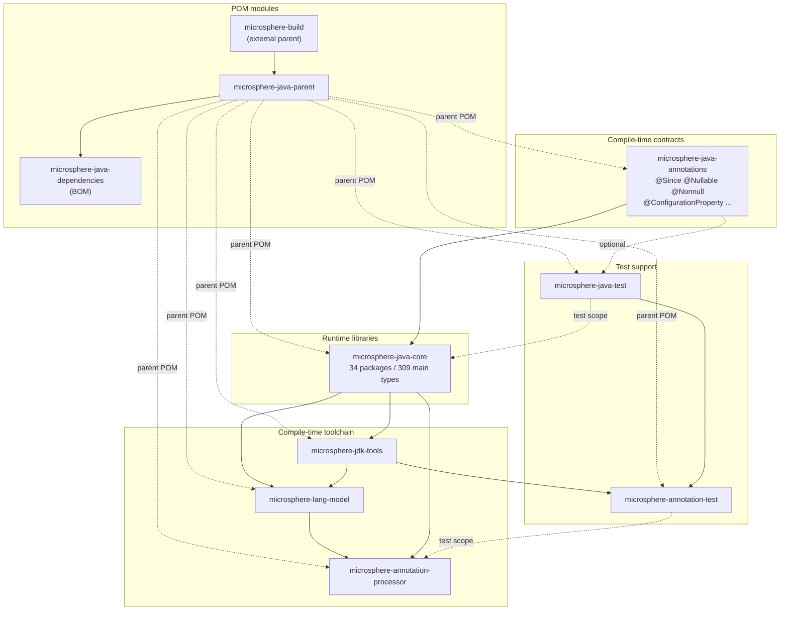

# Microsphere Java Documentation

Documentation for [`microsphere-java`](https://github.com/microsphere-projects/microsphere-java), a foundational
Java library of null-safe utilities, reflection and type abstractions, conversion/serialization SPIs, event
dispatching, I/O and classpath scanning, custom URL protocols, logging facade, artifact detection, JSON support,
configuration-property metadata, and a compile-time annotation-processing stack.

The docs are organized by **Maven module** and by **documentation branch line** (the version of the source tree
they describe), and every page exists in English and in Chinese.

---

## 1. Choose your guide

| Guide | Audience | English | 中文 |
|-------|----------|---------|------|
| **User Guide** | Library users: what to depend on, which API to call, which JDK is supported | [current/user-guide/README.md](current/user-guide/README.md) | [current/user-guide/zh/README.md](current/user-guide/zh/README.md) |
| **Developer Guide** | Library maintainers and framework authors: architecture, source analysis, design patterns, flow charts | [current/developer-guide/README.md](current/developer-guide/README.md) | [current/developer-guide/zh/README.md](current/developer-guide/zh/README.md) |

---

## 2. Version lines

Each documentation subdirectory mirrors one long-lived source branch. The page content — API signatures, SPI
registrations, JDK compatibility statements — is read from that branch, not from `main`.

| Directory | Source branch | Version | Status |
|-----------|---------------|---------|--------|
| [`current/`](current/user-guide/README.md) | `release` | `0.3.20-SNAPSHOT` (published as `0.3.20`, the newest tag) | Active |
| `1.x/` | `release-1.x` | — | Not documented: the `release-1.x` branch does not exist in this repository. Create `docs/1.x/` with the same layout when it does. |

---

## 3. Modules covered

One page per Maven module; `microsphere-java-core` is split into one page per top-level package group because of
its size (309 main-source files in 34 packages; 686 Java files including tests).

| Maven module | Type | Depends on | User Guide | Developer Guide |
|--------------|------|------------|------------|-----------------|
| `microsphere-java-annotations` | jar | — (optional `jsr305`) | [page](current/user-guide/microsphere-java-annotations.md) | [page](current/developer-guide/microsphere-java-annotations.md) |
| `microsphere-java-core` | jar | annotations | [14 pages](current/user-guide/microsphere-java-core/README.md) | [14 pages](current/developer-guide/microsphere-java-core/README.md) |
| `microsphere-jdk-tools` | jar | core | [page](current/user-guide/microsphere-jdk-tools.md) | [page](current/developer-guide/microsphere-jdk-tools.md) |
| `microsphere-lang-model` | jar | core | [page](current/user-guide/microsphere-lang-model.md) | [page](current/developer-guide/microsphere-lang-model.md) |
| `microsphere-annotation-processor` | jar (shaded) | core, lang-model | [page](current/user-guide/microsphere-annotation-processor.md) | [page](current/developer-guide/microsphere-annotation-processor.md) |
| `microsphere-java-test` | jar (test fixtures) | annotations (all deps optional) | [page](current/user-guide/microsphere-java-test.md) | [page](current/developer-guide/microsphere-java-test.md) |
| `microsphere-annotation-test` | jar (test harness) | java-test, jdk-tools | [page](current/user-guide/microsphere-annotation-test.md) | [page](current/developer-guide/microsphere-annotation-test.md) |
| `microsphere-java-parent` | pom | external `microsphere-build` | No page — build conventions are covered in the *Version information* section of each page |
| `microsphere-java-dependencies` | pom (BOM) | — | No page — its `dependencyManagement` entries are quoted in [Getting started](current/user-guide/README.md) |

---

## 4. Module dependency graph

Solid arrows are compile-scope dependencies; dashed arrows are test-scope, optional, or inheritance relations.
The graph is derived from the `<dependencies>` blocks of each module `pom.xml` on the `release` branch.

---

## 5. Language and file layout

* **English is the default language** and lives at the primary path (`docs/current/user-guide/foo.md`).
* **Chinese** is stored independently, mirrored file-for-file under a `zh/` subdirectory
  (`docs/current/user-guide/zh/foo.md`), with identical filenames.
* This index has its own Chinese mirror: [zh/README.md](zh/README.md).

---

## 6. Appendix: the topic-organized handbook

Before the module-based layout above, the documentation was organized by 18 functional topics
(Getting Started, Core Utilities, Reflection and Types, …). That bilingual handbook is still available and is a
useful cross-cutting read, but it is **not** module-oriented and is not version-scoped:

* User handbook: [user-guide/README.md](user-guide/README.md) (English pages, with `en/`/`zh/` in the developer handbook)
* Developer handbook: [developer-guide/README.md](developer-guide/README.md) — English in `developer-guide/en/`, Chinese in `developer-guide/zh/`

---

## 7. How to read these docs

1. Start with the [User Guide index](current/user-guide/README.md) — it carries coordinates, the JDK matrix, and a
   "which page do I need" table.
2. If you are extending the library, read the [Developer Guide index](current/developer-guide/README.md) for the
   architecture and the SPI registry, then the module page you are touching.
3. Facts in these pages are taken from the `release` branch sources. If a page and the code disagree, the code wins.
