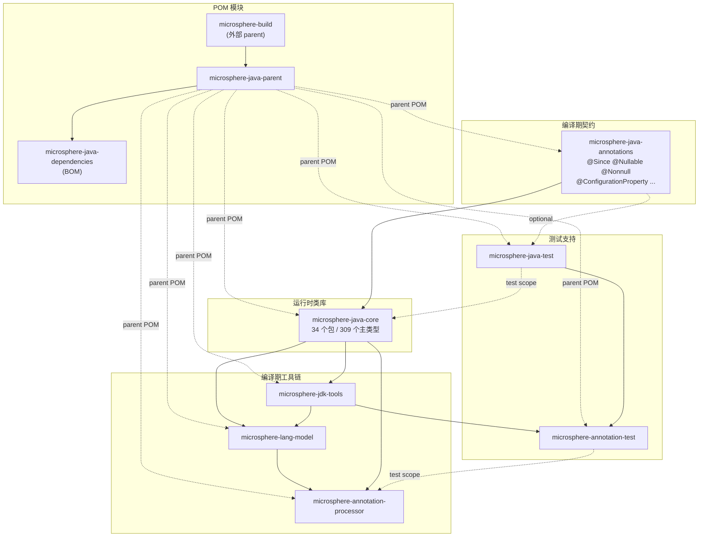

# Microsphere Java 文档

[`microsphere-java`](https://github.com/microsphere-projects/microsphere-java) 的文档。这是一个基础 Java 类库，
提供空安全的工具方法、反射与类型抽象、转换/序列化 SPI、事件分发、I/O 与 classpath 扫描、自定义 URL 协议、
日志门面、构件探测、JSON 支持、配置属性元数据，以及一整套编译期注解处理栈。

文档按 **Maven 模块** 与 **文档分支线**（所描述源码树的版本）组织，每一个页面都有英文与中文两个版本。

---

## 1. 选择指南

| 指南 | 读者 | English | 中文 |
|-------|----------|---------|------|
| **使用者指南** | 类库使用者：依赖什么、调用哪个 API、支持哪些 JDK | [./current/user-guide/README.md](./current/user-guide/README.md) | [./current/user-guide/README.zh.md](./current/user-guide/README.zh.md) |
| **开发者指南** | 类库维护者与框架作者：架构、源码分析、设计模式、流程图 | [./current/developer-guide/README.md](./current/developer-guide/README.md) | [./current/developer-guide/README.zh.md](./current/developer-guide/README.zh.md) |

---

## 2. 版本线

每个文档子目录对应一条长期维护的源码分支。页面内容——API 签名、SPI 注册、JDK 兼容性声明——取自该分支，
而不是 `main`。

| 目录 | 源码分支 | 版本 | 状态 |
|-----------|---------------|---------|--------|
| [`current/`](./current/user-guide/README.zh.md) | `release` | `0.3.20-SNAPSHOT`（已发布为 `0.3.20`，最新标签） | 活跃 |
| `1.x/` | `release-1.x` | — | 未收录：本仓库不存在 `release-1.x` 分支。若出现，按相同布局创建 `docs/1.x/`。 |

---

## 3. 覆盖的模块

每个 Maven 模块一个页面；`microsphere-java-core` 因体量过大（34 个包 / 309 个主源码类型；含测试共 686 个 Java
文件）按顶层包组拆成 14 个页面。

| Maven 模块 | 类型 | 依赖 | 使用者指南 | 开发者指南 |
|--------------|------|------------|------------|-----------------|
| `microsphere-java-annotations` | jar | —（可选 `jsr305`） | [页面](./current/user-guide/module-microsphere-java-annotations.zh.md) | [页面](./current/developer-guide/module-microsphere-java-annotations.zh.md) |
| `microsphere-java-core` | jar | annotations | [14 个页面](./current/user-guide/microsphere-java-core/README.zh.md) | [14 个页面](./current/developer-guide/microsphere-java-core/README.zh.md) |
| `microsphere-jdk-tools` | jar | core | [页面](./current/user-guide/module-microsphere-jdk-tools.zh.md) | [页面](./current/developer-guide/module-microsphere-jdk-tools.zh.md) |
| `microsphere-lang-model` | jar | core | [页面](./current/user-guide/module-microsphere-lang-model.zh.md) | [页面](./current/developer-guide/module-microsphere-lang-model.zh.md) |
| `microsphere-annotation-processor` | jar（shade） | core、lang-model | [页面](./current/user-guide/module-microsphere-annotation-processor.zh.md) | [页面](./current/developer-guide/module-microsphere-annotation-processor.zh.md) |
| `microsphere-java-test` | jar（测试夹具） | annotations（依赖全部 optional） | [页面](./current/user-guide/module-microsphere-java-test.zh.md) | [页面](./current/developer-guide/module-microsphere-java-test.zh.md) |
| `microsphere-annotation-test` | jar（测试框架） | java-test、jdk-tools | [页面](./current/user-guide/module-microsphere-annotation-test.zh.md) | [页面](./current/developer-guide/module-microsphere-annotation-test.zh.md) |
| `microsphere-java-parent` | pom | 外部 `microsphere-build` | 无页面——构建约定收录在各页面的 *版本信息* 小节 |
| `microsphere-java-dependencies` | pom（BOM） | — | 无页面——其 `dependencyManagement` 条目引述于[快速开始](./current/user-guide/README.zh.md) |

---

## 4. 模块依赖图

实线为 compile 作用域依赖；虚线为 test 作用域、optional 或继承关系。
该图由 `release` 分支各模块 `pom.xml` 的 `<dependencies>` 段落推导而来。

---

## 5. 语言与文件布局

* **英文为默认语言**，位于主路径（`docs/current/user-guide/foo.md`）。
* **中文** 使用独立文件：同名主干加 `.zh.md` 后缀，与英文文件位于 **同一** 目录
  （`docs/current/user-guide/foo.zh.md`）。每个英文页面都有中文对应页，反之亦然。
* 各层入口：

  | 层级 | English | 中文 |
  |-------|---------|------|
  | 文档根 | [README.md](./README.md) | [README.zh.md](./README.zh.md) |
  | 使用者指南索引 | [current/user-guide/README.md](./current/user-guide/README.md) | [current/user-guide/README.zh.md](./current/user-guide/README.zh.md) |
  | 开发者指南索引 | [current/developer-guide/README.md](./current/developer-guide/README.md) | [current/developer-guide/README.zh.md](./current/developer-guide/README.zh.md) |
  | `microsphere-java-core` 索引 | [current/user-guide/microsphere-java-core/README.md](./current/user-guide/microsphere-java-core/README.md) | [current/user-guide/microsphere-java-core/README.zh.md](./current/user-guide/microsphere-java-core/README.zh.md) |

  中文页面只在作为显式语言切换时（标注为 英文版 / 英文原文）才链接英文同页。

---

## 6. 已废弃的布局

曾经位于 `docs/user-guide/` 与 `docs/developer-guide/{en,zh}/` 的文档按功能主题而非 Maven 模块组织，该手册已被
**移除**；`current/` 下按模块、按版本线组织的页面是本仓库唯一的文档树，`current/` 对应 `release` 分支。
当前文档树的更早一版曾用 `zh/` 子目录镜像中文，这些路径同样已不存在——`zh/foo.md` 现为 `foo.zh.md`。

---

## 7. 如何阅读

1. 从 [使用者指南索引](./current/user-guide/README.zh.md) 开始——它给出坐标、JDK 矩阵以及“我需要哪一页”对照表。
2. 若你要扩展类库，先读 [开发者指南索引](./current/developer-guide/README.zh.md) 了解架构与 SPI 注册表，再读你要
   改动的模块页。
3. 页面中的事实均来自 `release` 分支源码。若页面与代码不一致，以代码为准。

---

英文原版：[English Documentation Index](./README.md)
