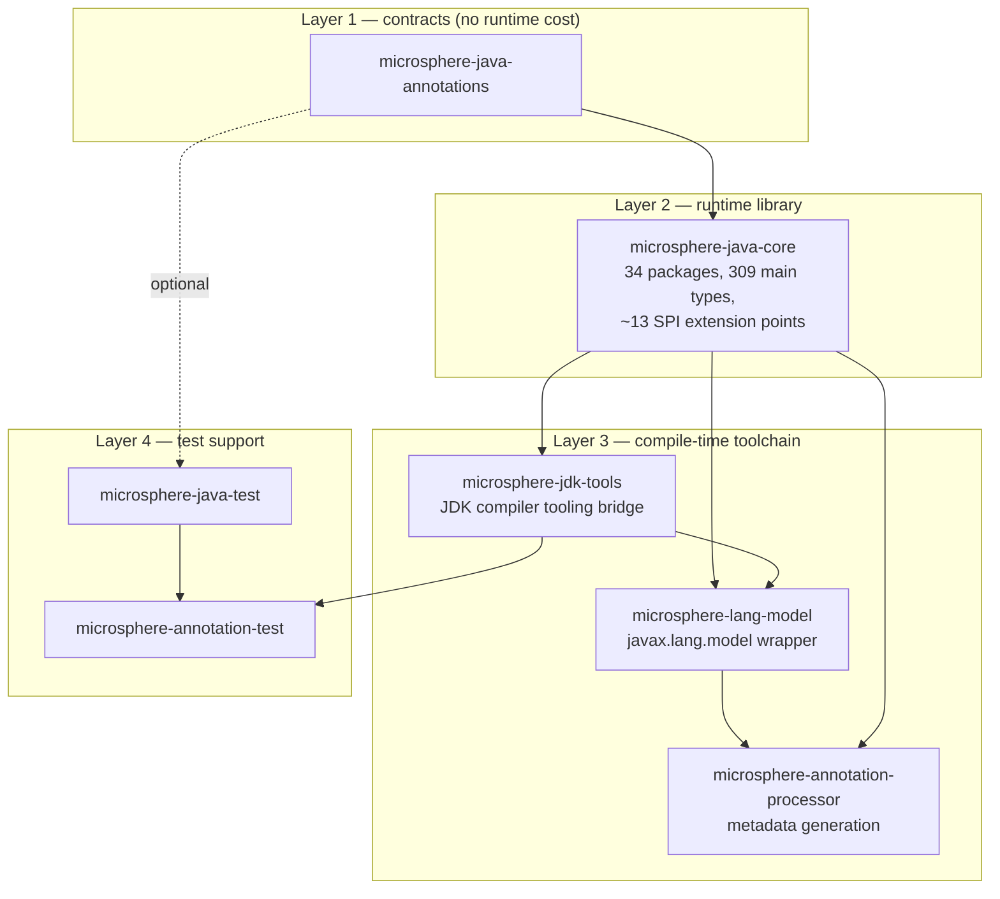
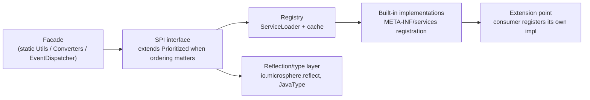
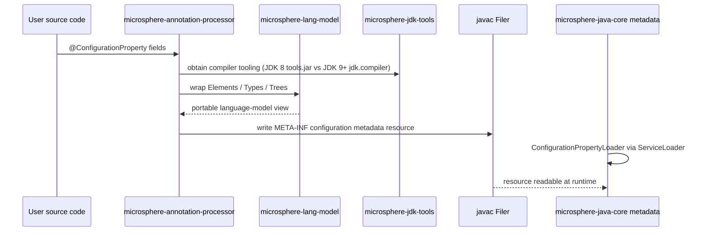
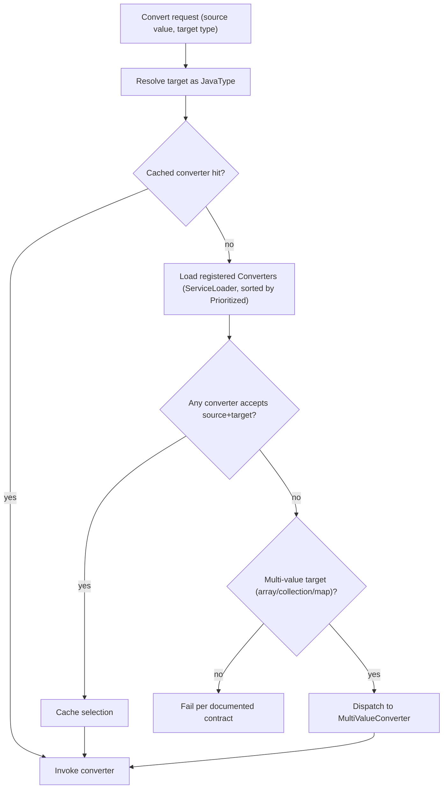

# Microsphere Java Developer Guide — `release` branch (`current`)

Audience: you are going to **read, change, or extend** `microsphere-java` — as a maintainer, or as a framework
author building on its SPIs. These pages give the architecture, class-level source analysis with `file:line`
references, the design patterns actually used, and flow charts for the non-trivial control flows.

Source line documented: **`release` branch**, `revision = 0.3.20-SNAPSHOT` (published as `0.3.20`, tagged 2026-10-16;
the previous release `0.3.19` was tagged 2026-08-30).
Every page has an independent Chinese mirror in the same directory: same stem, `.zh.md` suffix (`foo.md` → `foo.zh.md`).

* Documentation index and version lines: [../../README.md](../../README.md) · [中文](../../README.zh.md)
* User Guide (API usage, coordinates, JDK support): [../user-guide/README.md](../user-guide/README.md)

---

## 1. Architecture

### 1.1 Layering

The repository is a Maven multi-module reactor (`pom` aggregator `microsphere-java` → `microsphere-java-parent`
for build conventions → `microsphere-java-dependencies` as BOM → seven code modules). The modules form four layers,
and dependency direction is strictly downward:

| Layer | Rule that holds in the source tree |
|-------|------------------------------------|
| Contracts | Contains only annotations; nothing depends on `core`. Adding a runtime dependency here would break the zero-cost promise. |
| Runtime | `core` depends on `annotations` only, plus optional integrations (`slf4j-api`, `commons-logging`, `javax.annotation-api`, `jsr305`). Every subsystem is reachable through `META-INF/services`, never through a hard dependency. |
| Toolchain | Compilation is the only place the stack meets the JDK compiler, and `microsphere-jdk-tools` resolves it through `javax.tools.ToolProvider.getSystemJavaCompiler()` (`Compiler.java:107`). No source in the reactor imports `com.sun.tools.*`, mentions `tools.jar`, or asks for `--add-exports`; the single `--add-opens` string in the codebase is the reflective-access message in `reflect/AccessibleObjectUtils.java:204`. |
| Test support | `microsphere-java-test` has **all** dependencies `optional` so a consumer's JUnit/Mockito/Spring versions win. |

### 1.2 The recurring subsystem shape

Most of `core` implements the same five-part skeleton. Once you have seen it once, every subsystem reads the same way:

Consequences you should know before changing code:

* Implementations are **ordered**, usually via `io.microsphere.lang.Prioritized`; changing a `getOrder()` value is a
  behavioural change, not a cosmetic one.
* Implementations are **discovered at runtime**, so a class rename or package move breaks downstream consumers
  silently — the SPI files under `src/main/resources/META-INF/services/` must move with it.
* Capability that the current JDK cannot provide must **degrade to a no-op or a fallback**, not throw. The
  null-safety and degradation policy is documented per page.

### 1.3 SPI registry on the `release` branch

Each of these has a `META-INF/services` file in `microsphere-java-core/src/main/resources/` (or the module named below):

| SPI | Module | Purpose | Documented in |
|-----|--------|---------|---------------|
| `io.microsphere.convert.Converter` | core | Single-value type conversion | [Type conversion](./microsphere-java-core/type-conversion.md) |
| `io.microsphere.convert.multiple.MultiValueConverter` | core | Array/Collection/Map conversion | [Type conversion](./microsphere-java-core/type-conversion.md) |
| `io.microsphere.io.serializer.Serializer` | core | Binary serialization | [Serialization](./microsphere-java-core/serialization.md) |
| `io.microsphere.io.serializer.Deserializer` | core | Binary deserialization | [Serialization](./microsphere-java-core/serialization.md) |
| `io.microsphere.event.EventDispatcher` | core | Event dispatch strategy | [Events](./microsphere-java-core/events.md) |
| `io.microsphere.logging.LoggerFactory` | core | Log backend delegation chain | [Logging](./microsphere-java-core/logging.md) |
| `io.microsphere.classloading.ArtifactResourceResolver` | core | Locate artifact metadata | [Class loading and artifacts](./microsphere-java-core/classloading-and-artifacts.md) |
| `io.microsphere.classloading.URLClassPathHandle` | core | JDK-version-specific URLClassPath access | [Class loading and artifacts](./microsphere-java-core/classloading-and-artifacts.md) |
| `io.microsphere.net.ExtendableProtocolURLStreamHandler` | core | Custom URL protocol handlers | [Networking](./microsphere-java-core/net-and-url-protocols.md) |
| `io.microsphere.process.ProcessIdResolver` | core | Process id detection | [Concurrency, process, management](./microsphere-java-core/concurrency-process-and-management.md) |
| `io.microsphere.metadata.ConfigurationPropertyReader` | core | Read property metadata | [Configuration metadata](./microsphere-java-core/configuration-metadata.md) |
| `io.microsphere.metadata.ConfigurationPropertyLoader` | core | Load property metadata resources | [Configuration metadata](./microsphere-java-core/configuration-metadata.md) |
| `io.microsphere.metadata.ConfigurationPropertyGenerator` | core | Generate property metadata | [Configuration metadata](./microsphere-java-core/configuration-metadata.md) |
| `javax.annotation.processing.Processor` | microsphere-annotation-processor | Compile-time metadata generation | [Annotation processor](./module-microsphere-annotation-processor.md) |

---

## 2. Cross-module flows

### 2.1 Configuration-property metadata: annotation → processor → resource → runtime reader

### 2.2 Conversion dispatch (representative for every SPI-based subsystem)

---

## 3. Design patterns in this codebase

| Pattern | Where it is used | Why |
|---------|------------------|-----|
| Static Utility Class + marker interface | `io.microsphere.util.Utils` implementations across `util`, `collection`, `reflect`, `text` | Uniform discovery and non-instantiable API surface |
| Service Provider (SPI) + Registry | All 14 SPIs above, loaded through `ServiceLoader` helpers | Zero-config extensibility, no hard dependency on integrations |
| Strategy | `Converter`, `MultiValueConverter`, `LoggerFactory`, `ArtifactResourceResolver`, `ProcessIdResolver` selections | Per-JDK / per-type behaviour chosen at runtime |
| Ordered Strategy | `io.microsphere.lang.Prioritized` implementors (listeners, converters, loaders) | Deterministic dispatch order |
| Wrapper / Chain of Responsibility | `io.microsphere.lang.Wrapper` unwrap loops, `URLClassPathHandle` variants, delegating collections | Uniform unwrapping across layered abstractions |
| Decorator | `Delegating*` collections and executors in `io.microsphere.collection` / `concurrent` | Add null-safety or read-only semantics without copying |
| Null Object | `Empty*` collections, `NoOpURLClassPathHandle` | Graceful degradation instead of `null` or exceptions |
| Immutable value object | `JavaType`, `Artifact`, `MavenArtifact`, `ImmutableEntry` | Safe sharing across threads and caches |
| Template Method | `AbstractConverter`, `AbstractDeque`, `AbstractArtifactResourceResolver`, `AbstractURLClassPathHandle` | Shared lifecycle, pluggable specifics |
| Builder | `io.microsphere.management.builder.*` MBean builders | Multi-step JMX descriptor construction |
| Facade | `Logger`/`LoggerFactory`, `Converters`, `EventDispatcher`, `BeanUtils` | Small surface over a subsystem |
| Visitor | `javax.lang.model` element visitors in `microsphere-lang-model` and the processor | Traverse the compile-time model |

Each module page names the pattern and cites the concrete class with a `file:line` reference.

---

## 4. Pages

### 4.1 `microsphere-java-core` (14 pages)

| Page | Packages | Focus of the source analysis |
|------|----------|------------------------------|
| [Utilities, constants and text](./microsphere-java-core/util-and-constants.md) | `util`, `util.jar`, `constants`, `text`, `misc` | Class-loader and resource resolution, service-loading cache, version parsing |
| [Collections and filters](./microsphere-java-core/collections-and-filters.md) | `collection`, `filter` | Delegating/immutable wrapper internals, allocation-free empties and singletons |
| [Language abstractions](./microsphere-java-core/language-abstractions.md) | `lang`, `lang.function`, `lang.invoke`, `invoke` | `Prioritized` ordering, `Wrapper` unwrap loops, lambda/method-handle introspection |
| [Reflection, types and beans](./microsphere-java-core/reflection-and-beans.md) | `reflect`, `reflect.generics`, `internal.reflect`, `beans` | Generic-type resolution algorithm, `JavaType` model, accessibility handling per JDK |
| [Type conversion](./microsphere-java-core/type-conversion.md) | `convert`, `convert.multiple` | Converter selection, caching, generic parameter resolution |
| [Serialization](./microsphere-java-core/serialization.md) | `io.serializer` | Serializer/Deserializer dispatch and security-relevant deserialization paths |
| [Events](./microsphere-java-core/events.md) | `event` | Listener resolution, conditional filtering, dispatch thread-safety |
| [I/O, NIO, scanning and file filters](./microsphere-java-core/io-and-scanning.md) | `io`, `io.event`, `io.scanner`, `io.filter`, `nio.*` | Scanner plugin design, `WatchService` → event pipeline mapping |
| [Networking and URL protocols](./microsphere-java-core/net-and-url-protocols.md) | `net`, `net.classpath`, `net.console` | Handler registration constraints, sub-protocol chaining |
| [Logging](./microsphere-java-core/logging.md) | `logging` | Backend detection order, lazy init, JUL fallback |
| [Class loading and artifacts](./microsphere-java-core/classloading-and-artifacts.md) | `classloading` | classpath URL parsing, JPMS vs `sun.misc` paths, banned-artifact enforcement |
| [JSON](./microsphere-java-core/json.md) | `json` | Tokenizer/parser loop, `JSONObject` map choice and ordering |
| [Configuration metadata](./microsphere-java-core/configuration-metadata.md) | `metadata` | Reader/Loader/Generator pipeline and merging |
| [Concurrency, process, management and security](./microsphere-java-core/concurrency-process-and-management.md) | `concurrent`, `process`, `management`, `management.builder`, `security` | `ProcessIdResolver` fallback chain, MBean registration, SecurityManager deprecation handling |

Chinese index: [./microsphere-java-core/README.zh.md](./microsphere-java-core/README.zh.md).

### 4.2 Other modules

| Page | Module | Focus |
|------|--------|-------|
| [microsphere-java-annotations](./module-microsphere-java-annotations.md) | annotations | Retention policy choices and their reflective/compile-time consequences |
| [microsphere-jdk-tools](./module-microsphere-jdk-tools.md) | jdk-tools | One-class wrapper over `ToolProvider.getSystemJavaCompiler()` — in-JVM `javac` on JDK 8 → 25 |
| [microsphere-lang-model](./module-microsphere-lang-model.md) | lang-model | Adapter layer over `javax.lang.model`, visitor traversal, caching |
| [microsphere-annotation-processor](./module-microsphere-annotation-processor.md) | annotation-processor | Processor lifecycle, rounds, `Filer`/`Messager` usage, option handling |
| [microsphere-java-test](./module-microsphere-java-test.md) | java-test | Fixture lifecycle, JUnit 5 extension wiring, optional-dependency design |
| [microsphere-annotation-test](./module-microsphere-annotation-test.md) | annotation-test | In-process `javac` harness, in-memory file manager, diagnostics capture |

---

## 5. Build, test and compatibility infrastructure

| Aspect | Value | Where it is defined |
|--------|-------|---------------------|
| Reactor build order | parent → dependencies → annotations → core → jdk-tools → java-test → annotation-test → lang-model → annotation-processor | root `pom.xml` `<modules>` |
| Version scheme | `${revision}` flatten pattern (`revision=0.3.20-SNAPSHOT` on `release`) | root `pom.xml` properties |
| Language level | Java 8 target; the level is inherited from the external `microsphere-build` parent POM, so no `maven.compiler` setting appears in this repository | root `pom.xml` `<parent>` (`microsphere-build` `0.3.16`) |
| Dependency management chain | `microsphere-java-parent` imports `microsphere-all-bom` `0.3.13` and `spring-framework-bom`; `microsphere-java-dependencies` then manages the seven module versions | `microsphere-java-parent/pom.xml`, `microsphere-java-dependencies/pom.xml` |
| JDK-conditional test stack | profile `java8-16` (activation `[1.8,17)`) pins Spring `5.3.39`; otherwise Spring `7.0.9` is used | `microsphere-java-parent/pom.xml:21-24,52-64` |
| CI JDK matrix | Temurin `8`, `11`, `17`, `21`, `25` | `.github/workflows/maven-build.yml:25` |
| CI build command | `mvn --batch-mode --update-snapshots -Drevision=0.0.1-SNAPSHOT -Dsurefire.useSystemClassLoader=false test --activate-profiles test,coverage` | `.github/workflows/maven-build.yml:37-45` |
| CI triggers | push to `main`/`dev`; pull requests touching `main`/`dev`/`release` | `.github/workflows/maven-build.yml:14-18` |
| Publishing JDK | single run on Java `11` | `.github/workflows/maven-publish.yml:41` |
| Test framework | JUnit 5 (Jupiter), with `microsphere-java-test` fixtures | module poms, `src/test/java` |
| Extra test tooling | Mockito, Logback (test logging), Spring (cross-check conversions), JMH (benchmarks in core) | `microsphere-java-core/pom.xml` test scope |

> [!NOTE]
> CI runs Surefire with `-Dsurefire.useSystemClassLoader=false`. Keep that flag when reproducing classloader-,
> artifact-detection- or URL-protocol-related tests locally, because those areas are the ones where the default
> classloader isolation changes observed behaviour.

> [!NOTE]
> Maven is currently unreliable when invoked from an automated shell session in this workspace. Use a normal
> terminal for builds, or rely on CI. Source-level reading and grep-based analysis need no build.

---

## 6. Conventions to follow when you change this code

* Public and protected members are supposed to carry `@Nonnull` / `@Nullable`, and every member you touch must.
  The pass is not finished: 103 of the 309 `core` main sources carry the annotations today, and each User Guide page
  reports the measured count for its own scope.
* New API gets `@Since` with the version that will ship it.
* Failures in capability that the current JDK cannot provide degrade silently (no-op / neutral value), and the
  degradation is documented on the page — never add a new `assertNotNull`-style throw to "fix" an NPE.
* New SPI implementations must be registered in `META-INF/services` in the same commit that adds the class.
* Subsystem behaviour changes go with a page update: user-guide page (API, examples, JDK matrix) **and**
  developer-guide page (source analysis, patterns, flow chart), in both languages.
