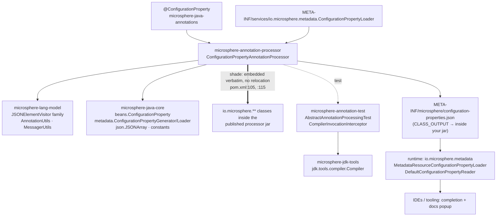
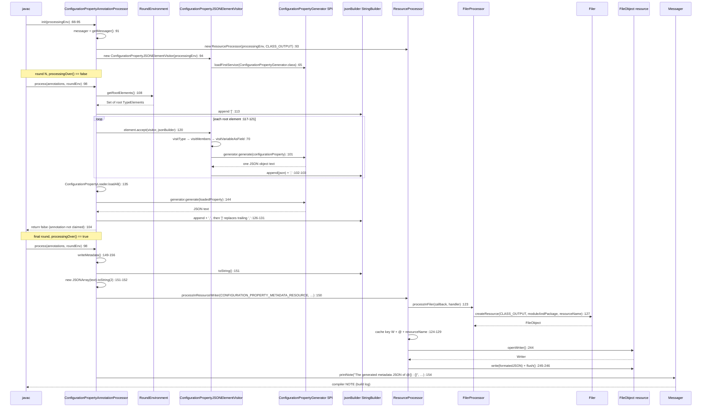
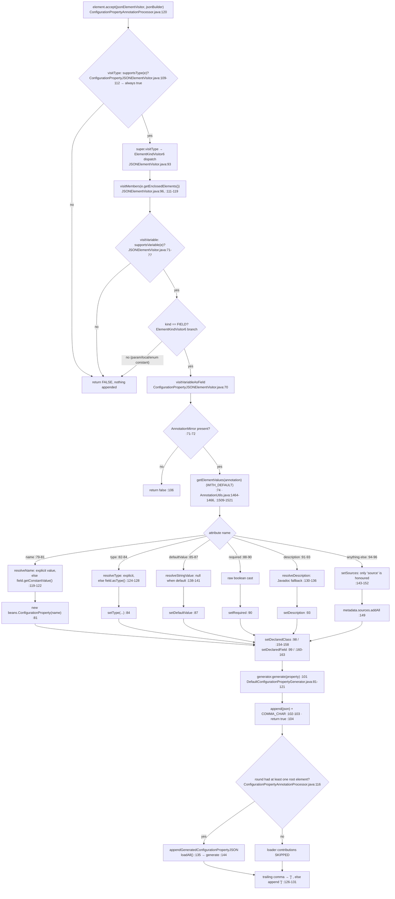

# Annotation Processor — Developer Guide

Module: `io.github.microsphere-projects:microsphere-annotation-processor` · `0.3.20-SNAPSHOT` (`release` branch)
Package: `io.microsphere.annotation.processor` (4 main types, 4 test classes + 1 SPI fixture) · Java 8 baseline, CI on
JDK 8 / 11 / 17 / 21 / 25

Path prefixes used below: `microsphere-annotation-processor/src/main/java/io/microsphere/` (sources — cited as
`annotation/processor/…`), `microsphere-annotation-processor/src/test/java/io/microsphere/` (tests), and full
`microsphere-<module>/src/...` paths for everything else.

---

## 1. Architecture position: the compile-time half

The metadata feature is split across two modules and two directions of data flow. This module **writes**
`META-INF/microsphere/configuration-properties.json` while `javac` runs; `io.microsphere.metadata` in
`microsphere-java-core` **reads** it at runtime, and one of its SPIs (`ConfigurationPropertyLoader`) feeds properties
*back* into this module's output during compilation. IDEs are the third consumer of the same file.



Edges proven from the sources:

* **`pom.xml:24-28`** declares `microsphere-java-core` (compile), **`:31-35`** declares `microsphere-lang-model`;
  **`:51-56`** declares `microsphere-annotation-test` with `test` scope (`:53`, `:55`).
* **processor → lang-model** — `ConfigurationPropertyJSONElementVisitor extends AnnotatedElementJSONElementVisitor`
  (`annotation/processor/ConfigurationPropertyJSONElementVisitor.java:57`, imported at `:23`), which extends
  `JSONElementVisitor` (`microsphere-lang-model/src/main/java/io/microsphere/lang/model/util/AnnotatedElementJSONElementVisitor.java:88`);
  the static imports of `AnnotationUtils`, `ClassUtils`, `TypeUtils`, `MessagerUtils` at
  `ConfigurationPropertyJSONElementVisitor.java:38-43` and `ConfigurationPropertyAnnotationProcessor.java:43`.
* **processor → core** — the model bean (`ConfigurationPropertyJSONElementVisitor.java:22`), the `JSONArray` writer
  (`ConfigurationPropertyAnnotationProcessor.java:22`, used `:151-152`), `ResourceConstants` (`:21`, `:39`),
  `SymbolConstants` (`:40-42`), the `ConfigurationPropertyGenerator` SPI (`:23`) and
  `ConfigurationPropertyLoader.loadAll` (`:44`, called `:135`).
* **runtime consumers** — `MetadataResourceConfigurationPropertyLoader` targets the exact same constant
  (`microsphere-java-core/src/main/java/io/microsphere/constants/ResourceConstants.java:54`), and
  `DefaultConfigurationPropertyReader` parses the array shape produced here. Those readers are analysed in
  [Configuration Metadata — Developer Guide](microsphere-java-core/configuration-metadata.md).

> [!NOTE]
> The `annotation-processor → core` edge is *both* a Maven edge and a runtime edge: the processor needs core's model,
> JSON and SPI classes **while it runs**, i.e. on the processor classpath. That is exactly what the `maven-shade-plugin`
> configuration at `pom.xml:103-121` solves — and exactly what creates the duplicate-class problem for consumers who
> also depend on core (§9).

---

## 2. Type inventory

| Type | Visibility | Responsibility | Key members |
|---|---|---|---|
| `ConfigurationPropertyAnnotationProcessor` (`annotation/processor/ConfigurationPropertyAnnotationProcessor.java:78`) | `public` | the Java EE `Processor`: per-round accumulation, final-round write, diagnostics | `init` `:88-95`, `process` `:97-105`, `resolveMetadata` `:107-110` / `:112-132`, `appendGeneratedConfigurationPropertyJSON` `:134-140` / `:142-147`, `writeMetadata` `:149-156`, `toJSON` `:158-160`, `getSupportedSourceVersion` `:162-165` |
| `ConfigurationPropertyJSONElementVisitor` (`ConfigurationPropertyJSONElementVisitor.java:57`) | **package-private** | turns one annotated `VariableElement` into one JSON object | constant `:59`, ctor `:63-66`, `visitVariableAsField` `:68-107`, `supportsType` `:109-112`, `getGenerator` `:114-117`, resolvers `:119-141`, `setSources` `:143-152`, `setDeclaredClass/Field` `:154-163` |
| `FilerProcessor` (`annotation/processor/FilerProcessor.java:76`) | `public` | `Filer` access wrapped with an exception handler; reflective `JavaFileManager` escape hatch | ctor `:80-82`, `processInFiler` `:84-90` / `:92-96`, `getJavaFileManager` `:103-106` |
| `ResourceProcessor` (`annotation/processor/ResourceProcessor.java:84`) | `public` | location-scoped resource read/write with `FileObject` caching and typed I/O callbacks | flags `:86-88`, ctors `:100-110`, `processInResource` `:112-118` / `:120-149`, `getResource` `:151-154`, `InputStream`/`Reader`/`CharSequence` `:156-213`, `OutputStream`/`Writer` `:215-252`, `exists` `:254-256` |

Tests: `ConfigurationPropertyAnnotationProcessorTest` (1 test), `ConfigurationPropertyJSONElementVisitorTest`
(3 tests + 7 compiled classes), `FilerProcessorTest` (3 tests), `ResourceProcessorTest` (15 tests), plus the
`TestConfigurationPropertyLoader` fixture registered in
`src/test/resources/META-INF/services/io.microsphere.metadata.ConfigurationPropertyLoader`.

The two "processor" classes are not `Processor` implementations despite the name — they are helpers. Only
`ConfigurationPropertyAnnotationProcessor` implements `javax.annotation.processing.Processor` (indirectly, via
`AbstractProcessor`, `ConfigurationPropertyAnnotationProcessor.java:78`).

---

## 3. Round handling and `RoundEnvironment` usage

`process()` is deliberately minimal (`ConfigurationPropertyAnnotationProcessor.java:97-105`):

```java
public boolean process(Set<? extends TypeElement> annotations, RoundEnvironment roundEnv) {
    if (roundEnv.processingOver()) {
        writeMetadata();
    } else {
        resolveMetadata(roundEnv);
    }
    return false;
}
```

Five facts follow from those seven lines:

1. **The `annotations` parameter is ignored.** Which annotations arrived is decided by `@SupportedAnnotationTypes`
   (`:77`), not by the round's set — so the processor runs once per round regardless of whether the target annotation is
   present.
2. **Root elements, not annotated elements.** `resolveMetadata(RoundEnvironment)` calls
   `roundEnv.getRootElements()` (`:108`) and offers every element to the visitor (`:117-121`). `getElementsAnnotatedWith`
   is never used; filtering is the visitor's job. Consequence: only elements **compiled in this round** can ever be
   emitted, so a dependency jar's annotated fields are invisible by construction.
3. **Accumulator state lives across rounds.** `jsonBuilder` is created once in `init()` (`:92`) and each non-final round
   wraps its contribution in a fresh `[` … `]` pair (`:113`, `:126-131`). A compile with two non-empty rounds therefore
   yields `[…][…]`, which is not a JSON array — see §9.
4. **The write happens exactly once, on the final round.** `writeMetadata()` (`:149-156`) is gated by
   `roundEnv.processingOver()` (`:99`); nothing is written during ordinary rounds, so a compile that fails before the
   last round leaves no resource behind.
5. **`return false` (`:104`) means the annotation is not claimed.** That is the conventional choice when several
   processors share an annotation, and the reason `-proc:only`/`-Xlint:processing` builds can print javac's
   "No processor claimed any of these annotations" warning for this annotation even though the processing succeeded.

`init()` (`:88-95`) builds three collaborators eagerly: `Messager` (`:91`), the accumulator (`:92`), a
`ResourceProcessor` bound to `StandardLocation.CLASS_OUTPUT` (`:93`, import `:46`) and the visitor (`:94`). Both
`ResourceProcessor`'s and the visitor's constructors can throw (§9), which is why a misconfigured processor path
surfaces as "Annotation processor … failed to initialize" rather than as a missing resource.

The two package-private methods `resolveMetadata(Set)` (`:112`) and `toJSON()` (`:158`) exist for the tests; they are the
only seam into the accumulation logic.

One full compile, ordinary round then final round:



---

## 4. Supported annotation types, source version and options

| Contract | What the code returns | Citation |
|---|---|---|
| `getSupportedAnnotationTypes()` | inherited from `AbstractProcessor`, reading the class-level `@SupportedAnnotationTypes(CONFIGURATION_PROPERTY_ANNOTATION_CLASS_NAME)` — exactly one FQN, `io.microsphere.annotation.ConfigurationProperty` | `ConfigurationPropertyAnnotationProcessor.java:77`, value at `ConfigurationPropertyJSONElementVisitor.java:59` |
| `getSupportedSourceVersion()` | overridden, returns `SourceVersion.latestSupported()` — the newest level the running JDK provides | `ConfigurationPropertyAnnotationProcessor.java:162-165`, static import `:45` |
| `getSupportedOptions()` | **not overridden**; `AbstractProcessor`'s default reads the absent `@SupportedOptions` annotation and returns an empty set. No `-A…` option is consumed anywhere | `ConfigurationPropertyAnnotationProcessor.java:78-166` (no override present) |

The annotation itself is `@Target(FIELD)` / `@Retention(RUNTIME)`
(`microsphere-java-annotations/src/main/java/io/microsphere/annotation/ConfigurationProperty.java:36-38`) with six
attributes — `name` (`:60`), `type` (`:67`), `defaultValue` (`:74`), `required` (`:81`), `description` (`:88`),
`source` (`:95`) — and three source constants (`:43`, `:48`, `:53`).

Two structural notes:

* The supported-annotation type is declared as a **string constant**, not a class literal, so the processor can be
  compiled and loaded without `microsphere-java-annotations` present. The *visitor*, however, resolves the type eagerly
  against the **compiled project's** classpath
  (`microsphere-lang-model/src/main/java/io/microsphere/lang/model/util/AnnotatedElementJSONElementVisitor.java:108-110`)
  and throws when it is absent — the annotation must therefore be a compile-scope dependency of the project being built.
* `latestSupported()` combined with a `ElementKindVisitor6` base
  (`microsphere-lang-model/src/main/java/io/microsphere/lang/model/util/JSONElementVisitor.java:57`) means the processor
  *accepts* any current source level while its dispatch table only knows Java 6-era element kinds. Kinds that postdate
  Java 6 (record components, module declarations) fall through to the `FALSE` default (`:59-61`, `:130-132`) and are
  dropped without a diagnostic.

---

## 5. The visitor: `AnnotationMirror` → model → JSON



Mechanics worth pinning:

* **One JSON object per annotated field, appended verbatim.** The visitor writes into the shared `StringBuilder` and
  terminates every entry with a comma (`ConfigurationPropertyJSONElementVisitor.java:101-103`); the processor converts
  that trailing comma into `]` when the array is closed (`ConfigurationPropertyAnnotationProcessor.java:126-131`).
  There is no per-property escaping here — quoting is `JSONUtils.append`'s job
  (`microsphere-java-core/src/main/java/io/microsphere/metadata/DefaultConfigurationPropertyGenerator.java:29-30`, `:88`).
* **Attribute order is the annotation's declaration order.** `getElementValues(annotation)` delegates with
  `WITH_DEFAULT` (`microsphere-lang-model/src/main/java/io/microsphere/lang/model/util/AnnotationUtils.java:1464-1466`)
  and builds a `LinkedHashMap` iterating the annotation type's *declared methods*, filling missing values from their
  defaults (`:1509-1521`). So `name` (`ConfigurationProperty.java:60`) is always the first entry, which is what makes the
  lazy `configurationProperty = new …(name)` at `ConfigurationPropertyJSONElementVisitor.java:81` safe for the other five
  branches. Nothing in the code enforces that ordering; the `else` branches at `:82-96` would NPE on a re-ordered
  annotation type.
* **"Not specified" means "derive it", not "omit it".** `matchesDefaultAttributeValue`
  (`AnnotationUtils.java:1145-1150`) gates three derivations: name → the field's constant value (`:119-122`), type →
  `field.asType()` resolved by `TypeUtils.getTypeName` (`:124-128`, import `:43`), description → `elements.getDocComment`
  (`:130-136`). `defaultValue` inverts the same test into `null`, which the generator then omits (`:138-141` +
  `DefaultConfigurationPropertyGenerator.java:100-104`).
* **`declaredClass` / `declaredField` are always populated** from the enclosing element's type name and the field's
  simple name (`:98-99`, `:154-163`) — that pair is what an IDE uses to jump to the source.
* **The generator is a runtime SPI lookup, resolved once per visitor.** `loadFirstService(ConfigurationPropertyGenerator.class)`
  (`ConfigurationPropertyJSONElementVisitor.java:65`, import `:44`) and the same instance is reused for loader-contributed
  properties via `getGenerator()` (`:114-117` → `ConfigurationPropertyAnnotationProcessor.java:143-144`).
  Because `DefaultConfigurationPropertyGenerator.getPriority()` returns `MIN_PRIORITY`
  (`DefaultConfigurationPropertyGenerator.java:161-164`) and `Prioritized.MIN_PRIORITY` is `Integer.MAX_VALUE`
  (`microsphere-java-core/src/main/java/io/microsphere/lang/Prioritized.java:86`) while `MAX_PRIORITY` is
  `Integer.MIN_VALUE` (`:81`) and `NORMAL_PRIORITY` is `0` (`:91`), **any** additional registered generator sorts ahead
  of the default and silently changes the output format.
* **`io.microsphere.json` is used twice, asymmetrically.** Generation is string concatenation in the generator, and the
  only real JSON API use in this module is the re-parse plus pretty-print at
  `ConfigurationPropertyAnnotationProcessor.java:151-152` (`new JSONArray(...).toString(2)`). The JSON model is
  core's, not Jackson's or Gson's.

---

## 6. Writing the resource through `Filer`

`FilerProcessor` owns the single `Filer` interaction (`annotation/processor/FilerProcessor.java:92-96`):

```java
public <T> T processInFiler(ThrowableFunction<Filer, T> filerCallback, BiFunction<Filer, Throwable, T> exceptionHandler) {
    Filer filer = processingEnv.getFiler();
    return filerCallback.execute(filer, exceptionHandler);
}
```

The one-argument overload supplies the **degrading** handler: a mandatory warning and `null`
(`:84-90`, via `MessagerUtils.printMandatoryWarning`
(`microsphere-lang-model/src/main/java/io/microsphere/lang/model/util/MessagerUtils.java:174-176`). `getJavaFileManager()`
reaches into the `Filer` implementation's private `fileManager` field (`:103-106`,
`FieldUtils.getFieldValue(true, filer, "fileManager")`) — a documented-dependency on `javac` internals, wrapped so it
returns `null` instead of failing.

`ResourceProcessor` layers location, caching and typed I/O on top (`annotation/processor/ResourceProcessor.java:84`):

* One `Location` and one `moduleAndPackage` per instance (`:90-94`); the processor's instance uses
  `CLASS_OUTPUT` and `""` (`ConfigurationPropertyAnnotationProcessor.java:93`, `ResourceProcessor.java:100-102`), so
  resource names are complete classpath-relative paths.
* A `Map<String, FileObject>` cache keyed `("W"|"R") + "@" + resourceName` (`:98`, `:123-130`) — the same name written
  twice in one compile reuses the handle instead of hitting `Filer.createResource` twice, which is what makes
  `processInResourceWriter` (`:235-252`) idempotent within a round but *not* across builds.
* Writing uses `filer.createResource(location, moduleAndPackage, name)`; reading uses
  `filer.getResource(...)` (`:127-128`). Read paths additionally check `exists(resource)` and, when it fails, print a
  `NOTE` and hand the callback an `Optional.empty()` (`:132-143`). `exists` is `getLastModified() > 0` (`:254-256`) —
  an in-memory `FileObject` can therefore look absent.
* Every callback body runs inside try-with-resources with an explicit `flush()` (`:224-232`, `:243-251`).
* **The default handlers throw.** Unlike `FilerProcessor`, `ResourceProcessor`'s convenience overloads warn **and**
  `throw wrap(e, RuntimeException.class)` (`:112-118`, `:156-162`, `:176-182`, `:195-201`, `:215-220`, `:235-240`), and
  the outer `processInResource` handler funnels any `Filer`-level failure into that same handler (`:145-148`).

So the metadata write path is: `writeMetadata()` (`ConfigurationPropertyAnnotationProcessor.java:149-156`) →
`processInResourceWriter` → `processInResource(FOR_WRITING)` → `FilerProcessor.processInFiler` →
`Filer.createResource(CLASS_OUTPUT, "", "META-INF/microsphere/configuration-properties.json")` →
`FileObject.openWriter()` → `writer.write(prettyJson)` → `flush` → close → `printNote(messager, …)`
(`MessagerUtils.java:103-105`). Two error channels exist on that path and they disagree: the `Filer`-level one degrades
to `null` + warning, the callback-level one rethrows into `process()` and aborts the compile.

---

## 7. Design patterns (with the proving class)

| Pattern | Proving class | Evidence |
|---|---|---|
| **Visitor** (double dispatch over `javax.lang.model` elements) | `ConfigurationPropertyJSONElementVisitor` | `element.accept(jsonElementVisitor, jsonBuilder)` (`ConfigurationPropertyAnnotationProcessor.java:120`), `visitVariableAsField` override (`ConfigurationPropertyJSONElementVisitor.java:68-107`), member walk `JSONElementVisitor.java:111-119` |
| **Template Method** (final dispatch + `supports*`/`doVisit*` hooks) | `JSONElementVisitor` (lang-model) with `ConfigurationPropertyJSONElementVisitor` as the concrete subclass | `visitType` is `final` and calls `supportsType` then `super.visitType` then `visitMembers` (`JSONElementVisitor.java:87-101`); hooks `:130-197`; the subclass overrides exactly one hook (`ConfigurationPropertyJSONElementVisitor.java:109-112`) |
| **Facade** (over `javax.annotation.processing.Filer`) | `FilerProcessor` and `ResourceProcessor` | `FilerProcessor.java:76-107` hides `getFiler()` + exception handling; `ResourceProcessor.java:84-257` hides location, existence, caching and stream lifecycle |
| **Service Provider / SPI** (the Java EE `Processor` contract itself, plus two of the library's own) | `ConfigurationPropertyAnnotationProcessor` | registered by name in `src/main/resources/META-INF/services/javax.annotation.processing.Processor:1`; `ConfigurationPropertyJSONElementVisitor.java:65` (`ConfigurationPropertyGenerator`) and `ConfigurationPropertyAnnotationProcessor.java:135` (`ConfigurationPropertyLoader`) are second- and third-party SPI lookups performed **at compile time** |
| **Strategy** (swappable rendering of one property) | `ConfigurationPropertyJSONElementVisitor.generator` | the `ConfigurationPropertyGenerator` field and its two shipped implementations (`DefaultConfigurationPropertyGenerator.java:78-165`, `ReflectiveConfigurationPropertyGenerator`), resolved by priority |
| **Callback / Command with failure handler** | `FilerProcessor.processInFiler`, `ResourceProcessor.processInResource` | `ThrowableFunction`/`ThrowableConsumer` + `BiFunction`/`BiConsumer` handler pairs (`FilerProcessor.java:22-27`, `:84-96`; `ResourceProcessor.java:22-23`, `:120-149`) |
| **Null Object / silent degradation** | `FilerProcessor` default handler; `ResourceProcessor` read branch | `null` + mandatory warning (`FilerProcessor.java:84-90`); `Optional.empty()` + `NOTE` for a missing resource (`ResourceProcessor.java:136-142`) |
| **Builder-ish accumulation** | `ConfigurationPropertyAnnotationProcessor.jsonBuilder` | a single `StringBuilder` field (`:82`) mutated across rounds (`:113-131`) — accumulation without an intermediate object model |

---

## 8. Testing strategy

All four test classes extend `AbstractAnnotationProcessingTest`
(`io/microsphere/annotation/processor/ConfigurationPropertyAnnotationProcessorTest.java:34`), which is a JUnit 5
`@ExtendWith(CompilerInvocationInterceptor.class)` fixture
(`microsphere-annotation-test/src/main/java/io/microsphere/test/annotation/processing/AbstractAnnotationProcessingTest.java:53`).
The interceptor, before each test method, compiles the test class plus `addCompiledClasses`
(`:133-134`) with an in-process `io.microsphere.jdk.tools.compiler.Compiler`
(`.../CompilerInvocationInterceptor.java:54-55`, `:63`), injects a driver processor (`:57-58`) and then appends every
`Processor` discovered on the test classpath (`:60-61`) — which is how *this* module's processor is exercised: it is
discovered exactly the way a real consumer's build discovers it. The `tools.jar` split is handled by
`microsphere-jdk-tools`, so JDK 8 and JDK 25 take the same code path.

| Suite | What it actually pins | Lines |
|---|---|---|
| `ConfigurationPropertyAnnotationProcessorTest` | `resolveMetadata(Set)` on an empty set does not throw and produces a non-null string; `init()` + `processingEnv` wiring | `:36-43` |
| `ConfigurationPropertyJSONElementVisitorTest` | the annotation FQN constant; `supportsType` returns `true` even for `NULL_TYPE_ELEMENT`; `setSources` is a no-op for an unknown attribute name and tolerates `null` arguments; the seven classes compiled to feed the round | `:46-74` |
| `FilerProcessorTest` | `createSourceFile` through the wrapper; `exists(...)` is `false` for a freshly created source file; a throwing callback returns `null`; `getJavaFileManager()` resolves reflectively | `:50-68` |
| `ResourceProcessorTest` | read/write symmetry against `CLASS_OUTPUT` and `SOURCE_PATH`, the `Optional.empty()` branch for a missing resource, `assertThrows(RuntimeException.class, …)` for each default handler plus the `null`-returning custom-handler variants, and resource cleanup | `:56-194` (cleanup `:71-74`, throwing cases `:82-90`, `:106-114`, `:124-132`, `:141-149`, `:159-169`, `:179-189`, `exists(null)` `:191-194`) |
| `TestConfigurationPropertyLoader` | fixture: one property per JDK simple type with random `sources`/`targets`, proving the loader → generator → file path | `io/microsphere/annotation/processor/TestConfigurationPropertyLoader.java:41-71` |

Gaps to close before changing this module:

* **No assertion on generated content.** The only "empty case" test uses `assertNotNull`
  (`ConfigurationPropertyAnnotationProcessorTest.java:42`), so `[]` vs `[,` vs malformed JSON are indistinguishable
  there. `toJSON()` (`ConfigurationPropertyAnnotationProcessor.java:158-160`) is package-private precisely so a content
  test can be added.
* **`visitVariableAsField` has no direct test** — the six attribute branches (`ConfigurationPropertyJSONElementVisitor.java:79-96`)
  are exercised only indirectly, and the `name`-before-`type` ordering assumption (§5) is untested.
* **`writeMetadata()` is untested** (`:149-156`): neither the multi-round concatenation (§9) nor the
  `FileAlreadyExistsException` path is covered.
* **No test runs the processor with the generator SPI absent** (`ConfigurationPropertyJSONElementVisitor.java:65`), the
  single most catastrophic failure mode in the module.

---

## 9. Review notes

1. **`getSupportedSourceVersion()` returns `latestSupported()`** (`ConfigurationPropertyAnnotationProcessor.java:164`)
   while the shipped bytecode level comes from the external parent `microsphere-build:0.3.16` (no
   `maven.compiler.*`/`<release>` property exists anywhere in the reactor). The processor therefore promises javac the
   newest source level while being compiled against Java 8 APIs and dispatching through
   `ElementKindVisitor6` (`microsphere-lang-model/src/main/java/io/microsphere/lang/model/util/JSONElementVisitor.java:57`).
   The safe reading: newer *source* levels work for annotated `static final` fields, but element kinds that postdate
   Java 6 are silently skipped rather than rejected. Pinning `SourceVersion.RELEASE_8` would break JDK 25 builds;
   leaving `latestSupported()` is the pragmatic choice — but it should be paired with a `visitUnknown` diagnostic.
2. **Multi-round concatenation is a latent build breaker.** `jsonBuilder` is never reset (`ConfigurationPropertyAnnotationProcessor.java:92`)
   and each non-final round closes its own array (`:113`, `:126-131`), so a second non-empty round yields
   `"[…][…]"`. The final round then does `new JSONArray(text)` (`:151`) and the failure is rethrown wrapped by
   `ResourceProcessor`'s default writer handler (`ResourceProcessor.java:235-240`) — an exception escaping `process()`,
   i.e. **the opposite of the library's silent-degradation policy**, and one that any co-resident source-generating
   processor can trigger.
3. **Loader contributions are gated on annotated fields.** `appendGeneratedConfigurationPropertyJSON` is called only
   inside `if (!elements.isEmpty())` (`ConfigurationPropertyAnnotationProcessor.java:116`, call `:123`), so a module
   with no annotated field emits `[]` and drops every `ConfigurationPropertyLoader` result. Combined with point 2, the
   call site is also *per round*, so loader properties are duplicated whenever more than one round has root elements.
4. **Silent failure modes** (each produces a build that succeeds with wrong or missing metadata):
   * `FilerProcessor.processInFiler` swallows any `Filer` failure into `null` + mandatory warning
     (`FilerProcessor.java:84-90`).
   * A missing resource on the read path becomes `Optional.empty()` + `NOTE` (`ResourceProcessor.java:136-142`).
   * `exists()` relies on `getLastModified() > 0` (`:254-256`), so an in-memory or freshly created object reads as absent
     (`FilerProcessorTest.java:52-54` asserts exactly this).
   * Unknown annotation attributes fall into `setSources`, which ignores everything except `"source"`
     (`ConfigurationPropertyJSONElementVisitor.java:94-96`, `:143-152`) — adding an attribute to `@ConfigurationProperty`
     silently produces no metadata instead of a compile error.
   * `visitVariableAsField` returns `false` when the mirror is absent (`:106`) — the normal, correct path.
   * `ConfigurationPropertyLoader.loadAll()` logs and drops a throwing loader
     (`microsphere-java-core/src/main/java/io/microsphere/metadata/ConfigurationPropertyLoader.java:101-103`), so
     compile-time contributions can vanish with one `error` line.
   * Root-element iteration is not sorted (`ConfigurationPropertyAnnotationProcessor.java:117-121`), so entry order in
     the JSON follows javac's set order; byte-for-byte reproducibility across JDK builds is not guaranteed by this code.
5. **Every throw site in the module**, against the documented silent-degradation policy:

   | Site | Throws | When | Policy verdict |
   |---|---|---|---|
   | `ConfigurationPropertyJSONElementVisitor.java:65` | `IllegalArgumentException` (via `ServiceLoaderUtils.java:599-604`) | no `ConfigurationPropertyGenerator` registered | violates — kills the build |
   | `AnnotatedElementJSONElementVisitor.java:103-104` | `IllegalArgumentException`/`NullPointerException` via `Assert.assertNotNull` | `null` `processingEnv` or `annotationClassName` | acceptable (programming error) |
   | `AnnotatedElementJSONElementVisitor.java:110` | `Assert.assertNotNull` | annotation type absent from the built project's classpath | violates — "processor failed to initialize" |
   | `ConfigurationPropertyJSONElementVisitor.java:84-96` | `NullPointerException` | `name` not the first element value (§5) | violates — fragile |
   | `ConfigurationPropertyJSONElementVisitor.java:81` | `Assert` on `null` name (`beans/ConfigurationProperty.java:120`) | non-`String` constant field without `name` | violates |
   | `ConfigurationPropertyJSONElementVisitor.java:89` | `NullPointerException`/`ClassCastException` | `(boolean) annotationValue.getValue()` unboxing | violates |
   | `ConfigurationPropertyJSONElementVisitor.java:121` | `ClassCastException` | `(String) value` when the constant is not a `String` | violates |
   | `ConfigurationPropertyAnnotationProcessor.java:151` | JSON parse failure | malformed accumulation (§9.2) | violates |
   | `ResourceProcessor.java:116`, `:160`, `:180`, `:199`, `:218`, `:238` | `throw wrap(e, RuntimeException.class)` | default handlers, one per read/write helper | violates by design — opted out of by passing your own handler (`:120-149`, `:164-174`, `:184-193`, `:204-213`, `:222-233`, `:242-252`) |
   | `FilerProcessor.java:84-90` | none | default handler degrades to `null` | compliant |

   Six of the ten rows are inside `ResourceProcessor` and are *documented* behaviour for the read helpers, but the write
   helper (`:235-240`) is on the metadata path, so the one thing this module must never fail at — writing a JSON file —
   is precisely the thing that throws.
6. **Shading consequences.** `pom.xml:103-121` binds `maven-shade-plugin:shade` to `package` (`:108-111`) with an
   `artifactSet` of exactly `io.github.microsphere-projects:microsphere-java-core` (`:113-117`) and nothing else: no
   `<relocations>`, no `<minimizeJar>`, no `<filters>`, no `<shadedArtifactAttached>`, no
   `<createDependencyReducedPom>` override. Behaviour follows the plugin's defaults: core's classes and its
   `META-INF/services/*` files are copied into the processor jar **under their original names**, the shaded archive
   replaces `target/microsphere-annotation-processor-<version>.jar` as the main artifact (the pre-shade jar is renamed
   `original-microsphere-annotation-processor-<version>.jar`), and a dependency-reduced POM is written in which the
   `microsphere-java-core` dependency no longer appears. Consumers depending on both artifacts therefore get two
   verbatim copies of `io.microsphere.**` on the classpath; the winner is classpath order, and the embedded copy is
   pinned to the core build that produced this processor release (`pom.xml:24-28`, root `${revision}` `pom.xml:54`).
   Reviewers should treat the shading as an implementation convenience for the *processor classpath* (it makes a single
   `annotationProcessorPaths` entry sufficient) and not as a public API — nothing about core's packages is relocated, so
   the duplication cannot be avoided by excluding core.
7. **Cross-module coupling to watch.** `CONFIGURATION_PROPERTY_ANNOTATION_CLASS_NAME` is a duplicated string literal
   (`ConfigurationPropertyJSONElementVisitor.java:59`) rather than `ClassUtils.getClassName(ConfigurationProperty.class)`
   — the annotation's package move would break the processor with an `Assert` failure, not a compile error. Renaming
   `configuration-properties.json` (`microsphere-java-core/src/main/java/io/microsphere/constants/ResourceConstants.java:43`, `:54`) changes both the write target here and
   every runtime loader plus every hand-written companion file.

---

* User-facing reference: [Annotation Processor — User Guide](../user-guide/microsphere-annotation-processor.md)
* Runtime half: [Configuration Property Metadata — Developer Guide](microsphere-java-core/configuration-metadata.md)
* Same-runtime half, user view: [Configuration Property Metadata — User Guide](../user-guide/microsphere-java-core/configuration-metadata.md)
* Neighbours: [microsphere-lang-model](../user-guide/microsphere-lang-model.md) · [microsphere-annotation-test](../user-guide/microsphere-annotation-test.md) · [microsphere-java-annotations](../user-guide/microsphere-java-annotations.md)
* Chinese version: [中文开发者指南](zh/microsphere-annotation-processor.md)
