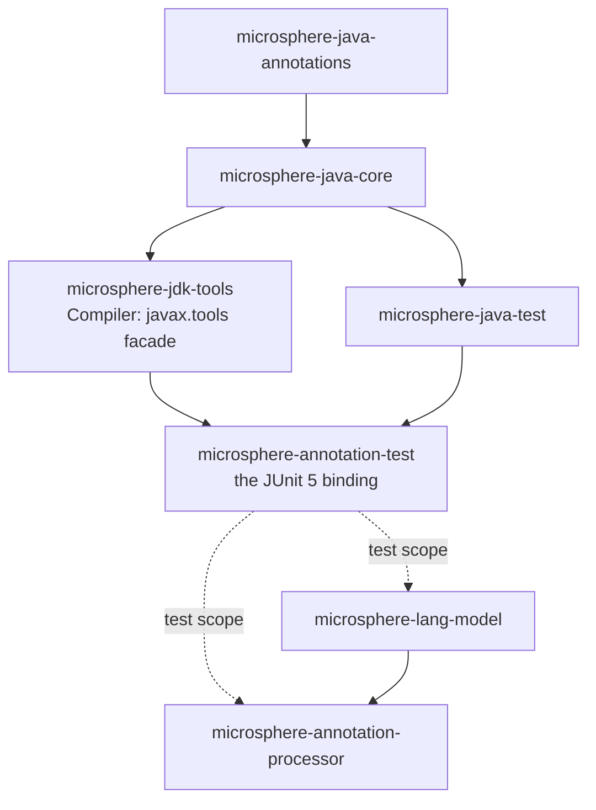
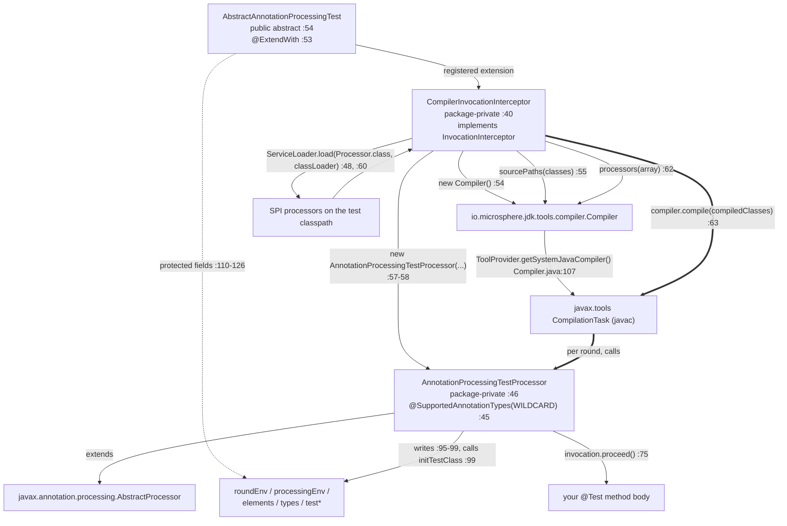
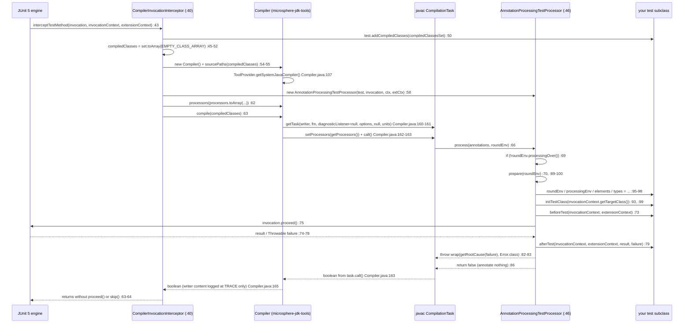

# Annotation Test: The Annotation-Processing Test Harness — Developer Guide

Module: `io.github.microsphere-projects:microsphere-annotation-test` · `0.3.20-SNAPSHOT` (`release`, published as `0.3.20`)
Three main types, one of them public · one test type · CI on JDK 8 / 11 / 17 / 21 / 25

Path prefixes used below: `processing/` = `microsphere-annotation-test/src/main/java/io/microsphere/test/annotation/processing/`,
`test-src/` = `microsphere-annotation-test/src/test/java/io/microsphere/test/annotation/processing/`, and
`Compiler.java` = `microsphere-jdk-tools/src/main/java/io/microsphere/jdk/tools/compiler/Compiler.java`.

> [!NOTE]
> Bare `:NN` citations inside a paragraph refer to the file that was cited most recently in that paragraph; cross-module
> citations always name the file.

---

## 1. Architecture position

The annotation-processing stack of this reactor has four layers, and this module is the **JUnit binding** of the stack:



### 1.1 Why the harness is split out of `microsphere-jdk-tools`

| Reason | Evidence |
|---|---|
| **`microsphere-jdk-tools` must not know JUnit exists.** `Compiler.java` imports only `javax.tools`, `javax.annotation.processing`, `io.microsphere.*` and JDK types (`Compiler.java:19-64`) — no `org.junit.*` | the two harness types import the JUnit 5 extension API from **main** source: `CompilerInvocationInterceptor.java:20-22` (`ExtensionContext`, `InvocationInterceptor`, `ReflectiveInvocationContext`) and `AnnotationProcessingTestProcessor.java:19-21`; the base class too (`AbstractAnnotationProcessingTest.java:21-23`) |
| **Production vs. test scope boundary.** `jdk-tools` is a compile-scope artifact usable from production code; the harness is only ever a test dependency | `microsphere-lang-model/pom.xml:52-57` and `microsphere-annotation-processor/pom.xml:50-56` both declare this module with `<scope>test</scope>` (`:56`, `:55`) |
| **Different dependency shape.** `jdk-tools` has exactly one compile dependency (core); this module adds `microsphere-java-test` and mirrors that artifact's optional test-fixture list | `microsphere-annotation-test/pom.xml:24-28` (`microsphere-java-test`, artifactId at `:26`), `:31-35` (`microsphere-jdk-tools`, artifactId at `:33`); optional list `:38-89` vs `microsphere-java-test/pom.xml:24-83` |
| **Lifecycle ownership.** `Compiler` is a *mechanical* facade (configure → `compile`), while the harness owns a *protocol*: rounds, hooks, failure re-wrapping | `Compiler.java:111-167` versus `AnnotationProcessingTestProcessor.java:66-87` |
| **Nothing here is runtime code.** No `META-INF/services`, no resources, no `module-info.java` — the module's whole content is `pom.xml` plus three `.java` files | verified by the module tree: `microsphere-annotation-test/pom.xml`, `processing/AbstractAnnotationProcessingTest.java`, `processing/AnnotationProcessingTestProcessor.java`, `processing/CompilerInvocationInterceptor.java`, `test-src/AnnotationProcessingTest.java` |

Reactor and dependency edges, all verified against a POM:

| Edge | Scope | Evidence |
|---|---|---|
| `annotation-test → microsphere-java-test` | compile | `microsphere-annotation-test/pom.xml:26` (`${revision}` at `:27`) |
| `annotation-test → microsphere-jdk-tools` | compile | `microsphere-annotation-test/pom.xml:33` (`${revision}` at `:34`) |
| `annotation-test → JUnit 5 / Mockito / Logback / JAX-RS / JAX-WS / Spring` | optional | `microsphere-annotation-test/pom.xml:41`, `:48`, `:54`, `:61`, `:68`, `:75`, `:82`, `:88` |
| `lang-model → annotation-test` | **test** | `microsphere-lang-model/pom.xml:54`, `<scope>test</scope>` `:56` |
| `annotation-processor → annotation-test` | **test** | `microsphere-annotation-processor/pom.xml:53`, `<scope>test</scope>` `:55` |
| version managed for consumers | — | `microsphere-java-dependencies/pom.xml:50` |
| reactor order | 7th of 9 | root `pom.xml:58-66` (`microsphere-annotation-test` at `:64`) |
| module parent | `microsphere-java-parent` `${revision}` | `microsphere-annotation-test/pom.xml:5-10`; reactor parent `microsphere-build:0.3.16` at root `pom.xml:6-10` |

> [!WARNING]
> The compile-scope dependency on `microsphere-java-test` (`microsphere-annotation-test/pom.xml:24-28`) is **not used by
> any source file in this module**: the three main types import only `io.microsphere.annotation.Nonnull`/`Nullable`
> (`AbstractAnnotationProcessingTest.java:19-20`), `io.microsphere.jdk.tools.compiler.Compiler`
> (`CompilerInvocationInterceptor.java:19`) and `io.microsphere` core helpers (`AnnotationProcessingTestProcessor.java:34-36`,
> `CompilerInvocationInterceptor.java:30-32`). `@Nonnull` / `@Nullable` come from `microsphere-java-annotations`
> (`microsphere-java-annotations/src/main/java/io/microsphere/annotation/Nonnull.java`), reached transitively through
> `microsphere-jdk-tools → microsphere-java-core` (`microsphere-java-core/pom.xml:24-28`).

---

## 2. Type inventory

| Type | FQN | Visibility | Size | Role |
|---|---|---|---|---|
| `AbstractAnnotationProcessingTest` | `io.microsphere.test.annotation.processing.AbstractAnnotationProcessingTest` (`processing/AbstractAnnotationProcessingTest.java:17`, `:54`) | `public abstract` | 164 lines; 27 constants (`:56-108`), 9 fields (`:110-126`), 4 methods (`:133`, `:136`, `:150`, `:161`) | the user's base class: state holder + template hooks; declares the extension at `:53` |
| `AnnotationProcessingTestProcessor` | `io.microsphere.test.annotation.processing.AnnotationProcessingTestProcessor` (`processing/AnnotationProcessingTestProcessor.java:46`) | **package-private** `class` | 106 lines; 4 fields (`:48-54`), 3 methods (`:66`, `:89`, `:102`) | the `AbstractProcessor` injected into `javac`; converts a compilation round into a test invocation |
| `CompilerInvocationInterceptor` | `io.microsphere.test.annotation.processing.CompilerInvocationInterceptor` (`processing/CompilerInvocationInterceptor.java:40`) | **package-private** `class` | 65 lines; 1 method (`:43`) | the JUnit 5 `InvocationInterceptor` that assembles and starts the compilation |
| `AnnotationProcessingTest` | `io.microsphere.test.annotation.processing.AnnotationProcessingTest` (`test-src/AnnotationProcessingTest.java:44`) | `public class` (test source) | 101 lines; 2 `@Test` methods (`:46`, `:77`) | self-test of the harness, also its own extension (`:44`, `:78`) |

Two structural facts worth recording: the harness's *only* public type is the base class, so
`AnnotationProcessingTestProcessor` and `CompilerInvocationInterceptor` are unreachable from consumer code (`:46`, `:40`);
and the two package-private types live in the **same package** as the base class, which is what lets the processor write
the test instance's `protected` fields directly (`AnnotationProcessingTestProcessor.java:95-99`) and the interceptor call
`test.addCompiledClasses(...)` (`CompilerInvocationInterceptor.java:50`).

---

## 3. The compile-in-JVM flow

### 3.1 The class/hook structure



### 3.2 Where the `JavaCompiler` and the `CompilationTask` come from

Nothing in `microsphere-annotation-test` touches a compiler API directly. The interceptor's two lines
`Compiler compiler = new Compiler();` / `compiler.sourcePaths(compiledClasses);`
(`CompilerInvocationInterceptor.java:54-55`) delegate everything:

1. `Compiler()` → `Compiler(defaultTargetDirectory())` → `Compiler(File, File)` (`Compiler.java:95-109`); the last one
   installs `DEFAULT_OPTIONS` (`:104`, `:76-77`) and resolves the tool at `:107` through
   `javax.tools.ToolProvider.getSystemJavaCompiler()` (static import `:64`), failing fast at `:108` when it is `null`.
2. `sourcePaths(Class...)` (`CompilerInvocationInterceptor.java:55` → `Compiler.java:121-126`) turns each class into a
   source **directory** via `detectSourcePath` (`Compiler.java:242-262`), silently skipping classes whose source cannot
   be located (`Compiler.java:129-133`).
3. `compile(Class...)` (`CompilerInvocationInterceptor.java:63` → `Compiler.java:156-167`) then builds, per call, a fresh
   `StringBuilderWriter` (`:158`), a fresh `StandardJavaFileManager` with `SOURCE_PATH` = collected source dirs and
   **both** `CLASS_OUTPUT` and `SOURCE_OUTPUT` = the single target dir (`:175-177`), resolves each class to its `.java`
   and drops misses (`:209-215`, `:217-226`), calls `getTask(writer, fm, listener, options, null, units)` (`:160-161`) —
   note the `null` `fileNames` argument — then `task.setProcessors(getProcessors())` (`:162`) and the blocking
   `task.call()` (`:163`).
4. **No caching exists at this layer.** `interceptTestMethod` runs once per test method
   (`CompilerInvocationInterceptor.java:43`), so a class with *N* `@Test` methods performs *N* independent
   `Compiler` constructions and *N* compilations of the same source set.

### 3.3 How the processor is injected

```java
// CompilerInvocationInterceptor.java:57-62
LinkedList<Processor> processors = new LinkedList<>();
processors.add(new AnnotationProcessingTestProcessor(test, invocation, invocationContext, extensionContext));
// Loads the SPI instances of Processor
ServiceLoader<Processor> loadedProcessors = load(Processor.class, classLoader);
loadedProcessors.forEach(processors::add);
compiler.processors(processors.toArray(new Processor[0]));
```

Four things follow from those six lines:

* The test processor receives the **whole JUnit invocation triple** — `Invocation<Void>`,
  `ReflectiveInvocationContext<Method>`, `ExtensionContext` — plus the test instance
  (`CompilerInvocationInterceptor.java:58`, constructor at `AnnotationProcessingTestProcessor.java:56-63`). That is how a
  compiler callback gets permission to run a test method.
* The class loader for SPI lookup is the **test class's own loader** (`CompilerInvocationInterceptor.java:48`, used at
  `:60`), not a `javac`-created processor loader. Combined with `task.setProcessors(...)` (`Compiler.java:162`), this
  suppresses `javac`'s own processor discovery — which is exactly why the interceptor has to do it manually
  (`Compiler.java:201-207`: an unset field means `emptySet()`, and an empty set means *no* processing).
* Ordering is requested but not guaranteed: the `LinkedList` is flattened to an array at
  `CompilerInvocationInterceptor.java:62` and re-baked into a `Set` by `processors(Processor...)`
  (`Compiler.java:136-139` → `Sets.ofSet`, `microsphere-java-core/src/main/java/io/microsphere/collection/Sets.java:552-557`).
  On JDK 9+ that is `Set.of` (unspecified iteration order, `Sets.java:97`, `:563-564`); the JDK 8 fallback is an
  insertion-ordered `LinkedHashSet` (`Sets.java:560-561` → `microsphere-java-core/src/main/java/io/microsphere/collection/SetUtils.java:155-168`).
* `ServiceLoader` failures are unguarded (`CompilerInvocationInterceptor.java:60-61`): a malformed
  `META-INF/services/javax.annotation.processing.Processor` entry throws `ServiceConfigurationError` out of
  `interceptTestMethod` before any compilation starts.

### 3.4 What the interceptor hook actually does

`CompilerInvocationInterceptor` implements exactly one method of `InvocationInterceptor` —
`interceptTestMethod(Invocation<Void>, ReflectiveInvocationContext<Method>, ExtensionContext)`
(`CompilerInvocationInterceptor.java:42-44`). Its contract is *around advice*: the caller (the JUnit engine) hands it a
suspended invocation and expects either `invocation.proceed()` or a deliberate skip. The hook does **not** call
`proceed()` itself; it hands the invocation to the processor (`:58`) and blocks in `compiler.compile(...)` (`:63`). The
`proceed()` happens later, on the same thread, from inside `javac`'s round
(`AnnotationProcessingTestProcessor.java:75`).

Consequences that are visible from the code alone:

* The `boolean` returned by `compile(...)` is discarded (`CompilerInvocationInterceptor.java:63`) and the method returns
  without calling `invocation.skip()` either (`:43-64`). If no non-final round ever invokes the processor, JUnit sees a
  normally-completing interceptor and records the test as passed.
* `throws Throwable` on the signature (`:44`) is what allows the wrapped failure to escape as-is from the round
  (`AnnotationProcessingTestProcessor.java:83`).

### 3.5 Round-trip sequence, with the hook decision points



### 3.6 How diagnostics are captured — they mostly are not

| Diagnostic source | Path through the code | Where it ends up |
|---|---|---|
| `javac` errors/warnings on your compilation units | `getTask(..., diagnosticListener, ...)` (`Compiler.java:160-161`) with the listener field left `null` (`Compiler.java:89`) — the harness never calls `diagnosticListener(...)` (`Compiler.java:141-144`) | the `StringBuilderWriter` (`Compiler.java:158`), logged once at **TRACE** in `finally` (`Compiler.java:165`) and then dropped |
| `ProcessingEnvironment#getMessager()` output from the processor under test | `javac`'s reporter, same writer | same TRACE line |
| `compile(...)`'s `boolean` | returned (`Compiler.java:163`) | **discarded** at `CompilerInvocationInterceptor.java:63` |
| Your test method's throwable | captured into `failure` (`AnnotationProcessingTestProcessor.java:76-77`), passed raw to `afterTest` (`:79`) | re-thrown as `wrap(getRootCause(failure), Error.class)` (`:82-83`) — `AssertionError` survives unchanged, everything else becomes `java.lang.Error` (`microsphere-java-core/src/main/java/io/microsphere/util/ExceptionUtils.java:98-104`, `:304-308`; root-cause walk at `microsphere-java-core/src/main/java/io/microsphere/util/ThrowableUtils.java:47`) |
| `javac` options | the interceptor never calls `options(...)`, so `DEFAULT_OPTIONS` stays (`Compiler.java:76-77`, installed at `:104`) | `-parameters`, `-Xlint:-unchecked`, `-nowarn`, `-Xlint:deprecation` — warnings are deliberately suppressed |

> [!IMPORTANT]
> The harness's failure channel is the **exception**, not the log. Everything `javac` itself reports — a broken source
> file, a `Messager` `ERROR` from your processor, an unsupported `-source` combination — is invisible at the default log
> level, because the only consumer of the captured writer is `logger.trace` (`Compiler.java:165`). Debugging a harness
> test that "does nothing" therefore starts with enabling TRACE on `io.microsphere.jdk.tools.compiler.Compiler`.

---

## 4. JDK 9+ adaptation: what is actually implemented

There is no version branch anywhere in the module — no `JavaVersion` check, no `Runtime.version()`, no
`Class.forName`, no `setAccessible`, no `tools.jar` arithmetic, no `--add-exports` string (verified across
`microsphere-annotation-test`'s sources; the only JDK-tool reference is the import at
`CompilerInvocationInterceptor.java:19`). The adaptation is delegated, and the pieces it delegates to are:

| Mechanism | Code | Why it matters on JDK 9+ |
|---|---|---|
| Tool lookup through `javax.tools` only | `Compiler.java:107`, guarded at `:108` | JDK 8 needs `lib/tools.jar`, JDK 9+ needs the `jdk.compiler` module; `ToolProvider` is the supported resolver on both, so no `com.sun.tools.javac` read and nothing to `--add-exports` |
| `getSupportedSourceVersion()` → `latestSupported()` | `AnnotationProcessingTestProcessor.java:102-105` (static import `:37`) | the `AbstractProcessor` default would report a fixed release and trigger a "supported source version … less than `-source`" warning on each newer JDK; `latestSupported()` tracks whatever JDK is running, which is what lets one jar pass on 8 → 25 |
| `@SupportedAnnotationTypes(WILDCARD)` | `AnnotationProcessingTestProcessor.java:45`, `WILDCARD` = `"*"` (`microsphere-java-core/src/main/java/io/microsphere/constants/SymbolConstants.java:313`) | the harness participates in rounds whatever the annotation set is; combined with `:69` the protocol does not depend on annotation types being present |
| Processors passed as objects, not discovered by `javac` | `CompilerInvocationInterceptor.java:57-62` → `Compiler.java:162` | no `-processorpath`, no module-path processor loading: the injected instances stay in the unnamed module / test class loader (`:48`) |
| No `module-info.java`, no `META-INF/services` in this module | module tree (see §1.1) | the harness is always classpath code; it never competes with a modular provider of `Processor` |
| CI without module flags | `.github/workflows/maven-build.yml:25` (matrix `8`/`11`/`17`/`21`/`25`), `:33` (`distribution: 'temurin'`), `:38-45` (build line), `-Dsurefire.useSystemClassLoader=false` at `:43` | no `--add-opens` / `--add-exports` is needed to run these tests on any matrix JDK. Note the flag at `:43` is **CI-only**: no POM in this reactor configures `maven-surefire-plugin` |

> [!WARNING]
> One JDK-dependent behaviour *does* leak into the harness, and it is silent: the processor collection described in §3.3
> (`Sets.ofSet` → `Set.of` on JDK 9+, `Sets.java:563-564`) also **rejects duplicate elements**. Two equal processor
> instances, or a `null` element, make the method handle throw — and the `catch (Throwable)` fallback returns the
> order-preserving `LinkedHashSet` variant instead (`Sets.java:565-567`). So the same test can iterate its processors in
> one order on JDK 9+ and another order on JDK 8. Nothing in the harness relies on that order today, but any future
> "my processor must run first" assumption would be JDK-version-fragile by construction.

---

## 5. Design patterns, with the proving code

| Pattern | Where it is | Evidence |
|---|---|---|
| **Template Method** | the base class defines the algorithm skeleton as four empty/`protected` hooks and one concrete step, and the processor drives them | hooks `AbstractAnnotationProcessingTest.java:133-134`, `:150-151`, `:161-163`; concrete step `initTestClass` `:136-142`; the driver `AnnotationProcessingTestProcessor.java:70`, `:73`, `:79`, `:99` |
| **Around advice / Interceptor** (JUnit 5 `InvocationInterceptor`) | the extension suspends the test method invocation and re-enters it from a different execution context | `CompilerInvocationInterceptor.java:40` (`implements InvocationInterceptor`), `:42-44` (single overridden method), `:63` (blocks in the compile), `AnnotationProcessingTestProcessor.java:75` (resumes) |
| **Deferred Command** | `Invocation<Void>` is stored in a field and invoked later by another object | field `AnnotationProcessingTestProcessor.java:50`, assigned `:60`, invoked `:75` |
| **Observer / callback pair (before–finally–after)** | `beforeTest` / `afterTest` bracket `proceed()` with `result` and `failure` plumbed to the `finally` block | `AnnotationProcessingTestProcessor.java:71-80` |
| **Facade (delegated)** | all compiler mechanics sit behind `microsphere-jdk-tools`' single type; the harness only configures and calls | `CompilerInvocationInterceptor.java:19`, `:54-55`, `:62-63`; `Compiler.java:72`, `:111-167` |
| **Blackboard / shared mutable context** | the test instance is a field bag that one collaborator writes and another reads, in the same package | writes `AnnotationProcessingTestProcessor.java:95-99`; declarations `AbstractAnnotationProcessingTest.java:110-126` |
| **Strategy (service-pluggable)** | every SPI `Processor` on the test class path joins the round, so behaviour is extensible without touching the harness | `CompilerInvocationInterceptor.java:48`, `:60-61` |
| **Object Mother / test-data catalogue** | 27 pre-typed `null` and empty values so overloaded `javax.lang.model` APIs can be called without casts | `AbstractAnnotationProcessingTest.java:56-108`; consumer usage `microsphere-lang-model/src/test/java/io/microsphere/lang/model/util/MethodUtilsTest.java:108` |
| **Adapters (two, small)** | `@SupportedAnnotationTypes` + `getSupportedSourceVersion()` adapt an `AbstractProcessor` to "any annotations, any JDK" | `AnnotationProcessingTestProcessor.java:45`, `:102-105` |
| **Fail-fast guard (delegated)** | the only deliberate abort is `Compiler`'s null check on the tool | `Compiler.java:107-108` |

Notably **absent**: no builder (the harness exposes setters-as-hooks, not a fluent builder — contrast
`Compiler.java:111-154`), no holder/lazy caches (a fresh `Compiler` and a fresh processor per test method,
`CompilerInvocationInterceptor.java:54`, `:58`), no `@Nullable`/`@Nonnull` on the injected fields
(`AbstractAnnotationProcessingTest.java:110-126` carry no annotations), and no service registration of the module's own
types (§1.1).

---

## 6. Extension points

| Point | Signature | Contract |
|---|---|---|
| Add compilation units | `protected void addCompiledClasses(@Nonnull Set<Class<?>> compiledClasses)` (`AbstractAnnotationProcessingTest.java:133`) | called once per test method, before the compiler is built (`CompilerInvocationInterceptor.java:50`); the set is insertion-ordered and de-duplicating (`:45`, `SetUtils.java:491`); the test class is already inside it (`:49`) |
| Per-round setup | `protected void beforeTest(ReflectiveInvocationContext<Method>, ExtensionContext)` (`:150`) | invoked per non-final round, after the fields are filled (`AnnotationProcessingTestProcessor.java:70`, `:73`) |
| Per-round teardown | `protected void afterTest(ReflectiveInvocationContext<Method>, ExtensionContext, @Nullable Object result, @Nullable Throwable failure)` (`:161`) | invoked from a `finally` (`:78-80`); `failure` is the **raw** throwable, un-wrapped (`:76-79`) |
| Re-target the model | `protected void initTestClass(@Nonnull Class<?> testClass)` (`:136`) | concrete, callable by subclasses; rewrites the five `test*` fields (`:137-141`) — usage at `microsphere-lang-model/src/test/java/io/microsphere/lang/model/util/UtilTest.java:52` |
| Inherited state | the nine `protected` fields (`:110-126`) + 27 constants (`:56-108`) | the entire read API of the harness |
| Additional JUnit behaviour | implement any JUnit 5 callback interface on your subclass | the module's own test does exactly this: `implements TestExecutionExceptionHandler` (`test-src/AnnotationProcessingTest.java:44`) and `@ExtendWith(AnnotationProcessingTest.class)` (`:78`) |
| Processor-side extension | register your `Processor` through `META-INF/services/javax.annotation.processing.Processor` | picked up at `CompilerInvocationInterceptor.java:60-61` |

There is **no** extension point for the compiler itself: `new Compiler()` is hard-coded
(`CompilerInvocationInterceptor.java:54`), so the target directory (`Compiler.java:99-101`, `:236-240`), `options`
(`:111-114`), `diagnosticListener` (`:141-144`), `locale` (`:146-149`) and `charset` (`:151-154`) are not reachable from
consumer code. Changing any of them means forking `CompilerInvocationInterceptor` — which is impossible from outside
`io.microsphere.test.annotation.processing` because the type is package-private (`:40`). The protected factory method
that would solve this does not exist; that is the module's main structural limitation.

---

## 7. Test strategy

`microsphere-annotation-test` has **one** test class, and it tests the harness with the harness:
`test-src/AnnotationProcessingTest.java:44` extends `AbstractAnnotationProcessingTest`.

| Test | What it pins | Lines |
|---|---|---|
| `test()` | all 27 constants: each `NULL_*` is `null`, each `EMPTY_*` equals a fresh empty array | `:46-75` |
| `testOnFailure()` | the failure path: a body that throws (`:81`) must reach `afterTest` with the raw throwable (`:85-90`) | `:77-82` |
| `afterTest` override | `failure.getMessage()` is `"For testing"`, i.e. neither swallowed nor re-worded before the hook | `:84-90` |
| `handleTestExecutionException` | the deliberate failure is **not** rethrown, so `testOnFailure` ends green | `:92-100` |

The last row is the interesting one: because the harness re-throws as an `Error`
(`AnnotationProcessingTestProcessor.java:83`), a test whose body throws must swallow that `Error` at the JUnit level in
order to pass — and the only reason `testOnFailure` passes is that
`handleTestExecutionException(ExtensionContext, Throwable)` never rethrows whatever it receives
(`test-src/AnnotationProcessingTest.java:93-100`). The `if ("testOnFailure".equals(method.getName()))` branch (`:96`)
contains nothing but the comment `// ingnore` (`:97`, sic), so the handler swallows failures from **every** test method,
not only that one.

Neither package-private type has a dedicated unit test (`AnnotationProcessingTestProcessor` and
`CompilerInvocationInterceptor` have no `*Test` counterpart in `src/test/java`). Their coverage is entirely
**indirect and cross-module**, which is the real test strategy of this artifact:

* `microsphere-lang-model`: `UtilTest` (`microsphere-lang-model/src/test/java/io/microsphere/lang/model/util/UtilTest.java:48`)
  extends the harness and 14 further test classes extend `UtilTest` — every one of them exercises the round trip, and
  `addCompiledClasses` (`:83-85` of `MethodUtilsTest.java`, `:189-194` of `TypeUtilsTest.java`) exercises the
  compilation-unit extension point.
* `microsphere-annotation-processor`: four direct subclasses —
  `ConfigurationPropertyAnnotationProcessorTest.java:34`, `FilerProcessorTest.java:41`,
  `ResourceProcessorTest.java:54`, `ConfigurationPropertyJSONElementVisitorTest.java:44`.
* CI runs all of it on Temurin 8 / 11 / 17 / 21 / 25 (`.github/workflows/maven-build.yml:25`, `:33`) with
  `-Dsurefire.useSystemClassLoader=false` (`:43`) and the `test,coverage` profiles (`:45`).

Uncovered: every failure branch listed in §8 — a dropped compilation unit, a compile returning `false`, a
`ServiceConfigurationError`, an NPE inside `initTestClass`, and the `processingOver()` short-circuit
(`AnnotationProcessingTestProcessor.java:69`).

---

## 8. Review notes: fragilities found in the sources

Ordered by how much damage each can do to a test suite that looks green.

1. **Vacuous pass is the default failure mode.** `interceptTestMethod` ignores `compile()`'s `boolean`
   (`CompilerInvocationInterceptor.java:63`) and neither proceeds nor skips: if the processor's `process()` is never
   reached with `!roundEnv.processingOver()` (`AnnotationProcessingTestProcessor.java:69`), the test method body simply
   never runs and JUnit reports success. Reachability fails quietly: sources not found on disk are filtered out
   (`Compiler.java:209-215`), and a `null` `JavaCompiler` aborts with `IllegalArgumentException` at construction
   (`Compiler.java:107-108`). Fix candidates: assert `proceed()` was called (a flag set in `afterTest`), or honour the
   `compile` result.
2. **Diagnostics are thrown away.** No `diagnosticListener` is ever registered (§3.6), so javac errors and
   `Messager` output exist only in a TRACE log (`Compiler.java:165`). Paired with note 1 this is why harness failures are
   hard to diagnose.
3. **Exception type is destroyed on the way out.** `wrap(getRootCause(failure), Error.class)`
   (`AnnotationProcessingTestProcessor.java:82-83`) keeps `AssertionError` as-is (`ExceptionUtils.java:99-101`) but
   rebuilds anything else as a `java.lang.Error` from the message plus cause (`ExceptionUtils.java:102-103`, `:304-308`).
   `getRootCause` also discards the wrapper chain (`ThrowableUtils.java:47`), so intermediate context is lost.
4. **`afterTest` can receive a `null` `failure` *and* the compile can still fail** — the processor's own throw (`:83`) is
   outside the hook's view, and `result` is always `null` for `void` test methods (`:71`, `:75`).
5. **Per-method recompilation.** One `Compiler` and one full `javac` round per `@Test`
   (`CompilerInvocationInterceptor.java:43-63`); a subclass with 30 methods compiles the same sources 30 times.
   Everything also writes into the **same** output directory, `CLASS_OUTPUT` = `SOURCE_OUTPUT` =
   `<root of Compiler.class>/target/generated-classes` (`Compiler.java:176-177`, `:236-240`) — inside a reactor that is
   `microsphere-jdk-tools/target/generated-classes`, shared by every module that uses this harness.
6. **Processor registration order is not stable across JDKs** — see the §4 warning
   (`Sets.java:563-567` vs `SetUtils.java:155-168`).
7. **Multiple non-final rounds re-run the whole test body.** `process()` is a per-round callback
   (`AnnotationProcessingTestProcessor.java:66`) and the only guard is `processingOver()` (`:69`); there is no
   "already ran" flag, so a code-generating processor multiplies assertion executions and `beforeTest` calls.
8. **Shared mutable state with no publication protocol.** The nine fields (`AbstractAnnotationProcessingTest.java:110-126`)
   are non-`volatile` and written from `prepare` (`AnnotationProcessingTestProcessor.java:95-99`). This is safe *today*
   only because `task.call()` is synchronous on the calling thread (`Compiler.java:163`); nothing in the code enforces
   that, so a compiler implementation that ran rounds on another thread would break the harness silently.
9. **`initTestClass` is unguarded.** `elements.getTypeElement(name)` may return `null` and the next line dereferences it
   (`AbstractAnnotationProcessingTest.java:139-140`); `(DeclaredType) testTypeMirror` (`:141`) is an unchecked cast that
   would throw `ClassCastException` for a non-declared type. The method also runs *during* the round
   (`AnnotationProcessingTestProcessor.java:99`), so the NPE surfaces wrapped per note 3.
10. **Two APIs resolve "the test class" differently.** The interceptor uses `extensionContext.getTestClass().get()`
    (`CompilerInvocationInterceptor.java:47`) while the processor uses `invocationContext.getTargetClass()`
    (`AnnotationProcessingTestProcessor.java:93`) — one value, two sources, both with `Optional#get()`-style unguarded
    access on the interceptor side (`:46`, `:47`). Keep them consistent if the harness ever supports `@Nested` classes.
11. **Raw types in the public API of the base class.** `EMPTY_COLLECTION_ARRAY` (`:62`), `NULL_COLLECTION` (`:64`),
    `NULL_LIST` (`:66`), `NULL_TYPE_ARRAY` (`:78`) / `EMPTY_TYPE_ARRAY` (`:80`) / `NULL_TYPE` (`:82`), `NULL_CLASS`
    (`:90`), `NULL_CLASS_ARRAY` (`:92`), `NULL_PREDICATE_ARRAY` (`:96`) are declared raw, so consumer tests inherit
    unchecked-conversion warnings. `NULL_TYPE_ARRAY` (`:78`) and `EMPTY_TYPE_ARRAY` (`:80`) are `java.lang.reflect.Type[]`,
    not `javax.lang.model` types — easy to confuse with `NULL_TYPE_MIRROR_ARRAY` (`:60`).
12. **Unused compile-scope dependency.** `microsphere-java-test` (`microsphere-annotation-test/pom.xml:24-28`) is
    compile-scope and unreferenced by the sources (§1 warning); six further optional declarations
    (`:38-89`) are unused by main source too. They inflate the transitive test classpath of both consumers.
13. **Javadoc `@since 1.0.0` vs release line `0.3.20`.** All three types claim `@since 1.0.0`
    (`AbstractAnnotationProcessingTest.java:51`, `AnnotationProcessingTestProcessor.java:43`,
    `CompilerInvocationInterceptor.java:38`) while `${revision}` is `0.3.20-SNAPSHOT` (root `pom.xml:54`). Harmless, but it
    means the `@since` tags cannot be used to date this artifact.
14. **`AnnotationProcessingTestProcessor` is package-private but not `final`.** Nothing prevents a same-package subclass,
    and its constructor (`:56`) is package-private as well; the two other types are also non-`final`
    (`CompilerInvocationInterceptor.java:40`). Fine for an internal type, but it means "package-private" is the only
    access control the harness offers, and JUnit's instantiation of a package-private extension class is a convention
    this module depends on (`AbstractAnnotationProcessingTest.java:53`).

---

## 9. See also

* [microsphere-annotation-test — User Guide](../user-guide/microsphere-annotation-test.md) — coordinates, the three-type
  API walkthrough, the seven-step processor-test recipe and the pitfall list
* [microsphere-jdk-tools — Developer Guide](microsphere-jdk-tools.md) — line-by-line `Compiler.java` analysis, the
  `ToolProvider` resolution and the source-discovery walk this harness relies on
* [microsphere-lang-model — Developer Guide](microsphere-lang-model.md) — `UtilTest`, the largest consumer of the harness
* [microsphere-annotation-processor — Developer Guide](microsphere-annotation-processor.md) — the processors exercised
  inside real compilation rounds
* [Collections and Filters — Developer Guide](microsphere-java-core/collections-and-filters.md) — `Sets.ofSet` /
  `SetUtils` / `SetUtils.newLinkedHashSet`, the JDK-dependent collection choice behind §3.3 and §4
* Chinese version: [中文开发者指南](zh/microsphere-annotation-test.md)
