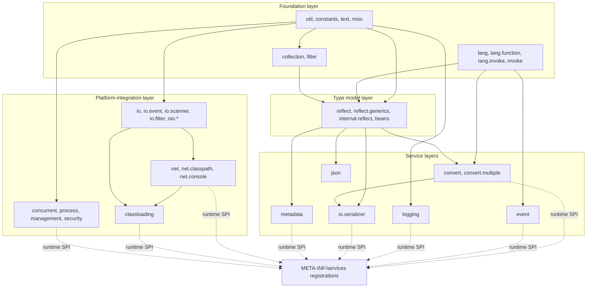

# `microsphere-java-core` — package-group index (Developer Guide)

Module: `io.github.microsphere-projects:microsphere-java-core` · Source line: `release` branch, `0.3.20-SNAPSHOT`
These 14 pages are the source-analysis counterpart of the [User Guide group index](../README.md); Chinese versions
live in [`zh/`](zh/README.md).

---

## 1. Internal dependency structure

`core` is one artifact, but its packages form a strict internal layering — nothing at a lower layer imports a higher
one, which is what keeps the artifact usable with an almost empty classpath.

| Layer | Packages | Contract it must honour |
|-------|----------|-------------------------|
| Foundation | `util`, `constants`, `text`, `misc`, `lang*`, `invoke`, `collection`, `filter` | No dependency on any other `core` package; JDK 8 only APIs; must never throw on `null` where the javadoc promises a neutral result |
| Type model | `reflect`, `reflect.generics`, `internal.reflect`, `beans` | Only layer allowed to touch JDK reflection internals; every internal-access path has a documented fallback |
| Service layers | `convert`, `convert.multiple`, `io.serializer`, `event`, `logging`, `json`, `metadata` | Each is an SPI family discovered through `META-INF/services`, ordered by `Prioritized` |
| Platform integration | `io*`, `nio*`, `net*`, `classloading`, `concurrent`, `process`, `management`, `security` | Highest JDK-version sensitivity; each page carries the version matrix and degradation behaviour |

---

## 2. Pages

| # | Page | Packages | Main analysis topics |
|---|------|----------|----------------------|
| 1 | [Utilities, constants and text](util-and-constants.md) | `util`, `util.jar`, `constants`, `text`, `misc` | `Utils` marker convention; class-loader and resource resolution order; service-loading cache; `Version` parsing |
| 2 | [Collections and filters](collections-and-filters.md) | `collection`, `filter` | `Delegating*` / `Unmodifiable*` / `Empty*` / `Singleton*` families; allocation strategy; filter composition |
| 3 | [Language abstractions](language-abstractions.md) | `lang`, `lang.function`, `lang.invoke`, `invoke` | `Prioritized` ordering arithmetic; `Wrapper` unwrap loop termination; lambda/method-handle introspection |
| 4 | [Reflection, types and beans](reflection-and-beans.md) | `reflect`, `reflect.generics`, `internal.reflect`, `beans` | Generic type-variable resolution; `JavaType` model; accessibility and `setAccessible` branching per JDK |
| 5 | [Type conversion](type-conversion.md) | `convert`, `convert.multiple` | Converter selection and caching; multi-value dispatch; lossy-conversion decisions |
| 6 | [Serialization](serialization.md) | `io.serializer` | Serializer/Deserializer selection; object-deserialization risk surface |
| 7 | [Event dispatching](events.md) | `event` | Listener matching, conditional filtering, dispatch concurrency |
| 8 | [I/O, NIO, scanning and file filters](io-and-scanning.md) | `io`, `io.event`, `io.scanner`, `io.filter`, `nio.*` | Scanner plugin design; `WatchService` event overflow handling; resource-close discipline |
| 9 | [Networking and URL protocols](net-and-url-protocols.md) | `net`, `net.classpath`, `net.console` | Single-registration constraint on `URL.setURLStreamHandlerFactory`; sub-protocol chaining |
| 10 | [Logging](logging.md) | `logging` | Backend detection order and lazy bootstrap; JUL fallback; logger publication safety |
| 11 | [Class loading and artifacts](classloading-and-artifacts.md) | `classloading` | classpath URL parsing, `URLClassPathHandle` per-JDK variants, JPMS paths, banned-artifact enforcement |
| 12 | [JSON](json.md) | `json` | Tokenizer/parser loop, escaping, `JSONObject` map choice and key ordering |
| 13 | [Configuration property metadata](configuration-metadata.md) | `metadata` | Reader/Loader/Generator pipeline, metadata merging, ordering rules |
| 14 | [Concurrency, process, management and security](concurrency-process-and-management.md) | `concurrent`, `process`, `management`, `management.builder`, `security` | `ProcessIdResolver` fallback chain; MBean registration lifecycle; SecurityManager deprecation handling |

Every page follows the same developer-facing skeleton: purpose in the architecture → package/class map → source
analysis with `file:line` references → design patterns with the implementing class named → mermaid flow charts for
the non-obvious control flows → extension points → thread-safety and performance notes → testing strategy.

---

## 3. Cross-cutting implementation facts

* **Discovery**: subsystems register implementations in `src/main/resources/META-INF/services/`. The `release`
  branch ships 13 such files in `core` (plus `javax.annotation.processing.Processor` in the processor module) — the
  full list with links is in the [Developer Guide index](../README.md#13-spi-registry-on-the-release-branch).
* **Ordering**: where order matters, implementations implement `io.microsphere.lang.Prioritized`, and selection is
  first-match after sorting. Do not rely on `ServiceLoader` file order.
* **Degradation policy**: capability the current JDK cannot provide returns a neutral value or a no-op handle
  (e.g. `NoOpURLClassPathHandle`, `Empty*` collections) instead of throwing. New code must follow this, and each
  degradation is documented on the owning page.
* **JDK internals are quarantined**: `internal.reflect`, `classloading`, `net`, `process` and `management` are the
  only `core` packages that reach into JDK internals, and each of them isolates the access behind a version-checked
  strategy object so the rest of the library stays portable.
