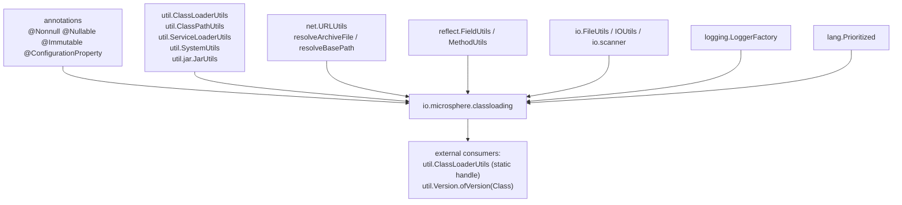
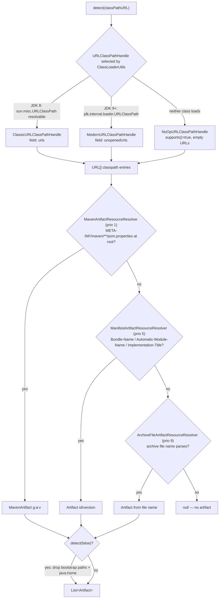
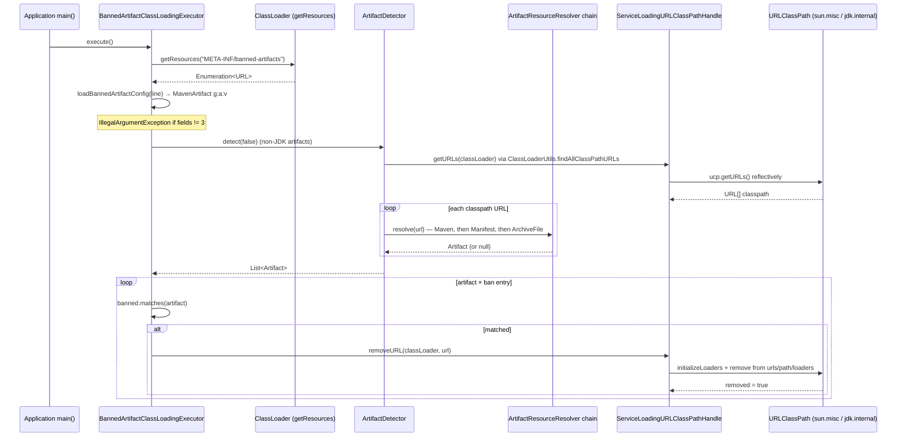

# Class Loading and Artifact Detection — Developer Guide

Module: `io.github.microsphere-projects:microsphere-java-core` · `0.3.20-SNAPSHOT` (`release` branch)
Package: `io.microsphere.classloading` (16 main types) · Java 8 baseline, CI on JDK 8 / 11 / 17 / 21 / 25

Path prefix used below: `microsphere-java-core/src/main/java/io/microsphere/` (sources) and
`microsphere-java-core/src/main/resources/` (SPI files).

---

## 1. Where this package sits



Both edges named in the task are verified by imports:

* **`util`** — `ArtifactDetector` imports `ClassLoaderUtils.findAllClassPathURLs/getClassLoader/getClassResource`,
  `ClassPathUtils.getBootstrapClassPaths`, `ObjectUtils.defaultIfNull`, `ServiceLoaderUtils.loadServicesList`,
  `SystemUtils.JAVA_HOME` (`classloading/ArtifactDetector.java:16-28`); `AbstractArtifactResourceResolver` imports
  `ClassLoaderUtils.getDefaultClassLoader` (`classloading/AbstractArtifactResourceResolver.java:23`).
* **`net`** — `URLClassPathHandle` imports `net.URLUtils.EMPTY_URL_ARRAY` (`classloading/URLClassPathHandle.java:26`);
  `AbstractURLClassPathHandle` additionally imports `URLUtils.resolveBasePath` (`:30-31`);
  `StreamArtifactResourceResolver` and `ArchiveFileArtifactResourceResolver` import `URLUtils.resolveArchiveFile`
  (`StreamArtifactResourceResolver.java:38`, `ArchiveFileArtifactResourceResolver.java:25`).

Consumption runs **backwards** too: `util.ClassLoaderUtils` holds the one static
`ServiceLoadingURLClassPathHandle` (`util/ClassLoaderUtils.java:94`) that every classpath walk and every
`removeClassPathURL(...)` passes through (`:1550-1564`, `:1598-1603`), and `util.Version.ofVersion(Class)` builds an
`ArtifactDetector` to resolve a library version (`util/Version.java:626-640`).

---

## 2. Package / class map

| Type | Kind | Responsibility | Key hooks |
|---|---|---|---|
| `Artifact` | value object | `artifactId` / `version` / `location`, per-field wildcard matching | `WILDCARD`, `UNKNOWN`, `matches(Artifact,String fn)` |
| `MavenArtifact` | value object | adds `groupId`; strictest matcher | `matchesGroupId` (`MavenArtifact.java:80-89`) |
| `ArtifactDetector` | facade | classpath → `List<Artifact>`; JDK filtering; short-circuit resolver chain | `detect(URL)` (`:137-149`), `removeJdkClassPathURLs` (`:164-175`) |
| `ArtifactResourceResolver` | SPI interface | `Artifact resolve(URL)` | extends `Prioritized` (`:49-58`) |
| `AbstractArtifactResourceResolver` | base | holds `classLoader`, `logger`, `final priority` | ctors `:95-102` |
| `StreamArtifactResourceResolver` | base | locates + opens the metadata stream (archive or directory) | `isArtifactMetadata`, `resolve(URL,InputStream,ClassLoader)` |
| `MavenArtifactResourceResolver` | impl | `META-INF/maven/**/pom.properties` → `MavenArtifact` | `DEFAULT_PRIORITY = 1` |
| `ManifestArtifactResourceResolver` | impl | `MANIFEST.MF` attributes → `Artifact` | `DEFAULT_PRIORITY = 5`, two `-D` tunables |
| `ArchiveFileArtifactResourceResolver` | impl | file name `a-1.0.jar` → `Artifact` | `DEFAULT_PRIORITY = 9`, `createArtifact` |
| `URLClassPathHandle` | SPI interface | read / mutate a loader's classpath | `supports`, `getURLs`, `removeURL`, `initializeLoaders` |
| `AbstractURLClassPathHandle` | base | reflective `ucp` access, `urls`/`path`/`loaders` surgery | `getURLClassPathClassName`, `getUrlsFieldName` |
| `ClassicURLClassPathHandle` | impl | `sun.misc.URLClassPath` / `urls` (JDK ≤ 8) | `ClassicURLClassPathHandle.java:34-42` |
| `ModernURLClassPathHandle` | impl | `jdk.internal.loader.URLClassPath` / `unopenedUrls` (JDK ≥ 9) | `ModernURLClassPathHandle.java:34-42` |
| `NoOpURLClassPathHandle` | impl | always-true no-op floor | `:32-45` |
| `ServiceLoadingURLClassPathHandle` | composite | SPI discovery + delegate + `URLClassLoader` fallback | `:36-59` |
| `BannedArtifactClassLoadingExecutor` | policy | GAV list → `removeClassPathURL` | `execute()` `:84-95` |

---

## 3. Source analysis

### 3.1 Class resource URL → artifact coordinates

`ArtifactDetector.detect(Class)` (`ArtifactDetector.java:130-134`) turns the class into its `.class` resource URL via
`ClassLoaderUtils.getClassResource`, then hands that URL to `detect(URL)` (`:136-149`), which iterates the
priority-sorted resolvers and **breaks on the first non-null result**.

Inside a stream resolver, `StreamArtifactResourceResolver.resolve(URL)` (`:106-134`) does the URL archaeology:

1. `URLUtils.resolveArchiveFile(resourceURL)` (`net/URLUtils.java:275-288`): a `file:` URL becomes the containing
   directory, any other protocol becomes the base path of the archive — kept only if the `File` exists.
2. Archive branch → `readArtifactMetadataDataFromFile` (`:151-165`) opens a `JarFile`, keeps the **first** entry whose
   name satisfies `isArtifactMetadata` (`findArtifactMetadataEntry`, `:179-182`, via `JarUtils.filter`), and buffers it
   into a `FastByteArrayInputStream` so the jar can be closed before the subclass parses it.
3. Directory branch → `readArtifactMetadataDataFromDirectory` (`:167-177`) scans recursively with
   `io.scanner.SimpleFileScanner.INSTANCE` and returns a `FileInputStream` for the first match.
4. No archive file → `readArtifactMetadataDataFromResource` returns `null` by default (`:136-139`), i.e. non-file
   protocols yield nothing unless a subclass overrides it.

The subclass only answers two questions: *which path is metadata* and *what does it mean*.
`MavenArtifactResourceResolver.isArtifactMetadata` requires the path to start with `META-INF/maven/` and end with
`/pom.properties` (`:101-110`), then loads the `Properties` and builds a `MavenArtifact` from the
`groupId`/`artifactId`/`version` keys (`:112-125`). `ManifestArtifactResourceResolver` matches the exact
`MANIFEST_RESOURCE_PATH` and picks the first present attribute of each configured list (`:191-232`).
`ArchiveFileArtifactResourceResolver` — the only resolver that keeps a non-`final` `resolve` — strips the extension,
splits on `-` and takes `[0]` as artifactId, `[1]` as version (`ArchiveFileArtifactResourceResolver.java:80-108`).

### 3.2 Resolver selection and ordering

Resolvers are discovered with `ServiceLoaderUtils.loadServicesList(ArtifactResourceResolver.class, classLoader, true)`
(`ArtifactDetector.java:92`) — cached, class-loader-hierarchy aware, and sorted by `Prioritized.COMPARATOR`.
`Prioritized.MAX_PRIORITY` is `Integer.MIN_VALUE` and `MIN_PRIORITY` is `Integer.MAX_VALUE`
(`lang/Prioritized.java:78-86`), so **the numerically smallest priority runs first**:
`Maven(1) → Manifest(5) → ArchiveFile(9)`. A user resolver with priority `0` therefore pre-empts all built-ins.
Because discovery uses the *detector's* class loader, application-defined resolvers on the classpath are visible; a
resolver returning `null` is the contract for "not mine" — there is no exception channel.



### 3.3 How the `URLClassPathHandle` variants are chosen

`ServiceLoadingURLClassPathHandle`'s constructor loads all registered handles, `filter(supports)` and `findFirst`
(`ServiceLoadingURLClassPathHandle.java:36-43`). `Classic` and `Modern` share
`AbstractURLClassPathHandle.DEFAULT_PRIORITY = MAX_PRIORITY + 99999` (`AbstractURLClassPathHandle.java:83`), which is
the most-negative band, so both sort ahead of `NoOpURLClassPathHandle`, whose priority is the interface default
`MIN_PRIORITY` (`URLClassPathHandle.java:124-126`; asserted in `NoOpURLClassPathHandleTest.java:60-62`). Exactly one of
`Classic`/`Modern` can resolve its `URLClassPath` class (`getUrlClassPathClass()` caches the failed lookup,
`AbstractURLClassPathHandle.java:178-186`), so the JDK decides the winner and `NoOp` only surfaces if both classes are
missing — a defensive floor that keeps `getURLs` from throwing.

Degradation is layered:

* `NoOpURLClassPathHandle.getURLs` returns the shared `EMPTY_URL_ARRAY`, `removeURL` returns `false` (`:37-45`).
* `AbstractURLClassPathHandle.getURLs` returns `EMPTY_URL_ARRAY` for a `null` loader or a missing `ucp` field (`:121-128`).
* `ServiceLoadingURLClassPathHandle.getURLs` falls back to the interface default — `URLClassLoader.getURLs()` after
  `ClassLoaderUtils.findURLClassLoader` — whenever the delegate returns an empty array (`:50-54`). This is what makes
  JDK-8-style `URLClassLoader` children (including `ClassLoaderUtils.newURLClassLoader` products) work even when the
  reflective handle is inapplicable.
* `removeURL` returns `false` **only** for `null` arguments (`AbstractURLClassPathHandle.java:131-134`). Every other
  failure throws instead of degrading, because the four reads at `:138-141` are unguarded:
  * Encapsulated `jdk.internal.loader` (JDK 17/21/25 without `--add-opens java.base/jdk.internal.loader=ALL-UNNAMED`):
    `AccessibleObjectUtils.trySetAccessible` returns `false` (`FieldUtils.java:826-828`), `field.get()` then raises
    `IllegalAccessException`, which `getFieldValue` rethrows as `IllegalStateException` (`:830-841`).
  * Missing field (`ucp`, `urls`, `path` or `loaders` — e.g. a loader that is neither a `URLClassLoader` nor a
    `BuiltinClassLoader`): `getFieldValue` returns `null` (`:818-820`), and `synchronized (urls)` throws
    `NullPointerException` at `AbstractURLClassPathHandle.java:147`. A null `ucp` reaches the same `:139` read as a
    `null` instance, which `FieldUtils` documents as `NullPointerException` for an instance field
    (`FieldUtils.java:813`).
  So `getURLs` has a null-`ucp` fallback (`:126-127`) but `removeURL` has none — a known asymmetry, and the reason the
  ban filter must run against a loader it can actually reflect into.
* `ServiceLoadingURLClassPathHandle` is a thin, unguarded forwarder. Its `delegate` comes from
  `filter(supports).findFirst().orElse(null)` (`:36-43`), and `getURLs`/`removeURL` dereference it directly (`:52`,
  `:58`) — only `supports()` (`:46-48`) tolerates the null. In practice `NoOpURLClassPathHandle.supports()` is `true`, so
  the chain always binds *something*; the null delegate is reachable only if the `META-INF/services` registration for
  `URLClassPathHandle` itself is dropped (a shading accident). `ClassLoaderUtils.removeClassPathURL` (`:1598-1603`) adds
  a `SecureClassLoader` guard but catches nothing, so all of the above exceptions reach the caller.

`initializeLoaders(classLoader)` (`URLClassPathHandle.java:101-108`) is called before removal
(`AbstractURLClassPathHandle.java:136`) — a deliberate `findResource("just-for-initializing-loaders")` nudge that forces
the JVM to populate the lazy `loaders` list, without which a never-used entry would leave `loaders` empty and the
removal incomplete.

### 3.4 Banned-artifact interception path

`BannedArtifactClassLoadingExecutor.execute()` (`:84-95`) reads **all** `META-INF/banned-artifacts` resources from the
class loader (`loadBannedArtifactConfigs(ClassLoader)`, `:97-110`; an `IOException` is logged and yields an empty list),
reads line by line in `file.encoding` and stops at the first blank line (`:112-127`). Each line must split into exactly
three colon-separated fields or `IllegalArgumentException` is thrown (`:129-138`). Detection then runs with
`detect(false)` — JDK libraries excluded — and every artifact matching any ban entry (per-field wildcard semantics from
`Artifact.matches`, `Artifact.java:99-122`) is removed through
`ClassLoaderUtils.removeClassPathURL(classLoader, url)` (`:91`), which itself requires a `SecureClassLoader`
(`util/ClassLoaderUtils.java:1598-1603`).



`AbstractURLClassPathHandle.removeURL` (`:130-167`) performs the surgery under `synchronized (urls)`: it iterates
`loaders`, compares each loader's `base` field normalised by `URLUtils.resolveBasePath` against the target URL's base
path, and on a match removes the loader, then the same URL from `urls` and from `path`. Note the asymmetry — the
collection removals are keyed on the raw `url`, so the `URL` instance passed in must be **equal** to the one in the
classpath; `resolveBasePath` only guards the `loaders` comparison. Note too that `urls` doubles as the lock target: if the
reflective read produced `null`, the method fails at `:147` before any of this logic runs — §3.3 lists the full
failure modes.

---

## 4. Design patterns (with the implementing class)

| Pattern | Implementing class(es) | Evidence |
|---|---|---|
| **Service Provider / SPI** | `ArtifactResourceResolver` (3 registrations), `URLClassPathHandle` (3 registrations) | `src/main/resources/META-INF/services/io.microsphere.classloading.ArtifactResourceResolver`, `...URLClassPathHandle` |
| **Strategy (per JDK)** | `ClassicURLClassPathHandle` vs `ModernURLClassPathHandle` vs `NoOpURLClassPathHandle`, chosen by `ServiceLoadingURLClassPathHandle` | `AbstractURLClassPathHandle.java:238-240` abstract name hooks |
| **Template Method** | `StreamArtifactResourceResolver.resolve(URL)` is `final`; subclasses implement `isArtifactMetadata` + `resolve(URL,InputStream,ClassLoader)` — `MavenArtifactResourceResolver`, `ManifestArtifactResourceResolver`, test-only `ErrorArtifactResourceResolver` | `StreamArtifactResourceResolver.java:107`, `:198-200` |
| **Template Method (fields)** | `AbstractURLClassPathHandle` fixes `getURLs`/`removeURL`, leaves `getURLClassPathClassName`/`getUrlsFieldName` to `Classic`/`Modern` | `:121`, `:131`, `:238-240` |
| **Null Object** | `NoOpURLClassPathHandle` — `supports()` true, `getURLs` → `EMPTY_URL_ARRAY`, `removeURL` → `false` | `NoOpURLClassPathHandle.java:32-45` |
| **Registry / chain-of-responsibility** | `ArtifactDetector.artifactResourceResolvers` list, first non-null wins | `ArtifactDetector.java:84`, `:139-147` |
| **Composite / delegation with fallback** | `ServiceLoadingURLClassPathHandle` delegates and falls back to the interface default | `:34`, `:50-54` |
| **Value Object / Specification** | `Artifact`, `MavenArtifact` (`equals`/`hashCode`/`toString`, `matches` as a per-field specification) | `Artifact.java:99-146`, `MavenArtifact.java:74-113` |
| **Factory Method** | `Artifact.create(...)`, `MavenArtifact.create(...)`, package-private `ArchiveFileArtifactResourceResolver.createArtifact` | `Artifact.java:57-67`, `ArchiveFileArtifactResourceResolver.java:94-108` |
| **Priority ordering** | `Prioritized` + `Prioritized.COMPARATOR`; `AbstractArtifactResourceResolver.getPriority()` is `final` to freeze priority at construction | `AbstractArtifactResourceResolver.java:104-107` |

---

## 5. Extension points

**Write your own `ArtifactResourceResolver`.** Prefer the template base so you do not touch `JarFile`:

```java
public class GradleModuleArtifactResourceResolver extends StreamArtifactResourceResolver {

    public static final int PRIORITY = 0;               // ahead of Maven(1)

    public GradleModuleArtifactResourceResolver() {
        super(PRIORITY);                                // default class loader
    }

    public GradleModuleArtifactResourceResolver(ClassLoader cl) {
        super(cl, PRIORITY);                            // null cl -> IllegalArgumentException
    }

    @Override
    protected boolean isArtifactMetadata(String relativePath) {
        return relativePath.startsWith("META-INF/") && relativePath.endsWith("module/gradle-module.json");
    }

    @Override
    protected Artifact resolve(URL resourceURL, InputStream data, ClassLoader classLoader) throws IOException {
        return Artifact.create(readId(data), readVersion(data), resourceURL);
    }
}
```

```
# src/main/resources/META-INF/services/io.microsphere.classloading.ArtifactResourceResolver
com.example.GradleModuleArtifactResourceResolver
```

Rules extracted from the sources: return `null` to decline a URL; never override `resolve(URL)` if you extend
`StreamArtifactResourceResolver` (it is `final`) — extend `AbstractArtifactResourceResolver` directly instead (as
`ArchiveFileArtifactResourceResolver` does) when you need full control; priority is constructor-only because
`getPriority()` is `final`.

**Support a future JDK's loader internals.** A `URLClassPathHandle` is two strings — the `URLClassPath` class name and
the unopened-URLs field name — plus registration in
`META-INF/services/io.microsphere.classloading.URLClassPathHandle`; give it `AbstractURLClassPathHandle.DEFAULT_PRIORITY`
so it beats `NoOp`. A `null` class lookup (`resolveClass` returning `null`) is the supported way to say "not on this JVM".

**Ban list per application.** Ship `META-INF/banned-artifacts`; because `getResources` is used, several modules may
contribute lines and they accumulate (`:100-105`).

---

## 6. Thread safety and performance

* **Immutable values.** `Artifact` and `MavenArtifact` are `@Immutable` with all-final state (`Artifact.java:35-49`),
  safe to publish freely and usable as map keys (`equals`/`hashCode` over the three fields).
* **Detector construction is the expensive part.** `ArtifactDetector` loads and sorts the resolver list per instance
  (`:90-98`) — cache one instance per class loader instead of constructing it inside a loop; `Version.ofVersion(Class)`
  does build one per call (`util/Version.java:632`), so avoid it in hot paths.
* **Resolver caching.** `ArtifactDetector` requests services with `cached = true` (`:92`); `ServiceLoadingURLClassPathHandle`
  uses the uncached default, but it is constructed once in `ClassLoaderUtils`' static initializer (`:94`), so the handle
  graph is effectively a JVM singleton.
* **Lazy, non-volatile caches.** The reflective `Field`/`Class` caches in `AbstractURLClassPathHandle`
  (`:87-107`, `:178-236`) are plain fields: benign races may repeat a lookup, no corruption. `ArtifactDetector`'s
  `artifactResourceResolvers` list is never mutated after construction.
* **Removal is synchronised, but only on `urls`.** `removeURL` takes `synchronized (urls)` (`:147`) — the JVM's own
  guard — yet the preceding `initializeLoaders` and the field reads are unsynchronised; concurrent class loading during
  a removal is the documented hazard of this whole approach. Those same unsynchronised reads are also what turns a
  blocked reflection into an escaping exception (§3.3), so **`removeURL` is not an exception-free API** — wrap it if the
  ban filter runs on a JDK whose loader you cannot open. Treat `execute()` as startup-only.
* **I/O cost per URL.** Each stream resolver opens the archive (`new JarFile`) and, for directories, scans recursively;
  `readArtifactMetadataDataFromFile` buffers the whole entry (`toByteArray`, `:161-163`), so a `detect()` over a
  hundred-jar classpath means a hundred-plus file opens. Metadata lookups short-circuit on the first hit
  (`findArtifactMetadataEntry` → `first(entries)`), but a *miss* still costs a full entry enumeration.
* **Static property capture is a perf win and a flexibility tax** — manifest attribute names are parsed once
  (`ManifestArtifactResourceResolver.java:162-164`, `:186-189`).

---

## 7. Testing strategy

Location: `microsphere-java-core/src/test/java/io/microsphere/classloading/` (18 files).

* **Generic resolution contract.** `AbstractArtifactResourceResolverTest` constructs the resolver reflectively from the
  subclass's type argument (`:56-62`) and asserts the invariant surface — `int` and `(ClassLoader,int)` constructors
  exist (`:64-73`), logger name equals class name (`:75-79`), `getPriority()` mirrors the field (`:86-89`). Concrete
  suites extend it and only implement `assertArtifact` / `testResolve`.
* **Stream template covered once, reused thrice.** `StreamArtifactResourceResolverTest` enumerates the six scenarios:
  archive-file hit (`jsr305`), archive-file miss, directory hit, directory miss, remote `http:` URL → `null`, `null` URL
  → `null` (`:37-77`). `MavenArtifactResourceResolverTest`, `ManifestArtifactResourceResolverTest` and
  `ErrorArtifactResourceResolverTest` inherit all of it; the last uses `ErrorArtifactResourceResolver`, which throws
  `IOException` from the parse step and asserts the artifact is `null` — pinning the "log and return null" behaviour of
  `StreamArtifactResourceResolver.java:127-129`.
* **Version-independent expectations.** The test fixtures deliberately assert against the *classpath* rather than a
  hardcoded JVM: `assertEquals(CURRENT_JAVA_VERSION.le(JAVA_VERSION_8), handle.supports())` and the `ge(JAVA_VERSION_9)`
  mirror (`ClassicURLClassPathHandleTest.java:44-47`, `ModernURLClassPathHandleTest.java:41-43`) — this is what makes
  the same suite green on 8/11/17/21/25.
* **Destructive paths guarded.** `BaseURLClassPathHandleTest` is `@Disabled` and abstract so it never runs alone;
  `Classic`/`Modern` suites re-enable the pattern per handle. `test()` only removes a URL whose path contains
  `jmh-generator-annprocess`, and only `if (handle.supports())` (`:58-69`), so no test mutates the application loader's
  real classpath; `ServiceLoadingURLClassPathHandleTest.testRemoveURL` instead copies the URLs into a fresh
  `URLClassLoader` and drains that (`:61-69`).
* **Null/empty contracts.** `ArtifactDetectorTest` asserts `detect((Class) null)` throws `NullPointerException`, an
  unknown `file:///not-found` URL yields `null`, and both an empty and a "test null" `Set<URL>` yield an empty list
  (`:53-88`); `NoOpURLClassPathHandleTest` and `URLClassPathHandleTest` assert the empty-array / `false` / `MIN_PRIORITY`
  floor (`NoOpURLClassPathHandleTest.java:44-62`, `URLClassPathHandleTest.java:41-61`).
* **Banning.** `BannedArtifactClassLoadingExecutorTest` covers the three branches: happy `execute()`, a `ClassLoader`
  whose `getResources` throws `IOException` → empty config list (no propagation), and a malformed definition →
  `IllegalArgumentException` (`:38-58`).
* **Writing new tests here.** Extend `AbstractArtifactResourceResolverTest` (or `StreamArtifactResourceResolverTest`)
  for resolvers, `BaseURLClassPathHandleTest` for handles, and always assert against resources that exist on the test
  classpath — `javax.annotation.Nonnull` → `com.google.code.findbugs:jsr305:3.0.2` is the canonical fixture
  (`AbstractArtifactResourceResolverTest.java:41-47`).

---

## 8. Known limits to keep in mind

* JPMS module descriptors are not read: identification relies entirely on archive metadata and `URLClassPath` URLs, so
  a class loaded from a module in the runtime image has no artifact unless the jar is also on the classpath.
* Nested jar URLs (`jar:file:/app.jar!/BOOT-INF/lib/x.jar!/…`) resolve to no `File`, so they produce no artifact — the
  reason Spring Boot re-packaged applications see far fewer detected artifacts than plain ones.
* `ServiceLoadingURLClassPathHandle.getURLs` dereferences `delegate` without a null check (`:50-53`); if you register no
  handle at all and the SPI file is missing, `supports()` is `false` and the first `getURLs` call NPEs — keep the three
  built-in registrations intact.
* Removal equality depends on the exact `URL` in `urls`/`path` (`:159-160`) while the `loaders` match uses normalised
  base paths (`:152-154`); pass URLs taken from `getURLs(...)`.

---

## 9. See also

* [Class loading and artifacts — User Guide](../../user-guide/microsphere-java-core/classloading-and-artifacts.md) — coordinates, runnable examples and the caller-facing pitfall list
* [Utilities, constants and text](util-and-constants.md) — `ClassLoaderUtils`, `ClassPathUtils`, `ServiceLoaderUtils` and `util.jar.JarUtils` feed this package, and `Version.ofVersion(Class)` is the consumer that loops back
* [Networking and URL protocols](net-and-url-protocols.md) — `URLUtils.resolveArchiveFile` / `resolveBasePath`, plus the `classpath:` `Handler` that resolves these URLs
* [I/O, NIO, scanning and file filters](io-and-scanning.md) — `FileUtils`, `IOUtils` and `io.scanner` are the other inbound edges of `ArtifactDetector`
* [Reflection, types and beans](reflection-and-beans.md) — `FieldUtils` / `MethodUtils` carry the `sun.misc` and JPMS field access these handles need
* [Language abstractions](language-abstractions.md) — `Prioritized` governs resolver and handle ordering
* [Package index and layer diagram](README.md)
* [中文版本](zh/classloading-and-artifacts.md)
