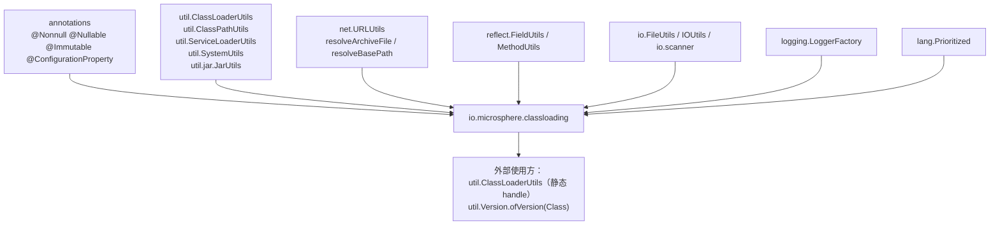
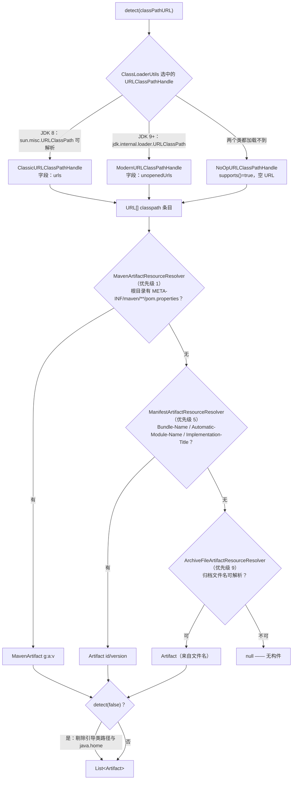
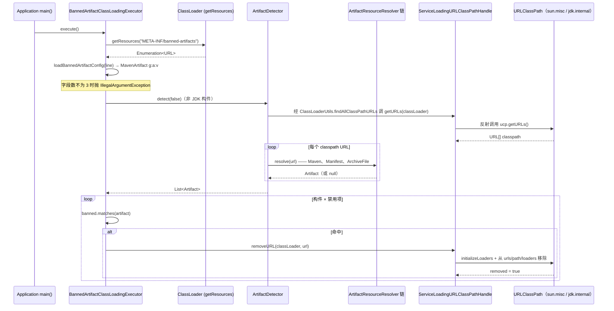

# 类加载与构件探测 —— 开发者指南

模块：`io.github.microsphere-projects:microsphere-java-core` · `0.3.20-SNAPSHOT`（`release` 分支）
包：`io.microsphere.classloading`（16 个主源码类型）· Java 8 基线，CI 覆盖 JDK 8 / 11 / 17 / 21 / 25

下文路径前缀：`microsphere-java-core/src/main/java/io/microsphere/`（源码）与
`microsphere-java-core/src/main/resources/`（SPI 注册文件）。

---

## 1. 本包在架构中的位置



任务中点明的两条依赖边均可由 import 核实：

* **`util`** —— `ArtifactDetector` 引入了 `ClassLoaderUtils.findAllClassPathURLs/getClassLoader/getClassResource`、
  `ClassPathUtils.getBootstrapClassPaths`、`ObjectUtils.defaultIfNull`、`ServiceLoaderUtils.loadServicesList`、
  `SystemUtils.JAVA_HOME`（`classloading/ArtifactDetector.java:16-28`）；`AbstractArtifactResourceResolver` 引入了
  `ClassLoaderUtils.getDefaultClassLoader`（`classloading/AbstractArtifactResourceResolver.java:23`）。
* **`net`** —— `URLClassPathHandle` 引入 `net.URLUtils.EMPTY_URL_ARRAY`（`classloading/URLClassPathHandle.java:26`）；
  `AbstractURLClassPathHandle` 另外引入 `URLUtils.resolveBasePath`（`:30-31`）；
  `StreamArtifactResourceResolver` 与 `ArchiveFileArtifactResourceResolver` 引入 `URLUtils.resolveArchiveFile`
  （`StreamArtifactResourceResolver.java:38`、`ArchiveFileArtifactResourceResolver.java:25`）。

依赖方向同时也是反向的：`util.ClassLoaderUtils` 持有一个静态
`ServiceLoadingURLClassPathHandle`（`util/ClassLoaderUtils.java:94`），所有 classpath 遍历与所有
`removeClassPathURL(...)` 都必经此处（`:1550-1564`、`:1598-1603`）；`util.Version.ofVersion(Class)` 会自建一个
`ArtifactDetector` 来解析依赖版本（`util/Version.java:626-640`）。

---

## 2. 包／类地图

| 类型 | 角色 | 职责 | 关键钩子 |
|---|---|---|---|
| `Artifact` | 值对象 | `artifactId` / `version` / `location`，按字段通配匹配 | `WILDCARD`、`UNKNOWN`、`matches(Artifact,String fn)` |
| `MavenArtifact` | 值对象 | 增加 `groupId`，匹配最严格 | `matchesGroupId`（`MavenArtifact.java:80-89`） |
| `ArtifactDetector` | 门面 | classpath → `List<Artifact>`；JDK 过滤；解析器链短路 | `detect(URL)`（`:137-149`）、`removeJdkClassPathURLs`（`:164-175`） |
| `ArtifactResourceResolver` | SPI 接口 | `Artifact resolve(URL)` | 继承 `Prioritized`（`:49-58`） |
| `AbstractArtifactResourceResolver` | 基类 | 承载 `classLoader`、`logger`、`final priority` | 构造器 `:95-102` |
| `StreamArtifactResourceResolver` | 基类 | 定位并打开元数据流（归档或目录） | `isArtifactMetadata`、`resolve(URL,InputStream,ClassLoader)` |
| `MavenArtifactResourceResolver` | 实现 | `META-INF/maven/**/pom.properties` → `MavenArtifact` | `DEFAULT_PRIORITY = 1` |
| `ManifestArtifactResourceResolver` | 实现 | `MANIFEST.MF` 属性 → `Artifact` | `DEFAULT_PRIORITY = 5`，两个 `-D` 可调项 |
| `ArchiveFileArtifactResourceResolver` | 实现 | 文件名 `a-1.0.jar` → `Artifact` | `DEFAULT_PRIORITY = 9`、`createArtifact` |
| `URLClassPathHandle` | SPI 接口 | 读取／修改加载器的 classpath | `supports`、`getURLs`、`removeURL`、`initializeLoaders` |
| `AbstractURLClassPathHandle` | 基类 | 反射访问 `ucp`，对 `urls`/`path`/`loaders` 做手术 | `getURLClassPathClassName`、`getUrlsFieldName` |
| `ClassicURLClassPathHandle` | 实现 | `sun.misc.URLClassPath` / `urls`（JDK ≤ 8） | `ClassicURLClassPathHandle.java:34-42` |
| `ModernURLClassPathHandle` | 实现 | `jdk.internal.loader.URLClassPath` / `unopenedUrls`（JDK ≥ 9） | `ModernURLClassPathHandle.java:34-42` |
| `NoOpURLClassPathHandle` | 实现 | 恒真的空操作兜底 | `:32-45` |
| `ServiceLoadingURLClassPathHandle` | 组合 | SPI 发现 + 委托 + `URLClassLoader` 兜底 | `:36-59` |
| `BannedArtifactClassLoadingExecutor` | 策略 | GAV 清单 → `removeClassPathURL` | `execute()` `:84-95` |

---

## 3. 源码解析

### 3.1 从类的源码 URL 到构件坐标

`ArtifactDetector.detect(Class)`（`ArtifactDetector.java:130-134`）先通过
`ClassLoaderUtils.getClassResource` 把类换成其 `.class` 资源 URL，再交给 `detect(URL)`（`:136-149`），后者按优先级
顺序遍历解析器链，并在**第一个非 null 结果处 break**。

流式解析器内部，`StreamArtifactResourceResolver.resolve(URL)`（`:106-134`）承担了 URL 的「考古」工作：

1. `URLUtils.resolveArchiveFile(resourceURL)`（`net/URLUtils.java:275-288`）：`file:` URL 解析为其所在的目录，
   其它协议解析出归档基础路径——并且只有 `File` 真实存在才保留。
2. 归档分支 → `readArtifactMetadataDataFromFile`（`:151-165`）打开 `JarFile`，保留第一个名字满足
   `isArtifactMetadata` 的条目（`findArtifactMetadataEntry`，`:179-182`，借助 `JarUtils.filter`），并把它整体缓冲进
   `FastByteArrayInputStream`，从而在子类型解析之前就能安全关闭 jar。
3. 目录分支 → `readArtifactMetadataDataFromDirectory`（`:167-177`）用 `io.scanner.SimpleFileScanner.INSTANCE`
   递归扫描，为第一个命中文件返回 `FileInputStream`。
4. 没有归档文件 → 默认的 `readArtifactMetadataDataFromResource` 返回 `null`（`:136-139`），也就是说非 `file` 协议
   除非子类型覆写否则一无所获。

子类型只回答两个问题：*哪个路径算元数据*、*元数据意味着什么*。
`MavenArtifactResourceResolver.isArtifactMetadata` 要求路径以 `META-INF/maven/` 开头并以 `/pom.properties` 结尾
（`:101-110`），随后加载 `Properties` 并据 `groupId`/`artifactId`/`version` 三个键构造 `MavenArtifact`
（`:112-125`）。`ManifestArtifactResourceResolver` 精确匹配 `MANIFEST_RESOURCE_PATH`，并对每个配置的属性列表取第一个
存在的属性（`:191-232`）。`ArchiveFileArtifactResourceResolver` 是唯一保留非 `final` `resolve` 的实现——去掉扩展名、
按 `-` 切分，`[0]` 作 artifactId、`[1]` 作版本（`ArchiveFileArtifactResourceResolver.java:80-108`）。

### 3.2 解析器的选择与排序

解析器由 `ServiceLoaderUtils.loadServicesList(ArtifactResourceResolver.class, classLoader, true)`
（`ArtifactDetector.java:92`）发现——带缓存、遍历类加载器层级，并按 `Prioritized.COMPARATOR` 排序。
`Prioritized.MAX_PRIORITY` 等于 `Integer.MIN_VALUE`，`MIN_PRIORITY` 等于 `Integer.MAX_VALUE`
（`lang/Prioritized.java:78-86`），因此**数值越小越先执行**：`Maven(1) → Manifest(5) → ArchiveFile(9)`。
优先级为 `0` 的用户解析器可以抢在全部内置实现之前。由于发现过程使用的是 *detector 自己的* 类加载器，应用 classpath
上自定义的解析器同样可见；返回 `null` 就是「这不归我管」的唯一约定——不存在异常通道。



### 3.3 各 JDK 下 `URLClassPathHandle` 变体的挑选

`ServiceLoadingURLClassPathHandle` 的构造器加载全部已注册 handle，`filter(supports)` 后 `findFirst`
（`ServiceLoadingURLClassPathHandle.java:36-43`）。`Classic` 与 `Modern` 共用
`AbstractURLClassPathHandle.DEFAULT_PRIORITY = MAX_PRIORITY + 99999`（`AbstractURLClassPathHandle.java:83`），
处于最负的区间，因此都排在 `NoOpURLClassPathHandle` 之前——后者的优先级是接口默认值 `MIN_PRIORITY`
（`URLClassPathHandle.java:124-126`；`NoOpURLClassPathHandleTest.java:60-62` 有断言）。而
`Classic`/`Modern` 中只有一个能解析到自己的 `URLClassPath` 类（`getUrlClassPathClass()` 会缓存失败结果，
`AbstractURLClassPathHandle.java:178-186`），所以由 JDK 决定胜者；只有两个类都缺失时才会落到 `NoOp`——那是一道
防御性底线，保证 `getURLs` 永不抛异常。

退化是分层的：

* `NoOpURLClassPathHandle.getURLs` 返回共享的 `EMPTY_URL_ARRAY`，`removeURL` 返回 `false`（`:37-45`）。
* `AbstractURLClassPathHandle.getURLs` 在加载器为 `null` 或 `ucp` 字段缺失时返回 `EMPTY_URL_ARRAY`（`:121-128`）。
* `ServiceLoadingURLClassPathHandle.getURLs` 在委托返回空数组时回落到接口默认实现——先用
  `ClassLoaderUtils.findURLClassLoader` 找到 `URLClassLoader`，再调其 `getURLs()`（`:50-54`）。正是这一点让 JDK 8 风格的
  `URLClassLoader` 子加载器（包括 `ClassLoaderUtils.newURLClassLoader` 造出的加载器）在反射 handle 不适用时依然可用。
* 只有参数为 `null` 时 `removeURL` 才返回 `false`（`AbstractURLClassPathHandle.java:131-134`）。其余失败都会**抛异常**
  而不是退化，因为 `:138-141` 的四次字段读取没有任何保护：
  * `jdk.internal.loader` 未开放（JDK 17/21/25 且没有 `--add-opens java.base/jdk.internal.loader=ALL-UNNAMED`）：
    `AccessibleObjectUtils.trySetAccessible` 返回 `false`（`FieldUtils.java:826-828`），随后 `field.get()` 抛出
    `IllegalAccessException`，而 `getFieldValue` 把它重新包装成 `IllegalStateException` 抛出（`:830-841`）。
  * 字段缺失（`ucp`、`urls`、`path` 或 `loaders`——例如目标加载器既不是 `URLClassLoader` 也不是 `BuiltinClassLoader`）：
    `getFieldValue` 返回 `null`（`:818-820`），于是 `synchronized (urls)` 在
    `AbstractURLClassPathHandle.java:147` 抛出 `NullPointerException`。若 `ucp` 为 `null`，`:139` 的读取等价于以
    `null` 实例访问实例字段，`FieldUtils` 的 javadoc 已明确声明这会抛 `NullPointerException`（`FieldUtils.java:813`）。
  因此 `getURLs` 对 `ucp` 为 `null` 有兜底（`:126-127`），而 `removeURL` 没有——这是一处已知的不对称，也正是禁用过滤器
  必须运行在「确实能反射进去」的加载器上的原因。
* `ServiceLoadingURLClassPathHandle` 只是一个毫无保护的转发器。它的 `delegate` 来自
  `filter(supports).findFirst().orElse(null)`（`:36-43`），而 `getURLs`/`removeURL` 直接解引用它（`:52`、`:58`）——
  只有 `supports()`（`:46-48`）能容忍 `null`。实际上 `NoOpURLClassPathHandle.supports()` 恒为 `true`，所以这条链总会绑到
  某个实现；`delegate` 为 `null` 只有在 `URLClassPathHandle` 自身的 `META-INF/services` 注册丢失（常见的 shade 事故）时
  才可达。`ClassLoaderUtils.removeClassPathURL`（`:1598-1603`）只加了 `SecureClassLoader` 判断，并不捕获任何异常，
  所以上述异常会原样传给调用方。

移除之前会先调用 `initializeLoaders(classLoader)`（`URLClassPathHandle.java:101-108`，被
`AbstractURLClassPathHandle.java:136` 调用）——这是一次刻意的 `findResource("just-for-initializing-loaders")` 触碰，
用于强制 JVM 把惰性的 `loaders` 列表填充出来；否则从未被使用的条目会让 `loaders` 保持为空，移除也就无法彻底完成。

### 3.4 禁用构件的拦截路径

`BannedArtifactClassLoadingExecutor.execute()`（`:84-95`）先读取类加载器上**所有**的
`META-INF/banned-artifacts` 资源（`loadBannedArtifactConfigs(ClassLoader)`，`:97-110`；`IOException` 只记录日志并返回
空列表），再按 `file.encoding` 逐行读取，并在第一个空行处终止（`:112-127`）。每行必须恰好切出三个冒号分隔字段，
否则抛 `IllegalArgumentException`（`:129-138`）。随后以 `detect(false)`（排除 JDK 库）执行探测，凡是匹配任一禁用项
（沿用 `Artifact.matches` 的按字段通配语义，`Artifact.java:99-122`）的构件，都会通过
`ClassLoaderUtils.removeClassPathURL(classLoader, url)` 移除（`:91`），而后者要求目标是 `SecureClassLoader`
（`util/ClassLoaderUtils.java:1598-1603`）。



`AbstractURLClassPathHandle.removeURL`（`:130-167`）在 `synchronized (urls)` 保护下完成「手术」：遍历 `loaders`，
把每个 loader 的 `base` 字段经 `URLUtils.resolveBasePath` 归一化后与目标 URL 的基础路径比较，命中即移除该 loader，
并把同一个 URL 从 `urls` 与 `path` 中删除。需要注意这里的不对称——两个集合的删除用的是**原始 `url`**，所以传入的
`URL` 必须与 classpath 中的那个 `equals`；`resolveBasePath` 只作用于 `loaders` 的比较。还有一点：`urls` 同时充当锁对象，
因此上一步的反射读取一旦返回 `null`，方法会在 `:147` 直接失败，根本走不到删除逻辑——完整失败模式见 §3.3。

---

## 4. 设计模式（标注具体实现类）

| 模式 | 实现类 | 依据 |
|---|---|---|
| **服务提供者 / SPI** | `ArtifactResourceResolver`（3 个注册项）、`URLClassPathHandle`（3 个注册项） | `src/main/resources/META-INF/services/io.microsphere.classloading.ArtifactResourceResolver`、`...URLClassPathHandle` |
| **策略（按 JDK 分化）** | `ClassicURLClassPathHandle`、`ModernURLClassPathHandle`、`NoOpURLClassPathHandle`，由 `ServiceLoadingURLClassPathHandle` 选择 | `AbstractURLClassPathHandle.java:238-240` 的抽象名字钩子 |
| **模板方法** | `StreamArtifactResourceResolver.resolve(URL)` 为 `final`；子类实现 `isArtifactMetadata` + `resolve(URL,InputStream,ClassLoader)`——`MavenArtifactResourceResolver`、`ManifestArtifactResourceResolver`，以及测试专用的 `ErrorArtifactResourceResolver` | `StreamArtifactResourceResolver.java:107`、`:198-200` |
| **模板方法（字段名）** | `AbstractURLClassPathHandle` 固定 `getURLs`/`removeURL`，把 `getURLClassPathClassName`/`getUrlsFieldName` 留给 `Classic`/`Modern` | `:121`、`:131`、`:238-240` |
| **空对象** | `NoOpURLClassPathHandle`——`supports()` 为真、`getURLs` 返回 `EMPTY_URL_ARRAY`、`removeURL` 返回 `false` | `NoOpURLClassPathHandle.java:32-45` |
| **注册表 / 职责链** | `ArtifactDetector.artifactResourceResolvers` 列表，第一个非 null 者胜出 | `ArtifactDetector.java:84`、`:139-147` |
| **组合 + 降级委托** | `ServiceLoadingURLClassPathHandle` 委托并在空结果时回落到接口默认实现 | `:34`、`:50-54` |
| **值对象 / 规约（Specification）** | `Artifact`、`MavenArtifact`（`equals`/`hashCode`/`toString`，`matches` 即按字段的规约） | `Artifact.java:99-146`、`MavenArtifact.java:74-113` |
| **工厂方法** | `Artifact.create(...)`、`MavenArtifact.create(...)`、包私有的 `ArchiveFileArtifactResourceResolver.createArtifact` | `Artifact.java:57-67`、`ArchiveFileArtifactResourceResolver.java:94-108` |
| **优先级排序** | `Prioritized` + `Prioritized.COMPARATOR`；`AbstractArtifactResourceResolver.getPriority()` 声明为 `final` 以冻结构造期优先级 | `AbstractArtifactResourceResolver.java:104-107` |

---

## 5. 扩展点

**编写自己的 `ArtifactResourceResolver`。** 优先继承模板基类，从而不必自己操作 `JarFile`：

```java
public class GradleModuleArtifactResourceResolver extends StreamArtifactResourceResolver {

    public static final int PRIORITY = 0;               // 排在 Maven(1) 之前

    public GradleModuleArtifactResourceResolver() {
        super(PRIORITY);                                // 默认类加载器
    }

    public GradleModuleArtifactResourceResolver(ClassLoader cl) {
        super(cl, PRIORITY);                            // cl 为 null 抛 IllegalArgumentException
    }

    @Override
    protected boolean isArtifactMetadata(String relativePath) {
        return relativePath.startsWith("META-INF/") && relativePath.endsWith("module/gradle-module.json");
    }

    @Override
    protected Artifact resolve(URL resourceURL, InputStream data, ClassLoader classLoader) throws IOException {
        return Artifact.create(readId(data), readVersion(data), resourceURL);
    }
}
```

```
# src/main/resources/META-INF/services/io.microsphere.classloading.ArtifactResourceResolver
com.example.GradleModuleArtifactResourceResolver
```

从源码提炼的规则：不属于你的 URL 要返回 `null`；继承 `StreamArtifactResourceResolver` 时**不要**试图覆写
`resolve(URL)`（它是 `final`），需要完全掌控流程请直接继承 `AbstractArtifactResourceResolver`（正如
`ArchiveFileArtifactResourceResolver` 所做）；由于 `getPriority()` 是 `final`，优先级只能通过构造器设定。

**支持未来 JDK 的加载器内部结构。** 一个 `URLClassPathHandle` 本质上只是两个字符串——`URLClassPath` 类名与未打开 URL
列表的字段名——再加上在
`META-INF/services/io.microsphere.classloading.URLClassPathHandle` 中的注册；请给它
`AbstractURLClassPathHandle.DEFAULT_PRIORITY`，以便排在 `NoOp` 之前。类查找失败（`resolveClass` 返回 `null`）就是
「本 JVM 不适用」的规范表达方式。

**按应用提供禁用清单。** 由于使用 `getResources`，多个模块都可以各自贡献若干行并累加生效（`:100-105`）。

---

## 6. 线程安全与性能

* **值对象不可变。** `Artifact` 与 `MavenArtifact` 标注 `@Immutable` 且全部字段为 `final`
  （`Artifact.java:35-49`），可安全发布，也能当 map 的 key（`equals`/`hashCode` 基于三个字段）。
* **开销主要在 detector 构造。** `ArtifactDetector` 每个实例都会加载并排序一次解析器列表（`:90-98`）——应按类加载器
  缓存实例，而不是在循环里反复 new；`Version.ofVersion(Class)` 每次调用都会新建一个（`util/Version.java:632`），
  热路径请回避。
* **解析器缓存。** `ArtifactDetector` 以 `cached = true` 请求服务（`:92`）；`ServiceLoadingURLClassPathHandle` 使用
  不缓存的默认值，但它在 `ClassLoaderUtils` 的静态初始化中被构造且仅一次（`:94`），所以整个 handle 图实际上就是 JVM
  单例。
* **惰性但非 volatile 的缓存。** `AbstractURLClassPathHandle` 中的 `Field`/`Class` 缓存（`:87-107`、`:178-236`）是普通
  字段：并发下的竞态最多导致重复查找，不会破坏状态。`ArtifactDetector` 的解析器列表在构造后不再变更。
* **移除只锁了 `urls`。** `removeURL` 使用 `synchronized (urls)`（`:147`）——JVM 自身的锁——但此前的
  `initializeLoaders` 与字段读取并未同步；移除过程中并发加载类是这套做法固有的风险。也正是这些未受保护的读取，让
  反射被封装挡住时以异常形式逃逸（见 §3.3），所以**`removeURL` 并不是一个「不抛异常」的 API**——如果目标 JDK 的加载器
  无法 `--add-opens`，请自行 try/catch。请把 `execute()` 视为仅启动期使用。
* **每个 URL 的 I/O 成本。** 流式解析器每次都 `new JarFile` 打开归档，目录场景还会递归扫描；
  `readArtifactMetadataDataFromFile` 会把整个条目缓冲为字节数组（`toByteArray`，`:161-163`）。因此对上百个 jar 的
  classpath 执行一次 `detect()` 意味着上百次文件打开。命中时是短路返回
  （`findArtifactMetadataEntry` → `first(entries)`），但**未命中**仍要完整枚举条目。
* **静态属性捕获**既是性能收益也是灵活性代价——manifest 属性名只解析一次
  （`ManifestArtifactResourceResolver.java:162-164`、`:186-189`）。

---

## 7. 测试策略

位置：`microsphere-java-core/src/test/java/io/microsphere/classloading/`（18 个文件）。

* **通用解析契约。** `AbstractArtifactResourceResolverTest` 通过子类的类型参数反射构造解析器（`:56-62`），并校验不变
  面——存在 `int` 与 `(ClassLoader,int)` 构造器（`:64-73`）、logger 名等于类名（`:75-79`）、`getPriority()` 与字段一致
  （`:86-89`）。具体套件继承它，只需实现 `assertArtifact` / `testResolve`。
* **模板基类只测一次、复用三次。** `StreamArtifactResourceResolverTest` 枚举六种场景：归档文件命中（`jsr305`）、
  归档文件未命中、目录命中、目录未命中、远程 `http:` URL → `null`、`null` URL → `null`（`:37-77`）。
  `MavenArtifactResourceResolverTest`、`ManifestArtifactResourceResolverTest`、`ErrorArtifactResourceResolverTest`
  全部继承；最后者使用 `ErrorArtifactResourceResolver`——它在解析阶段抛 `IOException`，而断言是构件为 `null`，从而
  钉死了「记录日志并返回 null」的行为（`StreamArtifactResourceResolver.java:127-129`）。
* **与 JDK 版本无关的期望。** 测试夹具刻意针对*当前 classpath*而非硬编码 JVM 断言：
  `assertEquals(CURRENT_JAVA_VERSION.le(JAVA_VERSION_8), handle.supports())` 与其镜像
  `ge(JAVA_VERSION_9)`（`ClassicURLClassPathHandleTest.java:44-47`、`ModernURLClassPathHandleTest.java:41-43`）——
  这正是同一套测试能在 8/11/17/21/25 上全绿的原因。
* **破坏性路径有护栏。** `BaseURLClassPathHandleTest` 是 `@Disabled` 的抽象类，因此自身不会运行；
  `Classic`/`Modern` 套件各自按 handle 重新启用。`test()` 只移除路径中含 `jmh-generator-annprocess` 的 URL，且必须
  `if (handle.supports())`（`:58-69`），所以没有任何测试会真的改动应用加载器的 classpath；
  `ServiceLoadingURLClassPathHandleTest.testRemoveURL` 改为把 URL 复制到新建的 `URLClassLoader` 再逐个移除（`:61-69`）。
* **null／空集契约。** `ArtifactDetectorTest` 断言 `detect((Class) null)` 抛 `NullPointerException`，未知的
  `file:///not-found` URL 返回 `null`，空集合与「测试用 null 集合」都返回空列表（`:53-88`）；
  `NoOpURLClassPathHandleTest` 与 `URLClassPathHandleTest` 断言空数组／`false`／`MIN_PRIORITY` 这条兜底底线
  （`NoOpURLClassPathHandleTest.java:44-62`、`URLClassPathHandleTest.java:41-61`）。
* **禁用逻辑。** `BannedArtifactClassLoadingExecutorTest` 覆盖三条分支：正常 `execute()`；`getResources` 抛
  `IOException` 的类加载器 → 配置列表为空且异常不外传；畸形定义 → `IllegalArgumentException`（`:38-58`）。
* **新增测试的写法。** 解析器请继承 `AbstractArtifactResourceResolverTest`（或 `StreamArtifactResourceResolverTest`），
  handle 请继承 `BaseURLClassPathHandleTest`，并且始终针对测试 classpath 上真实存在的资源断言——
  `javax.annotation.Nonnull` → `com.google.code.findbugs:jsr305:3.0.2` 是这里的标准夹具
  （`AbstractArtifactResourceResolverTest.java:41-47`）。

---

## 8. 需要记住的限制

* 不读取 JPMS 模块描述符：识别完全依赖归档元数据与 `URLClassPath` 提供的 URL，因此运行镜像中的模块里的类，只有在
  其 jar 同时出现在 classpath 上时才可能被探测到。
* 嵌套 jar URL（`jar:file:/app.jar!/BOOT-INF/lib/x.jar!/…`）解析不出 `File`，因而探测不到构件——这就是 Spring Boot
  re-packaged 应用探测结果远少于普通应用的原因。
* `ServiceLoadingURLClassPathHandle.getURLs` 解引用 `delegate` 时未做 null 检查（`:50-53`）；如果你既没有注册任何
  handle、连 service 文件也缺失，那么 `supports()` 为 `false` 且首次 `getURLs` 会 NPE——请保留三个内置注册项。
* 移除操作对 `urls`/`path` 依赖精确的 `URL` 相等（`:159-160`），而 `loaders` 的比较用的是归一化基础路径（`:152-154`）；
  因此请传入从 `getURLs(...)` 取得的 URL。

---

## 9. 另见

* [类加载与构件 —— 用户指南](../../user-guide/microsphere-java-core/classloading-and-artifacts.zh.md) —— 坐标、可运行示例与面向调用方的陷阱清单
* [工具类、常量与文本](./util-and-constants.zh.md) —— `ClassLoaderUtils`、`ClassPathUtils`、`ServiceLoaderUtils` 与 `util.jar.JarUtils` 为本包提供输入，`Version.ofVersion(Class)` 是回环的消费者
* [网络与 URL 协议](./net-and-url-protocols.zh.md) —— `URLUtils.resolveArchiveFile` / `resolveBasePath`，以及解析这些 URL 的 `classpath:` `Handler`
* [I/O、NIO、扫描与文件过滤器](./io-and-scanning.zh.md) —— `FileUtils`、`IOUtils` 与 `io.scanner` 是 `ArtifactDetector` 的另外几条入边
* [反射、类型与 Bean](./reflection-and-beans.zh.md) —— `sun.misc` 与 JPMS 字段访问所依赖的 `FieldUtils` / `MethodUtils`
* [语言抽象](./language-abstractions.zh.md) —— resolver 与 handle 的排序由 `Prioritized` 决定
* [子包索引与层级图](./README.zh.md)
* 英文原文：[Class Loading and Artifact Detection — Developer Guide](./classloading-and-artifacts.md)
