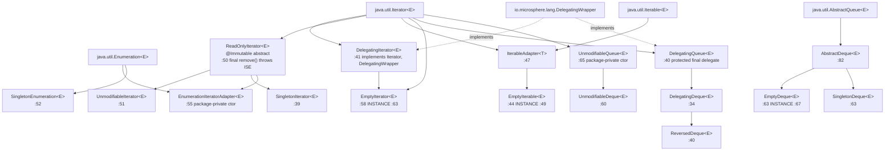
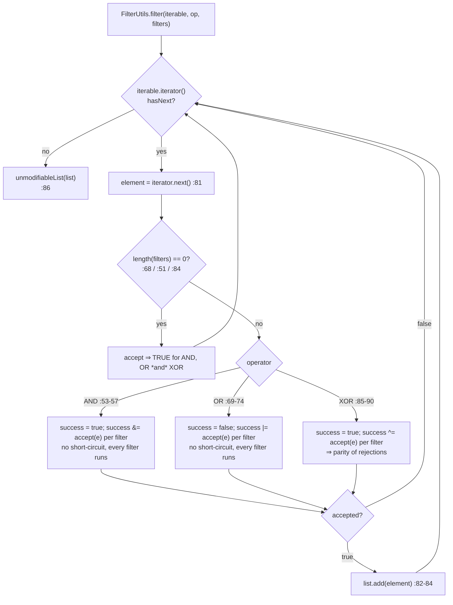
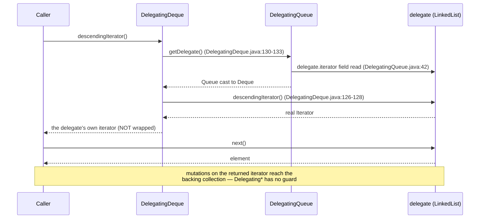

# Collections and filters — Developer Guide

| | |
|---|---|
| **Layer** | Foundation (`collection`, `filter`) — see the [layer table](README.md#1-internal-dependency-structure) |
| **Packages** | `io.microsphere.collection` (32 main sources) · `io.microsphere.filter` (9 main sources) = **41** |
| **Source line** | `release` branch, `0.3.20-SNAPSHOT` |
| **Analysis focus** | the `Delegating*` / `Unmodifiable*` / `Empty*` / `Singleton*` families, allocation strategy, filter composition |
| **Allowed imports** | `io.microsphere.util`, `io.microsphere.constants`, `io.microsphere.lang`, `io.microsphere.invoke`, `io.microsphere.annotation` — and nothing higher in the layering |

Paths are relative to `microsphere-java-core/src/main/java/io/microsphere/` unless a `test/` path is spelled out;
after the first full mention they appear as `collection/Foo.java:40-55` / `filter/Foo.java:40-55`.

---

## 1. Role in the architecture

`collection` and `filter` sit in the **Foundation layer**: they are imported by the type-model layer (`reflect` reads
`Map.Entry` pairs and iterates `Collection`s) and by every service layer, while importing nothing above themselves. The
`Util --> COLL` edge in the developer index is visible in the sources: `CollectionUtils` uses
`io.microsphere.util.ArrayUtils.length` and `io.microsphere.util.ObjectUtils.defaultIfNull`
(`collection/CollectionUtils.java:34-35`), `QueueUtils` uses `io.microsphere.util.ClassUtils.isAssignableFrom`
(`collection/QueueUtils.java:41`), and every utility class implements the `io.microsphere.util.Utils` marker
(`collection/CollectionUtils.java:43`, `collection/QueueUtils.java:50`, `filter/FilterUtils.java:50`).

`filter` is **not** a `File`-predicate package — that is `io.microsphere.io.filter` (page 8). What `io.microsphere.filter`
supplies is the generic `Filter<T>` contract (`filter/Filter.java:33-48`) plus the three predicate domains the scanners
need: `Class<?>` (`ClassFilter`, `:29`), `JarEntry` (`JarEntryFilter`, `:29`) and `String` class names
(`PackageNameClassNameFilter`, `:31`). Verified consumers inside `core` (from the `import io.microsphere.filter.*` set):

| Consumer | Imports | Role |
|---|---|---|
| `io/microsphere/io/scanner/Scanner.java:7` | `Filter` | the generic scan contract — `Scanner.scan(..., Filter)` |
| `io/microsphere/io/scanner/SimpleJarEntryScanner.java:8` | `JarEntryFilter` | filters jar entries during a scan (`:96` `scan(URL, boolean, JarEntryFilter)`) |
| `io/microsphere/io/scanner/SimpleClassScanner.java:8` | `PackageNameClassNameFilter` | class-name selection while scanning |
| `io/microsphere/io/filter/IOFileFilter.java:19` | `Filter` | the bridge to the real `File` predicate family |
| `io/microsphere/util/ClassUtils.java:9` | `ClassFileJarEntryFilter` | class-entry detection |
| `io/microsphere/util/jar/JarUtils.java:10` | `JarEntryFilter` | jar-entry traversal |

Going the other way — what the slice itself imports from the rest of the Foundation layer (the only outward edges; every
one is a `util`, `constants`, `invoke` or `lang.function` dependency):

| Type (`file:line` of the import) | Imports | Package |
|---|---|---|
| `ClassFileJarEntryFilter` (`filter/ClassFileJarEntryFilter.java:8`) | `FileConstants.CLASS_EXTENSION` | `io.microsphere.constants` |
| `PackageNameClassNameFilter` (`filter/PackageNameClassNameFilter.java:7-9`) | `SymbolConstants.DOT_CHAR`, `ClassUtils.resolvePackageName`, `StringUtils.isBlank` | `constants`, `util` |
| `PackageNameClassFilter` (`filter/PackageNameClassFilter.java:7`) | `SymbolConstants.DOT` | `constants` |
| `FilterOperator` (`filter/FilterOperator.java:4`) | `ArrayUtils.length` | `util` |
| `FilterUtils` (`filter/FilterUtils.java:14`) | `ListUtils.newArrayList` | `collection` |
| `EnumerationIteratorAdapter` (`collection/EnumerationIteratorAdapter.java:22-23`) | `ObjectUtils.defaultIfNull`, `Collections.emptyEnumeration` | `util` |
| `CollectionUtils` (`collection/CollectionUtils.java:32-35`) | `EmptyIterable.INSTANCE`, `ListUtils.isList`, `ArrayUtils.length`, `ObjectUtils.defaultIfNull` | `collection` (self), `util` |
| `QueueUtils` (`collection/QueueUtils.java:41`) | `ClassUtils.isAssignableFrom` | `util` |
| `Lists` (`collection/Lists.java:28`) | `MethodHandlesLookupUtils.findPublicStatic` | `invoke` |
| `DelegatingDeque` (`collection/DelegatingDeque.java:24-25`) | `MethodHandlesLookupUtils.findPublicVirtual`, `ThrowableSupplier.execute` | `invoke`, `lang.function` |

Nothing above the Foundation layer is imported, and no `io.microsphere.filter` type is referenced from
`io.microsphere.collection` — the slice is a leaf of the dependency graph.

> [!NOTE]
> **Correction to a common assumption**: `io.microsphere.classloading` does *not* import `io.microsphere.filter` — no
> `import io.microsphere.filter.` occurrence exists in that package on `release`. The filter consumers are
> `io.scanner`, `io.filter`, `util.ClassUtils` and `util.jar.JarUtils`.

---

## 2. Package and class map

### 2.1 `io.microsphere.collection` — 32 types

| Family | Count | Types |
|---|---|---|
| `Delegating*` | 3 | `DelegatingIterator`, `DelegatingQueue`, `DelegatingDeque` |
| `Unmodifiable*` | 3 | `UnmodifiableIterator`, `UnmodifiableQueue`, `UnmodifiableDeque` |
| `Empty*` | 3 | `EmptyIterator`, `EmptyIterable`, `EmptyDeque` |
| `Singleton*` | 3 | `SingletonIterator`, `SingletonEnumeration`, `SingletonDeque` |
| Skeletal / read-only bases | 2 | `ReadOnlyIterator`, `AbstractDeque` |
| Adapters | 3 | `IterableAdapter`, `EnumerationIteratorAdapter`, `ArrayEnumeration` |
| `Map.Entry` value types | 2 | `DefaultEntry`, `ImmutableEntry` |
| Views / structures | 2 | `ReversedDeque`, `ArrayStack` |
| `Utils` factories | 11 | `CollectionUtils`, `ListUtils`, `MapUtils`, `SetUtils`, `QueueUtils`, `PropertiesUtils`, `EnumerationUtils`, `Lists`, `Maps`, `Sets`, `Iterators` |
| | **32** | |

### 2.2 `io.microsphere.filter` — 9 types

| Role | Count | Types |
|---|---|---|
| Contract | 1 | `Filter<T>` (`@FunctionalInterface`, extends `Predicate<T>`) |
| Composition | 2 | `FilterOperator` (enum, 3 constants), `FilterUtils` (2 overloads) |
| Sub-contracts | 2 | `ClassFilter`, `JarEntryFilter` (both `@FunctionalInterface`, empty bodies) |
| Implementations | 4 | `TrueClassFilter`, `PackageNameClassFilter`, `PackageNameClassNameFilter`, `ClassFileJarEntryFilter` |
| | **9** | |

---

## 3. Source analysis

### 3.1 Two disjoint iterator trees, joined only by `ReadOnlyIterator`

There is no common abstract wrapper. The delegating tree closes itself with `final` methods; the read-only tree is the
extension skeleton — and the `Empty*` types pick a parent from each tree deliberately.

Branch-by-branch reading of the `Deque` ladder: `AbstractDeque` implements the *cheap* half of the `Deque` contract and
leaves the *element-touching* half abstract — `addFirst`/`addLast` translate an `false` offer into
`IllegalStateException("Queue full")` (`collection/AbstractDeque.java:84-94`, throw at `:87`/`:93`), `removeFirst`/
`removeLast` translate `null` into `NoSuchElementException` (`:96-112`, throw at `:102`/`:111`), and the six
`Queue`-shaped methods are routed to their `*First`/`*Last` twins (`offer→offerLast` `:129-132`, `poll→pollFirst`
`:134-137`, `peek→peekFirst` `:139-142`, `push→addFirst` `:119-122`, `pop→removeFirst` `:124-127`,
`removeFirstOccurrence→remove(o)` `:114-117`). That last routing is what makes `EmptyDeque.removeFirstOccurrence(...)`
return `false` without overriding it: it lands on `EmptyDeque.remove(Object)` (`collection/EmptyDeque.java:124-127`).

### 3.2 How `Empty*` and `Singleton*` avoid allocation

| Class | Allocation strategy | Evidence |
|---|---|---|
| `EmptyIterator` | one public static `INSTANCE`; the delegate is the JDK's own cached `Collections.emptyIterator()` | `collection/EmptyIterator.java:63`, `:65-67` |
| `CollectionUtils.emptyIterator()` | does **not** wrap — returns the JDK cached instance directly, so `EmptyIterator` is bypassed entirely | `collection/CollectionUtils.java:301-305` |
| `EmptyIterable` | one public static `INSTANCE`, constructed with `super(null)`; `IterableAdapter` converts that `null` into `EmptyIterator.INSTANCE` | `collection/EmptyIterable.java:49-53` + `collection/IterableAdapter.java:51-53` |
| `EmptyDeque` | one public static `INSTANCE` (`EmptyDeque<?>`), and `QueueUtils` caches it in a `static final Deque<?> EMPTY_DEQUE` field so both `emptyQueue()` and `emptyDeque()` cast the *same* object | `collection/EmptyDeque.java:67`, `collection/QueueUtils.java:52`, `:125-129`, `:144-148` |
| `SingletonDeque` | no cache (each element needs its own instance), holds exactly one `final E element` and mints a fresh one-shot iterator per `iterator()` call | `collection/SingletonDeque.java:67`, `:73-81` |
| `SingletonIterator` / `SingletonEnumeration` | zero-copy: no backing collection, just `element` + a `boolean hasNext` flag | `collection/SingletonIterator.java:41-47`, `collection/SingletonEnumeration.java:54-60` |
| `ReversedDeque.of` | allocation memoisation — returns the argument unchanged when it is already a `ReversedDeque`, so double-reversing costs nothing | `collection/ReversedDeque.java:46-52` |
| `Empty*` iterators are identity-stable | `assertSame(emptyIterator(), emptyDeque.iterator())` and the same for `descendingIterator()` | `collection/EmptyDequeTest.java:44-51`, `collection/EmptyQueueTest.java:45-47` |

`EmptyIterable` and `EmptyIterator` are *not* `Serializable` (`:44`, `:58` declare no such interface), while
`EmptyDeque` and `SingletonDeque` are (`:63` in both). The `serialVersionUID` of every `Serializable` type in this
package is `-1L` (`collection/EmptyDeque.java:65`, `collection/SingletonDeque.java:65`,
`collection/UnmodifiableQueue.java:67`).

### 3.3 Equality, `hashCode` and `toString` per wrapper

Each wrapper re-implements the trio; three distinct policies appear.

| Type | `equals` | `hashCode` | `toString` | Policy |
|---|---|---|---|---|
| `DelegatingIterator` | `delegate.equals(obj)`, `final` (`collection/DelegatingIterator.java:79-82`) | `delegate.hashCode()` (`:74-77`) | `delegate.toString()` (`:84-87`) | **pure forwarding** — the wrapper is transparent |
| `DelegatingQueue` | `delegate.equals(o)` (`:164-167`) | `delegate.hashCode()` (`:169-172`) | `delegate.toString()` (`:174-177`) | pure forwarding |
| `UnmodifiableQueue` | `this == o` shortcut, then `delegate.equals(o)` (`collection/UnmodifiableQueue.java:190-196`) | `delegate.hashCode()` (`:198-201`) | `delegate.toString()` (`:203-206`) | forwarding + identity short-circuit |
| `SingletonDeque` | value-based, `final`: `o instanceof SingletonDeque && Objects.equals(element, that.element)` (`collection/SingletonDeque.java:138-144`) | `Objects.hashCode(element)` (`:146-149`) | not overridden | **value identity** — required because `INSTANCE`-less wrappers must compare equal to each other |
| `ReversedDeque` | order-sensitive: size check, then elementwise via `Iterators.equals` (`collection/ReversedDeque.java:170-184`) | positional `31 * hashCode + element` fold (`:186-195`) | own `[a, b]` builder (`:152-168`) | a reversed view must **not** equal the source in order-insensitive `Collection.equals` semantics |
| `EmptyDeque` | not overridden (`collection/EmptyDeque.java:69-132`) | not overridden | not overridden | inherits `AbstractQueue`/`AbstractCollection` behaviour — reference identity |
| `DefaultEntry` | `o instanceof DefaultEntry` + both fields (`collection/DefaultEntry.java:76-82`) | `31 * key + value` (`:84-89`) | `key + "=" + value` (`:91-94`) | value object; `getKey`/`getValue` are `final` (`:59-67`) |
| `ImmutableEntry` | inherits | inherits | inherits | overrides only `setValue` → UOE (`collection/ImmutableEntry.java:53-56`) |

`UnmodifiableDeque` does **not** re-override the trio (`collection/UnmodifiableDeque.java:69-152` covers only the
`Deque`-specific methods), so it inherits `UnmodifiableQueue`'s forwarding-with-short-circuit.
`Iterators.equals` (`collection/Iterators.java:41-55`) is the shared elementwise comparator: identity first (`:42-44`),
null-safe (`:45-47`), then pairwise `Objects.equals` (`:49-53`) and a final "both exhausted" check (`:54`).

### 3.4 Filter composition, branch by branch

`FilterOperator` is a three-constant enum whose constants each override `accept(T, Filter<T>...)`
(`filter/FilterOperator.java:102`); `createFilter` (`:111-120`) captures the operator and the filter array in an
anonymous `Filter` — one object per composition, no proxy.

Three properties worth pinning:

* **Empty filter array is accept-all for all three operators** — the `length == 0` guard returns `true` at
  `:51-52` (AND), `:68-69` (OR), `:84-85` (XOR). A caller that composes `AND` with a runtime-built, possibly empty
  array therefore gets "everything passes", not "everything fails".
* **XOR seeds `true`, not `false`** (`:86`), so `XOR` computes the parity of *rejections*: with two filters, it accepts
  when both accept as well as when exactly one accepts... precisely, `true ^ a ^ b`, i.e. accepts when the number of
  rejecting filters is even. Its javadoc example (`:33-34`) describes the one-rejection case.
* **No short-circuiting.** AND keeps folding after the first `false` (`:54-56`) and OR keeps folding after the first
  `true` (`:71-73`); every filter in the array is invoked for every element. A filter with side effects or a costly
  `accept` must not rely on being skipped.
* `FilterUtils.filter` builds an `ArrayList` and returns `Collections.unmodifiableList` of it
  (`filter/FilterUtils.java:78-86`); the single-filter overload simply delegates with `AND` (`:62-64`). The `Iterable`
  parameter is dereferenced without a null check (`:79`), so `filter(null, ...)` throws `NullPointerException`.

### 3.5 Version branching: `MethodHandle`-guarded APIs

Two places in this slice need a JDK newer than the bytecode target, and both use the same shape — resolve a handle in a
static field, branch on `null`, and catch `Throwable` as a second safety net.

| Site | Resolves | On `null` handle | On `Throwable` |
|---|---|---|---|
| `collection/Lists.java:46-101` (11 handles for `List.of`) | `findPublicStatic(List.class, "of", ...)` | JDK 8 fallback: `emptyList()` `:123-126`, `singletonList(e1)` `:156-159`, `ListUtils.of(elements)` `:520-523` | same fallback, `catch (Throwable)` `:127-131` |
| `collection/DelegatingDeque.java:39` | `findPublicVirtual(Deque.class, "reversed")` | `QueueUtils.reversedDeque(getDelegate())` — the in-package `ReversedDeque` view (`:142-145`) | `ThrowableSupplier.execute(...)` wraps the invoke (`:146`) |

`Sets` and `Maps` replicate the `Lists` pattern verbatim (`collection/Sets.java:121-559`, `collection/Maps.java:116-592`).
Because `List.of` rejects `null` while the Java 8 fallbacks (`Collections.singletonList`,
`ListUtils.ofList` → `unmodifiableList(asList(...))`, `collection/ListUtils.java:189-196`) do not, the *null permission of
the same source line differs across JDKs* — a divergence the tests pin by calling the package-private helpers with an
explicit handle (`collection/ListsTest.java:108`, `:112-114`).

### 3.6 Representative call: iterating a `Delegating*` view

Compare with the `Unmodifiable*` path: `UnmodifiableQueue.iterator()` wraps the delegate's iterator through
`CollectionUtils.unmodifiableIterator` (`collection/UnmodifiableQueue.java:90-93`) and `UnmodifiableDeque`
does the same for `descendingIterator()` (`collection/UnmodifiableDeque.java:149-152`), so removal attempts die in
`ReadOnlyIterator.remove()` (`collection/ReadOnlyIterator.java:52-55`). `Delegating*` returns the raw iterator —
delegation is transparent, not protective.

### 3.7 Direction of the intra-slice dependency

The two packages are **not** siblings with a shared kernel — `filter` sits on top of `collection`, and the edge is
one-way and measurable:

* `filter/FilterUtils.java:14` statically imports `io.microsphere.collection.ListUtils.newArrayList` and uses it as the
  accumulation buffer (`filter/FilterUtils.java:78`). That is the only cross-package usage in the slice.
* A search for `io.microsphere.filter` across all 32 files of `collection` returns **no** occurrence — no class in
  `collection` knows that `Filter` exists. (`ReversedDeque.removeIf` etc. use `java.util.function.Predicate`
  (`collection/DelegatingQueue.java:130-132`), never `Filter`.)

Consequences for maintenance: `Filter` may gain default methods freely, but any change to `ListUtils.newArrayList`
semantics is observable through `FilterUtils.filter`, and moving either package into another artifact would break the
Foundation-layer rule of the [developer index](README.md#1-internal-dependency-structure) (`collection` must not import
`filter`, and neither may import above the Foundation layer).

---

## 4. Design patterns

| Pattern | Implementing class(es) | Evidence |
|---|---|---|
| **Decorator** (transparent) | `DelegatingIterator`, `DelegatingQueue`, `DelegatingDeque` | every method forwards (`collection/DelegatingIterator.java:49-67`, `collection/DelegatingQueue.java:49-177`); `DelegatingWrapper` marks the role (`:40`, `collection/DelegatingIterator.java:41`) |
| **Decorator** (behaviour-adding) | `UnmodifiableIterator`, `UnmodifiableQueue`, `UnmodifiableDeque` | reads forward (`collection/UnmodifiableQueue.java:75-98`), writes throw (`:105-168`) |
| **Null Object** | `EmptyIterator`, `EmptyIterable`, `EmptyDeque` | shared `INSTANCE` fields (`collection/EmptyIterator.java:63`, `collection/EmptyIterable.java:49`, `collection/EmptyDeque.java:67`) returned by `CollectionUtils.emptyIterable()` `:327-331` |
| **Singleton (per-value)** | `SingletonIterator`, `SingletonEnumeration`, `SingletonDeque` | one `final E element` field, `size()` hard-coded `1` (`collection/SingletonDeque.java:133-136`) |
| **Wrapper / Chain** | `ReversedDeque extends DelegatingDeque extends DelegatingQueue` | every override forwards to the *other* end of the deque (`collection/ReversedDeque.java:198-306`) |
| **Immutable value object** | `ImmutableEntry`, `DefaultEntry`, `SingletonDeque` | final `key` (`collection/DefaultEntry.java:37`), `final` accessors (`:59-67`), `final equals` (`collection/SingletonDeque.java:138-144`) |
| **Static Factory Method** | all 11 `*Utils`/`Lists`/`Maps`/`Sets` classes + `DefaultEntry.of` (`collection/DefaultEntry.java:55-57`), `ImmutableEntry.of` (`collection/ImmutableEntry.java:67-69`), `ReversedDeque.of` (`collection/ReversedDeque.java:46-52`), `FilterOperator.createFilter` (`filter/FilterOperator.java:111-120`) | each utility class is `abstract` with a `private` constructor (`collection/CollectionUtils.java:684-685`, `collection/QueueUtils.java:790-791`, `filter/FilterUtils.java:89`) |
| **Strategy** | `FilterOperator` constants; `Lists` handle-or-fallback | per-constant `accept` (`filter/FilterOperator.java:47-92`), per-arity handle strategy (`collection/Lists.java:123-132`) |
| **Template Method (skeleton)** | `AbstractDeque`, `ReadOnlyIterator` | `AbstractDeque` overrides exactly ten methods (`collection/AbstractDeque.java:84-142`), each routing to the `offer*`/`poll*`/`peek*`/`get*`/`remove(Object)` primitives its subclass supplies; `ReadOnlyIterator` fixes only `remove()` (`:52-55`) |
| **Adapter** | `EnumerationIteratorAdapter` (`Enumeration`→`Iterator`, `collection/EnumerationIteratorAdapter.java:55-72`), `IterableAdapter` (`Iterator`→`Iterable`, `collection/IterableAdapter.java:47-59`) | constructors normalise `null` (`:59-61`, `:51-53`) |

---

## 5. Extension points

| Base | Extensible? | Seam |
|---|---|---|
| `ReadOnlyIterator<E>` (`collection/ReadOnlyIterator.java:50`) | **yes** — abstract, public, `remove()` is final so subclasses cannot accidentally allow mutation | implement `hasNext()`/`next()`; `EnumerationIteratorAdapter:55`, `UnmodifiableIterator:51`, `SingletonIterator:39` all do |
| `AbstractDeque<E>` (`collection/AbstractDeque.java:82`) | **yes** — abstract, extends `AbstractQueue` | override `iterator()`, `size()` and the `*First`/`*Last` primitives; the test fixture `test/io/microsphere/collection/TestDeque.java:36` does exactly that, adding a `maxCapacity` (`:38`, `:191-193`) to force `offerFirst`/`offerLast` to return `false` |
| `DelegatingQueue<E>` (`collection/DelegatingQueue.java:40`) | **yes**, and intentionally the only family with a `protected final delegate` (`:42`) so subclasses read the delegate directly instead of through `getDelegate()` | `DelegatingDeque:34` extends it and narrows `getDelegate()` to `Deque<E>` (`:130-133`) |
| `DelegatingDeque<E>` (`collection/DelegatingDeque.java:34`) | **yes** — `reversed(MethodHandle)` is `protected` (`:142`) precisely so a subclass can supply its own handle | `ReversedDeque:40` extends it |
| `DelegatingIterator<E>` (`collection/DelegatingIterator.java:41`) | technically subclassable, **practically not** — all 8 methods are `final` (`:49-87`) and `getDelegate()` returns `Object` | `EmptyIterator:58` can only specialise by changing the *delegate*, not the methods |
| `UnmodifiableQueue<E>` (`collection/UnmodifiableQueue.java:65`) | **no** outside the package — the constructor is package-private (`:71-73`) | `UnmodifiableDeque:60` extends it, and its own constructor is public (`:64-67`) |
| `EmptyDeque`, `SingletonDeque`, `Empty*` iterators | subclassable (public/implicit ctors), but `SingletonDeque.equals` is `final` (`:138-144`) so a subclass cannot widen equality | — |
| `ClassFileJarEntryFilter` (`filter/ClassFileJarEntryFilter.java:32`) | **yes** — `protected` constructor (`:39-41`) alongside the public `INSTANCE` (`:37`) | extend to add entry-name rules while reusing `JarEntryFilter` |
| `TrueClassFilter` (`filter/TrueClassFilter.java:27`) | **no** — private constructor (`:34-36`); the class is not `final`, but nothing can extend it | use `INSTANCE` (`:32`) or write your own `ClassFilter` lambda (`filter/ClassFilter.java:28-30`) |
| `Filter<T>` / `ClassFilter` / `JarEntryFilter` | lambdas — all three are `@FunctionalInterface` (`filter/Filter.java:33`, `ClassFilter.java:28`, `JarEntryFilter.java:28`) | prefer `FilterOperator.createFilter(...)` when you need a `Filter` back rather than a `Predicate` |

The utility classes (`CollectionUtils`, `QueueUtils`, `ListUtils`, `MapUtils`, `SetUtils`, `PropertiesUtils`,
`EnumerationUtils`, `Lists`, `Maps`, `Sets`, `Iterators`, `FilterUtils`) are `abstract` with `private` constructors and
are **not** extension points — the private constructor makes even the abstract form uninstantiable
(`collection/CollectionUtils.java:684-685`, `collection/Lists.java:531-532`, `filter/FilterUtils.java:89`).

---

## 6. Thread safety and performance

| Declaration | Verdict |
|---|---|
| `DelegatingIterator`: `private final Iterator<E> delegate` (`:43`) | safe publication of the delegate, but `Iterator` itself is stateful — the wrapper is **not** thread-safe and not reusable after one traversal |
| `DelegatingQueue`: `protected final Queue<E> delegate` (`:42`) | final field, no other state; safety inherited from the delegate |
| `UnmodifiableQueue`: `private final Queue<E> delegate` (`:69`) | idem |
| `UnmodifiableDeque`: adds a **second** field `private final Deque<E> delegate` (`:62`) while `super` already stores the same object in its own `private final Queue<E>` (`:69`) | one extra reference per instance and two read paths (`getFirst()` uses the local field `:109-127`, `size()` uses the inherited one `:75-78`). Correct, but a `getDelegate()`-style accessor would have avoided the duplicate |
| `SingletonIterator`: `private final E element` (`:41`) + `private boolean hasNext` (`:43`) | **mutable, unsynchronised flag**: two threads sharing one instance can both pass `hasNext()` and both receive the element. Publish these one-shooters to a single consumer |
| `SingletonEnumeration`: `private final E element` (`:54`) + `private boolean hasNext` (`:56`) | same caveat; only `hasMoreElements()`/`nextElement()` exist (`:62-74`) |
| `Empty*` singletons | genuinely safe — `EmptyIterator` has no state beyond the final JDK delegate (`:65-67`), `EmptyDeque` overrides only constant-returning methods (`:69-132`) |
| `QueueUtils.EMPTY_DEQUE` | `static final Deque<?>` (`:52`) — one instance for the whole JVM, shared by `emptyQueue()` and `emptyDeque()` (`:125-148`) |
| `Lists` 11 handles / `DelegatingDeque.reversedMethodHandle` | `static final`, resolved once in the class initialiser (`collection/Lists.java:46-101`, `collection/DelegatingDeque.java:39`) — no per-call lookup |

Cost notes that follow from the code:

* `toIterable(Collection)` is free — `defaultIfNull(collection, () -> INSTANCE)` returns the collection itself when
  non-null (`collection/CollectionUtils.java:98-100`); `toIterable(Iterator)` and `toIterator(Enumeration)` each allocate
  exactly one adapter (`:121-123`, `:144-146`).
* `size(Iterable)` iterates in full when the argument is not a `Collection` (`collection/CollectionUtils.java:374-388`);
  for one-shot iterators that also *consumes* them. Prefer `size(Collection)`.
* `addAll(Collection, T...)` calls `add` once per element instead of `addAll`, so the return value counts real
  insertions (`:454-472`) — O(n) on `ArrayList`, and it silently returns `0` for a `null` collection (`:455-457`).
* `SingletonDeque.iterator()` allocates a new `SingletonIterator` per call (`collection/SingletonDeque.java:73-81`), which
  is what makes the deque re-iterable despite holding a single element.
* `ReversedDeque.toArray()` calls `super.toArray()` and then reverses the copy (`collection/ReversedDeque.java:141-144`),
  i.e. two array allocations; `toArray(T[])` uses `ArrayUtils.toArrayReversed` directly (`:146-150`).
* Filter composition allocates one `ArrayList` plus one unmodifiable wrapper per call
  (`filter/FilterUtils.java:78-86`) and one anonymous `Filter` per `createFilter`
  (`filter/FilterOperator.java:111-120`).
* Capacity pre-sizing is a first-class concern: `MapUtils` declares `MIN_LOAD_FACTOR = Float.MIN_VALUE`
  (`collection/MapUtils.java:61`) and `FIXED_LOAD_FACTOR = 1.00f` (`:66`), and `newFixedHashMap(int)` is just
  `newHashMap(size, FIXED_LOAD_FACTOR)` (`:980-983`); `newFixedLinkedHashMap(int)` does the same
  (`:1005`). `SetUtils` reuses the constant — `newFixedHashSet(int)` → `newHashSet(size, FIXED_LOAD_FACTOR)`
  (`collection/SetUtils.java:658-661`) and `newFixedLinkedHashSet(int)` → `newLinkedHashSet(size, FIXED_LOAD_FACTOR)`
  (`:681-684`). A load factor of `1.00f` means "never grow for this many elements", which trades one larger allocation for
  zero rehashes.

---

## 7. Testing strategy

Two abstract contract ladders carry most of the package, so a new wrapper inherits a full conformance suite by writing
one factory method.

**Read-only iterator ladder** — `test/io/microsphere/collection/ReadOnlyIteratorTest.java:41-75` is
`public abstract` and pulls the instance from `protected abstract Iterator<?> createIterator()` (`:45`). It asserts the
four read-only invariants: `hasNext()` true initially (`:48-50`), second `next()` throws `NoSuchElementException`
(`:52-59`), `remove()` throws `IllegalStateException` (`:62-64`), and `forEachRemaining` consumes then reports exhausted
(`:66-75`). Three subclasses feed it: `SingletonIteratorTest.java:30-36`, `UnmodifiableIteratorTest.java:31`,
`SingletonEnumerationTest.java:31`.

**Mutable collection ladder** — `MutableCollectionTest<C extends Collection<Object>>`
(`test/io/microsphere/collection/MutableCollectionTest.java:45`, abstract, with `protected abstract C newInstance()` at
`:55`) covers the whole `Collection` contract: size/isEmpty/contains (`:68-85`), iterator (`:86`), both `toArray` forms
(`:98`, `:105`), add/remove (`:116`, `:123`), containsAll/addAll/removeAll/removeIf/retainAll/clear (`:137-190`),
equals/hashCode/toString (`:191-221`) and spliterator/stream/parallelStream (`:222-236`). It is specialised into
`MutableQueueTest<Q extends Queue<Object>>` (`:37`, adds offer/poll/element/peek at `:40-70`) and then
`MutableDequeTest<D extends Deque<Object>>` (`:39`, adds the 17 `Deque` operations at `:42-178`). Concrete consumers:
`DelegatingQueueTest.java:36`, `DelegatingDequeTest.java:38`, `ReversedDequeTest.java:38` and — notably —
`LinkedListTest.java:32`, which runs the library's own contract against a JDK baseline to prove the suite is not
self-fulfilling.

The remaining suites are behaviour tables rather than ladders:

| Suite | What it pins |
|---|---|
| `AbstractDequeTest.java:39-240` | the skeleton's routing, via the `TestDeque` fixture: `addFirst` on a full deque → `IllegalStateException` (`:51-54`), `removeFirst` on empty → `NoSuchElementException` (`:74-79`), `offer`→`offerLast`/`poll`→`pollFirst` FIFO (`:218-228`), `push`/`pop` LIFO (`:231-239`), `removeFirstOccurrence` delegating to `remove(o)` (`:202-215`) |
| `EmptyDequeTest.java:39-92` / `EmptyQueueTest.java:40-84` | the neutral-value vs throw split, and iterator identity: `assertSame(emptyIterator(), ...)` (`:45`, `:50` / `:46`) |
| `UnmodifiableDequeTest.java:35-127` | mutation → UOE for all 12 `Deque` mutators (`:45-121`), reads pass through (`:85-101`), and `descendingIterator() instanceof UnmodifiableIterator` (`:126`); the subject is a *nested* wrapper — `new UnmodifiableDeque(new SingletonDeque(TEST_ELEMENT))` (`:41`) |
| `DelegatingIteratorTest.java:42-100` | forwarding, including `getDelegate()` identity (`:83`) and the transparent `equals`/`hashCode`/`toString` trio (`:87-99`) |
| `CollectionUtilsTest.java:78-278` | null tolerance (`:81`, `:167`, `:230`, `:247`, `:252`), the `null`/empty equality rule (`:191-195`), and the empty queue/deque factories (`:272`, `:278`) |
| `ListsTest.java` / `SetsTest.java` / `MapsTest.java` | both sides of the `MethodHandle` branch, by calling the package-private `ofList0`… helpers with `null` or a deliberately wrong handle (`ListsTest.java:108`, `:112-114`) |
| `DefaultEntryTest.java:34` / `ImmutableEntryTest.java:35-76` | value equality and the `setValue` UOE (`:55`) |
| `filter/FilterTest.java:33-53` | the `accept`/`test` bridge in both directions |
| `filter/FilterOperatorTest.java`, `filter/FilterUtilsTest.java:23-41` | AND/OR/XOR composition over a 0..9 list, including the single-filter overload (`:33-35`) |
| `test/io/microsphere/collection/ArrayStackTest.java:38`, `AbstractEnumerationTest.java:45` → `ArrayEnumerationTest.java:31` | stack and enumeration contracts |

> [!TIP]
> When you add a wrapper, extend the matching ladder instead of writing assertions: a `Delegating`-style class should
> extend `MutableDequeTest`/`MutableQueueTest`, and a read-only one should extend `ReadOnlyIteratorTest`. The ladders
> already assert `equals`/`hashCode`/`toString` and the stream/spliterator pass-throughs.

---

## 8. See also

* User-facing reference: [Collections and filters — User Guide](../../user-guide/microsphere-java-core/collections-and-filters.md)
* [Utilities, constants and text](util-and-constants.md) — `ArrayUtils`, `ObjectUtils`, `Assert`, the `Utils` marker
* [Language abstractions](language-abstractions.md) — `DelegatingWrapper`, `Prioritized`
* [I/O, NIO, scanning and file filters](io-and-scanning.md) — the `File` predicates and the scanners that consume `Filter`
* [Class loading and artifacts](classloading-and-artifacts.md) — downstream consumer of `collection`
* [中文开发者指南](zh/collections-and-filters.md)
