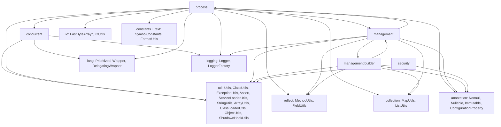
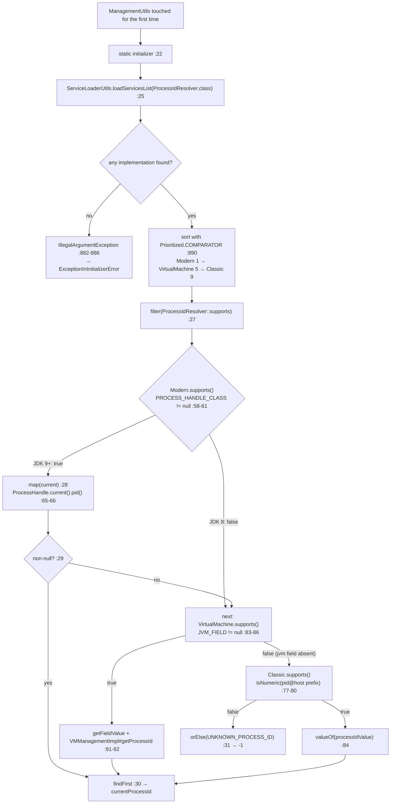
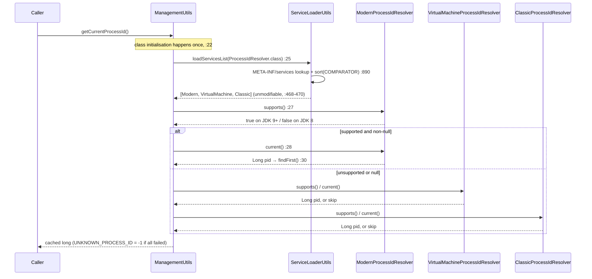
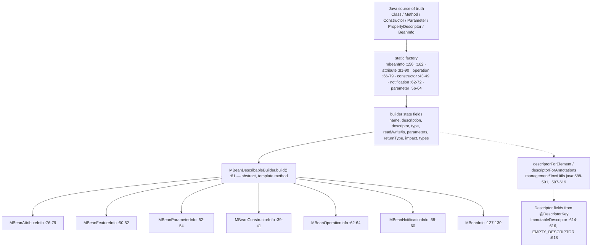

# Concurrency, process, management and security — developer guide

**Module:** `microsphere-java-core` · **Packages:** `io.microsphere.concurrent`, `io.microsphere.process`,
`io.microsphere.management`, `io.microsphere.management.builder`, `io.microsphere.security` · **23 main-source types** ·
**Branch:** `release` (`0.3.20-SNAPSHOT`)

This page is the source-level companion to
[Concurrency, process, management and security — User Guide](../../user-guide/microsphere-java-core/concurrency-process-and-management.md).
All paths are relative to `microsphere-java-core/src/main/java/io/microsphere/` (main) or
`microsphere-java-core/src/test/java/io/microsphere/` (tests).

---

## 1. Where this group sits

The five packages are not one subsystem. They are four small ones that happen to interlock twice: `process` reads the
`RuntimeMXBean` through `management`, and `management` resolves the PID from `process`. That mutual edge is the only real
coupling in the group, and it points in an unexpected direction — the *consumer* of the resolver chain lives in a
different package than the resolvers.



Every edge is backed by an import statement, verified individually:

| Edge | Evidence |
|---|---|
| `concurrent → lang` | `concurrent/DelegatingBlockingQueue.java:19` (`DelegatingWrapper`), `:30` (`Wrapper.tryUnwrap`) |
| `concurrent → util` | `concurrent/ExecutorUtils.java:20-21`, `:28-29`; `concurrent/DelegatingBlockingQueue.java:31` |
| `concurrent → logging` | `concurrent/ExecutorUtils.java:19`, `:27` |
| `process → lang` | `process/ProcessIdResolver.java:19`, `process/ClassicProcessIdResolver.java:19` |
| `process → reflect` | `process/ModernProcessIdResolver.java:22-23`; `process/VirtualMachineProcessIdResolver.java:26-28` |
| `process → management` | `process/ClassicProcessIdResolver.java:24`, `process/VirtualMachineProcessIdResolver.java:25` — both `JmxUtils.getRuntimeMXBean` |
| `process → concurrent` | `process/ProcessExecutor.java:17-18` — `newThreadFactory`, `shutdownOnExit` |
| `process → io / constants / text` | `process/ProcessExecutor.java:4-5`, `:19-20`, `:23` |
| `management → process` | `management/ManagementUtils.java:3`, `:9` |
| `management → util` | `management/ManagementUtils.java:4-5`, `:10`; `management/JmxUtils.java:24`, `:65-67` |
| `management ↔ management.builder` | `management/JmxUtils.java:23` (uses `MBeanParameterInfoBuilder`) and `management/builder/MBeanExecutableInfoBuilder.java:21`, `:33` (uses `JmxUtils`) |
| `management.builder → reflect` | `management/builder/MBeanInfoBuilder.java:37` (`MethodUtils.isIsMethod`) |
| `security → util / annotation` | `security/SecurityUtils.java:20-23`, `:27` |

Two observations for reviewers:

* **`management` and `management.builder` form a package-level cycle.** Neither direction is a class cycle, so the JDK
  compiles it happily, but the two packages must be reasoned about together: `JmxUtils.signature(Parameter[])`
  (`management/JmxUtils.java:577-582`) builds `MBeanParameterInfo` objects through the builder package, and the builders
  call back into `JmxUtils.descriptorForElement` / `descriptorForAnnotations`
  (`management/builder/MBeanExecutableInfoBuilder.java:33`, `management/builder/MBeanParameterInfoBuilder.java:28`).
* **`concurrent/CustomizedThreadFactory.java` and `concurrent/DelegatingScheduledExecutorService.java` import nothing from
  `io.microsphere`** — they are self-contained JDK adapters. That is why they are the safest types in the group to copy.

### 1.1 Who consumes this group inside `core`

Exactly three main-source files outside the group depend on it:

| Consumer | Uses |
|---|---|
| `io/StandardFileWatchService.java:44-46` | `CustomizedThreadFactory.newThreadFactory`, `ExecutorUtils.shutdown`, `ExecutorUtils.shutdownOnExit` |
| `util/ClassLoaderUtils.java:45` | `JmxUtils.getClassLoadingMXBean` |
| `util/ClassPathUtils.java:17` | `JmxUtils.getRuntimeMXBean` |

No Spring module consumes these packages, and no other `microsphere-*` module reads them from a public API surface — so
changes here are contained, with the exception of `JmxUtils` (used reflectively by nothing, directly by the three
consumers above).

---

## 2. Type inventory (all 23 types)

| # | Type | Declared at | Kind | Extends / implements | Responsibility |
|---|---|---|---|---|---|
| 1 | `CustomizedThreadFactory` | `concurrent/CustomizedThreadFactory.java:40` | concrete class | `ThreadFactory` | named, daemon, prioritised thread creation |
| 2 | `ExecutorUtils` | `concurrent/ExecutorUtils.java:40` | abstract (`Utils`) | `Utils` | graceful + at-exit executor shutdown |
| 3 | `DelegatingBlockingQueue<E>` | `concurrent/DelegatingBlockingQueue.java:55` | concrete class | `BlockingQueue<E>`, `DelegatingWrapper` | forwarding queue with wrapper flattening |
| 4 | `DelegatingScheduledExecutorService` | `concurrent/DelegatingScheduledExecutorService.java:56` | concrete class | `ScheduledExecutorService` | hot-swappable scheduling façade |
| 5 | `ProcessIdResolver` | `process/ProcessIdResolver.java:54` | interface | `Prioritized` | `supports()` / `current()` strategy contract |
| 6 | `ModernProcessIdResolver` | `process/ModernProcessIdResolver.java:50` | concrete class | `ProcessIdResolver` | `ProcessHandle#pid()` via reflection, prio 1 |
| 7 | `VirtualMachineProcessIdResolver` | `process/VirtualMachineProcessIdResolver.java:62` | concrete class | `ProcessIdResolver` | `sun.management.VMManagementImpl` via field reflection, prio 5 |
| 8 | `ClassicProcessIdResolver` | `process/ClassicProcessIdResolver.java:69` | concrete class | `ProcessIdResolver` | `RuntimeMXBean#getName()` `pid@host` parse, prio 9 |
| 9 | `ProcessManager` | `process/ProcessManager.java:40` | singleton class | — | registry of in-flight child processes |
| 10 | `ProcessExecutor` | `process/ProcessExecutor.java:58` | concrete class | — | child-process execution with timeout |
| 11 | `ManagementUtils` | `management/ManagementUtils.java:20` | abstract (`Utils`) | `Utils` | PID façade; drives the resolver chain |
| 12 | `JmxUtils` | `management/JmxUtils.java:87` | class (private ctor `:654-655`) | `Utils` | `ManagementFactory` cache + attribute/metadata introspection |
| 13 | `MBeanAttribute` | `management/MBeanAttribute.java:59` | concrete class | — | immutable (info, value) pair |
| 14 | `MBeanDescribableBuilder<B>` | `management/builder/MBeanDescribableBuilder.java:34` | abstract class | — | `description` + `descriptor`, declares `build()` `:61` |
| 15 | `MBeanFeatureInfoBuilder<B>` | `management/builder/MBeanFeatureInfoBuilder.java:32` | abstract class | `MBeanDescribableBuilder<B>` | adds `name`; `build()` → `MBeanFeatureInfo` `:50-52` |
| 16 | `MBeanAttributeInfoBuilder` | `management/builder/MBeanAttributeInfoBuilder.java:34` | concrete class | `MBeanFeatureInfoBuilder<…>` | adds `type`/`read`/`write`/`is` |
| 17 | `MBeanParameterInfoBuilder` | `management/builder/MBeanParameterInfoBuilder.java:40` | concrete class | `MBeanFeatureInfoBuilder<…>` | adds `type`; `parameter(Parameter)` `:66-74` |
| 18 | `MBeanExecutableInfoBuilder<B>` | `management/builder/MBeanExecutableInfoBuilder.java:48` | abstract class | `MBeanFeatureInfoBuilder<…>` | parameters/signature, `from(Executable)` `:76-84` |
| 19 | `MBeanConstructorInfoBuilder` | `management/builder/MBeanConstructorInfoBuilder.java:33` | concrete class | `MBeanExecutableInfoBuilder<…>` | → `MBeanConstructorInfo` `:39-41` |
| 20 | `MBeanOperationInfoBuilder` | `management/builder/MBeanOperationInfoBuilder.java:38` | concrete class | `MBeanExecutableInfoBuilder<…>` | `returnType` + nested `enum Impact` `:81-116` |
| 21 | `MBeanNotificationInfoBuilder` | `management/builder/MBeanNotificationInfoBuilder.java:40` | concrete class | `MBeanDescribableBuilder<…>` | notification `types` `:43-56` |
| 22 | `MBeanInfoBuilder` | `management/builder/MBeanInfoBuilder.java:48` | concrete class | `MBeanDescribableBuilder<MBeanInfoBuilder>` | aggregate; `mbeanInfo(BeanInfo)` `:162-185` |
| 23 | `SecurityUtils` | `security/SecurityUtils.java:39` | abstract (`Utils`) | `Utils` | `java.security.policy` get/set |

Structural notes that are easy to miss:

* `MBeanInfoBuilder` and `MBeanNotificationInfoBuilder` extend **`MBeanDescribableBuilder`**, not
  `MBeanFeatureInfoBuilder` — `MBeanInfo` and `MBeanNotificationInfo` have no `MBeanFeatureInfo` super-family in the JDK.
  Anyone assuming "everything in the package has `name()`" will be wrong for these two.
* `ProcessIdResolver` is the only *interface* in the group besides the JDK interfaces it implements; everything else is a
  class, and four of the classes (`ExecutorUtils`, `ManagementUtils`, `SecurityUtils`, `JmxUtils`) are non-instantiable
  utility holders with private constructors (`concurrent/ExecutorUtils.java:144-145`, `management/ManagementUtils.java:60`,
  `security/SecurityUtils.java:75-76`, `management/JmxUtils.java:654-655`).
* `ProcessIdResolver` declares `Long current()` (boxed) while `ManagementUtils.getCurrentProcessId()` returns `long`.
  The boxing is what makes the `filter(Objects::nonNull)` step in §3 possible.

---

## 3. Process-id resolution: the strategy chain and how the winner is picked

### 3.1 Assembly

There is no `ProcessIdResolvers` factory class anywhere in the repository. Assembly happens in one expression inside
`ManagementUtils`:

```java
static final long currentProcessId = resolveCurrentProcessId();                      // :22
private static long resolveCurrentProcessId() {
    return loadServicesList(ProcessIdResolver.class)                                  // :25
            .stream()
            .filter(ProcessIdResolver::supports)                                      // :27
            .map(ProcessIdResolver::current)                                          // :28
            .filter(Objects::nonNull)                                                 // :29
            .findFirst()                                                              // :30
            .orElse(UNKNOWN_PROCESS_ID);                                              // :31
}
```

`loadServicesList` is `ServiceLoaderUtils.loadServicesList(Class)` (`util/ServiceLoaderUtils.java:382-384`), which
delegates to the class-loader-hierarchy-aware path and ends in `loadServicesAsList(Class, ClassLoader)`
(`:873-893`). Three consequences follow from that path:

1. Implementations come from `META-INF/services`, and this group ships exactly one such file:
   `microsphere-java-core/src/main/resources/META-INF/services/io.microsphere.process.ProcessIdResolver` listing the three
   resolvers. `management` and `security` register nothing.
2. The returned list is wrapped unmodifiable (`util/ServiceLoaderUtils.java:468-470`), so the chain cannot be mutated by
   a caller.
3. If no implementation is found, `loadServicesAsList` throws `IllegalArgumentException`
   (`:882-886`) rather than returning an empty list. Because `resolveCurrentProcessId()` runs in a **static initializer**
   (`management/ManagementUtils.java:22`), that exception surfaces as `ExceptionInInitializerError` on first touch of
   `ManagementUtils`.

### 3.2 Ordering

`loadServicesAsList` sorts with `sort(serviceList, COMPARATOR)` (`util/ServiceLoaderUtils.java:890`), where `COMPARATOR`
is `Prioritized.COMPARATOR` (`lang/Prioritized.java:61-76`) and the natural order is
`Integer.compare(getPriority(), other.getPriority())` (`lang/Prioritized.java:102-105`). So **ascending numeric priority,
lowest first** — and remember the library's inverted constants: `MAX_PRIORITY = Integer.MIN_VALUE`
(`lang/Prioritized.java:81`), `MIN_PRIORITY = Integer.MAX_VALUE` (`:86`), `NORMAL_PRIORITY = 0` (`:91`).

The three resolvers space themselves out from `NORMAL_PRIORITY`:

| Resolver | Expression | Value | Citation |
|---|---|---|---|
| `ModernProcessIdResolver` | `NORMAL_PRIORITY + 1` | 1 | `process/ModernProcessIdResolver.java:73-76` |
| `VirtualMachineProcessIdResolver` | `NORMAL_PRIORITY + 5` | 5 | `process/VirtualMachineProcessIdResolver.java:99-102` |
| `ClassicProcessIdResolver` | `NORMAL_PRIORITY + 9` | 9 | `process/ClassicProcessIdResolver.java:91-94` |

The gaps (1/5/9) leave room for third-party resolvers to be inserted without renumbering, and the tests pin each number
exactly (`process/ModernProcessIdResolverTest.java`, `process/VirtualMachineProcessIdResolverTest.java`,
`process/ClassicProcessIdResolverTest.java` all assert `getPriority()`), so re-spacing them is a breaking change.
Declaration order inside the service file is irrelevant — sorting happens after loading.

### 3.3 Selection



The `filter`/`map` pair is lazy, so a lower-priority resolver's `current()` runs only when every higher-priority one has
either failed `supports()` or returned `null`. On JDK 11+ this means `VirtualMachineProcessIdResolver.current()` and
`ClassicProcessIdResolver.current()` are never invoked at all.

> [!WARNING]
> `supports()` guards *selection*, not *execution*. Calling `current()` on an unsupported resolver is not a documented
> no-op: `ModernProcessIdResolver.current()` passes a `null` class to `invokeStaticMethod`
> (`process/ModernProcessIdResolver.java:65`) and throws `IllegalArgumentException`, which the test pins on JDK 8
> (`process/ModernProcessIdResolverTest.java:43`). A resolver that *throws* during selection also escapes the
> `orElse(UNKNOWN_PROCESS_ID)` degradation at `:31` — the chain absorbs `null`, not exceptions. The javadoc at
> `management/ManagementUtils.java:48-51` promises the fallback more broadly than the code delivers.

### 3.4 One PID lookup, end to end



### 3.5 Eager probing — a subtle cost

All three resolvers do their discovery in **static initializers**, not lazily:
`PROCESS_HANDLE_CLASS = resolveClass(...)` (`process/ModernProcessIdResolver.java:56`),
`JVM_FIELD = findField(getRuntimeMXBean(), "jvm")` (`process/VirtualMachineProcessIdResolver.java:81`), and
`runtimeName` / `processIdValue` (`process/ClassicProcessIdResolver.java:73-75`). Class initialisation is triggered when
`ServiceLoader` instantiates each implementation, so a single `getCurrentProcessId()` call pays for **all three probes** —
including `Class.forName` for `java.lang.ProcessHandle` and a `getDeclaredField` walk of the `RuntimeMXBean`
implementation — before the winner is chosen. It is a one-off, class-initialisation-locked cost per JVM, but it explains why
the chain has no lazy short-circuit.

---

## 4. JDK-version dispatch: how one artifact runs on 8 → 25

There is **no version check anywhere in this group's main sources.** Grepping the 23 files for `JavaVersion`,
`JAVA_VERSION_`, `SystemUtils` or `isCurrentJavaVersion` yields nothing; version predicates appear only in tests
(`process/ModernProcessIdResolverTest.java:26` uses `testCurrentJavaVersion(GE, JAVA_VERSION_9)`). The dispatch is
therefore **capability probing**, three ways, each resolved by the JVM itself:

| Mechanism | Probe | Selection signal | Call path | On JDK 8 |
|---|---|---|---|---|
| Class presence | `resolveClass("java.lang.ProcessHandle")` (`process/ModernProcessIdResolver.java:54-56`) | `supports()` = `nonNull(PROCESS_HANDLE_CLASS)` (`:58-61`) | `MethodUtils.invokeStaticMethod(..., "current")` then `MethodUtils.invokeMethod(handle, ..., "pid")` (`:65-66`) | class absent → skipped |
| Field presence | `FieldUtils.findField(getRuntimeMXBean(), "jvm")` (`process/VirtualMachineProcessIdResolver.java:81`) | `supports()` = `nonNull(JVM_FIELD)` (`:83-86`) | `getFieldValue(true, runtimeMXBean, JVM_FIELD)` → `invokeMethod(true, jvm, "getProcessId")` (`:91-92`) | the intended JDK 8 path |
| Data shape | `substringBefore(getRuntimeMXBean().getName(), AT)` (`process/ClassicProcessIdResolver.java:73-75`) | `supports()` = `isNumeric(processIdValue)` (`:77-80`) | `valueOf(processIdValue)` (`:84`) — no reflection | last resort |

Why reflection instead of a direct `ProcessHandle.current().pid()` call: the artifact is compiled once at the bytecode
level inherited from the external parent `microsphere-build:0.3.16` (no `maven.compiler.*` / `<release>` property exists
anywhere in the reactor), and the CI matrix starts at JDK 8 (`java: [ '8' , '11' , '17' , '21' , '25' ]`,
`distribution: 'temurin'`, `.github/workflows/maven-build.yml:25`, `:33`). A compile-time reference to
`java.lang.ProcessHandle` would fail the JDK 8 build, so `ModernProcessIdResolver` reaches it through
`io.microsphere.reflect.MethodUtils` (`process/ModernProcessIdResolver.java:22-23`) and never names the type in code.

Consequences a maintainer should keep in mind:

* On JDK 9+ `VirtualMachineProcessIdResolver.supports()` is **not** what excludes it — the `jvm` field exists on HotSpot's
  `sun.management.RuntimeImpl` across the matrix, so `supports()` may well return `true`. It is shadowed by the priority
  1 resolver. If `ModernProcessIdResolver.current()` were ever to return `null`, the chain would fall through to
  `getFieldValue(true, ...)` (`:91`), which needs `--add-opens` on JDK 16+ and would otherwise throw. The safe ordering is
  the priority, not the guard.
* `VirtualMachineProcessIdResolver.current()` dereferences the result of `getFieldValue` without a null check and then
  calls `processId.longValue()` (`:91-96`), so an absent field value produces an `NullPointerException` rather than a
  clean fall-through.
* `JmxUtils.descriptorForAnnotations` also relies on reflective dispatch — it invokes annotation member methods through
  `MethodUtils.invokeMethod(annotation, method)` (`management/JmxUtils.java:609`, import at `:64`) so it works on the
  JDK's annotation proxy objects regardless of version.

---

## 5. The MBean builder pipeline

### 5.1 Shape



`MBeanDescribableBuilder.build()` is declared `public abstract <I extends DescriptorRead> I build();`
(`management/builder/MBeanDescribableBuilder.java:61`) — the abstract step of a template method whose shared steps
(`description(String)` `:51-54`, `descriptor(Descriptor)` `:56-59`) are inherited by all nine concrete/abstract builders.
The generic self-return `B` is what lets `name(...)` be called on a subclass and still return something chainable.

`MBeanInfoBuilder.build()` (`management/builder/MBeanInfoBuilder.java:127-130`) fans out to four private steps —
`buildAttributes()` `:132-136`, `buildConstructors()` `:138-142`, `buildOperations()` `:144-148`,
`buildNotifications()` `:150-154` — each of which is `builders.stream().map(X::build).toArray(X[]::new)`.

> [!NOTE]
> Correction worth recording: the arrays handed to the `MBeanInfo` constructor are produced by `toArray(...)`, **not** by
> the `EMPTY_MBEAN_*_ARRAY` constants in `JmxUtils` (`management/JmxUtils.java:91-99`). Of those five constants only
> `EMPTY_MBEAN_ATTRIBUTE_ARRAY` (`:91`) is used by production code — at `:417`. The other four (`:93`, `:95`, `:97`, `:99`)
> are referenced only from `.../test/java/io/microsphere/management/JmxUtilsTest.java:117-121`.

### 5.2 Reflection → JMX metadata

The bridge from `java.lang.reflect` to `javax.management` is `MBeanExecutableInfoBuilder.from(Executable)`
(`management/builder/MBeanExecutableInfoBuilder.java:76-84`), which records the executable and derives its parameter list;
`signature(...)` `:62-66` and `toSignature()` `:86-88` then materialise `MBeanParameterInfo[]`. The same derivation exists
statically in `JmxUtils.methodSignature(Method)` → `signature(Parameter[])` (`management/JmxUtils.java:573-582`), which
uses `MBeanParameterInfoBuilder::parameter` followed by `::build` — this is the `management` half of the package cycle
from §1.

Descriptions are never invented. `MBeanExecutableInfoBuilder.from(Executable)` and the `attribute(PropertyDescriptor)` path
let `description(...)` come from the JDK object's own `toString()`; `mbeanInfo(BeanInfo)` sets
`builder.description = beanInfo.toString()` (`management/builder/MBeanInfoBuilder.java:167`) and `className` from
`ClassUtils.getTypeName(beanClass)` (`:166`), while `mbeanInfo(String className)` (`:156-160`) leaves both `description`
and `descriptor` **null** — behaviour pinned by `.../test/java/io/microsphere/management/builder/MBeanInfoBuilderTest.java:154-159`.

Attribute/operation derivation from a JavaBean (`:162-185`) is three loops: `PropertyDescriptor[]` → `attribute(...)`
(`:170-172`), `MethodDescriptor[]` → `operation(...)` (`:174-177`), `beanClass.getDeclaredConstructors()` →
`constructor(...)` (`:179-182`). `attribute(PropertyDescriptor)` itself (`:75-85`) maps `is` from
`MethodUtils.isIsMethod(readMethod)`, `read` from `nonNull(readMethod)`, `write` from
`nonNull(propertyDescriptor.getWriteMethod())`, and uses `ListUtils.newLinkedList()` for the four builder lists
(`:57-66`, import `:36`).

Nothing in `management.builder` registers an MBean. The only `registerMBean(...)` calls in the whole slice are in tests
(`.../test/java/io/microsphere/management/JmxUtilsTest.java:267`, `:291`), under caller-chosen names
(`:234`, `:284`). Metadata production and registration remain deliberately separate.

---

## 6. Thread safety and state

| Holder | Declaration | Verdict |
|---|---|---|
| `ProcessManager.unfinishedProcessesCache` | `process/ProcessManager.java:47` — `ConcurrentHashMap`, package-private field | Safe for concurrent `putIfAbsent` (`:53`) and two-arg `remove(process, arguments)` (`:58`). Note the *conditional* remove: a mismatched `arguments` value silently leaves the entry. |
| `ProcessManager.unfinishedProcessesMap()` | `process/ProcessManager.java:67-71` | Returns `unmodifiableMap(cache)` — a live **view**, not a snapshot. Weakly consistent iteration (fine), but `@Immutable` at `:68` overstates it: the contents change under a concurrent registry. |
| `ManagementUtils.currentProcessId` | `management/ManagementUtils.java:22` — `static final long` | Effectively immutable; safe publication is guaranteed by the class-initialisation lock. The only refresh is a new JVM. |
| `JmxUtils` MXBean caches | `management/JmxUtils.java:101-117` — nine **non-volatile** private statics, each lazily filled in a `if (x == null) x = ManagementFactory.getX()` getter (`:132-138`, `:153-159`, `:174-180`, `:195-201`, `:223-229`, `:248-254`, `:275-282`, `:306-313`, `:337-344`) | Benign race by construction (idempotent re-assignment), but there is **no happens-before edge** for the published reference. For the `ManagementFactory` singletons the objects are already fully constructed, so the exposure is theoretical; for the three `List` caches, which wrap a list built inside the getter, unsafe publication is the case a reviewer should think about. Also: the "cached once" property is not enforced, so `ManagementFactory.getMemoryPoolMXBeans()` may be called more than once under contention. |
| `ServiceLoaderUtils.servicesCache` | `util/ServiceLoaderUtils.java:140` (`ConcurrentMap`, `computeIfAbsent` at `:846`) | Thread-safe, but only consulted when `SERVICE_LOADER_CACHED` is `true` (`:138`); the default is `false`, so `ManagementUtils` (`:25`) discovers on every call. In this group the amortisation comes from the `currentProcessId` static field instead. |
| `ShutdownHookUtils.shutdownHookCallbacks` | `util/ShutdownHookUtils.java:114` — `static final PriorityBlockingQueue` | Thread-safe queue; `ExecutorUtils.shutdownOnExit` (`concurrent/ExecutorUtils.java:63-68`) appends without bound and never removes — see pitfall 11 in the user guide. |
| `DelegatingScheduledExecutorService.delegate` | `concurrent/DelegatingScheduledExecutorService.java:58` — `volatile` | Reference swap is safely published; nothing more. The javadoc at `:49-50` ("thread-safe and allows the delegate to be changed dynamically") is true of the *field*, not of an in-flight `schedule(...)`/`Future` sequence. |
| `DelegatingBlockingQueue.delegate` | `concurrent/DelegatingBlockingQueue.java:57` — `final` | Safe publication via final field; thread-safety is inherited from the wrapped queue, which the decorator neither adds to nor subtracts from. |
| `CustomizedThreadFactory` | `concurrent/CustomizedThreadFactory.java:57-67`, counter at `:71` | All fields effectively immutable except the `AtomicInteger` thread counter → safe for concurrent `newThread`. |
| `ProcessExecutor` | `process/ProcessExecutor.java:90`, `:104-115`, `:149-192` | Per-instance single-thread executor; instances are **not** safe to share for concurrent `execute(...)` calls (each call submits to the same single thread and mutates shared state). |
| `MBeanAttribute` | `management/MBeanAttribute.java:59`, ctor `:67-75` | Immutable value object; the constructor's `requireNonNull` on the two metadata arguments (`:70-71`) is the class's only throw site. |
| All nine builders | field mutation throughout | **Not** thread-safe by design; a builder is a single-threaded staging area for one `build()`. |

### 6.1 Every throw site in this group

For the repository's NPE/exception-hardening audit, these are the places where the group's otherwise silent-degradation
policy is broken, verified line by line:

* `management/JmxUtils.java:627-628` — `catch (Throwable e) { throw wrap(e, RuntimeException.class); }` inside
  `doGetAttribute`; only `ReflectionException`, `InstanceNotFoundException` and `AttributeNotFoundException` are handled
  gracefully (`:625-626`).
* `process/ProcessExecutor.java:172` (`IOException` for a non-zero exit), `:188` (`TimeoutException` re-thrown after
  `future.cancel(true)`), `:190` (`wrap(e, IOException.class)`).
* `management/MBeanAttribute.java:70-71` — `requireNonNull`.
* `management/builder/MBeanAttributeInfoBuilder.java:86` — `assertNotNull(attributeType, ...)` → `IllegalArgumentException`
  (`util/Assert.java:149-153`).
* `process/ModernProcessIdResolver.java:65` — throws on an unsupported JVM instead of returning `null`.
* `util/ServiceLoaderUtils.java:882-886` — reached from `management/ManagementUtils.java:25`, inside a static initializer.
* Latent (not currently reachable): `process/VirtualMachineProcessIdResolver.java:91-96`.

Everything else degrades: `ExecutorUtils.shutdown` returns `false` (`concurrent/ExecutorUtils.java:96-101`, `:132-134`),
`JmxUtils` returns empty arrays (`management/JmxUtils.java:416-418`), empty maps (`:375-377`), `null` after logging
(`:560-568`, `:513-534`), or `EMPTY_DESCRIPTOR` (`:618`).

---

## 7. Design patterns (with the implementing class)

| Pattern | Proving class(es) | How it shows up in source |
|---|---|---|
| **Strategy + ordered selection** | `ProcessIdResolver` (`process/ProcessIdResolver.java:54`) and its three implementations | `supports()`/`current()` contract; ordering by `Prioritized` (`:54`, `lang/Prioritized.java:102-105`); the choosing loop is `management/ManagementUtils.java:25-31` |
| **Service Provider Interface** | `META-INF/services/io.microsphere.process.ProcessIdResolver` + `ServiceLoaderUtils` | the only extension point that is data-driven rather than type-driven |
| **Facade** | `JmxUtils` over `ManagementFactory`/`MBeanServer`; `ManagementUtils` over the resolver chain | one flat static surface for nine MXBean accessors (`management/JmxUtils.java:132-344`); a single `getCurrentProcessId()` hiding three strategies (`management/ManagementUtils.java:56-58`) |
| **Builder** | the whole `management.builder` family | fluent setters returning `this`/`(B) this` and a terminal `build()` per JDK constructor (`management/builder/MBeanInfoBuilder.java:127-130`) |
| **Template Method** | `MBeanDescribableBuilder` (`management/builder/MBeanDescribableBuilder.java:34-61`) | `description()`/`descriptor()` are the shared steps, `build()` is the abstract step; `MBeanInfoBuilder.build()` also fixes the skeleton of four `map(...).toArray(...)` sub-steps (`:132-154`) |
| **Decorator / delegating wrapper** | `DelegatingBlockingQueue` (`concurrent/DelegatingBlockingQueue.java:55`), `DelegatingScheduledExecutorService` (`:56`) | every method is a one-line forward; `tryUnwrap` flattens nesting (`:59-62`, `lang/Wrapper.java:113-121`) |
| **Singleton (eager, private constructor)** | `ProcessManager.INSTANCE` (`process/ProcessManager.java:45`, ctor `:49-50`) | one registry per class loader; `protected` mutators make subclassing the extension route (`:52`, `:57`) |
| **Factory Method** | `CustomizedThreadFactory.newThreadFactory` overloads (`concurrent/CustomizedThreadFactory.java:78-90`); the six static `mbeanInfo`/`attribute`/`operation`/`constructor`/`notification`/`parameter` factories | the constructor of `CustomizedThreadFactory` is `protected` (`:69`), so the factory methods are the public entry |
| **Null Object** | **absent — deliberately noted** | there is no Null Object here. `UNKNOWN_PROCESS_ID = -1L` (`process/ProcessIdResolver.java:59`) is a sentinel primitive, `Long current()` returns real `null` on failure, and the only empty-object in play (`ImmutableDescriptor.EMPTY_DESCRIPTOR`, used at `management/JmxUtils.java:618`) comes from the JDK, not from this group |
| **Value Object** | `MBeanAttribute` (`management/MBeanAttribute.java:59`) | final fields, `equals`/`hashCode` derived from the wrapped `MBeanAttributeInfo`, no behaviour beyond delegation (`:86-138`) |
| **Command (lightweight)** | `ProcessExecutor` (`process/ProcessExecutor.java:58`, `:104-115`) | a command line + options captured at construction, executed later against an `OutputStream` (`:149-192`) |

---

## 8. Extension points

1. **Add a PID strategy.** Implement `ProcessIdResolver`, pick a `getPriority()` that slots between the existing 1/5/9,
   and append the class name to `META-INF/services/io.microsphere.process.ProcessIdResolver`. Nothing else changes — the
   `ManagementUtils` chain picks it up automatically. Guard `current()` so it never throws when `supports()` is `false`.
2. **Customise thread creation.** `CustomizedThreadFactory`'s constructor is `protected`
   (`concurrent/CustomizedThreadFactory.java:69-76`) precisely so subclasses can override `newThread` (`:94-99`) — for
   example to install an `UncaughtExceptionHandler`, which the base class deliberately does not do.
3. **Intercept scheduling or queueing.** Extend `DelegatingScheduledExecutorService` (swappable `volatile` delegate,
   `concurrent/DelegatingScheduledExecutorService.java:58-70`) or wrap with `DelegatingBlockingQueue`
   (`concurrent/DelegatingBlockingQueue.java:55`).
4. **Track child processes differently.** `ProcessManager`'s `protected` add/remove (`process/ProcessManager.java:52-60`)
   are meant to be called by subclasses; the private constructor (`:49-50`) keeps `INSTANCE` (`:45`) the only JDK-visible
   singleton.
5. **Emit custom JMX metadata.** Subclass any builder and set the fields the JDK requires; `description(...)` and
   `descriptor(...)` are inherited from `MBeanDescribableBuilder` (`management/builder/MBeanDescribableBuilder.java:51-59`).

---

## 9. Testing strategy

| Test | Pins |
|---|---|
| `.../process/ModernProcessIdResolverTest.java:26-50` | version-conditional `supports()` via `testCurrentJavaVersion(GE, JAVA_VERSION_9)` (`:26`), the JDK 8 `IllegalArgumentException` on `current()` (`:43`), priority `1` |
| `.../process/VirtualMachineProcessIdResolverTest.java:28-41` | `supports()` true, `current()` non-null, priority `5` |
| `.../process/ClassicProcessIdResolverTest.java:28-41` | `supports()` true, `current()` non-null, priority `9` |
| `.../management/ManagementUtilsTest.java:19-24` | `getCurrentProcessId() > 0` and equality with the cached `currentProcessId` field |
| `.../process/ProcessManagerTest.java:28-60` | live registry observation while a `java -version` child runs; asserts the recorded options string is `" -version"` (`:52`) |
| `.../process/ProcessExecutorTest.java:38-64` | happy path plus all three failure modes: `TimeoutException` (`1` ms timeout), `IOException` for a bad flag, `IOException` for a missing command |
| `.../management/JmxUtilsTest.java:107-294` | MXBean identity, five `ClassLoading` attributes (`:190-199`), silent degradation for unknown names (`:201-205`), a hand-written `DynamicMBean` registered as `io.microsphere.management:type=Test` (`:231-234`, `:267`), and the `RuntimeMBeanException` escape via `CacheControl` (`:284-293`) |
| `.../management/JmxUtilsTest.java:319-343` | `@DescriptorKey` → `Descriptor` field, and the `EMPTY_DESCRIPTOR` branch |
| `.../management/MBeanAttributeTest.java:48-96` | delegation surface of the value object |
| `.../management/builder/*BuilderTest.java` | per-builder `build()` mapping; `MBeanInfoBuilderTest.java:154-159` pins the null-description case, `:162-181` the `BeanInfo` path, `:184-204` the aggregate |
| `.../management/builder/AbstractMBeanDescribableBuilderTest.java:38-39`, `AbstractMBeanFeatureInfoBuilderTest.java:37-38` | the two shared bases are `@Disabled` **at the abstract base only** (`:38`, `:37`) and reflectively construct the concrete builder from the type parameter, so the seven concrete tests still execute |
| `.../concurrent/*Test.java` | thread-name/daemon/priority assertions (`CustomizedThreadFactoryTest.java:40-61`), shutdown semantics (`ExecutorUtilsTest.java:36-89`, hook queue drained via `getStaticFieldValue` at `:47-67`), delegate forwarding and swap (`DelegatingScheduledExecutorServiceTest.java:28-110`, `DelegatingBlockingQueueTest.java:36-177`) |
| `.../security/SecurityUtilsTest.java:44-71` | get/set round-trip plus `clearProperty` teardown |

Coverage gaps worth noting: no test forces `ManagementUtils` into the `-1` state (the SPI file is always present), no test
exercises `VirtualMachineProcessIdResolver.current()` on a JDK where `supports()` is `true` but the field is inaccessible,
and nothing asserts behaviour when `Microsphere`'s `SERVICE_LOADER_CACHED` is flipped to `true`.

---

## 10. Review notes

1. **`ProcessManager` advertises API it does not have.** The javadoc bullet "Safely destroy a process"
   (`process/ProcessManager.java:19`) and the example `ProcessManager.INSTANCE.destroy(process)` (`:30`) describe a method
   the class body (`:40-72`) never declares. The example at `:25-27` also calls the `protected`
   `addUnfinishedProcess(...)` from outside the class.
2. **`ManagementUtils`' degradation promise is too strong.** `management/ManagementUtils.java:48-51` says the result
   "defaults to `UNKNOWN_PROCESS_ID`" if no resolver can determine the PID; `:25-31` only degrades on `null`, never on a
   thrower, and a missing SPI file throws from the static initializer (`:22`, `util/ServiceLoaderUtils.java:882-886`).
3. **`JmxUtils.getAttribute` has no readability guard.** The javadoc at `management/JmxUtils.java:453` and `:464-465`
   promises `null` when "the attribute is not readable", but `:456-458` forwards straight to `doGetAttribute`; the
   not-readable case is realised as an `AttributeNotFoundException` caught at `:625` and logged (`:633-640`).
   `getMBeanAttributes` (`:422-427`) reads *every* declared attribute, so a write-only attribute costs a warn-logged
   exception per snapshot.
4. **`@Immutable` on a live view.** `process/ProcessManager.java:67-71` returns `unmodifiableMap` of a `ConcurrentMap` and
   annotates it `@Immutable`; the contents change while the caller iterates.
5. **Non-volatile static caches in `JmxUtils`.** Nine fields (`management/JmxUtils.java:101-117`) published without
   volatile/locks — see §6 for the precise risk split between the MXBean singletons and the `List` caches.
6. **Public misspelling.** `DEFAULT_PROCESS_EXECUTION_TIMEOUT_PROPERTY_VAUE` (`process/ProcessExecutor.java:65`) is a
   `public static final` field; renaming it is a breaking change on a released line.
7. **Thread-safety javadoc overreach.** `concurrent/DelegatingScheduledExecutorService.java:49-50` claims class-level
   thread-safety; only the `volatile` reference swap is safe (§6).
8. **Two documentation-only artefacts.** `TestSecurityManager`
   (`.../test/java/io/microsphere/security/TestSecurityManager.java:27`, `:38`, `:52`) is referenced nowhere, and
   `security/SecurityUtils.java:35` links `@see SecurityManager`, an API deprecated for removal since JDK 17 and
   disabled in JDK 24 — a trap for readers of the javadoc.
9. **Four unused `public static final` empty arrays** (`management/JmxUtils.java:93`, `:95`, `:97`, `:99`), used only from
   `JmxUtilsTest` (`:117-121`).
10. **Minor javadoc typo** in the contract itself: `process/ProcessIdResolver.java:71` renders `<code>>null</code>`.
11. **No uncaught-exception handling.** `CustomizedThreadFactory.newThread` (`concurrent/CustomizedThreadFactory.java:94-99`)
    sets group/name/daemon/priority only; a repository-wide search of the main sources finds no
    `UncaughtExceptionHandler` usage, which is a deliberate gap callers must fill.

---

## 11. See also

* [Concurrency, process, management and security — User Guide](../../user-guide/microsphere-java-core/concurrency-process-and-management.md)
* [Language abstractions — Developer Guide](./language-abstractions.md) — `Prioritized` and the comparator contract that `JmxUtils` ordering leans on
* [Utilities, constants and text — Developer Guide](./util-and-constants.md) — `ClassLoaderUtils`/`ClassUtils`, the MXBean export layer and `ProcessIdResolver` all build on them
* [Reflection, types and beans — Developer Guide](./reflection-and-beans.md) — how `@ManagedAttribute` accessors are discovered
* [microsphere-jdk-tools — Developer Guide](../module-microsphere-jdk-tools.md) — the compile-time counterpart of the `management` runtime layer
* [Core package-group index](./README.md) · [Developer Guide index](../README.md)
* 中文版本：[并发、进程、管理与安全 —— 开发者指南](./concurrency-process-and-management.zh.md)
