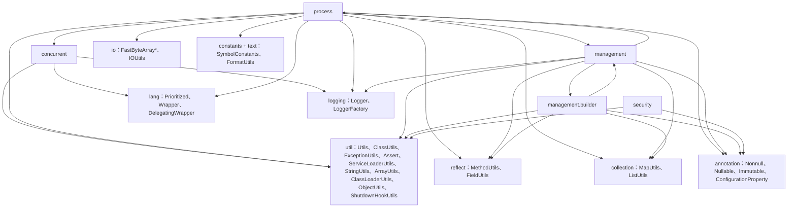
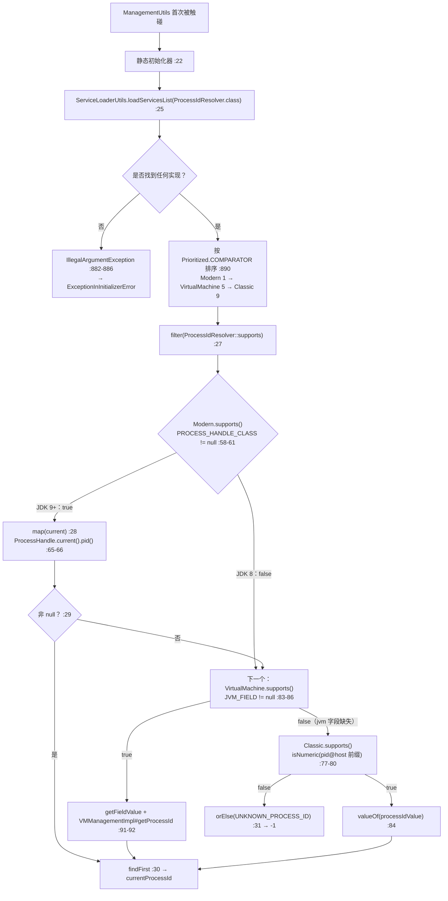
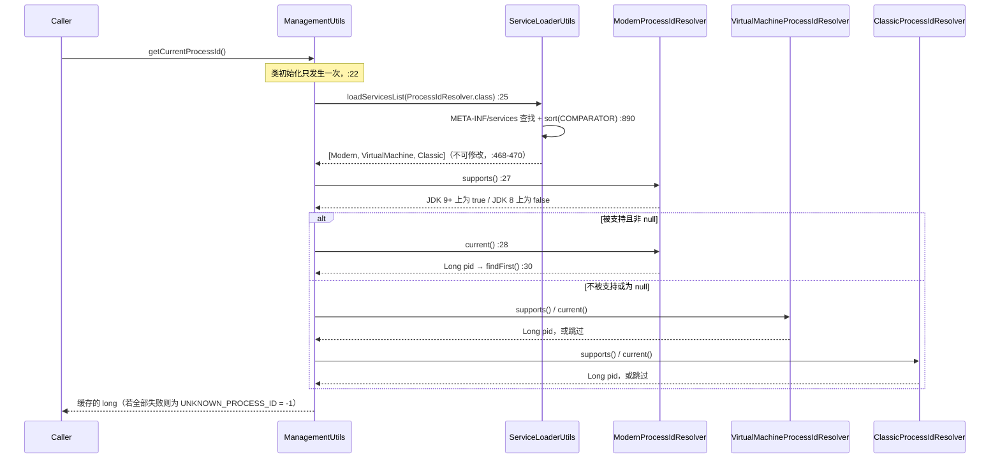
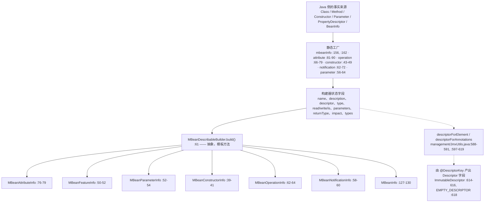

# 并发、进程、管理与安全 —— 开发者指南

**模块：** `microsphere-java-core` · **包：** `io.microsphere.concurrent`、`io.microsphere.process`、
`io.microsphere.management`、`io.microsphere.management.builder`、`io.microsphere.security` · **23 个主源码类型** ·
**分支：** `release`（`0.3.20-SNAPSHOT`）

本页是
[并发、进程、管理与安全 —— 用户指南](../../user-guide/microsphere-java-core/concurrency-process-and-management.zh.md)
的源码级配套文档。所有路径都相对于 `microsphere-java-core/src/main/java/io/microsphere/`（主干源码）或
`microsphere-java-core/src/test/java/io/microsphere/`（测试）。

---

## 1. 这一组在整体中的位置

这五个包并不是同一个子系统。它们是四个小子系统，恰好在两处相互咬合：`process` 通过 `management` 读取
`RuntimeMXBean`，而 `management` 从 `process` 解析 PID。这条相互依赖的边是本组中唯一真正的耦合，
而且它指向一个出人意料的方向 —— 解析器链条的*消费者*与解析器本身不在同一个包里。



每条边背后都有一句 import 语句，并逐一核对过：

| 边 | 证据 |
|---|---|
| `concurrent → lang` | `concurrent/DelegatingBlockingQueue.java:19`（`DelegatingWrapper`）、`:30`（`Wrapper.tryUnwrap`） |
| `concurrent → util` | `concurrent/ExecutorUtils.java:20-21`、`:28-29`；`concurrent/DelegatingBlockingQueue.java:31` |
| `concurrent → logging` | `concurrent/ExecutorUtils.java:19`、`:27` |
| `process → lang` | `process/ProcessIdResolver.java:19`、`process/ClassicProcessIdResolver.java:19` |
| `process → reflect` | `process/ModernProcessIdResolver.java:22-23`；`process/VirtualMachineProcessIdResolver.java:26-28` |
| `process → management` | `process/ClassicProcessIdResolver.java:24`、`process/VirtualMachineProcessIdResolver.java:25` —— 两者都用 `JmxUtils.getRuntimeMXBean` |
| `process → concurrent` | `process/ProcessExecutor.java:17-18` —— `newThreadFactory`、`shutdownOnExit` |
| `process → io / constants / text` | `process/ProcessExecutor.java:4-5`、`:19-20`、`:23` |
| `management → process` | `management/ManagementUtils.java:3`、`:9` |
| `management → util` | `management/ManagementUtils.java:4-5`、`:10`；`management/JmxUtils.java:24`、`:65-67` |
| `management ↔ management.builder` | `management/JmxUtils.java:23`（使用 `MBeanParameterInfoBuilder`）与 `management/builder/MBeanExecutableInfoBuilder.java:21`、`:33`（使用 `JmxUtils`） |
| `management.builder → reflect` | `management/builder/MBeanInfoBuilder.java:37`（`MethodUtils.isIsMethod`） |
| `security → util / annotation` | `security/SecurityUtils.java:20-23`、`:27` |

给评审者的两点观察：

* **`management` 与 `management.builder` 构成一个包级循环。** 两个方向都不是类循环，因此 JDK 可以顺利编译，
  但这两个包必须放在一起推理：`JmxUtils.signature(Parameter[])`（`management/JmxUtils.java:577-582`）经由 builder 包
  构造 `MBeanParameterInfo` 对象，而构建器又回调进 `JmxUtils.descriptorForElement` / `descriptorForAnnotations`
  （`management/builder/MBeanExecutableInfoBuilder.java:33`、`management/builder/MBeanParameterInfoBuilder.java:28`）。
* **`concurrent/CustomizedThreadFactory.java` 与 `concurrent/DelegatingScheduledExecutorService.java`
  没有从 `io.microsphere` 导入任何东西** —— 它们是自足的 JDK 适配层。这就是为什么它们是本组中最可以安全照搬的类型。

### 1.1 在 `core` 内部谁消费这一组

组外恰好只有三个主源码文件依赖它：

| 消费者 | 使用了什么 |
|---|---|
| `io/StandardFileWatchService.java:44-46` | `CustomizedThreadFactory.newThreadFactory`、`ExecutorUtils.shutdown`、`ExecutorUtils.shutdownOnExit` |
| `util/ClassLoaderUtils.java:45` | `JmxUtils.getClassLoadingMXBean` |
| `util/ClassPathUtils.java:17` | `JmxUtils.getRuntimeMXBean` |

没有任何 Spring 模块消费这些包，也没有其他 `microsphere-*` 模块从公开 API 面读取它们 —— 所以这里的改动是被封闭住的，
唯一的例外是 `JmxUtils`（没有被任何反射使用，但被上面三个消费者直接调用）。

---

## 2. 类型清单（全部 23 个类型）

| # | 类型 | 声明位置 | 种类 | 继承 / 实现 | 职责 |
|---|---|---|---|---|---|
| 1 | `CustomizedThreadFactory` | `concurrent/CustomizedThreadFactory.java:40` | 具体类 | `ThreadFactory` | 命名、守护、带优先级的线程创建 |
| 2 | `ExecutorUtils` | `concurrent/ExecutorUtils.java:40` | 抽象类（`Utils`） | `Utils` | 优雅关闭 + 退出时关闭执行器 |
| 3 | `DelegatingBlockingQueue<E>` | `concurrent/DelegatingBlockingQueue.java:55` | 具体类 | `BlockingQueue<E>`、`DelegatingWrapper` | 带包装器压平的转发队列 |
| 4 | `DelegatingScheduledExecutorService` | `concurrent/DelegatingScheduledExecutorService.java:56` | 具体类 | `ScheduledExecutorService` | 可热替换的调度门面 |
| 5 | `ProcessIdResolver` | `process/ProcessIdResolver.java:54` | 接口 | `Prioritized` | `supports()` / `current()` 策略契约 |
| 6 | `ModernProcessIdResolver` | `process/ModernProcessIdResolver.java:50` | 具体类 | `ProcessIdResolver` | 经反射调用 `ProcessHandle#pid()`，prio 1 |
| 7 | `VirtualMachineProcessIdResolver` | `process/VirtualMachineProcessIdResolver.java:62` | 具体类 | `ProcessIdResolver` | 经字段反射访问 `sun.management.VMManagementImpl`，prio 5 |
| 8 | `ClassicProcessIdResolver` | `process/ClassicProcessIdResolver.java:69` | 具体类 | `ProcessIdResolver` | 解析 `RuntimeMXBean#getName()` 的 `pid@host`，prio 9 |
| 9 | `ProcessManager` | `process/ProcessManager.java:40` | 单例类 | —— | 进行中的子进程注册表 |
| 10 | `ProcessExecutor` | `process/ProcessExecutor.java:58` | 具体类 | —— | 带超时的子进程执行 |
| 11 | `ManagementUtils` | `management/ManagementUtils.java:20` | 抽象类（`Utils`） | `Utils` | PID 门面；驱动解析器链条 |
| 12 | `JmxUtils` | `management/JmxUtils.java:87` | 类（私有构造器 `:654-655`） | `Utils` | `ManagementFactory` 缓存 + 属性/元数据自省 |
| 13 | `MBeanAttribute` | `management/MBeanAttribute.java:59` | 具体类 | —— | 不可变的（info, value）配对 |
| 14 | `MBeanDescribableBuilder<B>` | `management/builder/MBeanDescribableBuilder.java:34` | 抽象类 | —— | `description` + `descriptor`，声明 `build()` `:61` |
| 15 | `MBeanFeatureInfoBuilder<B>` | `management/builder/MBeanFeatureInfoBuilder.java:32` | 抽象类 | `MBeanDescribableBuilder<B>` | 增加 `name`；`build()` → `MBeanFeatureInfo` `:50-52` |
| 16 | `MBeanAttributeInfoBuilder` | `management/builder/MBeanAttributeInfoBuilder.java:34` | 具体类 | `MBeanFeatureInfoBuilder<…>` | 增加 `type`/`read`/`write`/`is` |
| 17 | `MBeanParameterInfoBuilder` | `management/builder/MBeanParameterInfoBuilder.java:40` | 具体类 | `MBeanFeatureInfoBuilder<…>` | 增加 `type`；`parameter(Parameter)` `:66-74` |
| 18 | `MBeanExecutableInfoBuilder<B>` | `management/builder/MBeanExecutableInfoBuilder.java:48` | 抽象类 | `MBeanFeatureInfoBuilder<…>` | 参数/签名，`from(Executable)` `:76-84` |
| 19 | `MBeanConstructorInfoBuilder` | `management/builder/MBeanConstructorInfoBuilder.java:33` | 具体类 | `MBeanExecutableInfoBuilder<…>` | → `MBeanConstructorInfo` `:39-41` |
| 20 | `MBeanOperationInfoBuilder` | `management/builder/MBeanOperationInfoBuilder.java:38` | 具体类 | `MBeanExecutableInfoBuilder<…>` | `returnType` + 内嵌 `enum Impact` `:81-116` |
| 21 | `MBeanNotificationInfoBuilder` | `management/builder/MBeanNotificationInfoBuilder.java:40` | 具体类 | `MBeanDescribableBuilder<…>` | 通知 `types` `:43-56` |
| 22 | `MBeanInfoBuilder` | `management/builder/MBeanInfoBuilder.java:48` | 具体类 | `MBeanDescribableBuilder<MBeanInfoBuilder>` | 聚合；`mbeanInfo(BeanInfo)` `:162-185` |
| 23 | `SecurityUtils` | `security/SecurityUtils.java:39` | 抽象类（`Utils`） | `Utils` | `java.security.policy` 的 get/set |

容易被忽略的结构性说明：

* `MBeanInfoBuilder` 与 `MBeanNotificationInfoBuilder` 继承的是 **`MBeanDescribableBuilder`**，
  而不是 `MBeanFeatureInfoBuilder` —— 在 JDK 中 `MBeanInfo` 与 `MBeanNotificationInfo` 并不属于
  `MBeanFeatureInfo` 超族。任何假设"包里所有东西都有 `name()`"的人都会在这两个类型上出错。
* `ProcessIdResolver` 是本组中除它所实现的 JDK 接口之外唯一的*接口*；其余全是类，而其中四个类
  （`ExecutorUtils`、`ManagementUtils`、`SecurityUtils`、`JmxUtils`）是不可实例化的静态工具持有者，
  拥有私有构造器（`concurrent/ExecutorUtils.java:144-145`、`management/ManagementUtils.java:60`、
  `security/SecurityUtils.java:75-76`、`management/JmxUtils.java:654-655`）。
* `ProcessIdResolver` 声明的是 `Long current()`（装箱），而 `ManagementUtils.getCurrentProcessId()` 返回 `long`。
  正是这个装箱使得 §3 中的 `filter(Objects::nonNull)` 步骤成为可能。

---

## 3. 进程 id 解析：策略链条与胜出者如何被选出

### 3.1 组装

整个仓库中不存在任何名为 `ProcessIdResolvers` 的工厂类。组装发生在 `ManagementUtils` 内部的一个表达式里：

```java
static final long currentProcessId = resolveCurrentProcessId();                      // :22
private static long resolveCurrentProcessId() {
    return loadServicesList(ProcessIdResolver.class)                                  // :25
            .stream()
            .filter(ProcessIdResolver::supports)                                      // :27
            .map(ProcessIdResolver::current)                                          // :28
            .filter(Objects::nonNull)                                                 // :29
            .findFirst()                                                              // :30
            .orElse(UNKNOWN_PROCESS_ID);                                              // :31
}
```

`loadServicesList` 即 `ServiceLoaderUtils.loadServicesList(Class)`（`util/ServiceLoaderUtils.java:382-384`），
它委托给具备类加载器层次感知的那条路径，最终落在 `loadServicesAsList(Class, ClassLoader)`（`:873-893`）。
由这条路径可以得出三点后果：

1. 实现来自 `META-INF/services`，而本组恰好只贡献了一个这样的文件：
   `microsphere-java-core/src/main/resources/META-INF/services/io.microsphere.process.ProcessIdResolver`，
   其中列出三个解析器。`management` 与 `security` 没有注册任何东西。
2. 返回的列表被包装为不可修改（`util/ServiceLoaderUtils.java:468-470`），因此调用方无法改动这条链条。
3. 若找不到任何实现，`loadServicesAsList` 会抛出 `IllegalArgumentException`（`:882-886`），
   而不是返回空列表。由于 `resolveCurrentProcessId()` 运行在**静态初始化器**中
   （`management/ManagementUtils.java:22`），该异常会在 `ManagementUtils` 首次被触碰时表现为
   `ExceptionInInitializerError`。

### 3.2 排序

`loadServicesAsList` 使用 `sort(serviceList, COMPARATOR)` 排序（`util/ServiceLoaderUtils.java:890`），
其中 `COMPARATOR` 是 `Prioritized.COMPARATOR`（`lang/Prioritized.java:61-76`），自然序为
`Integer.compare(getPriority(), other.getPriority())`（`lang/Prioritized.java:102-105`）。
因此是**优先级数值升序，最小者在前** —— 并且请记住库中取反的常量：`MAX_PRIORITY = Integer.MIN_VALUE`
（`lang/Prioritized.java:81`）、`MIN_PRIORITY = Integer.MAX_VALUE`（`:86`）、`NORMAL_PRIORITY = 0`（`:91`）。

三个解析器围绕 `NORMAL_PRIORITY` 拉开间距：

| 解析器 | 表达式 | 值 | 引用 |
|---|---|---|---|
| `ModernProcessIdResolver` | `NORMAL_PRIORITY + 1` | 1 | `process/ModernProcessIdResolver.java:73-76` |
| `VirtualMachineProcessIdResolver` | `NORMAL_PRIORITY + 5` | 5 | `process/VirtualMachineProcessIdResolver.java:99-102` |
| `ClassicProcessIdResolver` | `NORMAL_PRIORITY + 9` | 9 | `process/ClassicProcessIdResolver.java:91-94` |

这些间隔（1/5/9）为第三方解析器留出了插入空间而无需重新编号，而且测试把每个数字都精确钉死
（`process/ModernProcessIdResolverTest.java`、`process/VirtualMachineProcessIdResolverTest.java`、
`process/ClassicProcessIdResolverTest.java` 都断言 `getPriority()`），所以重新排布间距就是一次破坏性变更。
service 文件内部的声明顺序无关紧要 —— 排序发生在加载之后。

### 3.3 选择



`filter`/`map` 这对操作是惰性的，因此低优先级解析器的 `current()` 只有在每一个更高优先级的解析器
要么 `supports()` 失败、要么返回 `null` 之后才会执行。在 JDK 11+ 上，这意味着
`VirtualMachineProcessIdResolver.current()` 与 `ClassicProcessIdResolver.current()` 根本不会被调用。

> [!WARNING]
> `supports()` 守护的是*选择*，而不是*执行*。在不被支持的解析器上调用 `current()` 并不是一次文档所述的空操作：
> `ModernProcessIdResolver.current()` 会把一个 `null` 类传给 `invokeStaticMethod`
> （`process/ModernProcessIdResolver.java:65`）并抛出 `IllegalArgumentException`，JDK 8 上的这一行为被测试钉死
> （`process/ModernProcessIdResolverTest.java:43`）。同样，一个在选择过程中*抛异常*的解析器也会穿透 `:31` 处的
> `orElse(UNKNOWN_PROCESS_ID)` 降级 —— 这条链条吸收的是 `null`，不是异常。
> `management/ManagementUtils.java:48-51` 的 Javadoc 对兜底的承诺比代码实际给出的更宽。

### 3.4 一次 PID 查找，从头到尾



### 3.5 急切探测 —— 一个不易察觉的代价

三个解析器都在**静态初始化器**中完成自己的探测，而不是惰性进行：
`PROCESS_HANDLE_CLASS = resolveClass(...)`（`process/ModernProcessIdResolver.java:56`）、
`JVM_FIELD = findField(getRuntimeMXBean(), "jvm")`（`process/VirtualMachineProcessIdResolver.java:81`）以及
`runtimeName` / `processIdValue`（`process/ClassicProcessIdResolver.java:73-75`）。
当 `ServiceLoader` 实例化每个实现时会触发类初始化，因此单次 `getCurrentProcessId()` 调用要为
**全部三次探测**买单 —— 包括对 `java.lang.ProcessHandle` 的 `Class.forName` 以及对 `RuntimeMXBean`
实现类的 `getDeclaredField` 遍历 —— 然后才选出胜出者。这是每个 JVM 一次性的、由类初始化锁保证的代价，
但它解释了为什么这条链条没有惰性短路。

---

## 4. JDK 版本分派：同一个构件如何跑在 8 → 25 上

本组的主体源码中**不存在任何版本判断**。在 23 个文件里搜索 `JavaVersion`、`JAVA_VERSION_`、`SystemUtils`
或 `isCurrentJavaVersion` 一无所获；版本谓词只出现在测试里
（`process/ModernProcessIdResolverTest.java:26` 使用 `testCurrentJavaVersion(GE, JAVA_VERSION_9)`）。
因此这里的分派是**能力探测**，共三种方式，每种都由 JVM 自己回答：

| 机制 | 探测 | 选择信号 | 调用路径 | 在 JDK 8 上 |
|---|---|---|---|---|
| 类是否存在 | `resolveClass("java.lang.ProcessHandle")`（`process/ModernProcessIdResolver.java:54-56`） | `supports()` = `nonNull(PROCESS_HANDLE_CLASS)`（`:58-61`） | 先 `MethodUtils.invokeStaticMethod(..., "current")`，再 `MethodUtils.invokeMethod(handle, ..., "pid")`（`:65-66`） | 类不存在 → 跳过 |
| 字段是否存在 | `FieldUtils.findField(getRuntimeMXBean(), "jvm")`（`process/VirtualMachineProcessIdResolver.java:81`） | `supports()` = `nonNull(JVM_FIELD)`（`:83-86`） | `getFieldValue(true, runtimeMXBean, JVM_FIELD)` → `invokeMethod(true, jvm, "getProcessId")`（`:91-92`） | 这就是为 JDK 8 设计的路径 |
| 数据形状 | `substringBefore(getRuntimeMXBean().getName(), AT)`（`process/ClassicProcessIdResolver.java:73-75`） | `supports()` = `isNumeric(processIdValue)`（`:77-80`） | `valueOf(processIdValue)`（`:84`）—— 无反射 | 最后手段 |

为什么用反射而不是直接调用 `ProcessHandle.current().pid()`：该构件只编译一次，字节码级别从外部父 POM
`microsphere-build:0.3.16` 继承（反应堆中不存在任何 `maven.compiler.*` / `<release>` 属性），
而 CI 矩阵从 JDK 8 起步（`java: [ '8' , '11' , '17' , '21' , '25' ]`、`distribution: 'temurin'`，
`.github/workflows/maven-build.yml:25`、`:33`）。对 `java.lang.ProcessHandle` 的编译期引用会让 JDK 8 构建失败，
所以 `ModernProcessIdResolver` 通过 `io.microsphere.reflect.MethodUtils` 触达它
（`process/ModernProcessIdResolver.java:22-23`），代码中从不点名这个类型。

维护者需要记在心上的后果：

* 在 JDK 9+ 上，排除 `VirtualMachineProcessIdResolver.supports()` 的**并不是** `supports()` 本身 —— 在整个矩阵的
  HotSpot `sun.management.RuntimeImpl` 上 `jvm` 字段都存在，所以 `supports()` 很可能返回 `true`。
  它被优先级为 1 的解析器遮蔽了。假如 `ModernProcessIdResolver.current()` 哪天真返回了 `null`，链条会落到
  `getFieldValue(true, ...)`（`:91`），而它在 JDK 16+ 上需要 `--add-opens`，否则抛出异常。
  真正安全的是优先级顺序，而不是那个卫兵。
* `VirtualMachineProcessIdResolver.current()` 对 `getFieldValue` 的结果解引用时没有 null 检查，
  随后调用 `processId.longValue()`（`:91-96`），所以字段值缺失时产生的是 `NullPointerException`，
  而不是一次干净的落空继续。
* `JmxUtils.descriptorForAnnotations` 同样依赖反射式分派 —— 它通过 `MethodUtils.invokeMethod(annotation, method)`
  调用注解的成员方法（`management/JmxUtils.java:609`，import 在 `:64`），因此无论哪个版本都能在 JDK 的注解代理对象上工作。

---

## 5. MBean 构建器流水线

### 5.1 形态



`MBeanDescribableBuilder.build()` 的声明是 `public abstract <I extends DescriptorRead> I build();`
（`management/builder/MBeanDescribableBuilder.java:61`）—— 它是模板方法模式中的抽象步骤，
其共享步骤（`description(String)` `:51-54`、`descriptor(Descriptor)` `:56-59`）被全部九个具体/抽象构建器继承。
泛型的自返回类型 `B` 正是使得在子类上调用 `name(...)` 之后仍能继续链式返回的原因。

`MBeanInfoBuilder.build()`（`management/builder/MBeanInfoBuilder.java:127-130`）展开为四个私有步骤 ——
`buildAttributes()` `:132-136`、`buildConstructors()` `:138-142`、`buildOperations()` `:144-148`、
`buildNotifications()` `:150-154` —— 每一步都是 `builders.stream().map(X::build).toArray(X[]::new)`。

> [!NOTE]
> 值得记录的一处修正：传给 `MBeanInfo` 构造器的数组是由 `toArray(...)` 产出的，**不是**由 `JmxUtils` 中的
> `EMPTY_MBEAN_*_ARRAY` 常量（`management/JmxUtils.java:91-99`）。那五个常量中只有
> `EMPTY_MBEAN_ATTRIBUTE_ARRAY`（`:91`）被主干代码使用 —— 在 `:417`。其余四个（`:93`、`:95`、`:97`、`:99`）
> 只被 `.../test/java/io/microsphere/management/JmxUtilsTest.java:117-121` 引用。

### 5.2 反射 → JMX 元数据

从 `java.lang.reflect` 到 `javax.management` 的桥梁是 `MBeanExecutableInfoBuilder.from(Executable)`
（`management/builder/MBeanExecutableInfoBuilder.java:76-84`），它记录该 executable 并推导出它的参数列表；
随后 `signature(...)` `:62-66` 与 `toSignature()` `:86-88` 把 `MBeanParameterInfo[]` 物化出来。
同样的推导也以静态形式存在于 `JmxUtils.methodSignature(Method)` → `signature(Parameter[])`
（`management/JmxUtils.java:573-582`）中，它先使用 `MBeanParameterInfoBuilder::parameter` 再 `::build` ——
这就是 §1 中那个包级循环的 `management` 半边。

描述文本从不被凭空编造。`MBeanExecutableInfoBuilder.from(Executable)` 以及 `attribute(PropertyDescriptor)` 路径
让 `description(...)` 取自 JDK 对象自身的 `toString()`；`mbeanInfo(BeanInfo)` 设置
`builder.description = beanInfo.toString()`（`management/builder/MBeanInfoBuilder.java:167`），
`className` 取自 `ClassUtils.getTypeName(beanClass)`（`:166`）；而 `mbeanInfo(String className)`（`:156-160`）
把 `description` 与 `descriptor` 都留为 **null** —— 该行为被
`.../test/java/io/microsphere/management/builder/MBeanInfoBuilderTest.java:154-159` 钉死。

从 JavaBean 推导属性/操作（`:162-185`）是三个循环：`PropertyDescriptor[]` → `attribute(...)`（`:170-172`）、
`MethodDescriptor[]` → `operation(...)`（`:174-177`）、`beanClass.getDeclaredConstructors()` → `constructor(...)`
（`:179-182`）。`attribute(PropertyDescriptor)` 自身（`:75-85`）把 `is` 映射自
`MethodUtils.isIsMethod(readMethod)`，`read` 映射自 `nonNull(readMethod)`，`write` 映射自
`nonNull(propertyDescriptor.getWriteMethod())`，并用 `ListUtils.newLinkedList()` 承载那四个构建器列表
（`:57-66`，import 在 `:36`）。

`management.builder` 中没有任何东西注册 MBean。整个切片里唯一的 `registerMBean(...)` 调用都在测试中
（`.../test/java/io/microsphere/management/JmxUtilsTest.java:267`、`:291`），使用调用方自选的名称
（`:234`、`:284`）。元数据产出与注册被刻意分离。

---

## 6. 线程安全与状态

| 持有者 | 声明 | 判定 |
|---|---|---|
| `ProcessManager.unfinishedProcessesCache` | `process/ProcessManager.java:47` —— `ConcurrentHashMap`，包级私有字段 | 可以安全地并发 `putIfAbsent`（`:53`）与双参数 `remove(process, arguments)`（`:58`）。注意这里的*条件式*移除：`arguments` 值不匹配时会静默保留该条目。 |
| `ProcessManager.unfinishedProcessesMap()` | `process/ProcessManager.java:67-71` | 返回 `unmodifiableMap(cache)` —— 这是一个活动的**视图**，不是快照。弱一致迭代（没问题），但 `:68` 处的 `@Immutable` 言过其实：并发注册时内容会变化。 |
| `ManagementUtils.currentProcessId` | `management/ManagementUtils.java:22` —— `static final long` | 实质不可变；安全发布由类初始化锁保证。唯一的刷新方式是换一个 JVM。 |
| `JmxUtils` 的 MXBean 缓存 | `management/JmxUtils.java:101-117` —— 九个**非 volatile** 私有静态字段，每个都在 `if (x == null) x = ManagementFactory.getX()` 形态的 getter 中惰性填充（`:132-138`、`:153-159`、`:174-180`、`:195-201`、`:223-229`、`:248-254`、`:275-282`、`:306-313`、`:337-344`） | 结构上属于良性竞争（幂等重复赋值），但被发布的引用**没有 happens-before 边**。对 `ManagementFactory` 单例而言对象本已构造完成，所以这种暴露只是理论上的；对那三个 `List` 缓存而言，它们包装的是在 getter 内部构建的列表，不安全发布才是评审者应当思考的情形。另外："只缓存一次"这一性质并未被强制，所以在竞争下 `ManagementFactory.getMemoryPoolMXBeans()` 可能被调用多次。 |
| `ServiceLoaderUtils.servicesCache` | `util/ServiceLoaderUtils.java:140`（`ConcurrentMap`，`:846` 处 `computeIfAbsent`） | 线程安全，但只有当 `SERVICE_LOADER_CACHED` 为 `true` 时才会被查询（`:138`）；默认是 `false`，所以 `ManagementUtils`（`:25`）每次调用都重新发现。在本组中，摊销来自 `currentProcessId` 静态字段。 |
| `ShutdownHookUtils.shutdownHookCallbacks` | `util/ShutdownHookUtils.java:114` —— `static final PriorityBlockingQueue` | 线程安全队列；`ExecutorUtils.shutdownOnExit`（`concurrent/ExecutorUtils.java:63-68`）无上限地追加且从不移除 —— 见用户指南的陷阱 11。 |
| `DelegatingScheduledExecutorService.delegate` | `concurrent/DelegatingScheduledExecutorService.java:58` —— `volatile` | 引用替换是安全发布的，仅此而已。`:49-50` 的 Javadoc（"线程安全，并允许动态更换被委托对象"）说的是*字段*，而不是一次进行中的 `schedule(...)`/`Future` 序列。 |
| `DelegatingBlockingQueue.delegate` | `concurrent/DelegatingBlockingQueue.java:57` —— `final` | 通过 final 字段安全发布；线程安全继承自被包装的队列，装饰器既不增加也不减少。 |
| `CustomizedThreadFactory` | `concurrent/CustomizedThreadFactory.java:57-67`，计数器在 `:71` | 除 `AtomicInteger` 线程计数器外所有字段实质不可变 → 可安全并发 `newThread`。 |
| `ProcessExecutor` | `process/ProcessExecutor.java:90`、`:104-115`、`:149-192` | 每实例一个单线程执行器；实例**不适合**被共享用于并发 `execute(...)` 调用（每次调用都提交到同一个线程并修改共享状态）。 |
| `MBeanAttribute` | `management/MBeanAttribute.java:59`，构造器 `:67-75` | 不可变值对象；构造器对两个元数据参数的 `requireNonNull`（`:70-71`）是这个类唯一的抛出点。 |
| 全部九个构建器 | 全程字段变更 | 按设计**不是**线程安全的；一个构建器是为单次 `build()` 暂存数据的单线程场所。 |

### 6.1 本组的每一处抛出点

针对仓库的 NPE/异常加固审计，以下是本组否则一贯的静默降级策略被打破的位置，逐行核对过：

* `management/JmxUtils.java:627-628` —— `doGetAttribute` 内部的
  `catch (Throwable e) { throw wrap(e, RuntimeException.class); }`；只有 `ReflectionException`、
  `InstanceNotFoundException` 与 `AttributeNotFoundException` 被优雅处理（`:625-626`）。
* `process/ProcessExecutor.java:172`（非零退出码的 `IOException`）、`:188`（在 `future.cancel(true)` 之后重新抛出的
  `TimeoutException`）、`:190`（`wrap(e, IOException.class)`）。
* `management/MBeanAttribute.java:70-71` —— `requireNonNull`。
* `management/builder/MBeanAttributeInfoBuilder.java:86` —— `assertNotNull(attributeType, ...)` →
  `IllegalArgumentException`（`util/Assert.java:149-153`）。
* `process/ModernProcessIdResolver.java:65` —— 在不被支持的 JVM 上抛异常而不是返回 `null`。
* `util/ServiceLoaderUtils.java:882-886` —— 从 `management/ManagementUtils.java:25` 抵达，位于静态初始化器内。
* 潜伏（当前不可达）：`process/VirtualMachineProcessIdResolver.java:91-96`。

其余一切都是降级：`ExecutorUtils.shutdown` 返回 `false`（`concurrent/ExecutorUtils.java:96-101`、`:132-134`），
`JmxUtils` 返回空数组（`management/JmxUtils.java:416-418`）、空 map（`:375-377`）、记录日志后返回 `null`
（`:560-568`、`:513-534`），或 `EMPTY_DESCRIPTOR`（`:618`）。

---

## 7. 设计模式（附实现类）

| 模式 | 佐证类 | 在源码中的表现 |
|---|---|---|
| **策略 + 有序选择** | `ProcessIdResolver`（`process/ProcessIdResolver.java:54`）及其三个实现 | `supports()`/`current()` 契约；按 `Prioritized` 排序（`:54`、`lang/Prioritized.java:102-105`）；挑选循环在 `management/ManagementUtils.java:25-31` |
| **服务提供者接口（SPI）** | `META-INF/services/io.microsphere.process.ProcessIdResolver` + `ServiceLoaderUtils` | 唯一一个由数据而非类型驱动的扩展点 |
| **门面** | `JmxUtils` 覆盖 `ManagementFactory`/`MBeanServer`；`ManagementUtils` 覆盖解析器链条 | 九个 MXBean 访问器的单一扁平静态面（`management/JmxUtils.java:132-344`）；隐藏三个策略的单个 `getCurrentProcessId()`（`management/ManagementUtils.java:56-58`） |
| **构建器** | 整个 `management.builder` 家族 | 返回 `this`/`(B) this` 的链式 setter，以及对应 JDK 构造器的终结方法 `build()`（`management/builder/MBeanInfoBuilder.java:127-130`） |
| **模板方法** | `MBeanDescribableBuilder`（`management/builder/MBeanDescribableBuilder.java:34-61`） | `description()`/`descriptor()` 是共享步骤，`build()` 是抽象步骤；`MBeanInfoBuilder.build()` 同样固定了四个 `map(...).toArray(...)` 子步骤的骨架（`:132-154`） |
| **装饰器 / 委托包装** | `DelegatingBlockingQueue`（`concurrent/DelegatingBlockingQueue.java:55`）、`DelegatingScheduledExecutorService`（`:56`） | 每个方法都是一行转发；`tryUnwrap` 压平嵌套（`:59-62`、`lang/Wrapper.java:113-121`） |
| **单例（急切、私有构造器）** | `ProcessManager.INSTANCE`（`process/ProcessManager.java:45`，构造器 `:49-50`） | 每个类加载器一个注册表；`protected` 的变更方法使子类化成为扩展路径（`:52`、`:57`） |
| **工厂方法** | `CustomizedThreadFactory.newThreadFactory` 各重载（`concurrent/CustomizedThreadFactory.java:78-90`）；六个静态 `mbeanInfo`/`attribute`/`operation`/`constructor`/`notification`/`parameter` 工厂 | `CustomizedThreadFactory` 的构造器是 `protected`（`:69`），因此工厂方法就是公开入口 |
| **空对象（Null Object）** | **缺失 —— 刻意标注** | 这里没有 Null Object。`UNKNOWN_PROCESS_ID = -1L`（`process/ProcessIdResolver.java:59`）是一个哨兵基量，`Long current()` 在失败时返回真正的 `null`，而唯一在场的小空对象（`ImmutableDescriptor.EMPTY_DESCRIPTOR`，用于 `management/JmxUtils.java:618`）来自 JDK，而非本组 |
| **值对象** | `MBeanAttribute`（`management/MBeanAttribute.java:59`） | final 字段，`equals`/`hashCode` 派生自被包装的 `MBeanAttributeInfo`，除委托外没有行为（`:86-138`） |
| **命令（轻量）** | `ProcessExecutor`（`process/ProcessExecutor.java:58`、`:104-115`） | 构造时捕获命令行 + 选项，之后针对某个 `OutputStream` 执行（`:149-192`） |

---

## 8. 扩展点

1. **新增一种 PID 策略。** 实现 `ProcessIdResolver`，选一个能插入现有 1/5/9 之间的 `getPriority()`，
   并把类名追加到 `META-INF/services/io.microsphere.process.ProcessIdResolver`。其他一切都不必改动 ——
   `ManagementUtils` 的链条会自动接收它。请给 `current()` 加护，使它在 `supports()` 为 `false` 时永不抛异常。
2. **定制线程创建。** `CustomizedThreadFactory` 的构造器之所以是 `protected`
   （`concurrent/CustomizedThreadFactory.java:69-76`），正是为了让子类可以覆写 `newThread`（`:94-99`）——
   例如安装一个 `UncaughtExceptionHandler`，基类刻意没有做这件事。
3. **拦截调度或队列操作。** 继承 `DelegatingScheduledExecutorService`（`volatile` 可替换的 delegate，
   `concurrent/DelegatingScheduledExecutorService.java:58-70`），或用 `DelegatingBlockingQueue`
   进行包装（`concurrent/DelegatingBlockingQueue.java:55`）。
4. **以不同方式跟踪子进程。** `ProcessManager` 的 `protected` add/remove（`process/ProcessManager.java:52-60`）
   就是为子类调用而设计的；私有构造器（`:49-50`）使 `INSTANCE`（`:45`）成为 JDK 可见的唯一单例。
5. **产出自定义 JMX 元数据。** 继承任意构建器并设置 JDK 要求的字段；`description(...)` 与 `descriptor(...)`
   继承自 `MBeanDescribableBuilder`（`management/builder/MBeanDescribableBuilder.java:51-59`）。

---

## 9. 测试策略

| 测试 | 钉死了什么 |
|---|---|
| `.../process/ModernProcessIdResolverTest.java:26-50` | 与版本相关的 `supports()`，经由 `testCurrentJavaVersion(GE, JAVA_VERSION_9)`（`:26`）、JDK 8 上 `current()` 抛出的 `IllegalArgumentException`（`:43`）、优先级 `1` |
| `.../process/VirtualMachineProcessIdResolverTest.java:28-41` | `supports()` 为 true、`current()` 非 null、优先级 `5` |
| `.../process/ClassicProcessIdResolverTest.java:28-41` | `supports()` 为 true、`current()` 非 null、优先级 `9` |
| `.../management/ManagementUtilsTest.java:19-24` | `getCurrentProcessId() > 0` 以及与缓存的 `currentProcessId` 字段相等 |
| `.../process/ProcessManagerTest.java:28-60` | 在一个 `java -version` 子进程运行期间实时观察注册表；断言记录的 options 字符串是 `" -version"`（`:52`） |
| `.../process/ProcessExecutorTest.java:38-64` | 正常路径以及全部三种失败模式：`TimeoutException`（`1` 毫秒超时）、错误参数的 `IOException`、命令不存在的 `IOException` |
| `.../management/JmxUtilsTest.java:107-294` | MXBean 同一性、五个 `ClassLoading` 属性（`:190-199`）、未知名称的静默降级（`:201-205`）、一个以 `io.microsphere.management:type=Test` 注册的手写 `DynamicMBean`（`:231-234`、`:267`），以及经由 `CacheControl` 逃逸的 `RuntimeMBeanException`（`:284-293`） |
| `.../management/JmxUtilsTest.java:319-343` | `@DescriptorKey` → `Descriptor` 字段，以及 `EMPTY_DESCRIPTOR` 分支 |
| `.../management/MBeanAttributeTest.java:48-96` | 值对象的委托面 |
| `.../management/builder/*BuilderTest.java` | 每个构建器的 `build()` 映射；`MBeanInfoBuilderTest.java:154-159` 钉死 description 为 null 的情形，`:162-181` 是 `BeanInfo` 路径，`:184-204` 是聚合 |
| `.../management/builder/AbstractMBeanDescribableBuilderTest.java:38-39`、`AbstractMBeanFeatureInfoBuilderTest.java:37-38` | 两个共享基类**只在抽象基类上**标了 `@Disabled`（`:38`、`:37`），并通过类型参数反射构造具体构建器，因此七个具体测试仍然执行 |
| `.../concurrent/*Test.java` | 线程名/守护/优先级断言（`CustomizedThreadFactoryTest.java:40-61`）、关闭语义（`ExecutorUtilsTest.java:36-89`，hook 队列通过 `getStaticFieldValue` 排空于 `:47-67`）、委托转发与替换（`DelegatingScheduledExecutorServiceTest.java:28-110`、`DelegatingBlockingQueueTest.java:36-177`） |
| `.../security/SecurityUtilsTest.java:44-71` | get/set 往返以及 `clearProperty` 收尾清理 |

值得注意的覆盖率缺口：没有测试把 `ManagementUtils` 逼到 `-1` 状态（SPI 文件始终存在），
没有测试在 `supports()` 为 `true` 但字段不可访问的 JDK 上执行 `VirtualMachineProcessIdResolver.current()`，
也没有任何测试断言 `Microsphere` 的 `SERVICE_LOADER_CACHED` 被翻成 `true` 时的行为。

---

## 10. 评审注记

1. **`ProcessManager` 宣称了自己并不拥有的 API。** Javadoc 条目"Safely destroy a process"
   （`process/ProcessManager.java:19`）与示例 `ProcessManager.INSTANCE.destroy(process)`（`:30`）
   描述的是类体（`:40-72`）从未声明的方法。`:25-27` 的示例还从类外部调用了 `protected` 的
   `addUnfinishedProcess(...)`。
2. **`ManagementUtils` 的降级承诺过强。** `management/ManagementUtils.java:48-51` 说当没有解析器能确定 PID 时结果
   "默认为 `UNKNOWN_PROCESS_ID`"；而 `:25-31` 只在 `null` 时降级，从不处理抛异常者，且缺失的 SPI 文件会从
   静态初始化器抛出（`:22`、`util/ServiceLoaderUtils.java:882-886`）。
3. **`JmxUtils.getAttribute` 没有可读性卫兵。** `management/JmxUtils.java:453` 与 `:464-465` 的 Javadoc
   承诺当"属性不可读"时返回 `null`，但 `:456-458` 直接转发给 `doGetAttribute`；不可读这一情形实际表现为
   在 `:625` 被捕获并记录日志（`:633-640`）的 `AttributeNotFoundException`。`getMBeanAttributes`（`:422-427`）
   会读取*每一个*声明的属性，因此一个只写属性会让每次快照付出一次带 warn 日志的异常。
4. **在活动视图上标注 `@Immutable`。** `process/ProcessManager.java:67-71` 返回 `ConcurrentMap` 的
   `unmodifiableMap` 并给它加上 `@Immutable`；调用方迭代期间内容就在变化。
5. **`JmxUtils` 中的非 volatile 静态缓存。** 九个字段（`management/JmxUtils.java:101-117`）
   在没有 volatile/锁的情况下发布 —— 关于 MXBean 单例与 `List` 缓存之间的精确风险切分见 §6。
6. **公开面上的拼写错误。** `DEFAULT_PROCESS_EXECUTION_TIMEOUT_PROPERTY_VAUE`（`process/ProcessExecutor.java:65`）
   是一个 `public static final` 字段；重命名它在已发布版本线上属于破坏性变更。
7. **线程安全 Javadoc 越界。** `concurrent/DelegatingScheduledExecutorService.java:49-50` 宣称类级线程安全；
   只有 `volatile` 引用替换是安全的（§6）。
8. **两个只存在于文档中的产物。** `TestSecurityManager`
   （`.../test/java/io/microsphere/security/TestSecurityManager.java:27`、`:38`、`:52`）没有任何地方引用，而
   `security/SecurityUtils.java:35` 链接了 `@see SecurityManager`，一个自 JDK 17 起废弃并计划移除、
   在 JDK 24 中被禁用的 API —— 对 Javadoc 读者是个陷阱。
9. **四个从未使用的 `public static final` 空数组**（`management/JmxUtils.java:93`、`:95`、`:97`、`:99`），
   只被 `JmxUtilsTest`（`:117-121`）使用。
10. **契约本身的 Javadoc 小笔误**：`process/ProcessIdResolver.java:71` 渲染成了 `<code>>null</code>`。
11. **没有未捕获异常处理。** `CustomizedThreadFactory.newThread`
    （`concurrent/CustomizedThreadFactory.java:94-99`）只设置分组/名称/守护/优先级；
    对主干源码做全仓搜索找不到任何 `UncaughtExceptionHandler` 用法，这是调用方必须自己填补的一个刻意空缺。

---

## 11. 参见

* 面向使用者的对应页面：[并发、进程、管理与安全 —— 用户指南](../../user-guide/microsphere-java-core/concurrency-process-and-management.zh.md)
* 本页英文原文：[Concurrency, process, management and security — developer guide](./concurrency-process-and-management.md)
* 相关 zh 页面：[语言抽象](./language-abstractions.zh.md) · [工具类、常量与文本](./util-and-constants.zh.md) · [反射、类型与 Bean](./reflection-and-beans.zh.md) · [集合与过滤器](./collections-and-filters.zh.md) · [IO 与扫描](./io-and-scanning.zh.md) · [日志](./logging.zh.md) · [类加载与构件](./classloading-and-artifacts.zh.md)
* [JDK 工具 —— 开发者指南](../module-microsphere-jdk-tools.zh.md) —— `management` 运行期层的编译期对应物
* [开发者指南索引](../README.zh.md)
* 子片索引：[./README.zh.md](./README.zh.md)
