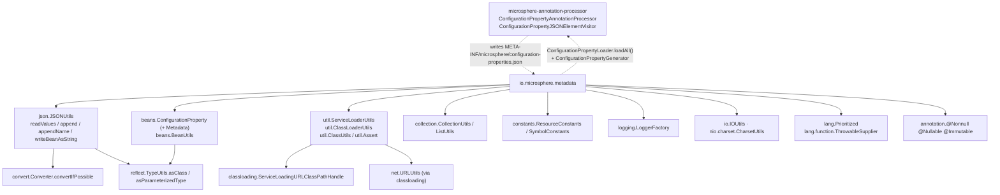
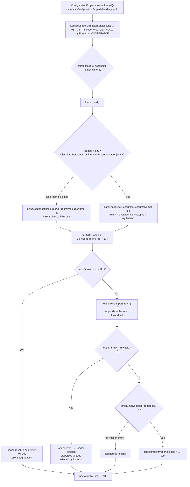
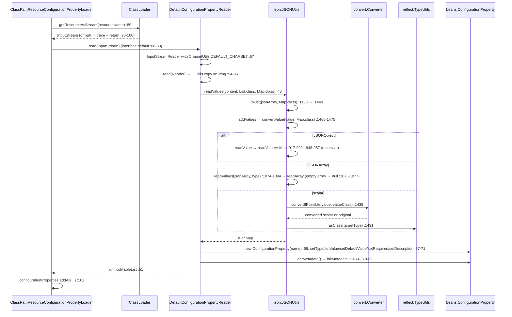

# Configuration Property Metadata — Developer Guide

Module: `io.github.microsphere-projects:microsphere-java-core` · `0.3.20-SNAPSHOT` (`release` branch)
Package: `io.microsphere.metadata` (9 main types, 8 test classes + 4 test fixtures) · Java 8 baseline, CI on JDK 8 / 11 / 17 / 21 / 25

Path prefix used below: `microsphere-java-core/src/main/java/io/microsphere/` (sources),
`microsphere-java-core/src/test/java/io/microsphere/` (tests) and `microsphere-java-core/src/main/resources/`
(SPI files and metadata resources).

---

## 1. Where this package sits

The package is the runtime half of a two-half contract. The compile-time half lives in the sibling
`microsphere-annotation-processor` module, which **writes** the JSON document this package **reads**; the loader
contract, conversely, lets a runtime application **feed extra properties back into** the processor's output. Both
directions are real code edges, verified below.



Edges proven from the sources:

* **to `annotation-processor`** — `ConfigurationPropertyAnnotationProcessor` imports
  `io.microsphere.metadata.ConfigurationPropertyGenerator` and statically imports
  `io.microsphere.metadata.ConfigurationPropertyLoader.loadAll`
  (`microsphere-annotation-processor/src/main/java/io/microsphere/annotation/processor/ConfigurationPropertyAnnotationProcessor.java:23`,
  `:44`), calls `loadAll()` (`:135`) and `generator.generate(...)` (`:143-144`), and writes
  `CONFIGURATION_PROPERTY_METADATA_RESOURCE` (`:150`). `ConfigurationPropertyJSONElementVisitor` resolves the generator
  with `loadFirstService(ConfigurationPropertyGenerator.class)`
  (`ConfigurationPropertyJSONElementVisitor.java:65`). Maven direction is one-way: `microsphere-annotation-processor`
  depends on `microsphere-java-core` (`microsphere-annotation-processor/pom.xml:26`).
* **direct `core` edges** — every import in the package was enumerated; there is no direct import of `convert`,
  `reflect`, `net` or `io.scanner` from `io.microsphere.metadata`.
* **`convert` / `reflect` are transitive, through `json` and `beans`** — `json/JSONUtils.java:63` imports
  `io.microsphere.convert.Converter.convertIfPossible` (used at `:1439`) and `:23`, `:65-67` import
  `reflect.ConstructorUtils`, `reflect.MethodUtils.invokeMethod`, `reflect.TypeUtils.asClass` /
  `asParameterizedType`; `beans/BeanUtils.java:62-63` imports `reflect.AccessibleObjectUtils.trySetAccessible` and
  `reflect.MethodUtils.invokeMethod`. That is the whole story of "resolving property types" from this package's point
  of view — see §4.
* **`util` → `classloading` / `net`** — `util/ClassLoaderUtils.java:9-10` imports the `classloading` handles and holds
  one static `ServiceLoadingURLClassPathHandle` (`:94`); `net.URLUtils` is reached from `classloading`, not from here.

> [!NOTE]
> The dashed edges in the diagram are compile-time *and* runtime couplings in opposite directions. If you build a
> reactor where `microsphere-annotation-processor` is absent, this package still works for reading
> hand-written metadata; if `microsphere-java-core` is absent from the processor's classpath, the processor cannot
> compile at all.

---

## 2. Type inventory

| Type | Kind | Responsibility | Key hooks |
|---|---|---|---|
| `ConfigurationProperty` (model) | JavaBean, `beans` | name / type name / value / default / required / description / metadata | ctors `:115-124`, `equals` `:178-190` |
| `ConfigurationProperty.Metadata` | nested value object | `sources`, `targets`, `declaredClass`, `declaredField` | lazy `LinkedHashSet` `:258-263`, `:282-287` |
| `ConfigurationPropertyReader` | SPI interface | content → `List<ConfigurationProperty>` | `read(InputStream)` `:66-68`, `read(Reader)` `:94-96`, `read(String)` `:119` |
| `DefaultConfigurationPropertyReader` | impl | JSON-array parsing + key mapping | `:42-52`, `:59-76`, `:78-89`, priority `:54-57` |
| `ConfigurationPropertyLoader` | SPI interface | source → properties; aggregate all loaders | `load()` `:68`, static `loadAll()` `:91-106` |
| `ClassPathResourceConfigurationPropertyLoader` | abstract base | Class-Path resource → stream → reader | ctors `:59-77`, `final load()` `:80-92`, `load(list, supplier)` `:94-104` |
| `MetadataResourceConfigurationPropertyLoader` | impl | `configuration-properties.json`, single hit | `:35-37`, priority `:40-42` |
| `AdditionalMetadataResourceConfigurationPropertyLoader` | impl | `additional-configuration-properties.json`, single hit | `:35-37`, priority `:40-42` |
| `ConfigurationPropertyGenerator` | SPI interface | one property → JSON text | `generate(ConfigurationProperty)` `:66` |
| `DefaultConfigurationPropertyGenerator` | impl | hand-built `StringBuilder` JSON | `:81-121`, `:123-159`, priority `:161-164` |
| `ReflectiveConfigurationPropertyGenerator` | impl | `JSONUtils.writeBeanAsString` | `:76-79` |

Test fixtures (`src/test/java/io/microsphere/metadata/`): `DefaultConfigurationPropertyLoader`,
`EmptyConfigurationPropertyLoader`, `NullConfigurationPropertyLoader`, `ErrorConfigurationPropertyLoader` — all four
registered in `src/test/resources/META-INF/services/io.microsphere.metadata.ConfigurationPropertyLoader` purely to
exercise `loadAll()`'s degradation branches.

---

## 3. Naming, locating and merging metadata resources

### 3.1 Names are constants, not strings you invent

`constants/ResourceConstants.java` defines the layout: `METADATA_RESOURCE = "META-INF/"` (`:33`),
`MICROSPHERE_METADATA_RESOURCE = METADATA_RESOURCE + "microsphere/"` (`:38`), the file names
`configuration-properties.json` (`:43`) and `additional-configuration-properties.json` (`:48`), and the two composed
resource paths at `:54` and `:60`. The two concrete loaders pass exactly those constants to the base constructor
(`metadata/MetadataResourceConfigurationPropertyLoader.java:36`,
`metadata/AdditionalMetadataResourceConfigurationPropertyLoader.java:36`); they add no logic beyond priority.

There is deliberately **no** properties/YAML variant, no versioned path, and no per-profile suffix. Anything else is a
custom subclass.

### 3.2 Locating: two lookups, one merge



Observations that matter for maintenance:

* **The single-hit mode is the default and is what both shipped loaders use.** `loadedAll` is only `true` when a
  subclass passes it explicitly (`ClassPathResourceConfigurationPropertyLoader.java:67-69`, `:71-77`); the one-argument
  constructor fixes it to `false` (`:59-61`). With `configuration-properties.json` present in every jar of a real
  application, `loadAll()` reads exactly one of them.
* **Merging is concatenation, not de-duplication.** `loadAll()` appends (`metadata/ConfigurationPropertyLoader.java:99`)
  and the base class appends per URL (`:86`, `:102`). There is no name-keyed index anywhere in the package; the only
  de-duplication inside a property is the `LinkedHashSet` behind `sources`/`targets`
  (`beans/ConfigurationProperty.java:258-263`, `:282-287`).
* **The order is registration order, then priority.** `loadServicesList` discovers via `ServiceLoader` and calls
  `sort(serviceList, COMPARATOR)` (`util/ServiceLoaderUtils.java:888-890`); `sort` is stable, so equal priorities retain
  file order. Because `Prioritized.compareTo` compares the raw ints (`lang/Prioritized.java:103-105`) and the constants
  are inverted (`MAX_PRIORITY = Integer.MIN_VALUE` `:81`, `MIN_PRIORITY = Integer.MAX_VALUE` `:86`), **the numerically
  smallest value runs first**.
* **`MIN_PRIORITY + 9` overflows.** `AdditionalMetadataResourceConfigurationPropertyLoader.java:41` computes
  `Integer.MAX_VALUE + 9`, i.e. `-2147483640`. Its intent ("sort after the metadata loader") is inverted by the wrap;
  the test asserts against the same overflowing expression (`AdditionalMetadataResourceConfigurationPropertyLoaderTest.java:51-54`),
  so nothing fails. Do not "fix" the constant without auditing ordering-sensitive consumers.

### 3.3 The generated file is machine-owned

`ConfigurationPropertyAnnotationProcessor` accumulates a JSON array in a `StringBuilder` per round
(`ConfigurationPropertyAnnotationProcessor.java:112-132`), appends the `ConfigurationPropertyLoader`-sourced entries
(`:134-147`), and on the final round pretty-prints through `JSONArray` into
`CONFIGURATION_PROPERTY_METADATA_RESOURCE` (`:149-156`). The seven entries shipped at
`microsphere-java-core/src/main/resources/META-INF/microsphere/configuration-properties.json` are that output — the
reason `MetadataResourceConfigurationPropertyLoaderTest.java:45-49` asserts `7`.

---

## 4. The read → convert → bind pipeline



**Why `sources` really is a `String[]`.** The reader casts `(String[]) metadataMap.get("sources")`
(`metadata/DefaultConfigurationPropertyReader.java:80-81`) and that is not a mistake: `readValueAsMap` runs every value
through `convertValue(value, Map.class)` (`json/JSONUtils.java:954`), a `JSONArray` goes to
`readValues(jsonArray, targetType)` (`:1074-1094`), whose unparameterized `Map.class` branch leaves `multipleClass`
null and returns `readArray(jsonArray, elementClass)` (`:1087-1090`) — a genuine `String[]` for a homogeneous string
array. Two consequences: an **empty** JSON array becomes `null` (`:1075-1077`) — the `"targets": []` in
`src/test/resources/META-INF/microsphere/additional-configuration-properties.json` — and a **heterogeneous** or
object-valued array does not, so the cast is format-sensitive rather than type-safe. `CollectionUtils.addAll` is
`@Nullable` on both arguments (`collection/CollectionUtils.java:454`), so a `null` array is simply a no-op.

**Binding is a fixed six-key mapping.** `readConfigurationProperty` (`:59-76`) reads `name`, `type`, `value`,
`defaultValue`, `required`, `description`, constructs with the name only (`:66`, so the declared type is applied
afterwards via `setType(String)`), and then hands the nested map to `initMetadata` (`:78-89`). No conversion of the
`type` string to a `Class` happens here, and `value`/`defaultValue` stay as whatever the JSON layer produced.

**Deviations from the silent-degradation policy in this pipeline** (all of them feed the project's NPE-hardening
audit):

| Situation | Behaviour | Where |
|---|---|---|
| resource absent / stream unopenable | `trace` log, empty result — compliant | `ClassPathResourceConfigurationPropertyLoader.java:96-101` |
| loader throws `Throwable` | `error` log, loader dropped — compliant | `ConfigurationPropertyLoader.java:101-103` |
| loader returns `null` | filtered by `isNotEmpty` — compliant | `:98` |
| **no `ConfigurationPropertyLoader` registration at all** | `IllegalArgumentException` escapes `loadAll()` | `:93` + `ServiceLoaderUtils.java:882-886` |
| **entry without `required`** | unboxing `NullPointerException` | `DefaultConfigurationPropertyReader.java:64` |
| **entry without `metadata`** | `NullPointerException` on `metadataMap.get(...)` | `:79-80` |
| entry without `type`, or empty | `IllegalArgumentException` | `beans/ConfigurationProperty.java:141-144` |
| blank resource name in a subclass ctor | `IllegalArgumentException` (documented) | `ClassPathResourceConfigurationPropertyLoader.java:72` |
| **`targets` are written into `sources`** | data loss, no exception | `DefaultConfigurationPropertyReader.java:85-86` |

The last row is the most consequential defect in the package: `initMetadata` calls
`addAll(metadata.getSources(), sources)` **and** `addAll(metadata.getSources(), targets)` — the second target should be
`metadata.getTargets()`. Every round-trip through the reader therefore merges targets into sources and loses the
`targets` field entirely. No test covers generator → reader symmetry
(`DefaultConfigurationPropertyReaderTest.java:47-55` only asserts list size), which is why it survives;
`JSONTestUtils.assertConfigurationPropertyJSON` (`io/JSONTestUtils.java:42-48`) checks `targets` on the *generated*
JSON only.

---

## 5. Ordering, caching and thread safety

* **Discovery is uncached by default.** `loadServicesList(Class)` (`ServiceLoaderUtils.java:382-384`) resolves the
  service type's own class loader and delegates with `SERVICE_LOADER_CACHED` (`:410-412`), whose value is parsed from
  `microsphere.service-loader.cached` and defaults to `false` (`:107`, `:112`, `:138`). With `cached = true` the list is
  memoised in `servicesCache`, a `ConcurrentHashMap` keyed by service type (`:140`, used at `:843-856`). **The cache key
  ignores the class loader**, so a cached lookup is only safe for single-loader applications.
* **`loadAll()` re-discovers on every call.** Because the default is uncached and `ConfigurationPropertyLoader.loadAll`
  uses the one-argument overload (`metadata/ConfigurationPropertyLoader.java:93`), each call performs a full
  `ServiceLoader` traversal plus sort. Treat it as a startup-time API, not a per-request one.
* **The base loader is immutable after construction.** `resourceName`, `classLoader`, `loadedAll` and
  `configurationPropertyReader` are all `final` (`ClassPathResourceConfigurationPropertyLoader.java:51-57`), the class
  loader is normalised once via `nullSafeClassLoader` (`:74`, `util/ClassLoaderUtils.java:218-220`), and `load()` is
  `final` (`:80`) so subclasses cannot break the contract. Concurrent `load()` calls are safe: the accumulator is a
  method-local `LinkedList` (`:81`).
* **Returned lists are unmodifiable, the elements are not.** Both `load()` (`:91`) and `loadAll()` (`:105`) wrap with
  `Collections.unmodifiableList`, and the reader does too (`DefaultConfigurationPropertyReader.java:51`) — yet every
  `ConfigurationProperty` is fully mutable (`beans/ConfigurationProperty.java:151-170`). The `@Immutable` annotations on
  the reader overloads (`metadata/ConfigurationPropertyReader.java:65`, `:93`, `:118`) are therefore nominal; publishing
  a loaded list across threads requires a copy or a freeze if callers might mutate.
* **No locks, no shared mutable state in the generators.** `DefaultConfigurationPropertyGenerator` builds a fresh
  `StringBuilder` per call (`:84`, `:124`) and keeps no fields; `ReflectiveConfigurationPropertyGenerator` is
  stateless (`:73-79`). Both are safely shareable, and `DefaultConfigurationPropertyReader` likewise keeps no fields.
* **Streams are always closed.** `load(...)` uses `try`-with-resources over the `ThrowableSupplier`
  (`ClassPathResourceConfigurationPropertyLoader.java:95`), including the `url::openStream` case (`:86`), so the
  `loadedAll` loop never leaks handles — but an `IOException` from `openStream()` propagates out of the whole `load()`,
  discarding that loader's already-collected properties once `loadAll()` catches it (`:101-103`).
* **Logging is per-subclass.** `protected final Logger logger = getLogger(getClass())` (`:49`) names the concrete
  loader, which is what `ClassPathResourceConfigurationPropertyLoaderTest` relies on by extending `LoggingTest`
  (`ClassPathResourceConfigurationPropertyLoaderTest.java:39`) to observe the trace branch.

---

## 6. SPI seams and how implementations are discovered

Three `META-INF/services` files ship in the core module. Contents, verbatim:

```
microsphere-java-core/src/main/resources/META-INF/services/io.microsphere.metadata.ConfigurationPropertyLoader
io.microsphere.metadata.AdditionalMetadataResourceConfigurationPropertyLoader

.../io.microsphere.metadata.ConfigurationPropertyReader
io.microsphere.metadata.DefaultConfigurationPropertyReader

.../io.microsphere.metadata.ConfigurationPropertyGenerator
io.microsphere.metadata.DefaultConfigurationPropertyGenerator
```

| Seam | Discovering call site | Cache flag used | Notes |
|---|---|---|---|
| `ConfigurationPropertyLoader` | `ServiceLoaderUtils.loadServicesList(ConfigurationPropertyLoader.class)` (`ConfigurationPropertyLoader.java:93`) | default (`false`) | the only aggregate entry point in the package |
| `ConfigurationPropertyGenerator` | `loadFirstService(ConfigurationPropertyGenerator.class)` in the **processor** (`ConfigurationPropertyJSONElementVisitor.java:65`) | default | core itself never looks it up |
| `ConfigurationPropertyReader` | none — no call site exists | — | registered but unused; see below |

> [!WARNING]
> Two seams are only nominally pluggable in `0.3.20`:
>
> * The **reader** service file has no consumer. `ClassPathResourceConfigurationPropertyLoader` instantiates
>   `new DefaultConfigurationPropertyReader()` directly (`ClassPathResourceConfigurationPropertyLoader.java:76`), so
>   registering a second reader changes nothing.
> * The **generator** default implementation registers itself with the *lowest* precedence
>   (`DefaultConfigurationPropertyGenerator.java:161-164` returns `MIN_PRIORITY` = `Integer.MAX_VALUE`), while the
>   unregistered `ReflectiveConfigurationPropertyGenerator` inherits `NORMAL_PRIORITY` = 0
>   (`ReflectiveConfigurationPropertyGeneratorTest.java:53-57`). A consumer that registers both therefore gets the
>   reflective one from `loadFirstService`, not the default.
> * `MetadataResourceConfigurationPropertyLoader` — the loader for the primary resource — is not in the service file at
>   all, so `loadAll()` never runs it. Register it explicitly if you need the generated file at runtime.

Extension recipe for a real, working loader:

```java
public class ApplicationYamlConfigurationPropertyLoader
        extends ClassPathResourceConfigurationPropertyLoader {

    public ApplicationYamlConfigurationPropertyLoader() {
        super("META-INF/microsphere/application-properties.json", true); // every jar's copy, not the first
    }

    @Override
    public int getPriority() {
        return 100;                    // any int < Integer.MAX_VALUE sorts ahead of the built-ins
    }
}
```

```
# src/main/resources/META-INF/services/io.microsphere.metadata.ConfigurationPropertyLoader
com.example.ApplicationYamlConfigurationPropertyLoader
```

Constraints extracted from the sources: `load()` is `final` (`:80`) so you cannot override the lookup itself — override
the package-visible `load(List, ThrowableSupplier)` (`:94`) only if you subclass in the same package, otherwise use your
own reader; the resource name must be non-empty (`:72`); `load()` may return `null`
(`ConfigurationPropertyLoader.java:67-68`) but should prefer an empty list to stay compatible with `isNotEmpty`
filtering (`:98`); and `throws Throwable` is part of the signature (`:68`), so checked failures are legal here.

---

## 7. Design patterns (with the implementing class)

| Pattern | Implementing class | Evidence |
|---|---|---|
| **Service Provider / SPI** | `ConfigurationPropertyLoader`, `ConfigurationPropertyReader`, `ConfigurationPropertyGenerator` | three files under `src/main/resources/META-INF/services/`; discovery at `ConfigurationPropertyLoader.java:93`, `ConfigurationPropertyJSONElementVisitor.java:65` |
| **Template Method** | `ClassPathResourceConfigurationPropertyLoader` — `load()` is `final`, subclasses fix only the resource name and `loadedAll` through the constructor | `ClassPathResourceConfigurationPropertyLoader.java:80-92`, `MetadataResourceConfigurationPropertyLoader.java:35-37` |
| **Chain / aggregation with per-link fault isolation** | `ConfigurationPropertyLoader.loadAll()` | `:94-105` (`try`/`catch (Throwable)` per loader, `isNotEmpty` filter) |
| **Null Object / silent degradation** | the `null`-`InputStream` branch in `load(list, supplier)`; test fixtures `EmptyConfigurationPropertyLoader` and `NullConfigurationPropertyLoader` | `ClassPathResourceConfigurationPropertyLoader.java:96-101`; fixtures at `src/test/java/.../EmptyConfigurationPropertyLoader.java:33-38`, `NullConfigurationPropertyLoader.java:31-36` |
| **Strategy** | `DefaultConfigurationPropertyGenerator` (hand-built) vs `ReflectiveConfigurationPropertyGenerator` (bean-introspecting), interchangeable through the SPI | `DefaultConfigurationPropertyGenerator.java:81-121`, `ReflectiveConfigurationPropertyGenerator.java:76-79` |
| **Value Object with lazy collections** | `ConfigurationProperty.Metadata` | `beans/ConfigurationProperty.java:219-357`, `getSources()` `:258-263` |
| **Self-ordered list (`Prioritized`)** | all three interfaces extend it; the comparator is the sort key | `lang/Prioritized.java:61-76`, `:103-105`; `ServiceLoaderUtils.java:890` |
| **Facade over constants** | `ResourceConstants` for the resource layout | `constants/ResourceConstants.java:33-60` |
| **Adapter over the JSON model** | `DefaultConfigurationPropertyReader` adapts `JSONUtils.readValues` output to the bean | `DefaultConfigurationPropertyReader.java:43`, `:59-89` |

---

## 8. Testing strategy

Location: `microsphere-java-core/src/test/java/io/microsphere/metadata/` — 12 files (8 test classes, 4 SPI fixtures),
plus the shared `io/JSONTestUtils.java` fixture.

* **Priority assertions are the ordering contract.** `DefaultConfigurationPropertyReaderTest.java:57-60`,
  `MetadataResourceConfigurationPropertyLoaderTest.java:51-54` and `DefaultConfigurationPropertyGeneratorTest.java:141-145`
  each pin `MIN_PRIORITY`; `AdditionalMetadataResourceConfigurationPropertyLoaderTest.java:51-54` pins the overflowing
  `MIN_PRIORITY + 9`; `ReflectiveConfigurationPropertyGeneratorTest.java:53-57` pins `NORMAL_PRIORITY`. Any change to a
  priority must be made together with these.
* **Constructor matrix.** `ClassPathResourceConfigurationPropertyLoaderTest` covers all four constructors
  (`:41-60`, `:76-85`), the two missing-resource cases (`:62-74`) and the blank-name rejection
  (`:87-91`); `assertConfigurationProperties` (`:93-96`) is the shared size-2 assertion against
  `additional-configuration-properties.json`.
* **`loadAll()` branches.** `ConfigurationPropertyLoaderTest.java:44-49` expects 3 properties — 2 from the registered
  additional loader plus 1 from the test `DefaultConfigurationPropertyLoader` — which simultaneously proves the
  empty/null filters and the `ErrorConfigurationPropertyLoader` catch (that fixture throws `Throwable`
  unconditionally, `ErrorConfigurationPropertyLoader.java:31-36`). Note it also proves `MetadataResourceConfigurationPropertyLoader`
  is *not* discovered: the count would be 10 otherwise.
* **Generator shape.** `DefaultConfigurationPropertyGeneratorTest.java:59-100` grows the property field by field and
  re-parses each time, which is what pins the "omit nulls, always emit `required`/`metadata`" rules;
  `:102-139` walks the `Metadata` sub-object including the `{}` empty case (`:107`).
* **Gaps to close when you touch this package.** No test round-trips generator → reader (which is why the
  `targets`-into-`sources` defect at `DefaultConfigurationPropertyReader.java:85-86` survives), and no test runs
  `loadAll()` with the service file absent (the `IllegalArgumentException` escape at `:93`).

---

## 9. Review notes

Read this package with the following in hand:

1. **Two live defects, both silent.** The `targets`/`sources` swap
   (`metadata/DefaultConfigurationPropertyReader.java:85-86`) corrupts metadata on read; the `MIN_PRIORITY + 9`
   overflow (`metadata/AdditionalMetadataResourceConfigurationPropertyLoader.java:41`) inverts the intended ordering.
   Neither is caught by the current suite (§8).
2. **Three contract-vs-implementation mismatches.** `loadAll()`'s "empty list if no loaders are found" promise
   (`metadata/ConfigurationPropertyLoader.java:84`) versus the unconditional
   `IllegalArgumentException` from discovery (`util/ServiceLoaderUtils.java:882-893`); the registered-but-unconsumed
   reader SPI; the unregistered primary loader. Each is a doc/code fork that reviewers should treat as intentional or
   file as a bug, not ignore. A lower-severity instance of the same drift sits in the Javadoc examples:
   `metadata/ConfigurationPropertyReader.java:54`, `:81` and `:108` call `reader.load(...)` although the contract method
   is `read(...)` (and `:52` names a non-existent `ConfigurationPropertiesReader` type), while
   `metadata/ConfigurationPropertyLoader.java:76` shows `generateAll()` instead of the actual `loadAll()`.
3. **The error policy holds in the load path and breaks in the read path.** Degradation is real at the loader level
   (trace on missing resource, error on throwing loader, filter on null/empty) but the JSON reader dereferences assumed
   keys unguarded (`metadata/DefaultConfigurationPropertyReader.java:64`, `:79-80`, `:80-81`). Fixing those three lines
   is the package's share of the open NPE-hardening audit.
4. **The `type` field is inert data by design.** Nothing here resolves `java.lang.String[]` into a `Class`; the only
   type machinery in the pipeline is the `convert`/`reflect` usage inside `json/JSONUtils.java:63`, `:66-67`,
   `:1427-1442`. A reviewer looking for binding logic in `io.microsphere.metadata` will not find it — it belongs to the
   consumers documented in [type-conversion.md](../../user-guide/microsphere-java-core/type-conversion.md).
5. **Cost model.** One `ServiceLoader` traversal + sort per `loadAll()`; one `getResourceAsStream` (or N
   `openStream()` calls under `loadedAll`) per loader; one full-content `String` per resource
   (`metadata/ConfigurationPropertyReader.java:95` buffers everything via `copyToString`). Fine at startup, wrong in a
   request path.
6. **Cross-module coupling to watch.** Changing `ConfigurationPropertyLoader` or `ConfigurationPropertyGenerator`
   signatures ripples into `microsphere-annotation-processor` (§1); changing `ResourceConstants` paths breaks both the
   processor's output location and every hand-written `additional-configuration-properties.json` in the wild.

---

* User-facing reference: [Configuration Property Metadata — User Guide](../../user-guide/microsphere-java-core/configuration-metadata.md)
* Compile-time half: [microsphere-annotation-processor module page](../../user-guide/microsphere-annotation-processor.md)
* Same-package neighbours: [JSON](json.md) · [Reflection and beans](reflection-and-beans.md) · [Type conversion](type-conversion.md) · [Utilities and constants](util-and-constants.md)
