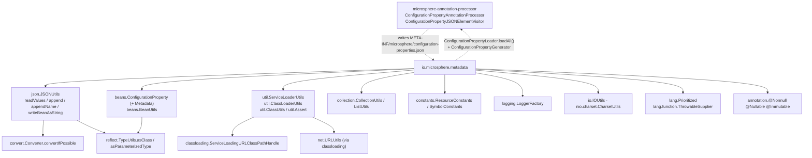
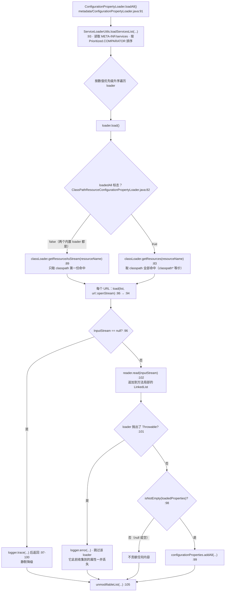
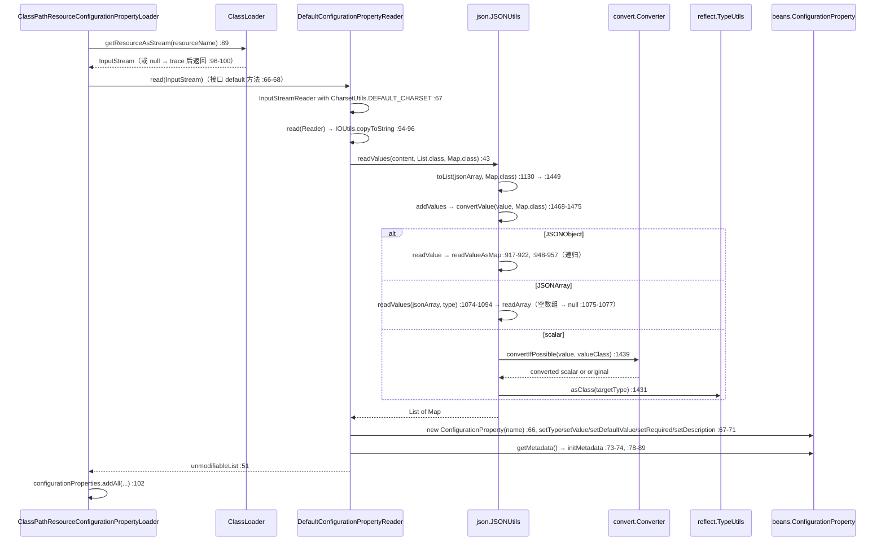

# 配置属性元数据 —— 开发者指南

模块：`io.github.microsphere-projects:microsphere-java-core` · `0.3.20-SNAPSHOT`（`release` 分支）
包：`io.microsphere.metadata`（9 个主类型，8 个测试类 + 4 个测试固件）· Java 8 基线，CI 覆盖 JDK 8 / 11 / 17 / 21 / 25

下文使用的路径前缀：`microsphere-java-core/src/main/java/io/microsphere/`（源码）、
`microsphere-java-core/src/test/java/io/microsphere/`（测试）以及 `microsphere-java-core/src/main/resources/`
（SPI 文件与元数据资源）。

---

## 1. 本包在架构中的位置

这个包是一份两半式契约的运行时那一半。编译期那一半位于兄弟模块 `microsphere-annotation-processor`，它**写出**本包
**读取**的 JSON 文档；反过来，loader 契约让运行时应用可以把**额外的属性回灌**进处理器的产物。两个方向都是真实的代码
边，下方逐一验证。



由各文件 import 语句证明的边：

* **到 `annotation-processor`** —— `ConfigurationPropertyAnnotationProcessor` 导入
  `io.microsphere.metadata.ConfigurationPropertyGenerator` 并静态导入
  `io.microsphere.metadata.ConfigurationPropertyLoader.loadAll`
  （`microsphere-annotation-processor/src/main/java/io/microsphere/annotation/processor/ConfigurationPropertyAnnotationProcessor.java:23`、
  `:44`），调用 `loadAll()`（`:135`）与 `generator.generate(...)`（`:143-144`），并写出
  `CONFIGURATION_PROPERTY_METADATA_RESOURCE`（`:150`）。`ConfigurationPropertyJSONElementVisitor` 用
  `loadFirstService(ConfigurationPropertyGenerator.class)` 解析 generator
  （`ConfigurationPropertyJSONElementVisitor.java:65`）。Maven 方向是单向的：`microsphere-annotation-processor` 依赖
  `microsphere-java-core`（`microsphere-annotation-processor/pom.xml:26`）。
* **直接的 `core` 内部边** —— 已枚举本包全部 import；`io.microsphere.metadata` 中没有对 `convert`、`reflect`、`net`
  或 `io.scanner` 的直接导入。
* **`convert` / `reflect` 是经 `json` 与 `beans` 传递到达的** —— `json/JSONUtils.java:63` 导入
  `io.microsphere.convert.Converter.convertIfPossible`（在 `:1439` 使用），`:23`、`:65-67` 导入
  `reflect.ConstructorUtils`、`reflect.MethodUtils.invokeMethod`、`reflect.TypeUtils.asClass` /
  `asParameterizedType`；`beans/BeanUtils.java:62-63` 导入 `reflect.AccessibleObjectUtils.trySetAccessible` 与
  `reflect.MethodUtils.invokeMethod`。这就是本包视角下“解析属性类型”的全部事实——见 §4。
* **`util` → `classloading` / `net`** —— `util/ClassLoaderUtils.java:9-10` 导入 classloading 的 handle，并持有一个静态
  `ServiceLoadingURLClassPathHandle`（`:94`）；`net.URLUtils` 是从 `classloading` 到达的，而不是从这里。

> [!NOTE]
> 图中的虚线是方向相反、同时存在于编译期与运行期的耦合。如果构建的 reactor 中没有
> `microsphere-annotation-processor`，本包读取手写元数据仍然可用；如果处理器的 classpath 中没有
> `microsphere-java-core`，处理器根本无法编译。

---

## 2. 类型清单

| 类型 | 种类 | 职责 | 关键钩子 |
|---|---|---|---|
| `ConfigurationProperty`（模型） | JavaBean，位于 `beans` | name / 类型名 / value / default / required / description / metadata | 构造器 `:115-124`，`equals` `:178-190` |
| `ConfigurationProperty.Metadata` | 嵌套值对象 | `sources`、`targets`、`declaredClass`、`declaredField` | 懒初始化 `LinkedHashSet` `:258-263`、`:282-287` |
| `ConfigurationPropertyReader` | SPI 接口 | 内容 → `List<ConfigurationProperty>` | `read(InputStream)` `:66-68`、`read(Reader)` `:94-96`、`read(String)` `:119` |
| `DefaultConfigurationPropertyReader` | 实现 | JSON 数组解析 + 键映射 | `:42-52`、`:59-76`、`:78-89`，优先级 `:54-57` |
| `ConfigurationPropertyLoader` | SPI 接口 | 来源 → 属性；聚合全部 loader | `load()` `:68`，静态 `loadAll()` `:91-106` |
| `ClassPathResourceConfigurationPropertyLoader` | 抽象基类 | Class-Path 资源 → 流 → reader | 构造器 `:59-77`，`final load()` `:80-92`，`load(list, supplier)` `:94-104` |
| `MetadataResourceConfigurationPropertyLoader` | 实现 | `configuration-properties.json`，单次命中 | `:35-37`，优先级 `:40-42` |
| `AdditionalMetadataResourceConfigurationPropertyLoader` | 实现 | `additional-configuration-properties.json`，单次命中 | `:35-37`，优先级 `:40-42` |
| `ConfigurationPropertyGenerator` | SPI 接口 | 单个属性 → JSON 文本 | `generate(ConfigurationProperty)` `:66` |
| `DefaultConfigurationPropertyGenerator` | 实现 | 手工拼装 `StringBuilder` 生成 JSON | `:81-121`、`:123-159`，优先级 `:161-164` |
| `ReflectiveConfigurationPropertyGenerator` | 实现 | `JSONUtils.writeBeanAsString` | `:76-79` |

测试固件（`src/test/java/io/microsphere/metadata/`）：`DefaultConfigurationPropertyLoader`、
`EmptyConfigurationPropertyLoader`、`NullConfigurationPropertyLoader`、`ErrorConfigurationPropertyLoader`——四者都注册在
`src/test/resources/META-INF/services/io.microsphere.metadata.ConfigurationPropertyLoader`，只为覆盖 `loadAll()` 的各条
降级分支。

---

## 3. 元数据资源的命名、定位与合并

### 3.1 名字是常量，不是随手写的字符串

`constants/ResourceConstants.java` 定义了目录结构：`METADATA_RESOURCE = "META-INF/"`（`:33`）、
`MICROSPHERE_METADATA_RESOURCE = METADATA_RESOURCE + "microsphere/"`（`:38`）、文件名
`configuration-properties.json`（`:43`）与 `additional-configuration-properties.json`（`:48`），以及 `:54` 和 `:60` 处
拼好的两条完整资源路径。两个具体 loader 只是把这些常量原样交给基类构造器
（`metadata/MetadataResourceConfigurationPropertyLoader.java:36`、
`metadata/AdditionalMetadataResourceConfigurationPropertyLoader.java:36`），除优先级外没有任何逻辑。

这里刻意**没有** properties/YAML 变体，没有版本化路径，也没有 profile 后缀。其他一切都需要自定义子类。

### 3.2 定位：两种查找，一种合并



对维护者真正重要的观察：

* **单次命中是默认值，也是两个内置 loader 的行为。** `loadedAll` 只有在子类显式传入时才为 `true`
  （`ClassPathResourceConfigurationPropertyLoader.java:67-69`、`:71-77`）；单参数构造器把它固定为 `false`（`:59-61`）。
  在真实应用中每个 jar 都带着 `configuration-properties.json`，而 `loadAll()` 只读其中一份。
* **合并是拼接，不是去重。** `loadAll()` 追加（`metadata/ConfigurationPropertyLoader.java:99`），基类按 URL 追加
  （`:86`、`:102`）。本包任何地方都不存在按名称建索引的逻辑；单个属性内部唯一的去重，是 `sources`/`targets` 背后的
  `LinkedHashSet`（`beans/ConfigurationProperty.java:258-263`、`:282-287`）。
* **顺序 = 注册顺序，再按优先级排序。** `loadServicesList` 通过 `ServiceLoader` 发现后调用
  `sort(serviceList, COMPARATOR)`（`util/ServiceLoaderUtils.java:888-890`）；`sort` 是稳定的，因此相同优先级保持文件中的
  先后。又因为 `Prioritized.compareTo` 比较的是原始 int（`lang/Prioritized.java:103-105`），而常量是反向的
  （`MAX_PRIORITY = Integer.MIN_VALUE` 见 `:81`，`MIN_PRIORITY = Integer.MAX_VALUE` 见 `:86`），所以**数值最小者先运行**。
* **`MIN_PRIORITY + 9` 会溢出。** `AdditionalMetadataResourceConfigurationPropertyLoader.java:41` 计算的是
  `Integer.MAX_VALUE + 9`，即 `-2147483640`。它“排在 metadata loader 之后”的意图被回绕反转；测试拿同一个会溢出的表达式
  做断言（`AdditionalMetadataResourceConfigurationPropertyLoaderTest.java:51-54`），因此不会失败。修改该常量前，必须先
  审计所有对顺序敏感的使用方。

### 3.3 生成的文件归机器所有

`ConfigurationPropertyAnnotationProcessor` 在每一轮处理中把 JSON 数组累积进一个 `StringBuilder`
（`ConfigurationPropertyAnnotationProcessor.java:112-132`），追加来自 `ConfigurationPropertyLoader` 的条目
（`:134-147`），并在最后一轮经 `JSONArray` 美化后写入 `CONFIGURATION_PROPERTY_METADATA_RESOURCE`（`:149-156`）。
`microsphere-java-core/src/main/resources/META-INF/microsphere/configuration-properties.json` 里随模块发布的七条条目
正是该产物——这就是 `MetadataResourceConfigurationPropertyLoaderTest.java:45-49` 断言 `7` 的原因。

---

## 4. 读取 → 转换 → 绑定这条流水线



**`sources` 为什么真的是 `String[]`。** reader 里有 `(String[]) metadataMap.get("sources")` 这样的强制转换
（`metadata/DefaultConfigurationPropertyReader.java:80-81`），这并非笔误：`readValueAsMap` 会把每个值都过一遍
`convertValue(value, Map.class)`（`json/JSONUtils.java:954`），`JSONArray` 会走
`readValues(jsonArray, targetType)`（`:1074-1094`），其中未参数化的 `Map.class` 分支让 `multipleClass` 保持为 null，
于是返回 `readArray(jsonArray, elementClass)`（`:1087-1090`）——对同构字符串数组来说就是真正的 `String[]`。由此带来
两个后果：**空** JSON 数组会变成 `null`（`:1075-1077`）——`src/test/resources/META-INF/microsphere/additional-configuration-properties.json`
里的 `"targets": []` 就是这种情形；而**异构**或元素为对象的数组则不会，所以这个转换依赖的是格式而非类型安全。
`CollectionUtils.addAll` 对两个参数都是 `@Nullable`（`collection/CollectionUtils.java:454`），因此 `null` 数组只是空操作。

**绑定是一份固定的六键映射。** `readConfigurationProperty`（`:59-76`）读取 `name`、`type`、`value`、`defaultValue`、
`required`、`description`，仅用名称构造对象（`:66`，因此声明类型随后经 `setType(String)` 设置），再把嵌套的 map 交给
`initMetadata`（`:78-89`）。这里不会把 `type` 字符串解析成 `Class`，`value`/`defaultValue` 也保持 JSON 层给出的形态。

**流水线中偏离静默降级策略之处**（全部计入项目的 NPE 加固审计）：

| 情形 | 行为 | 位置 |
|---|---|---|
| 资源缺失 / 流打不开 | `trace` 日志、空结果——符合策略 | `ClassPathResourceConfigurationPropertyLoader.java:96-101` |
| loader 抛 `Throwable` | `error` 日志、丢弃该 loader——符合策略 | `ConfigurationPropertyLoader.java:101-103` |
| loader 返回 `null` | 由 `isNotEmpty` 过滤——符合策略 | `:98` |
| **完全没有 `ConfigurationPropertyLoader` 注册** | `IllegalArgumentException` 逃逸出 `loadAll()` | `:93` + `ServiceLoaderUtils.java:882-886` |
| **条目缺少 `required`** | 拆箱 `NullPointerException` | `DefaultConfigurationPropertyReader.java:64` |
| **条目缺少 `metadata`** | `metadataMap.get(...)` 触发 `NullPointerException` | `:79-80` |
| 条目缺少 `type` 或为空 | `IllegalArgumentException` | `beans/ConfigurationProperty.java:141-144` |
| 子类构造器传入空白资源名 | `IllegalArgumentException`（已文档化） | `ClassPathResourceConfigurationPropertyLoader.java:72` |
| **`targets` 被写进 `sources`** | 数据丢失，不抛异常 | `DefaultConfigurationPropertyReader.java:85-86` |

最后一行是本包后果最严重的缺陷：`initMetadata` 先调用 `addAll(metadata.getSources(), sources)`，**又**调用
`addAll(metadata.getSources(), targets)`——第二处本应是 `metadata.getTargets()`。于是每一次经由 reader 的往返都会把
targets 并入 sources，并彻底丢掉 `targets` 字段。没有任何测试覆盖 generator → reader 的对称性
（`DefaultConfigurationPropertyReaderTest.java:47-55` 只断言列表长度），这就是它长期存活的原因；
`JSONTestUtils.assertConfigurationPropertyJSON`（`io/JSONTestUtils.java:42-48`）只在**生成**出的 JSON 上检查 `targets`。

---

## 5. 顺序、缓存与线程安全

* **默认不缓存发现结果。** `loadServicesList(Class)`（`ServiceLoaderUtils.java:382-384`）取 service 类型自己的
  class loader，然后带 `SERVICE_LOADER_CACHED` 委托（`:410-412`），该值由
  `microsphere.service-loader.cached` 解析而来，默认为 `false`（`:107`、`:112`、`:138`）。当 `cached = true` 时列表会被
  记忆在 `servicesCache`（一个以 service 类型为键的 `ConcurrentHashMap`，`:140`，使用见 `:843-856`）。**缓存键不包含
  class loader**，因此缓存过的查询只在单 loader 的应用里安全。
* **`loadAll()` 每次都重新发现。** 由于默认不缓存、而 `ConfigurationPropertyLoader.loadAll` 用的是单参数重载
  （`metadata/ConfigurationPropertyLoader.java:93`），每次调用都会做完整的 `ServiceLoader` 遍历加排序。把它当作启动期
  API，不要放进请求路径。
* **基类 loader 构造后不可变。** `resourceName`、`classLoader`、`loadedAll`、`configurationPropertyReader` 全部 `final`
  （`ClassPathResourceConfigurationPropertyLoader.java:51-57`），class loader 经 `nullSafeClassLoader` 一次性归一化
  （`:74`、`util/ClassLoaderUtils.java:218-220`），且 `load()` 是 `final`（`:80`），子类无法破坏契约。并发调用 `load()`
  是安全的：累加器是方法局部的 `LinkedList`（`:81`）。
* **返回的列表不可修改，元素却可变。** `load()`（`:91`）、`loadAll()`（`:105`）和 reader（`:51`）都用
  `Collections.unmodifiableList` 包装——然而每个 `ConfigurationProperty` 都是完全可变的
  （`beans/ConfigurationProperty.java:151-170`）。因此 reader 各重载上的 `@Immutable`
  （`metadata/ConfigurationPropertyReader.java:65`、`:93`、`:118`）只是名义上的；若调用方可能修改，跨线程发布加载结果
  需要先复制或冻结。
* **generator 无锁、无共享可变状态。** `DefaultConfigurationPropertyGenerator` 每次调用新建 `StringBuilder`（`:84`、
  `:124`）且不持有字段；`ReflectiveConfigurationPropertyGenerator` 无状态（`:73-79`）。两者都可安全共享，
  `DefaultConfigurationPropertyReader` 同样不持有字段。
* **流一定会被关闭。** `load(...)` 对 `ThrowableSupplier` 使用 `try`-with-resources
  （`ClassPathResourceConfigurationPropertyLoader.java:95`），`url::openStream` 的情形也一样（`:86`），所以 `loadedAll`
  循环不会泄漏句柄——但 `openStream()` 抛出的 `IOException` 会穿透整个 `load()`，一旦 `loadAll()` 捕获它
  （`:101-103`），该 loader 已收集的属性也随之作废。
* **日志按子类命名。** `protected final Logger logger = getLogger(getClass())`（`:49`）用的是具体 loader 的名字，
  `ClassPathResourceConfigurationPropertyLoaderTest` 正是依赖这一点继承 `LoggingTest`
  （`ClassPathResourceConfigurationPropertyLoaderTest.java:39`）来观察 trace 分支。

---

## 6. SPI 接缝与实现的发现方式

core 模块随包发布三个 `META-INF/services` 文件，内容逐字如下：

```
microsphere-java-core/src/main/resources/META-INF/services/io.microsphere.metadata.ConfigurationPropertyLoader
io.microsphere.metadata.AdditionalMetadataResourceConfigurationPropertyLoader

.../io.microsphere.metadata.ConfigurationPropertyReader
io.microsphere.metadata.DefaultConfigurationPropertyReader

.../io.microsphere.metadata.ConfigurationPropertyGenerator
io.microsphere.metadata.DefaultConfigurationPropertyGenerator
```

| 接缝 | 发现调用点 | 使用的缓存标志 | 说明 |
|---|---|---|---|
| `ConfigurationPropertyLoader` | `ServiceLoaderUtils.loadServicesList(ConfigurationPropertyLoader.class)`（`ConfigurationPropertyLoader.java:93`） | 默认（`false`） | 本包唯一的聚合入口 |
| `ConfigurationPropertyGenerator` | **处理器**中的 `loadFirstService(ConfigurationPropertyGenerator.class)`（`ConfigurationPropertyJSONElementVisitor.java:65`） | 默认 | core 自身从不查询它 |
| `ConfigurationPropertyReader` | 无——不存在调用点 | —— | 已注册但未被使用，见下 |

> [!WARNING]
> `0.3.20` 中有两个接缝只是名义上可插拔：
>
> * **reader** 的 service 文件没有消费方。`ClassPathResourceConfigurationPropertyLoader` 直接
>   `new DefaultConfigurationPropertyReader()`（`ClassPathResourceConfigurationPropertyLoader.java:76`），因此再注册
>   第二个 reader 不会改变任何行为。
> * **generator** 的默认实现以*最低*优先级注册自身
>   （`DefaultConfigurationPropertyGenerator.java:161-164` 返回 `MIN_PRIORITY` = `Integer.MAX_VALUE`），而未注册的
>   `ReflectiveConfigurationPropertyGenerator` 继承的是 `NORMAL_PRIORITY` = 0
>   （`ReflectiveConfigurationPropertyGeneratorTest.java:53-57`）。一旦某使用方把两者都注册，`loadFirstService` 返回的
>   就是反射实现而不是默认实现。
> * 主资源对应的 `MetadataResourceConfigurationPropertyLoader` 完全没有出现在 service 文件里，所以 `loadAll()` 永远不会
>   运行它。运行时确实需要读取生成文件时，请显式注册。

一个真正可用的 loader 的扩展配方：

```java
public class ApplicationYamlConfigurationPropertyLoader
        extends ClassPathResourceConfigurationPropertyLoader {

    public ApplicationYamlConfigurationPropertyLoader() {
        super("META-INF/microsphere/application-properties.json", true); // every jar's copy, not the first
    }

    @Override
    public int getPriority() {
        return 100;                    // any int < Integer.MAX_VALUE sorts ahead of the built-ins
    }
}
```

```
# src/main/resources/META-INF/services/io.microsphere.metadata.ConfigurationPropertyLoader
com.example.ApplicationYamlConfigurationPropertyLoader
```

从源码中提炼的约束：`load()` 是 `final`（`:80`），所以你不能覆盖查找过程本身——只有同包子类才能覆写包可见的
`load(List, ThrowableSupplier)`（`:94`），否则请自带 reader；资源名必须非空（`:72`）；`load()` 允许返回 `null`
（`ConfigurationPropertyLoader.java:67-68`），但为了与 `isNotEmpty` 过滤（`:98`）兼容更应返回空列表；`throws Throwable`
是签名的一部分（`:68`），因此受检异常在这里是合法的。

---

## 7. 设计模式（附证明类）

| 模式 | 实现类 | 证据 |
|---|---|---|
| **Service Provider / SPI** | `ConfigurationPropertyLoader`、`ConfigurationPropertyReader`、`ConfigurationPropertyGenerator` | `src/main/resources/META-INF/services/` 下的三个文件；发现点见 `ConfigurationPropertyLoader.java:93`、`ConfigurationPropertyJSONElementVisitor.java:65` |
| **模板方法** | `ClassPathResourceConfigurationPropertyLoader` —— `load()` 为 `final`，子类只通过构造器固定资源名与 `loadedAll` | `ClassPathResourceConfigurationPropertyLoader.java:80-92`、`MetadataResourceConfigurationPropertyLoader.java:35-37` |
| **链式聚合 + 逐环故障隔离** | `ConfigurationPropertyLoader.loadAll()` | `:94-105`（每个 loader 一个 `try`/`catch (Throwable)`，外加 `isNotEmpty` 过滤） |
| **空对象 / 静默降级** | `load(list, supplier)` 中 `InputStream` 为 `null` 的分支；测试固件 `EmptyConfigurationPropertyLoader` 与 `NullConfigurationPropertyLoader` | `ClassPathResourceConfigurationPropertyLoader.java:96-101`；固件见 `src/test/java/.../EmptyConfigurationPropertyLoader.java:33-38`、`NullConfigurationPropertyLoader.java:31-36` |
| **策略** | `DefaultConfigurationPropertyGenerator`（手工拼装）与 `ReflectiveConfigurationPropertyGenerator`（bean 内省），经 SPI 互换 | `DefaultConfigurationPropertyGenerator.java:81-121`、`ReflectiveConfigurationPropertyGenerator.java:76-79` |
| **带懒初始化集合的值对象** | `ConfigurationProperty.Metadata` | `beans/ConfigurationProperty.java:219-357`，`getSources()` `:258-263` |
| **自排序列表（`Prioritized`）** | 三个接口都继承它；comparator 即排序键 | `lang/Prioritized.java:61-76`、`:103-105`；`ServiceLoaderUtils.java:890` |
| **常量门面** | `ResourceConstants` 承载资源目录结构 | `constants/ResourceConstants.java:33-60` |
| **JSON 模型的适配器** | `DefaultConfigurationPropertyReader` 把 `JSONUtils.readValues` 的输出适配成 bean | `DefaultConfigurationPropertyReader.java:43`、`:59-89` |

---

## 8. 测试策略

位置：`microsphere-java-core/src/test/java/io/microsphere/metadata/` —— 12 个文件（8 个测试类，4 个 SPI 固件），
另加共享固件 `io/JSONTestUtils.java`。

* **优先级断言就是顺序契约。** `DefaultConfigurationPropertyReaderTest.java:57-60`、
  `MetadataResourceConfigurationPropertyLoaderTest.java:51-54` 与 `DefaultConfigurationPropertyGeneratorTest.java:141-145`
  各自钉住 `MIN_PRIORITY`；`AdditionalMetadataResourceConfigurationPropertyLoaderTest.java:51-54` 钉住会溢出的
  `MIN_PRIORITY + 9`；`ReflectiveConfigurationPropertyGeneratorTest.java:53-57` 钉住 `NORMAL_PRIORITY`。任何优先级改动
  都必须与这些断言一起修改。
* **构造器矩阵。** `ClassPathResourceConfigurationPropertyLoaderTest` 覆盖全部四个构造器（`:41-60`、`:76-85`）、
  两处资源缺失用例（`:62-74`）以及空白名拒绝（`:87-91`）；共享断言 `assertConfigurationProperties`（`:93-96`）针对
  `additional-configuration-properties.json` 断言大小为 2。
* **`loadAll()` 的分支。** `ConfigurationPropertyLoaderTest.java:44-49` 预期 3 条属性——注册过的 additional loader 贡献
  2 条，测试用的 `DefaultConfigurationPropertyLoader` 贡献 1 条——这同时证明了空/null 过滤与
  `ErrorConfigurationPropertyLoader` 的捕获（该固件无条件抛 `Throwable`，见 `ErrorConfigurationPropertyLoader.java:31-36`）。
  请注意它同时也证明了 `MetadataResourceConfigurationPropertyLoader` **没有**被发现：否则总数应为 10。
* **generator 的输出形态。** `DefaultConfigurationPropertyGeneratorTest.java:59-100` 逐字段填充属性并反复重新解析，
  这正是“省略 null、始终输出 `required`/`metadata`”规则的依据；`:102-139` 遍历 `Metadata` 子对象，含 `{}` 空对象分支
  （`:107`）。
* **改动本包时应先补齐的缺口。** 目前没有测试做 generator → reader 往返（这就是
  `DefaultConfigurationPropertyReader.java:85-86` 处 targets 并入 sources 的缺陷得以存活的原因），也没有测试在缺失
  service 文件的情况下运行 `loadAll()`（`:93` 处的 `IllegalArgumentException` 逃逸）。

---

## 9. 评审要点

阅读本包时请掌握以下结论：

1. **两个活跃缺陷，都是静默的。** targets/sources 写串
   （`metadata/DefaultConfigurationPropertyReader.java:85-86`）会在读取时破坏元数据；`MIN_PRIORITY + 9` 溢出
   （`metadata/AdditionalMetadataResourceConfigurationPropertyLoader.java:41`）把预期顺序反转。现有测试套都抓不到（§8）。
2. **三处契约与实现不一致。** `loadAll()` 关于“找不到 loader 时返回空列表”的承诺
   （`metadata/ConfigurationPropertyLoader.java:84`）对发现阶段无条件的 `IllegalArgumentException`
   （`util/ServiceLoaderUtils.java:882-893`）；注册却无人消费的 reader SPI；未注册的主 loader。每一条都应被视为有意为之
   或记为缺陷，评审者不应略过。同一类漂移在程度较轻的地方也出现在 Javadoc 示例里：
   `metadata/ConfigurationPropertyReader.java:54`、`:81` 与 `:108` 写的是 `reader.load(...)`，而契约方法是 `read(...)`
   （`:52` 还提到了一个并不存在的 `ConfigurationPropertiesReader` 类型）；`metadata/ConfigurationPropertyLoader.java:76`
   则写成 `generateAll()`，实际方法是 `loadAll()`。
3. **错误策略在加载路径成立，在读取路径失效。** loader 层面的降级是真实的（资源缺失走 trace、抛异常记 error、null/空被
   过滤），但 JSON reader 对假定的键做了无保护的解引用
   （`metadata/DefaultConfigurationPropertyReader.java:64`、`:79-80`、`:80-81`）。修掉这三行，就是本包对未决 NPE 加固
   审计的贡献。
4. **`type` 字段按设计就是惰性数据。** 这里没有任何地方把 `java.lang.String[]` 解析成 `Class`；流水线中唯一的类型机器
   是 `json/JSONUtils.java:63`、`:66-67`、`:1427-1442` 处对 `convert`/`reflect` 的使用。期望在
   `io.microsphere.metadata` 里找到绑定逻辑的人会一无所获——它属于
   [./type-conversion.zh.md](../../user-guide/microsphere-java-core/type-conversion.zh.md) 所述的使用方。
5. **成本模型。** 每次 `loadAll()` 一次 `ServiceLoader` 遍历 + 排序；每个 loader 一次 `getResourceAsStream`（`loadedAll`
   下是 N 次 `openStream()`）；每个资源一次完整内容的 `String` 物化
   （`metadata/ConfigurationPropertyReader.java:95` 经 `copyToString` 全量缓冲）。启动期无碍，请求路径中不合适。
6. **需要盯住的跨模块耦合。** 改动 `ConfigurationPropertyLoader` 或 `ConfigurationPropertyGenerator` 的签名会波及
   `microsphere-annotation-processor`（§1）；改动 `ResourceConstants` 中的路径会同时破坏处理器的写出位置与外部所有手写的
   `additional-configuration-properties.json`。

---

* 面向使用者的参考：[配置属性元数据 —— 用户指南](../../user-guide/microsphere-java-core/configuration-metadata.zh.md)
* 编译期那一半：[microsphere-annotation-processor 模块页](../module-microsphere-annotation-processor.zh.md)
* 同包邻居：[JSON](./json.zh.md) · [反射与 JavaBean](./reflection-and-beans.zh.md) · [类型转换](./type-conversion.zh.md) · [工具类与常量](./util-and-constants.zh.md)
