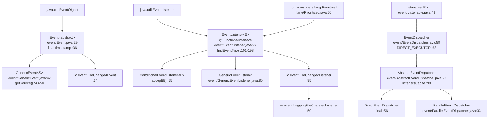
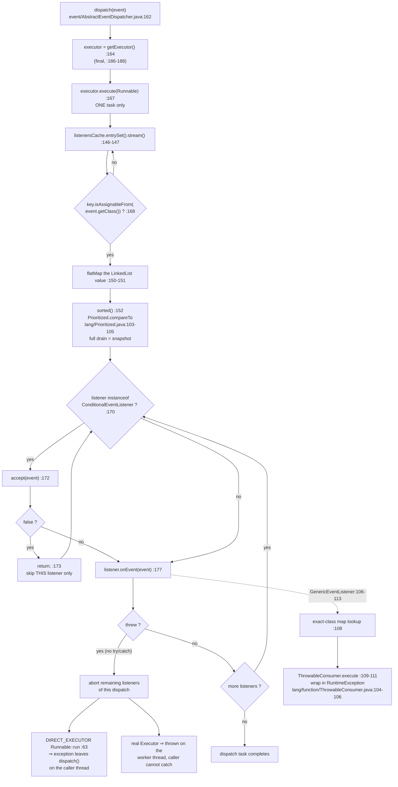

# Event dispatching — Developer Guide

| | |
|---|---|
| **Layer** | Service layer (`event`) — see the [layer table](./README.md#1-internal-dependency-structure) |
| **Packages** | `io.microsphere.event` (10 main sources) |
| **Source line** | `release` branch, `0.3.20-SNAPSHOT` |
| **Analysis focus** | listener matching, conditional filtering, dispatch concurrency |
| **Allowed imports** | `io.microsphere.annotation`, `io.microsphere.collection`, `io.microsphere.lang*`, `io.microsphere.logging`, `io.microsphere.reflect`, `io.microsphere.util` — and nothing from the platform-integration layer |

Paths are relative to `microsphere-java-core/src/main/java/io/microsphere/` unless a `test/` path is spelled out;
after the first full mention they appear as `event/EventDispatcher.java:40-55`.

---

## 1. Role in the architecture

`event` is a **Service layer** package: it stands on the Foundation (`lang.Prioritized`, `lang.function.Throwable*`,
`collection.MapUtils`/`ListUtils`/`SetUtils`) and the Type-model layer (`reflect.TypeUtils`,
`lang.invoke.LambdaUtils`), and it is the only place in `core` that implements the observer contract for the platform
packages. The `LANG --> EVENT` edge in the developer index is visible in the imports
(`event/EventListener.java:19`, `event/GenericEventListener.java:19-20`, `event/AbstractEventDispatcher.java:20`), and
the index also draws `EVENT -.runtime SPI.-> META-INF/services` (`event/AbstractEventDispatcher.java:214-219`,
`util/ServiceLoaderUtils.java:468`).

**Verified consumers** — taken from the full `io.microsphere.event` reference set in the `release` worktree (33 files,
only 5 of them main sources outside the package itself):

| Consumer | Imports | Evidence |
|---|---|---|
| `io/StandardFileWatchService.java:21`, `:48-49` | `EventDispatcher`, `DIRECT_EXECUTOR`, `parallel` | creates one dispatcher per watched directory (`:278`), registers listeners (`:271`), dispatches from the watch loop (`:243-251`) |
| `io/event/FileChangedEvent.java:20` | `Event` | `public class FileChangedEvent extends Event` (`:34`) |
| `io/event/FileChangedListener.java:19-20` | `Event`, `EventListener` | `interface FileChangedListener extends EventListener<FileChangedEvent>` (`:95`), default kind-routing in `onEvent` (`:97-110`) |
| `io/event/LoggingFileChangedListener.java` | (via `FileChangedListener`) | concrete listener that logs at debug (`:50`, `:69-71`) |

> [!NOTE]
> **Correction to the slice brief.** Neither `io.microsphere.logging` nor `io.microsphere.classloading` imports
> `io.microsphere.event`. The dependency runs the *other* way for logging: `AbstractEventDispatcher` imports
> `io.microsphere.logging.Logger` (`event/AbstractEventDispatcher.java:21`) and `LoggerFactory` (`:39`) and keeps a
> `protected final Logger logger` (`:97`). So `event` sits above `logging`, and `classloading` is unrelated to this
> slice. The 3 types in `io.microsphere.io.event` are the real, and only, downstream listener family.

---

## 2. Package and class map

| Type | Modifiers | Extends / implements | Owns |
|---|---|---|---|
| `Event` (`event/Event.java:29`) | `abstract` | `java.util.EventObject` | `final long timestamp` (`:36`) |
| `GenericEvent<S>` (`event/GenericEvent.java:42`) | concrete | `Event` | nothing extra; casts `getSource()` (`:48-50`) |
| `EventListener<E>` (`event/EventListener.java:72`) | `@FunctionalInterface` | `java.util.EventListener`, `Prioritized` | 3 static `findEventType` overloads (`:101-198`) |
| `ConditionalEventListener<E>` (`event/ConditionalEventListener.java:47`) | interface | `EventListener<E>` | `boolean accept(E)` (`:55`) |
| `GenericEventListener` (`event/GenericEventListener.java:80`) | `abstract` | `EventListener<Event>` | `final Method onEventMethod` (`:82`), `Map<Class<?>, Set<Method>> handleEventMethods` (`:84`) |
| `Listenable<E>` (`event/Listenable.java:49`) | interface | — | `assertListener` (`:80-90`) + 6 register/remove/query members |
| `EventDispatcher` (`event/EventDispatcher.java:58`) | interface | `Listenable<EventListener<?>>` | `DIRECT_EXECUTOR` (`:63`), 3 static factories (`:70-95`), `dispatch` (`:102`) |
| `AbstractEventDispatcher` (`event/AbstractEventDispatcher.java:93`) | `abstract` | `EventDispatcher` | `mutex` (`:95`), `logger` (`:97`), `listenersCache` (`:99`), `executor` (`:101`) |
| `DirectEventDispatcher` (`event/DirectEventDispatcher.java:56`) | `final` | `AbstractEventDispatcher` | one ctor, `super(DIRECT_EXECUTOR)` (`:58-60`) |
| `ParallelEventDispatcher` (`event/ParallelEventDispatcher.java:33`) | open | `AbstractEventDispatcher` | `commonPool()` default (`:35-37`), `Executor` ctor (`:39-41`) |

No annotation types, no `CancelDispatcherOperationException`, no builder, no `package-info.java`. The `Wrapper`
abstraction is **not** used anywhere in the package — the import lists of all 10 files contain no
`io.microsphere.lang.Wrapper` (see `event/AbstractEventDispatcher.java:19-44`, `event/EventListener.java:19-29`,
`event/GenericEventListener.java:19-31`, `event/Listenable.java:19-27`, `event/EventDispatcher.java:19-22`).

---

## 3. Source analysis

### 3.1 The listener cache: key, population and (missing) invalidation

There is exactly one registry field:

```java
private final ConcurrentMap<Class<? extends Event>, List<EventListener>> listenersCache = newConcurrentHashMap(); // event/AbstractEventDispatcher.java:99
```

* **Key** = the single event type resolved from the listener by `EventListener.findEventType(listener)`
  (`event/AbstractEventDispatcher.java:190-192`). One listener ⇒ at most one key.
* **Value** = a plain `LinkedList` (`event/AbstractEventDispatcher.java:197`, created by
  `collection/ListUtils.java:448-450`) — insertion-ordered, un-synchronised.
* **Map instance** = `java.util.concurrent.ConcurrentHashMap` (`collection/MapUtils.java:705-707`).
* **Write protocol** (`:194-204`): `if (eventType != null)` → `synchronized (mutex)` → `computeIfAbsent` →
  `consumer.accept(listeners)` → `Collections.sort(listeners)`. Sorting on every mutation is what makes the read path
  cheap; it is the only "invalidation" the cache performs.
* **No eviction.** `grep` over the file shows `listenersCache` is touched at `:99`, `:146` (read) and `:196-197` (write)
  only — there is no `listenersCache.remove(key)`. After `removeEventListener` (`:124-127`) or
  `removeAllEventListeners` (`event/Listenable.java:157-159`) the key survives with an empty `LinkedList`. The map
  therefore grows monotonically with the number of *distinct event types ever seen*, never with the number of listeners,
  and there is no way to shrink it short of discarding the dispatcher.
* **Null-type degradation.** When `findEventType` cannot resolve a type, `doInListener` is a **no-op** (`:194-195`) —
  the listener is silently unregistered rather than throwing. `event/AbstractEventDispatcherTest.java:66-70` pins that
  behaviour with `assertDoesNotThrow`.
* **Read path** (`:145-153`) streams the entry set, filters, flat-maps the values and calls `.sorted()`. It holds **no
  lock** — see §7.1.

### 3.2 The matching algorithm

`dispatch` (`event/AbstractEventDispatcher.java:162-180`) resolves two independent matching rules:

**Registration-time rule (which key):** `findEventType(Class)` (`event/EventListener.java:131-150`)

```java
if (isAssignableFrom(EventListener.class, listenerClass)) {
    List<Class<?>> parameterTypes = resolveLambdaMethodParameterTypes(listenerClass, EventListener.class);
    if (parameterTypes.size() == 1) { eventType = (Class<? extends Event>) parameterTypes.get(0); }  // Lambda case
    else { /* getAllParameterizedTypes(...).stream().map(...).findAny().orElse(superclass recursion) */ }
}
```

| Step | Line | Note |
|---|---|---|
| Guard: the class must be an `EventListener` | `event/EventListener.java:134` | otherwise `null`, i.e. silent drop |
| Lambda branch | `:135-138` | `lang/invoke/LambdaUtils.java:98-128` reads the synthetic class's declared methods and matches them against the functional-interface method's parameter types; returns `emptyList()` unless the class *is* a lambda class (`:99-101`) |
| Normal branch | `:141-146` | `reflect/TypeUtils.java:843-847` collects every `ParameterizedType` in the hierarchy; `findEventType(ParameterizedType)` (`event/EventListener.java:182-198`) picks the first actual type argument assignable to `Event`; `findAny()` means **the winning element is whatever the stream hits first**, not the most specific type |
| Superclass fallback | `:146` | `(Class) findEventType(listenerClass.getSuperclass())` — unchecked cast, `null` for `Object` |

The lambda-vs-normal branch split is exactly why `event/EventListenerTest.java:43-56` (lambdas) and
`:34-41` (classes, including `EchoEventListener2 extends Vector<EventListener<Event>>`) are separate tests:
for `EchoEventListener2` the parameterised `Vector` type is inspected first and rejected by the raw-type guard at
`event/EventListener.java:186`, so the `EventListener<Event>` interface is what yields `Event.class`.

**Dispatch-time rule (which keys fire):** `event/AbstractEventDispatcher.java:168`

```java
sortedListeners(entry -> entry.getKey().isAssignableFrom(event.getClass()))
```

So matching is **supertype-keyed, subtype-event-directed**: key `Event` fires for an `EchoEvent` event, key `EchoEvent`
never fires for a plain `Event` (`event/DirectEventDispatcherTest.java:111-124`). There is no `instanceof`-style
wildcard, no payload matching and no key cache by event class — every dispatch re-scans all keys.

### 3.3 Conditional evaluation order

The condition check is *inside* the notification loop, per listener, after ordering:

```java
sortedListeners(...).forEach(listener -> {
    if (listener instanceof ConditionalEventListener) {              // event/AbstractEventDispatcher.java:170
        if (!predicateEventListener.accept(event)) { return; }       // :171-174
    }
    listener.onEvent(event);                                         // :177
});
```

Consequences, all directly readable:

1. `accept` is invoked **at most once per (listener, dispatch)** — never during registration, never cached.
2. It runs in priority order, because `sorted()` at `:152` completes before the first `accept` call.
3. A vetoed listener's `onEvent` is skipped, but **the loop continues** (`return;` inside a `forEach` lambda is a
   `continue`, `:173`). `event/ConditionalEventListenerTest.java:39-57` proves both halves.
4. `accept` is not protected either: a throwing `accept` behaves exactly like a throwing `onEvent` (§3.4), since the
   `instanceof` block at `:170-175` has no `try`.
5. The `instanceof` test is against the *listener object*, so a listener may be conditional for one event type and
   unconditional for another only by implementing the interface — there is no per-event condition, and no annotation-based
   condition anywhere in the package.

`GenericEventListener` implements a **second, inner dispatch**: the outer engine delivers by assignability, then
`onEvent` (`event/GenericEventListener.java:106-113`) looks up `handleEventMethods.getOrDefault(event.getClass(),
emptySet())` (`:108`) — an **exact-class** `HashMap` lookup over the map built once in the constructor (`:86-89`,
`:95-104`). A handler declared for a supertype of the runtime event class is therefore dead code, and the method
collection rules are the five predicates at `:128-151` plus the `getMethods()` visibility constraint at `:98`.

### 3.4 Cancellation short-circuit, and what happens when a listener throws

**There is no cancellation API.** The only ways propagation ends early are:

| Path | Mechanism | Where | Reach |
|---|---|---|---|
| Veto | `return;` in the `forEach` body | `event/AbstractEventDispatcher.java:172-174` | the current listener only |
| Exception | unguarded `listener.onEvent(event)` | `event/AbstractEventDispatcher.java:177` | aborts **all remaining listeners of that dispatch** |
| Nothing else | `onEvent` is `void`; no `break`, no flag, no `isCancelled()` | `event/EventListener.java:205`, `event/AbstractEventDispatcher.java:167-179` | — |

Because `dispatch` contains no `try`/`catch`, the throwing listener's exception escapes `executor.execute(...)`:

* **`DirectEventDispatcher`** — `DIRECT_EXECUTOR` is `Runnable::run` (`event/EventDispatcher.java:63`), so the task runs
  inline and the exception propagates out of `dispatch()` **on the caller's thread**, after having skipped the remaining
  listeners. Listener state mutated before the throw is *not* rolled back.
* **`ParallelEventDispatcher`** — the exception is thrown inside the executor's worker thread; `dispatch()` has already
  returned, so the caller cannot catch it and nothing logs it (§7.2).
* **`GenericEventListener` handlers** — reflective failures go through
  `ThrowableConsumer.execute` (`event/GenericEventListener.java:109-111`), whose default handler is
  `throw new RuntimeException(failure)` (`lang/function/ThrowableConsumer.java:104-106`, `:151-153`). An
  `InvocationTargetException` therefore surfaces re-wrapped in a `RuntimeException`, and the *remaining handler methods of
  that same listener* are cut off too, because `forEach` over the `Set<Method>` at `:108` is inside the same unprotected
  loop.
* **`StandardFileWatchService`** — a throwing `FileChangedListener` propagates into the watch loop's `finally`
  (`io/StandardFileWatchService.java:233-237`) and resets the `WatchKey`; the loop keeps running.

### 3.5 SPI bootstrap and ordering

```java
protected void loadEventListenerInstances() {                                   // event/AbstractEventDispatcher.java:214
    execute(() -> loadServicesList(EventListener.class, getDefaultClassLoader(), true)
            .stream().sorted().forEach(this::addEventListener),
            e -> logger.trace(e.getMessage()));                                 // :215-218
}
```

* Called from the constructor (`:112`), so **every dispatcher instance loads global listeners eagerly** — you cannot
  construct an `AbstractEventDispatcher` without touching the classpath.
* The `ThrowableAction.execute(action, handler)` wrapper (`lang/function/ThrowableAction.java:132-135`) means a broken
  service definition degrades to a `logger.trace(...)` line, never an exception — pinned by
  `event/AbstractEventDispatcherTest.java:49-59`.
* Ordering is `Prioritized`-based, twice over: `.sorted()` on the loaded list (`:217`, natural order from
  `lang/Prioritized.java:103-105`) and again by `Collections.sort` inside `doInListener` (`:201`). This matches the
  repository rule "first-match after sorting; never trust `ServiceLoader` file order".
* `cached = true` is passed to `util/ServiceLoaderUtils.java:468`, which returns
  `Collections.unmodifiableList(...)` (`:469`), so the loaded instances are shared per class loader across dispatchers
  — two `DirectEventDispatcher`s receive the *same* SPI listener objects (`event/EventDispatcherTest.java:50` asserts
  two such listeners exist).
* `core`'s main resources ship `META-INF/services/io.microsphere.event.EventDispatcher` listing `DirectEventDispatcher`
  and `ParallelEventDispatcher`, but nothing in this repository loads `EventDispatcher` as a service; the listener file
  exists only in `src/test/resources`.

---

## 4. Control-flow diagrams

### 4.1 Class hierarchy



### 4.2 The dispatch loop, branch by branch



### 4.3 publish → listener → the absence of a cancel

```mermaid
sequenceDiagram
    participant P as Publisher
    participant D as AbstractEventDispatcher
    participant X as Executor
    participant L1 as Listener A - ConditionalEventListener
    participant L2 as Listener B

    P->>D: dispatch(event)  (event/AbstractEventDispatcher.java:162)
    D->>X: executor.execute(task)  (:167) — one task, not N
    X->>D: task.run()  (inline for DIRECT_EXECUTOR :63)
    D->>D: sortedListeners(key.isAssignableFrom(eventClass))  (:168)
    D->>D: sorted() drains a snapshot  (:152)
    D->>L1: accept(event)  (:172)
    L1-->>D: false
    Note over D,L1: return; at :173 — skip listener A, loop CONTINUES
    D->>L2: onEvent(event)  (:177)
    L2-->>D: throws RuntimeException
    Note over D: no try/catch at :177 ⇒ listeners C..N never run
    alt DIRECT_EXECUTOR
        D-->>P: exception propagates out of dispatch()
    else real Executor
        D-->>X: exception dies on the worker thread
        P->>P: dispatch() already returned (see event/ParallelEventDispatcherTest.java:48-51)
    end
    Note over P,L2: no cancel() / stopPropagation() exists:<br/>onEvent is void (event/EventListener.java:205)
```

---

## 5. Design patterns

| Pattern | Implementing class(es) | Evidence |
|---|---|---|
| **Observer** | subject `AbstractEventDispatcher`; observers = `EventListener` implementations | push loop `sortedListeners(...).forEach(listener -> ... listener.onEvent(event))` (`event/AbstractEventDispatcher.java:168-177`); attach/detach API `event/Listenable.java:100`, `:137`; payload `Event extends java.util.EventObject` (`event/Event.java:29`) |
| **Registry** | `AbstractEventDispatcher` | `listenersCache`, a `ConcurrentMap<Class<? extends Event>, List<EventListener>>` (`event/AbstractEventDispatcher.java:99`), populated at `:197` and looked up at `:146-152` |
| **Strategy** (execution) | `EventDispatcher.DIRECT_EXECUTOR`, `DirectEventDispatcher`, `ParallelEventDispatcher` | the `Executor` field (`:101`) is the strategy, chosen once in the ctor (`:109-113`), consulted per dispatch (`:164`); `DirectEventDispatcher` passes `DIRECT_EXECUTOR` (`event/DirectEventDispatcher.java:58-60`), `ParallelEventDispatcher` passes `commonPool()` (`event/ParallelEventDispatcher.java:35-37`) |
| **Strategy** (condition) | `ConditionalEventListener` | `accept(E)` (`event/ConditionalEventListener.java:55`) consulted at `event/AbstractEventDispatcher.java:170-175` |
| **Chain of Responsibility, short-circuit** | `AbstractEventDispatcher.dispatch` | sequential `forEach` over an ordered stream (`:152`, `:169`); the two exits are `return;` (`:173`) and an uncaught throw (`:177`) — a chain whose break is exception-driven, not protocol-driven |
| **Template Method** | `AbstractEventDispatcher`, `GenericEventListener` | `dispatch` fixed, `getExecutor()` sealed `final` (`:186-188`) while the ctor is `protected` (`:109`); `loadEventListenerInstances()` explicitly documented as overridable (`:206-213`); `onEvent` is `final` in `GenericEventListener` (`event/GenericEventListener.java:106`) and in the test base `test/event/AbstractEventListener.java:28-31` |
| **Reflection-driven dispatch (poor man's multi-method)** | `GenericEventListener` | `Map<Class<?>, Set<Method>>` built in the ctor (`event/GenericEventListener.java:84`, `:95-104`), `Method.invoke` fan-out (`:108-112`) |
| **Static Factory / Factory Method** | `EventDispatcher` | `newDefault()` (`event/EventDispatcher.java:70-73`), `parallel(Executor)` (`:81-84`), `of(@Nullable Executor)` (`:92-95`) |
| **Service Loader (SPI)** | `AbstractEventDispatcher` | `loadServicesList(EventListener.class, getDefaultClassLoader(), true)` (`event/AbstractEventDispatcher.java:215`, `util/ServiceLoaderUtils.java:468`) |
| **`Wrapper`** | **not used** | no `io.microsphere.lang.Wrapper` import in any of the 10 files; the registry values are raw `LinkedList`s (`:197`), not wrapped views |
| **Adapter** | `io.event.FileChangedListener` | one `EventListener` callback adapted into three kind-specific defaults (`io/event/FileChangedListener.java:97-110`) |

---

## 6. Extension points

| Goal | How | Constraint to respect |
|---|---|---|
| New execution strategy | `extends AbstractEventDispatcher` and pass your `Executor` to `super(...)` (`event/AbstractEventDispatcher.java:109-113`) | `getExecutor()` is `final` (`:186-188`); the strategy cannot be changed after construction, and `null` is rejected (`:110`) |
| A one-off dispatcher without inheritance | implement `EventDispatcher` directly | you get `DIRECT_EXECUTOR` for free (`event/EventDispatcher.java:111-113`); see the anonymous implementation in `event/EventDispatcherTest.java:66-88` |
| Sub-classing the default | **impossible** — `DirectEventDispatcher` is `final` (`event/DirectEventDispatcher.java:56`) | use `ParallelEventDispatcher` (open, `event/ParallelEventDispatcher.java:33`) or your own `AbstractEventDispatcher` |
| Veto without touching the dispatcher | implement `ConditionalEventListener` (`event/ConditionalEventListener.java:47`) | `accept` runs once per listener per dispatch, in priority order; it must not throw (§3.3) |
| Several handlers in one listener | extend `GenericEventListener` and add `public void h(SomeEvent)` methods | the five rules at `event/GenericEventListener.java:128-151`; exact-class dispatch at `:108`; the `onEvent(Event)` override is forbidden (`final`, `:106`) |
| A kind-routing listener family | default methods on your own sub-interface, as `FileChangedListener` does (`io/event/FileChangedListener.java:97-110`) | your sub-interface must keep `EventListener<YourEvent>` so `findEventType` resolves (`event/EventListener.java:182-198`) |
| Order of notification | override `getPriority()` (`event/EventListener.java:214-216`) | smaller first, `lang/Prioritized.java:81`, `:86`, `:91`, `:103-105`; ties across different keys are unordered (§7.2) |
| Global listeners | add `META-INF/services/io.microsphere.event.EventListener` | loaded at construction time, cached per class loader, `equals`-deduplicated (`event/AbstractEventDispatcher.java:115-121`, `:155-159`) |
| Custom bootstrap | override `loadEventListenerInstances()` (`event/AbstractEventDispatcher.java:214-219`) | it is `protected` and deliberately overridable (`:206-213`); note it runs from the ctor, so subclass fields are still `null` when it executes |

---

## 7. Thread safety and performance

### 7.1 The actual collection fields

| Field | Declared type | Real implementation | Guarded by | Line |
|---|---|---|---|---|
| `listenersCache` | `ConcurrentMap<Class<? extends Event>, List<EventListener>>` | `java.util.concurrent.ConcurrentHashMap` | the map itself is concurrent | `event/AbstractEventDispatcher.java:99`; factory `collection/MapUtils.java:705-707` |
| cache **values** | `List<EventListener>` | `java.util.LinkedList` — **not** synchronized, **not** copy-on-write | `synchronized (mutex)` **on writes only** | `:197`; factory `collection/ListUtils.java:448-450`; lock at `:196` |
| `mutex` | `Object` | plain private lock object, no fairness concern | — | `:95` |
| `executor` | `Executor` | `final`, assigned once | safe publication via `final` | `:101`, `:109-113` |
| `logger` | `Logger` | `protected final`, obtained from the class's own logger name | — | `:97` |
| `GenericEventListener.handleEventMethods` | `Map<Class<?>, Set<Method>>` | `HashMap` of `LinkedHashSet`s, built in the ctor, never mutated | `final` field + constructor-only writes | `event/GenericEventListener.java:84`, `:95-104`; `collection/MapUtils.newHashMap`, `collection/SetUtils.newLinkedHashSet` imports at `:27-28` |
| `Event.timestamp` | `long` | `final`, non-volatile | `final` — safe for readers after construction | `event/Event.java:36`, `:46` |

### 7.2 What that combination actually guarantees

* **Concurrent add/add is safe.** Two threads calling `addEventListener` serialise on `mutex` (`:196-202`), and each
  mutation re-sorts (`:201`). `getAllEventListeners()` (`:130-139`) is also a read that takes no lock, so it can observe
  a `LinkedList` mid-mutation from another thread.
* **Concurrent add vs. dispatch is NOT safe.** The read path (`:146-152`) iterates the same `LinkedList`s without
  `mutex`. `LinkedList` is not documented for concurrent iteration + structural modification, so a dispatch racing a
  registration can throw `ConcurrentModificationException` or miss the added listener. No test in
  `microsphere-java-core/src/test/java/io/microsphere/event/` exercises concurrent registration.
* **A dispatch sees a snapshot.** `sorted()` (`:152`) is a stateful intermediate operation: the whole listener stream is
  buffered before the first `accept`/`onEvent` runs. Registering inside a listener therefore cannot affect the current
  dispatch — the change applies to the next one. This also means the `LinkedList` iteration completes *before* listener
  code runs, which narrows the racing window in the previous bullet to the drain phase only.
* **`Event` is effectively immutable** (`final timestamp`, `event/Event.java:36`; source is `final` in
  `java.util.EventObject`), so sharing an event across dispatchers is safe — but listeners are *not*, since a listener's
  own state is plain fields written inside `onEvent` (e.g. `test/event/AbstractEventListener.java:25` uses an
  `AtomicInteger`, while `event/ConditionalEventListenerTest.java:61` uses a bare `String`).
* **Ordering is single-threaded per dispatch.** Priority order comes from `sort`/`sorted`; nothing provides ordering
  *between* concurrent dispatches, and equal priorities on different keys are compared as `0`
  (`lang/Prioritized.java:103-105`) so their relative order depends on `ConcurrentHashMap` traversal (`:146-147`).
* **Concurrency ≠ parallel listeners.** One `execute(...)` call per dispatch (`:167`) means listener parallelism does
  not exist even with `ParallelEventDispatcher`; only successive/overlapping dispatches run concurrently.
* **Uncaught exceptions are invisible.** `logger` is used *only* by the SPI bootstrap (`:218`). The dispatch loop logs
  nothing, so with a real `Executor` a failing listener produces no dispatcher-side record at all.

### 7.3 Complexity

| Operation | Cost | Why |
|---|---|---|
| `addEventListener` | `O(k + n log n + n)` reflection-heavy | `findEventType` walks the type hierarchy (`event/EventListener.java:131-150`); `addIfAbsent` is a `contains` scan over the bucket (`:155-159`); `Collections.sort` runs on **every** add (`:201`) |
| `removeEventListener` | `O(n)` + `O(n log n)` | `LinkedList.remove` scan (`:126`) then re-sort (`:201`) |
| `getAllEventListeners` | `O(T·n)` with an inner `contains` ⇒ `O((T·n)²)` in the worst case | flat-maps all keys then de-dups with `addIfAbsent` (`:131-139`) |
| `dispatch` | `O(T)` key filter + `O(m log m)` sort + `O(m)` notification | re-filters and re-sorts **every** dispatch even though the registry is already sorted (`:145-153`, `:168`) |
| `GenericEventListener.onEvent` | `O(1)` lookup + `O(h)` reflective invokes | `getOrDefault` on the ctor-built map (`:108`); one `Method.invoke` per handler, each wrapped by `ThrowableConsumer` (`:109-111`) |

The practical consequence: dispatching is cheap in listener count but pays a full re-sort per event; a dispatcher with
hundreds of listeners under a hot path re-sorts `O(m log m)` on every dispatch. Nothing caches the sorted list, because
`sort` on mutation (`:201`) is not exploited by the read path (`:152` sorts again).

---

## 8. Testing strategy

13 files live in `microsphere-java-core/src/test/java/io/microsphere/event/`: 9 tests plus 4 fixtures.

| File | What it pins |
|---|---|
| `test/event/EventDispatcherTest.java:42-45` | `newDefault()` returns `DirectEventDispatcher` — the SPI file's first entry is not accidentally used |
| `test/event/EventDispatcherTest.java:47-51` | `getExecutor() == DIRECT_EXECUTOR` **and** the SPI-loaded listener count is `2` |
| `test/event/EventDispatcherTest.java:53-60` | `of(null)` → direct, `of(commonPool())` → parallel |
| `test/event/EventDispatcherTest.java:62-89` | an ad-hoc `EventDispatcher` implementation inherits `DIRECT_EXECUTOR` |
| `test/event/AbstractEventDispatcherTest.java:36-40` | `null` executor → `IllegalArgumentException` |
| `test/event/AbstractEventDispatcherTest.java:42-47` | SPI load yields a non-empty registry |
| `test/event/AbstractEventDispatcherTest.java:49-59` | with a parent-less `URLClassLoader`, bootstrapping degrades to **no-op** (`assertDoesNotThrow`) |
| `test/event/AbstractEventDispatcherTest.java:61-70` | `getExecutor()` identity; `doInListener(null, ...)` is a silent no-op |
| `test/event/DirectEventDispatcherTest.java:58-80` | ordering by priority, duplicate-add idempotence, remove |
| `test/event/DirectEventDispatcherTest.java:82-106` | var-args / `Iterable` add and remove paths, duplicates on both |
| `test/event/DirectEventDispatcherTest.java:108-151` | the assignability matrix: `Event`-keyed listener fires for both events, `EchoEvent`-keyed listener only for `EchoEvent` |
| `test/event/DirectEventDispatcherTest.java:153-183` | lambda listeners resolve their type and are counted (`1`, then `3`) |
| `test/event/EventListenerTest.java:34-61` | `findEventType` over classes, lambdas and `null` |
| `test/event/EventListenerTest.java:63-77` | default priority is `NORMAL_PRIORITY` |
| `test/event/ConditionalEventListenerTest.java:39-76` | veto skips, accept lets through |
| `test/event/GenericEventListenerTest.java:48-83` | which methods become handlers (name-agnostic, arity-checked, `public`-only) |
| `test/event/GenericEventTest.java:35-79` | typed source, timestamp bounds and ordering, `null` source → `IllegalArgumentException` |
| `test/event/ListenableTest.java:17-20` | `assertListener(null)` → `IllegalArgumentException` — the only surviving validation |
| `test/event/ParallelEventDispatcherTest.java:46-57` | async delivery needs `awaitTermination` before asserting, and the common pool is shut down `@AfterAll` |

Fixtures worth reusing: `test/event/EchoEvent.java:24` (minimal `Event`), `test/event/AbstractEventListener.java:23-42`
(`final onEvent` + `handleEvent` hook + `AtomicInteger` counter + thread name logging),
`test/event/EchoEventListener.java:26` and `test/event/EchoEventListener2.java:29-60` (the `-1` priority and the
class-only `equals`, both load-bearing for the ordering and duplicate tests), and
`test/resources/META-INF/services/io.microsphere.event.EventListener` (the two SPI entries).

**Known fragility to respect when extending these tests.** `EventDispatcherTest.testDefaultMethods` (`:50`) hard-codes
`getAllEventListeners().size() == 2`, but every dispatcher constructed anywhere in the suite loads the same SPI listeners
(`event/AbstractEventDispatcher.java:112`), and `ConditionalEventListenerTest` documents the collision explicitly —
`setUp` calls `removeAllEventListeners()` (`test/event/ConditionalEventListenerTest.java:36`) and the test ends with a
comment plus a second clean-up at `:54-56`. So: **`removeAllEventListeners()` in `setUp`/`tearDown` is mandatory for any
new test in this package**, and asserting absolute registry sizes is unsafe. `DirectEventDispatcherTest.setUp` follows
the rule (`:48`).

**Gaps this page documents rather than hides** (candidates for new tests): concurrent registration during dispatch
(§7.2), exception propagation out of `dispatch()` (no test asserts it, though the code path at
`event/AbstractEventDispatcher.java:177` is unambiguous), the exact-class limitation of
`GenericEventListener` handler lookup (`event/GenericEventListener.java:108`), and the retained empty cache entry after
removal (§3.1).

---

## 9. See also

* [Event dispatching — User Guide](../../user-guide/microsphere-java-core/events.md) — API tables, test-derived examples, pitfalls.
* [Language abstractions](./language-abstractions.md) — `Prioritized` (`lang/Prioritized.java:56-106`), `LambdaUtils`, `Throwable*`.
* [Reflection, types and beans](./reflection-and-beans.md) — `TypeUtils.getAllParameterizedTypes` (`reflect/TypeUtils.java:843-847`) and `isAssignableFrom` (`:375-378`).
* [Collections and filters](./collections-and-filters.md) — `newConcurrentHashMap` / `newLinkedList`, the two collections behind the registry.
* [Logging](./logging.md) — the `Logger` that swallows SPI failures in this dispatcher.
* [I/O, NIO, scanning and file filters](./io-and-scanning.md) — `io.event` and `StandardFileWatchService`, this engine's only consumer.
* [Developer Guide index](./README.md) — the layer table and the SPI registry list.
