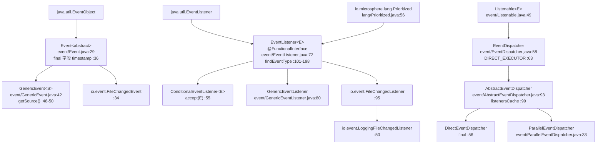
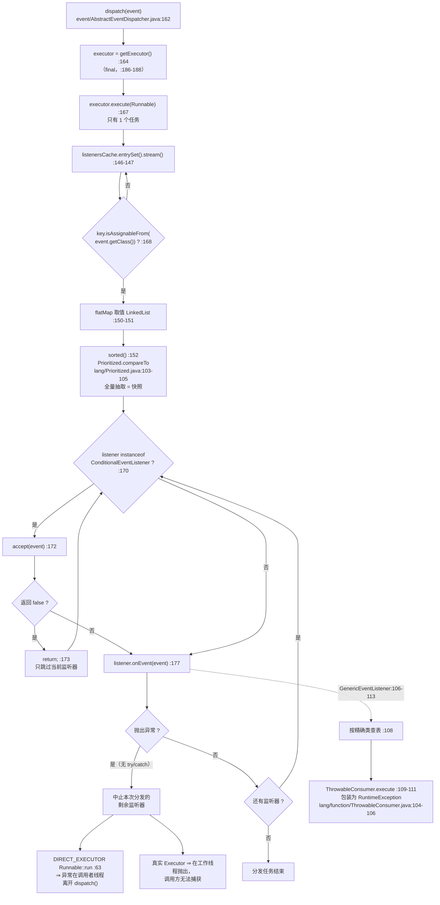

# 事件分发（Event dispatching）—— 开发者指南

| | |
|---|---|
| **层级** | 服务层（Service layer，`event`）—— 参见[层级表](./README.zh.md#1-内部依赖结构) |
| **包** | `io.microsphere.event`（10 个主源码） |
| **源码基线** | `release` 分支，`0.3.20-SNAPSHOT` |
| **分析重点** | 监听器匹配、条件过滤、分发并发 |
| **允许的导入** | `io.microsphere.annotation`、`io.microsphere.collection`、`io.microsphere.lang*`、`io.microsphere.logging`、`io.microsphere.reflect`、`io.microsphere.util` —— 不得导入平台集成层的任何内容 |

路径除显式写出 `test/` 外，均相对于 `microsphere-java-core/src/main/java/io/microsphere/`；
首次完整提及之后缩写为 `event/EventDispatcher.java:40-55`。

---

## 1. 在架构中的角色

`event` 是一个**服务层**包：它建立在基础设施层（`lang.Prioritized`、`lang.function.Throwable*`、
`collection.MapUtils`/`ListUtils`/`SetUtils`）与类型模型层（`reflect.TypeUtils`、`lang.invoke.LambdaUtils`）之上，
并且是 `core` 中唯一为平台各包实现观察者契约的位置。开发者索引里的 `LANG --> EVENT` 这条边在导入语句中清晰可见
（`event/EventListener.java:19`、`event/GenericEventListener.java:19-20`、`event/AbstractEventDispatcher.java:20`），
索引还画出了 `EVENT -.runtime SPI.-> META-INF/services`（`event/AbstractEventDispatcher.java:214-219`、
`util/ServiceLoaderUtils.java:468`）。

**验证过的消费者** —— 取自 `release` 工作树中 `io.microsphere.event` 的完整引用集合（33 个文件，
其中本包之外只有 5 个是主源码）：

| 消费者 | 导入 | 证据 |
|---|---|---|
| `io/StandardFileWatchService.java:21`、`:48-49` | `EventDispatcher`、`DIRECT_EXECUTOR`、`parallel` | 每个被监视目录创建一个分发器（`:278`）、注册监听器（`:271`）、在监视循环中分发（`:243-251`） |
| `io/event/FileChangedEvent.java:20` | `Event` | `public class FileChangedEvent extends Event`（`:34`） |
| `io/event/FileChangedListener.java:19-20` | `Event`、`EventListener` | `interface FileChangedListener extends EventListener<FileChangedEvent>`（`:95`），`onEvent` 中默认按类型路由（`:97-110`） |
| `io/event/LoggingFileChangedListener.java` | （经由 `FileChangedListener`） | 以 debug 级别记录日志的具体监听器（`:50`、`:69-71`） |

> [!NOTE]
> **对切片任务书的更正**。`io.microsphere.logging` 与 `io.microsphere.classloading` 都*不*导入
> `io.microsphere.event`。对于 logging，依赖方向恰好*相反*：`AbstractEventDispatcher` 导入了
> `io.microsphere.logging.Logger`（`event/AbstractEventDispatcher.java:21`）与 `LoggerFactory`（`:39`），并持有一个
> `protected final Logger logger`（`:97`）。因此 `event` 位于 `logging` 之上，而 `classloading` 与本切片无关。
> `io.microsphere.io.event` 中的那 3 个类型才是真实且唯一的下游监听器家族。

---

## 2. 包与类地图

| 类型 | 修饰符 | 继承 / 实现 | 自身持有的成员 |
|---|---|---|---|
| `Event`（`event/Event.java:29`） | `abstract` | `java.util.EventObject` | `final long timestamp`（`:36`） |
| `GenericEvent<S>`（`event/GenericEvent.java:42`） | 具体类 | `Event` | 无新增字段；对 `getSource()` 做向下转型（`:48-50`） |
| `EventListener<E>`（`event/EventListener.java:72`） | `@FunctionalInterface` | `java.util.EventListener`、`Prioritized` | 3 个静态 `findEventType` 重载（`:101-198`） |
| `ConditionalEventListener<E>`（`event/ConditionalEventListener.java:47`） | 接口 | `EventListener<E>` | `boolean accept(E)`（`:55`） |
| `GenericEventListener`（`event/GenericEventListener.java:80`） | `abstract` | `EventListener<Event>` | `final Method onEventMethod`（`:82`）、`Map<Class<?>, Set<Method>> handleEventMethods`（`:84`） |
| `Listenable<E>`（`event/Listenable.java:49`） | 接口 | — | `assertListener`（`:80-90`）+ 6 个注册/注销/查询成员 |
| `EventDispatcher`（`event/EventDispatcher.java:58`） | 接口 | `Listenable<EventListener<?>>` | `DIRECT_EXECUTOR`（`:63`）、3 个静态工厂（`:70-95`）、`dispatch`（`:102`） |
| `AbstractEventDispatcher`（`event/AbstractEventDispatcher.java:93`） | `abstract` | `EventDispatcher` | `mutex`（`:95`）、`logger`（`:97`）、`listenersCache`（`:99`）、`executor`（`:101`） |
| `DirectEventDispatcher`（`event/DirectEventDispatcher.java:56`） | `final` | `AbstractEventDispatcher` | 单个构造函数，`super(DIRECT_EXECUTOR)`（`:58-60`） |
| `ParallelEventDispatcher`（`event/ParallelEventDispatcher.java:33`） | 开放类 | `AbstractEventDispatcher` | 默认 `commonPool()`（`:35-37`）、`Executor` 构造函数（`:39-41`） |

没有注解类型，没有 `CancelDispatcherOperationException`，没有 builder，也没有 `package-info.java`。
`Wrapper` 抽象在本包中**未被使用** —— 10 个文件的导入列表里都没有 `io.microsphere.lang.Wrapper`
（见 `event/AbstractEventDispatcher.java:19-44`、`event/EventListener.java:19-29`、
`event/GenericEventListener.java:19-31`、`event/Listenable.java:19-27`、`event/EventDispatcher.java:19-22`）。

---

## 3. 源码分析

### 3.1 监听器缓存：键、填充方式与（缺失的）失效逻辑

注册表字段只有一个：

```java
private final ConcurrentMap<Class<? extends Event>, List<EventListener>> listenersCache = newConcurrentHashMap(); // event/AbstractEventDispatcher.java:99
```

* **键** = 由 `EventListener.findEventType(listener)` 从监听器解析出的唯一事件类型
  （`event/AbstractEventDispatcher.java:190-192`）。一个监听器 ⇒ 至多一个键。
* **值** = 一个普通 `LinkedList`（`event/AbstractEventDispatcher.java:197`，由 `collection/ListUtils.java:448-450`
  创建）—— 插入有序、未同步。
* **Map 实例** = `java.util.concurrent.ConcurrentHashMap`（`collection/MapUtils.java:705-707`）。
* **写协议**（`:194-204`）：`if (eventType != null)` → `synchronized (mutex)` → `computeIfAbsent` →
  `consumer.accept(listeners)` → `Collections.sort(listeners)`。每次变更都排序，这正是读路径便宜的原因；
  也是该缓存执行的唯一"失效"动作。
* **没有清除（eviction）机制。** 对该文件的检索显示 `listenersCache` 只在 `:99`、`:146`（读）和 `:196-197`（写）
  被触及 —— 不存在 `listenersCache.remove(key)`。执行过 `removeEventListener`（`:124-127`）或
  `removeAllEventListeners`（`event/Listenable.java:157-159`）之后，键仍然带着一个空 `LinkedList` 保留着。
  因此该 Map 随*曾出现过的不同事件类型数量*单调增长，而不随监听器数量增长，并且除非丢弃整个分发器，否则无法收缩。
* **类型解析为 null 时的降级。** 当 `findEventType` 无法解析出类型时，`doInListener` 是一个**空操作**（`:194-195`）——
  监听器被静默地不注册，而不是抛异常。`event/AbstractEventDispatcherTest.java:66-70` 用 `assertDoesNotThrow`
  钉住了这一行为。
* **读路径**（`:145-153`）对 entry set 做 stream、过滤、flatMap 取值，然后调用 `.sorted()`。它**不持有任何锁** ——
  见 §7.1。

### 3.2 匹配算法

`dispatch`（`event/AbstractEventDispatcher.java:162-180`）解析两条互相独立的匹配规则：

**注册期规则（落到哪个键）：** `findEventType(Class)`（`event/EventListener.java:131-150`）

```java
if (isAssignableFrom(EventListener.class, listenerClass)) {
    List<Class<?>> parameterTypes = resolveLambdaMethodParameterTypes(listenerClass, EventListener.class);
    if (parameterTypes.size() == 1) { eventType = (Class<? extends Event>) parameterTypes.get(0); }  // Lambda case
    else { /* getAllParameterizedTypes(...).stream().map(...).findAny().orElse(superclass recursion) */ }
}
```

| 步骤 | 行号 | 说明 |
|---|---|---|
| 前置判断：该类必须是 `EventListener` | `event/EventListener.java:134` | 否则返回 `null`，即静默丢弃 |
| Lambda 分支 | `:135-138` | `lang/invoke/LambdaUtils.java:98-128` 读取合成类的声明方法，并用函数式接口方法的参数类型去匹配；除非该类*确实*是 lambda 类，否则返回 `emptyList()`（`:99-101`） |
| 常规分支 | `:141-146` | `reflect/TypeUtils.java:843-847` 收集类型层次中每一个 `ParameterizedType`；`findEventType(ParameterizedType)`（`event/EventListener.java:182-198`）挑选第一个可赋给 `Event` 的实际类型参数；`findAny()` 意味着**胜出的是流最先命中的元素**，而非最具体的类型 |
| 父类回退 | `:146` | `(Class) findEventType(listenerClass.getSuperclass())` —— 未检查转型，对 `Object` 返回 `null` |

lambda 分支与常规分支的这条分界线，正是 `event/EventListenerTest.java:43-56`（lambda）与 `:34-41`（类，
其中包含 `EchoEventListener2 extends Vector<EventListener<Event>>`）分成两个测试的原因：对 `EchoEventListener2`
而言，参数化的 `Vector` 类型先被检视，并在 `event/EventListener.java:186` 的裸类型守卫处被拒，因此最终是
`EventListener<Event>` 接口给出了 `Event.class`。

**分发期规则（哪些键会触发）：** `event/AbstractEventDispatcher.java:168`

```java
sortedListeners(entry -> entry.getKey().isAssignableFrom(event.getClass()))
```

因此匹配是**按超类型建键、按子类型事件投递**：键 `Event` 会对 `EchoEvent` 事件触发，而键 `EchoEvent`
永远不会对普通 `Event` 触发（`event/DirectEventDispatcherTest.java:111-124`）。没有 `instanceof` 式的通配、
没有载荷匹配、也没有按事件类建键的缓存 —— 每次分发都会重扫所有键。

### 3.3 条件判断的求值顺序

条件检查位于通知循环*内部*，逐监听器执行，且在排序之后：

```java
sortedListeners(...).forEach(listener -> {
    if (listener instanceof ConditionalEventListener) {              // event/AbstractEventDispatcher.java:170
        if (!predicateEventListener.accept(event)) { return; }       // :171-174
    }
    listener.onEvent(event);                                         // :177
});
```

全部可直接读出的推论：

1. `accept` 对每个（监听器、分发）组合**至多调用一次** —— 注册期不调用，也不缓存结果。
2. 它按优先级顺序执行，因为 `:152` 的 `sorted()` 在第一次 `accept` 调用之前就已完整完成。
3. 被否决的监听器其 `onEvent` 会被跳过，但**循环继续**（`forEach` lambda 里的 `return;` 相当于 `continue`，`:173`）。
   `event/ConditionalEventListenerTest.java:39-57` 同时证明了这两半。
4. `accept` 同样不受保护：抛出异常的 `accept` 与抛出异常的 `onEvent` 表现完全一致（§3.4），
   因为 `:170-175` 的 `instanceof` 块没有 `try`。
5. `instanceof` 判定的是*监听器对象*，所以一个监听器只能靠实现接口来对某一事件类型有条件、对另一类型无条件 ——
   不存在按事件设定的条件，本包内也不存在任何基于注解的条件。

`GenericEventListener` 实现了**第二次、内部的分发**：外层引擎按可赋源性投递，随后 `onEvent`
（`event/GenericEventListener.java:106-113`）查找 `handleEventMethods.getOrDefault(event.getClass(), emptySet())`
（`:108`）—— 一次针对**精确类**的 `HashMap` 查找，其 map 在构造函数中一次性构建（`:86-89`、`:95-104`）。
因此为运行时事件类的超类型声明的处理方法就是死代码，而方法收集规则就是 `:128-151` 的五个谓词，
再加上 `:98` 处 `getMethods()` 的可见性约束。

### 3.4 取消的短路逻辑，以及监听器抛异常时会发生什么

**不存在取消 API。** 传播提前结束的仅有方式是：

| 路径 | 机制 | 位置 | 影响范围 |
|---|---|---|---|
| 否决 | `forEach` 体内的 `return;` | `event/AbstractEventDispatcher.java:172-174` | 仅当前这一个监听器 |
| 异常 | 无保护的 `listener.onEvent(event)` | `event/AbstractEventDispatcher.java:177` | 中止**本次分发的所有剩余监听器** |
| 除此之外别无他法 | `onEvent` 返回 `void`；没有 `break`、没有标志位、没有 `isCancelled()` | `event/EventListener.java:205`、`event/AbstractEventDispatcher.java:167-179` | — |

由于 `dispatch` 内部没有 `try`/`catch`，抛异常监听器的异常会逃出 `executor.execute(...)`：

* **`DirectEventDispatcher`** —— `DIRECT_EXECUTOR` 就是 `Runnable::run`（`event/EventDispatcher.java:63`），
  任务内联执行，因此异常在跳过剩余监听器之后，**在调用者线程上**穿出 `dispatch()`。
  抛出前监听器已改动的状态*不会*回滚。
* **`ParallelEventDispatcher`** —— 异常在执行器的工作线程内抛出；`dispatch()` 早已返回，
  因此调用方无法捕获，也没有任何日志记录它（§7.2）。
* **`GenericEventListener` 的处理方法** —— 反射调用失败经由 `ThrowableConsumer.execute`
  （`event/GenericEventListener.java:109-111`），其默认处理器是 `throw new RuntimeException(failure)`
  （`lang/function/ThrowableConsumer.java:104-106`、`:151-153`）。于是 `InvocationTargetException`
  会被再包一层 `RuntimeException` 浮出，而且*同一监听器剩余的其它处理方法*也会被切断，
  因为 `:108` 上对 `Set<Method>` 的 `forEach` 处在同一个无保护的循环里。
* **`StandardFileWatchService`** —— 抛异常的 `FileChangedListener` 会传播进监视循环的 `finally`
  （`io/StandardFileWatchService.java:233-237`）并重置 `WatchKey`；循环继续运行。

### 3.5 SPI 引导与顺序

```java
protected void loadEventListenerInstances() {                                   // event/AbstractEventDispatcher.java:214
    execute(() -> loadServicesList(EventListener.class, getDefaultClassLoader(), true)
            .stream().sorted().forEach(this::addEventListener),
            e -> logger.trace(e.getMessage()));                                 // :215-218
}
```

* 由构造函数调用（`:112`），因此**每个分发器实例都会立即加载全局监听器** —— 你无法在不触碰 classpath 的情况下
  构造一个 `AbstractEventDispatcher`。
* `ThrowableAction.execute(action, handler)` 包装（`lang/function/ThrowableAction.java:132-135`）意味着损坏的服务定义
  降级为一行 `logger.trace(...)`，绝不抛异常 —— 由 `event/AbstractEventDispatcherTest.java:49-59` 钉住。
* 顺序基于 `Prioritized`，而且是两遍：加载列表上的 `.sorted()`（`:217`，自然序来自
  `lang/Prioritized.java:103-105`），以及 `doInListener` 内部的 `Collections.sort`（`:201`）。
  这与仓库规则"排序后取首个命中；永不信任 `ServiceLoader` 的文件顺序"一致。
* 传给 `util/ServiceLoaderUtils.java:468` 的是 `cached = true`，该方法返回
  `Collections.unmodifiableList(...)`（`:469`），所以加载出的实例在同一类加载器下跨分发器共享 ——
  两个 `DirectEventDispatcher` 收到的是*同一批* SPI 监听器对象（`event/EventDispatcherTest.java:50` 断言存在两个这样的监听器）。
* `core` 的主资源里带着 `META-INF/services/io.microsphere.event.EventDispatcher`，列出 `DirectEventDispatcher`
  与 `ParallelEventDispatcher`，但本仓库中没有任何地方把 `EventDispatcher` 当作服务加载；监听器服务文件只存在于
  `src/test/resources`。

---

## 4. 控制流图

### 4.1 类层次



### 4.2 分发循环：逐分支拆解



### 4.3 publish → listener → 缺席的 cancel

```mermaid
sequenceDiagram
    participant P as Publisher
    participant D as AbstractEventDispatcher
    participant X as Executor
    participant L1 as 监听器 A - ConditionalEventListener
    participant L2 as 监听器 B

    P->>D: dispatch(event)  (event/AbstractEventDispatcher.java:162)
    D->>X: executor.execute(task)  (:167) — 一个任务，而非 N 个
    X->>D: task.run()  （DIRECT_EXECUTOR 时内联，:63）
    D->>D: sortedListeners(key.isAssignableFrom(eventClass))  (:168)
    D->>D: sorted() 抽出一份快照  (:152)
    D->>L1: accept(event)  (:172)
    L1-->>D: false
    Note over D,L1: :173 的 return; —— 跳过监听器 A，循环继续
    D->>L2: onEvent(event)  (:177)
    L2-->>D: 抛出 RuntimeException
    Note over D: :177 处没有 try/catch ⇒ 监听器 C..N 永不执行
    alt DIRECT_EXECUTOR
        D-->>P: 异常穿出 dispatch()
    else 真实 Executor
        D-->>X: 异常死在工作线程上
        P->>P: dispatch() 早已返回（见 event/ParallelEventDispatcherTest.java:48-51）
    end
    Note over P,L2: 不存在 cancel() / stopPropagation()：<br/>onEvent 返回 void（event/EventListener.java:205）
```

---

## 5. 设计模式

| 模式 | 实现类 | 证据 |
|---|---|---|
| **观察者（Observer）** | 主体 `AbstractEventDispatcher`；观察者 = `EventListener` 的实现 | 推送循环 `sortedListeners(...).forEach(listener -> ... listener.onEvent(event))`（`event/AbstractEventDispatcher.java:168-177`）；挂载/卸载 API `event/Listenable.java:100`、`:137`；载荷 `Event extends java.util.EventObject`（`event/Event.java:29`） |
| **注册表（Registry）** | `AbstractEventDispatcher` | `listenersCache`，一个 `ConcurrentMap<Class<? extends Event>, List<EventListener>>`（`event/AbstractEventDispatcher.java:99`），在 `:197` 填充、在 `:146-152` 查找 |
| **策略（Strategy，执行）** | `EventDispatcher.DIRECT_EXECUTOR`、`DirectEventDispatcher`、`ParallelEventDispatcher` | `Executor` 字段（`:101`）就是策略，在构造函数中一次性选定（`:109-113`），每次分发时读取（`:164`）；`DirectEventDispatcher` 传入 `DIRECT_EXECUTOR`（`event/DirectEventDispatcher.java:58-60`），`ParallelEventDispatcher` 传入 `commonPool()`（`event/ParallelEventDispatcher.java:35-37`） |
| **策略（Strategy，条件）** | `ConditionalEventListener` | `accept(E)`（`event/ConditionalEventListener.java:55`）在 `event/AbstractEventDispatcher.java:170-175` 处被咨询 |
| **职责链，短路版（Chain of Responsibility）** | `AbstractEventDispatcher.dispatch` | 对有序流的顺序 `forEach`（`:152`、`:169`）；两个出口是 `return;`（`:173`）与未捕获的抛出（`:177`） —— 一条靠异常而非靠协议中断的链 |
| **模板方法（Template Method）** | `AbstractEventDispatcher`、`GenericEventListener` | `dispatch` 固定，`getExecutor()` 被 `final` 封死（`:186-188`）而构造函数是 `protected`（`:109`）；`loadEventListenerInstances()` 明确在文档中声明可覆写（`:206-213`）；`onEvent` 在 `GenericEventListener` 中是 `final`（`event/GenericEventListener.java:106`），在测试基类 `test/event/AbstractEventListener.java:28-31` 中同样是 `final` |
| **反射驱动的分发（廉价多重分派）** | `GenericEventListener` | 构造函数里建好的 `Map<Class<?>, Set<Method>>`（`event/GenericEventListener.java:84`、`:95-104`）、`Method.invoke` 扇出（`:108-112`） |
| **静态工厂 / 工厂方法** | `EventDispatcher` | `newDefault()`（`event/EventDispatcher.java:70-73`）、`parallel(Executor)`（`:81-84`）、`of(@Nullable Executor)`（`:92-95`） |
| **服务加载（SPI）** | `AbstractEventDispatcher` | `loadServicesList(EventListener.class, getDefaultClassLoader(), true)`（`event/AbstractEventDispatcher.java:215`、`util/ServiceLoaderUtils.java:468`） |
| **`Wrapper`** | **未使用** | 10 个文件都没有 `io.microsphere.lang.Wrapper` 导入；注册表的值是裸 `LinkedList`（`:197`），不是包装视图 |
| **适配器（Adapter）** | `io.event.FileChangedListener` | 一个 `EventListener` 回调被适配为三个按类型分派的默认方法（`io/event/FileChangedListener.java:97-110`） |

---

## 6. 扩展点

| 目标 | 做法 | 必须遵守的约束 |
|---|---|---|
| 新的执行策略 | `extends AbstractEventDispatcher` 并把你的 `Executor` 传给 `super(...)`（`event/AbstractEventDispatcher.java:109-113`） | `getExecutor()` 是 `final`（`:186-188`）；策略构造后不可更换，`null` 会被拒绝（`:110`） |
| 不靠继承的一次性分发器 | 直接实现 `EventDispatcher` | 免费获得 `DIRECT_EXECUTOR`（`event/EventDispatcher.java:111-113`）；参考 `event/EventDispatcherTest.java:66-88` 的匿名实现 |
| 继承默认实现 | **不可能** —— `DirectEventDispatcher` 是 `final`（`event/DirectEventDispatcher.java:56`） | 改用 `ParallelEventDispatcher`（开放，`event/ParallelEventDispatcher.java:33`）或自己的 `AbstractEventDispatcher` |
| 不改分发器地实现否决 | 实现 `ConditionalEventListener`（`event/ConditionalEventListener.java:47`） | `accept` 每次分发对每个监听器执行一次，按优先级顺序；它不得抛异常（§3.3） |
| 一个监听器内放多个处理方法 | 继承 `GenericEventListener` 并添加 `public void h(SomeEvent)` 方法 | `event/GenericEventListener.java:128-151` 的五条规则；`:108` 的精确类分派；禁止覆写 `onEvent(Event)`（`final`，`:106`） |
| 按类型路由的监听器家族 | 在你自己的子接口上写默认方法，正如 `FileChangedListener` 所做的（`io/event/FileChangedListener.java:97-110`） | 你的子接口必须保留 `EventListener<YourEvent>`，`findEventType` 才能解析（`event/EventListener.java:182-198`） |
| 控制通知顺序 | 覆写 `getPriority()`（`event/EventListener.java:214-216`） | 数值小者在前，`lang/Prioritized.java:81`、`:86`、`:91`、`:103-105`；不同键之间的同优先级是无序的（§7.2） |
| 全局监听器 | 添加 `META-INF/services/io.microsphere.event.EventListener` | 构造期加载、按类加载器缓存、依 `equals` 去重（`event/AbstractEventDispatcher.java:115-121`、`:155-159`） |
| 自定义引导 | 覆写 `loadEventListenerInstances()`（`event/AbstractEventDispatcher.java:214-219`） | 它是 `protected` 且刻意设计为可覆写（`:206-213`）；注意它由构造函数触发，因此执行时子类字段仍是 `null` |

---

## 7. 线程安全与性能

### 7.1 真实的集合字段

| 字段 | 声明类型 | 实际实现 | 由什么保护 | 行号 |
|---|---|---|---|---|
| `listenersCache` | `ConcurrentMap<Class<? extends Event>, List<EventListener>>` | `java.util.concurrent.ConcurrentHashMap` | Map 自身是并发安全的 | `event/AbstractEventDispatcher.java:99`；工厂 `collection/MapUtils.java:705-707` |
| 缓存的**值** | `List<EventListener>` | `java.util.LinkedList` —— **不**同步、**不**写时复制 | `synchronized (mutex)` **仅保护写入** | `:197`；工厂 `collection/ListUtils.java:448-450`；锁在 `:196` |
| `mutex` | `Object` | 普通私有锁对象，无公平性问题 | — | `:95` |
| `executor` | `Executor` | `final`，只赋值一次 | 通过 `final` 安全发布 | `:101`、`:109-113` |
| `logger` | `Logger` | `protected final`，以类自身名字获取 | — | `:97` |
| `GenericEventListener.handleEventMethods` | `Map<Class<?>, Set<Method>>` | `HashMap` 套 `LinkedHashSet`，构造函数中建成，之后不再变更 | `final` 字段 + 仅构造函数写入 | `event/GenericEventListener.java:84`、`:95-104`；`collection/MapUtils.newHashMap`、`collection/SetUtils.newLinkedHashSet` 的导入在 `:27-28` |
| `Event.timestamp` | `long` | `final`、非 `volatile` | `final` —— 构造完成后对读方安全 | `event/Event.java:36`、`:46` |

### 7.2 这一组合实际保证了什么

* **并发 add/add 是安全的。** 两个线程同时调用 `addEventListener` 会在 `mutex` 上串行化（`:196-202`），
  且每次变更都会重新排序（`:201`）。`getAllEventListeners()`（`:130-139`）同样是不加锁的读，因此它可能观察到
  另一个线程改到一半的 `LinkedList`。
* **并发 add 与 dispatch 并不安全。** 读路径（`:146-152`）在没有 `mutex` 的情况下迭代同样的 `LinkedList`。
  `LinkedList` 并未声明支持"迭代 + 结构性修改"并发，因此与注册竞争的分发可能抛
  `ConcurrentModificationException`，或者漏掉刚加入的监听器。
  `microsphere-java-core/src/test/java/io/microsphere/event/` 下没有任何测试涉及并发注册。
* **单次分发看到的是一份快照。** `sorted()`（`:152`）是有状态的中间操作：整条监听器流会在第一次
  `accept`/`onEvent` 之前被完整缓冲。因此在监听器内部注册新监听器不会影响当前这次分发 —— 变更作用于下一次。
  这也意味着 `LinkedList` 的迭代在监听器代码运行前就已结束，从而把上一条中的竞争窗口收窄到"抽取快照"阶段。
* **`Event` 事实上不可变**（`final timestamp`，`event/Event.java:36`；source 在 `java.util.EventObject` 中是 `final`），
  所以跨分发器共享同一个事件是安全的 —— 但监听器不是，监听器自身状态就是 `onEvent` 内写入的普通字段
  （例如 `test/event/AbstractEventListener.java:25` 用了 `AtomicInteger`，
  而 `event/ConditionalEventListenerTest.java:61` 用的是裸 `String`）。
* **顺序只在单次分发内保证。** 优先级顺序来自 `sort`/`sorted`；并发分发*之间*没有任何顺序保证，
  而不同键上的相等优先级会被比较为 `0`（`lang/Prioritized.java:103-105`），
  于是它们的相对顺序取决于 `ConcurrentHashMap` 的遍历（`:146-147`）。
* **并发 ≠ 监听器并行。** 每次分发只有一次 `execute(...)` 调用（`:167`），意味着即便使用
  `ParallelEventDispatcher`，监听器之间也不存在并行；只有相继/重叠的分发之间才是并发的。
* **未捕获的异常是隐形的。** `logger` *仅*被 SPI 引导使用（`:218`）。分发循环不打任何日志，
  所以使用真实 `Executor` 时，失败的监听器在分发器这一侧不会留下任何记录。

### 7.3 复杂度

| 操作 | 代价 | 原因 |
|---|---|---|
| `addEventListener` | `O(k + n log n + n)`，且反射开销大 | `findEventType` 遍历类型层次（`event/EventListener.java:131-150`）；`addIfAbsent` 是对桶的 `contains` 扫描（`:155-159`）；`Collections.sort` 在**每一次** add 时执行（`:201`） |
| `removeEventListener` | `O(n)` + `O(n log n)` | `LinkedList.remove` 扫描（`:126`）后重新排序（`:201`） |
| `getAllEventListeners` | `O(T·n)` 且内含 `contains` ⇒ 最坏 `O((T·n)²)` | flatMap 所有键后用 `addIfAbsent` 去重（`:131-139`） |
| `dispatch` | `O(T)` 键过滤 + `O(m log m)` 排序 + `O(m)` 通知 | 尽管注册表本身已经有序，**每次**分发仍重新过滤并重排（`:145-153`、`:168`） |
| `GenericEventListener.onEvent` | `O(1)` 查表 + `O(h)` 次反射调用 | 对构造函数建好的 map 做 `getOrDefault`（`:108`）；每个处理方法一次 `Method.invoke`，各由 `ThrowableConsumer` 包装（`:109-111`） |

实践推论：分发的成本随监听器数线性，但每个事件都要付一次完整重排；拥有数百个监听器的分发器在热点路径上
每次分发都要重排 `O(m log m)`。没有任何地方缓存排好序的列表，因为变更时的 `sort`（`:201`）
并未被读路径利用（`:152` 又排了一次）。

---

## 8. 测试策略

`microsphere-java-core/src/test/java/io/microsphere/event/` 下有 13 个文件：9 个测试类加 4 个夹具。

| 文件 | 钉住了什么 |
|---|---|
| `test/event/EventDispatcherTest.java:42-45` | `newDefault()` 返回 `DirectEventDispatcher` —— 不会误用 SPI 文件的第一项 |
| `test/event/EventDispatcherTest.java:47-51` | `getExecutor() == DIRECT_EXECUTOR`，**并且** SPI 加载到的监听器数量是 `2` |
| `test/event/EventDispatcherTest.java:53-60` | `of(null)` → direct，`of(commonPool())` → parallel |
| `test/event/EventDispatcherTest.java:62-89` | 临时实现的 `EventDispatcher` 继承到 `DIRECT_EXECUTOR` |
| `test/event/AbstractEventDispatcherTest.java:36-40` | `null` executor → `IllegalArgumentException` |
| `test/event/AbstractEventDispatcherTest.java:42-47` | SPI 加载得到非空注册表 |
| `test/event/AbstractEventDispatcherTest.java:49-59` | 在 parent 为 null 的 `URLClassLoader` 下，引导过程降级为**空操作**（`assertDoesNotThrow`） |
| `test/event/AbstractEventDispatcherTest.java:61-70` | `getExecutor()` 的同一性；`doInListener(null, ...)` 是静默空操作 |
| `test/event/DirectEventDispatcherTest.java:58-80` | 按优先级排序、重复 add 的幂等性、移除 |
| `test/event/DirectEventDispatcherTest.java:82-106` | 可变参数 / `Iterable` 的添加与移除路径，两侧都带重复项 |
| `test/event/DirectEventDispatcherTest.java:108-151` | 可赋源性矩阵：`Event` 键的监听器对两种事件都触发，`EchoEvent` 键的监听器只对 `EchoEvent` 触发 |
| `test/event/DirectEventDispatcherTest.java:153-183` | lambda 监听器能解析出类型并被计数（先 `1`，后 `3`） |
| `test/event/EventListenerTest.java:34-61` | `findEventType` 覆盖类、lambda 与 `null` |
| `test/event/EventListenerTest.java:63-77` | 默认优先级是 `NORMAL_PRIORITY` |
| `test/event/ConditionalEventListenerTest.java:39-76` | 否决会跳过，accept 则放行 |
| `test/event/GenericEventListenerTest.java:48-83` | 哪些方法会成为处理方法（与方法名无关、校验参数个数、仅 `public`） |
| `test/event/GenericEventTest.java:35-79` | 带类型的 source、时间戳边界与顺序、`null` source → `IllegalArgumentException` |
| `test/event/ListenableTest.java:17-20` | `assertListener(null)` → `IllegalArgumentException` —— 唯一仍然生效的校验 |
| `test/event/ParallelEventDispatcherTest.java:46-57` | 异步投递需要 `awaitTermination` 后再断言，公共池在 `@AfterAll` 关闭 |

值得复用的夹具：`test/event/EchoEvent.java:24`（最小 `Event`）、
`test/event/AbstractEventListener.java:23-42`（`final onEvent` + `handleEvent` 钩子 + `AtomicInteger` 计数 + 线程名日志）、
`test/event/EchoEventListener.java:26` 与 `test/event/EchoEventListener2.java:29-60`
（`-1` 优先级与只比较类的 `equals`，二者都是排序与去重测试的支点），
以及 `test/resources/META-INF/services/io.microsphere.event.EventListener`（两条 SPI 记录）。

**扩展这些测试时必须尊重的已知脆弱点。** `EventDispatcherTest.testDefaultMethods`（`:50`）硬编码了
`getAllEventListeners().size() == 2`，但测试套件中任何位置构造的分发器都会加载同一批 SPI 监听器
（`event/AbstractEventDispatcher.java:112`），而 `ConditionalEventListenerTest` 明确记录了这次冲突 ——
`setUp` 调用了 `removeAllEventListeners()`（`test/event/ConditionalEventListenerTest.java:36`），
测试结尾还留有一行注释加第二次清理（`:54-56`）。所以：**本包内任何新测试都必须在 `setUp`/`tearDown` 里调用
`removeAllEventListeners()`**，而断言注册表的绝对大小是不安全的。`DirectEventDispatcherTest.setUp` 遵循了该规则（`:48`）。

**本页选择记录而非掩盖的缺口**（可作为新测试的候选）：分发期间的并发注册（§7.2）、异常穿出 `dispatch()`
（没有测试断言它，尽管 `event/AbstractEventDispatcher.java:177` 的代码路径毫无歧义）、
`GenericEventListener` 处理方法查找的精确类限制（`event/GenericEventListener.java:108`），
以及移除后残留的空缓存条目（§3.1）。

---

## 9. 参见

* [事件分发（Event dispatching）—— 用户指南](../../user-guide/microsphere-java-core/events.zh.md) —— API 表、源自测试的示例、陷阱。
* [语言抽象](./language-abstractions.zh.md) —— `Prioritized`（`lang/Prioritized.java:56-106`）、`LambdaUtils`、`Throwable*`。
* [反射、类型与 Bean](./reflection-and-beans.zh.md) —— `TypeUtils.getAllParameterizedTypes`（`reflect/TypeUtils.java:843-847`）与 `isAssignableFrom`（`:375-378`）。
* [集合与过滤器](./collections-and-filters.zh.md) —— `newConcurrentHashMap` / `newLinkedList`，注册表背后的两个集合。
* [日志](./logging.zh.md) —— 在本分发器里吞掉 SPI 失败的那个 `Logger`。
* [I/O、NIO、扫描与文件过滤器](./io-and-scanning.zh.md) —— `io.event` 与 `StandardFileWatchService`，本引擎唯一的消费者。
* [开发者指南索引](./README.zh.md) —— 层级表与 SPI 注册表清单。
