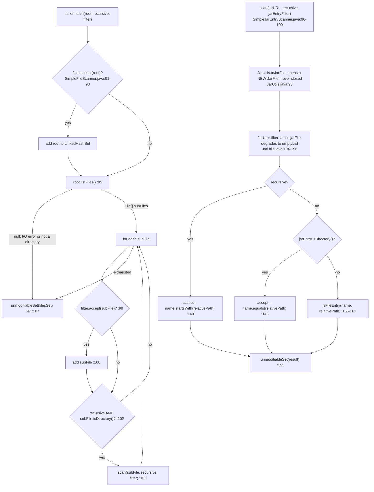

# I/O, NIO, scanning and file filters — Developer Guide

| | |
|---|---|
| **Layer** | Platform integration (`io`, `io.event`, `io.scanner`, `io.filter`, `nio.*`) — see the [layer table](README.md#1-internal-dependency-structure) |
| **Packages** | `io.microsphere.io` (7 main sources) · `io.microsphere.io.event` (3) · `io.microsphere.io.scanner` (4) · `io.microsphere.io.filter` (5) · `io.microsphere.nio.file` (1) · `io.microsphere.nio.charset` (1) = **21** |
| **Source line** | `release` branch, `0.3.20-SNAPSHOT` |
| **Analysis focus** | scanner plugin design; `WatchService` event-overflow handling; resource-close discipline |
| **Allowed imports** | `io.microsphere.util`, `constants`, `text`, `collection`, `filter`, `event`, `logging`, `concurrent`, `annotation` — plus `io.microsphere.nio.*` from `io` |

Paths are relative to `microsphere-java-core/src/main/java/io/microsphere/` unless a `test/` path is spelled out;
after the first full mention they appear as `scanner/SimpleFileScanner.java:87-108` / `io/IOUtils.java:455-471`.

---

## 1. Role in the architecture

This slice is the **lowest part of the Platform-integration layer**: it is the only place in `core` that touches the file system, and it
converts raw `java.nio.file` primitives (`WatchService`, `WatchKey`, `Path`, `JarFile`) into `core`'s own vocabulary (`File`, `Filter`,
`EventDispatcher`, `Set`). Everything above it that needs disk or archive access goes through it.

**Verified outward edges** — what the slice imports from the rest of `core` (from the `import io.microsphere.*` set of the 21 files):

| Type (`file:line` of the import) | Imports | Package |
|---|---|---|
| `io/IOUtils.java:21-23`, `:36-43` | `CharsetUtils`, `StringUtils`, `Utils`, `SeparatorConstants.LINE_SEPARATOR`, `SystemUtils.FILE_ENCODING`, `ObjectUtils.defaultIfNull`, `ArrayUtils.EMPTY_BYTE_ARRAY` | `nio.charset`, `util`, `constants` |
| `io/FileUtils.java:40`, `:101`, `:340` | `ArrayUtils.EMPTY_FILE_ARRAY`, `substringAfterLast`, `ThrowableSupplier.execute` | `util` |
| `io/StandardFileWatchService.java:21-25`, `:41-65` | `EventDispatcher`, `logging.Logger`, `io.event.*`, `CustomizedThreadFactory`, `ExecutorUtils`, `FormatUtils`, `ArrayUtils`, `MapUtils`, `SetUtils`, `ConfigurationProperty` | `event`, `logging`, `concurrent`, `text`, `util`, `collection`, `annotation` |
| `io/scanner/SimpleClassScanner.java:8-31` | `PackageNameClassNameFilter`, `FilterUtils.filter`, `ClassDataRepository`, `ClassLoaderUtils`, `ClassUtils.findClassNamesInClassPath`, `URLUtils`, `Streams.filterAll`, `SetUtils` | `filter`, `lang`, `util`, `net`, `collection` |
| `io/scanner/SimpleJarEntryScanner.java:8-25` | `JarEntryFilter`, `JarUtils`, `PathConstants.SLASH`, `StringUtils.EMPTY` | `filter`, `util.jar`, `constants` |
| `io/filter/IOFileFilter.java:19` | `io.microsphere.filter.Filter` (javadoc `@see` only, `:49`) | `filter` |
| `io/filter/FileExtensionFilter.java:23-26` | `SymbolConstants.DOT`, `FileUtils.getFileExtension`, `StringUtils.isBlank`, `SystemUtils.IS_OS_WINDOWS` | `constants`, `io`, `util` |
| `nio/file/Files.java:21`, `:30` | `IOUtils`, `CharsetUtils.DEFAULT_CHARSET` | `io`, `nio.charset` |

**Verified inbound edges** — who consumes this slice (grep of `import io.microsphere.{io,nio}.` over the main sources):

| Consumer | Imports from this slice | Role of the edge |
|---|---|---|
| `util/ClassUtils.java:10-13`, `:54-55` | `io.FileUtils`, `io.filter.FileExtensionFilter`, `io.filter.IOFileFilter`, `io.scanner.SimpleFileScanner`, `io.scanner.SimpleJarEntryScanner` | **classpath scanning**: `findClassNamesInDirectory` calls `SimpleFileScanner.INSTANCE.scan(dir, recursive, of(CLASS))` (`util/ClassUtils.java:1402`); `findClassNamesInJarFile` calls `SimpleJarEntryScanner.INSTANCE.scan(jf, recursive, ClassFileJarEntryFilter.INSTANCE)` (`util/ClassUtils.java:1449`) |
| `net/URLUtils.java:10` | `io.IOUtils` | URL content reading |
| `classloading/StreamArtifactResourceResolver.java:20` | `io.FastByteArrayInputStream` | artifact content buffering |
| `process/ProcessExecutor.java:4-5` | `io.FastByteArrayInputStream`, `io.FastByteArrayOutputStream` | stdout/stderr capture |
| `util/ExceptionUtils.java:20` | `io.StringBuilderWriter` | stack trace → string |
| `util/SystemUtils.java:21` | `nio.charset.CharsetUtils` | `FILE_ENCODING` default (`util/SystemUtils.java:332`) |

> [!NOTE]
> **Cross-check against the layer diagram in [README.md](README.md#1-internal-dependency-structure).** That diagram now
> shows the cycle (`IO -. cycle .-> UTIL`) and its Foundation row states the exception, but the diagram is drawn at
> package-group granularity, so the evidence is reproduced here: the `release` sources contain the opposite direction as
> well — `util/ClassUtils.java:10-13` and `:54-55` import `io.FileUtils`, `io.filter.*` and `io.scanner.*`, while
> `io/IOUtils.java:22-23` imports `util.StringUtils` and `util.Utils`. `util` ↔ `io` is therefore a genuine package cycle
> inside `core`. It is harmless for the
> artifact (one JAR), but it means `io.scanner` cannot be moved below `util`, and it is why `SimpleClassScanner` ends up calling back into
> `ClassUtils.findClassNamesInClassPath` (`scanner/SimpleClassScanner.java:146`).
>
> The README also lists `IO --> NET` and `IO --> CL`. Those are accurate but incomplete in the other direction: the scanners import
> `net.URLUtils` themselves (`scanner/SimpleClassScanner.java:23-24`), so `io.scanner` → `net` exists too.

The slice is also the **`File` predicate home**. `io.microsphere.io.filter` holds `IOFileFilter` and its four implementations;
`io.microsphere.filter` holds the generic `Filter<T>` SPI. They are documented separately in [Collections and filters](collections-and-filters.md),
which records the same correction.

---

## 2. Package and class map

### 2.1 The 21 types

| Package | Count | Types |
|---|---|---|
| `io.microsphere.io` | 7 | `IOUtils` (`io/IOUtils.java:57`), `FileUtils` (`io/FileUtils.java:34`), `FileWatchService` (`io/FileWatchService.java:54`), `StandardFileWatchService` (`io/StandardFileWatchService.java:108`), `StringBuilderWriter` (`io/StringBuilderWriter.java:66`), `FastByteArrayInputStream` (`io/FastByteArrayInputStream.java:67`), `FastByteArrayOutputStream` (`io/FastByteArrayOutputStream.java:55`) |
| `io.microsphere.io.event` | 3 | `FileChangedEvent` (`io/event/FileChangedEvent.java:34`), `FileChangedListener` (`io/event/FileChangedListener.java:95`), `LoggingFileChangedListener` (`io/event/LoggingFileChangedListener.java:50`) |
| `io.microsphere.io.scanner` | 4 | `Scanner` (`scanner/Scanner.java:24`), `SimpleClassScanner` (`scanner/SimpleClassScanner.java:64`), `SimpleFileScanner` (`scanner/SimpleFileScanner.java:52`), `SimpleJarEntryScanner` (`scanner/SimpleJarEntryScanner.java:60`) |
| `io.microsphere.io.filter` | 5 | `IOFileFilter` (`io/filter/IOFileFilter.java:53`), `DirectoryFileFilter` (`io/filter/DirectoryFileFilter.java:42`), `FileExtensionFilter` (`io/filter/FileExtensionFilter.java:57`), `NameFileFilter` (`io/filter/NameFileFilter.java:28`), `TrueFileFilter` (`io/filter/TrueFileFilter.java:28`) |
| `io.microsphere.nio.file` | 1 | `Files` (`nio/file/Files.java:40`) |
| `io.microsphere.nio.charset` | 1 | `CharsetUtils` (`nio/charset/CharsetUtils.java:33`) |

### 2.2 Responsibility split

| Axis | Members | Shape |
|---|---|---|
| Stateless utility (`abstract` + `private` ctor, implements `Utils`) | `IOUtils` (`:57`, `:547`), `FileUtils` (`:34`, `:343`), `nio.file.Files` (`:40`, `:172`), `CharsetUtils` (`:33`, `:45`) | never instantiated; the `Utils` marker is `io.microsphere.util.Utils` |
| Singleton scanner (public `INSTANCE`, public no-arg ctor) | `SimpleFileScanner` (`scanner/SimpleFileScanner.java:57`, `:59-60`), `SimpleJarEntryScanner` (`scanner/SimpleJarEntryScanner.java:65`, `:67-68`), `SimpleClassScanner` (`scanner/SimpleClassScanner.java:69`, `:71-72`) | stateless, so `new SimpleFileScanner()` works but is pointless |
| Singleton filter (`INSTANCE`, `protected` ctor) | `DirectoryFileFilter` (`io/filter/DirectoryFileFilter.java:47`, `:49`), `TrueFileFilter` (`io/filter/TrueFileFilter.java:33`, `:35`) | subclass-only construction |
| Configurable filter (no singleton) | `FileExtensionFilter` (`of`, `:93-95`), `NameFileFilter` (`:34-41`) | per-call state in a `final` field |
| Lifecycle service | `StandardFileWatchService` (`io/StandardFileWatchService.java:108`) | the only stateful, `AutoCloseable` type in the slice |
| JDK-type extension | `StringBuilderWriter extends Writer`, `FastByteArrayInputStream extends ByteArrayInputStream`, `FastByteArrayOutputStream extends ByteArrayOutputStream` | `io/StringBuilderWriter.java:66`, `io/FastByteArrayInputStream.java:67`, `io/FastByteArrayOutputStream.java:55` |

---

## 3. Source analysis

### 3.1 Scanner "plugin" design — and why it is not a plugin system

`io.scanner.Scanner<S,R>` declares the two-method contract (`scanner/Scanner.java:35` unfiltered, `:47` with a `Filter<R>`), both `@Nonnull`
and both declaring `IllegalArgumentException` / `IllegalStateException`. On the `release` branch:

* **no type implements it** — grepping `implements Scanner`, `extends Scanner` and `ClassPathScanner` across the whole worktree returns zero matches;
* **no service file exists for it** — the 13 `META-INF/services` files shipped in `core` do not include `io.microsphere.io.scanner.Scanner`
  (the full list is in the [developer index](README.md)); the closest scanner-ish registrations are
  `io.microsphere.classloading.ArtifactResourceResolver` and `io.microsphere.classloading.URLClassPathHandle`, which consume this slice
  rather than implement it;
* the three `Simple*Scanner` classes are unrelated concrete types with **their own** parameter shapes —
  `scan(File, boolean, IOFileFilter)` (`scanner/SimpleFileScanner.java:87`), `scan(JarFile, String, boolean, JarEntryFilter)`
  (`scanner/SimpleJarEntryScanner.java:131`), `scan(ClassLoader, String, boolean, boolean)` (`scanner/SimpleClassScanner.java:121`).

So the extensibility is **parameter-shaped, not type-shaped**. Every scanner is a strategy *consumer*:

| Scanner | Injected strategy | Where it is applied | Neutral default |
|---|---|---|---|
| `SimpleFileScanner` | `IOFileFilter` | tested on the root (`scanner/SimpleFileScanner.java:91`) and on every child (`:99`) | `TrueFileFilter.INSTANCE` (`:73`) |
| `SimpleJarEntryScanner` | `JarEntryFilter` | pre-pass through `JarUtils.filter(jarFile, jarEntryFilter)` (`:133`) | `null`, which `JarUtils.filter` degrades to "everything" (`util/jar/JarUtils.java:194-199`) |
| `SimpleClassScanner` | `io.microsphere.filter.Filter<String>` internally, `Predicate<Class<?>>` externally | names narrowed by `PackageNameClassNameFilter` (`:182-183`), classes narrowed by `filterAll` (`:178`) | empty varargs array (`lang.function.Predicates`) |

The `@Since` story is uniform: none of the 21 files carries the `io.microsphere.annotation.@Since` annotation — a grep for `@Since` over
`io/microsphere/io/**` and `io/microsphere/nio/**` returns nothing. Versioning is expressed purely as javadoc `@since 1.0.0` on every public
type (e.g. `scanner/SimpleFileScanner.java:50`, `io/StandardFileWatchService.java:106`, `io/filter/IOFileFilter.java:50`). Treat the whole
slice as API since 1.0.0.

**Traversal, `SimpleFileScanner` (`scanner/SimpleFileScanner.java:87-108`).** Four things are worth naming precisely, because they are the
contract rather than the implementation detail:

1. the root is filtered before anything is listed (`:91-93`) — hence `scan(emptyDir, true)` returns a one-element set;
2. `listFiles()` may legitimately return `null` (I/O error, or the path is not a directory) and is guarded (`:97`) rather than trusted, so
   the scan degrades to "root only";
3. recursion is depth-first *and* order-preserving: children are added as encountered (`:99-101`), then each subdirectory's own result set is
   `addAll`-ed (`:103`) — the child's set is itself unmodifiable (`:107`) and is copied out into the parent's mutable `LinkedHashSet` (`:89`);
4. that `LinkedHashSet` is wrapped by `Collections.unmodifiableSet` on the way out (`:107`), so callers cannot mutate a scan result.

**Two-phase class scanning, `SimpleClassScanner` (`scanner/SimpleClassScanner.java:121-158`).** It first asks the class loader for package
resources (`:128`); if that yields nothing it falls back to the classpath index held by `ClassDataRepository` (`:130-141`), converting the
first known class's classpath entry into a `URL` (`:136-139`). Each resource URL is then truncated at the package resource name to recover
the classpath root (`resolveClassPathURL`, `:187-191`), and `ClassUtils.findClassNamesInClassPath` does the actual directory/jar walk
(`:146`). Finally, `requiredLoad` decides between `loadClass` and `findLoadedClass` (`:151`) — the non-loading default means an unopened
`Set<Class<?>>` is often *empty*, which callers must handle.

### 3.2 The watch-key event loop: register → poll → reset → cancel

`StandardFileWatchService` owns four collaborator objects (`io/StandardFileWatchService.java:139-149`): a JDK `WatchService`, an
`ExecutorService eventLoopExecutor`, an `Executor eventHandlerExecutor`, and an `AtomicBoolean started`. Construction is three-deep
telescoping (`:151-165`); every variant installs a JVM shutdown hook via `shutdownOnExit(eventLoopExecutor, eventHandlerExecutor)` (`:164`,
implementation at `concurrent/ExecutorUtils.java:63-68`).

**Registration is deferred and directory-only.** `watch()` never touches the JDK: it resolves the *directory* key (`getMetadata`, `:275` —
`isDirectory(filePath, NOFOLLOW_LINKS) ? filePath : filePath.getParent()`), creates one `FileChangedMetadata` per directory via
`computeIfAbsent` (`:276-281`) holding a fresh `EventDispatcher.parallel(eventHandlerExecutor)` (`:278`), a `TreeSet<Path> filePaths`
(`:333`) and the mapped `WatchEvent.Kind[]` (`:279`), then adds the listener (`:271`). The actual `directoryPath.register(watchService, kinds)`
happens only inside `start()` → `registerDirectoriesToWatchService` (`:178` → `:253-264`).

**The loop (`:209-241`) and its reset discipline.** `dispatchFileChangedEvents` submits a `Callable` to the single-thread executor (`:210`)
whose body is:

```java
while (isStarted()) {                                  // :211
    WatchKey watchKey = null;                          // :212
    try {
        watchKey = watchService.take();                // :214  blocking; throws InterruptedException
        if (watchKey.isValid()) {                      // :215  the key may already be stale
            for (WatchEvent event : watchKey.pollEvents()) {   // :216
                Path dirPath = (Path) watchKey.watchable();    // :217-218
                Path fileRelativePath = (Path) event.context();// :219
                ... resolve, look up metadata, dispatch        // :221-230
            }
        }
    } finally {
        if (watchKey != null) {
            watchKey.reset();                          // :235
        }
    }
}
```

`reset()` is in `finally`, so it runs on both the happy path and the exceptional one (`:233-237`) — which is the JDK requirement (an un-reset
key stops delivering events). Two properties follow from the code as written:

* **There is no `catch`.** `take()` throwing `InterruptedException` or `ClosedWatchServiceException`, the `watchKey.watchable()` /
  `event.context()` casts at `:218-219`, and `toKind` at `:245` are all unguarded. Any of them ends the `while` loop and is recorded inside
  `eventLoopFuture` (`:210`), which the class never `get()`s or checks.
* **`OVERFLOW` is the concrete instance of that.** `ALL_WATCH_EVENT_KINDS` registers only `ENTRY_CREATE/ENTRY_DELETE/ENTRY_MODIFY`
  (`:133-137`) — `StandardWatchEventKinds.OVERFLOW` cannot be requested and is not in the array — yet the OS may still emit it, and the loop
  hands whatever arrives to `toKind` (`:245`), whose `else` branch throws `IllegalArgumentException("The invalid kind of WatchEvent : {}")`
  (`:324-327`). That is exactly what `StandardFileWatchServiceTest.java:120-123` asserts:
  `assertThrows(IllegalArgumentException.class, () -> toKind(OVERFLOW))`. In the loop itself an `OVERFLOW` would first NPE at
  `dirPath.resolve(fileRelativePath)` (`:224`) because its context is not a `Path`; either way the thread dies, `started` stays `true`
  (`:196-198`) and the service goes permanently quiet while still reporting itself healthy. **This is the single largest gap in the slice.**
  A robust embedding either supervises `eventLoopFuture.isDone()` or adds an `OVERFLOW` branch that re-registers the surviving keys.

**Stop/cancel discipline (`:186-194`).**

```java
while (this.started.compareAndSet(true, false)) {          // :188  runs the body at most once
    this.eventLoopExecutor.awaitTermination(100, MILLISECONDS); // :190  gives take() time to return
    this.eventLoopFuture.cancel(true);                     // :192  interrupts it if not
}
```

`cancel(true)` interrupts the `take()`, and the `finally` still resets the key before the task unwinds. `close()` (`:200-207`) then stops,
closes the JDK service through the library's own total helper (`IOUtils.close`, `io/IOUtils.java:535-545`), clears the cache (`:204`) and
shuts both executors down (`:205-206`). Because `stop()`'s loop condition is a `compareAndSet`, calling `close()` on a never-started service
is safe — the body never runs, so `eventLoopFuture` (still `null`, `:149`) is never dereferenced; `testCloseWithoutStart`
(`StandardFileWatchServiceTest.java:275-281`) pins this.

**Dispatch (`:243-251`).** `Path → File` via `filePath.toFile()` (`:244`), `WatchEvent.Kind → FileChangedEvent.Kind` via `toKind` (`:245`), a
new `FileChangedEvent` per event (`:246`), then `eventDispatcher.dispatch(...)` (`:247`). The listener side is the
`FileChangedListener.onEvent` default, which fans out by kind (`io/event/FileChangedListener.java:99-109`) with `DELETED` as the `default` arm
— so a `null` kind NPEs at `:99` (`FileChangedListenerTest.java:80`).

### 3.3 `io.filter` predicates — what composition exists, and what does not

`IOFileFilter` is the contract: `@FunctionalInterface` (`io/filter/IOFileFilter.java:52`) extending **both** `java.io.FileFilter` and
`java.io.FilenameFilter` (`:53`). The abstract method is the single-argument `accept(File)` (`:56`); the two-argument form is a *bridge*,
constructing `new File(dir, name)` and forwarding (`:58-61`). That is the whole of the "combator" story: one object can be handed to
`File.listFiles(FileFilter)`, `File.list(FilenameFilter)`, `FilenameFilter`-based APIs and `SimpleFileScanner` without adaptation.

> [!IMPORTANT]
> **There are no boolean combinators in `io.microsphere.io.filter`.** A grep of the package finds no `and`, `or`, `negate`, no `AcceptAll`, no
> `AndFileFilter`/`OrFileFilter`, and `IOFileFilter` deliberately does **not** extend `java.util.function.Predicate` — so the `Predicate`
> default methods are unavailable, and even if they were they would return `Predicate`, not `IOFileFilter`. `TrueFileFilter`
> (`io/filter/TrueFileFilter.java:28-47`) is the *identity element* for a conjunction (`scanner/SimpleFileScanner.java:73` uses it as such),
> but there is nothing to conjoin it with. Do not cite Apache `IOFileFilter.and(...)`: this is an Apache-derived package
> (`io/filter/IOFileFilter.java:1-16` carries the ASF header) and the combinators were **not** carried over.
>
> The library's real combinator, `FilterOperator.createFilter(Filter<T>...)` (`filter/FilterOperator.java:111-120`), returns a `Filter<File>` —
> which is **not** assignable to the `IOFileFilter` parameter of `SimpleFileScanner.scan(File, boolean, IOFileFilter)`
> (`scanner/SimpleFileScanner.java:87`), because `Filter` is a subtype of `Predicate` and `IOFileFilter` is a subtype of
> `FileFilter`/`FilenameFilter`. The two hierarchies meet only at the lambda site. Compose in your own code, then wrap:
> `IOFileFilter f = file -> a.accept(file) && b.accept(file);`.

Null discipline across the five types is *not* uniform, and it is the most common source of surprises. Note that `accept(File)` and
`accept(File, String)` behave differently: only `TrueFileFilter` overrides the two-argument form (`io/filter/TrueFileFilter.java:44`) — a
grep of the package confirms it is the sole declaration — so for the other three the bridge at `IOFileFilter.java:59-60` runs first, and
`new File(dir, null)` is an NPE in the JDK.

| Type | `accept(null)` | `accept(dir, null)` | Evidence |
|---|---|---|---|
| `DirectoryFileFilter` | `false` | **`NullPointerException`**, in the bridge | `io/filter/DirectoryFileFilter.java:53-55` + `IOFileFilter.java:60` |
| `FileExtensionFilter` | `false` | **`NullPointerException`**, in the bridge | `io/filter/FileExtensionFilter.java:69-72` + `IOFileFilter.java:60` |
| `NameFileFilter` | **`NullPointerException`** | **`NullPointerException`**, in the bridge before its own `file.getName()` | `io/filter/NameFileFilter.java:44-48` |
| `TrueFileFilter` | `true` | `true` — overrides both, bypassing the bridge | `io/filter/TrueFileFilter.java:39`, `:44` |
| lambda `IOFileFilter` | implementor's choice | forwards through `:59-61` | `IOFileFilterTest.java:21-27` |

`FileExtensionFilter` also carries the slice's only OS-dependent constant: `CASE_SENSITIVE = !SystemUtils.IS_OS_WINDOWS`
(`io/filter/FileExtensionFilter.java:59`, with `IS_OS_WINDOWS` defined at `util/SystemUtils.java:347`), consumed by
`matches(String, boolean)` (`:83-85`). The constructor normalises a leading dot away (`:63-66`), so `of(".txt")` and `of("txt")` are
equivalent (`FileExtensionFilterTest.java:65-69`).

### 3.4 Resource-close discipline

The slice has a deliberate, documented asymmetry:

* `IOUtils` **never** closes what it is given. Every reading method's javadoc says the stream is left open (`io/IOUtils.java:99`, `:129`,
  `:160`, `:191`, `:222`, `:435-436`, `:477`), and `close(Closeable)` (`:535-545`) is the only closer — total, `null`-tolerant, and swallowing
  `IOException` to `TRACE` (`:542`). Eight javadoc examples inside the class itself call `IOUtils.closeQuietly(...)` (`:110`, `:140`, `:172`,
  `:200`, `:231`, `:258`, `:287`, `:314`), **a method that does not exist**; the real name is `close`. Anyone porting from Commons-IO will hit
  this.
* `nio.file.Files.readLines` **does** own its resource, through try-with-resources on `java.nio.file.Files.newInputStream`
  (`nio/file/Files.java:166-170`), and delegates the decoding to `IOUtils.readLines(InputStream, Charset)` — so the two halves compose
  without double-closing.
* The one genuine leak is `SimpleJarEntryScanner.scan(URL, ...)` (`scanner/SimpleJarEntryScanner.java:96-100`): it calls
  `JarUtils.toJarFile(jarURL)` (`:98`) — which allocates `new JarFile(...)` per call (`util/jar/JarUtils.java:93`) and returns `null` if the
  path is unresolvable or the open failed (`:88-90`, `:94-98`) — and then delegates to the `JarFile` overload without closing it. Because
  `JarUtils.filter` treats a `null` `JarFile` as "no entries" (`util/jar/JarUtils.java:194-196`), the failure mode is a **silent empty result
  plus an unclosed handle**, never an exception. `util/ClassUtils.java:1448-1449` is the in-repo counter-example: open in
  try-with-resources, call the `JarFile` overload.
* `StandardFileWatchService` is `AutoCloseable` (`:108`) and `close()` releases everything it owns (`:200-207`); `start()` is the only place a
  JDK `WatchService` is created (`:176`), so `start()` without `close()` leaks that handle. It does not block JVM exit, though: the loop
  thread comes from a factory built with `daemon = true` (`:156`, `concurrent/CustomizedThreadFactory.java:82-84`, `:96`), so the
  `WatchService` simply stays registered until the shutdown hook installed at `:164` runs.

---

## 4. Control and class flow

### 4.1 Scan traversal (`flowchart TD`)



### 4.2 `WatchService` register → poll → reset, including the overflow branch (`sequenceDiagram`)

```mermaid
sequenceDiagram
    participant App as Caller thread
    participant WS as StandardFileWatchService
    participant Cache as fileChangedMetadataCache (TreeMap)
    participant Loop as eventLoop thread
    participant JDK as java.nio.file.WatchService
    participant Disp as EventDispatcher.parallel
    participant L as FileChangedListener

    App->>WS: watch(file, listener, kinds) :267
    WS->>Cache: getMetadata(parent dir) computeIfAbsent :275-281
    Cache-->>WS: FileChangedMetadata{dispatcher, kinds, filePaths}
    WS->>WS: filePaths.add(filePath) :270 / addEventListener(listener) :271
    Note over WS: nothing registered with the JDK yet
    App->>WS: start() :167
    WS->>WS: started.compareAndSet(false,true) :168 - IllegalStateException :169 if already started
    WS->>JDK: fileSystem.newWatchService() :176
    WS->>JDK: dirPath.register(watchService, kinds) :258, one per cache entry
    WS->>Loop: eventLoopExecutor.submit(loop) -> eventLoopFuture :210

    loop while isStarted() :211
        Loop->>JDK: watchService.take() :214
        JDK-->>Loop: WatchKey - isValid() :215, pollEvents() :216
        alt entry kind (CREATE / MODIFY / DELETE)
            Loop->>Cache: get(dirPath) :221
            Loop->>Disp: dispatch(new FileChangedEvent(file, kind)) :246-247
            Disp->>L: onEvent -> onFileCreated/Modified/Deleted (FileChangedListener.java:99-109)
        else OVERFLOW or unknown kind
            Loop->>Loop: toKind(kind) throws IllegalArgumentException :245 :324-327
            Note over Loop: no catch block - the Callable dies
            Loop-->>WS: exception stored in eventLoopFuture, never get()
            Note over WS: isStarted() still true :196-198 - service silently stops reporting
        end
        Loop->>JDK: finally watchKey.reset() :233-237
    end

    App->>WS: stop() :186
    WS->>WS: started.compareAndSet(true,false) :188
    WS->>Loop: awaitTermination(100ms) :190 / eventLoopFuture.cancel(true) :192
    App->>WS: close() :201
    WS->>JDK: IOUtils.close(watchService) :203
    WS->>Cache: clear() :204
    WS->>WS: shutdown(executors) :205-206
```

### 4.3 Scanner / filter class hierarchy (`graph TD`)

```mermaid
graph TD
    subgraph JDK["JDK contracts"]
        FILT["java.io.FileFilter"]
        FNFLT["java.io.FilenameFilter"]
    end
    subgraph GEN["io.microsphere.filter - generic SPI, separate page"]
        FILTER["Filter&lt;T&gt;"]
        JEF["JarEntryFilter"]
        PNCF["PackageNameClassNameFilter"]
    end
    subgraph IOF["io.microsphere.io.filter - File predicates"]
        IOFILEF["IOFileFilter"]
        DIRF["DirectoryFileFilter"]
        EXT["FileExtensionFilter"]
        NAMEF["NameFileFilter"]
        TRUEF["TrueFileFilter"]
    end
    subgraph SC["io.microsphere.io.scanner"]
        SCANIF["Scanner&lt;S,R&gt;"]
        SFS["SimpleFileScanner"]
        SJS["SimpleJarEntryScanner"]
        SCS["SimpleClassScanner"]
    end
    subgraph EVT["io.microsphere.io.event"]
        FCE["FileChangedEvent"]
        FCL["FileChangedListener"]
        LFCL["LoggingFileChangedListener"]
    end

    FILT <|-- IOFILEF
    FNFLT <|-- IOFILEF
    IOFILEF <|.. DIRF
    IOFILEF <|.. EXT
    IOFILEF <|.. NAMEF
    IOFILEF <|.. TRUEF
    FILTER -. "javadoc @see only, IOFileFilter.java:49" .- IOFILEF
    JEF -. "scanner arg" .- SJS
    PNCF -. "used by" .- SCS
    SCANIF -. "declared but NOT implemented" .- SFS
    SCANIF -. "declared but NOT implemented" .- SJS
    SCANIF -. "declared but NOT implemented" .- SCS
    SFS -->|"IOFileFilter param :87"| IOFILEF
    SFS -->|"TrueFileFilter default :73"| TRUEF
    SCS -->|"ClassNameFilter :182"| PNCF
    EXT -->|"getFileExtension :75"| FCEXT["io.FileUtils"]
    FCL -->|"extends EventListener&lt;FileChangedEvent&gt;"| EVL["io.microsphere.event.EventListener"]
    FCE -->|"extends Event"| EV["io.microsphere.event.Event"]
    LFCL ..|> FCL
    SFWS["io.StandardFileWatchService"] -->|"implements FileWatchService"| FWI["io.FileWatchService"]
    SFWS -->|"dispatch :247"| ED["io.microsphere.event.EventDispatcher"]
    ED -.->|"addEventListener :271"| FCL
    SCS -.->|"findClassNamesInClassPath :146"| CU["util.ClassUtils"]
    CU -.->|"scan(dir, .., of(CLASS)) :1402"| SFS
    CU -.->|"scan(jarFile, ..) :1449"| SJS
```

---

## 5. Design patterns

| Pattern | Implementing class(es) | Evidence, and where it stops short |
|---|---|---|
| **Strategy / Plugin (parameter-shaped)** | `SimpleFileScanner` × `IOFileFilter`; `SimpleJarEntryScanner` × `JarEntryFilter`; `SimpleClassScanner` × `Predicate<Class<?>>`; `StandardFileWatchService` × `Executor` | `scanner/SimpleFileScanner.java:87` (filter argument), `scanner/SimpleJarEntryScanner.java:131`, `scanner/SimpleClassScanner.java:168-169`, `io/StandardFileWatchService.java:155-159`. The *type-level* plug point `scanner/Scanner.java:24` exists but has no implementations and no `META-INF/services` registration — see 3.1 |
| **Singleton (eager, public field)** | `SimpleFileScanner.INSTANCE` (`:57`), `SimpleJarEntryScanner.INSTANCE` (`:65`), `SimpleClassScanner.INSTANCE` (`:69`), `DirectoryFileFilter.INSTANCE` (`io/filter/DirectoryFileFilter.java:47`), `TrueFileFilter.INSTANCE` (`io/filter/TrueFileFilter.java:33`) | All are `public final/static` fields over stateless objects. Two of the five keep a `protected` ctor (`DirectoryFileFilter.java:49`, `TrueFileFilter.java:35`) to block third-party instantiation while allowing subclassing |
| **Composite (filter)** | **absent** | No `AndFileFilter` / `OrFileFilter` / `not()` in `io.microsphere.io.filter`; `IOFileFilter` does not extend `Predicate`. Only `TrueFileFilter` as an identity value (`scanner/SimpleFileScanner.java:73`). Composition lives in `filter/FilterOperator.java:111-120`, which is type-incompatible with `IOFileFilter` — see 3.3 |
| **Adapter** | `IOFileFilter` adapts one predicate to two JDK interfaces (`io/filter/IOFileFilter.java:53`, `:58-61`); `toWatchEventKind` / `toKind` adapt `FileChangedEvent.Kind` ⇄ `StandardWatchEventKinds` (`io/StandardFileWatchService.java:299-313`, `:316-329`); `dispatchFileChangedEvent` adapts `Path`→`File` (`:244`); `FileChangedEvent` adapts a `File` into the `Event` source and casts it back (`io/event/FileChangedEvent.java:45-49`, `:54-56`) | `toKind` is the adapter that turns an unadaptable value into an exception (`:324-327`) rather than `null` — the one place in the slice where the degradation policy is *not* followed |
| **Observer (bridge to `io.event`)** | `FileChangedListener` (`io/event/FileChangedListener.java:95`) registered into `EventDispatcher.parallel(...)` per directory (`io/StandardFileWatchService.java:278`), notified at `:247` | The JDK `WatchService` (poll-based) is translated into push-based observers; ordering comes from `io.microsphere.event.AbstractEventDispatcher.sortedListeners()` (`event/AbstractEventDispatcher.java:145-153`), and `ConditionalEventListener` filtering is applied there too (`:162-180`, guard at `:170-175`) |
| **Template Method** | `FileWatchService.watch(File, Iterable, Kind...)` default loops into the abstract single-listener method (`io/FileWatchService.java:76-78`); `FileChangedListener.onEvent` routes by kind to three empty hooks (`io/event/FileChangedListener.java:97-134`); `SimpleJarEntryScanner`'s `protected scan(JarFile, String, boolean, JarEntryFilter)` is the overridable step (`:131-153`); `AbstractEventDispatcher.dispatch` fixes the executor/listener skeleton (`event/AbstractEventDispatcher.java:162-180`) | `LoggingFileChangedListener` is the "concrete hook only" demonstration — it overrides the three kind methods and never `onEvent` (`io/event/LoggingFileChangedListener.java:54-71`) |
| **Null Object / neutral value** | `FileExtensionFilter.accept(null)` → `false` (`io/filter/FileExtensionFilter.java:70-72`); `DirectoryFileFilter.accept(null)` → `false` (`:53-55`); `FileUtils.listFiles(null)` → `EMPTY_FILE_ARRAY` (`io/FileUtils.java:292-295`); `IOUtils.toByteArray(null)` → shared `EMPTY_BYTE_ARRAY` (`:209-211`); `IOUtils.close(null)` → no-op (`:535-545`); `toWatchEventKinds(null)` → `ALL_WATCH_EVENT_KINDS` (`io/StandardFileWatchService.java:286-289`) | The counter-examples are `NameFileFilter.accept(null)` → NPE (`io/filter/NameFileFilter.java:45`), the `accept(dir, null)` bridge → NPE for three of the four filters (`IOFileFilter.java:60`), and `IOUtils.copy(null, out)` → NPE (`:456`) |
| **Facade / Utility (non-instantiable)** | `IOUtils` (`io/IOUtils.java:57`, `:547`), `FileUtils` (`:34`, `:343`), `nio.file.Files` (`:40`, `:172`), `CharsetUtils` (`:33`, `:45`) | All `public abstract class … implements Utils` with a `private` constructor; `nio.file.Files` deliberately shadows `java.nio.file.Files` and re-exports it through `IOUtils` (`nio/file/Files.java:31`, `:167-168`) |
| **Decorator (via inheritance, not wrapping)** | `StringBuilderWriter` (`io/StringBuilderWriter.java:66`), `FastByteArray*` (`io/FastByteArrayInputStream.java:67`, `io/FastByteArrayOutputStream.java:55`) | These subclass rather than wrap, so they inherit the JDK's `protected buf/count/pos/mark` state — which is how `FastByteArrayInputStream.equals` can compare buffers directly (`:161-166`) |

---

## 6. Extension points

1. **Add a `File` predicate.** Implement `IOFileFilter` (it is `@FunctionalInterface`, so a lambda works — `io/filter/IOFileFilter.java:52`);
   overriding `accept(File)` is enough because `accept(File, String)` defaults to the bridge at `:58-61`. Keep `accept(null)` returning
   `false` if you want to be usable as `SimpleFileScanner`'s filter on a `null` root (`scanner/SimpleFileScanner.java:91`). There is **no
   service file to register** — the package is not SPI-loaded.
2. **Add a scanner.** Copy the singleton idiom: a `public static final INSTANCE` plus a public no-arg ctor
   (`scanner/SimpleFileScanner.java:57-60`), return `unmodifiableSet(newLinkedHashSet())` (`:89`, `:107`), accept the filter as an argument
   rather than as a field, and take `boolean recursive` explicitly instead of sub-classing for it. If you want your scanner to be
   discoverable through `ServiceLoader`, define your own `META-INF/services/your.YourScannerType` — nothing in `core` currently consumes
   `io.microsphere.io.scanner.Scanner` that way, so implementing that interface buys you nothing today (`scanner/Scanner.java:24`).
3. **Add a file-change reaction.** Implement `FileChangedListener` and override only the kinds you care about
   (`io/event/FileChangedListener.java:117-134`), optionally `getPriority()` from `Prioritized` — the default is `NORMAL_PRIORITY = 0`
   (`lang/Prioritized.java:99`). Beware the house quirk recorded in the developer index: `MIN_PRIORITY = Integer.MAX_VALUE` and
   `MAX_PRIORITY = Integer.MIN_VALUE` (`lang/Prioritized.java:81`, `:86`), i.e. the constant **names are inverted relative to their values**,
   so `MIN_PRIORITY` sorts last. Register with `FileWatchService.watch(File, Iterable<FileChangedListener>, Kind...)`
   (`io/FileWatchService.java:76-78`) — `LoggingFileChangedListener` (`io/event/LoggingFileChangedListener.java:50`) is the ready-made
   debugging listener.
4. **Swap the executors.** `StandardFileWatchService(Executor eventHandlerExecutor)` (`:155-157`) controls whether listeners run on the watch
   thread (`DIRECT_EXECUTOR`, `Runnable::run`, `event/EventDispatcher.java:63` — the no-arg ctor default, `:152`) or in parallel;
   `StandardFileWatchService(Executor, ExecutorService)` (`:159-165`) additionally lets you own the loop thread. Thread naming is configurable
   through the system property `microsphere.file-watch-service.thread-name-prefix` (`:120`, `:131`).
5. **Tune the I/O buffer.** `-Dmicrosphere.io.buffer.size=4096` before the first `IOUtils` class load (`io/IOUtils.java:80`, `:91`).
6. **Add a charset-aware read path.** Extend `nio.file.Files` (`:40`) rather than `IOUtils`: `Files` is the layer that owns the stream
   (`:166-170`), so a new `readString(Path, Charset)` gets closing for free.

---

## 7. Thread-safety and performance

**Mutable state lives in exactly one class.** `SimpleFileScanner`, `SimpleJarEntryScanner` and `SimpleClassScanner` hold no fields (only
`INSTANCE`, `scanner/SimpleFileScanner.java:57`, `scanner/SimpleJarEntryScanner.java:65`, `scanner/SimpleClassScanner.java:69`), and every
filter's state is `final` (`io/filter/FileExtensionFilter.java:61`, `io/filter/NameFileFilter.java:30-32`). `IOUtils`, `FileUtils`, `Files`
and `CharsetUtils` are static-only, with `BUFFER_SIZE` (`io/IOUtils.java:91`) and `DEFAULT_CHARSET` (`nio/charset/CharsetUtils.java:43`)
resolved once at class initialisation.

`StandardFileWatchService` is the exception, field by field:

| Field | Declaration | Concurrency verdict |
|---|---|---|
| `started` | `private final AtomicBoolean started;` (`:147`, initialised `:162`) | correct — CAS-gated start (`:168`) and stop (`:188`) |
| `eventLoopFuture` | `private volatile Future eventLoopFuture;` (`:149`) | the `volatile` is what makes the `stop()` read (`:192`) visible; still dereferenced only inside a CAS body that cannot run before `start()` |
| `eventHandlerExecutor` | `private final Executor` (`:141`) | safe publication |
| `eventLoopExecutor` | `private final ExecutorService` (`:143`) — `newSingleThreadExecutor(newThreadFactory(THREAD_NAME_PREFIX, true))` (`:156`) | **one** loop thread, daemon (`concurrent/CustomizedThreadFactory.java:82-84`, `:96`) |
| `watchService` | `private WatchService watchService;` (`:139`) — **not** `volatile`, **not** `final` | written in `start()` (`:182`) on the caller thread, read in `close()` (`:203`); there is no happens-before edge, so a `close()` racing `start()` can observe `null` and skip closing the JDK service entirely |
| `fileChangedMetadataCache` | `private final Map<Path, FileChangedMetadata> ... = newTreeMap();` (`:145`) | `newTreeMap()` returns a plain `java.util.TreeMap` (`collection/MapUtils.java:812-814`). It is written by `watch()` (`:276`, `computeIfAbsent`, caller thread) and read by the event loop (`:221`) — **unsynchronised concurrent access to a `TreeMap`.** Registering before `start()` is safe; registering afterwards (which 3.2 shows is useless anyway) is a data race |
| `FileChangedMetadata.filePaths` | `private final Set<Path> filePaths = newTreeSet();` (`:333`) | plain `java.util.TreeSet` (`collection/SetUtils.java:702-704`), written at `:270`, read at `:225` — same race. In practice it never filters anything (see the user guide's pitfall 3), so the read is harmless today |
| `FileChangedMetadata.eventDispatcher` | non-`final` field assigned in the lambda at `:278` | the dispatcher itself is safe (`event/AbstractEventDispatcher.java:95-99` uses a `mutex` and a `ConcurrentMap`); the field's non-`final` status is the weak point |

Practical guidance: register every watch **before** `start()`, from a single thread, and treat `isStarted()` (`:196-198`) as advisory rather
than as a liveness signal (see the `OVERFLOW` discussion in 3.2).

**Performance characteristics worth knowing before you point these at a real tree:**

* `SimpleFileScanner` recursion copies on the way up. Each level returns an `unmodifiableSet` view (`scanner/SimpleFileScanner.java:107`)
  which the parent `addAll`s (`:103`) into its own `LinkedHashSet`, so a depth-*d*, *n*-file tree moves roughly *n·d* references. It is
  correct and allocation-light per node, but not linear-time. There is no depth limit and no visited-inode tracking, so a symlink loop
  overflows the stack (`:102` uses `File.isDirectory()`, which follows links).
* `SimpleJarEntryScanner` is **not** selective at the archive level. `JarUtils.filter(jarFile, jarEntryFilter)` materialises *every* entry
  into a `List` first (`util/jar/JarUtils.java:197-198`), and only then does `scanner/SimpleJarEntryScanner.java:135-151` apply the
  relative-path/`isFileEntry` narrowing in Java. A non-recursive scan of a 10k-entry jar still walks 10k entries.
* `SimpleClassScanner` calls `findClassNamesInClassPath(classPath, true)` with recursion hard-coded to `true`
  (`scanner/SimpleClassScanner.java:146`) regardless of the caller's `recursive` flag; the flag is applied *afterwards* by
  `PackageNameClassNameFilter` (`:147`, `:182-183`). Sub-package filtering is therefore a post-filter, not a traversal optimisation.
* `IOUtils.copy` allocates one `byte[BUFFER_SIZE]` / `char[BUFFER_SIZE]` per call (`io/IOUtils.java:460`, `:501`) — 2 KiB by default (`:66`),
  which is small for large transfers; raise the system property (see 6.5) rather than changing code. `toByteArray` (`:212-214`) buffers the
  whole stream in memory and `FastByteArrayOutputStream.grow` doubles (`io/FastByteArrayOutputStream.java:107`), so an unbounded stream risks
  both an `OutOfMemoryError` from `assertCapacity` (`:114-118`) and a final copy in `toByteArray()` (`:159-161`).
* `FileUtils.cleanDirectory` lists per level through the library's own null-safe helper (`io/FileUtils.java:164`, and `:269` for the
  on-exit twin; `deleteDirectory` delegates at `:129`) and uses no parallelism; the tests at `FileUtilsTest.java:219-265` exist precisely
  because a concurrent writer makes these throw.
* Watch dispatch cost is one `FileChangedEvent` allocation plus one `Path → File` conversion per event
  (`io/StandardFileWatchService.java:244-246`), then `sortedListeners()` re-sorts on **every** dispatch
  (`event/AbstractEventDispatcher.java:145-153`, invoked at `:168`). On Windows, where one write yields several `MODIFIED` events, that
  re-sort is the hot path; using `DIRECT_EXECUTOR` (`io/StandardFileWatchService.java:152`) also moves listener work onto the loop thread and
  can delay `watchKey.reset()` (`:235`), which in turn increases `OVERFLOW` likelihood.

---

## 8. Testing strategy

The slice has 21 main types and 20 test classes under `microsphere-java-core/src/test/java/io/microsphere/io/**` and `.../nio/**` (excluding
the 17 `io/serializer/**` suites, which belong to [Serialization](serialization.md)).

| Suite | What it pins |
|---|---|
| `io/scanner/SimpleFileScannerTest.java:35-70` | traversal contract against `$JAVA_HOME`: recursive vs non-recursive (`:37`, `:40`), filter-specialised scans (`:46`, `:52`), and the two boundary shapes — empty directory (`:57-62`) and a plain file as root (`:64-70`) |
| `io/scanner/SimpleJarEntryScannerTest.java:35-61` | URL vs `JarFile` entry points (`:36-55`), the exact counts `1` and `5` that fix `isFileEntry` semantics (`:39`, `:43`), and `isFileEntry` directly, including the trailing-slash asymmetry (`:58-61`) |
| `io/scanner/SimpleClassScannerTest.java:31-58` | directory-backed (`:32-35`) and jar-backed (`:38-48`) package scans, plus the archive overloads with and without loading (`:51-58`) |
| `io/filter/IOFileFilterTest.java:20-28` | the `@FunctionalInterface` lambda form and the `accept(File,String)` bridge (`:26`) |
| `io/filter/DirectoryFileFilterTest.java:25-42`, `FileExtensionFilterTest.java:28-79`, `NameFileFilterTest.java:46-68`, `TrueFileFilterTest.java:17-21` | per-predicate truth tables, `null` behaviour (`DirectoryFileFilterTest.java:26-28`, `FileExtensionFilterTest.java:34-36`), directory rejection (`FileExtensionFilterTest.java:38-43`), and the `matches(name, caseSensitive)` seam (`:56-62`) that makes the Windows rule testable on Linux |
| `io/IOUtilsTest.java:63-221` | buffer constants (`:63-66`), the whole `null`/empty/blank encoding matrix (`:106-134`), `IllegalCharsetNameException` on `""` (`:117-119`), `copy` round-trip (`:196-201`) and `close` totality (`:203-221`) |
| `io/FileUtilsTest.java:73-315` | relative-path resolution incl. the two `null` cases (`:73-91`), delete counts (`:99-124`, `:162-174`, `:202-217`), `listFiles` degradation (`:176-200`), symlink detection (`:297-309`) and canonical idempotence (`:311-315`) |
| `io/FileUtilsTest.java:219-265`, `:317-378` | the two concurrency harnesses: `testForceDeleteOnIOException` holds a `FileOutputStream` under a monitor while another thread deletes, and `handleDirectoryOnIOException0` races file creation against directory deletion, asserting that an `IOException` **is** observed (`:373`) |
| `io/StandardFileWatchServiceTest.java:97-123` | the pure mapping functions with no threads: `toWatchEventKinds` null/empty/full-varargs (`:98-104`) and `toKind` including the `OVERFLOW` throw (`:120-123`) |
| `io/StandardFileWatchServiceTest.java:126-163`, `:166-214` | the end-to-end file lifecycle (`CountDownLatch(3)`, double-`start` ISE, `stop`) and the directory lifecycle |
| `io/StandardFileWatchServiceTest.java:269-314` | `isStarted()` before start (`:270-273`), `close()` without start (`:275-281`) and the `Iterable` overload fan-out (`:283-314`) |
| `io/event/FileChangedEventTest.java:21-36` | source identity, `toString` shape, and the two `IllegalArgumentException` guards (`:33-34`) |
| `io/event/FileChangedListenerTest.java:45-103` | `getPriority()` default (`:47`), kind routing over `values()` (`:51-76`) and `onEvent(null)` NPE (`:79-81`) |
| `io/StringBuilderWriterTest.java:44-157`, `FastByteArrayInputStreamTest.java:46-139`, `FastByteArrayOutputStreamTest.java:38-120` | the no-op `close`/`flush` (`StringBuilderWriterTest.java:145-157`), null/empty tolerance of every `write`/`append` (`:69-113`), `skip` clamping (`FastByteArrayInputStreamTest.java:98-104`), buffer-content `equals` (`:128-139`), growth and the `OutOfMemoryError` seam (`FastByteArrayOutputStreamTest.java:117-120`) |
| `nio/file/FilesTest.java:58-65`, `nio/charset/CharsetUtilsTest.java:17-20` | `File`/`Path` overload agreement and `DEFAULT_CHARSET` non-null |

Three conventions are worth copying:

* **Fixtures come from `AbstractTestCase`** (`microsphere-java-core/src/test/java/io/microsphere/AbstractTestCase.java`):
  `createRandomTempDirectory()` (`:126-128`), `createRandomTempFile()` (`:130-132`), `createRandomFile(File)` (`:145-150`) — all of which
  register `deleteOnExit()` — and `makeLinkFile(File)` (`:160-176`), which shells out to `mklink /D` on Windows and `ln -s` elsewhere so
  symlink tests are meaningful on both.
* **Watch tests are written as spin/poll, not sleep.** `StandardFileWatchServiceTest.java:199-208` busy-waits on an `AtomicReference` until
  the expected event lands, and the chained-operations listener (`:216-250`) does each next mutation on a *separate* `ExecutorService` with a
  100 ms cap (`:252-267`) so a listener can never block the event loop it was called from.
* **OS-dependent logic is exposed for testing.** `FileExtensionFilter` makes the case decision a parameter of `matches(String, boolean)`
  (`io/filter/FileExtensionFilter.java:83-85`) instead of reading `IS_OS_WINDOWS` at the call site, which is what lets
  `FileExtensionFilterTest.java:56-62` assert both branches on any OS. Do the same when adding a platform rule.

> [!TIP]
> The two scanner suites depend on `$JAVA_HOME` (`SimpleFileScannerTest.java:33`) and on `javax.annotation` living in a **jar**
> (`SimpleJarEntryScannerTest.java:37-43`, `SimpleClassScannerTest.java:39`). Those counts (`1`, `5`, `4`) break if the dependency moves to a
> directory layout — so when you change the classpath shape of the build, expect these three suites to be the canary, not a regression.

---

## 9. See also

* User-facing reference: [I/O, NIO, scanning and file filters — User Guide](../../user-guide/microsphere-java-core/io-and-scanning.md)
* [Collections and filters](collections-and-filters.md) — the generic `Filter<T>` / `FilterOperator` SPI, and the `File`-predicate correction
  this page repeats
* [Event dispatching](events.md) — `EventDispatcher`, `AbstractEventDispatcher`, `Prioritized`, `ConditionalEventListener`, the machinery
  `io.event` bridges into
* [Utilities, constants and text](util-and-constants.md) — `SystemUtils` (`FILE_ENCODING`, `IS_OS_WINDOWS`), `ClassLoaderUtils`,
  `util.jar.JarUtils`, `ClassDataRepository`
* [Networking and URL protocols](net-and-url-protocols.md) — `URLUtils.resolveArchiveFile` and the `jar:` protocol the scanners depend on
* [Class loading and artifacts](classloading-and-artifacts.md) — the downstream consumer of `FastByteArrayInputStream` and of the scanners
* [Serialization](serialization.md) — the sibling `io.microsphere.io.serializer` package
* [Developer Guide index](README.md) — layer table, 13-file SPI registry, degradation policy
* [中文开发者指南](zh/io-and-scanning.md)
