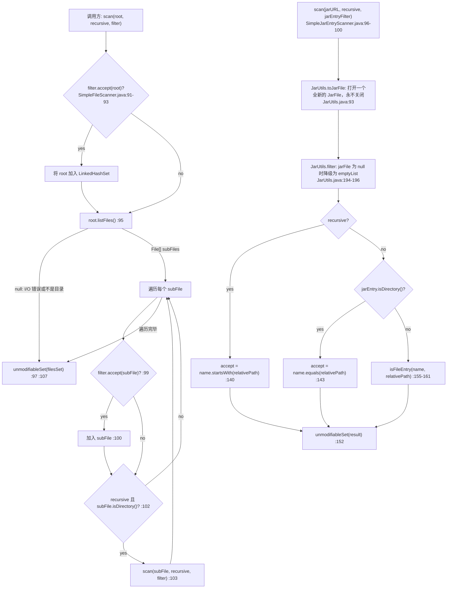

# I/O、NIO、扫描与文件过滤器（I/O, NIO, scanning and file filters）—— 开发者指南

| | |
|---|---|
| **层级** | 平台集成层（`io`、`io.event`、`io.scanner`、`io.filter`、`nio.*`）—— 参见[层级表](./README.zh.md#1-内部依赖结构) |
| **包** | `io.microsphere.io`（7 个主源码）· `io.microsphere.io.event`（3）· `io.microsphere.io.scanner`（4）· `io.microsphere.io.filter`（5）· `io.microsphere.nio.file`（1）· `io.microsphere.nio.charset`（1）= **21** |
| **源码基线** | `release` 分支，`0.3.20-SNAPSHOT` |
| **分析重点** | 扫描器的插件式设计、`WatchService` 事件溢出处理、资源关闭纪律 |
| **允许的导入** | `io.microsphere.util`、`constants`、`text`、`collection`、`filter`、`event`、`logging`、`concurrent`、`annotation` —— 以及 `io` 可导入 `io.microsphere.nio.*` |

路径除显式写出 `test/` 外，均相对于 `microsphere-java-core/src/main/java/io/microsphere/`；
首次完整提及之后缩写为 `scanner/SimpleFileScanner.java:87-108` / `io/IOUtils.java:455-471`。

---

## 1. 在架构中的角色

本切片位于**平台集成层的最底部**：它是 `core` 中唯一接触文件系统的地方，负责把 `java.nio.file` 的原始基元
（`WatchService`、`WatchKey`、`Path`、`JarFile`）翻译成 `core` 自己的词汇（`File`、`Filter`、`EventDispatcher`、`Set`）。
它之上任何需要访问磁盘或归档包的部分都要经过这里。

**已核实的外向边** —— 本切片从 `core` 其余部分导入了什么（来自这 21 个文件的 `import io.microsphere.*` 集合）：

| 类型（`import` 语句的 `file:line`） | 导入内容 | 包 |
|---|---|---|
| `io/IOUtils.java:21-23`, `:36-43` | `CharsetUtils`、`StringUtils`、`Utils`、`SeparatorConstants.LINE_SEPARATOR`、`SystemUtils.FILE_ENCODING`、`ObjectUtils.defaultIfNull`、`ArrayUtils.EMPTY_BYTE_ARRAY` | `nio.charset`、`util`、`constants` |
| `io/FileUtils.java:40`, `:101`, `:340` | `ArrayUtils.EMPTY_FILE_ARRAY`、`substringAfterLast`、`ThrowableSupplier.execute` | `util` |
| `io/StandardFileWatchService.java:21-25`, `:41-65` | `EventDispatcher`、`logging.Logger`、`io.event.*`、`CustomizedThreadFactory`、`ExecutorUtils`、`FormatUtils`、`ArrayUtils`、`MapUtils`、`SetUtils`、`ConfigurationProperty` | `event`、`logging`、`concurrent`、`text`、`util`、`collection`、`annotation` |
| `io/scanner/SimpleClassScanner.java:8-31` | `PackageNameClassNameFilter`、`FilterUtils.filter`、`ClassDataRepository`、`ClassLoaderUtils`、`ClassUtils.findClassNamesInClassPath`、`URLUtils`、`Streams.filterAll`、`SetUtils` | `filter`、`lang`、`util`、`net`、`collection` |
| `io/scanner/SimpleJarEntryScanner.java:8-25` | `JarEntryFilter`、`JarUtils`、`PathConstants.SLASH`、`StringUtils.EMPTY` | `filter`、`util.jar`、`constants` |
| `io/filter/IOFileFilter.java:19` | `io.microsphere.filter.Filter`（仅 javadoc `@see`，`:49`） | `filter` |
| `io/filter/FileExtensionFilter.java:23-26` | `SymbolConstants.DOT`、`FileUtils.getFileExtension`、`StringUtils.isBlank`、`SystemUtils.IS_OS_WINDOWS` | `constants`、`io`、`util` |
| `nio/file/Files.java:21`, `:30` | `IOUtils`、`CharsetUtils.DEFAULT_CHARSET` | `io`、`nio.charset` |

**已核实的内向边** —— 谁在消费本切片（对主源码 grep `import io.microsphere.{io,nio}.`）：

| 消费者 | 从本切片导入 | 这条边的作用 |
|---|---|---|
| `util/ClassUtils.java:10-13`, `:54-55` | `io.FileUtils`、`io.filter.FileExtensionFilter`、`io.filter.IOFileFilter`、`io.scanner.SimpleFileScanner`、`io.scanner.SimpleJarEntryScanner` | **classpath 扫描**：`findClassNamesInDirectory` 调用 `SimpleFileScanner.INSTANCE.scan(dir, recursive, of(CLASS))`（`util/ClassUtils.java:1402`）；`findClassNamesInJarFile` 调用 `SimpleJarEntryScanner.INSTANCE.scan(jf, recursive, ClassFileJarEntryFilter.INSTANCE)`（`util/ClassUtils.java:1449`） |
| `net/URLUtils.java:10` | `io.IOUtils` | 读取 URL 内容 |
| `classloading/StreamArtifactResourceResolver.java:20` | `io.FastByteArrayInputStream` | 构件内容缓冲 |
| `process/ProcessExecutor.java:4-5` | `io.FastByteArrayInputStream`、`io.FastByteArrayOutputStream` | stdout/stderr 捕获 |
| `util/ExceptionUtils.java:20` | `io.StringBuilderWriter` | 堆栈跟踪 → 字符串 |
| `util/SystemUtils.java:21` | `nio.charset.CharsetUtils` | `FILE_ENCODING` 默认值（`util/SystemUtils.java:332`） |

> [!NOTE]
> **与 [./README.zh.md](./README.zh.md#1-内部依赖结构) 中层级图相互印证。** 该图现已画出这个环（`IO -. cycle .-> UTIL`），基础设施层
> 一行也注明了例外；但层级图是按包分组粒度画的，因此证据在此完整保留：`release` 源码里同时存在相反方向：
> `util/ClassUtils.java:10-13` 与 `:54-55` 导入了
> `io.FileUtils`、`io.filter.*`、`io.scanner.*`，而 `io/IOUtils.java:22-23` 导入了 `util.StringUtils` 与 `util.Utils`。
> 因此 `util` ↔ `io` 是 `core` 内部一个真实的包环。对产物（单个 JAR）而言无害，但它意味着 `io.scanner` 不可能被下移到
> `util` 之下，也正是 `SimpleClassScanner` 会回调 `ClassUtils.findClassNamesInClassPath` 的原因
> （`scanner/SimpleClassScanner.java:146`）。
>
> README 还列出了 `IO --> NET` 与 `IO --> CL`。这两个方向本身没错，但缺少反方向：扫描器自己就导入了 `net.URLUtils`
> （`scanner/SimpleClassScanner.java:23-24`），所以 `io.scanner` → `net` 同样存在。

本切片同时也是 **`File` 谓词的归属地**。`io.microsphere.io.filter` 存放 `IOFileFilter` 及其四个实现；
`io.microsphere.filter` 存放泛型 `Filter<T>` SPI。二者在[集合与过滤器](./collections-and-filters.zh.md)中分开记录，那一页也做了同样的修正。

---

## 2. 包与类地图

### 2.1 21 个类型

| 包 | 数量 | 类型 |
|---|---|---|
| `io.microsphere.io` | 7 | `IOUtils`（`io/IOUtils.java:57`）、`FileUtils`（`io/FileUtils.java:34`）、`FileWatchService`（`io/FileWatchService.java:54`）、`StandardFileWatchService`（`io/StandardFileWatchService.java:108`）、`StringBuilderWriter`（`io/StringBuilderWriter.java:66`）、`FastByteArrayInputStream`（`io/FastByteArrayInputStream.java:67`）、`FastByteArrayOutputStream`（`io/FastByteArrayOutputStream.java:55`） |
| `io.microsphere.io.event` | 3 | `FileChangedEvent`（`io/event/FileChangedEvent.java:34`）、`FileChangedListener`（`io/event/FileChangedListener.java:95`）、`LoggingFileChangedListener`（`io/event/LoggingFileChangedListener.java:50`） |
| `io.microsphere.io.scanner` | 4 | `Scanner`（`scanner/Scanner.java:24`）、`SimpleClassScanner`（`scanner/SimpleClassScanner.java:64`）、`SimpleFileScanner`（`scanner/SimpleFileScanner.java:52`）、`SimpleJarEntryScanner`（`scanner/SimpleJarEntryScanner.java:60`） |
| `io.microsphere.io.filter` | 5 | `IOFileFilter`（`io/filter/IOFileFilter.java:53`）、`DirectoryFileFilter`（`io/filter/DirectoryFileFilter.java:42`）、`FileExtensionFilter`（`io/filter/FileExtensionFilter.java:57`）、`NameFileFilter`（`io/filter/NameFileFilter.java:28`）、`TrueFileFilter`（`io/filter/TrueFileFilter.java:28`） |
| `io.microsphere.nio.file` | 1 | `Files`（`nio/file/Files.java:40`） |
| `io.microsphere.nio.charset` | 1 | `CharsetUtils`（`nio/charset/CharsetUtils.java:33`） |

### 2.2 职责划分

| 轴线 | 成员 | 形态 |
|---|---|---|
| 无状态工具类（`abstract` + `private` 构造器，实现 `Utils`） | `IOUtils`（`:57`、`:547`）、`FileUtils`（`:34`、`:343`）、`nio.file.Files`（`:40`、`:172`）、`CharsetUtils`（`:33`、`:45`） | 从不实例化；`Utils` 标记即 `io.microsphere.util.Utils` |
| 单例扫描器（public `INSTANCE` + public 无参构造器） | `SimpleFileScanner`（`scanner/SimpleFileScanner.java:57`、`:59-60`）、`SimpleJarEntryScanner`（`scanner/SimpleJarEntryScanner.java:65`、`:67-68`）、`SimpleClassScanner`（`scanner/SimpleClassScanner.java:69`、`:71-72`） | 无状态，因此 `new SimpleFileScanner()` 可行但毫无意义 |
| 单例过滤器（`INSTANCE` + `protected` 构造器） | `DirectoryFileFilter`（`io/filter/DirectoryFileFilter.java:47`、`:49`）、`TrueFileFilter`（`io/filter/TrueFileFilter.java:33`、`:35`） | 只允许子类构造 |
| 可配置过滤器（无单例） | `FileExtensionFilter`（`of`，`:93-95`）、`NameFileFilter`（`:34-41`） | 每次调用的状态存放在 `final` 字段中 |
| 生命周期服务 | `StandardFileWatchService`（`io/StandardFileWatchService.java:108`） | 本切片中唯一有状态且 `AutoCloseable` 的类型 |
| JDK 类型扩展 | `StringBuilderWriter extends Writer`、`FastByteArrayInputStream extends ByteArrayInputStream`、`FastByteArrayOutputStream extends ByteArrayOutputStream` | `io/StringBuilderWriter.java:66`、`io/FastByteArrayInputStream.java:67`、`io/FastByteArrayOutputStream.java:55` |

---

## 3. 源码分析

### 3.1 扫描器的“插件式”设计 —— 以及它为什么不是插件系统

`io.scanner.Scanner<S,R>` 声明了两方法契约（`:35` 无过滤，`:47` 带 `Filter<R>`），两者都是 `@Nonnull`，且都声明
`IllegalArgumentException` / `IllegalStateException`。在 `release` 分支上：

* **没有任何类型实现它** —— 在整个工作树中 grep `implements Scanner`、`extends Scanner` 与 `ClassPathScanner`，结果为零；
* **不存在对应的服务文件** —— `core` 中随包发布的 13 个 `META-INF/services` 文件不包含
  `io.microsphere.io.scanner.Scanner`（完整清单见[开发者索引](./README.zh.md)）；最接近扫描器性质的注册是
  `io.microsphere.classloading.ArtifactResourceResolver` 与 `io.microsphere.classloading.URLClassPathHandle`，它们是消费本切片，而非实现它；
* 三个 `Simple*Scanner` 是互不相关的具体类型，各自有**自己的**参数形态 ——
  `scan(File, boolean, IOFileFilter)`（`scanner/SimpleFileScanner.java:87`）、`scan(JarFile, String, boolean, JarEntryFilter)`
  （`scanner/SimpleJarEntryScanner.java:131`）、`scan(ClassLoader, String, boolean, boolean)`（`scanner/SimpleClassScanner.java:121`）。

因此扩展性是**参数形态的，而非类型形态的**。每个扫描器都是策略的*消费方*：

| 扫描器 | 注入的策略 | 应用位置 | 中性默认值 |
|---|---|---|---|
| `SimpleFileScanner` | `IOFileFilter` | 先作用于根（`scanner/SimpleFileScanner.java:91`），再作用于每个子项（`:99`） | `TrueFileFilter.INSTANCE`（`:73`） |
| `SimpleJarEntryScanner` | `JarEntryFilter` | 通过 `JarUtils.filter(jarFile, jarEntryFilter)` 预筛（`:133`） | `null`，`JarUtils.filter` 会将其降级为“全部保留”（`util/jar/JarUtils.java:194-199`） |
| `SimpleClassScanner` | 内部 `io.microsphere.filter.Filter<String>`，外部 `Predicate<Class<?>>` | 名称由 `PackageNameClassNameFilter` 收窄（`:182-183`），类由 `filterAll` 收窄（`:178`） | 空可变参数数组（`lang.function.Predicates`） |

`@Since` 的情况是一致的：这 21 个文件没有一个使用 `io.microsphere.annotation.@Since` 注解 —— 对
`io/microsphere/io/**` 与 `io/microsphere/nio/**` grep `@Since` 无任何结果。版本信息完全以 javadoc 的 `@since 1.0.0` 表达，
且每个 public 类型都有（例如 `scanner/SimpleFileScanner.java:50`、`io/StandardFileWatchService.java:106`、
`io/filter/IOFileFilter.java:50`）。把整个切片视为“自 1.0.0 起的 API”。

**遍历逻辑，`SimpleFileScanner`（`scanner/SimpleFileScanner.java:87-108`）。** 有四点值得精确命名，因为它们属于契约而非实现细节：

1. 根节点在任何列目录动作之前就被过滤（`:91-93`）—— 所以 `scan(emptyDir, true)` 返回单元素集合；
2. `listFiles()` 可能合法地返回 `null`（I/O 错误，或该路径不是目录），代码对它做了防护（`:97`）而非信任，于是扫描降级为“只有根”；
3. 递归是深度优先*且*保序的：子项按遇到顺序加入（`:99-101`），随后每个子目录自己的结果集被 `addAll` 合并（`:103`）——
   子集本身也是不可修改的（`:107`），被复制进父级可变的 `LinkedHashSet`（`:89`）；
4. 这个 `LinkedHashSet` 在返回前被 `Collections.unmodifiableSet` 包装（`:107`），调用方无法修改扫描结果。

**两阶段类扫描，`SimpleClassScanner`（`scanner/SimpleClassScanner.java:121-158`）。** 它先向类加载器索取包资源（`:128`）；
若无结果，则回退到 `ClassDataRepository` 维护的 classpath 索引（`:130-141`），把第一个已知类的 classpath 条目转换成 `URL`
（`:136-139`）。随后每个资源 URL 在包资源名处被截断以还原 classpath 根（`resolveClassPathURL`，`:187-191`），
真正的目录/jar 遍历交给 `ClassUtils.findClassNamesInClassPath`（`:146`）。最后由 `requiredLoad` 决定走 `loadClass` 还是
`findLoadedClass`（`:151`）—— 默认不加载意味着一个未主动打开的 `Set<Class<?>>` 常常是*空的*，调用方必须处理这种情况。

### 3.2 watch-key 事件循环：register → poll → reset → cancel

`StandardFileWatchService` 持有四个协作对象（`io/StandardFileWatchService.java:139-149`）：JDK 的 `WatchService`、
一个 `ExecutorService eventLoopExecutor`、一个 `Executor eventHandlerExecutor`，以及一个 `AtomicBoolean started`。
构造器是三层 telescoping（`:151-165`）；每个变体都会通过 `shutdownOnExit(eventLoopExecutor, eventHandlerExecutor)`
（`:164`，实现在 `concurrent/ExecutorUtils.java:63-68`）注册一个 JVM 关闭钩子。

**注册是延迟的，且只针对目录。** `watch()` 完全不接触 JDK：它先解析出*目录*键（`getMetadata`，`:275` ——
`isDirectory(filePath, NOFOLLOW_LINKS) ? filePath : filePath.getParent()`），通过 `computeIfAbsent` 为每个目录创建一个
`FileChangedMetadata`（`:276-281`），其中持有全新的 `EventDispatcher.parallel(eventHandlerExecutor)`（`:278`）、
一个 `TreeSet<Path> filePaths`（`:333`）以及映射后的 `WatchEvent.Kind[]`（`:279`），然后添加监听器（`:271`）。
真正的 `directoryPath.register(watchService, kinds)` 只发生在 `start()` → `registerDirectoriesToWatchService`
（`:178` → `:253-264`）之中。

**循环本体（`:209-241`）与它的 reset 纪律。** `dispatchFileChangedEvents` 向单线程执行器提交一个 `Callable`（`:210`），其主体为：

```java
while (isStarted()) {                                  // :211
    WatchKey watchKey = null;                          // :212
    try {
        watchKey = watchService.take();                // :214  blocking; throws InterruptedException
        if (watchKey.isValid()) {                      // :215  the key may already be stale
            for (WatchEvent event : watchKey.pollEvents()) {   // :216
                Path dirPath = (Path) watchKey.watchable();    // :217-218
                Path fileRelativePath = (Path) event.context();// :219
                ... resolve, look up metadata, dispatch        // :221-230
            }
        }
    } finally {
        if (watchKey != null) {
            watchKey.reset();                          // :235
        }
    }
}
```

`reset()` 位于 `finally`，因此正常路径与异常路径都会执行它（`:233-237`）—— 这正是 JDK 的要求（未 reset 的 key 会停止投递事件）。
由代码现状可推出两条性质：

* **没有 `catch`。** `take()` 抛出的 `InterruptedException` 或 `ClosedWatchServiceException`、`:218-219` 处的
  `watchKey.watchable()` / `event.context()` 强转、以及 `:245` 处的 `toKind`，全都未被防护。任意一个都会终止 `while` 循环，
  并被记录进 `eventLoopFuture`（`:210`），而这个类从不 `get()` 或检查它。
* **`OVERFLOW` 就是这一点的实例。** `ALL_WATCH_EVENT_KINDS` 只注册了 `ENTRY_CREATE/ENTRY_DELETE/ENTRY_MODIFY`
  （`:133-137`）—— `StandardWatchEventKinds.OVERFLOW` 既无法被请求，也不在该数组中 —— 但操作系统仍可能投递它，而循环会把任何到达的事件
  交给 `toKind`（`:245`），其 `else` 分支抛出 `IllegalArgumentException("The invalid kind of WatchEvent : {}")`（`:324-327`）。
  这正是 `StandardFileWatchServiceTest.java:120-123` 断言的内容：
  `assertThrows(IllegalArgumentException.class, () -> toKind(OVERFLOW))`。而在循环内部，`OVERFLOW` 的 context 不是 `Path`，
  会先在 `dirPath.resolve(fileRelativePath)`（`:224`）处 NPE；无论哪条路径，线程都会死掉，`started` 仍为 `true`（`:196-198`），
  服务从此彻底安静却仍然自报健康。**这是整个切片最大的缺口。** 稳健的嵌入方式要么监视 `eventLoopFuture.isDone()`，
  要么增加一个 `OVERFLOW` 分支来重新注册仍然存活的 key。

**stop/cancel 纪律（`:186-194`）。**

```java
while (this.started.compareAndSet(true, false)) {          // :188  runs the body at most once
    this.eventLoopExecutor.awaitTermination(100, MILLISECONDS); // :190  gives take() time to return
    this.eventLoopFuture.cancel(true);                     // :192  interrupts it if not
}
```

`cancel(true)` 会打断 `take()`，而 `finally` 仍会在任务展开之前 reset key。`close()`（`:200-207`）随后停止循环、通过库自带的
全函数式帮助方法关闭 JDK 服务（`IOUtils.close`，`io/IOUtils.java:535-545`）、清空缓存（`:204`）并关闭两个执行器
（`:205-206`）。由于 `stop()` 的循环条件是一个 `compareAndSet`，对从未启动的服务调用 `close()` 是安全的 —— 循环体不会执行，
因此 `eventLoopFuture`（仍为 `null`，`:149`）绝不会被解引用；`testCloseWithoutStart`（`StandardFileWatchServiceTest.java:275-281`）
钉住了这一行为。

**派发（`:243-251`）。** `Path → File` 经由 `filePath.toFile()`（`:244`），`WatchEvent.Kind → FileChangedEvent.Kind` 经由 `toKind`
（`:245`），每个事件新建一个 `FileChangedEvent`（`:246`），随后 `eventDispatcher.dispatch(...)`（`:247`）。监听器一侧是
`FileChangedListener.onEvent` 的默认实现，它按 kind 分派（`io/event/FileChangedListener.java:99-109`），其中 `DELETED` 是 `default`
分支 —— 所以 `null` 的 kind 会在 `:99` 处 NPE（`FileChangedListenerTest.java:80`）。

### 3.3 `io.filter` 谓词 —— 存在什么样的组合能力，缺了什么

契约是 `IOFileFilter`：`@FunctionalInterface`（`io/filter/IOFileFilter.java:52`），**同时**继承 `java.io.FileFilter` 与
`java.io.FilenameFilter`（`:53`）。抽象方法是单参数的 `accept(File)`（`:56`）；双参数形式是一个*桥接*，构造
`new File(dir, name)` 后转发（`:58-61`）。这就是“组合器”故事的全部：一个对象无需适配即可交给 `File.listFiles(FileFilter)`、
`File.list(FilenameFilter)`、基于 `FilenameFilter` 的 API 以及 `SimpleFileScanner`。

> [!IMPORTANT]
> **`io.microsphere.io.filter` 中没有布尔组合器。** 对整个包 grep 找不到 `and`、`or`、`negate`，没有 `AcceptAll`，没有
> `AndFileFilter`/`OrFileFilter`；而且 `IOFileFilter` 刻意**没有**继承 `java.util.function.Predicate` —— 因此 `Predicate` 的默认方法不可用，
> 即便可用它们返回的也是 `Predicate` 而不是 `IOFileFilter`。`TrueFileFilter`（`io/filter/TrueFileFilter.java:28-47`）是合取的*单位元*
> （`scanner/SimpleFileScanner.java:73` 正是这样使用它），但没有任何东西可与它合取。不要引用 Apache 的 `IOFileFilter.and(...)`：
> 这是一个源自 Apache 的包（`io/filter/IOFileFilter.java:1-16` 带有 ASF 头），而组合器**并未**被移植过来。
>
> 库中真正的组合器 `FilterOperator.createFilter(Filter<T>...)`（`filter/FilterOperator.java:111-120`）返回的是 `Filter<File>` ——
> 它**不能**赋值给 `SimpleFileScanner.scan(File, boolean, IOFileFilter)`（`scanner/SimpleFileScanner.java:87`）的 `IOFileFilter` 参数，
> 因为 `Filter` 是 `Predicate` 的子类型，而 `IOFileFilter` 是 `FileFilter`/`FilenameFilter` 的子类型。两条继承体系只在 lambda 书写处相遇。
> 请自行组合后再包装：`IOFileFilter f = file -> a.accept(file) && b.accept(file);`。

五种类型对 `null` 的处理**并不**统一，这是最常见的意外来源。注意 `accept(File)` 与 `accept(File, String)` 行为不同：
只有 `TrueFileFilter` 覆写了双参数形式（`io/filter/TrueFileFilter.java:44`）—— 对包内 grep 可确认它是唯一声明 ——
因此其余三个会先走 `IOFileFilter.java:59-60` 的桥接，而 `new File(dir, null)` 在 JDK 中就是 NPE。

| 类型 | `accept(null)` | `accept(dir, null)` | 证据 |
|---|---|---|---|
| `DirectoryFileFilter` | `false` | **`NullPointerException`**，发生在桥接中 | `io/filter/DirectoryFileFilter.java:53-55` + `IOFileFilter.java:60` |
| `FileExtensionFilter` | `false` | **`NullPointerException`**，发生在桥接中 | `io/filter/FileExtensionFilter.java:69-72` + `IOFileFilter.java:60` |
| `NameFileFilter` | **`NullPointerException`** | **`NullPointerException`**，在桥接中先于它自己的 `file.getName()` | `io/filter/NameFileFilter.java:44-48` |
| `TrueFileFilter` | `true` | `true` —— 两个方法都覆写，绕过桥接 | `io/filter/TrueFileFilter.java:39`、`:44` |
| lambda `IOFileFilter` | 由实现者决定 | 经 `:59-61` 转发 | `IOFileFilterTest.java:21-27` |

`FileExtensionFilter` 还携带本切片唯一的 OS 相关常量：`CASE_SENSITIVE = !SystemUtils.IS_OS_WINDOWS`
（`io/filter/FileExtensionFilter.java:59`，`IS_OS_WINDOWS` 定义在 `util/SystemUtils.java:347`），由
`matches(String, boolean)`（`:83-85`）消费。构造器会把前导点规范化掉（`:63-66`），所以 `of(".txt")` 与 `of("txt")` 等价
（`FileExtensionFilterTest.java:65-69`）。

### 3.4 资源关闭纪律

本切片存在一处刻意且有文档记载的不对称：

* `IOUtils` **从不**关闭交给它的东西。每个读取方法的 javadoc 都说流保持打开（`io/IOUtils.java:99`、`:129`、`:160`、`:191`、`:222`、
  `:435-436`、`:477`），而 `close(Closeable)`（`:535-545`）是唯一的关闭器 —— 全函数式、容忍 `null`，并把 `IOException` 吞掉记为 `TRACE`
  （`:542`）。类自身 javadoc 里有八处示例调用 `IOUtils.closeQuietly(...)`（`:110`、`:140`、`:172`、`:200`、`:231`、`:258`、`:287`、`:314`），
  而**这个方法并不存在**；真实名字是 `close`。从 Commons-IO 迁移过来的人一定会踩到。
* `nio.file.Files.readLines` **确实**拥有自己的资源，通过针对 `java.nio.file.Files.newInputStream` 的 try-with-resources
  （`nio/file/Files.java:166-170`），并把解码工作委托给 `IOUtils.readLines(InputStream, Charset)` —— 于是两半可以组合而不会重复关闭。
* 唯一真正的泄漏是 `SimpleJarEntryScanner.scan(URL, ...)`（`scanner/SimpleJarEntryScanner.java:96-100`）：它调用
  `JarUtils.toJarFile(jarURL)`（`:98`）—— 每次调用都 `new JarFile(...)`（`util/jar/JarUtils.java:93`），若路径无法解析或打开失败则返回
  `null`（`:88-90`、`:94-98`）—— 然后委托给 `JarFile` 重载却不关闭它。由于 `JarUtils.filter` 把 `null` 的 `JarFile` 当作“没有条目”
  （`util/jar/JarUtils.java:194-196`），失败表现是**静默的空结果加上一个未关闭的句柄**，永不抛异常。
  `util/ClassUtils.java:1448-1449` 是库内的反例：用 try-with-resources 打开，再调用 `JarFile` 重载。
* `StandardFileWatchService` 是 `AutoCloseable`（`:108`），`close()` 会释放它拥有的全部资源（`:200-207`）；`start()` 是 JDK
  `WatchService` 唯一的创建点（`:176`），所以 `start()` 而不 `close()` 会泄漏该句柄。不过它不会阻塞 JVM 退出：循环线程来自一个以
  `daemon = true` 构建的工厂（`:156`、`concurrent/CustomizedThreadFactory.java:82-84`、`:96`），因此 `WatchService` 只是保持注册状态，
  直到 `:164` 安装的关闭钩子运行。

---

## 4. 控制流与类关系图

### 4.1 扫描遍历（`flowchart TD`）



### 4.2 `WatchService` register → poll → reset，含溢出分支（`sequenceDiagram`）

```mermaid
sequenceDiagram
    participant App as 调用线程
    participant WS as StandardFileWatchService
    participant Cache as fileChangedMetadataCache (TreeMap)
    participant Loop as eventLoop 线程
    participant JDK as java.nio.file.WatchService
    participant Disp as EventDispatcher.parallel
    participant L as FileChangedListener

    App->>WS: watch(file, listener, kinds) :267
    WS->>Cache: getMetadata(父目录) computeIfAbsent :275-281
    Cache-->>WS: FileChangedMetadata{dispatcher, kinds, filePaths}
    WS->>WS: filePaths.add(filePath) :270 / addEventListener(listener) :271
    Note over WS: 此时尚未向 JDK 注册任何东西
    App->>WS: start() :167
    WS->>WS: started.compareAndSet(false,true) :168 - 若已启动则 IllegalStateException :169
    WS->>JDK: fileSystem.newWatchService() :176
    WS->>JDK: dirPath.register(watchService, kinds) :258，每个缓存项一次
    WS->>Loop: eventLoopExecutor.submit(loop) -> eventLoopFuture :210

    loop 当 isStarted() :211
        Loop->>JDK: watchService.take() :214
        JDK-->>Loop: WatchKey - isValid() :215、pollEvents() :216
        alt 条目类型 (CREATE / MODIFY / DELETE)
            Loop->>Cache: get(dirPath) :221
            Loop->>Disp: dispatch(new FileChangedEvent(file, kind)) :246-247
            Disp->>L: onEvent -> onFileCreated/Modified/Deleted (FileChangedListener.java:99-109)
        else OVERFLOW 或未知类型
            Loop->>Loop: toKind(kind) 抛 IllegalArgumentException :245 :324-327
            Note over Loop: 没有 catch 块 - Callable 死亡
            Loop-->>WS: 异常被存进 eventLoopFuture，从不 get()
            Note over WS: isStarted() 仍为 true :196-198 - 服务静默停止上报
        end
        Loop->>JDK: finally watchKey.reset() :233-237
    end

    App->>WS: stop() :186
    WS->>WS: started.compareAndSet(true,false) :188
    WS->>Loop: awaitTermination(100ms) :190 / eventLoopFuture.cancel(true) :192
    App->>WS: close() :201
    WS->>JDK: IOUtils.close(watchService) :203
    WS->>Cache: clear() :204
    WS->>WS: shutdown(executors) :205-206
```

### 4.3 扫描器 / 过滤器类层次（`graph TD`）

```mermaid
graph TD
    subgraph JDK["JDK 契约"]
        FILT["java.io.FileFilter"]
        FNFLT["java.io.FilenameFilter"]
    end
    subgraph GEN["io.microsphere.filter - 泛型 SPI，另见独立一页"]
        FILTER["Filter&lt;T&gt;"]
        JEF["JarEntryFilter"]
        PNCF["PackageNameClassNameFilter"]
    end
    subgraph IOF["io.microsphere.io.filter - File 谓词"]
        IOFILEF["IOFileFilter"]
        DIRF["DirectoryFileFilter"]
        EXT["FileExtensionFilter"]
        NAMEF["NameFileFilter"]
        TRUEF["TrueFileFilter"]
    end
    subgraph SC["io.microsphere.io.scanner"]
        SCANIF["Scanner&lt;S,R&gt;"]
        SFS["SimpleFileScanner"]
        SJS["SimpleJarEntryScanner"]
        SCS["SimpleClassScanner"]
    end
    subgraph EVT["io.microsphere.io.event"]
        FCE["FileChangedEvent"]
        FCL["FileChangedListener"]
        LFCL["LoggingFileChangedListener"]
    end

    FILT <|-- IOFILEF
    FNFLT <|-- IOFILEF
    IOFILEF <|.. DIRF
    IOFILEF <|.. EXT
    IOFILEF <|.. NAMEF
    IOFILEF <|.. TRUEF
    FILTER -. "仅 javadoc @see，IOFileFilter.java:49" .- IOFILEF
    JEF -. "扫描器参数" .- SJS
    PNCF -. "被使用" .- SCS
    SCANIF -. "已声明但未被实现" .- SFS
    SCANIF -. "已声明但未被实现" .- SJS
    SCANIF -. "已声明但未被实现" .- SCS
    SFS -->|"IOFileFilter 参数 :87"| IOFILEF
    SFS -->|"TrueFileFilter 默认值 :73"| TRUEF
    SCS -->|"ClassNameFilter :182"| PNCF
    EXT -->|"getFileExtension :75"| FCEXT["io.FileUtils"]
    FCL -->|"extends EventListener&lt;FileChangedEvent&gt;"| EVL["io.microsphere.event.EventListener"]
    FCE -->|"extends Event"| EV["io.microsphere.event.Event"]
    LFCL ..|> FCL
    SFWS["io.StandardFileWatchService"] -->|"实现 FileWatchService"| FWI["io.FileWatchService"]
    SFWS -->|"dispatch :247"| ED["io.microsphere.event.EventDispatcher"]
    ED -.->|"addEventListener :271"| FCL
    SCS -.->|"findClassNamesInClassPath :146"| CU["util.ClassUtils"]
    CU -.->|"scan(dir, .., of(CLASS)) :1402"| SFS
    CU -.->|"scan(jarFile, ..) :1449"| SJS
```

---

## 5. 设计模式

| 模式 | 实现类 | 证据，以及它止步于何处 |
|---|---|---|
| **Strategy / Plugin（参数形态）** | `SimpleFileScanner` × `IOFileFilter`；`SimpleJarEntryScanner` × `JarEntryFilter`；`SimpleClassScanner` × `Predicate<Class<?>>`；`StandardFileWatchService` × `Executor` | `scanner/SimpleFileScanner.java:87`（filter 参数）、`scanner/SimpleJarEntryScanner.java:131`、`scanner/SimpleClassScanner.java:168-169`、`io/StandardFileWatchService.java:155-159`。*类型级*插接点 `scanner/Scanner.java:24` 存在，但既无实现也无 `META-INF/services` 注册 —— 见 3.1 |
| **Singleton（饿汉、public 字段）** | `SimpleFileScanner.INSTANCE`（`:57`）、`SimpleJarEntryScanner.INSTANCE`（`:65`）、`SimpleClassScanner.INSTANCE`（`:69`）、`DirectoryFileFilter.INSTANCE`（`io/filter/DirectoryFileFilter.java:47`）、`TrueFileFilter.INSTANCE`（`io/filter/TrueFileFilter.java:33`） | 全部是无状态对象上的 `public final/static` 字段。五个中有两个保留 `protected` 构造器（`DirectoryFileFilter.java:49`、`TrueFileFilter.java:35`），以阻止第三方实例化同时允许被子类化 |
| **Composite（过滤器）** | **缺失** | `io.microsphere.io.filter` 中没有 `AndFileFilter` / `OrFileFilter` / `not()`；`IOFileFilter` 不继承 `Predicate`。只有作为单位值的 `TrueFileFilter`（`scanner/SimpleFileScanner.java:73`）。组合能力位于 `filter/FilterOperator.java:111-120`，它与 `IOFileFilter` 类型不兼容 —— 见 3.3 |
| **Adapter** | `IOFileFilter` 把一个谓词适配到两个 JDK 接口（`io/filter/IOFileFilter.java:53`、`:58-61`）；`toWatchEventKind` / `toKind` 适配 `FileChangedEvent.Kind` ⇄ `StandardWatchEventKinds`（`io/StandardFileWatchService.java:299-313`、`:316-329`）；`dispatchFileChangedEvent` 适配 `Path`→`File`（`:244`）；`FileChangedEvent` 把 `File` 适配为 `Event` 的 source 并强转回来（`io/event/FileChangedEvent.java:45-49`、`:54-56`） | `toKind` 是把无法适配的值变成异常（`:324-327`）而非 `null` 的那个适配器 —— 这是切片中唯一**没有**遵循降级策略的地方 |
| **Observer（通往 `io.event` 的桥）** | `FileChangedListener`（`io/event/FileChangedListener.java:95`）按目录注册进 `EventDispatcher.parallel(...)`（`io/StandardFileWatchService.java:278`），在 `:247` 处通知 | JDK 的 `WatchService`（轮询式）被翻译成推送式观察者；顺序来自 `io.microsphere.event.AbstractEventDispatcher.sortedListeners()`（`event/AbstractEventDispatcher.java:145-153`），`ConditionalEventListener` 过滤也在此处生效（`:162-180`，判定在 `:170-175`） |
| **Template Method** | `FileWatchService.watch(File, Iterable, Kind...)` 的默认实现循环调用抽象的单监听器方法（`io/FileWatchService.java:76-78`）；`FileChangedListener.onEvent` 按 kind 路由到三个空钩子（`io/event/FileChangedListener.java:97-134`）；`SimpleJarEntryScanner` 的 `protected scan(JarFile, String, boolean, JarEntryFilter)` 是可覆写步骤（`:131-153`）；`AbstractEventDispatcher.dispatch` 固定了执行器/监听器骨架（`event/AbstractEventDispatcher.java:162-180`） | `LoggingFileChangedListener` 是“只实现具体钩子”的示范 —— 它覆写三个 kind 方法而不覆写 `onEvent`（`io/event/LoggingFileChangedListener.java:54-71`） |
| **Null Object / 中性值** | `FileExtensionFilter.accept(null)` → `false`（`io/filter/FileExtensionFilter.java:70-72`）；`DirectoryFileFilter.accept(null)` → `false`（`:53-55`）；`FileUtils.listFiles(null)` → `EMPTY_FILE_ARRAY`（`io/FileUtils.java:292-295`）；`IOUtils.toByteArray(null)` → 共享的 `EMPTY_BYTE_ARRAY`（`:209-211`）；`IOUtils.close(null)` → 空操作（`:535-545`）；`toWatchEventKinds(null)` → `ALL_WATCH_EVENT_KINDS`（`io/StandardFileWatchService.java:286-289`） | 反例是 `NameFileFilter.accept(null)` → NPE（`io/filter/NameFileFilter.java:45`）、四个过滤器中有三个的 `accept(dir, null)` 桥接 → NPE（`IOFileFilter.java:60`），以及 `IOUtils.copy(null, out)` → NPE（`:456`） |
| **Facade / Utility（不可实例化）** | `IOUtils`（`io/IOUtils.java:57`、`:547`）、`FileUtils`（`:34`、`:343`）、`nio.file.Files`（`:40`、`:172`）、`CharsetUtils`（`:33`、`:45`） | 全部是 `public abstract class … implements Utils` 且构造器为 `private`；`nio.file.Files` 刻意遮蔽 `java.nio.file.Files`，并通过 `IOUtils` 重新导出（`nio/file/Files.java:31`、`:167-168`） |
| **Decorator（靠继承而非包装）** | `StringBuilderWriter`（`io/StringBuilderWriter.java:66`）、`FastByteArray*`（`io/FastByteArrayInputStream.java:67`、`io/FastByteArrayOutputStream.java:55`） | 它们继承而非包装，因此继承了 JDK 的 `protected buf/count/pos/mark` 状态 —— 这正是 `FastByteArrayInputStream.equals` 能直接比较缓冲区的原因（`:161-166`） |

---

## 6. 扩展点

1. **新增一个 `File` 谓词。** 实现 `IOFileFilter`（它是 `@FunctionalInterface`，所以 lambda 即可 ——
   `io/filter/IOFileFilter.java:52`）；只覆写 `accept(File)` 就足够，因为 `accept(File, String)` 默认走 `:58-61` 的桥接。
   若希望它在根为 `null` 时仍可用作 `SimpleFileScanner` 的过滤器，就让 `accept(null)` 返回 `false`
   （`scanner/SimpleFileScanner.java:91`）。**没有服务文件可注册** —— 该包不走 SPI 加载。
2. **新增一个扫描器。** 照搬单例惯例：一个 `public static final INSTANCE` 加一个 public 无参构造器
   （`scanner/SimpleFileScanner.java:57-60`），返回 `unmodifiableSet(newLinkedHashSet())`（`:89`、`:107`），把过滤器作为参数而非字段接收，
   并显式接收 `boolean recursive` 而不是为它派生子类。若希望扫描器可被 `ServiceLoader` 发现，请自行定义
   `META-INF/services/your.YourScannerType` —— `core` 中目前没有任何地方通过该方式消费 `io.microsphere.io.scanner.Scanner`，
   所以今天实现那个接口不会带来任何好处（`scanner/Scanner.java:24`）。
3. **新增一种文件变化响应。** 实现 `FileChangedListener`，只覆写你在意的 kind（`io/event/FileChangedListener.java:117-134`），
   可选地实现 `Prioritized` 的 `getPriority()` —— 默认是 `NORMAL_PRIORITY = 0`（`lang/Prioritized.java:99`）。注意开发者索引里记录的
   本库怪癖：`MIN_PRIORITY = Integer.MAX_VALUE`、`MAX_PRIORITY = Integer.MIN_VALUE`（`lang/Prioritized.java:81`、`:86`），
   也就是说这两个常量的**名字与其数值是反的**，因此 `MIN_PRIORITY` 排在最后。用
   `FileWatchService.watch(File, Iterable<FileChangedListener>, Kind...)`（`io/FileWatchService.java:76-78`）注册 ——
   `LoggingFileChangedListener`（`io/event/LoggingFileChangedListener.java:50`）是现成的调试用监听器。
4. **替换执行器。** `StandardFileWatchService(Executor eventHandlerExecutor)`（`:155-157`）决定监听器是在监听线程上运行
   （`DIRECT_EXECUTOR`，即 `Runnable::run`，`event/EventDispatcher.java:63` —— 无参构造器的默认值，`:152`）还是并行运行；
   `StandardFileWatchService(Executor, ExecutorService)`（`:159-165`）进一步让你接管循环线程。线程名可通过系统属性
   `microsphere.file-watch-service.thread-name-prefix` 配置（`:120`、`:131`）。
5. **调整 I/O 缓冲大小。** 在首次加载 `IOUtils` 之前设置 `-Dmicrosphere.io.buffer.size=4096`（`io/IOUtils.java:80`、`:91`）。
6. **新增一条带字符集的读取路径。** 扩展 `nio.file.Files`（`:40`）而不是 `IOUtils`：`Files` 才是拥有流的那一层（`:166-170`），
   因此新的 `readString(Path, Charset)` 天然获得正确的关闭语义。

---

## 7. 线程安全与性能

**可变状态只存在于一个类中。** `SimpleFileScanner`、`SimpleJarEntryScanner`、`SimpleClassScanner` 没有字段（只有 `INSTANCE`，
`scanner/SimpleFileScanner.java:57`、`scanner/SimpleJarEntryScanner.java:65`、`scanner/SimpleClassScanner.java:69`），
且每个过滤器的状态都是 `final`（`io/filter/FileExtensionFilter.java:61`、`io/filter/NameFileFilter.java:30-32`）。
`IOUtils`、`FileUtils`、`Files`、`CharsetUtils` 只有静态成员，`BUFFER_SIZE`（`io/IOUtils.java:91`）与 `DEFAULT_CHARSET`
（`nio/charset/CharsetUtils.java:43`）在类初始化时各解析一次。

`StandardFileWatchService` 是例外，逐字段来看：

| 字段 | 声明 | 并发结论 |
|---|---|---|
| `started` | `private final AtomicBoolean started;`（`:147`，`:162` 初始化） | 正确 —— 启动（`:168`）与停止（`:188`）都由 CAS 把关 |
| `eventLoopFuture` | `private volatile Future eventLoopFuture;`（`:149`） | `volatile` 正是让 `stop()` 的读取（`:192`）可见的原因；它只在不可能早于 `start()` 执行的 CAS 体内被解引用 |
| `eventHandlerExecutor` | `private final Executor`（`:141`） | 安全发布 |
| `eventLoopExecutor` | `private final ExecutorService`（`:143`）—— `newSingleThreadExecutor(newThreadFactory(THREAD_NAME_PREFIX, true))`（`:156`） | **单个**循环线程，守护线程（`concurrent/CustomizedThreadFactory.java:82-84`、`:96`） |
| `watchService` | `private WatchService watchService;`（`:139`）—— **不是** `volatile`，**不是** `final` | 在 `start()`（`:182`）中由调用线程写入，在 `close()`（`:203`）中读取；不存在 happens-before 边，因此与 `start()` 竞争的 `close()` 可能读到 `null`，从而完全不关闭 JDK 服务 |
| `fileChangedMetadataCache` | `private final Map<Path, FileChangedMetadata> ... = newTreeMap();`（`:145`） | `newTreeMap()` 返回的是普通的 `java.util.TreeMap`（`collection/MapUtils.java:812-814`）。它由 `watch()` 写入（`:276`，`computeIfAbsent`，调用线程），被事件循环读取（`:221`）—— **对 `TreeMap` 的无同步并发访问。** 在 `start()` 之前注册是安全的；之后再注册（3.2 已说明那本来也无效）就是数据竞争 |
| `FileChangedMetadata.filePaths` | `private final Set<Path> filePaths = newTreeSet();`（`:333`） | 普通的 `java.util.TreeSet`（`collection/SetUtils.java:702-704`），`:270` 写、`:225` 读 —— 同样的竞争。实践中它从不过滤掉任何东西（见用户指南陷阱 3），所以目前这个读取无害 |
| `FileChangedMetadata.eventDispatcher` | 非 `final` 字段，在 `:278` 的 lambda 中赋值 | 派发器本身是安全的（`event/AbstractEventDispatcher.java:95-99` 使用 `mutex` 与 `ConcurrentMap`）；薄弱点在于该字段不是 `final` |

实践建议：所有 watch 都在 `start()` **之前**、由单一线程注册，并把 `isStarted()`（`:196-198`）当作参考信息而非存活信号
（见 3.2 关于 `OVERFLOW` 的讨论）。

**在把这些类指向真实目录树之前值得知道的性能特征：**

* `SimpleFileScanner` 的递归在回溯时复制。每一层返回一个 `unmodifiableSet` 视图（`scanner/SimpleFileScanner.java:107`），
  父级把它 `addAll`（`:103`）进自己的 `LinkedHashSet`，因此深度为 *d*、含 *n* 个文件的树大约要移动 *n·d* 个引用。它正确且每个节点的
  分配很轻，但不是线性时间。没有深度上限，也没有已访问 inode 的跟踪，所以符号链接环会撑爆栈（`:102` 使用 `File.isDirectory()`，
  它会跟随链接）。
* `SimpleJarEntryScanner` 在归档层面**并不**做选择。`JarUtils.filter(jarFile, jarEntryFilter)` 先把*每一个*条目实体化进一个 `List`
  （`util/jar/JarUtils.java:197-198`），之后才由 `scanner/SimpleJarEntryScanner.java:135-151` 在 Java 侧应用相对路径 / `isFileEntry`
  收窄。对一万个条目的 jar 做非递归扫描，仍然要走完一万个条目。
* `SimpleClassScanner` 调用 `findClassNamesInClassPath(classPath, true)`，递归被硬编码为 `true`
  （`scanner/SimpleClassScanner.java:146`），与调用方传入的 `recursive` 无关；该标志是在*之后*由
  `PackageNameClassNameFilter` 生效的（`:147`、`:182-183`）。因此子包过滤是后置过滤，而非遍历优化。
* `IOUtils.copy` 每次调用分配一个 `byte[BUFFER_SIZE]` / `char[BUFFER_SIZE]`（`io/IOUtils.java:460`、`:501`）—— 默认 2 KiB（`:66`），
  对大传输来说偏小；请调高系统属性（见 6.5）而不是改代码。`toByteArray`（`:212-214`）把整个流缓冲进内存，而
  `FastByteArrayOutputStream.grow` 是翻倍增长（`io/FastByteArrayOutputStream.java:107`），因此对一个无界流同时存在
  `assertCapacity` 抛出的 `OutOfMemoryError`（`:114-118`）与 `toByteArray()` 的最后一次复制（`:159-161`）两种风险。
* `FileUtils.cleanDirectory` 通过库自带的 null 安全帮助方法逐层列目录（`io/FileUtils.java:164`，on-exit 版本在 `:269`；
  `deleteDirectory` 在 `:129` 委托给它），不使用并行；`FileUtilsTest.java:219-265` 这些测试的存在，正是因为并发写入者会让它们抛出异常。
* watch 的派发开销是每个事件一次 `FileChangedEvent` 分配加一次 `Path → File` 转换
  （`io/StandardFileWatchService.java:244-246`），随后 `sortedListeners()` 在**每一次**派发时重新排序
  （`event/AbstractEventDispatcher.java:145-153`，在 `:168` 调用）。在 Windows 上，一次写入会产生多个 `MODIFIED` 事件，这个重排序就是
  热点；使用 `DIRECT_EXECUTOR`（`io/StandardFileWatchService.java:152`）还会把监听器工作搬到循环线程上，可能推迟
  `watchKey.reset()`（`:235`），进而提高 `OVERFLOW` 的概率。

---

## 8. 测试策略

本切片有 21 个主类型与 20 个测试类，位于 `microsphere-java-core/src/test/java/io/microsphere/io/**` 与 `.../nio/**`
（不含 17 个 `io/serializer/**` 套件，那些属于[序列化](./serialization.zh.md)）。

| 套件 | 它钉住了什么 |
|---|---|
| `io/scanner/SimpleFileScannerTest.java:35-70` | 针对 `$JAVA_HOME` 的遍历契约：递归与非递归（`:37`、`:40`）、按过滤器特化的扫描（`:46`、`:52`），以及两种边界形态 —— 空目录（`:57-62`）与以普通文件作根（`:64-70`） |
| `io/scanner/SimpleJarEntryScannerTest.java:35-61` | URL 与 `JarFile` 两个入口（`:36-55`）、固定 `isFileEntry` 语义的确切计数 `1` 与 `5`（`:39`、`:43`），以及直接测试 `isFileEntry`，含尾斜杠的不对称（`:58-61`） |
| `io/scanner/SimpleClassScannerTest.java:31-58` | 目录支撑（`:32-35`）与 jar 支撑（`:38-48`）的包扫描，外加加载与不加载两种归档重载（`:51-58`） |
| `io/filter/IOFileFilterTest.java:20-28` | `@FunctionalInterface` 的 lambda 形态与 `accept(File,String)` 桥接（`:26`） |
| `io/filter/DirectoryFileFilterTest.java:25-42`、`FileExtensionFilterTest.java:28-79`、`NameFileFilterTest.java:46-68`、`TrueFileFilterTest.java:17-21` | 每个谓词的真值表、`null` 行为（`DirectoryFileFilterTest.java:26-28`、`FileExtensionFilterTest.java:34-36`）、目录拒绝（`FileExtensionFilterTest.java:38-43`），以及让 Windows 规则可在 Linux 上验证的 `matches(name, caseSensitive)` 接缝（`:56-62`） |
| `io/IOUtilsTest.java:63-221` | 缓冲常量（`:63-66`）、完整的 `null`/empty/blank 编码矩阵（`:106-134`）、`""` 上的 `IllegalCharsetNameException`（`:117-119`）、`copy` 往返（`:196-201`）与 `close` 的全函数性（`:203-221`） |
| `io/FileUtilsTest.java:73-315` | 相对路径解析含两个 `null` 情形（`:73-91`）、删除计数（`:99-124`、`:162-174`、`:202-217`）、`listFiles` 降级（`:176-200`）、符号链接检测（`:297-309`）与 canonical 幂等（`:311-315`） |
| `io/FileUtilsTest.java:219-265`、`:317-378` | 两个并发测试装置：`testForceDeleteOnIOException` 在监视器下持有 `FileOutputStream` 同时由另一线程删除；`handleDirectoryOnIOException0` 让创建文件与删除目录相互竞争，并断言 `IOException` **确实**被观察到（`:373`） |
| `io/StandardFileWatchServiceTest.java:97-123` | 不涉及线程的纯映射函数：`toWatchEventKinds` 的 null/empty/完整可变参数（`:98-104`），以及包含 `OVERFLOW` 抛出的 `toKind`（`:120-123`） |
| `io/StandardFileWatchServiceTest.java:126-163`、`:166-214` | 文件的端到端生命周期（`CountDownLatch(3)`、重复 `start` 触发 ISE、`stop`）与目录的生命周期 |
| `io/StandardFileWatchServiceTest.java:269-314` | 启动前的 `isStarted()`（`:270-273`）、未启动就 `close()`（`:275-281`）以及 `Iterable` 重载的分发（`:283-314`） |
| `io/event/FileChangedEventTest.java:21-36` | source 同一性、`toString` 形态，以及两个 `IllegalArgumentException` 防护（`:33-34`） |
| `io/event/FileChangedListenerTest.java:45-103` | `getPriority()` 默认值（`:47`）、遍历 `values()` 的 kind 路由（`:51-76`）与 `onEvent(null)` NPE（`:79-81`） |
| `io/StringBuilderWriterTest.java:44-157`、`FastByteArrayInputStreamTest.java:46-139`、`FastByteArrayOutputStreamTest.java:38-120` | 空操作的 `close`/`flush`（`StringBuilderWriterTest.java:145-157`）、每个 `write`/`append` 对 null/empty 的容忍（`:69-113`）、`skip` 的钳制（`FastByteArrayInputStreamTest.java:98-104`）、基于缓冲区内容的 `equals`（`:128-139`）、扩容与 `OutOfMemoryError` 接缝（`FastByteArrayOutputStreamTest.java:117-120`） |
| `nio/file/FilesTest.java:58-65`、`nio/charset/CharsetUtilsTest.java:17-20` | `File`/`Path` 重载的一致性，以及 `DEFAULT_CHARSET` 非 null |

有三条惯例值得照搬：

* **夹具来自 `AbstractTestCase`**（`microsphere-java-core/src/test/java/io/microsphere/AbstractTestCase.java`）：
  `createRandomTempDirectory()`（`:126-128`）、`createRandomTempFile()`（`:130-132`）、`createRandomFile(File)`（`:145-150`）——
  它们都会注册 `deleteOnExit()` —— 以及 `makeLinkFile(File)`（`:160-176`），它在 Windows 上调用 `mklink /D`、在其他平台调用 `ln -s`，
  从而让符号链接测试在两种平台上都有意义。
* **watch 测试写成自旋/轮询，而不是 sleep。** `StandardFileWatchServiceTest.java:199-208` 在 `AtomicReference` 上忙等直到期望的事件到达；
  链式操作监听器（`:216-250`）把每一步后续变更放到一个*独立*的 `ExecutorService` 上并设 100 ms 上限（`:252-267`），
  这样监听器绝不会阻塞调用它的那个事件循环。
* **把依赖 OS 的逻辑暴露出来以便测试。** `FileExtensionFilter` 把大小写决策做成 `matches(String, boolean)` 的参数
  （`io/filter/FileExtensionFilter.java:83-85`），而不是在调用点读取 `IS_OS_WINDOWS`，这正是 `FileExtensionFilterTest.java:56-62`
  能在任何操作系统上断言两个分支的原因。新增平台规则时请照此办理。

> [!TIP]
> 两个扫描器套件依赖 `$JAVA_HOME`（`SimpleFileScannerTest.java:33`），也依赖 `javax.annotation` 位于一个 **jar** 中
> （`SimpleJarEntryScannerTest.java:37-43`、`SimpleClassScannerTest.java:39`）。如果该依赖改成目录布局，这些计数（`1`、`5`、`4`）就会失效 ——
> 所以当你改动构建的 classpath 形态时，应当预期这三个套件是预警信号，而不是回归缺陷。

---

## 9. 参见

* 面向使用者的参考：[I/O、NIO、扫描与文件过滤器 — 用户指南](../../user-guide/microsphere-java-core/io-and-scanning.zh.md)
* [集合与过滤器](./collections-and-filters.zh.md) —— 泛型 `Filter<T>` / `FilterOperator` SPI，以及本页重复的那条 `File` 谓词归属修正
* [事件派发](./events.zh.md) —— `EventDispatcher`、`AbstractEventDispatcher`、`Prioritized`、`ConditionalEventListener`，
  即 `io.event` 所桥接进的机制
* [工具类、常量与文本](./util-and-constants.zh.md) —— `SystemUtils`（`FILE_ENCODING`、`IS_OS_WINDOWS`）、`ClassLoaderUtils`、
  `util.jar.JarUtils`、`ClassDataRepository`
* [网络与 URL 协议](./net-and-url-protocols.zh.md) —— `URLUtils.resolveArchiveFile` 以及扫描器依赖的 `jar:` 协议
* [类加载与构件](./classloading-and-artifacts.zh.md) —— `FastByteArrayInputStream` 与扫描器的下游消费者
* [序列化](./serialization.zh.md) —— 兄弟包 `io.microsphere.io.serializer`
* [开发者指南索引](./README.zh.md) —— 层级表、13 个文件的 SPI 登记表、降级策略
* [English Developer Guide](./io-and-scanning.md)
