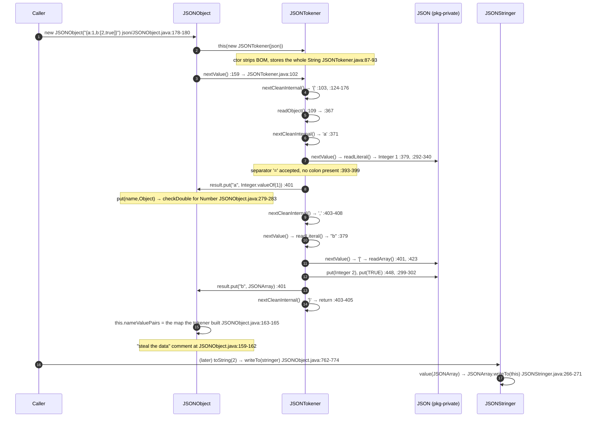
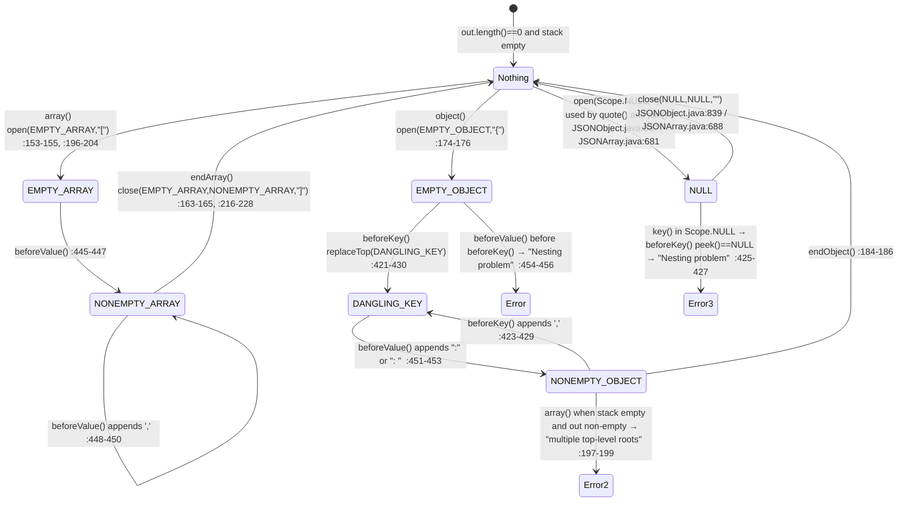
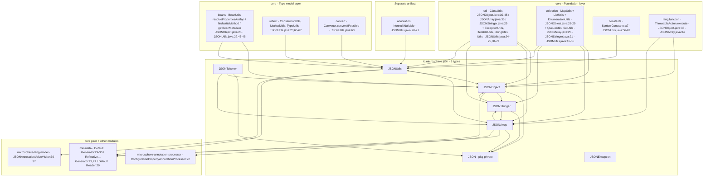

# JSON — developer guide

Module: `io.github.microsphere-projects:microsphere-java-core` · Source line: `release` branch, `0.3.20-SNAPSHOT`
Package analysed: `io.microsphere.json` — **8 main-source types** (`JSON`, `JSONArray`, `JSONException`,
`JSONObject`, `JSONStringer`, `JSONTokener`, `JSONUtils`, `package-info.java`).
Companion user-facing page: [User Guide — JSON](../../user-guide/microsphere-java-core/json.md).

All `file:line` references are relative to `microsphere-java-core/src/main/java/io/microsphere/`
(main) or `microsphere-java-core/src/test/java/io/microsphere/` (test), read from the `release` worktree,
then shortened to `json/JSONUtils.java:40-55`.

---

## 1. Architecture position: why the library carries its own JSON model

`io.microsphere.json` is **not** a design choice the project made for its own sake; it is a **vendored fork**. The
package declares that in one line: `json/package-info.java:19` — "Fork the source code from org.json" — and six of
the eight files repeat it in their licence header (`Copyright (C) 2010 The Android Open Source Project` at
`json/JSON.java:2`, `json/JSONArray.java:2`, `json/JSONException.java:2`, `json/JSONObject.java:2`,
`json/JSONStringer.java:2`, `json/JSONTokener.java:2`). Only `json/JSONUtils.java` and `json/package-info.java` are
Microsphere-original and carry the ASF header plus `@author Mercy` / `@since 1.0.0`
(`json/JSONUtils.java:2-16`, `:109-112`; `json/package-info.java:2-16`, `:21-22`).

Four reasons make the fork the right call *for this codebase*, and they are all verifiable from the tree:

1. **Zero-dependency packaging.** `microsphere-java-core/pom.xml:22-74` declares exactly one compile dependency
   (`microsphere-java-annotations`) plus optional logging back-ends. There is no Jackson, Gson or `org.json`
   artifact anywhere in the reactor. A library whose selling point is "almost empty classpath"
   (`docs/current/developer-guide/microsphere-java-core/README.md:11-12`) cannot route its metadata documents through
   a third-party JSON stack.
2. **`metadata` needs the output, not the model.** The configuration-property generator writes JSON by streaming
   `name:value` pairs into a caller-supplied `StringBuilder` — that is `JSONUtils.append`
   (`json/JSONUtils.java:146-467`), used at `metadata/DefaultConfigurationPropertyGenerator.java:29-30,88-117`.
   None of the third-party trees would survive that call pattern unchanged.
3. **A stable, familiar surface.** `JSONObject`/`JSONArray`/`JSONTokener`/`JSONStringer`/`JSONException` is the
   Android `org.json` API, which is frozen upstream, so the fork carries no invention risk.
4. **The bridge is where the value is.** `JSONUtils` (1480 lines — larger than the six forked classes combined) is
   what turns JSON into `List`/`Set`/`Queue`/`Enumeration`/arrays/JavaBeans and back
   (`json/JSONUtils.java:884-1212`), and it does it through the library's own `beans`, `convert`, `reflect` and
   `collection` layers. That integration is the reason the package is in `core` at all.

**Boundary it owns:** `io.microsphere.json` owns *the JSON object model, the JSON text grammar, and the JSON↔Java
bridge*. It owns no transport, no charset negotiation, no `Reader`/`InputStream` parsing (the tokener reads only a
`String`, `json/JSONTokener.java:75,87-93`), no type registry and no `Mapper`-style configuration. It is
**additive to** `io.serializer` rather than part of it — the serializer family covers binary `Object`↔`byte[]` only.

### 1.1 Where the index places it — and one claim that is false

The developer index puts `json` in the "Service layers" band, whose contract column reads
"Each is an SPI family discovered through `META-INF/services`, ordered by `Prioritized`"
(`docs/current/developer-guide/microsphere-java-core/README.md:70`).

**That is not true of `io.microsphere.json`,** and the index's own diagram already reflects it: of the eight
packages given a dashed `-.runtime SPI.->` edge (`README.md:55-62`), `JSON` is the one node in the Services subgraph
that has none (`README.md:29`). Verified against the tree:

* `microsphere-java-core/src/main/resources/META-INF/services/` contains 14 files — for `ArtifactResourceResolver`,
  `URLClassPathHandle`, `Converter`, `MultiValueConverter`, `EventDispatcher`, `Serializer`, `Deserializer`,
  `LoggerFactory`, three `metadata` interfaces, `ExtendableProtocolURLStreamHandler` and `ProcessIdResolver`.
  **There is no `io.microsphere.json.*` service file.**
* No type in the package implements, references or is ordered by `io.microsphere.lang.Prioritized`.

So `io.microsphere.json` is a plain value-model/utility package, not an SPI family, and the index table row should
either drop `json` from that band or re-word the contract. The diagram's other omission is worth noting for anyone
reading it as a dependency graph: `json` has exactly one incoming edge (`REFL --> JSON`, `README.md:48`), yet the
package genuinely imports `collection`, `util`, `constants` and `lang.function` too (§10).

---

## 2. Type inventory

| # | Type | Kind | Visibility | Lines | Origin | Role |
|---|---|---|---|---|---|---|
| 1 | `JSONObject` | class | `public` | 888 | AOSP fork | ordered name→value map; hosts `NULL`, `wrap`, `quote`, `numberToString` (`json/JSONObject.java:83`, `:101`, `:859`, `:831`, `:803`) |
| 2 | `JSONArray` | class | `public` | 747 | AOSP fork | dense indexed `List` wrapper with the same getter family (`json/JSONArray.java:76`, `:78`) |
| 3 | `JSONTokener` | class | `public` | 583 | AOSP fork | lexer + recursive-descent parser over one `String` (`json/JSONTokener.java:70-75`) |
| 4 | `JSONStringer` | class | `public` | 478 | AOSP fork | the model's only writer; `Scope` stack + indent (`json/JSONStringer.java:70-75`, `:81-118`) |
| 5 | `JSONException` | class | `public` | 47 | AOSP fork | the package's only checked exception, one constructor (`json/JSONException.java:41-45`) |
| 6 | `JSON` | class | **package-private**, `final`-by-private-ctor | 127 | AOSP fork | coercion helpers + `checkDouble` + the two `typeMismatch` factories (`json/JSON.java:25`, `:27`, `:108`, `:117`) |
| 7 | `JSONUtils` | `abstract class … implements Utils` | `public` | 1480 | Microsphere | `StringBuilder` writer (34 `append` overloads) and the JSON↔collections/beans reader (`json/JSONUtils.java:113`, `:146-467`, `:884-1212`) |
| 8 | `package-info.java` | package doc | — | 25 | Microsphere | records the fork (`json/package-info.java:19-22`) |

Three structural facts fall out of the table and are worth stating before the source analysis:

* **The fork keeps Android's internal split**: `JSON` is package-private, so every coercion rule is *shared* by
  `JSONObject` and `JSONArray` rather than duplicated — both import the same five statics
  (`json/JSONObject.java:30-35`, `json/JSONArray.java:26-31`).
* **`JSONStringer`'s output buffer is package-visible** (`final StringBuilder out`, `json/JSONStringer.java:75`) and
  `JSONArray.join` writes to it directly (`json/JSONArray.java:684,689`). Two of the eight types are therefore
  coupled through a field, not a method.
* **`JSONObject` and `JSONUtils` import each other**: `JSONObject` pulls `isJSONObject`/`isJSONArray`
  (`json/JSONObject.java:36-37`) while `JSONUtils` pulls `wrap` (`json/JSONUtils.java:64`). At the type level that is
  a real cycle inside one package; it compiles only because both directions are static utility calls.

---

## 3. The lexer and parser: `JSONTokener`'s state machine

### 3.1 Two fields and cursor arithmetic

The entire lexer state is `private final String in` + `private int pos` (`json/JSONTokener.java:75`, `:81`). The
constructor strips an optional UTF-8 BOM and otherwise stores `null` happily, which the javadoc admits produces a
tokener that "throws `NullPointerExceptions` when methods are called" (`:84-85`, code `:87-93`). There is no
`Reader`, no buffer, no charset handling — the input is one in-memory `String`.

Four package-private accessors do all character movement: `charAt(int)` `:567-569`, `currentChar()` `:559-561`,
`nextChar()` `:563-565` (`charAt(this.pos++)`), and the parser backtracks by mutating `pos` directly —
`this.pos--` at `:119`, `:375`, `:445` — rather than through the public `back()` helper (`:553-557`). Because
`charAt` never bounds-checks, every "is there more input" question must be answered by `hasNext()` (`:501-503`)
first; the parse path does this consistently, the legacy API path partly does not (`next(char)` at `:505-511`
substitutes `'\0'` for exhaustion and then reports it as a mismatch).

### 3.2 The dispatch loop

`nextValue()` is the whole grammar (`json/JSONTokener.java:102-122`): it calls `nextCleanInternal()` once, then
switches on the character. `nextCleanInternal()` (`:124-176`) is the lexer proper — a loop that discards
` \t\n\r`, consumes `/* … */` (unterminated ⇒ `syntaxError("Unterminated comment")`, `:141-149`), `// …`
(`:151-155`) and `# …` (`:161-168`), and returns any other character; a bare `/` that is not a comment opener is
returned as a literal (`:157-158`). Exhaustion returns the `-1` sentinel (`:175`).

```mermaid
flowchart TD
    IN["nextValue()  JSONTokener.java:102-122"] --> CLEAN["nextCleanInternal()  :124-176"]
    CLEAN --> WS{"char class?"}
    WS -- "space / tab / CR / LF" --> CLEAN
    WS -- "'/' then '*'" --> CMT["skip /* … */ to indexOf(\"*/\")<br/>:141-149 — unterminated → syntaxError"]
    WS -- "'/' then '/'" --> EOL1["skipToEndOfLine()  :151-155, :182-190"]
    WS -- "'#'" --> EOL2["skipToEndOfLine() — non-RFC leniency  :161-168"]
    CMT --> CLEAN
    EOL1 --> CLEAN
    EOL2 --> CLEAN
    WS -- "-1 (exhausted)" --> EOIE["throw syntaxError(\"End of input\")<br/>:105-106, :470-472"]
    WS -- "'{'" --> RO["readObject()  :367-413"]
    WS -- "'['" --> RA["readArray()  :423-461"]
    WS -- "'\"' or \"'\"" --> NS["nextString(quote)  :203-240"]
    WS -- "anything else" --> PUSH["this.pos--  (un-read one char)  :119"]
    PUSH --> RL["readLiteral()  :292-340"]

    NS --> ESC{"c == '\\\\' ?"}
    ESC -- yes --> RE["readEscapeCharacter()  :251-283<br/>u → Integer.parseInt(hex,16) :258-260"]
    ESC -- no --> NS
    RE --> NS

    RL --> LIT{"literal form?"}
    LIT -- "null/true/false, ignore-case" --> SENT["NULL / TRUE / FALSE  :297-303"]
    LIT -- "no '.' → parseLong base 10/16/8" --> PROMOTE["≤ Integer range → int<br/>else → long  :306-322"]
    LIT -- "valueOf(literal)" --> DBL["Double  :332-336"]
    LIT -- "NumberFormatException" --> RAW["bare String  :338-339"]
```

The three composite paths recurse back into `nextValue()`: `readObject` calls it for the name (`:379`) and the
value (`:401`); `readArray` calls it for each element (`:448`). That is the whole parser — one dispatcher, two
bracket loops, one string scanner, one literal scanner.

### 3.3 The leniencies are load-bearing

`readObject` accepts `:` **or** `=` as the separator and then eats a following `>` to allow `=>`
(`json/JSONTokener.java:388-399`), and accepts `;` as well as `,` between pairs (`:403-411`). `readArray` treats a
separator with no preceding value as an element and inserts a **Java `null`** — `result.put(null)` at `:438-443`,
and again for a trailing `,:]` at `:433-437`. Its own javadoc spells out the consequence: `"[]"` is empty but
`"[,]"` is a two-element array equivalent to `[null,null]` (`:415-418`).

That is the single most important internal fact about the parse path: **the class javadoc lists nine accepted
syntax errors as deliberate non-errors** (`json/JSONTokener.java:44-62`), so `nextValue()` succeeding says nothing
about the input being JSON. Note also that the two `null` flavours produced here are not the same object —
`readLiteral` returns the `NULL` sentinel for the word `null` (`:297-298`) while `readArray` puts the raw Java
`null` for a dangling separator (`:441`). One parser, two null outputs, chosen by *which* rule matched.

### 3.4 `new JSONObject(String)` end to end



The map hand-off is the trick the fork inherited and the source comments openly: *"Getting the parser to
populate this could get tricky. Instead, just parse to temporary JSONObject and then steal the data from that"*
(`json/JSONObject.java:159-162`, code `:163-165`; the array mirror is `json/JSONArray.java:121-127`). The
temporary object becomes garbage on every `new JSONObject(String)` — two allocations where one would do, in exchange
for keeping `nameValuePairs` `final`.

### 3.5 Recursion depth: nothing bounds it

Neither `readObject` (`json/JSONTokener.java:367-413`) nor `readArray` (`:423-461`) carries a counter, and neither
checks anything like a maximum nesting level; the only stop conditions are the closing bracket and `-1`. Combined
with `JSONStringer`'s field comment "Unlike the original implementation, this stack isn't limited to 20 levels of
nesting" (`json/JSONStringer.java:120-124`) — which flatly contradicts its own class javadoc at `:61-62` — the
package has **no depth protection on either side**. Deep input therefore fails with `StackOverflowError`, an
`Error` outside both `JSONException` and `RuntimeException`. There is no test for it anywhere in
`json/JSONTokenerTest.java` or `json/JSONStringerTest.java`.

---

## 4. `JSONObject`: backing map and key ordering

`JSONObject` stores everything in one `final` field: `private final Map<String, Object> nameValuePairs`
(`json/JSONObject.java:116`), and every construction route reaches it through the no-arg constructor's
`newLinkedHashMap()` (`:121-123`). That helper is the library's own — `collection/MapUtils.java:574-577` returns a
plain `LinkedHashMap<>()` with no capacity argument — so:

* **iteration order is insertion order**, always, including after `put` of an existing key (which `LinkedHashMap`
  does *not* re-order) and after `remove`+re-`put` (which moves the key to the end);
* **`toString()` output is deterministic**, which is why `json/JSONObjectTest.java:419` can assert an exact string;
* the map is **never wrapped, copied or made unmodifiable** — `keys()` iterates `nameValuePairs.keySet()` directly
  (`:722-724`) and `names()` builds an array from it (`:732-734`), so both are live views.

That last point collides with the documentation. `keys()`' javadoc states "the order of the keys is undefined"
(`json/JSONObject.java:715-716`) — inherited from the AOSP text, written when the field could legitimately be a
`HashMap`. On this branch it is provably ordered, and `json/JSONObjectTest.java:381-392` asserts exactly that order.
A reader who trusts the javadoc will avoid depending on behaviour the code guarantees; that is the wrong direction of
surprise, and the javadoc should be corrected rather than the field changed.

**Write paths.** `put(String,Object)` is the only one with real semantics (`json/JSONObject.java:274-285`): a Java
`null` value **removes** the key (`:275-278`), any `Number` goes through `JSON.checkDouble` (`:279-283`, comment at
`:280-281` explains the deliberate deviation from the original which only checked floats/doubles), and only then
`doPut` (`:340-343`) after `checkName` rejects a `null` name (`:345-350`). The four primitive overloads
(`:218-260`) box and delegate, and still declare `throws JSONException` because `checkName` does. `accumulate`
(`:317-338`) repeats the `checkDouble` guard for the *new* value only — and the comment at `:323` says why:
"check in accumulate, since array.put(Object) doesn't do any checking". That comment is an admission, not an
explanation: `JSONArray.put(Object)` really is unguarded (`json/JSONArray.java:225-228`), so `accumulate(name, NaN)`
is checked while `array.put((Object) NaN)` is not, and the failure only surfaces at serialization time
(`json/JSONObject.java:803-809` → `json/JSONStringer.java:278-279`).

**Read paths.** `get(String)` distinguishes *absent* from *sentinel*: `nameValuePairs.get(name)` returning `null`
throws `"No value for <name>"` (`json/JSONObject.java:393-399`), while a `NULL` value passes through because it is a
real object. But `getBoolean` and `getString` start from `opt()` instead of `get()` (`:421`, `:594`), so for them a
missing key and an explicit `null` both surface as `"Value at <name> is null."` from `JSON.typeMismatch`
(`json/JSON.java:108-115`). Seven getters, two error vocabularies, decided by which helper the getter happens to
call. `isNull` (`:370-373`) and `has` (`:382-384`) are the pair that lets you tell the two nulls apart, and
`isNull` uses reference identity (`value == NULL`) plus a `null` check — it does not call the sentinel's broken
`equals`.

**The sentinel.** `NULL` is an anonymous `Object` subclass field (`json/JSONObject.java:101-114`) that overrides
`equals` to accept `null` — with the in-line comment `// API specifies this broken equals implementation`
(`:105-106`) and the class javadoc stating the contract violation explicitly (`:98-99`). Its `toString()` returns
`"null"` (`:109-112`), which is what makes it serialise correctly without special-casing
(`json/JSONStringer.java:276-277`). Because `equals` is asymmetric here, `NULL.equals(null)` is `true` while
`null.equals` is unreachable, and `NULL` is a singleton only by convention — nothing prevents a second anonymous
instance elsewhere. `wrap` therefore tests `o == null || o.equals(NULL)` (`json/JSONObject.java:861`), invoking
*caller-controlled* `equals` on the very first line of the conversion ladder.

**Equality.** `equals` compares the backing maps (`json/JSONObject.java:777-788`) and `hashCode` delegates to the
map's (`:790-793`); `equals` is **not** `final` while `JSONArray.equals` **is** (`json/JSONArray.java:728-739`).
Because the sentinel breaks `equals` symmetry, two `JSONObject`s holding `NULL` compare equal (both maps see
`NULL.equals(NULL)`), which is intended — but the same is true of a `JSONObject` holding `NULL` versus one holding
Java `null`, and the latter can never be built through `put` (`:275-278`), only through `readArray`'s dangling
separator (`json/JSONTokener.java:441`) or the `Map` constructor (`json/JSONObject.java:147`, which stores
`wrap(value)` — and `wrap(null)` returns `NULL`, so the Map route does normalise).

---

## 5. `JSONArray`: storage and the `null` hole

`JSONArray` holds `private final List<Object> values` (`json/JSONArray.java:78`) created by
`ListUtils.newArrayList()` (`:83-85`, helper at `collection/ListUtils.java:313-315` → plain `ArrayList`). The
primitive-array constructor is the one place that sizes it up front — `newArrayList(length)`
(`json/JSONArray.java:155`, helper at `collection/ListUtils.java:337-339`) — and `getLength`/`Array.get` come from
`java.lang.reflect.Array`, so any array type is accepted, not just primitives, even though the javadoc promises
"primitive array" (`:144-149`) and the failure message says `"Not a primitive array: "` (`:150-153`).

Four constructors, three different `null` disciplines:
`JSONArray(Iterable)` guards its argument (`:104-111`, `:106`); `JSONArray(Enumeration)` does **not** — the raw
`while (enumeration.hasMoreElements())` at `:88-94` NPEs on a `null` argument, breaking the pattern its sibling
establishes; `JSONArray(JSONTokener)` steals the parsed list (`:120-131`) and throws
`typeMismatch(object, "JSONArray")` (`json/JSON.java:117-123`) when the tokener's first value is not an array;
`JSONArray(Object array)` rejects non-arrays with a *checked* `JSONException` (`:150-153`).

`put(int, Object)` is the only indexed writer that grows the list itself, null-padding the gap
(`json/JSONArray.java:300-310`, the padding loop at `:305-307`), which means `put(5, x)` on an empty array produces
a list of six entries whose first five are **Java `null`** — not `NULL`. Those five elements then fail `get(int)`
with `"Value at 0 is null."` (`:333-343`, `:336-338`), pass `isNull(int)` (`:319-322`), return `null` from
`opt(int)` (`:352-357`) — because `opt` bounds-checks but does not null-normalise — and serialise as `null`
(`json/JSONStringer.java:276-277`, since `out.append(null)` appends the four characters `null`). So
`[null,null,null,null,null,"x"]` round-trips through `toString()` yet its elements are not addressable through
`get`. Same story for `readArray`'s dangling separators (§3.3). This is the concrete origin of the dual-null warning
in the class javadoc (`json/JSONArray.java:49-52`).

`equals` on the list (`json/JSONArray.java:728-739`) means two arrays differing only in Java-`null` vs `NULL`
elements are **unequal** even though both print identically — `ArrayList.equals` uses `Objects.equals`, and
`NULL.equals(null)` is `true` while `null.equals(NULL)` never runs, so the comparison is element-order-dependent.
It is `final`, unlike `JSONObject.equals` (§4).

---

## 6. The writer: `JSONStringer`'s scope stack and indent strategy

`JSONStringer` is a state machine over a `StringBuilder`, and its only state is the scope stack —
`private final List<Scope> stack = newArrayList()` (`json/JSONStringer.java:124`). `Scope` is a package-private
nested enum with six constants (`:81-118`), five of them real grammar states and one (`NULL`) a hack for
bracketless output. Separators and nesting validity are derived *entirely* from the top of that stack, via
`peek()` (`:236-241`), `replaceTop()` (`:248-250`), `beforeKey()` (`:421-430`) and `beforeValue()` (`:439-457`).



**Indent** is a per-instance constant, not a per-call argument: the constructor builds one space string
(`char[indentSpaces]` filled by `Arrays.fill`) and anything `<= 0` sets `indent = null`
(`json/JSONStringer.java:136-144`). `newline()` then appends `\n` plus `indent` repeated **once per stack entry**
(`:388-397`), which is why the closing bracket sits one level out — `close()` pops *before* calling `newline()`
(`:222-225`). `beforeValue()` picks `":"` vs `": "` off the same field (`:452`), so compact and pretty output differ
in exactly one character per pair, and the shape asserted at `json/JSONObjectTest.java:420`
(`"{\n \"name\": \"Mercy\",\n …\n}"`) is that combination and nothing more.

**Escaping** is the switch at `json/JSONStringer.java:338-386`: `"`, `\` **and `/`** are backslash-escaped in one
branch (`:349-353`), six named escapes follow, and everything `<= 0x1F` becomes `format("\\u%04x", c)` (`:375-381`).
`U+2028`/`U+2029` are **not** escaped here — the comment at `:343-347` cites only RFC 4627 — while `JSONUtils.escape`
does escape them (`json/JSONUtils.java:115-117`, `:1358-1361`) and does **not** escape `/` (its table at `:130-144`
has no `/` entry). The two encoders are byte-incompatible in both directions, and `json/JSONStringerTest.java:188-194`
and `json/JSONUtilsTest.java:806-815` each pin only their own half.

**`Scope.NULL`** is how `JSONObject.quote(String)` and `JSONArray.join(String)` reuse the machine for bracketless
output: both `open(Scope.NULL, "")` and `close(Scope.NULL, Scope.NULL, "")`
(`json/JSONObject.java:835-841`; `json/JSONArray.java:680-689`). `beforeValue()` never touches the stack for that
scope — it falls through every branch to the `context != Scope.NULL` test at `:454`, which is false, so nothing is
appended and nothing is replaced (`:439-457`). That is the only way `join` can interleave a separator —
and `join` does it by writing straight into `stringer.out` (`:684`) and returning `stringer.out.toString()` (`:689`)
instead of `stringer.toString()`. That matters: `JSONStringer.toString()` returns **`null`** for an empty buffer,
violating `Object.toString` by its own admission (`:465-466, :470-473`), so `quote` would return `null` for `null`
input if it did not short-circuit at `json/JSONObject.java:832-834`.

---

## 7. `JSONUtils`: a second encoder, and the Java bridge

`JSONUtils` (1480 lines) is where the fork stops. Two responsibilities live in one class, and they are architecturally
unrelated:

**(a) A `StringBuilder` writer with no object model.** 34 `append(StringBuilder, name, value)` overloads
(`json/JSONUtils.java:146-467`) plus `appendValue` (`:469-486`), `appendArray` (`:488-498`),
`appendName` (`:500-508`) and the private helpers `appendMap`/`appendIterable`/`appendString`/`appendType`
(`:1388-1425`). It is the path `metadata` uses, because it needs no tree
(`metadata/DefaultConfigurationPropertyGenerator.java:88-117`). Design observations:

* `appendName` writes `'"' + name + '"' + ':'` with **no escaping at all** (`:500-506`), and — worse — wraps the
  whole write in `if (isNotBlank(name))` (`:501`), so a `null` or blank name emits **nothing**, not even the colon.
  The following `append` value then lands adjacent to whatever preceded it. The caller has no signal.
* `appendValue`'s first statement is `value.getClass()` (`:469-470`), so a `null` value is an `NullPointerException`
  — and via `appendMap`/`appendIterable` (`:1388-1415`) a single `null` inside any map or collection propagates the
  same way. The model classes are tolerant of `null`; this class is not.
* No finiteness check exists anywhere in the class, so `append(builder, "n", Double.NaN)` emits `NaN`
  (`:176-179` and the `else` branch at `:483-485`). The model path refuses the same value
  (`json/JSON.java:27-32`).
* `REPLACEMENT_CHARS` is a `String[128]` indexed by `char` (`:130-144`), so `escape` is O(n) with a
  `builder == null` fast path — but only when the input actually needs no escaping.

**(b) The JSON↔Java bridge.** `readValue`/`readValues`/`readArray` in nine overloads (`:884-1212`) plus
`writeValueAsString` (`:1234-1241`) and `writeBeanAsString` (`:1272-1277`). The mechanism composes four other `core`
packages: `ConstructorUtils.newInstance(true, beanClass)` for instantiation and `MethodUtils.invokeMethod` for the
setter call, `BeanUtils.getBeanMetadata`/`findWriteMethod` to locate properties, `Converter.convertIfPossible` for
scalar coercion and `TypeUtils.asParameterizedType`/`asClass` to recover generic types
(`json/JSONUtils.java:988-1007`, `:1427-1442`; imports at `:23`, `:63`, `:65-67`). Two design smells are visible in
this half:

* `readValues(JSONArray, Class, Class)` is a six-branch `if`/`else if` ladder that **falls off the end into
  `return null`** (`:1125-1141`) — an unsupported target type is not an error, it is a silent `null`, asserted at
  `json/JSONUtilsTest.java:639-645`.
* `determineElementClass` is annotated `@Nonnull` (`:1302`) but dereferences `element.getClass()` without a guard
  (`:1306-1308`), so an array containing a Java `null` — producible by §5's `put(int,Object)` padding or §3.3's
  dangling separator — throws `NullPointerException` from a method whose contract promises non-`null`.
  It is also not a *common superclass* computation despite the javadoc examples claiming otherwise
  (`:1288-1297`): the loop only narrows between concrete classes and jumps straight to `Object.class` on the first
  mismatch (`:1312-1318`).

`isUnknownClass` (`:510-512`) with `UNKNOWN_CLASS = Void.class` (`:119`) is the internal sentinel that lets the
`Type`-aware reader (`:1073-1094`) mean "the caller did not tell me, infer it" — a third `null`-like convention in
one package.

---

## 8. Exception taxonomy

`JSONException` is the package's only declared exception, and it is minimal to the point of being awkward:
`public class JSONException extends Exception` (`json/JSONException.java:41`) with **one** constructor taking a
`String` (`:43-45`). Consequences that matter to anyone adding code here:

* **No cause constructor.** `throw new JSONException(msg, cause)` does not compile, which is why every re-wrap path
  in the library must go through `ExceptionUtils.wrap` into a *different* exception type
  (`json/JSONUtils.java:803-812`, `:843-852`), and why the class javadoc tells callers to give up and wrap it in a
  `RuntimeException` instead (`:30-39`).
* **No `serialVersionUID`** — grep across all eight files returns nothing, so the class relies on the JDK's computed
  UID, and it is also untestable for the same reason the fork has no `@author`/`@since` (below).
* **No `JSONException()` and no `JSONException(Throwable)`**, so a caught `JSONException` cannot be rethrown
  unchanged with a new message.

Four vocabularies are in active use, and the mapping is not principled:

| Vocabulary | Raised by | Where |
|---|---|---|
| checked `JSONException` | malformed input, missing/out-of-range key, type mismatch, `NaN`/infinite writes, `null` names, nesting violations | `json/JSONTokener.java:470-472`; `json/JSONObject.java:345-350`, `:393-399`, `:803-806`; `json/JSONArray.java:150-153`, `:333-343`; `json/JSONStringer.java:196-204`, `:216-228`, `:236-241`, `:261-264`, `:406-409`, `:421-430`, `:439-457`; via `json/JSON.java:108-123` |
| unchecked `RuntimeException` | `toString(int)` on either model type, `quote` | `json/JSONObject.java:762-766`, `:831-842`; `json/JSONArray.java:713-717`; both via `ThrowableAction.execute` → `handleException` `throw new RuntimeException(failure)` (`lang/function/ThrowableAction.java:105-107`, `:79-81`) |
| unchecked `IllegalArgumentException` | `JSONUtils.jsonObject` / `jsonArray` only | `json/JSONUtils.java:803-812`, `:843-852`, via `util/ExceptionUtils.java:97-104`, `:304-308` |
| unchecked `NullPointerException` | `new JSONTokener(null)` reads, `appendValue(null)`, `determineElementClass`, `JSONArray(Enumeration)`, `JSONObject(Map)` with a `null` key | `json/JSONTokener.java:501-503`; `json/JSONUtils.java:470`, `:1308`; `json/JSONArray.java:88-94`; `json/JSONObject.java:144-146` (documented at `:131`) |
| unchecked `NumberFormatException` | a malformed `\uXXXX` — `Integer.parseInt(hex,16)` with no guard | `json/JSONTokener.java:258-260`, admitted by the javadocs at `:200` and `:248` |
| silent `null` / no-op | `wrap` on failure, `writeValueAsString`, `readValues` on an unsupported target, `put(name,null)` removing the key, `names()` on an empty object | `json/JSONObject.java:867-885`, `:732-734`; `json/JSONUtils.java:1234-1241`, `:1125-1141`; `json/JSONObject.java:275-278` |

`JSONStringer` is worth separating out: it is the **only** class that reports grammar violations from *writing*
rather than reading, and it does so with one of exactly two messages — `"Nesting problem"` (`:219`, `:238`, `:426`,
`:455`) and the more specific `"Nesting problem: multiple top-level roots"` (`:198`) / `"Names must be non-null"`
(`:408`). Callers cannot distinguish an unbalanced bracket from a key/value ordering error from the message alone.

---

## 9. Design patterns

| Pattern | Implementing class(es) | Evidence in this package |
|---|---|---|
| **Composite** | `JSONObject`, `JSONArray` over the value tree | Each holds children of the same union it belongs to (`json/JSONObject.java:116`, `json/JSONArray.java:78`) and the writer recurses component-first: `JSONStringer.value(Object)` hands a nested `JSONArray`/`JSONObject` back to `writeTo(this)` instead of serialising it (`json/JSONStringer.java:266-272` ↔ `json/JSONArray.java:719-725`, `json/JSONObject.java:768-774`). No `Component` interface exists — the union is checked with `instanceof`, which is why the recursion is open to `StackOverflowError` (§3.5) |
| **Sentinel / Null Object** | `JSONObject.NULL` | a `public static final Object` anonymous instance whose `equals` deliberately accepts `null` and whose `toString` returns `"null"` (`json/JSONObject.java:101-114`); the contract violation is documented at `:98-99` and the behavioural list at `:87-97`. It makes "present with no value" a first-class member, and it is the reason `JSONStringer` needs `out.append(value)` at `:276-277` |
| **Fluent Builder** | `JSONObject` `put` family, `JSONArray` `put` family, `JSONStringer` verbs | every mutator returns `this` — `json/JSONObject.java:218-260`, `:284`, `:296-301`, `:317-338`; `json/JSONArray.java:176-228`, `:240-310`; `json/JSONStringer.java:153-155`, `:174-176`, `:261-287`, `:406-413` (javadoc `@return this stringer`, `:150`). Note there is **no** separate builder type and no `build()` step — the object is mutable throughout, so this is fluent-chaining, not the GoF Builder |
| **State Machine (table-free)** | `JSONStringer.Scope` | six states in a package-private enum (`json/JSONStringer.java:81-118`), transitions encoded as `if` chains over `peek()`/`replaceTop()` in `beforeKey`/`beforeValue`/`open`/`close` (`:196-250`, `:421-457`); the javadoc names the two duties as separator insertion and nesting-error detection (`:77-80`) |
| **Strategy (coercion), shared via package-private statics** | `JSON.toBoolean` / `toDouble` / `toInteger` / `toLong` / `toString` | one coercion implementation, statically imported by both composite nodes (`json/JSONObject.java:30-35`, `json/JSONArray.java:26-31`; definitions at `json/JSON.java:34-106`). Each returns `null` to mean "cannot coerce" and the *caller* chooses throw-vs-default (`json/JSONObject.java:420-427` vs `:436-452`) |
| **Visitor (non-GoF, javadoc-acknowledged)** | `JSONUtils.appendValue` + `JSONStringer.value(Object)` | two hand-written runtime-type ladders rather than double dispatch: `json/JSONUtils.java:469-486` (array → map → iterable → char-family → `Type` → fallback) and `json/JSONStringer.java:261-287`. `JSONAnnotationValueVisitor` in `microsphere-lang-model` consumes `append`/`appendName` as its visit results (`microsphere-lang-model/src/main/java/io/microsphere/lang/model/util/JSONAnnotationValueVisitor.java:36-37`) |
| **Adapter (Java ⇄ JSON)** | `JSONObject.wrap`, `JSONUtils.readValueAsBean`, `writeBeanAsString` | `wrap` adapts `Iterable`/array/`Enumeration`/`Map`/`Class`/`CharSequence`/`Enum`/`java.*`/JavaBean into the JSON union (`json/JSONObject.java:859-886`), the bean path adapts back through `BeanUtils.resolvePropertiesAsMap` and `findWriteMethod` (`json/JSONObject.java:25,881`; `json/JSONUtils.java:988-1007`) |
| **Template-less Factory Methods** | the five `JSONObject` and six `JSONArray` constructors | each constructor is a *parse-then-steal* or *copy-and-wrap* factory rather than one overloading an existing one (`json/JSONObject.java:121-198`; `json/JSONArray.java:83-159`) |
| **Static utility (marker-conformant)** | `JSONUtils` | `public abstract class JSONUtils implements Utils` (`json/JSONUtils.java:113`) with a `private` constructor (`:1477-1478`) — the library-wide convention described in [Utilities and constants](./util-and-constants.md). `JSON` is package-private with a `private JSON()` (`json/JSON.java:25`, `:125-126`); `JSONObject`/`JSONArray` are not utility classes and have no such guard |

**Absent on purpose, and worth recording so nobody re-adds it:** there is no `Registry` (nothing is discovered), no
`Factory` interface, no `Mapper`-style configuration object, no `Context`/`Config` parameter on any method, and no
`Visitor` interface. The whole package is closed for extension: `JSONObject` and `JSONArray` are non-`final` but
their javadocs, copied verbatim from AOSP, instruct against inheritance (`json/JSONArray.java:71-74`,
`json/JSONStringer.java:64-68`, `json/JSONTokener.java:64-68`) while `json/JSONObject.java:47-82` carries **no such
warning at all** — an asymmetry introduced by the fork, not inherited from it.

---

## 10. Package dependencies

Verified with a grep over `import io.microsphere.*` and `import static io.microsphere.*` in all eight files
(main sources only), plus a repository-wide grep for `io.microsphere.json` outside the package.



Read the graph against the index claim in §1.1: `json` sits at the **top of the Service layer**, importing every
lower layer but imported by only one peer (`metadata`) and two downstream modules. That makes it safe to move
later — nothing in `core` below the type-model layer depends on it — but it also means **`json` cannot be extracted
into its own artifact without also extracting or inlining `beans`, `reflect`, `convert`, `collection`, `constants`,
`util` and `lang.function`**, because `JSONUtils` alone touches all seven
(`json/JSONUtils.java:22-25,43-73`). The forked six classes need only `beans`, `collection`, `util`,
`lang.function` (`json/JSONObject.java:25-45`, `json/JSONArray.java:25-35`, `json/JSONStringer.java:21,29`) and
would extract more cheaply, which argues for splitting `JSONUtils` into a `json`-dependent module of its own.

**Verified non-dependencies.** `io.microsphere.net.classpath`, `io.microsphere.io*`, `io.microsphere.nio.*`,
`io.microsphere.concurrent`, `io.microsphere.process`, `io.microsphere.management`, `io.microsphere.security`,
`io.microsphere.logging`, `io.microsphere.event`, `io.microsphere.classloading` and `io.microsphere.filter`
contain **zero** references to `io.microsphere.json`. `io.microsphere.convert` and `io.microsphere.reflect` use
`JSONUtils`'s *dependants*, not it — the only `convert` symbol `json` consumes is the
`Converter.convertIfPossible` static (`json/JSONUtils.java:63`), so `convert → json` never occurs and the
`CONV --> SERIAL` style edge does not exist here.

**Test-only surface.** `src/test/java/io/microsphere/JSONTestUtils.java:34-64` is a shared helper that builds
`JSONObject`/`JSONArray` fixtures for non-JSON tests, and the two beans it round-trips are
`src/test/java/io/microsphere/test/Data.java` and `MultipleValueData.java`; three resources feed the parser tests —
`src/test/resources/test/json/data.json` and `array.json` for `testNextValueOnReadObject`/
`testNextValueOnReadArray` (`json/JSONTokenerTest.java:59-73`), and `clean.txt` for `testNextCleanInternal`, which
loops until it reaches an `'a'` and thereby proves comment and whitespace skipping (`:152-159`). The Integer→Long
promotion §3.2 describes is pinned two methods later at `:241-242`.

---

## 11. Review notes

### 11.1 Thread safety

Three of the four forked mutable classes document themselves as not thread-safe, in identical AOSP wording:
`json/JSONTokener.java:64-68`, `json/JSONArray.java:71-74`, `json/JSONStringer.java:64-68`. **`JSONObject` does
not** — its javadoc block at `json/JSONObject.java:47-82` never mentions thread safety, even though its field is a
plain `LinkedHashMap` (`:116`) that `put`/`remove`/`accumulate` mutate without synchronisation. The omission is
harmless today (a `LinkedHashMap` is as unsafe as an `ArrayList`) but it is the one class a reviewer would expect a
warning on, because `JSONObject` is also the class people pass across threads. Recommend adding the paragraph for
parity.

Two further points a reviewer should not miss:

* `JSONStringer` cannot be shared even in principle: `out` is a single `StringBuilder` (`json/JSONStringer.java:75`)
  and `toString()` reads it without copying (`:470-473`). Its `stack` is an `ArrayList` (`:124`), so reuse across
  threads corrupts both.
* The statics are safe because they are stateless. `JSONUtils.REPLACEMENT_CHARS` is a `static final String[]`
  populated once inside a `static` block (`json/JSONUtils.java:130-144`) and **never mutated afterwards** — but an
  `array` of mutable references is not truly immutable, and `U2028`/`U2029` (`:115-117`) plus `UNKNOWN_CLASS` (`:119`)
  are effectively `final` constants too. `JSONObject.NULL` is a genuine singleton whose `equals` is
  non-symmetric-with-respect-to-`null` by design (`:101-114`); that is safe to share, but `wrap`'s first line
  calls `o.equals(NULL)` on **caller-supplied** objects (`:861`), so a hostile or buggy `equals` can block or throw
  inside what looks like a pure static function.

### 11.2 Allocation behaviour

The fork optimised for one thing — *not leaking the input string's char array* — and every hot path pays for it:

* `nextString`'s escape-free fast path returns `new String(this.in.substring(start, this.pos - 1))`
  (`json/JSONTokener.java:219`) with the comment "a new string avoids leaking memory". On Java 8+ `substring`
  already copies, so the extra `new String(...)` is now **a second full copy of every JSON string value**. Same
  pattern in `readLiteral`'s give-up branch: `return new String(literal); // a new string avoids leaking memory`
  (`:339`). These two lines are pure legacy cost with no legacy benefit.
* `nextToInternal` produces another `substring` per literal (`:349-358`), and `readLiteral` then re-parses it, so a
  number costs two `String` allocations before it becomes an `Integer`.
* Only `nextString` allocates a `StringBuilder` lazily (`:209-232`), which is the one genuinely good decision in the
  lexer.
* Per serialisation call: `toString(int)` constructs a fresh `JSONStringer` — hence a fresh `StringBuilder`,
  a fresh scope-stack `ArrayList` and a fresh indent `String` — per object, and `JSONStringer.java:136-144` builds
  the indent once per instance (so a recursive `writeTo` shares it within one call, correctly).
  `json/JSONObject.java:762-766`, `json/JSONArray.java:713-717`. There is no reuse across calls, so
  serialising a list of 1000 `JSONObject`s allocates 1000 stringers plus 1000 lists.
* `JSONUtils` sidesteps all of that, which is exactly why `metadata` uses it: it appends into the caller's
  `StringBuilder` and allocates nothing per document except what `StringBuilder` growth requires
  (`json/JSONUtils.java:146-508`). It has no `join`/escape-builder allocation either, because `escape` keeps a
  `builder == null` fast path until the first character that needs replacing (`:1349`, `:1378-1380`).
* `JSONObject(Map)` copies the map entry-by-entry through `wrap` (`json/JSONObject.java:135-149`) rather than
  `putAll`, and `JSONArray(Object array)` pre-sizes (`:155`); `JSONArray(Iterable)`/`Enumeration` do not
  (`:88-111`), so they re-grow.

### 11.3 Error handling, measured against the silent-degradation policy

The house policy is silent degradation — return a neutral value rather than throw. `io.microsphere.json` is the
library's stated exception, and the exception is real but **not consistently applied**. Reviewing it in order of
severity:

1. **`JSONObject.getString` names the wrong type.** `json/JSONObject.java:597` calls
   `typeMismatch(name, object, "long")`. Its twin `json/JSONArray.java:556` passes `"String"`. Copy-paste defect,
   message-only impact, and untested because no test asserts on `getString`'s message text.
2. **`JSONUtils.escape`'s documented contract is inverted.** Javadoc `@return` says
   "the escaped string, or an empty string if the input is `null`" (`json/JSONUtils.java:1340`); the code returns
   `v` — i.e. `null` — for any zero-length input (`:1343-1346`). `json/JSONUtilsTest.java:760-762` asserts the
   *code's* behaviour, so the suite has pinned the divergence rather than the contract.
3. **`jsonObject(null)` throws `NullPointerException` where it promises `IllegalArgumentException`.**
   `@throws` at `json/JSONUtils.java:801` and `:841`; `new JSONTokener(null)` stores the `null`
   (`:87-93`, javadoc `:84-85`) and `hasNext()` dereferences it at `:501-503`, which is not the caught
   `JSONException` at `:806-810`. No test covers it — `json/JSONTokenerTest.java:49-51` builds the tokener and never
   reads it.
4. **`JSONStringer`'s nesting limit is documented twice and implemented zero times.** Class javadoc
   "at most 20 levels … may fail with a `JSONException`" (`json/JSONStringer.java:61-62`) versus field comment
   "isn't limited to 20 levels of nesting" (`:120-123`). Neither is enforced; the actual outcome is
   `StackOverflowError` (§3.5). Same class, twelve lines apart — the worst kind of documentation defect.
5. **`keys()` denies a guarantee the code provides.** "the order of the keys is undefined"
   (`json/JSONObject.java:715-716`) against `LinkedHashMap` (`:116`, `:122`) and a test asserting the order
   (`json/JSONObjectTest.java:381-392`). §4.
6. **A `JSONException` can be smuggled past a `catch` as a `NumberFormatException`.**
   `json/JSONTokener.java:258-260` — `"\uZZZZ"` is the input, and the javadocs already say so (`:200`, `:248`).
7. **`accumulate` documents, in a code comment, that another method is unsafe.**
   `json/JSONObject.java:323` versus `json/JSONArray.java:225-228`. The comment is a known-defect marker; it should
   either be fixed by adding the check to `put(Object)` or the gap should be stated in `put`'s javadoc.
8. **Silent-degradation *inside* the exception-throwing package.** `wrap`'s `catch (Exception ignored) {}`
   (`json/JSONObject.java:867-885`), `writeValueAsString` returning `null` (`json/JSONUtils.java:1234-1241`),
   `readValues` falling off the end to `return null` (`:1125-1141`), `readValueAsBean` skipping unmatched keys
   quietly (`:988-1007`, proven by `json/JSONUtilsTest.java:573-581`) and `appendName` emitting nothing for a blank
   name (`:500-508`). Five places where the package returns to the house policy without saying so. None of them
   distinguish "nothing to do" from "I failed".

### 11.4 Fork hygiene

* **Six classes carry no `@author` and no `@since`** — a grep across the package finds exactly two of each, both in
  the original files (`json/JSONUtils.java:109`, `:111`; `json/package-info.java:21`, `:22`). Anyone reading the
  Javadoc cannot tell the forked from the original, which is the opposite of what the licence headers achieve.
* **`json/JSONTokener.java:571-581` `dehexchar` is `public static` and unused** in all main sources. It is legacy
  surface kept "because the original implementation exposed it" — the comment block at `:485-491` says so — but
  unlike `more()`/`next()`/`skipTo()` it is dead in the parser *and* untested here.
* **`json/JSONUtils.java:1358-1361` handles the two Unicode line separators by `char` comparison and string
  constants** against the sibling `REPLACEMENT_CHARS` table at `:130-144` that handles everything else by array
  lookup. Two escaping mechanisms in one 45-line method; the table could hold both if `char`-indexing were widened,
  and `0x2028 > 127` is presumably why it does not.
* **`json/JSONArray.java:150-153` rejects non-arrays by calling `array.getClass()` on a possibly-`null` argument**
  *after* `isArray(array)` returned `false` for it — `util/ClassUtils.java:329-331` delegates through
  `getClass(Object)` (`:1967-1971`, `null`-tolerant) to `isArray(Class)` (`:347-348`, `type != null &&
  type.isArray()`). So `new JSONArray((Object) null)` throws `NullPointerException` instead of the documented
  `JSONException`.
* **`json/JSONUtilsTest.java:319-334` (`testAppendOnObjectAsMap`) contains no assertion at all.** It exercises the
  map branch of `appendValue` and discards the result, so the `Map` path of the second encoder is effectively
  untested despite the test existing.
* **`json/JSONTokenerTest.java:48-51` (`testConstrcutorWithNull`) constructs `new JSONTokener(null)` and never reads
  from it**, which is exactly why defect 3 in §11.3 survives — the NPE the tokener's own javadoc promises
  (`json/JSONTokener.java:84-85`) is unexercised. The method name is also misspelled ("Constrcutor"), echoing the
  `testtGet` typo recorded on the [Serialization](./serialization.md) page
  (`io/serializer/SerializersTest.java:57`): test method names are evidently not checked by any tool in the build.
* **No test in the package asserts on an error message that the code produced.** A grep for
  `"cannot be converted"`, `"No value for"` and `"is null"` across `src/test/java/io/microsphere/json/` matches only
  `json/JSONExceptionTest.java:36` and `:48`, both asserting on messages the test itself constructs —
  `new JSONException(message)` and `new JSONException(null)`. Every `JSON.typeMismatch` string
  (`json/JSON.java:108-123`) and every `syntaxError` string (`json/JSONTokener.java:470-472`) is therefore
  unpinned, which is why defect 1 in §11.3 could sit at `json/JSONObject.java:597` undetected.

### 11.5 What I would change, in order

1. `json/JSONObject.java:597` — `"long"` → `"String"`. One token, no behaviour change.
2. Add the `checkDouble` guard to `json/JSONArray.java:225-228`, delete the apologetic comment at
   `json/JSONObject.java:323`, and add a test for `put((Object) NaN)` → `toString()`.
3. Fix `json/JSONStringer.java:61-62` to match `:120-123`, then either add a real `MAX_NESTING_DEPTH` to
   `JSONTokener.readObject`/`readArray` or remove the claim entirely — the current state invites callers to believe
   a hostile input is bounded.
4. Change `json/JSONUtils.escape`'s javadoc `:1340` to `@return null if the input is null or empty`, or make the
   code match the doc; either way, do not keep `json/JSONUtilsTest.java:760-762` asserting a contradiction.
5. Wrap `NumberFormatException`-era escapes: `catch (NumberFormatException e)` around `json/JSONTokener.java:258-260`
   and rethrow `syntaxError("Invalid hexadecimal number in \\uXXXX escape sequence")`. This is the AOSP upstream text
   and the fork dropped it.
6. Guard `json/JSONUtils.java:470`, `:1308`, `json/JSONArray.java:88-94` and `:150-153` for `null`, or document each
   as NPE-throwing with `@throws NullPointerException` the way `json/JSONObject.java:131` already does for its
   `Map` constructor.
7. Correct `docs/current/developer-guide/microsphere-java-core/README.md:70` to drop `json` from the
   SPI-family contract, or add the four dashed edges `json` genuinely has in §10.

---

## 12. See also

* [User Guide — JSON](../../user-guide/microsphere-java-core/json.md) — the API surface, runnable examples, the
  throw-vs-default table and the thirteen pitfalls.
* [Configuration property metadata](./configuration-metadata.md) — `metadata` is the only in-`core` consumer, on both
  sides of the wire (`metadata/DefaultConfigurationPropertyGenerator.java:29-30,88-117`,
  `metadata/ReflectiveConfigurationPropertyGenerator.java:22,24`,
  `metadata/DefaultConfigurationPropertyReader.java:29,43`).
* [Reflection, types and beans](./reflection-and-beans.md) — `BeanUtils.resolvePropertiesAsMap` /
  `findWriteMethod` / `getBeanMetadata` and `ConstructorUtils` / `MethodUtils` / `TypeUtils` are what make the JavaBean
  conversions work at all (`json/JSONObject.java:25`, `json/JSONUtils.java:22-23,43-45,65-67`).
* [Type conversion](./type-conversion.md) — `Converter.convertIfPossible` is the leaf every JSON→Java scalar reaches
  (`json/JSONUtils.java:63,1427-1442`), and `convert` itself does not depend on `json`.
* [Collections and filters](./collections-and-filters.md) — `MapUtils.newLinkedHashMap`
  (`collection/MapUtils.java:574-577`) and `ListUtils.newArrayList` (`collection/ListUtils.java:313-315`) decide
  `JSONObject`'s key ordering and `JSONArray`'s storage.
* [Language abstractions](./language-abstractions.md) — `ThrowableAction.execute` is the checked→unchecked
  translation layer behind `toString(int)` (`lang/function/ThrowableAction.java:79-81,105-107`).
* [Serialization](./serialization.md) — the sibling Service-layer package, and the genuine SPI family that `json`
  is often mistaken for (§1.1).
