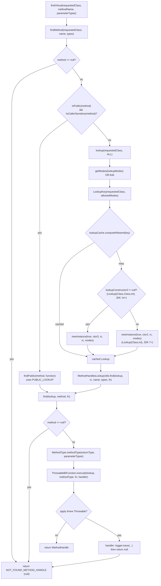

# Language Abstractions — Developer Guide

Internal design of the `io.microsphere.lang`, `io.microsphere.lang.function`, `io.microsphere.lang.invoke` and
`io.microsphere.invoke` packages of `microsphere-java-core` (`0.3.20-SNAPSHOT`, `release` branch).

All `file:line` references are relative to the `release` worktree, e.g.
`microsphere-java-core/src/main/java/io/microsphere/lang/Prioritized.java:61`.

---

## 1. Place in the architecture

These four packages are the **lowest-level vocabulary** of the library. They depend on almost nothing
(`io.microsphere.util`, `io.microsphere.annotation`, `io.microsphere.constants` and each other) and are depended upon
by nearly every other group.

### 1.1 `Prioritized` implementors found in main sources

| Subsystem | Implementor / sub-contract | Reference |
|-----------|---------------------------|-----------|
| Events | `io.microsphere.event.EventListener<E extends Event> extends java.util.EventListener, Prioritized` | `event/EventListener.java:72` |
| Events | `io.microsphere.event.GenericEventListener` (concrete, priority-carrying) | `event/GenericEventListener.java:72` |
| Conversion | `io.microsphere.convert.Converter<S, T> extends Prioritized` | `convert/Converter.java:72` |
| Conversion | `io.microsphere.convert.multiple.MultiValueConverter<S> extends Prioritized` | `convert/multiple/MultiValueConverter.java:36` |
| Logging | `io.microsphere.logging.LoggerFactory implements Prioritized` | `logging/LoggerFactory.java:65` |
| Class loading | `io.microsphere.classloading.URLClassPathHandle` / `AbstractURLClassPathHandle` / `ArtifactResourceResolver` | `classloading/URLClassPathHandle.java:71`, `classloading/AbstractURLClassPathHandle.java:78`, `classloading/ArtifactResourceResolver.java:49` |
| Process identity | `io.microsphere.process.ProcessIdResolver` (+ `ClassicProcessIdResolver`) | `process/ProcessIdResolver.java:54` |
| Configuration metadata | `ConfigurationPropertyReader` / `Loader` / `Generator` | `metadata/ConfigurationPropertyReader.java:41`, `metadata/ConfigurationPropertyLoader.java:47`, `metadata/ConfigurationPropertyGenerator.java:56` |
| Ordering consumers | `ServiceLoaderUtils` (sorts), `ShutdownHookUtils` (priority queue) | see §2.2 |

### 1.2 `Wrapper` implementors found in main sources

| Subsystem | Implementor | Reference |
|-----------|-----------|-----------|
| Collections | `io.microsphere.collection.DelegatingQueue<E> implements Queue<E>, DelegatingWrapper` | `collection/DelegatingQueue.java:40` |
| Collections | `io.microsphere.collection.DelegatingIterator<E> implements Iterator<E>, DelegatingWrapper` | `collection/DelegatingIterator.java:41` |
| Concurrency | `io.microsphere.concurrent.DelegatingBlockingQueue<E> implements BlockingQueue<E>, DelegatingWrapper` | `concurrent/DelegatingBlockingQueue.java:55` |
| Contract tree | `Wrapper` → `DelegatingWrapper`; `WrapperProcessor<W extends Wrapper>` as the processing hook | `lang/Wrapper.java:71`, `lang/DelegatingWrapper.java:78`, `lang/WrapperProcessor.java:39` |

### 1.3 `Deprecation` consumers

`Deprecation` is a field of the reflective metadata model, always `@Nonnull` there:
`io.microsphere.reflect.ExecutableDefinition:91,114` (protected constructors) and
`io.microsphere.reflect.ConstructorDefinition:70,91`. That is what feeds the annotation processor's
`@Attribute`/`@MvcEndpoint` metadata extraction.

---

## 2. Package / class map

| Package | Type | Kind | Responsibility |
|---------|------|------|----------------|
| `io.microsphere.lang` | `Prioritized` | interface, `extends Comparable<Prioritized>` | ordering contract + tolerant `Comparator` |
| | `Wrapper` | interface | unwrap contract |
| | `DelegatingWrapper` | interface, `extends Wrapper` | default single-level delegation |
| | `WrapperProcessor<W>` | interface | typed wrapper post-processor SPI |
| | `Deprecation` | `final`, `@Immutable`, `Serializable` | deprecation descriptor + `Level` + `Builder` |
| | `MutableInteger` | class, `extends Number` | mutable `int` box |
| | `ClassDataRepository` | class, `@Immutable`, `INSTANCE` | cached classpath/package index |
| `io.microsphere.lang.function` | `ThrowableFunction<T,R>` | `@FunctionalInterface` | 1-arg throwing function |
| | `ThrowableConsumer<T>` | `@FunctionalInterface` | 1-arg throwing consumer |
| | `ThrowableSupplier<T>` | `@FunctionalInterface` | throwing supplier |
| | `ThrowableAction` | `@FunctionalInterface` | no-arg throwing action |
| | `ThrowableBiFunction<T,U,R>` | `@FunctionalInterface` + nested `ExceptionHandler` | 2-arg throwing function |
| | `ThrowableBiConsumer<T,U>` | `@FunctionalInterface` | 2-arg throwing consumer |
| | `Predicates` | static-method interface | predicate constants + `and`/`or` |
| | `Streams` | static-method interface | array/`Iterable` filtering |
| `io.microsphere.lang.invoke` | `LambdaUtils` | `abstract`, `implements Utils` | recover SAM parameter types from a lambda class |
| `io.microsphere.invoke` | `MethodHandlesLookupUtils` | `abstract`, `implements Utils` | public-lookup `MethodHandle` resolution with graceful failure |
| | `MethodHandleUtils` | `abstract`, `implements Utils` | wide-access `Lookup` creation + cache, `LookupMode` |

### 2.1 Cross-package coupling worth knowing

`io.microsphere.invoke.MethodHandleUtils` **depends on** `io.microsphere.lang.function.ThrowableBiFunction`
(`MethodHandleUtils.java:19`, `:347`) and on `MethodHandlesLookupUtils.NOT_FOUND_METHOD_HANDLE`
(`MethodHandleUtils.java:37`, `:350`). So `lang.function` is not a leaf — it is the exception-boundary mechanism for
`java.lang.invoke` code, which is exactly why `MethodHandleUtils.find` can promise "returns null instead of throwing".

`io.microsphere.lang.invoke.LambdaUtils` is separate from `io.microsphere.invoke` because it uses
`io.microsphere.internal.reflect.ConstantPoolUtils`, not `Lookup`.

### 2.2 Two consumers that define `Prioritized`'s real semantics

- `ServiceLoaderUtils.java:30` imports `Prioritized.COMPARATOR`; `:890` executes `sort(serviceList, COMPARATOR)`.
- `ShutdownHookUtils.java:34` imports the same constant; `:114` builds
  `static final PriorityBlockingQueue<Runnable> shutdownHookCallbacks = new PriorityBlockingQueue<>(SHUTDOWN_HOOK_CALLBACKS_CAPACITY, COMPARATOR)`.

---

## 3. Source analysis

### 3.1 `Prioritized`: order computation and (non-)caching

```
Prioritized.java:56   public interface Prioritized extends Comparable<Prioritized>
Prioritized.java:81   int MAX_PRIORITY = MIN_VALUE;        // Integer.MIN_VALUE
Prioritized.java:86   int MIN_PRIORITY = MAX_VALUE;        // Integer.MAX_VALUE
Prioritized.java:91   int NORMAL_PRIORITY = 0;
Prioritized.java:98   default int getPriority() { return NORMAL_PRIORITY; }
Prioritized.java:103  default int compareTo(Prioritized that) { return compare(this.getPriority(), that.getPriority()); }
```

Key design decisions:

1. **Rank, not weight.** `MAX_PRIORITY = Integer.MIN_VALUE` (`:81`) inverts the naive reading so that "highest priority"
   sorts *first* under ascending `Integer.compare`. Every consumer that documents "return `MAX_PRIORITY` to win"
   (`convert/Converter.java:52`) relies on this.
2. **No caching.** `compareTo` (`:104`) calls `getPriority()` twice per comparison, and `Comparator` implementations
   invoke `compareTo` `O(n log n)` times per sort. There is no memoisation inside `Prioritized`; caching lives in the
   *consumers* — `ServiceLoaderUtils.java:890` sorts once when the service list is built, and
   `ShutdownHookUtils.java:114` pays `O(log n)` per offer against a maintained heap instead of re-sorting. Consequence:
   a `getPriority()` that is expensive or non-deterministic is a performance and correctness hazard for implementors.
3. **`COMPARATOR` is `Comparator<Object>`, not `Comparator<Prioritized>`** (`:61`). This is the load-bearing part of the
   design: `instanceof` (`:62-64`) replaces a cast, which makes `null` and foreign objects legal inputs. The four-way
   branch at `:65-75` yields: both prioritized → delegate to `compareTo`; left only → `-1`; right only → `1`;
   neither → `0`. Because `null instanceof X` is `false`, `null` is treated as "not prioritized" and sorts last —
   exactly the `PrioritizedTest.java:66-72` expectations.
4. **Contract drift.** The Javadoc at `:96` claims the default is `MIN_PRIORITY`, the code at `:99` returns
   `NORMAL_PRIORITY`. Tests pin the code. Do not "fix" the code without auditing every SPI that relies on `0`.

Note the sort is a **stable partition, not a total order on the non-prioritized subset**: `COMPARATOR` reports `0` for
any two non-prioritized elements, so their relative order depends on the sort's stability (`Collections.sort` /
`List.sort` are stable; `PriorityBlockingQueue` is not).

### 3.2 `Wrapper` / `DelegatingWrapper`: how the unwrap loop terminates

The `Wrapper` Javadoc (`Wrapper.java:77-82`) describes *recursive* unwrap semantics, but the interface declares no
recursion — each implementation is free. `DelegatingWrapper` (`DelegatingWrapper.java:88-97`) resolves it as:

```
:89  if (getClass().equals(type))            -> return (T) this          // TERMINATES: identity
:92  else if (isWrapperFor(type))            -> return (T) getDelegate() // TERMINATES: one hop
:96  else                                    -> throw IllegalArgumentException
```

and `isWrapperFor` (`:100-103`) is a single `type.isInstance(getDelegate())` with **no recursion into the delegate**.
So the shipped default never loops: it is bounded to at most one hop and one throw path.

Loop termination for genuinely layered wrappers is guaranteed by three properties an implementation must keep:

- **Progress**: each hop must return a strictly different object (`getDelegate()`), never `this`.
- **Acyclicity**: no object may appear twice in a delegate chain; the JDK reference graph is finite, so a chain ends.
- **Bounded failure**: the terminal non-match must throw `IllegalArgumentException` (`:96`) rather than return `null`,
  so a caller that ignores `isWrapperFor` gets a loud error. `WrapperTest`/`DelegatingWrapperTest.java:49` assert this.

`Wrapper.tryUnwrap` (`Wrapper.java:113-121`) is the only *static* logic in the package and it deliberately avoids the
recursion question entirely: `instanceof Wrapper` → `isWrapperFor` → `unwrap`, otherwise `return null` (`:120`).
The three `WrapperTest` cases (`WrapperTest.java:38-49`) confirm `null` is the answer for "wrong type", `null` input and
non-`Wrapper` input alike.

`DelegatingWrapperImpl` (`src/test/java/io/microsphere/lang/DelegatingWrapperImpl.java`) is the reference minimal
implementation: it only supplies `getDelegate()`.

### 3.3 `LambdaUtils`: how a lambda's SAM types are recovered — constant pool, not `SerializedLambda`

**Verified negative result:** nothing in `io.microsphere.lang.invoke` (or, per a repo-wide grep of main sources, in the
lambda path) uses `java.lang.SerializedLambda`. The `writeReplace`/`SerializedLambda` technique is not employed. The
implementation instead reads the **class constant pool**:

```
LambdaUtils.java:53    public abstract class LambdaUtils implements Utils
LambdaUtils.java:99    if (!isLambdaClass(type)) return emptyList();
LambdaUtils.java:103   Method declaredMethod = findFunctionalInterfaceMethod(functionalInterface);
LambdaUtils.java:108   if (!functionalInterface.isAssignableFrom(type)) return emptyList();
LambdaUtils.java:115   int size = getSize(type);                              // ConstantPoolUtils
LambdaUtils.java:116   for (int i = size - 1; i > -1; i--) {                   // REVERSE scan
LambdaUtils.java:117       Member member = getMethodAt(type, i);
LambdaUtils.java:118-125  if (Method) { resolveParameterTypes(...); if (matched) break; }
```

Why reverse (`:116`): the lambda's implementation method is appended late in the constant pool of the synthetic
`…$$Lambda/…` class, so scanning from the end finds it first and `break` (`:123`) short-circuits.

`isLambdaClass` (`util/ClassUtils.java:639-645`) requires the class to be synthetic **and** its name to match the
`$$Lambda` + `/` pattern (`:668-670`) — a JDK-9+ naming shape. On JDK 8 (`…$$Lambda$123/0x…`) the guard behaves
differently, which is a compatibility caveat the source does not comment on.

`resolveParameterTypes(Method actualMethod, Class<?>… declaredParameterTypes)` (`:131-168`) is the matching core:

- `:132-135` read actual types, allocate the result at the **declared** arity.
- `:136-146` **receiver-as-first-parameter** case (`actualLength < length`): if the method is `static` reject immediately
  (`:137-140`), else slot 0 becomes `actualMethod.getDeclaringClass()` (`:142`) and the remaining actual parameters are
  shifted by one (`:143-145`). This is what makes `String::toUpperCase` resolve to `(String)`.
- `:147-166` normal positional match, walked **right-to-left** (`index = length - 1 - i`, `:149`) so that variadic-ish
  trailing shapes align; primitives are unboxed via `resolvePrimitiveType` (`:153`), reference types widened via
  `tryResolveWrapperType` (`:158`) and checked with `isAssignableFrom` (`:159`).
- Failure signal is the **identity** sentinel `EMPTY_CLASS_ARRAY` (`:139`, `:155`, `:161`) — which is why
  `LambdaUtilsTest.java:150-153` asserts with `assertSame`.

When the JDK forbids constant-pool access: `ConstantPoolUtils.invoke` (`internal/reflect/ConstantPoolUtils.java:240-249`)
wraps `invokeMethod(true, constantPool, method, args)` in `catch (Throwable)` and returns `null` (`:248`);
`getConstantPool` (`:251-253`) reflectively calls the package-private `Class.getConstantPool()`. `getSize` then yields
`0`/`null`, the reverse loop never executes, and `LambdaUtils` returns `emptyList()` (`:113`). The class is resolved as
`sun.reflect.ConstantPool` first, falling back to `jdk.internal.reflect.ConstantPool` (`:255-259`, names at `:51` and
`:56`) — so it self-selects between the JDK ≤ 8 and JDK 9+ shapes at class-init time. **Net effect: `LambdaUtils`
never throws; a forbidden JDK turns it into a no-op.**

The interface-count guard `allInterfaces.size() == 1` (`:72-77`) is stricter than it looks: `isFunctionalInterface`
(`util/ClassUtils.java:698-707`) is true both for `@FunctionalInterface`-annotated types and for any interface with
exactly one abstract method. A lambda for `io.microsphere.event.EventListener` (annotated, `event/EventListener.java:71`)
also inherits `Comparable` through `Prioritized`, so the closure has two candidates and the one-argument overload
returns empty — asserted at `LambdaUtilsTest.java:74-75`.

### 3.4 Method-handle resolution and the forbidden-access path

`MethodHandleUtils.find` (`MethodHandleUtils.java:346-357`) is a three-way router:

1. `:348-351` `findMethod(...)` returns `null` → return `NOT_FOUND_METHOD_HANDLE` (which is `null`,
   `MethodHandlesLookupUtils.java:67`).
2. `:352-354` `isCandidateMethod` (`:366-368`: `isPublic && !isCallerSensitiveMethod`) → `findPublic(...)` against
   `PUBLIC_LOOKUP`, no privileged constructor needed.
3. `:355-356` otherwise `lookup(requestedClass)` (all modes) and delegate to
   `MethodHandlesLookupUtils.find(lookup, …)`.

The privileged `Lookup` is produced by `newLookup` (`:359-364`), which prefers the JDK 14+ three-argument private
constructor and falls back to the two-argument one:

```
:360 if (lookupConstructor3 != null) return newInstance(true, lookupConstructor3, requested, requested, allowedModes);
:363 return newInstance(true, lookupConstructor2, requested, allowedModes);
```

`lookupConstructor1` (`Lookup(Class)`, `:157`) is loaded but unused by `newLookup` — dead-but-exported-by-history state.
The three `Constructor` fields (`:157`, `:162`, `:167`) are resolved at class-init, so on a JDK where a shape is absent
the field is `null` and the code selects the other branch. **This is the compatibility mechanism**: no `if (javaVersion`
checks, only null-presence checks.

Forbidden-access behaviour, in two places:
- `newInstance(true, …)` swallowing `InvocationTargetException`/`InaccessibleObjectException` → `newLookup` returns
  `null` → `lookupCache` stores `null` for that key (`ConcurrentHashMap.computeIfAbsent` does **not** cache a `null`
  mapping result, so a refused JDK re-attempts construction on every call — see §6).
- `MethodHandlesLookupUtils.find` (`MethodHandlesLookupUtils.java:113-128`) hands the `Lookup`+`MethodType` to
  `ThrowableBiFunction.execute(...)` (`:121`) with an explicit three-argument handler that logs at `trace`
  (`:123-125`) and **returns `null`** (`:126`). So `IllegalAccessException` / `WrongMethodTypeException` /
  `NoClassDefFoundError` are converted into a `null` handle, never into a thrown exception.

`MethodType` construction special-cases empty parameter arrays (`:120`,
`isEmpty(parameterTypes) ? methodType(returnType) : methodType(returnType, parameterTypes)`) because
`MethodType.methodType(Class, Class…)` distinguishes zero-length from `null`.

### 3.5 `Deprecation`: immutability mechanics

`Deprecation.java:72-73` `@Immutable public final class … implements Serializable` with an explicit
`serialVersionUID` (`:75`). All five fields are `private final` (`:77-90`); both constructors are package-private
(`:92`, `:100`), so the public surface is factory-only. The 5-arg constructor validates only `level` (`:102`); the copy
constructor (`:92-98`) skips validation because the source is already valid. `equals` (`:136-149`) short-circuits on
`o == this`, uses `instanceof` (not `getClass()`) so a hypothetical subclass stays comparable, and compares `level` with
`==` (enum identity) while the rest go through `Objects.equals`. `hashCode` (`:152-154`) covers the same five fields.
`Builder` (`:186-243`) has a `protected` constructor so it is extensible, and `level(@Nullable Level)` normalises `null`
to `DEFAULT` (`:231`) — the only defensive branch in the builder. `since(String)` (`:206-208`) converts through
`Version.of`, so an unparsable version string fails inside `Version`, not here.

---

## 4. Design patterns actually present

| Pattern | Where | Evidence |
|---------|-------|----------|
| **Marker / contract interface** | `Wrapper` (`lang/Wrapper.java:71`), `Prioritized` (`lang/Prioritized.java:56`), `io.microsphere.util.Utils` (implemented by `LambdaUtils:53`, `MethodHandleUtils:87`, `MethodHandlesLookupUtils:62`), `Predicates:32`, `Streams:44` | No instance state; used purely to tag and to enable a capability. `Utils` marks "static utility, not to be implemented by users". |
| **Comparator strategy** | `Prioritized.COMPARATOR` (`lang/Prioritized.java:61`) | A single shared strategy object injected into `PriorityBlockingQueue` (`ShutdownHookUtils.java:114`) and `List.sort` (`ServiceLoaderUtils.java:890`). |
| **Template method via `default`** | `DelegatingWrapper` (`lang/DelegatingWrapper.java:78-103`) | Subclasses implement one abstract primitive (`getDelegate()`); `unwrap`/`isWrapperFor` are inherited skeletons. Same shape in `ThrowableFunction.execute` → `handleException` (`ThrowableFunction.java:71-101`). |
| **Wrapper + Chain of Responsibility** | `Wrapper`/`DelegatingWrapper`/`WrapperProcessor`, consumed by `DelegatingQueue:40`, `DelegatingIterator:41`, `DelegatingBlockingQueue:55` | A request ("give me a `T`") travels the delegate chain; each hop either answers or declines. `WrapperProcessor<W extends Wrapper>` is the pluggable intercepting filter. The SPI chains built on `Prioritized` (`Converter`, `ProcessIdResolver`, `ConfigurationProperty*`, `URLClassPathHandle`) are the same pattern with priority as the routing key. |
| **Builder** | `Deprecation.Builder` (`lang/Deprecation.java:186-243`) + `Deprecation.builder()` (`:250`) | Fluent, nullable-tolerant, terminating in `build()`; the `of(…)` overloads (`:254-278`) are telescoping factories delegating to the builder. |
| **Immutable value object** | `Deprecation` (`lang/Deprecation.java:72`), `ClassDataRepository` (`:79` `@Immutable`) | `final` class, `private final` fields, full `equals`/`hashCode`, `Serializable`. |
| **Adapter / functional-interface adapter** | the six `Throwable*` interfaces (`lang/function/`) | Each adapts a JDK `java.util.function` shape to a `throws Throwable` signature and back again, via `execute`/`ExceptionHandler`. `MethodHandleUtils.find` (`:347`) uses `ThrowableBiFunction<Lookup, MethodType, MethodHandle>` precisely to adapt `Lookup.findVirtual`, which throws checked `NoSuchMethodException`/`IllegalAccessException`. |
| **Null Object as sentinel** | `NOT_FOUND_METHOD_HANDLE = null` (`MethodHandlesLookupUtils.java:67`), `EMPTY_CLASS_ARRAY` identity return (`LambdaUtils.java:139`) | "Absence" is encoded as a stable reference instead of an exception. |
| **Singleton / service locator** | `ClassDataRepository.INSTANCE` (`:85`), `LoggerFactory` chosen by `Prioritized` ordering | |
| **Flyweight-ish cache** | `MethodHandleUtils.lookupCache` (`:169`) keyed by `LookupKey` (`:253-285`) | Shared `Lookup` instances per `(requestedClass, allowedModes)`. |

---

## 5. Diagrams

### 5.1 `MethodHandleUtils.findVirtual` resolution algorithm



### 5.2 Lambda parameter-type resolution

```mermaid
flowchart TD
    A["resolveLambdaMethodParameterTypes(object, functionalInterface)"] --> B["type = getType(object)"]
    B --> C{"isLambdaClass(type)?<br/>synthetic && name matches $$Lambda + '/'"}
    C -- no --> Z["return Collections.emptyList()"]
    C -- yes --> D["declaredMethod = findFunctionalInterfaceMethod(functionalInterface)"]
    D --> E{declaredMethod == null?}
    E -- yes --> Z
    E -- no --> F{functionalInterface.isAssignableFrom(type)?}
    F -- no --> Z
    F -- yes --> G["size = ConstantPoolUtils.getSize(type)"]
    G --> H{"Class.getConstantPool() reachable?"}
    H -- "no (Throwable caught)" --> Z
    H -- yes --> I["i = size-1 down to 0"]
    I --> J["member = getMethodAt(type, i)"]
    J --> K{member instanceof Method?}
    K -- no --> I
    K -- yes --> L["resolveParameterTypes(actualMethod, declaredParameterTypes)"]
    L --> M{"actual.length < declared.length?"}
    M -- "yes, static" --> N["return EMPTY_CLASS_ARRAY (reject)"]
    M -- "yes, instance" --> O["slot0 = declaringClass<br/>shift remaining actual params"]
    M -- no --> P["right-to-left match:<br/>primitives via resolvePrimitiveType<br/>refs via tryResolveWrapperType + isAssignableFrom"]
    O --> Q
    P --> Q{mismatch?}
    Q -- yes --> N
    Q -- no --> R["matchedParameterTypes"]
    N --> S["continue scanning i--"]
    S --> I
    R --> T{result != EMPTY_CLASS_ARRAY?}
    T -- yes --> U["ofList(matched) ; break"]
    T -- no --> I
```

### 5.3 Contract hierarchy and implementors

```mermaid
classDiagram
    class Comparable~T~
    class Prioritized {
        <<interface>>
        +COMPARATOR Comparator~Object~
        +int MAX_PRIORITY = MIN_VALUE
        +int MIN_PRIORITY = MAX_VALUE
        +int NORMAL_PRIORITY
        +getPriority() int
        +compareTo(Prioritized) int
    }
    class Wrapper {
        <<interface>>
        +unwrap(Class~T~) T
        +isWrapperFor(Class~?~) boolean
        +tryUnwrap(Object, Class~T~)$ T
    }
    class DelegatingWrapper {
        <<interface>>
        +getDelegate() Object
        +unwrap(Class~T~) T
        +isWrapperFor(Class~?~) boolean
    }
    class WrapperProcessor~W~ {
        <<interface>>
        +process(W) W
    }
    class EventListener~E~
    class Converter~S,T~
    class MultiValueConverter~S~
    class LoggerFactory
    class ProcessIdResolver
    class URLClassPathHandle
    class ConfigurationPropertyReader
    class DelegatingQueue~E~
    class DelegatingIterator~E~
    class DelegatingBlockingQueue~E~
    class ThrowableBiFunction~T,U,R~ {
        <<interface>>
        +apply(T,U) R
        +execute(T,U,f,h)$ R
        +DEFAULT_EXCEPTION_HANDLER
    }
    class ExceptionHandler~T,U,R~ {
        <<interface>>
        +handle(T,U,Throwable) R
    }
    class MethodHandlesLookupUtils {
        <<abstract>>
        +NOT_FOUND_METHOD_HANDLE$
        +findPublicVirtual(...)$ MethodHandle
    }
    class MethodHandleUtils {
        <<abstract>>
        +ALL_MODES$ int
        +LookupMode$ enum
        +lookup(Class)$ Lookup
        +findVirtual(Class,String,Class...)$ MethodHandle
    }
    class Deprecation {
        <<immutable, Serializable>>
        +Level$ enum
        +Builder$
        +of(...)$ Deprecation
        +builder()$ Builder
    }
    class ExecutableDefinition
    class ConstructorDefinition

    Comparable <|-- Prioritized
    Prioritized <|.. EventListener~E~
    Prioritized <|-- Converter~S,T~
    Prioritized <|-- MultiValueConverter~S~
    Prioritized <|.. LoggerFactory
    Prioritized <|-- ProcessIdResolver
    Prioritized <|-- URLClassPathHandle
    Prioritized <|-- ConfigurationPropertyReader
    Wrapper <|-- DelegatingWrapper
    Wrapper ..> WrapperProcessor~W~ : processes
    DelegatingWrapper <|.. DelegatingQueue~E~
    DelegatingWrapper <|.. DelegatingIterator~E~
    DelegatingWrapper <|.. DelegatingBlockingQueue~E~
    ThrowableBiFunction *-- ExceptionHandler~T,U,R~
    MethodHandleUtils ..> ThrowableBiFunction~T,U,R~ : uses as exception boundary
    MethodHandleUtils --|> MethodHandlesLookupUtils : reuses NOT_FOUND + findPublic
    Deprecation <-- ExecutableDefinition : @Nonnull field
    Deprecation <-- ConstructorDefinition : @Nonnull field
```



---

## 6. Thread-safety

| Component | Verdict | Reasoning |
|-----------|---------|-----------|
| `Prioritized` | Safe as a value, **unsafe if `getPriority()` mutates** | The `Comparator` is stateless (`lang/Prioritized.java:61`); safety depends on the implementor returning a stable value during a sort. `COMPARATOR` must not throw, so `null` elements are legal inputs by design. |
| `Wrapper` / `DelegatingWrapper` | Caller-dependent | `isWrapperFor` then `unwrap` is a **check-then-act** pair (`lang/Wrapper.java:113-121`): if `getDelegate()` can change between the two calls, `unwrap` may throw `IllegalArgumentException`. Keep delegates `final`. |
| `Deprecation` | **Immutable, freely shareable** | `final` class, `final` fields, `@Immutable` (`lang/Deprecation.java:72-90`). `Builder` is **not** thread-safe by intent (single-thread construction) and `level(@Nullable)` is the only synchronisation-free normalisation. |
| `MutableInteger` | **Not thread-safe** | `private int value` (`lang/MutableInteger.java:48`) with no `volatile` and no locking; `getAndIncrement` (`:125`) and friends are read-modify-write. Despite `AtomicInteger`-shaped names, concurrent use is a data race. |
| `ClassDataRepository` | **Safe: built once under JVM class-initialisation** | Exposed only as `INSTANCE` (`:85`) and annotated `@Immutable` (`:79`), returning `unmodifiableSet` views (`:101`, `:165`). The three maps are assigned in instance field initializers (`:87-91`) during construction of the singleton, so the whole index is built once, guarded by the `<clinit>` lock of the holder class — a happens-before-correct publication, not a benign race. The cost is that the first touch pays a full classpath scan (`:200-201`). |
| `MethodHandleUtils` | Uses `ConcurrentMap` but has a **`computeIfAbsent` + `null` subtlety** | `lookupCache` (`:169`) is `newConcurrentHashMap()`; `lookup(...)` (`:305-309`) calls `computeIfAbsent(key, MethodHandleUtils::newLookup)`. `ConcurrentHashMap` does **not** store a `null` result, so when `newLookup` returns `null` (constructor forbidden) the entry is never cached and every call re-attempts privileged construction. `LookupKey` (`:253-285`) is a correct value class (immutable `final` fields, `equals`/`hashCode` over both parts, identity short-circuit at `:266`). |
| `MethodHandleUtils` class init | Loads three private `Constructor`s eagerly (`:157-167`) | Static initialisation of this class can therefore fail loudly only if `findConstructor`/`getDeclaredConstructor` throws — they are specified to return `null` instead. The `PUBLIC_LOOKUP` (`:174`) is a static final snapshot of `MethodHandles.publicLookup()`. |
| `MethodHandlesLookupUtils` | Stateless | Only `null`/`PUBLIC_LOOKUP` constants (`:67`, `:72`); each `find` builds a fresh `MethodType` and captures a fresh `Logger` inside the failure handler (`:122`), so `LoggerFactory` lookups happen on the failure path, not the hot path. |
| `LambdaUtils` | Stateless but **not free** | Each call walks the constant pool backwards (`:115-126`) and reflects per entry. No cache exists, so calling it on a hot path is expensive; memoise in your own layer. |

---

## 7. Extension points

1. **Implement `Prioritized`** to join any library ordering chain (events, converters, SPI services, shutdown hooks,
   process-id resolvers, configuration loaders, classpath handles). Prefer `MAX_PRIORITY`/`MIN_PRIORITY`/
   `NORMAL_PRIORITY` constants over magic numbers so the rank semantics stay visible.
2. **Implement `DelegatingWrapper` by supplying only `getDelegate()`** for a one-level decorator. Override
   `isWrapperFor`/`unwrap` when you need real transitivity, and make sure a nested `Wrapper` delegate is asked in turn.
3. **Register a `WrapperProcessor<W>`** to intercept wrapped beans generically; the `W extends Wrapper` bound keeps the
   processor type-safe without casts.
4. **Use `Throwable*` as an SPI shape** when a callback must surface checked exceptions but the caller decides policy:
   the interfaces deliberately leave `handleException` overridable (except `ThrowableBiFunction`, whose policy is the
   `ExceptionHandler` argument or the shared `DEFAULT_EXCEPTION_HANDLER`).
5. **Subclass `Deprecation.Builder`** (`protected Builder()`, `lang/Deprecation.java:203`) to add validation while
   reusing `build()`'s contract.
6. **Reuse `LookupMode` + `lookup(Class, LookupMode…)`** rather than constructing `Lookup` yourself, so the cache and
   the JDK-version fallback in `newLookup` keep working.
7. **Extend `MethodHandlesLookupUtils`/`MethodHandleUtils` only by `protected` reuse** — `find` and `findPublic` are
   `protected`, so a library-internal subclass can supply its own `Lookup` while inheriting the null-on-failure
   behaviour. The classes themselves are `abstract` with private constructors, i.e. not implementable by users.

---

## 8. Testing strategy

Test tree: `microsphere-java-core/src/test/java/io/microsphere/lang/`, `…/lang/function/`, `…/lang/invoke/`,
`…/invoke/`.

| Test | Covers | Notable assertions to preserve |
|------|--------|--------------------------------|
| `lang/PrioritizedTest.java` | default methods, constants, `COMPARATOR` | `PrioritizedTest.java:42-53` default priority is `NORMAL_PRIORITY`; `:58-72` the full `null`/foreign-element matrix. Any refactor of `COMPARATOR` must keep `compare(null, null) == 0`. |
| `lang/WrapperTest.java` | `Wrapper.tryUnwrap` | `:38-49` three `null` outcomes; documents that `tryUnwrap` is *not* an "unwrap or return input" helper. |
| `lang/DelegatingWrapperTest.java` + `lang/DelegatingWrapperImpl.java` | minimal `getDelegate()` implementation | `:38-49` supertype match (`CharSequence`), self-unwrap by exact class, `IllegalArgumentException` on miss. |
| `lang/DeprecationTest.java` | factories, builder, `equals`/`hashCode`/`toString` | |
| `lang/MutableIntegerTest.java` | all `getAnd*`/`*AndGet` transitions, `Number` conversions, `equals`/`hashCode` | |
| `lang/ClassDataRepositoryTest.java` | classpath/package index | |
| `lang/function/Throwable*Test.java` (6 files) | each interface's happy path, default handler, custom handler, static `execute`, `compose`/`andThen` | |
| `lang/function/PredicatesTest.java`, `…/StreamsTest.java` | predicate combinators, array + `Iterable` filter overloads | |
| `lang/invoke/LambdaUtilsTest.java` | compiled lambdas, `LambdaMetafactory`-built lambdas, mismatch sentinel | `:69-104` primitive/wrapper parameter recovery; `:134-144` wrong-interface → empty; `:148-154` `assertSame(EMPTY_CLASS_ARRAY, …)`; `:156-339` four hand-built `LambdaMetafactory` fixtures (`toUpperLambda`, `sumLambda`, `volumeLambda`, `replaceLambda`) that exercise virtual-with-receiver, static, and 3-arity SAM shapes. |
| `invoke/MethodHandleUtilsTest.java` | `lookup` identity/caching, all four visibilities for virtual **and** static, `NOT_FOUND`, `handleInvokeExactFailure`, `LookupKey` `equals`/`hashCode` | `:49-52` `assertSame` proves the cache works; `:76-77` missing method → `null`; `:107-124` `LookupKey` value semantics, including `assertFalse(key.equals(this))`. |
| `invoke/MethodHandlesLookupUtilsTest.java` | public-only lookup helpers | |
| `invoke/MethodHandleUtilsBenchmark.java` | throughput comparison of handle vs. reflection paths | A benchmark, not an assertion test; keep it out of correctness gates. |

Testing implications for maintainers:

- The `Lang`/`invoke` utilities are **JDK-version-sensitive**, so the CI matrix (JDK 8/11/17/21/25) is the real
  regression net for `newLookup`'s constructor selection and for `Class.getConstantPool()` availability. A change that
  passes on one JDK is not evidence of compatibility.
- `resolveParameterTypes` is package-private and exercised directly by the test — widening it to `private` would break
  `LambdaUtilsTest.java:39`.
- Prefer `assertSame` for the two sentinel contracts (`EMPTY_CLASS_ARRAY`, `NOT_FOUND_METHOD_HANDLE`): they are identity
  guarantees, not value guarantees.
- When changing `Deprecation`, re-run `reflect/ExecutableDefinition`/`ConstructorDefinition` tests too — the
  `@Nonnull level` invariant at `lang/Deprecation.java:102` is what keeps those models valid.

---

## 9. Related pages

- [User guide: Language Abstractions](../../user-guide/microsphere-java-core/language-abstractions.md)
- [Reflection, types and beans](./reflection-and-beans.md) — `ConstantPoolUtils`, `MethodUtils.findFunctionalInterfaceMethod`, `ExecutableDefinition`
- [Utilities, constants and text](./util-and-constants.md) — `Version`, `ArrayUtils.EMPTY_CLASS_ARRAY`, `SymbolConstants`
- [Collections and filters](./collections-and-filters.md), [Type conversion](./type-conversion.md), [Event dispatching](./events.md) — `Prioritized`/`Wrapper` consumers
