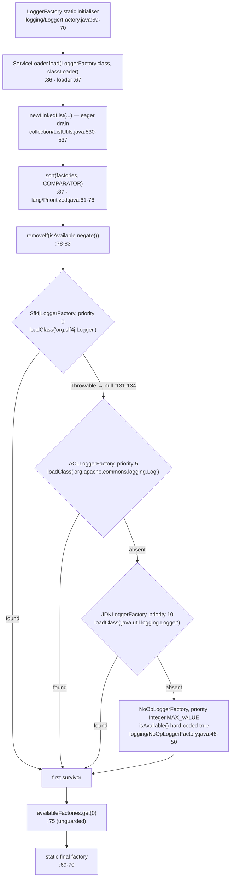
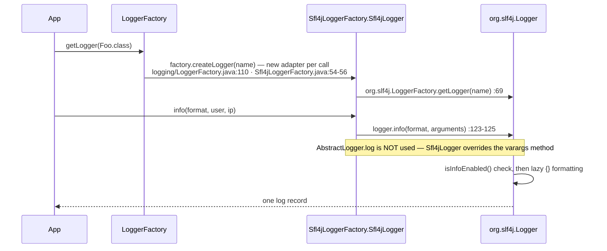
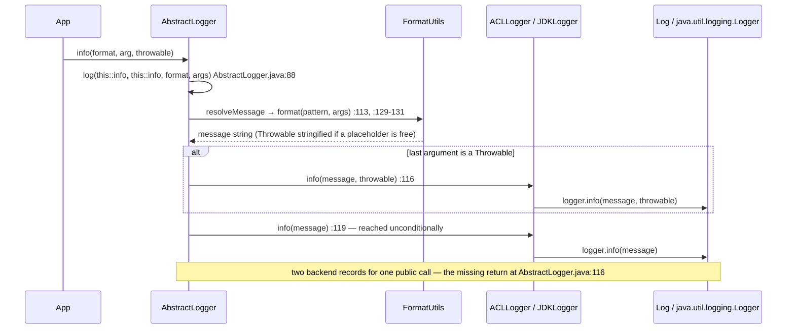
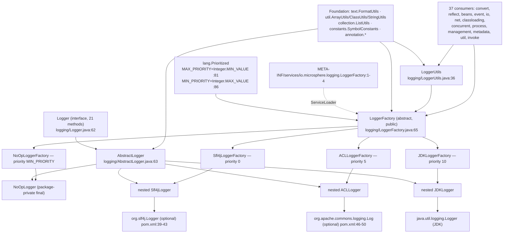

# Logging — Developer Guide

| | |
|---|---|
| **Layer** | Service layer (`logging`) — sits on the Foundation layer only; see the [layer table](./README.md#1-internal-dependency-structure) |
| **Package** | `io.microsphere.logging` — **9** top-level types + 3 nested adapter classes = 12 classes |
| **Source line** | `release` branch, `0.3.20-SNAPSHOT` |
| **Analysis focus** | backend resolution chain, adapter wrapping, logger (non-)caching and thread-safety, optional-dependency safety |
| **Technical through-line** | `microsphere-java-core` declares `slf4j-api` and `commons-logging` **optional at compile scope** (`microsphere-java-core/pom.xml:39-43`, `:46-50`); everything below explains how the package stays loadable when neither is present |
| **Verified outward edges** | `logging → lang` (`Prioritized`), `logging → util` (`ArrayUtils.length`, `ClassUtils.getTypeName`, `StringUtils.isBlank`/`substringBefore`), `logging → collection` (`ListUtils.newLinkedList`), `logging → text` (`FormatUtils.format`), `logging → constants` (`SymbolConstants.DOLLAR`), `logging → annotation` (`@Nonnull`/`@Nullable`); **no** edge to `reflect`, `convert`, `io`, `net` or Spring |
| **In-library consumers** | 37 main-source classes across `convert`, `reflect`, `beans`, `event`, `io`, `net`, `classloading`, `concurrent`, `process`, `management`, `metadata`, `util`, `invoke`, `internal.reflect` |

Paths are relative to `microsphere-java-core/src/main/java/io/microsphere/` unless a `test/` path is spelled out; after the first full mention they appear as `logging/LoggerFactory.java:88-102`.

---

## 1. Role in the architecture

`logging` is a **Service-layer** package that consumes only Foundation-layer material. Across its nine files it imports `lang`, `util`, `collection`, `text`, `constants` and `annotation` — nothing else (`logging/LoggerFactory.java:19-30`, `logging/AbstractLogger.java:19-23`, `logging/LoggerUtils.java:20-26`, `logging/NoOpLogger.java:20`). Notably it does **not** import `reflect`: unlike `convert`, which reads its own generic signature (`convert/Converter.java:99-110`), `LoggerFactory` discovers its implementations purely through `java.util.ServiceLoader` (`logging/LoggerFactory.java:30`, `:86`).

The layering is what makes the artifact usable with an almost empty classpath: `logging` is the **only** package in `microsphere-java-core` that may touch a third-party logging API, and it is the only reason `slf4j-api` and `commons-logging` appear in the module's `<dependencies>` at all — both as `<optional>true</optional>` (`microsphere-java-core/pom.xml:39-43`, `:46-50`). Every other package reaches a logger through `LoggerFactory.getLogger(...)`; 37 main-source classes do exactly that (e.g. `convert/AbstractConverter.java:23,28,90`, `reflect/MethodUtils.java:23,52,94`, `util/ServiceLoaderUtils.java:7,32`, `event/AbstractEventDispatcher.java:21,39`, `io/event/LoggingFileChangedListener.java:19,21`).

Because resolution happens in a `LoggerFactory` static initialiser (`logging/LoggerFactory.java:69-70`) that *every*
consumer triggers, `logging` is effectively the lowest common runtime dependency of the whole artifact: if its bootstrap
throws, nothing in `core` that logs can load. That makes the failure-tolerance gaps in §3.4 the highest-severity items
on this page.

> [!NOTE]
> `logging` is *leaf-ish* but not a leaf. The edges into `text` and `util` follow the Foundation → Service direction in
> the layer table; the reverse-looking references in `util/ClassUtils.java` and `util/ClassLoaderUtils.java` are those
> classes logging **about** themselves as consumers, not providers, so no cycle is introduced.

---

## 2. Type inventory

### 2.1 Top-level types (9)

| Type | Kind | Visibility | Responsibility | Evidence |
|---|---|---|---|---|
| `Logger` | interface | `public` | 21-method level API (`getName` + 5 levels × guard/plain/formatted/throwable) | `logging/Logger.java:62-241` |
| `AbstractLogger` | abstract class | `public` | Holds the name, implements the varargs methods on top of the primitive ones, formats messages | `logging/AbstractLogger.java:63-132` |
| `LoggerFactory` | abstract class, `implements Prioritized` | `public` | SPI type; loads/sorts/filters factories once and delegates `createLogger` | `logging/LoggerFactory.java:65-154` |
| `Sfl4jLoggerFactory` | concrete factory | `public` | Probes `org.slf4j.Logger`, priority `NORMAL_PRIORITY` | `logging/Sfl4jLoggerFactory.java:44-173` |
| `ACLLoggerFactory` | concrete factory | `public` | Probes `org.apache.commons.logging.Log`, priority `NORMAL_PRIORITY + 5` | `logging/ACLLoggerFactory.java:48-151` |
| `JDKLoggerFactory` | concrete factory | `public` | Probes `java.util.logging.Logger`, priority `NORMAL_PRIORITY + 10` | `logging/JDKLoggerFactory.java:54-170` |
| `NoOpLoggerFactory` | concrete factory | `public` | Always available, `MIN_PRIORITY`, deliberately throws on `getDelegateLoggerClassName()` | `logging/NoOpLoggerFactory.java:39-60` |
| `NoOpLogger` | concrete logger | **package-private `final`** | Silent sink; every guard returns `true` | `logging/NoOpLogger.java:41-111` |
| `LoggerUtils` | abstract utility | `public` | Level-gated one-shot logging with caller-derived logger names | `logging/LoggerUtils.java:36-106` |

### 2.2 Nested adapter types (3) — the only classes that bind a backend

| Nested class | Enclosing factory | Backend type it holds | Binding line |
|---|---|---|---|
| `Sfl4jLoggerFactory.Sfl4jLogger` (package-private, `extends AbstractLogger`) | `Sfl4jLoggerFactory` | `org.slf4j.Logger` | `logging/Sfl4jLoggerFactory.java:63-65`, obtained at `:69` |
| `ACLLoggerFactory.ACLLogger` (package-private, `extends AbstractLogger`) | `ACLLoggerFactory` | `org.apache.commons.logging.Log` | `logging/ACLLoggerFactory.java:67-69`, obtained at `:73` |
| `JDKLoggerFactory.JDKLogger` (package-private, `extends AbstractLogger`) | `JDKLoggerFactory` | `java.util.logging.Logger` | `logging/JDKLoggerFactory.java:73-75`, obtained at `:79` |

Three constants carry the probe targets and are the only place the foreign class names appear as data:
`SLF4J_LOGGER_CLASS_NAME = "org.slf4j.Logger"` (`logging/Sfl4jLoggerFactory.java:46`),
`ACL_LOG_CLASS_NAME = "org.apache.commons.logging.Log"` (`logging/ACLLoggerFactory.java:50`) and
`JDK_LOGGER_CLASS_NAME = "java.util.logging.Logger"` (`logging/JDKLoggerFactory.java:56`).

Test-side inventory: `AbstractLoggerTest` is the abstract contract harness (`logging/AbstractLoggerTest.java:34-134`)
with four concrete subclasses (`logging/ACLLoggerFactoryTest.java:10`, `logging/JDKLoggerFactoryTest.java:17`,
`logging/Sfl4jLoggerFactoryTest.java:10`, `logging/NoOpLoggerTest.java:10`), plus `LoggerFactoryTest`,
`NoOpLoggerFactoryTest`, `LoggerUtilsTest` and the negative fixture `NoDelegateLoggerFactory` (`:27`).

---

## 3. The `LoggerFactory` resolution and delegation chain

### 3.1 One-shot bootstrap

`LoggerFactory` has exactly two static fields, both `final`, both populated during class initialisation:

```java
private static final ClassLoader classLoader = LoggerFactory.class.getClassLoader();  // logging/LoggerFactory.java:67
@Nonnull private static final LoggerFactory factory = loadFactory();                  // logging/LoggerFactory.java:69-70
```

`getLogger(Class)` (`logging/LoggerFactory.java:97-100`) and `getLogger(String)` (`:108-111`) read `factory` and call
`factory.createLogger(name)` — no re-resolution, no `volatile`, no `synchronized`, no holder idiom, because the JVM's
class-initialisation lock already provides safe publication plus once-only semantics. The trade-off is that the choice
is **immutable for the lifetime of that classloader**: there is no supported re-scan.

### 3.2 Load → sort → filter → pick

| Step | Code | Notes |
|---|---|---|
| Load | `newLinkedList(load(LoggerFactory.class, classLoader))` | `logging/LoggerFactory.java:86` — `ServiceLoader` is drained **eagerly** into a `LinkedList` (`collection/ListUtils.java:530-537`); instantiation is reflective inside `ServiceLoader` |
| Sort | `sort(factories, COMPARATOR)` | `logging/LoggerFactory.java:87`, `java.util.Collections.sort` (static import `:28`) — a **stable** sort, so equal priorities keep service-file order |
| Filter | `factories.removeIf(LoggerFactory::isAvailable.negate())` | `logging/LoggerFactory.java:80-81` — written as "remove the unavailable", not "keep the available" |
| Pick | `availableFactories.get(0)` | `logging/LoggerFactory.java:75` — **no empty-list guard** |

The comparator comes from `Prioritized.COMPARATOR` (`lang/Prioritized.java:61-76`) and `compareTo` is
`compare(getPriority(), that.getPriority())` (`:102-105`), so ascending numeric = descending precedence. The four shipped
ranks are `0` (`logging/Sfl4jLoggerFactory.java:58-61`), `5` (`logging/ACLLoggerFactory.java:62-65`), `10`
(`logging/JDKLoggerFactory.java:68-71`) and `Integer.MAX_VALUE` (`logging/NoOpLoggerFactory.java:56-59`), which yields
the **SLF4J → Commons Logging → JUL → no-op** delegation chain. The constant names are inverted —
`MAX_PRIORITY = Integer.MIN_VALUE` (`lang/Prioritized.java:81`), `MIN_PRIORITY = Integer.MAX_VALUE` (`:86`),
`NORMAL_PRIORITY = 0` (`:91`) — and a factory that never overrides `getPriority()` inherits the interface default
NORMAL_PRIORITY (`:98-100`), so it **ties with `Sfl4jLoggerFactory`** and the tie is broken only by classpath order.

### 3.3 Availability is a class-loading probe

```java
protected boolean isAvailable() {                                       // logging/LoggerFactory.java:118-120
    return nonNull(getDelegateLoggerClass());
}
@Nullable private Class<?> getDelegateLoggerClass() {                   // logging/LoggerFactory.java:127-136
    Class<?> c = null;
    try { c = classLoader.loadClass(getDelegateLoggerClassName()); }     // :132
    catch (Throwable e) { /* empty by design */ }                      // :131-134
    return c;
}
```

Two structural details matter for extension authors. First, `getDelegateLoggerClass()` is `private` (`:128`), so a
subclass **cannot** inspect the probed class; the only supported seams are overriding `isAvailable()` (as
`NoOpLoggerFactory` does at `logging/NoOpLoggerFactory.java:46-50`) or `getDelegateLoggerClassName()`
(`logging/LoggerFactory.java:143-144`). Second, the catch is on `Throwable`, not `ClassNotFoundException`, so it also
swallows `LinkageError`/`NoClassDefFoundError` from a half-present backend jar — deliberate, but it means a corrupt
backend degrades silently instead of surfacing.

### 3.4 Bootstrap failure paths (audit findings)

| Condition | Observed behaviour | Evidence |
|---|---|---|
| Backend absent | Silent, correct degradation | `logging/LoggerFactory.java:131-134`, `:80-81` |
| A service entry names a missing class / non-public constructor / abstract type | `ServiceConfigurationError` escapes the eager drain and the static initialiser, leaving `LoggerFactory` in `ExceptionInInitializerError`; **every** later `getLogger` call then throws `NoClassDefFoundError` | `logging/LoggerFactory.java:69-70`, `:86` |
| Survivor list is empty | `IndexOutOfBoundsException` at `get(0)` | `logging/LoggerFactory.java:75` |
| `NoOpLoggerFactory.isAvailable()` override removed | `getDelegateLoggerClassName()` raises `UnsupportedOperationException` during bootstrap | `logging/NoOpLoggerFactory.java:41-44`, `:46-50` |
| `null` logger name | Passed through unchecked to `java.util.logging.Logger.getLogger` / `LogFactory.getLog` / `org.slf4j.LoggerFactory.getLogger`; `getLogger(Class)` dereferences immediately | `logging/LoggerFactory.java:99`, `:108-111` |

The last three deviate from the library-wide **silent degradation** error policy and belong in the NPE-hardening audit.
The guarded per-factory probe (`logging/LoggerFactory.java:131-134`) shows the intended policy; the load step (`:86`) and
the pick step (`:75`) were left unguarded.

---

## 4. How each adapter wraps its backend

All three adapters extend `AbstractLogger` and hold a `final` reference to the backend logger obtained in the
constructor. The wrapping style differs in one decisive respect: **which methods they override**.

| | `Sfl4jLogger` | `ACLLogger` | `JDKLogger` |
|---|---|---|---|
| Backend obtained by | `org.slf4j.LoggerFactory.getLogger(name)` `logging/Sfl4jLoggerFactory.java:69` | `org.apache.commons.logging.LogFactory.getLog(name)` `logging/ACLLoggerFactory.java:73` | `java.util.logging.Logger.getLogger(name)` `logging/JDKLoggerFactory.java:79` |
| Guards forwarded to the backend | `logging/Sfl4jLoggerFactory.java:73-75`, `:93-95`, `:113-115`, `:133-135`, `:153-155` | `logging/ACLLoggerFactory.java:77-79`, `:91-93`, `:106-109`, `:122-124`, `:137-139` | level-mapped, see below |
| Varargs `(String, Object...)` overridden? | **Yes** — all five: `:83-85`, `:103-105`, `:123-125`, `:143-145`, `:163-165` | **No** | **No** |
| Formatting performed by | SLF4J, lazily | `FormatUtils.format`, eagerly (`logging/AbstractLogger.java:129-131`) | `FormatUtils.format`, eagerly |
| Level model | native TRACE/DEBUG/INFO/WARN/ERROR | native `trace`/`debug`/… on `Log` | `ALL`/`FINE`/`INFO`/`WARNING`/`SEVERE` (`logging/JDKLoggerFactory.java:23-27`, `:82-155`) |
| Extra seams | none | none | package-private `isLoggable(Level)` `:157-159`, `log(Level,String)` `:161-163`, `log(Level,String,Throwable)` `:165-167` |

`JDKLogger` is the thinnest: all five levels funnel through two helpers plus a guard, and those helpers are
package-private and non-`final` precisely so a test can intercept at `:157-167`. `ACLLogger` and `Sfl4jLogger` expose no
such seam and call the backend directly.

### 4.1 `AbstractLogger` as the shared behaviour layer

`AbstractLogger` implements only the five varargs methods plus one protected engine:

```java
public void info(String format, Object... arguments) {              // logging/AbstractLogger.java:86-89
    log(this::info, this::info, format, arguments);                 // :88 — method refs to the primitive overloads
}
protected void log(Consumer<String> messageHandler, BiConsumer<String, Throwable> messageThrowableHandler,
                   String format, Object... arguments) {            // logging/AbstractLogger.java:107
    final String message; int length = length(arguments);
    if (length < 1) { message = format; }                           // :110-111
    else {
        message = resolveMessage(format, arguments);                // :113
        Object lastArgument = arguments[length - 1];
        if (lastArgument instanceof Throwable)                      // :115
            messageThrowableHandler.accept(message, (Throwable) lastArgument);  // :116
    }
    messageHandler.accept(message);                                 // :119 — reached unconditionally
}
```

The `this::info` pair at `:88` is the dispatch mechanism: method references to the class's own `Logger` overloads are
passed as `Consumer`/`BiConsumer`, and the concrete class decides which one(s) run. `getName()` is `final` (`:71-74`)
over a `final` field (`:65-69`), and `resolveMessage` (`:129-131`) is the single seam for subclasses wanting different
placeholder semantics.

> [!IMPORTANT]
> **Control-flow defect: the `return` between `:116` and `:119` is missing.** When `arguments` is non-empty and its last
> element is a `Throwable`, both `messageThrowableHandler.accept(...)` *and* `messageHandler.accept(message)` run, so one
> public call produces **two** backend records — one with the stack trace, one without. It is observable under the
> Commons Logging and JUL adapters (which inherit these methods) and invisible under SLF4J, which overrides them
> (`logging/Sfl4jLoggerFactory.java:83-85`, `:103-105`, `:123-125`, `:143-145`, `:163-165`). The suite cannot detect it:
> every level test wraps calls in `assertDoesNotThrow` (`logging/AbstractLoggerTest.java:56-65`, `:89-99`), which asserts
> nothing about record count. A correct fix is `return;` after `:116`, plus a capturing-backend test.
>
> Secondary effect at the same lines: `resolveMessage(format, arguments)` receives **all** arguments including the
> trailing `Throwable`, so a format string with as many `{}` as arguments renders the exception's `toString()` into the
> message body (`text/FormatUtils.java:73-80` stringifies via `String.valueOf`).

### 4.2 `NoOpLogger` deliberately reuses the defective engine

`NoOpLogger` (`logging/NoOpLogger.java:41`) overrides only the primitive overloads, so its varargs handling is inherited
from `AbstractLogger`. Because both handlers are no-ops (`:52-54`, `:65-67`, `:78-80`, `:91-93`, `:104-106`) the
double-invocation is harmless there — but `resolveMessage` still runs, so a no-op logger **still pays the formatting
cost**. Its guards all return `true` (`:47-50`, `:60-63`, `:73-76`, `:86-89`, `:99-102`), which keeps guard-then-log call
sites functional. `NoOpLoggerFactory.createLogger` is the only production path that produces one
(`logging/NoOpLoggerFactory.java:51-54`).

---

## 5. Caching, cache keys and thread-safety

**Loggers are not cached at any level.** The chain is `LoggerFactory.getLogger(String)` →
`factory.createLogger(name)` (`logging/LoggerFactory.java:110`) → `new XxxLogger(name)`
(`logging/Sfl4jLoggerFactory.java:54-56`, `logging/ACLLoggerFactory.java:58-60`,
`logging/JDKLoggerFactory.java:64-66`, `logging/NoOpLoggerFactory.java:52-54`). Each call allocates a new adapter and
performs a fresh backend lookup; the only caching that exists lives *inside* the backends (JUL's `LogManager` registry,
SLF4J's `LoggerContext`, Commons Logging's `LogFactory` cache), which is why distinct adapters can wrap one backend
instance.

| Question | Answer | Evidence |
|---|---|---|
| Are `Logger` instances memoised? | No — there is no `Map` field anywhere in the package | `logging/LoggerFactory.java:67`, `:69-70` are the only static fields |
| Cache key, if it existed | The `String` name (`type.getName()` for the class form) | `logging/LoggerFactory.java:99`, `:110` |
| Are `LoggerFactory` instances memoised? | No — `loadFactories()` re-drains `ServiceLoader` each call, creating fresh objects | `logging/LoggerFactory.java:85-89` |
| What **is** memoised? | Only the single winning factory, in a `static final` field | `logging/LoggerFactory.java:69-70` |
| Sibling-SPI contrast | `convert` caches per `(source,target)` pair via `ConcurrentMap.computeIfAbsent` (`convert/Converters.java:46-67`); `logging` has no analogue | — |

Thread-safety, field by field:

- `classLoader` and `factory` are `private static final`, written only in `<clinit>`
  (`logging/LoggerFactory.java:67`, `:69-70`); safe publication comes from the JVM class-initialisation lock, so
  concurrent `getLogger` calls see a fully constructed factory without `volatile`.
- `AbstractLogger.name` is `final` (`logging/AbstractLogger.java:65-69`) and `getName()` is `final` (`:71-74`); the
  backend handles are `final` (`logging/Sfl4jLoggerFactory.java:65`, `logging/ACLLoggerFactory.java:69`,
  `logging/JDKLoggerFactory.java:75`). A `Logger` is therefore **immutable and freely shareable**, and `log(...)` holds no
  mutable state (`logging/AbstractLogger.java:107-120`).
- `loadFactories()` returns a mutable `LinkedList` that `loadAvailableFactories()` mutates via `removeIf`
  (`logging/LoggerFactory.java:78-89`) — safe because the list never escapes as shared state; the package-private callers
  that do receive it (`logging/LoggerFactoryTest.java:57-59`, `logging/NoOpLoggerFactoryTest.java:25-33`) each get a
  freshly built list.
- `Prioritized.COMPARATOR` is a stateless lambda (`lang/Prioritized.java:61-76`) and `Collections.sort`
  (`logging/LoggerFactory.java:87`) is not re-entered concurrently.
- `NoOpLogger` / `NoOpLoggerFactory` are stateless; the javadoc "thread-safe" claim
  (`logging/NoOpLogger.java:39`) is structurally true.

Allocation cost is concentrated on the `LoggerUtils` path: every `LoggerUtils.info(...)`/`debug(...)` call re-derives the
caller class name (`ClassUtils.getTypeName` + `substringBefore`), constructs an adapter **and** performs a backend lookup,
then discards the adapter (`logging/LoggerUtils.java:89-99`). That makes it right for cold paths (bootstrap, one-shot
diagnostics) and wrong for loops. `LoggerUtils` also has **zero consumers inside `microsphere-java-core`** — only
`logging/LoggerUtilsTest.java` calls it.

---

## 6. Optional-dependency safety

The module compiles against `slf4j-api` and `commons-logging` but ships neither transitively
(`microsphere-java-core/pom.xml:39-43`, `:46-50`). Four mechanisms combine to keep the artifact loadable without them.
None is a `java.lang.reflect.Method.invoke` — the safety is **structural**, achieved by splitting the compiled classes and
probing by name.

1. **The factory classes do not reference the backend types.** `Sfl4jLoggerFactory` imports only
   `io.microsphere.lang.Prioritized` (`logging/Sfl4jLoggerFactory.java:19`) and mentions `org.slf4j` only as a javadoc
   `@see` (`:41`); `ACLLoggerFactory` has **no import statements at all** (`logging/ACLLoggerFactory.java:17` is the
   package declaration). A factory can therefore be instantiated and probed on a classpath where its backend is absent.
2. **Backend binding is quarantined into the nested class.** Each `org.slf4j.Logger` /
   `org.apache.commons.logging.Log` / `java.util.logging.Logger` field lives in the nested adapter
   (`logging/Sfl4jLoggerFactory.java:63-70`, `logging/ACLLoggerFactory.java:67-74`,
   `logging/JDKLoggerFactory.java:73-80`) — a separate class file the JVM resolves lazily, only when `createLogger`
   constructs it (`logging/Sfl4jLoggerFactory.java:55`). Because a factory with a missing backend is filtered out before
   `createLogger` is reached (`logging/LoggerFactory.java:80-81`), `NoClassDefFoundError` cannot be produced by a loser
   branch. **This is the load-bearing trick of the whole package.**
3. **Class names as data plus reflective loading for the probe.** `getDelegateLoggerClassName()` returns a `String`
   (`logging/Sfl4jLoggerFactory.java:48-51`, `logging/ACLLoggerFactory.java:52-55`,
   `logging/JDKLoggerFactory.java:58-61`) and `getDelegateLoggerClass()` resolves it with `ClassLoader.loadClass`
   (`logging/LoggerFactory.java:132`) inside a `catch (Throwable)` guard (`:131-134`) — the closest thing to classic
   reflection here, and the reason detection is order-independent and crash-free.
4. **`ServiceLoader`, which instantiates reflectively.** `load(LoggerFactory.class, classLoader)`
   (`logging/LoggerFactory.java:30`, `:86`) requires each implementation to be `public` with a public no-arg constructor —
   satisfied by `Sfl4jLoggerFactory` (`:44`), `ACLLoggerFactory` (`:48`), `JDKLoggerFactory` (`:54`) and
   `NoOpLoggerFactory` (`:39`), all registered in
   `src/main/resources/META-INF/services/io.microsphere.logging.LoggerFactory:1-4`. Conversely `NoOpLogger` is
   package-private (`logging/NoOpLogger.java:41`) precisely *because* it is not an SPI type — only its factory is.

A fifth, genuinely reflective device belongs to `LoggerUtils`: it derives the logger name from the lambda's runtime class
via `ClassUtils.getTypeName(loggerConsumer)` (`logging/LoggerUtils.java:102`, `util/ClassUtils.java:2025-2028`) and cuts
at `SymbolConstants.DOLLAR` (`constants/SymbolConstants.java:228`, `util/StringUtils.java:472-482`), so
`io.microsphere.logging.LoggerUtilsTest$$Lambda$…` → `io.microsphere.logging.LoggerUtilsTest`. The per-call
`Class.getName()` is why `LoggerUtils` is a cold-path API (§5).

> [!WARNING]
> The loader used for both the SPI load and the probe is `LoggerFactory.class.getClassLoader()`
> (`logging/LoggerFactory.java:67`) — the **defining** loader, not the thread-context one — and it is used raw:
> `LoggerFactory` does not go through `ClassLoaderUtils.getClassLoader(...)` / `nullSafeClassLoader`
> (`util/ClassLoaderUtils.java:298-303`) the way `ServiceLoaderUtils` does (`util/ServiceLoaderUtils.java:383`). Under a
> `null` (bootstrap) loader, `ServiceLoader.load(LoggerFactory.class, null)` finds nothing,
> `loadAvailableFactories()` returns an empty list and `get(0)` (`logging/LoggerFactory.java:75`) throws. Keep
> `microsphere-java-core` off the bootstrap classpath.

---

## 7. Diagrams

### 7.1 Backend detection order



### 7.2 One `logger.info("User {} logged in from {}", user, ip)` under the SLF4J adapter



### 7.3 The same call under the Commons Logging / JUL adapters



### 7.4 Hierarchy and module/package dependency



---

## 8. Design patterns

| Pattern | Proving class | Evidence |
|---|---|---|
| **Adapter** | `Sfl4jLoggerFactory.Sfl4jLogger` implements `Logger` by holding `org.slf4j.Logger` and translating each method; the same shape in `ACLLogger` and `JDKLogger` | `logging/Sfl4jLoggerFactory.java:63-172` (field `:65`, ctor `:67-70`, forwarding `:72-170`); `logging/ACLLoggerFactory.java:67-150`; `logging/JDKLoggerFactory.java:73-169` |
| **Facade** | `LoggerFactory` + `Logger` hide which backend exists and which API it speaks; `LoggerUtils` is a coarser facade over "resolve name → get logger → test level → log" | `logging/LoggerFactory.java:97-111`, `logging/Logger.java:62-241`, `logging/LoggerUtils.java:43-94` |
| **Null Object** | `NoOpLogger` (with `NoOpLoggerFactory`) — a real object with empty bodies and permissive guards, so no call site needs a `null` check | `logging/NoOpLogger.java:41-111` (empty bodies `:52-54`, `:78-80`, `:104-106`; guards `:47-50`, `:99-102`); `logging/NoOpLoggerFactory.java:39-60` |
| **Decorator (functional)** | `AbstractLogger` wraps a class's *own* primitive `Consumer<String>` / `BiConsumer<String,Throwable>` methods with formatting and throwable extraction, without changing their signatures | `logging/AbstractLogger.java:76-99` (`log(this::info, this::info, …)` at `:88`), engine `:107-120`, seam `:129-131` |
| **Template Method** | `LoggerFactory` — `getDelegateLoggerClassName()` and `createLogger(String)` are the abstract steps, `isAvailable()` is the hook (`logging/NoOpLoggerFactory.java:46-50`) | `logging/LoggerFactory.java:118-120`, `:143-144`, `:152` |
| **Factory Method + static singleton holder** | `LoggerFactory.getLogger` over the one `static final factory`, resolved in `<clinit>` | `logging/LoggerFactory.java:69-70`, `:97-111`, `:152` |
| **SPI / ordered strategy registry** | four registered factories ordered by `Prioritized` | `src/main/resources/META-INF/services/io.microsphere.logging.LoggerFactory:1-4`, `logging/LoggerFactory.java:85-89` |
| **Strategy** | `LoggerUtils.trace/debug/info/warn/error` each pass a different `Logger::isXxxEnabled` method reference as the predicate | `logging/LoggerUtils.java:43-81`, shared engine `:89-94` |

The **Template Method** seam at `logging/LoggerFactory.java:143-144` is the intended extension point, and the
**Null Object** at `logging/NoOpLogger.java:41` is what guarantees the detection chain in §7.1 always ends in a winner.

### 8.1 Adding your own backend

1. Extend `LoggerFactory` and implement both abstract methods
   (`logging/LoggerFactory.java:143-144`, `:152`).
2. Put the backend-typed field and the delegating methods in a **nested class**, never in the factory itself, so the
   optional-dependency quarantine of §6 holds.
3. Return a class-name `String` from `getDelegateLoggerClassName()` and let `isAvailable()` probe it
   (`logging/LoggerFactory.java:118-120`) — do not hard-reference the backend type in the factory.
4. Override `getPriority()` with a value distinct from `0`, `5`, `10` and `Integer.MAX_VALUE`, because the default
   `NORMAL_PRIORITY` ties with SLF4J (`lang/Prioritized.java:98-100`).
5. Register the class name in your own
   `META-INF/services/io.microsphere.logging.LoggerFactory` and make sure it is visible to
   `LoggerFactory.class.getClassLoader()` (`logging/LoggerFactory.java:67`) — the thread-context loader is not consulted.
6. Copy the contract test rather than writing a new one: extend `AbstractLoggerTest`
   (`logging/AbstractLoggerTest.java:34-134`) as `Sfl4jLoggerFactoryTest` does (`:10-15`).

---

## 9. Review notes

Ordered by severity, all verified against `release`.

1. **`AbstractLogger.log` misses a `return` (`logging/AbstractLogger.java:116` → `:119`).** One public call carrying a
   trailing `Throwable` emits two backend records under ACL and JUL. Fix: `return` after the throwable branch. The suite
   cannot see it because it only asserts non-throwing (`logging/AbstractLoggerTest.java:56-65`, `:89-99`); add a
   capturing-backend test asserting record count.
2. **Trailing `Throwable` can leak into the message text** (`logging/AbstractLogger.java:113`,
   `text/FormatUtils.java:73-80`): all arguments reach `resolveMessage`, so a format with as many `{}` as arguments
   renders `String.valueOf(throwable)`. Fix: strip the trailing throwable before formatting.
3. **Unguarded `get(0)` (`logging/LoggerFactory.java:75`) and unguarded eager `ServiceLoader` drain (`:86`) inside a
   static initialiser (`:69-70`).** Either can kill `LoggerFactory` for the whole classloader
   (`IndexOutOfBoundsException` / `ServiceConfigurationError` → `ExceptionInInitializerError`). Both contradict silent
   degradation, whose intended shape is visible at `:131-134`. Fix: iterate the sorted list, return the first available
   entry, and fall back to a directly constructed `NoOpLoggerFactory` — which also demotes the SPI file's last entry from
   a requirement to a redundancy.
4. **`getLogger` performs no null/blank validation** (`logging/LoggerFactory.java:99`, `:108-111`) while `NoOpLogger`
   alone defends itself (`logging/NoOpLogger.java:43-45`). Recorded against the NPE-hardening audit; it is also a
   behavioural difference between backends (§3.4).
5. **No logger caching (§5).** Every `getLogger` allocates an adapter and hits the backend registry. If a cache is added,
   the natural key is the `String` name (`logging/LoggerFactory.java:99`, `:110`) in a
   `ConcurrentHashMap<String, Logger>` filled by `computeIfAbsent`, mirroring `convert/Converters.java:46-67`; the
   adapters are immutable, so sharing is safe.
6. **`LoggerFactory` implements `Prioritized` but never overrides `getPriority()`,** so an extension that forgets to
   override it ties with `Sfl4jLoggerFactory` at `0` (`lang/Prioritized.java:98-100`) and the winner depends on classpath
   order under a stable sort (`logging/LoggerFactory.java:87`). Document a required priority range, or break ties on class
   name.
7. **`getDelegateLoggerClass()` is `private` (`logging/LoggerFactory.java:128`) while `isAvailable()` is `protected`
   (`:118`)**: subclasses can replace the decision but cannot reuse the probe. That forces `NoOpLoggerFactory` to hard-code
   `true` (`logging/NoOpLoggerFactory.java:46-50`) and to keep the `UnsupportedOperationException` stub (`:41-44`) that
   §3.4 lists as a bootstrap hazard. Consider a `protected` probe returning `Class<?>` so factories could bind the backend
   type directly.
8. **`NoOpLogger` is package-private (`logging/NoOpLogger.java:41`) while `NoOpLoggerFactory` is public (`:39`)**, so
   `createLogger` returns a type outside callers cannot name; the "silence everything" use case is reachable only via the
   `Logger` interface or a custom factory. Package-local tests work around it (`logging/NoOpLoggerTest.java:12-15`).
9. **`LoggerUtils` omits the `util.Utils` marker interface** (`logging/LoggerUtils.java:36`, cf. `util/Utils.java:41`) that
   every other `core` utility implements, and it is the only `*Utils` class with **no in-library consumer** — nothing but
   `logging/LoggerUtilsTest.java` calls it. Adopt `Utils` or document the exemption, and warn about the per-call
   allocation (§5).
10. **Test-order coupling around the JUL configuration.** `LoggerFactoryTest` and `JDKLoggerFactoryTest` install
    `META-INF/logging.properties` (`.level = ALL`) in `@BeforeAll` (`logging/LoggerFactoryTest.java:42-48`,
    `logging/JDKLoggerFactoryTest.java:19-25`), but `ACLLoggerFactoryTest` (`:10-15`) asserts `isTraceEnabled()`
    (`logging/AbstractLoggerTest.java:50-53`) without installing one, so it can depend on another class having already
    reconfigured the JVM-wide `LogManager`. Move the loader into `AbstractLoggerTest`, or gate the assertion.
11. **Resource-null fragility in the harness:** `getResource("/META-INF/logging.properties")` is dereferenced without a
    null check (`logging/LoggerFactoryTest.java:44-45`), so a missing test resource surfaces as `NullPointerException`
    instead of a clear message.
12. **Documentation drift:** the `LoggerFactory` javadoc example (`logging/LoggerFactory.java:41-58`) correctly shows a
    subclass overriding `getDelegateLoggerClassName()` / `createLogger(String)`, but `NoOpLoggerFactory`'s example
    (`logging/NoOpLoggerFactory.java:25-32`) advertises `NoOpLoggerFactory.getLogger(MyClass.class)`, which resolves to the
    inherited **static** `LoggerFactory.getLogger` and returns whichever factory won — not `NoOpLoggerFactory`. Rewrite it
    as `new NoOpLoggerFactory().createLogger(...)`. The same drift exists one layer up: `Prioritized.getPriority()`'s
    javadoc promises a default of `MIN_PRIORITY` (`lang/Prioritized.java:96`) while the code returns
    `NORMAL_PRIORITY` (`:98-100`).

---

## 10. See also

* User-facing reference: [Logging — User Guide](../../user-guide/microsphere-java-core/logging.md)
* [Language abstractions](./language-abstractions.md) — `Prioritized` constants, `COMPARATOR` and `compareTo`, the ordering machinery behind §3.2
* [Utilities, constants and text](./util-and-constants.md) — `FormatUtils`, `ArrayUtils`, `ClassUtils`, `StringUtils`, `SymbolConstants`, plus the `ClassLoaderUtils`/`ServiceLoaderUtils` conventions `LoggerFactory` does not follow (§6)
* [Collections and filters](./collections-and-filters.md) — `ListUtils.newLinkedList`, the eager drain in §3.2
* [Type conversion](./type-conversion.md) — the sibling SPI whose per-pair cache (§5) `logging` deliberately lacks
* [Events](./events.md) · [Serialization](./serialization.md) · [Reflection, types and beans](./reflection-and-beans.md) — the layers above; `logging` does **not** depend on `reflect`
