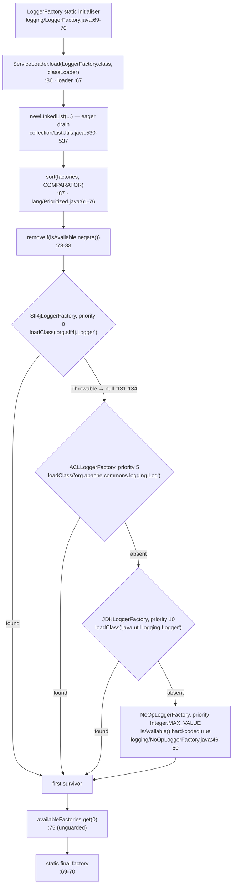
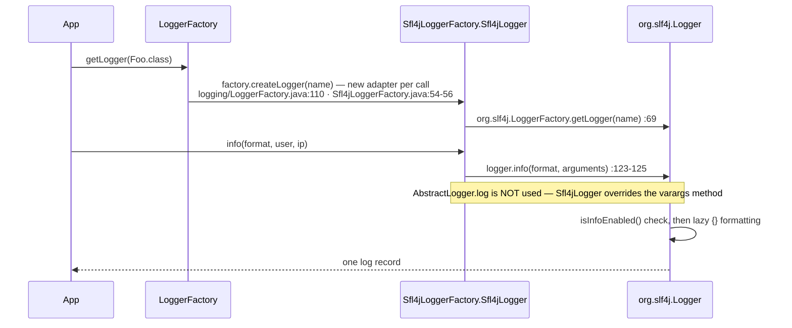
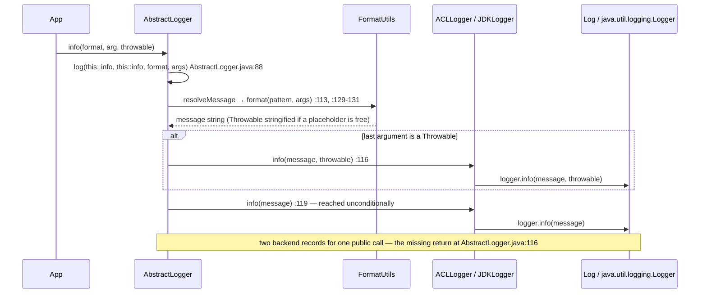
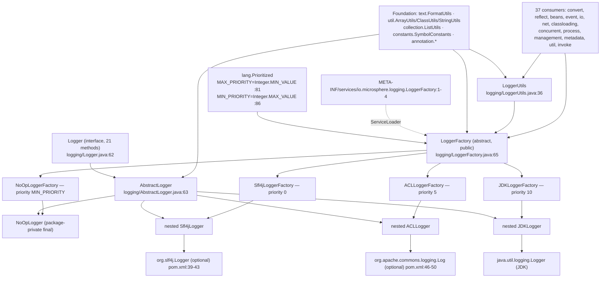

# 日志 — 开发者指南

| | |
|---|---|
| **层级** | 服务层（`logging`）——仅坐落在基础层之上；参见[层级表](./README.zh.md#1-内部依赖结构) |
| **包** | `io.microsphere.logging` — **9** 个顶层类型 + 3 个嵌套适配器类 = 12 个类 |
| **源码线** | `release` 分支，`0.3.20-SNAPSHOT` |
| **分析重点** | 后端解析链、适配器包装方式、logger 的（未）缓存与线程安全、可选依赖安全性 |
| **贯穿式技术事实** | `microsphere-java-core` 把 `slf4j-api` 与 `commons-logging` 声明为 **compile 作用域下 optional**（`microsphere-java-core/pom.xml:39-43`、`:46-50`）；下文全部在解释二者都不存在时该包为何仍可加载 |
| **已核实的外部依赖边** | `logging → lang`（`Prioritized`）、`logging → util`（`ArrayUtils.length`、`ClassUtils.getTypeName`、`StringUtils.isBlank`/`substringBefore`）、`logging → collection`（`ListUtils.newLinkedList`）、`logging → text`（`FormatUtils.format`）、`logging → constants`（`SymbolConstants.DOLLAR`）、`logging → annotation`（`@Nonnull`/`@Nullable`）；**没有**指向 `reflect`、`convert`、`io`、`net` 或 Spring 的边 |
| **库内消费者** | 跨 `convert`、`reflect`、`beans`、`event`、`io`、`net`、`classloading`、`concurrent`、`process`、`management`、`metadata`、`util`、`invoke`、`internal.reflect` 的 37 个主源类 |

除明确写出 `test/` 的路径外，所有路径都相对于
`microsphere-java-core/src/main/java/io/microsphere/`；首次完整出现后缩写为 `logging/LoggerFactory.java:88-102`。

---

## 1. 在架构中的位置

`logging` 是一个**服务层（Service-layer）**包，只消费基础层材料。它的九个文件合计只 import `lang`、`util`、
`collection`、`text`、`constants` 与 `annotation`——别无其他
（`logging/LoggerFactory.java:19-30`、`logging/AbstractLogger.java:19-23`、`logging/LoggerUtils.java:20-26`、
`logging/NoOpLogger.java:20`）。值得注意的是它**不** import `reflect`：与 `convert` 读取自身泛型签名
（`convert/Converter.java:99-110`）不同，`LoggerFactory` 完全通过 `java.util.ServiceLoader` 发现它的实现
（`logging/LoggerFactory.java:30`、`:86`）。

正是这种分层让该 artifact 在近乎空白的 classpath 上仍可使用：`logging` 是 `microsphere-java-core` 中**唯一**
可能触及第三方日志 API 的包，也是 `slf4j-api` 与 `commons-logging` 出现在该模块 `<dependencies>` 里的唯一原因
——两者都是 `<optional>true</optional>`（`microsphere-java-core/pom.xml:39-43`、`:46-50`）。其余每个包都通过
`LoggerFactory.getLogger(...)` 获取 logger；37 个主源类正是这么做的（例如
`convert/AbstractConverter.java:23,28,90`、`reflect/MethodUtils.java:23,52,94`、`util/ServiceLoaderUtils.java:7,32`、
`event/AbstractEventDispatcher.java:21,39`、`io/event/LoggingFileChangedListener.java:19,21`）。

因为解析发生在 `LoggerFactory` 的静态初始化块中（`logging/LoggerFactory.java:69-70`），而*每个*消费者都会触发它，
`logging` 实际上是整个 artifact 最低的共同运行时依赖：它一旦引导失败，`core` 中所有会记日志的东西都无法加载。
这让 §3.4 里的容错缺口成为本页严重度最高的条目。

> [!NOTE]
> `logging` 是*近乎叶子*但不是叶子。指向 `text` 与 `util` 的边遵循层级表中基础层 → 服务层的方向；
> `util/ClassUtils.java` 与 `util/ClassLoaderUtils.java` 里那些看似反向的引用，是这些类作为**消费者**在记录
> 自己的日志，而非作为提供者，因此不会引入环。

---

## 2. 类型清单

### 2.1 顶层类型（9 个）

| 类型 | 种类 | 可见性 | 职责 | 证据 |
|---|---|---|---|---|
| `Logger` | 接口 | `public` | 21 方法的级别 API（`getName` + 5 个级别 × 守卫/纯文本/格式化/带异常） | `logging/Logger.java:62-241` |
| `AbstractLogger` | 抽象类 | `public` | 持有名称，在基元方法之上实现变参方法，并负责消息格式化 | `logging/AbstractLogger.java:63-132` |
| `LoggerFactory` | 抽象类，`implements Prioritized` | `public` | SPI 类型；一次性加载/排序/过滤工厂并委托 `createLogger` | `logging/LoggerFactory.java:65-154` |
| `Sfl4jLoggerFactory` | 具体工厂 | `public` | 探测 `org.slf4j.Logger`，优先级 `NORMAL_PRIORITY` | `logging/Sfl4jLoggerFactory.java:44-173` |
| `ACLLoggerFactory` | 具体工厂 | `public` | 探测 `org.apache.commons.logging.Log`，优先级 `NORMAL_PRIORITY + 5` | `logging/ACLLoggerFactory.java:48-151` |
| `JDKLoggerFactory` | 具体工厂 | `public` | 探测 `java.util.logging.Logger`，优先级 `NORMAL_PRIORITY + 10` | `logging/JDKLoggerFactory.java:54-170` |
| `NoOpLoggerFactory` | 具体工厂 | `public` | 永远可用，`MIN_PRIORITY`，在 `getDelegateLoggerClassName()` 上刻意抛异常 | `logging/NoOpLoggerFactory.java:39-60` |
| `NoOpLogger` | 具体 logger | **包私有 `final`** | 静默接收器；每个守卫都返回 `true` | `logging/NoOpLogger.java:41-111` |
| `LoggerUtils` | 抽象工具类 | `public` | 级别门控的一次性日志，logger 名称由调用方推导 | `logging/LoggerUtils.java:36-106` |

### 2.2 嵌套适配器类型（3 个）——唯一绑定后端的类

| 嵌套类 | 外层工厂 | 它持有的后端类型 | 绑定位置 |
|---|---|---|---|
| `Sfl4jLoggerFactory.Sfl4jLogger`（包私有，`extends AbstractLogger`） | `Sfl4jLoggerFactory` | `org.slf4j.Logger` | `logging/Sfl4jLoggerFactory.java:63-65`，取值于 `:69` |
| `ACLLoggerFactory.ACLLogger`（包私有，`extends AbstractLogger`） | `ACLLoggerFactory` | `org.apache.commons.logging.Log` | `logging/ACLLoggerFactory.java:67-69`，取值于 `:73` |
| `JDKLoggerFactory.JDKLogger`（包私有，`extends AbstractLogger`） | `JDKLoggerFactory` | `java.util.logging.Logger` | `logging/JDKLoggerFactory.java:73-75`，取值于 `:79` |

三个常量承载着探测目标类名，也是外域类名唯一以数据形式出现的地方：
`SLF4J_LOGGER_CLASS_NAME = "org.slf4j.Logger"`（`logging/Sfl4jLoggerFactory.java:46`）、
`ACL_LOG_CLASS_NAME = "org.apache.commons.logging.Log"`（`logging/ACLLoggerFactory.java:50`）与
`JDK_LOGGER_CLASS_NAME = "java.util.logging.Logger"`（`logging/JDKLoggerFactory.java:56`）。

测试侧清单：`AbstractLoggerTest` 是抽象契约装置（`logging/AbstractLoggerTest.java:34-134`），有四个具体子类
（`logging/ACLLoggerFactoryTest.java:10`、`logging/JDKLoggerFactoryTest.java:17`、
`logging/Sfl4jLoggerFactoryTest.java:10`、`logging/NoOpLoggerTest.java:10`），另有 `LoggerFactoryTest`、
`NoOpLoggerFactoryTest`、`LoggerUtilsTest` 以及反向夹具 `NoDelegateLoggerFactory`（`:27`）。

---

## 3. `LoggerFactory` 的解析与委托链

### 3.1 一次性引导

`LoggerFactory` 恰好只有两个静态字段，都是 `final`，都在类初始化期间填充：

```java
private static final ClassLoader classLoader = LoggerFactory.class.getClassLoader();  // logging/LoggerFactory.java:67
@Nonnull private static final LoggerFactory factory = loadFactory();                  // logging/LoggerFactory.java:69-70
```

`getLogger(Class)`（`logging/LoggerFactory.java:97-100`）与 `getLogger(String)`（`:108-111`）读取 `factory` 并调用
`factory.createLogger(name)`——没有重新解析、没有 `volatile`、没有 `synchronized`、也没有 holder 惯用法，因为 JVM
的类初始化锁已经提供了安全发布与一次性语义。代价是这个选择在**该 classloader 的生存期内不可变**：不存在受支持的
重新扫描。

### 3.2 加载 → 排序 → 过滤 → 选取

| 步骤 | 代码 | 说明 |
|---|---|---|
| 加载 | `newLinkedList(load(LoggerFactory.class, classLoader))` | `logging/LoggerFactory.java:86` — `ServiceLoader` 被**急切地**排入一个 `LinkedList`（`collection/ListUtils.java:530-537`）；实例化发生在 `ServiceLoader` 内部的反射中 |
| 排序 | `sort(factories, COMPARATOR)` | `logging/LoggerFactory.java:87`，`java.util.Collections.sort`（静态 import 在 `:28`）——一次**稳定**排序，因此相同优先级保持 service 文件顺序 |
| 过滤 | `factories.removeIf(LoggerFactory::isAvailable.negate())` | `logging/LoggerFactory.java:80-81` — 写成"移除不可用的"，而不是"保留可用的" |
| 选取 | `availableFactories.get(0)` | `logging/LoggerFactory.java:75` — **没有空列表守卫** |

比较器来自 `Prioritized.COMPARATOR`（`lang/Prioritized.java:61-76`），而 `compareTo` 是
`compare(getPriority(), that.getPriority())`（`:102-105`），所以数值升序 = 优先级降序。四个内置秩分别是 `0`
（`logging/Sfl4jLoggerFactory.java:58-61`）、`5`（`logging/ACLLoggerFactory.java:62-65`）、`10`
（`logging/JDKLoggerFactory.java:68-71`）与 `Integer.MAX_VALUE`
（`logging/NoOpLoggerFactory.java:56-59`），由此得到 **SLF4J → Commons Logging → JUL → no-op** 的委托链。常量名是
反的——`MAX_PRIORITY = Integer.MIN_VALUE`（`lang/Prioritized.java:81`）、`MIN_PRIORITY = Integer.MAX_VALUE`（`:86`）、
`NORMAL_PRIORITY = 0`（`:91`）——而从不覆写 `getPriority()` 的工厂会继承接口默认 NORMAL_PRIORITY（`:98-100`），
于是它与 `Sfl4jLoggerFactory` **打平**，平局只由 classpath 顺序决定。

### 3.3 可用性就是一次类加载探测

```java
protected boolean isAvailable() {                                       // logging/LoggerFactory.java:118-120
    return nonNull(getDelegateLoggerClass());
}
@Nullable private Class<?> getDelegateLoggerClass() {                   // logging/LoggerFactory.java:127-136
    Class<?> c = null;
    try { c = classLoader.loadClass(getDelegateLoggerClassName()); }     // :132
    catch (Throwable e) { /* empty by design */ }                      // :131-134
    return c;
}
```

有两个结构性细节对扩展作者很重要。第一，`getDelegateLoggerClass()` 是 `private`（`:128`），因此子类**无法**检查
被探测到的类；受支持的接缝只有覆写 `isAvailable()`（`NoOpLoggerFactory` 在 `logging/NoOpLoggerFactory.java:46-50`
就是这么做的）或覆写 `getDelegateLoggerClassName()`（`logging/LoggerFactory.java:143-144`）。第二，捕获的是
`Throwable` 而非 `ClassNotFoundException`，所以它同样吞掉来自半成品后端 jar 的
`LinkageError`/`NoClassDefFoundError`——这是刻意的，但也意味着损坏的后端会静默降级而非浮现出来。

### 3.4 引导失败路径（审计发现）

| 条件 | 观察到的行为 | 证据 |
|---|---|---|
| 后端缺失 | 静默且正确地降级 | `logging/LoggerFactory.java:131-134`、`:80-81` |
| 某个 service 条目指向缺失的类 / 非 public 构造器 / 抽象类型 | `ServiceConfigurationError` 逃出急切的排空与静态初始化块，使 `LoggerFactory` 处于 `ExceptionInInitializerError`；此后**每次** `getLogger` 调用都抛 `NoClassDefFoundError` | `logging/LoggerFactory.java:69-70`、`:86` |
| 存活列表为空 | `get(0)` 抛 `IndexOutOfBoundsException` | `logging/LoggerFactory.java:75` |
| 移除 `NoOpLoggerFactory.isAvailable()` 覆写 | 引导期间 `getDelegateLoggerClassName()` 抛 `UnsupportedOperationException` | `logging/NoOpLoggerFactory.java:41-44`、`:46-50` |
| logger 名称为 `null` | 未经检查地传给 `java.util.logging.Logger.getLogger` / `LogFactory.getLog` / `org.slf4j.LoggerFactory.getLogger`；`getLogger(Class)` 会立即解引用 | `logging/LoggerFactory.java:99`、`:108-111` |

最后三项偏离了库范围的**静默降级**错误策略，应归入 NPE 加固审计。有守卫的每工厂探测
（`logging/LoggerFactory.java:131-134`）展示了预期的策略；加载步（`:86`）与选取步（`:75`）则未加守卫。

---

## 4. 每个适配器如何包装它的后端

三个适配器都继承 `AbstractLogger`，并在构造器中取得一个指向后端 logger 的 `final` 引用。包装风格有一个决定性
差异：**它们覆写了哪些方法**。

| | `Sfl4jLogger` | `ACLLogger` | `JDKLogger` |
|---|---|---|---|
| 后端如何取得 | `org.slf4j.LoggerFactory.getLogger(name)` `logging/Sfl4jLoggerFactory.java:69` | `org.apache.commons.logging.LogFactory.getLog(name)` `logging/ACLLoggerFactory.java:73` | `java.util.logging.Logger.getLogger(name)` `logging/JDKLoggerFactory.java:79` |
| 守卫是否转发给后端 | `logging/Sfl4jLoggerFactory.java:73-75`、`:93-95`、`:113-115`、`:133-135`、`:153-155` | `logging/ACLLoggerFactory.java:77-79`、`:91-93`、`:106-109`、`:122-124`、`:137-139` | 经级别映射，见下文 |
| 是否覆写变参 `(String, Object...)`？ | **是**——五个全部覆写：`:83-85`、`:103-105`、`:123-125`、`:143-145`、`:163-165` | **否** | **否** |
| 格式化由谁执行 | SLF4J，惰性 | `FormatUtils.format`，急切（`logging/AbstractLogger.java:129-131`） | `FormatUtils.format`，急切 |
| 级别模型 | 原生 TRACE/DEBUG/INFO/WARN/ERROR | `Log` 上的原生 `trace`/`debug`/… | `ALL`/`FINE`/`INFO`/`WARNING`/`SEVERE`（`logging/JDKLoggerFactory.java:23-27`、`:82-155`） |
| 额外接缝 | 无 | 无 | 包私有 `isLoggable(Level)` `:157-159`、`log(Level,String)` `:161-163`、`log(Level,String,Throwable)` `:165-167` |

`JDKLogger` 是最薄的一个：五个级别全部汇聚到两个辅助方法加一个守卫，而这些辅助方法之所以是包私有且非 `final`，
正是为了让测试能在 `:157-167` 处拦截。`ACLLogger` 与 `Sfl4jLogger` 不暴露这类接缝，直接调用后端。

### 4.1 `AbstractLogger` 作为共享行为层

`AbstractLogger` 只实现五个变参方法加一个受保护的引擎：

```java
public void info(String format, Object... arguments) {              // logging/AbstractLogger.java:86-89
    log(this::info, this::info, format, arguments);                 // :88 — method refs to the primitive overloads
}
protected void log(Consumer<String> messageHandler, BiConsumer<String, Throwable> messageThrowableHandler,
                   String format, Object... arguments) {            // logging/AbstractLogger.java:107
    final String message; int length = length(arguments);
    if (length < 1) { message = format; }                           // :110-111
    else {
        message = resolveMessage(format, arguments);                // :113
        Object lastArgument = arguments[length - 1];
        if (lastArgument instanceof Throwable)                      // :115
            messageThrowableHandler.accept(message, (Throwable) lastArgument);  // :116
    }
    messageHandler.accept(message);                                 // :119 — reached unconditionally
}
```

`:88` 处的 `this::info` 二元组就是分发机制：指向本类自身 `Logger` 重载的方法引用被当作
`Consumer`/`BiConsumer` 传入，由具体决定运行哪一个（或两个都运行）。`getName()` 是 `final`（`:71-74`），
底下的字段也是 `final`（`:65-69`），而 `resolveMessage`（`:129-131`）是子类想要不同占位符语义时的唯一接缝。

> [!IMPORTANT]
> **控制流缺陷：`:116` 与 `:119` 之间缺少 `return`。** 当 `arguments` 非空且最后一个元素是 `Throwable` 时，
> `messageThrowableHandler.accept(...)` *与* `messageHandler.accept(message)` 都会执行，于是一次公开调用产生
> **两条**后端记录——一条带堆栈，一条不带。在继承这些方法的 Commons Logging 与 JUL 适配器下它是可观察的，
> 在 SLF4J 下不可见，因为 SLF4J 覆写了它们
> （`logging/Sfl4jLoggerFactory.java:83-85`、`:103-105`、`:123-125`、`:143-145`、`:163-165`）。测试套件无法发现它：
> 每个级别测试都把调用包在 `assertDoesNotThrow` 里（`logging/AbstractLoggerTest.java:56-65`、`:89-99`），
> 这对记录条数什么都没断言。正确的修法是在 `:116` 之后加 `return;`，并补一个使用可捕获后端的测试。
>
> 同一处的次级效应：`resolveMessage(format, arguments)` 收到的是**全部**参数，包含尾随的 `Throwable`，因此当格式
> 串里的 `{}` 数量与参数数量相等时，异常的 `toString()` 会被渲染进消息正文
> （`text/FormatUtils.java:73-80` 通过 `String.valueOf` 字符串化）。

### 4.2 `NoOpLogger` 刻意复用了这个有缺陷的引擎

`NoOpLogger`（`logging/NoOpLogger.java:41`）只覆写基元重载，因此它的变参处理全部继承自 `AbstractLogger`。
由于两个处理器都是 no-op（`:52-54`、`:65-67`、`:78-80`、`:91-93`、`:104-106`），双重调用在那里无害——
但 `resolveMessage` 依然会执行，所以 no-op logger **仍然要支付格式化成本**。它的守卫全部返回 `true`
（`:47-50`、`:60-63`、`:73-76`、`:86-89`、`:99-102`），这让"先判守卫再记录"的调用点保持可用。
`NoOpLoggerFactory.createLogger` 是产出它的唯一生产路径（`logging/NoOpLoggerFactory.java:51-54`）。

---

## 5. 缓存、缓存键与线程安全

**任何层都没有缓存 logger。** 调用链是 `LoggerFactory.getLogger(String)` → `factory.createLogger(name)`
（`logging/LoggerFactory.java:110`）→ `new XxxLogger(name)`
（`logging/Sfl4jLoggerFactory.java:54-56`、`logging/ACLLoggerFactory.java:58-60`、
`logging/JDKLoggerFactory.java:64-66`、`logging/NoOpLoggerFactory.java:52-54`）。每次调用都分配一个新的适配器并
执行一次全新的后端查找；唯一存在的缓存位于后端*内部*（JUL 的 `LogManager` 注册表、SLF4J 的 `LoggerContext`、
Commons Logging 的 `LogFactory` 缓存），这也正是不同适配器可以包装同一个后端实例的原因。

| 问题 | 回答 | 证据 |
|---|---|---|
| `Logger` 实例会被记忆化吗？ | 不会——整个包中没有任何 `Map` 字段 | `logging/LoggerFactory.java:67`、`:69-70` 是仅有的静态字段 |
| 若存在缓存，键是什么 | `String` 名称（类形式则为 `type.getName()`） | `logging/LoggerFactory.java:99`、`:110` |
| `LoggerFactory` 实例会被记忆化吗？ | 不会——`loadFactories()` 每次都重新排空 `ServiceLoader`，创建全新对象 | `logging/LoggerFactory.java:85-89` |
| **什么**被记忆化了？ | 只有那个唯一的胜出工厂，保存在 `static final` 字段里 | `logging/LoggerFactory.java:69-70` |
| 兄弟 SPI 的对照 | `convert` 通过 `ConcurrentMap.computeIfAbsent` 按 `(source,target)` 缓存（`convert/Converters.java:46-67`）；`logging` 没有对应物 | — |

逐字段的线程安全性：

- `classLoader` 与 `factory` 是 `private static final`，只在 `<clinit>` 中写入
  （`logging/LoggerFactory.java:67`、`:69-70`）；安全发布来自 JVM 类初始化锁，因此并发的 `getLogger` 调用无需
  `volatile` 就能看到构造完成的工厂。
- `AbstractLogger.name` 是 `final`（`logging/AbstractLogger.java:65-69`），`getName()` 也是 `final`（`:71-74`）；
  后端句柄是 `final`（`logging/Sfl4jLoggerFactory.java:65`、`logging/ACLLoggerFactory.java:69`、
  `logging/JDKLoggerFactory.java:75`）。因此 `Logger` 是**不可变且可自由共享的**，而 `log(...)` 不持有可变状态
  （`logging/AbstractLogger.java:107-120`）。
- `loadFactories()` 返回一个可变 `LinkedList`，`loadAvailableFactories()` 通过 `removeIf` 修改它
  （`logging/LoggerFactory.java:78-89`）——安全，因为该列表从不作为共享状态逃逸；真正接收它的包内调用者
  （`logging/LoggerFactoryTest.java:57-59`、`logging/NoOpLoggerFactoryTest.java:25-33`）各自得到新构建的列表。
- `Prioritized.COMPARATOR` 是一个无状态 lambda（`lang/Prioritized.java:61-76`），而 `Collections.sort`
  （`logging/LoggerFactory.java:87`）不会被并发重入。
- `NoOpLogger` / `NoOpLoggerFactory` 是无状态的；javadoc 中的"线程安全"声明
  （`logging/NoOpLogger.java:39`）在结构上成立。

分配成本集中在 `LoggerUtils` 路径上：每次 `LoggerUtils.info(...)`/`debug(...)` 调用都会重新推导调用者类名
（`ClassUtils.getTypeName` + `substringBefore`）、构造一个适配器**并**执行一次后端查找，然后把适配器丢弃
（`logging/LoggerUtils.java:89-99`）。因此它适合冷路径（引导、一次性诊断），不适合循环。`LoggerUtils` 在
`microsphere-java-core` 内部**没有任何消费者**——只有 `logging/LoggerUtilsTest.java` 调用它。

---

## 6. 可选依赖安全性

该模块针对 `slf4j-api` 与 `commons-logging` 编译，但不会传递性地携带它们
（`microsphere-java-core/pom.xml:39-43`、`:46-50`）。四重机制共同保证 artifact 在没有它们时仍可加载。
没有一处是 `java.lang.reflect.Method.invoke`——这里的安全性是**结构性的**，靠拆分编译单元并按名字探测实现。

1. **工厂类不引用后端类型。** `Sfl4jLoggerFactory` 只 import `io.microsphere.lang.Prioritized`
   （`logging/Sfl4jLoggerFactory.java:19`），`org.slf4j` 仅以 javadoc `@see` 形式出现（`:41`）；
   `ACLLoggerFactory` **完全没有 import 语句**（`logging/ACLLoggerFactory.java:17` 是包声明）。
   因此即便后端不在 classpath 上，工厂本身也可以被实例化并探测。
2. **后端绑定被隔离进嵌套类。** 每个 `org.slf4j.Logger` / `org.apache.commons.logging.Log` /
   `java.util.logging.Logger` 字段都位于嵌套适配器中
   （`logging/Sfl4jLoggerFactory.java:63-70`、`logging/ACLLoggerFactory.java:67-74`、
   `logging/JDKLoggerFactory.java:73-80`）——那是独立的 class 文件，JVM 惰性解析，只在 `createLogger` 构造它时才
   解析（`logging/Sfl4jLoggerFactory.java:55`）。由于后端缺失的工厂在到达 `createLogger` 之前就被过滤掉了
   （`logging/LoggerFactory.java:80-81`），落败分支不可能产生 `NoClassDefFoundError`。
   **这是整个包赖以成立的承重技巧。**
3. **类名作为数据 + 用反射加载做探测。** `getDelegateLoggerClassName()` 返回一个 `String`
   （`logging/Sfl4jLoggerFactory.java:48-51`、`logging/ACLLoggerFactory.java:52-55`、
   `logging/JDKLoggerFactory.java:58-61`），而 `getDelegateLoggerClass()` 用 `ClassLoader.loadClass`
   （`logging/LoggerFactory.java:132`）解析它，并包在 `catch (Throwable)` 守卫内（`:131-134`）——这是本文中最接近
   经典反射的东西，也是探测与顺序无关且不会崩溃的原因。
4. **`ServiceLoader`，它通过反射实例化。** `load(LoggerFactory.class, classLoader)`
   （`logging/LoggerFactory.java:30`、`:86`）要求每个实现是 `public` 且有 public 无参构造器——
   `Sfl4jLoggerFactory`（`:44`）、`ACLLoggerFactory`（`:48`）、`JDKLoggerFactory`（`:54`）与
   `NoOpLoggerFactory`（`:39`）都满足，且全部注册在
   `src/main/resources/META-INF/services/io.microsphere.logging.LoggerFactory:1-4`。反过来，`NoOpLogger` 之所以是
   包私有（`logging/NoOpLogger.java:41`），正是*因为*它不是 SPI 类型——只有它的工厂才是。

第五个真正带反射色彩的装置属于 `LoggerUtils`：它通过 `ClassUtils.getTypeName(loggerConsumer)`
（`logging/LoggerUtils.java:102`、`util/ClassUtils.java:2025-2028`）从 lambda 的运行时类推导 logger 名称，并在
`SymbolConstants.DOLLAR`（`constants/SymbolConstants.java:228`、`util/StringUtils.java:472-482`）处切断，于是
`io.microsphere.logging.LoggerUtilsTest$$Lambda$…` → `io.microsphere.logging.LoggerUtilsTest`。每次调用都要付一次
`Class.getName()`，这正是 `LoggerUtils` 属于冷路径 API 的原因（§5）。

> [!WARNING]
> SPI 加载与探测使用的加载器都是 `LoggerFactory.class.getClassLoader()`
> （`logging/LoggerFactory.java:67`）——**定义**加载器，而非线程上下文加载器——而且是裸用：
> `LoggerFactory` 没有像 `ServiceLoaderUtils` 那样经由 `ClassLoaderUtils.getClassLoader(...)` /
> `nullSafeClassLoader`（`util/ClassLoaderUtils.java:298-303`、`util/ServiceLoaderUtils.java:383`）。在 `null`
> （bootstrap）加载器之下，`ServiceLoader.load(LoggerFactory.class, null)` 什么都找不到，
> `loadAvailableFactories()` 返回空列表，然后 `get(0)`（`logging/LoggerFactory.java:75`）抛异常。
> 请勿把 `microsphere-java-core` 放进 bootstrap classpath。

---

## 7. 图表

### 7.1 后端探测顺序



### 7.2 SLF4J 适配器下的一次 `logger.info("User {} logged in from {}", user, ip)`



### 7.3 同一个调用在 Commons Logging / JUL 适配器下的路径



### 7.4 类型层次与模块/包依赖



---

## 8. 设计模式

| 模式 | 举证类 | 证据 |
|---|---|---|
| **适配器（Adapter）** | `Sfl4jLoggerFactory.Sfl4jLogger` 通过持有 `org.slf4j.Logger` 并逐方法转译来实现 `Logger`；`ACLLogger` 与 `JDKLogger` 是同一形状 | `logging/Sfl4jLoggerFactory.java:63-172`（字段 `:65`、构造器 `:67-70`、转发 `:72-170`）；`logging/ACLLoggerFactory.java:67-150`；`logging/JDKLoggerFactory.java:73-169` |
| **门面（Facade）** | `LoggerFactory` + `Logger` 隐藏了存在哪个后端以及它讲哪种 API；`LoggerUtils` 是"解析名称 → 取 logger → 判级别 → 记录"之上更粗粒度的门面 | `logging/LoggerFactory.java:97-111`、`logging/Logger.java:62-241`、`logging/LoggerUtils.java:43-94` |
| **空对象（Null Object）** | `NoOpLogger`（配合 `NoOpLoggerFactory`）——一个真实对象，方法体为空、守卫宽容，于是任何调用点都不需要 `null` 检查 | `logging/NoOpLogger.java:41-111`（空方法体 `:52-54`、`:78-80`、`:104-106`；守卫 `:47-50`、`:99-102`）；`logging/NoOpLoggerFactory.java:39-60` |
| **装饰器（Decorator，函数式）** | `AbstractLogger` 用格式化与异常提取包装某个类*自身*的基元 `Consumer<String>` / `BiConsumer<String,Throwable>` 方法，而不改变其签名 | `logging/AbstractLogger.java:76-99`（`:88` 处的 `log(this::info, this::info, …)`），引擎 `:107-120`，接缝 `:129-131` |
| **模板方法（Template Method）** | `LoggerFactory`——`getDelegateLoggerClassName()` 与 `createLogger(String)` 是抽象步骤，`isAvailable()` 是钩子（`logging/NoOpLoggerFactory.java:46-50`） | `logging/LoggerFactory.java:118-120`、`:143-144`、`:152` |
| **工厂方法 + 静态单例持有者** | `LoggerFactory.getLogger` 建立在那唯一一个 `static final factory` 之上，并在 `<clinit>` 中解析 | `logging/LoggerFactory.java:69-70`、`:97-111`、`:152` |
| **SPI / 有序策略注册表** | 四个已注册的工厂按 `Prioritized` 排序 | `src/main/resources/META-INF/services/io.microsphere.logging.LoggerFactory:1-4`、`logging/LoggerFactory.java:85-89` |
| **策略（Strategy）** | `LoggerUtils.trace/debug/info/warn/error` 各自传入不同的 `Logger::isXxxEnabled` 方法引用作为谓词 | `logging/LoggerUtils.java:43-81`，共享引擎 `:89-94` |

`logging/LoggerFactory.java:143-144` 处的**模板方法**接缝是预期的扩展点，而 `logging/NoOpLogger.java:41` 处的
**空对象**保证了 §7.1 的探测链永远以一个胜出者收尾。

### 8.1 添加你自己的后端

1. 继承 `LoggerFactory` 并实现两个抽象方法（`logging/LoggerFactory.java:143-144`、`:152`）。
2. 把带后端类型的字段与委托方法放进一个**嵌套类**，绝不要放在工厂本身里，这样 §6 的可选依赖隔离才成立。
3. 让 `getDelegateLoggerClassName()` 返回一个类名 `String`，交由 `isAvailable()` 去探测
   （`logging/LoggerFactory.java:118-120`）——不要在工厂里硬引用后端类型。
4. 用与 `0`、`5`、`10`、`Integer.MAX_VALUE` 都不同的值覆写 `getPriority()`，因为默认的
   `NORMAL_PRIORITY` 会与 SLF4J 打平（`lang/Prioritized.java:98-100`）。
5. 把你的类名注册进你自己的
   `META-INF/services/io.microsphere.logging.LoggerFactory`，并确保它对
   `LoggerFactory.class.getClassLoader()`（`logging/LoggerFactory.java:67`）可见——线程上下文加载器不会被咨询。
6. 复制契约测试而不是新写一个：像 `Sfl4jLoggerFactoryTest`（`:10-15`）那样继承 `AbstractLoggerTest`
   （`logging/AbstractLoggerTest.java:34-134`）。

---

## 9. 评审记录

按严重度排序，全部已针对 `release` 核实。

1. **`AbstractLogger.log` 缺少 `return`（`logging/AbstractLogger.java:116` → `:119`）。** 一次携带尾随 `Throwable`
   的公开调用在 ACL 与 JUL 下会发出两条后端记录。修复：在异常分支之后加 `return`。测试套件看不到它，因为它只断言
   不抛异常（`logging/AbstractLoggerTest.java:56-65`、`:89-99`）；应补一个使用可捕获后端、断言记录条数的测试。
2. **尾随的 `Throwable` 可能泄漏进消息文本**（`logging/AbstractLogger.java:113`、`text/FormatUtils.java:73-80`）：
   所有参数都会到达 `resolveMessage`，因此 `{}` 数量与参数数量相等时就会渲染
   `String.valueOf(throwable)`。修复：格式化之前先剥离尾随异常。
3. **静态初始化块（`:69-70`）内既有无守卫的 `get(0)`（`logging/LoggerFactory.java:75`），也有无守卫的急切
   `ServiceLoader` 排空（`:86`）。** 任一者都可能让整个 classloader 上的 `LoggerFactory` 报废
   （`IndexOutOfBoundsException` / `ServiceConfigurationError` → `ExceptionInInitializerError`）。两者都与静默降级
   矛盾，而后者预期的形态可以在 `:131-134` 看到。修复：遍历已排序列表，返回第一个可用条目，并回退到直接构造的
   `NoOpLoggerFactory`——这同时也把 SPI 文件最后一条从"必需"降为"冗余"。
4. **`getLogger` 不做任何 null/空白校验**（`logging/LoggerFactory.java:99`、`:108-111`），而只有 `NoOpLogger`
   自我保护（`logging/NoOpLogger.java:43-45`）。已记入 NPE 加固审计；如 §3.4 所述，这同时也是后端之间的行为差异。
5. **没有 logger 缓存（§5）。** 每次 `getLogger` 都分配一个适配器并访问后端注册表。若要加缓存，天然的键是
   `String` 名称（`logging/LoggerFactory.java:99`、`:110`），用
   `ConcurrentHashMap<String, Logger>` 配合 `computeIfAbsent` 填充，仿照
   `convert/Converters.java:46-67`；适配器不可变，因此共享是安全的。
6. **`LoggerFactory` 实现了 `Prioritized` 却从不覆写 `getPriority()`，** 所以忘记覆写的扩展与
   `Sfl4jLoggerFactory` 在 `0` 打平（`lang/Prioritized.java:98-100`），而在稳定排序下
   （`logging/LoggerFactory.java:87`）胜者取决于 classpath 顺序。应文档化必需的优先级区间，或按类名打破平局。
7. **`getDelegateLoggerClass()` 是 `private`（`logging/LoggerFactory.java:128`），而 `isAvailable()` 是
   `protected`（`:118`）**：子类可以替换决策，却无法复用探测。这迫使 `NoOpLoggerFactory` 硬编码 `true`
   （`logging/NoOpLoggerFactory.java:46-50`），并保留 §3.4 列为引导隐患的
   `UnsupportedOperationException` 桩（`:41-44`）。可以考虑提供一个返回 `Class<?>` 的 `protected` 探测方法，
   让工厂能直接绑定后端类型。
8. **`NoOpLogger` 是包私有（`logging/NoOpLogger.java:41`）而 `NoOpLoggerFactory` 是 public（`:39`）**，
   于是 `createLogger` 返回一个调用者无法命名的类型；"全部静音"这一用例只能通过 `Logger` 接口或自定义工厂触达。
   包内测试绕开了它（`logging/NoOpLoggerTest.java:12-15`）。
9. **`LoggerUtils` 遗漏了 `util.Utils` 标记接口**（`logging/LoggerUtils.java:36`，对照
   `util/Utils.java:41`），而每个其他 `core` 工具类都实现了它；它也是唯一**没有库内消费者**的 `*Utils` 类——除了
   `logging/LoggerUtilsTest.java` 无人调用。要么采用 `Utils`，要么文档化这个豁免，并警告每次调用的分配成本（§5）。
10. **围绕 JUL 配置的测试顺序耦合。** `LoggerFactoryTest` 与 `JDKLoggerFactoryTest` 在 `@BeforeAll` 中安装
    `META-INF/logging.properties`（`.level = ALL`）（`logging/LoggerFactoryTest.java:42-48`、
    `logging/JDKLoggerFactoryTest.java:19-25`），但 `ACLLoggerFactoryTest`（`:10-15`）在**没有**安装任何配置的
    情况下断言 `isTraceEnabled()`（`logging/AbstractLoggerTest.java:50-53`），因此它可能依赖另一个类已经重新配置过
    JVM 范围的 `LogManager`。把加载逻辑上移到 `AbstractLoggerTest`，或对该断言加门控。
11. **夹具中的资源判空脆弱**：`getResource("/META-INF/logging.properties")` 未判空即被解引用
    （`logging/LoggerFactoryTest.java:44-45`），所以缺失的测试资源会表现为 `NullPointerException` 而非清晰的消息。
12. **文档漂移**：`LoggerFactory` 的 javadoc 示例（`logging/LoggerFactory.java:41-58`）正确展示了覆写
    `getDelegateLoggerClassName()` / `createLogger(String)` 的子类，但 `NoOpLoggerFactory` 的示例
    （`logging/NoOpLoggerFactory.java:25-32`）宣传的是
    `NoOpLoggerFactory.getLogger(MyClass.class)`，它解析到继承来的**静态** `LoggerFactory.getLogger`，返回的是胜出的
    那个工厂——而不是 `NoOpLoggerFactory`。应改写为
    `new NoOpLoggerFactory().createLogger(...)`。上一层存在同样的漂移：`Prioritized.getPriority()` 的 javadoc
    承诺默认值是 `MIN_PRIORITY`（`lang/Prioritized.java:96`），而代码返回的是 `NORMAL_PRIORITY`（`:98-100`）。

---

## 10. 另见

* 面向使用者的参考：[日志 — 用户指南](../../user-guide/microsphere-java-core/logging.zh.md)
* [语言抽象](./language-abstractions.zh.md) — `Prioritized` 常量、`COMPARATOR` 与 `compareTo`，即 §3.2 背后的排序机制
* [工具类、常量与文本](./util-and-constants.zh.md) — `FormatUtils`、`ArrayUtils`、`ClassUtils`、`StringUtils`、`SymbolConstants`，以及 `LoggerFactory` 并未遵循的 `ClassLoaderUtils`/`ServiceLoaderUtils` 约定（§6）
* [集合与过滤器](./collections-and-filters.zh.md) — `ListUtils.newLinkedList`，§3.2 中的急切排空
* [类型转换](./type-conversion.zh.md) — 兄弟 SPI，其按对的缓存（§5）是 `logging` 刻意没有的
* [事件](./events.zh.md) · [序列化](./serialization.zh.md) · [反射、类型与 beans](./reflection-and-beans.zh.md) — 更上层；注意 `logging` **不**依赖 `reflect`
