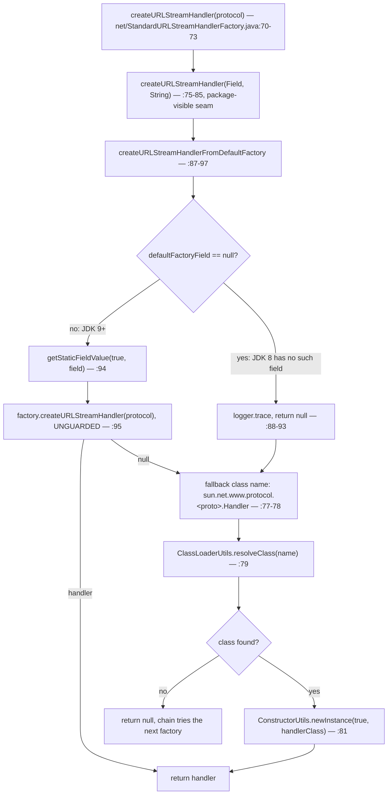
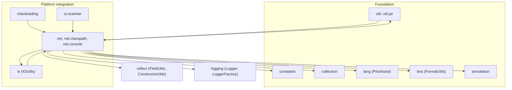

# Networking and URL protocols — Developer Guide

| | |
|---|---|
| **Layer** | Platform integration (`net`, `net.classpath`, `net.console`) — see the [layer graph](README.md#1-internal-dependency-structure) |
| **Packages** | `io.microsphere.net` (10 main sources) · `io.microsphere.net.classpath` (1) · `io.microsphere.net.console` (2) = **13** files / 3 359 lines |
| **Source line** | `release` branch, `0.3.20-SNAPSHOT` (tag `0.3.20` published) |
| **Analysis focus** | the write-once `URL.factory` slot, handler selection from JDK 8 → 25, sub-protocol parse/rewrite/dispatch |
| **Outward imports** | `util`, `constants`, `text`, `lang`, `collection`, `reflect`, `logging`, `io`, `annotation` |

Paths are relative to `microsphere-java-core/src/main/java/io/microsphere/`; test paths appear as `net/…Test.java`
relative to `microsphere-java-core/src/test/java/io/microsphere/`.

---

## 1. Role in the architecture

The developer index places this group in the **Platform-integration layer** with edges `IO --> NET`, `NET --> CL` and
`NET -.runtime SPI.-> SERVICES2` (`README.md:50-52`, `:60`), and all three are visible in the sources. `NET --> CL` is a
load-time rather than a compile edge: `classloading/AbstractURLClassPathHandle.java:30-31`,
`classloading/ArchiveFileArtifactResourceResolver.java:25`, `classloading/StreamArtifactResourceResolver.java:38` and
`classloading/URLClassPathHandle.java:26` static-import `URLUtils.EMPTY_URL_ARRAY`, `resolveBasePath` and
`resolveArchiveFile`. `IO --> NET` is a call edge **and it runs both ways** — `io/scanner/SimpleClassScanner.java:23-24`
uses `ofURL`/`resolveArchiveFile` while `net/URLUtils.java:10` imports `io.microsphere.io.IOUtils` and calls
`IOUtils.close(jarFile)` at `:676`. The SPI edge is the activation mechanism:
`src/main/resources/META-INF/services/io.microsphere.net.ExtendableProtocolURLStreamHandler`, whose entire content is
the `classpath` and `console` handlers.

> [!IMPORTANT]
> **The index's layering claim is only half true.** `net` reaches *down* into the type-model layer
> (`net/StandardURLStreamHandlerFactory.java:29-31` and `net/URLUtils.java:56-57` use `reflect.ConstructorUtils` and
> `reflect.FieldUtils`) and *up* into `io` and `logging` — and three Foundation classes import it back
> (`util/ClassLoaderUtils.java:46`, `util/ClassUtils.java:58`, `util/jar/JarUtils.java:37-39`), so `util ⇄ net` is a real
> package cycle. §8 maps every edge and §12.13 lists what they cost.

Functionally the group does the one job the JDK refuses: make `java.net.URL`'s protocol-handler registry **pluggable,
reorderable and inspectable after the JVM has started**. `classpath:`, `console:` and `URLUtils`' 60-odd methods are
either a demonstration that the registry works or the parsing machinery it needs. Size tells the story:
`net/URLUtils.java` is 1 724 of the group's 3 359 lines (51 %); the nine handler/factory types share the other 1 635.

---

## 2. Package and class map

### 2.1 `io.microsphere.net` — 10 types

| Type | Lines | Kind | Responsibility |
|---|---|---|---|
| `URLUtils` (`net/URLUtils.java:90`) | 1 724 | `abstract … implements Utils`, private ctor `:1722-1723` | parsing (`file:`/`jar:`/matrix/query), encode/decode, **all** reflective access to `URL.factory` |
| `ExtendableProtocolURLStreamHandler` (`net/ExtendableProtocolURLStreamHandler.java:132`) | 420 | abstract `URLStreamHandler` | the base third parties extend: conventions (`:179-210`), `_sp` rewrite (`:328-392`), dispatch (`:271-286`) |
| `DelegatingURLConnection` (`net/DelegatingURLConnection.java:43`) | 261 | concrete `URLConnection` | forwards 42 methods (`:52-260`) to a wrapped connection |
| `CompositeSubProtocolURLConnectionFactory` (`net/…:76`) | 152 | implements `SubProtocolURLConnectionFactory` | chain over sub-protocol factories (`:124-138`) |
| `MutableURLStreamHandlerFactory` (`net/…:64`) | 139 | `implements URLStreamHandlerFactory`, `<H extends URLStreamHandler>` | protocol → handler registry over a plain `HashMap` (`:66`, `:80-82`) |
| `CompositeURLStreamHandlerFactory` (`net/…:56`) | 135 | implements `URLStreamHandlerFactory` | first-non-null chain, flattened and re-sorted on add (`:74-107`) |
| `StandardURLStreamHandlerFactory` (`net/…:56`) | 98 | implements `URLStreamHandlerFactory` | re-exposes the JDK's own `file:`/`jar:`/`http:` handlers (`:70-97`) |
| `SubProtocolURLConnectionFactory` (`net/…:68`) | 92 | **interface**, 2 methods | `supports(URL, List<String>)` `:80`, `create(URL, List<String>, Proxy)` `:91` |
| `ServiceLoaderURLStreamHandlerFactory` (`net/…:61`) | 92 | extends `DelegatingURLStreamHandlerFactory` | the entry point: `attach()` `:71-74`, delegate construction `:76-82` |
| `DelegatingURLStreamHandlerFactory` (`net/…:56`) | 84 | base with a `null`-asserting ctor `:66-69` | single-delegate wrapper, `protected final getDelegate()` `:81-83` |

### 2.2 The two protocol sub-packages — 3 types

| Type | Lines | Extends | Body |
|---|---|---|---|
| `net/classpath/Handler.java:40` | 64 | `ExtendableProtocolURLStreamHandler` | one override, `openConnection(URL, Proxy)` `:43-63` |
| `net/console/ConsoleURLConnection.java:35` | 60 | `java.net.URLConnection` | `connect()` no-op `:47-49`, `System.in` `:51-54`, `System.out` `:56-59` |
| `net/console/Handler.java:32` | 38 | `ExtendableProtocolURLStreamHandler` | one override returning `new ConsoleURLConnection(url)` `:34-37` |

Both `Handler` classes are top-level, in a sub-package of `io.microsphere.net`, and named `Handler` — the exact three
constraints the no-arg superclass constructor enforces (`:179-210`). That is not decoration: the naming convention is
what lets the JDK's own `java.protocol.handler.pkgs` lookup (`net/URLUtils.java:134`,
`net/ExtendableProtocolURLStreamHandler.java:212-235`) find them at all.

### 2.3 The test tree — 19 files

`net/URLUtilsTest.java` (724) and `net/DelegatingURLConnectionTest.java` (324) dominate; two structural fixtures matter
more than their size. `net/AbstractExtendableProtocolURLStreamHandlerTest.java` (163) is the template every `Handler`
test inherits — `setUp()` calls `createHandler()` **before** `new URL(getTestURL())` (`:62-67`) and `tearDown()` strips
the system property again (`:69-72`). `net/test/Handler.java` (37) declares a fourth protocol (`test:`) that exists only
in test sources and appears in no SPI file, reached purely through the `java.protocol.handler.pkgs` side effect of its
superclass constructor. Three null-object fixtures (`ConsoleSubProtocolURLConnectionFactory.java:34-45`,
`FalseSubProtocolURLConnectionFactory.java:33-44`, `NullSubProtocolURLConnectionFactory.java:33-44`) drive §5.2.

---

## 3. Source analysis: how a handler reaches `java.net.URL`

### 3.1 The registration chain

`java.net.URL` exposes exactly one public registration point, `URL.setURLStreamHandlerFactory`, and it is
**write-once**: a second call throws `IllegalStateException`/`Error("factory already defined")`. The group's answer is
to take ownership of that slot and multiplex behind it.

```mermaid
sequenceDiagram
    participant App as Application
    participant SL as ServiceLoaderURLStreamHandlerFactory
    participant SPU as ServiceLoaderUtils
    participant CMP as CompositeURLStreamHandlerFactory
    participant JDK as java.net.URL
    App->>SL: attach()  (net/ServiceLoaderURLStreamHandlerFactory.java:71-74)
    SL->>SL: new …Factory() → super(createDelegate())  (:63-65)
    SL->>SPU: loadServicesList(URLStreamHandlerFactory.class)  (:77)
    SPU-->>SL: normally empty; test SPI adds StandardURLStreamHandlerFactory
    SL->>SPU: loadServicesList(ExtendableProtocolURLStreamHandler.class)  (:87)
    SPU-->>SL: classpath.Handler, console.Handler (main SPI file)
    SL->>SL: toFixedMap(handlers, e → entry(handler.getProtocol(), handler)) → MutableURLStreamHandlerFactory  (:88-89, :78)
    SL->>CMP: new composite(factories) then addURLStreamHandlerFactory(fallbackFactory)  (:79-80)
    SL->>SL: URLUtils.attachURLStreamHandlerFactory(factory)  (:73)
    SL->>JDK: getStaticFieldValue(true, URL.class, "factory")  (net/URLUtils.java:1370 → :1424-1426)
    alt slot empty
        SL->>JDK: URL.setURLStreamHandlerFactory(factory)  (:1373-1375)
    else foreign factory present
        SL->>CMP: new composite, add old factory  (:1379-1381)
        SL->>JDK: setStaticFieldValue(true, URL.class, "factory", null) then setURLStreamHandlerFactory(composite)  (:1383-1384 → :1641-1643)
        SL->>CMP: addURLStreamHandlerFactory(factory)  (:1388)
    end
```

Two properties of this chain are worth internalising.

1. **`loadHandlers()` keys on the protocol, not the class** (`:88-89`), mapping
   `handler.getProtocol() → handler` through `collection/MapUtils.java:1036-1050`, which fills a fixed
   `LinkedHashMap` with plain `put`. So SPI declaration order becomes iteration order, and a second provider for the
   same protocol **silently replaces** the first — no log, no exception. Two libraries both shipping a `classpath`
   handler resolve to whichever `ServiceLoader` lists last.
2. **`ServiceLoaderURLStreamHandlerFactory` is not itself a `java.net.URLStreamHandlerFactory` SPI provider.** In this
   release that service file exists only in **test** resources
   (`src/test/resources/META-INF/services/java.net.URLStreamHandlerFactory`, content
   `io.microsphere.net.StandardURLStreamHandlerFactory`). At runtime `loadServicesList(URLStreamHandlerFactory.class)`
   (`:77`) therefore returns an empty list and the composite's only member is the mutable SPI registry — exactly the
   shape `net/ServiceLoaderURLStreamHandlerFactoryTest.java:55-69` depends on.

### 3.2 `attachURLStreamHandlerFactory`: four branches, one reflection primitive

`net/URLUtils.java:1365-1389` is the only writer of the global slot.

| Branch | Condition | Action | Lines |
|---|---|---|---|
| 1 | `factory == null` | return — silent no-op, although the parameter carries no `@Nullable` | `:1366-1368` |
| 2 | slot empty | `URL.setURLStreamHandlerFactory(factory)` and return — no composite is created | `:1373-1375` |
| 3 | slot holds a `CompositeURLStreamHandlerFactory` | append to it in place | `:1376-1377`, `:1388` |
| 4 | slot holds a **foreign** factory | composite ← old, **null `URL.factory`**, install composite, append | `:1378-1385`, `:1388` |

Branch 4 is the clever one and the risky one: the JDK refuses a second call because `URL.factory != null`, so writing
`null` through `setStaticFieldValue(true, URL.class, "factory", null)` (`:1641-1643`) disarms the guard and preserves
the foreign factory as member 0. Nothing re-reads the slot afterwards, so the foreign factory is thereafter reached
**only** through `CompositeURLStreamHandlerFactory.createURLStreamHandler`, which stops at the first non-null handler
(`:78-84`). A catch-all foreign factory therefore starves every microsphere handler added later; a factory that returns
`null` for unknown protocols behaves correctly.

### 3.3 `registerURLStreamHandler`: find-or-create a mutable registry

`net/URLUtils.java:1461-1463` is the convenience form that `init()` uses
(`net/ExtendableProtocolURLStreamHandler.java:237-241`); `:1502-1506` is the work — get a mutable factory
(`createIfAbsent = true`), `addURLStreamHandler(protocol, handler)`, then `attachURLStreamHandlerFactory(factory)`.
`getMutableURLStreamHandlerFactory(boolean)` (`:1614-1624`) contains a redundant double assignment worth reading
closely: line `:1616` casts the slot's value directly to `MutableURLStreamHandlerFactory` (`:1637-1639`), which is
always `null` when the slot holds a composite, and `:1618` then performs the real member search (`:1626-1635`). The
result is correct; the first call is dead code. Three behaviours follow:

* If the composite has **no** mutable member, `createIfAbsent` mints one (`:1620-1622`) and `attach` appends it
  *last* (`:1388`) — registration never reorders existing handlers, so a new handler can be shadowed by an earlier member.
* The member search returns the **first** mutable factory and ignores later ones (`:1626-1635`); with two registries in
  one JVM every registration lands in the first.
* `MutableURLStreamHandlerFactory` validates nothing (`:91-94`): `addURLStreamHandler(null, h)` is accepted and later
  indistinguishable from an unknown protocol (`:112-114`, `:125-128`).

---

## 4. Source analysis: the JDK-version split in handler *selection*

Once the group owns the slot it must keep `file:`, `jar:` and `http:` resolvable, because a factory **replaces** the
JDK's built-in lookup rather than extending it. That is `StandardURLStreamHandlerFactory`'s whole job and it is the
only type in the group with explicit version branching.

### 4.1 Two techniques, chosen by field presence rather than by version number



Static initialisation decides which branch is even possible:
`private static final Field defaultFactoryField = findField(URL.class, defaultFactoryFieldName); // JDK 9+` (`:68`,
field-name constant `:63`, prefix constant `net/URLUtils.java:139`). The code never consults `SystemUtils.IS_JAVA_9`
(`util/SystemUtils.java:367`) or any other version flag: the group's version policy is **structural probing** — ask the
JDK whether the private field exists and branch on that. It survives a version that none of the
`IS_JAVA_8 … IS_JAVA_24` constants models, and it is why nothing in `net` needs editing when a new JDK ships. The only
other JDK-shape dependency is the class-name convention `sun.net.www.protocol.<protocol>.Handler` (`:78`), which still
resolves on JDK 25 because those handlers remain in `java.base`.

> [!WARNING]
> **`net/StandardURLStreamHandlerFactory.java:94-95` is the group's one unguarded dereference.** The `Field` is
> null-checked (`:88-93`) but the value read from it is not, so `factory.createURLStreamHandler(protocol)` runs on
> whatever `URL.defaultFactory` holds. Where a hardened or minimised runtime makes that read degrade to `null`, the
> call throws `NullPointerException` **instead of** falling through to the `<= JDK 8 works` path (`:77-83`), and the
> exception escapes into the chain — `net/CompositeURLStreamHandlerFactory.java:80` does not catch, so the whole
> composite aborts. This is a real finding for the open NPE-hardening audit, not a documentation defect: the adjacent
> `if (defaultFactoryField == null)` proves the author was thinking about absence.

### 4.2 The second selection path: `java.protocol.handler.pkgs`

The no-arg constructor publishes the handler's *parent* package into the JDK's own search property: `appendHandlerPackage`
(`net/ExtendableProtocolURLStreamHandler.java:212-216`) truncates at the last dot (`:219`) and appends with the `'|'`
separator (`net/URLUtils.java:144`) via `setProperty(HANDLER_PACKAGES_PROPERTY_NAME, …)` (`:234`, property name `:134`).
So `new io.microsphere.net.classpath.Handler()` adds `io.microsphere.net` — **not** `io.microsphere.net.classpath` —
because the JDK appends `<protocol>.Handler` to each listed package itself. This is why `net/test/Handler.java` works
with no factory attached (`net/test/HandlerTest.java:37-65`), and why `net/URLUtilsTest.java:520` constructs
`new io.microsphere.net.console.Handler()` purely for the property side effect before asserting sub-protocol parsing.

The two paths are complementary, and mixing them is the usual cause of "works locally, fails in CI":

| | `URL.factory` (attached) | `java.protocol.handler.pkgs` (property) |
|---|---|---|
| Who consults it | microsphere's composite | the JDK, inside `URL.getURLStreamHandler` |
| Reorderable at runtime | yes — member order (`:78-84`) plus `Prioritized` (`:123-125`) | no — first match wins, then cached |
| Instance identity | one per SPI/registry entry | one per protocol for the JVM's life |
| Re-registering a protocol | last `put` wins, first non-null answers | ignored (already cached) |
| Un-registerable | yes, `clearURLStreamHandlerFactory()` (`:1641-1643`) | **no** — the cache is unreachable |

That last row makes `clearURLStreamHandlerFactory()` a trap: it clears only the slot, not `URL`'s per-protocol handler
cache, which is why `net/AbstractExtendableProtocolURLStreamHandlerTest.java:69-72` resets the *property* while
`net/URLUtilsTest.java:149-152` clears the *slot*. The two cleanups are not interchangeable.

---

## 5. Source analysis: `ExtendableProtocolURLStreamHandler` — parse, rewrite, dispatch

### 5.1 The sub-protocol problem

A `URLStreamHandler` is keyed by one protocol string, but the group wants `console:text://host/path` to mean "the
`console` protocol, first sub-protocol `text`". The JDK cannot parse that scheme. The solution is a **rewrite on the way
in and a re-format on the way out**:

```mermaid
flowchart TD
    S["new URL(\"test:text://localhost:12345/abc\")"] --> P["parseURL(u, spec, start, limit) — :328-337, final"]
    P --> Q{":// found after start?"}
    Q -- "no" --> R["super.parseURL(u, spec, start, limit) — :335"]
    Q -- "yes" --> T["reformSpec(u, spec, start, end, limit) — :370-392"]
    T --> U["split(subProtocol, ':') — :372-373"] --> V["matrix = buildMatrixString(\"_sp\", subProtocols) — :374 → net/URLUtils.java:887-888 → :1693-1715"] --> W["builder = protocol + spec[end..limit] — :379-381"]
    W --> X{"query marker present?"}
    X -- "yes" --> Y1["insert the matrix before the query — :383-386"]
    X -- "no" --> Y2["append the matrix — :388"]
    Y1 --> Z["super.parseURL(u, actualSpec, …) — :333"]
    Y2 --> Z
    R --> AA
    Z --> AA["URL state: protocol=test, the _sp matrix survives inside the path"]
    AA --> AB["openConnection(u) — :266-269, final"] --> AC["resolveSubProtocols(u) — :273 → net/URLUtils.java:1087-1089 → :1133-1144"] --> AE["walk factories in order — :275-284"]
    AE --> AF{"supports(u, subProtocols) and create(...) != null?"}
    AF -- "yes" --> AI["break and return the connection — :278-282"]
    AF -- "no, keep going" --> AE
    AE -- "exhausted" --> AJ["openFallbackConnection(u, p) — :285, default returns null :297-299"]
```

`reformSpec` holds the subtlety: `;_sp=text` must land **before** the query and **before** any fragment, because `URL`
parses `?` and `#` itself — hence the `indexOf(QUERY_STRING, end)` insert at `:383-386`, with `limit` already excluding
the fragment (`:375`). Round-tripping is the other half: `toExternalForm` (`:323-326` → `net/URLUtils.java:933-1016`)
rebuilds the `protocol:sub1:sub2://…` form from the parsed state by folding the `_sp` matrix back into the scheme
(`:961-971` via `reformProtocol` `:1645-1663`). Because `equals`/`hashCode` are `final` and defined on that rebuilt form
(`:301-309`), `URL` equality follows the rewrite while `hostsEqual` (`:311-314`) still compares bare hosts — an
asymmetry `net/ExtendableProtocolURLStreamHandlerTest.java:206-223` pins down.

### 5.2 The dispatch matrix, as the tests enumerate it

`openConnection(URL, Proxy)` (`:271-286`) walks `factories` and requires `supports() == true` **and** `create() != null`
to stop. `net/ExtendableProtocolURLStreamHandlerTest.java:157-172`, `:186-198` exercise exactly the four reachable
states:

| # | Chain state | Outcome | Evidence |
|---|---|---|---|
| 1 | empty chain | `openFallbackConnection` → `null` | `net/ExtendableProtocolURLStreamHandlerTest.java:157-162` |
| 2 | one factory, `supports()` false | `null` | `:168`, `net/FalseSubProtocolURLConnectionFactory.java:33-44` |
| 3 | supports true, `create()` null | `null` | `:169`, `net/NullSubProtocolURLConnectionFactory.java:33-44` |
| 4 | both succeed | the factory's connection | `:186-198`, `net/ConsoleSubProtocolURLConnectionFactory.java:34-45` |

Returning `null` from `openConnection` is legal for a handler but not for a caller: `URL.openStream()` dereferences it,
so `new URL("test://x").openStream()` throws `NullPointerException` rather than `IOException` — asserted as `null` at
`net/test/HandlerTest.java:57-59`. That is the deliberate extension contract (`:288-299` javadoc: "return `null` as
default"), but it is a **silent-degradation** choice with an undeclared consequence, and subclasses that forget
`openFallbackConnection` ship it. `CompositeSubProtocolURLConnectionFactory` makes the opposite choice for the same
situation: `supports()` is `selectFactoryIndex(...) > -1` (`net/CompositeSubProtocolURLConnectionFactory.java:124-127`),
yet `create()` indexes the `-1` from `:140-151` at `:135-138` and throws `IndexOutOfBoundsException` — safe only because
callers check `supports` first (`net/CompositeSubProtocolURLConnectionFactoryTest.java:59-62`).

### 5.3 Mutating the chain after construction

`factories` is a private inline `List` (`:136`) reachable two ways: the protected init hook (`:254-255`, called from
`:243-247` and then sorted with `Prioritized.COMPARATOR` at `:246`) and the public customizer (`:262-264`, **not**
re-sorted). The asymmetry matters — `customizeSubProtocolURLConnectionFactories` honours arbitrary
`add(index, …)` mutations (`net/ExtendableProtocolURLStreamHandlerTest.java:168-169`), so positional insertion is the
documented way to force precedence over a `Prioritized` factory that would otherwise sort ahead.

---

## 6. Source analysis: `URLUtils` — the parsing and reflection engine

### 6.1 Three modifier tiers in one 1 724-line class

| Tier | Representative members | Purpose |
|---|---|---|
| `public static` parsing | `ofURL` `:180-186`, `resolveQueryParameters` `:324-327`, `resolveMatrixParameters` `:364-381`, `normalizePath` `:403-420`, `encode` `:457-459`/`:498-506`, `decode` `:543-545`/`:582-590`, `buildURI` `:789-809`, `toExternalForm` `:933-1016`, `getSubProtocol` `:1047-1050`, `resolveSubProtocols` `:1087-1089`/`:1133-1144`, `resolveProtocol` `:1184-1201`, `resolveAuthority` `:1247-1249`/`:1282-1285`, `resolvePath` `:1316-1318`, `isDirectoryURL` `:622-635`, `isJarURL` `:667-682`, `isArchiveURL` `:719-725`, `isArchiveProtocol` `:754-757` | the documented surface |
| `public static` registration | `attachURLStreamHandlerFactory` `:1365-1389`, `getURLStreamHandlerFactory` `:1424-1426`, `registerURLStreamHandler` `:1461-1463`/`:1502-1506`, `close` `:1528-1532` | the only writers of the JDK slot |
| `protected`/package-private seams | `getMutableURLStreamHandlerFactory` `:1610-1624`, `findMutableURLStreamHandlerFactory` `:1626-1639`, `clearURLStreamHandlerFactory` `:1641-1643`, `reformProtocol` `:1645-1663`, `resolveParameters` `:1665-1691`, `buildString` `:1693-1715`, `getFirst` `:1717-1720`, `resolvePath(URL,boolean)` `:1534-1545`, `resolvePathFromFile(URL,boolean)` `:1551-1557`, `resolvePathFromJar` `:1582-1604`, `buildPath` `:1559-1580`, `truncateMatrixString` `:1606-1608` | testability without reflection |

Tier 3 is why `net/URLUtilsTest.java` needs no container. The OS branch, for example, is not mocked:
`resolvePathFromFile(url, boolean)` takes the flag as a parameter (`:1551`) while the package-private
`resolvePathFromFile(url)` injects the real `IS_OS_WINDOWS` (`:1547-1549`, import `:71`), so the Windows path is
asserted on Linux CI (`net/URLUtilsTest.java:671-672`).

### 6.2 Path resolution: the group's most-consumed code

`resolveArchiveFile(URL)` (`:275-301`) and its helpers underpin `classloading` and `io.scanner`:

* `resolveBasePath(URL)` (`:245-248`) — NPE-checked, delegates to `resolvePath(url, false)` so the entry is dropped.
* `resolveArchiveEntryPath(URL)` (`:212-220`) — the complement: everything after `!/`
  (`constants/SeparatorConstants.ARCHIVE_ENTRY_SEPARATOR`, length constant `:108`).
* `resolvePath(URL, boolean)` (`:1534-1545`) — a `switch` on protocol with **no `default:`**: `file:` →
  `resolvePathFromFile`, `jar:` → `resolvePathFromJar`, everything else (including `classpath:`) falls through to
  `truncateMatrixString(url.getPath())` (`:1544`). A `null` protocol therefore throws at the `switch`.
* `buildPath(URL)` (`:1559-1580`) concatenates `"/" + authority + path` with pre-computed capacity, then
  `resolvePathFromFile` strips the leading `/` on Windows only (`:1553-1555`) — that one boolean is the entire platform
  story for `file:///D:/test` → `D:/test`.
* `resolvePathFromJar` (`:1582-1604`) removes a leading `file:/` (`:1584-1587`), truncates at `!/` unless asked
  otherwise (`:1590-1592`), and re-adds a leading `/` only when no drive colon exists (`:1594-1601`).

### 6.3 Null and failure policy inside the engine

The library-wide **silent degradation** policy mostly holds, with enough exceptions to need a table:

| Input | Result | Lines |
|---|---|---|
| `attachURLStreamHandlerFactory(null)` | no-op | `:1366-1368` |
| `close(null)`, `close(nonHttp)` | no-op; only `HttpURLConnection` gets `disconnect()` | `:1528-1532`, import `:16` |
| `isDirectoryURL(null)` | `false` | `:622-625` |
| `isJarURL(null)`, `isArchiveURL(null)` | **`NullPointerException`** — no guard; `isArchiveURL` delegates to `isJarURL` | `:667-668`, `:719-720`; asserted `net/URLUtilsTest.java:379-382` |
| `ofURL("malformed")` | **`IllegalArgumentException`** wrapping `MalformedURLException` | `:180-186`; asserted `:159-162` |
| `resolveProtocol("ht tp://x")` | `null`, after `logger.trace` | `:1184-1201` |
| `buildMatrixString(name, new String[0])` | **`null`** although annotated `@Nonnull` | `:886-889` → `:1693-1698`; javadoc itself prints `null` |
| `encode`/`decode` with an unsupported charset | `IllegalArgumentException` | `:498-506`, `:582-590` |
| `DEFAULT_ENCODING` | `SystemUtils.FILE_ENCODING`, i.e. the `file.encoding` property — **not** the literal `"UTF-8"` its javadoc states | `:94-97` → `util/SystemUtils.java:332` |

The last row is a live cross-JDK difference: `file.encoding` is only guaranteed `UTF-8` from JDK 18 onward unless set
explicitly, so `encode(value)`/`decode(value)` are not stable across the CI matrix (`.github/workflows/maven-build.yml:25`
runs Temurin 8, 11, 17, 21 and 25; `:33` `distribution: 'temurin'`). Callers that care use the explicit overloads
(`:498-506`, `:582-590`). A documentation defect also ships: the `resolveSubProtocols(String)` javadoc example closes
its code fence mid-line, so the rendered output reads `[subproto1, s` / `` ``` `` / `ubproto2]` (`:1113-1119`).

---

## 7. Design patterns

| Pattern | Where | Evidence |
|---|---|---|
| **Service Loader / plugin** | the delegate graph is built from two SPI lookups | `net/ServiceLoaderURLStreamHandlerFactory.java:76-82`, `:84-91`; main SPI file for `ExtendableProtocolURLStreamHandler` |
| **Composite + Chain of Responsibility** | iterate members, stop at the first non-null handler; the same shape over `supports`/`create` | `net/CompositeURLStreamHandlerFactory.java:74-86`; `net/CompositeSubProtocolURLConnectionFactory.java:124-138` |
| **Decorator (transparent)** | 42 forwarders over `URLConnection`; one forwarder over the factory SPI | `net/DelegatingURLConnection.java:43-260`; `net/DelegatingURLStreamHandlerFactory.java:66-74` |
| **Registry** | `Map<String, H>` behind the factory interface | `net/MutableURLStreamHandlerFactory.java:66`, `:80-128` |
| **Template Method** | fixed `setUp`/`tearDown` ordering, abstract `createHandler`/`getTestURL`/`getTestURLWithSP`/`testOpenConnection` | `net/AbstractExtendableProtocolURLStreamHandlerTest.java:62-72`, `:109-124`, `:131-134` |
| **Strategy** | the `Field`-injection seam makes the JDK branch selectable per call | `net/StandardURLStreamHandlerFactory.java:70-73` → `:75-85` |
| **Null Object** | `openFallbackConnection` → `null`, plus the three chain-state fixtures | `net/ExtendableProtocolURLStreamHandler.java:297-299`; `net/False…`, `net/Null…`, `net/Console…SubProtocolURLConnectionFactory.java` |
| **Convention over configuration** | protocol inferred from the package name; handler located as `<package>.<protocol>.Handler` | `net/ExtendableProtocolURLStreamHandler.java:174-177`, `:191-196`; `net/URLUtils.java:134`, `:139`, `:149` |
| **Static utility + marker** | `abstract` class, private ctor, `implements Utils` | `net/URLUtils.java:90`, `:1722-1723`, import `:13` |

What is **absent** matters: no factory or handler in this group implements `io.microsphere.lang.Prioritized`. All three
sorted collections still use `Prioritized.COMPARATOR`
(`net/CompositeURLStreamHandlerFactory.java:119-129`, `net/CompositeSubProtocolURLConnectionFactory.java:119-122`,
`net/ExtendableProtocolURLStreamHandler.java:243-247`), but that comparator returns `0` for two non-`Prioritized`
objects (`lang/Prioritized.java:61-76`) and `Collections.sort` is stable, so **every order here is insertion/SPI order**.
The sorting is future-proofing, not current behaviour; assuming otherwise leads to a mis-diagnosed handler-shadowing
bug. The constants are inverted — `MAX_PRIORITY = Integer.MIN_VALUE` (`lang/Prioritized.java:81`),
`MIN_PRIORITY = Integer.MAX_VALUE` (`:86`), `NORMAL_PRIORITY = 0` (`:91`).

---

## 8. Dependencies on other core packages



Every edge is a concrete import:

| Edge | Evidence | Symbols |
|---|---|---|
| `net → constants` | `net/URLUtils.java:9`, static imports `:36-54` | `SymbolConstants`, `PathConstants`, `ProtocolConstants`, `SeparatorConstants.ARCHIVE_ENTRY_SEPARATOR` |
| `net → collection` | `net/URLUtils.java:31-35`, `net/ServiceLoaderURLStreamHandlerFactory.java:29-30`, `net/CompositeSubProtocolURLConnectionFactory.java:28`, `net/ExtendableProtocolURLStreamHandler.java:32-33` | `size`, `first`, `newArrayList`, `newLinkedList`, `ofList`, `ofSet`, `toFixedMap`, `immutableEntry`, `newFixedLinkedHashMap`, `isEmpty` |
| `net → lang` | `net/CompositeURLStreamHandlerFactory.java:19`, `net/CompositeSubProtocolURLConnectionFactory.java:19`, `net/ExtendableProtocolURLStreamHandler.java:38` | `Prioritized`, `Prioritized.COMPARATOR` |
| `net → text` | `net/ExtendableProtocolURLStreamHandler.java:46` | `FormatUtils.format`, used by `toString` (`:416-419`) |
| `net → annotation` | `net/URLUtils.java:6-8`, `net/ExtendableProtocolURLStreamHandler.java:19-20`, `net/ServiceLoaderURLStreamHandlerFactory.java:19-20` | `@Nonnull`, `@Nullable`, `@Immutable` |
| `net → reflect` | `net/StandardURLStreamHandlerFactory.java:29-31`, `net/URLUtils.java:56-57` | `findField`, `getStaticFieldValue`, `setStaticFieldValue`, `newInstance` |
| `net → logging` | `net/StandardURLStreamHandlerFactory.java:19`, `net/URLUtils.java:11`, `:55` | `Logger`, `getLogger`, `logger.trace` at `net/URLUtils.java:1194-1196` |
| `net → io` | `net/URLUtils.java:10`, used at `:676` | `IOUtils.close(JarFile)` |
| `net → util` | `net/URLUtils.java:12-13`, `:58-73`, `net/classpath/Handler.java:20`, `:30` | `ArrayUtils.EMPTY_URL_ARRAY`, `Utils`, `SystemUtils.FILE_ENCODING`/`IS_OS_WINDOWS`, `ClassLoaderUtils.getClassLoader`/`resolveClass`, `ClassPathUtils.getClassPaths` (`net/URLUtils.java:292`), `ClassUtils.cast` (`:1638`), `JarUtils.toJarFile`/`isDirectoryEntry` (`:626`, `:673`) |
| `util → net` (cycle) | `util/ClassLoaderUtils.java:46`, `util/ClassUtils.java:58`, `util/jar/JarUtils.java:37-39` | `normalizePath`, `resolveProtocol`, `decode`, `resolveArchiveFile` |
| `classloading → net`, `io.scanner → net` | `classloading/*:25-38`, `io/scanner/SimpleClassScanner.java:23-24` | `EMPTY_URL_ARRAY`, `resolveBasePath`, `resolveArchiveFile`, `ofURL` |

The `util ⇄ net` and `io ⇄ net` cycles are the first things a `module-info.java` pass or an artifact split would have to
break. `net`'s own use of `IOUtils` (`:10`, `:676`) is the cheaper of the two: `JarFile` has been `AutoCloseable` since
JDK 7, so the edge could disappear without touching behaviour.

---

## 9. Extension points

| You want | Use | Contract |
|---|---|---|
| A new protocol shipped by a library | subclass `ExtendableProtocolURLStreamHandler`, name it `Handler`, top-level, in a sub-package, and list it in the SPI file | `net/ExtendableProtocolURLStreamHandler.java:138-151`, `:179-210`; your protocol is the **last segment of your package name** (`:174-177`, `:212-216`) |
| A new protocol registered at runtime | `URLUtils.registerURLStreamHandler(handler)` or `(protocol, handler)` | `net/URLUtils.java:1461-1463`, `:1502-1506`; the explicit-protocol constructor skips every convention check (`:153-155`) |
| To serve one sub-protocol | implement `SubProtocolURLConnectionFactory`, add via `customizeSubProtocolURLConnectionFactories` | `net/SubProtocolURLConnectionFactory.java:68-92`; `net/ExtendableProtocolURLStreamHandler.java:262-264` — the list is **not** re-sorted |
| To plug a whole factory into the global chain | `URLUtils.attachURLStreamHandlerFactory(...)` | `net/URLUtils.java:1365-1389`; prefer composite membership over a second `URL.setURLStreamHandlerFactory` |
| To win precedence | implement `Prioritized` | `lang/Prioritized.java:61-104`; wiring at `net/CompositeURLStreamHandlerFactory.java:123-125` |
| To intercept one behaviour of a connection | subclass `DelegatingURLConnection` | `net/DelegatingURLConnection.java:43-260`; **the delegate is `private final` (`:45`) with no accessor**, unlike `collection`'s `Delegating*` family |
| To fail loudly instead of returning `null` | override `openFallbackConnection` or `openConnection(URL, Proxy)` | `net/ExtendableProtocolURLStreamHandler.java:271-299`; `openConnection(URL)` is `final` (`:266-269`), as are `equals`, `hashCode`, `hostsEqual`, `toExternalForm`, `parseURL` (`:301-337`) |

`net/classpath/Handler.java:43-63` is the worked example of "override only the two-argument `openConnection`": it never
consults `factories`, so it answers every sub-protocol itself, resolves against `getClassLoader(Handler.class)` (`:57`,
import `:30`) — the loader that loaded microsphere, **not** the thread-context loader — and throws `IOException` on a
miss (`:59-61`). That miss is the group's only eager failure besides the convention assertions (`:179-210`).

---

## 10. Thread safety, performance, and startup cost

* **Explicitly not thread-safe**: `MutableURLStreamHandlerFactory` documents it (`net/MutableURLStreamHandlerFactory.java:53-56`)
  over a plain `HashMap` (`:66`, `:81`). `CompositeURLStreamHandlerFactory` mutates its list on every add (`:94-107`)
  while `createURLStreamHandler` iterates it (`:78-84`) with no synchronisation, so registration belongs to bootstrap.
* **`getHandlers()` is a live view** — `handlers.values()` (`:121-123`) — so `clearHandlers()` (`:135-138`) empties the
  registry through any caller's reference.
* **Global mutation is the expensive path.** Branch 4 of `attachURLStreamHandlerFactory` performs a reflective read, a
  reflective write of `URL.factory`, a `setURLStreamHandlerFactory` call and two list sorts (`:1379-1388` →
  `net/CompositeURLStreamHandlerFactory.java:104`). From JDK 16 up, `java.net.URL`'s private static field is not open to
  the unnamed module by default, so both the read (`:1424-1426`) and the write (`:1641-1643`) need
  `--add-opens java.base/java.net=ALL-UNNAMED`. Because `FieldUtils` degrades accessibility failures silently,
  `getURLStreamHandlerFactory()` can return `null` **while a factory is installed**, which sends `attach` down branch 2
  and turns `URL.setURLStreamHandlerFactory` into a hard `Error` — the worst-case failure mode of the whole design.
* **Sorting runs on every mutation** (`net/CompositeURLStreamHandlerFactory.java:104`,
  `net/CompositeSubProtocolURLConnectionFactory.java:92`, `:100`, `:114`, `net/ExtendableProtocolURLStreamHandler.java:246`)
  — free at the current cardinality (≤ 4), relevant only for per-request registration.
* **`isJarURL` touches the filesystem**: a `file:` URL is opened as a `JarFile` to prove it is one
  (`net/URLUtils.java:667-682`, import `:73`) and closed in `finally` (`:676`); `isArchiveURL` (`:719-725`) inherits the
  cost. Use `isArchiveProtocol` (`:754-757`) when only the scheme matters.
* **Equality rebuilds strings.** `toExternalForm` pre-computes its `StringBuilder` capacity
  (`net/URLUtils.java:942-988`), but it is on the hot path because `equals`/`hashCode` are defined on it
  (`net/ExtendableProtocolURLStreamHandler.java:301-309`), so every `URL.equals` on a microsphere protocol formats two
  full URL strings. Relatedly `resolveSubProtocols(URL)` re-parses `url.toString()` per call
  (`net/URLUtils.java:1087-1089`) from `openConnection` (`net/ExtendableProtocolURLStreamHandler.java:273`).

---

## 11. Testing strategy

| Concern | Mechanism | Evidence |
|---|---|---|
| Handler discovery without a factory | construct the handler **before** the URL so the constructor publishes `io.microsphere.net` into the property, then remove it | `net/AbstractExtendableProtocolURLStreamHandlerTest.java:62-72`; `net/ExtendableProtocolURLStreamHandlerTest.java:140-146`, `:260-271` |
| Global-slot hygiene | `@AfterEach clearURLStreamHandlerFactory()` in the utils suite; the handler suite resets the property instead | `net/URLUtilsTest.java:149-152`; `net/AbstractExtendableProtocolURLStreamHandlerTest.java:69-72` |
| JDK-version branch | a package-visible overload takes the `Field` as a parameter, so `null` simulates JDK 8 without a JDK 8 run | `net/StandardURLStreamHandlerFactory.java:75-85`; `net/StandardURLStreamHandlerFactoryTest.java:43-47` |
| End-to-end attach | `attach()` in `@BeforeEach`, then a real `classpath:` resource with non-ASCII content | `net/ServiceLoaderURLStreamHandlerFactoryTest.java:45-53`, `:55-69`, `:71-76` |
| Dispatch matrix | three null-object fixtures for "not supported", "supported but created nothing", "created" | `net/ExtendableProtocolURLStreamHandlerTest.java:157-172`, `:186-198` |
| OS branching | the boolean is a method parameter, not a static read | `net/URLUtils.java:1551`; `net/URLUtilsTest.java:671-672` |
| Delegation completeness | 42 forwarders asserted individually against a real `file:` connection | `net/DelegatingURLConnectionTest.java:63-69`, `:76-79`, `:110-150`, `:200-221`, `:301-312` |

Two ordering hazards before adding a test. `net/MutableURLStreamHandlerFactoryTest.java:79-88` asserts registry sizes
1/2/3 by mutating a registry that also receives SPI-discovered handlers, so the counts depend on what ran earlier in
the same JVM. And because the property and the slot are cleaned by *different* suites, any test that attaches a factory
must clear it or the state leaks into the next class.

---

## 12. Review notes

Ordered by how likely a caller is to hit each.

1. **Unguarded dereference of `URL.defaultFactory`'s value** — `net/StandardURLStreamHandlerFactory.java:94-95`, right
   beside a null guard for the `Field` (`:88-93`). Turns a JDK-shape surprise into an NPE that aborts the composite.
   Highest-value fix; belongs in the NPE-hardening audit.
2. **`openConnection` may legally return `null`, so `URL.openStream()` throws NPE, not `IOException`** —
   `net/ExtendableProtocolURLStreamHandler.java:285`, `:297-299`; asserted `net/test/HandlerTest.java:57-59`.
3. **`@Nonnull` `buildMatrixString(String, String...)` returns `null`** — `net/URLUtils.java:886-889` → `:1693-1698`;
   the `Map` overload (`:841-842`) is honestly `@Nullable`, so the defect is local to one signature.
4. **`CompositeSubProtocolURLConnectionFactory.create` throws `IndexOutOfBoundsException` on an empty chain** —
   `net/CompositeSubProtocolURLConnectionFactory.java:130-138` indexes the `-1` of `:140-151`.
5. **Silent last-wins on duplicate protocols** during SPI loading —
   `net/ServiceLoaderURLStreamHandlerFactory.java:88-89` through `collection/MapUtils.java:1036-1050`; the shadowed
   handler produces no diagnostic.
6. **`registerURLStreamHandler(protocol, null)` stores `null`** — `net/URLUtils.java:1502-1506`, no validation in
   `net/MutableURLStreamHandlerFactory.java:91-94`; later indistinguishable from an unknown protocol (`:112-114`).
7. **Dead first assignment plus first-match-only search** — `net/URLUtils.java:1616` always yields `null` for a
   composite, and `:1626-1635` returns only the first mutable member.
8. **Inconsistent null policy between sibling predicates** — `isDirectoryURL` guards (`net/URLUtils.java:622-625`) while
   `isJarURL` (`:667-668`) and `isArchiveURL` (`:719-720`) dereference; `ofURL` throws `IllegalArgumentException` (`:180-186`).
9. **`DEFAULT_ENCODING`'s javadoc says `"UTF-8"`, its value is `file.encoding`** — `net/URLUtils.java:94-97` vs
   `util/SystemUtils.java:332`; a portability trap across the CI matrix.
10. **`switch` on a possibly-`null` protocol with no `default:`** (`net/URLUtils.java:1534-1545`), and
    `DelegatingURLConnection`'s constructor dereferences without a guard (`:47-50`, `super(delegate.getURL())`).
11. **Mangled javadoc example** in `resolveSubProtocols(String)` — `net/URLUtils.java:1113-1119`.
12. **`DelegatingURLConnection`'s delegate is unreachable from subclasses** — `:45` is `private final` with no accessor,
    so the "base class for specialized wrappers" promise at `:29-31` is weaker than the `collection/Delegating*` family.
13. **Two cycles against the documented layering** (`util ⇄ net`, `io ⇄ net`, §8) — harmless at runtime, but they make
    the group unextractable without moving four string helpers out of `util`.

The design itself is sound and the reflection is confined to three accesses (read `URL.factory`, write `URL.factory`,
read `URL.defaultFactory`) with the version split decided **structurally** rather than by version number — which is why
one code path serves JDK 8 through 25. The defects cluster in two places: the "value absent" branch of
`StandardURLStreamHandlerFactory`, and the mixed `null` policy across `URLUtils`. Both are invisible to this release's
test suite, which always runs against a cooperative JDK and an already-populated registry.

---

## 13. See also

* [Networking and URL protocols — User Guide](../../user-guide/microsphere-java-core/net-and-url-protocols.md) — runnable examples and the pitfall list
* [I/O, NIO, scanning and file filters](io-and-scanning.md) — `SimpleClassScanner` calls `ofURL`/`resolveArchiveFile`; `IOUtils.close` is called back by `URLUtils`
* [Class loading and artifacts](classloading-and-artifacts.md) — the largest consumer of `URLUtils`
* [Collections and filters](collections-and-filters.md) — the `Delegating*` convention this group deliberately does **not** follow
* [Language abstractions](language-abstractions.md) — `Prioritized` ordering arithmetic behind the three sorted chains
* [Utilities, constants and text](util-and-constants.md) — `SystemUtils`, `ProtocolConstants`, `SeparatorConstants`
* [Type conversion](type-conversion.md) — the charset arguments of `encode`/`decode` resolve through `CharsetUtils`
* [中文版本](zh/net-and-url-protocols.md)
