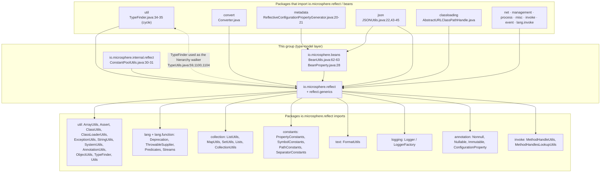
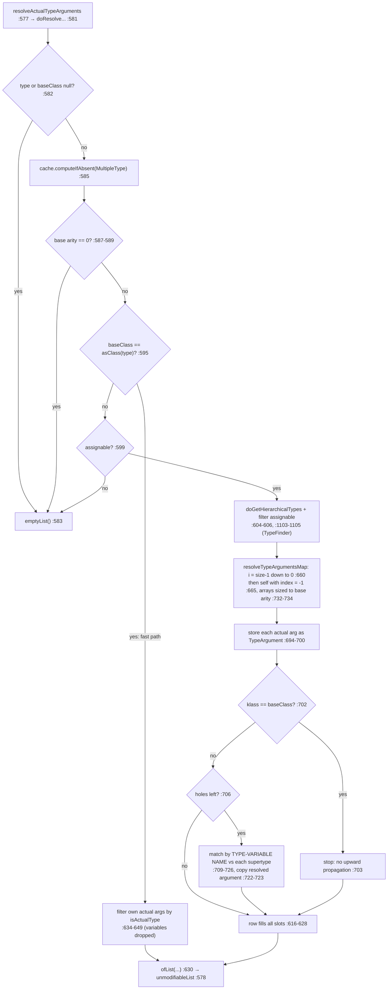
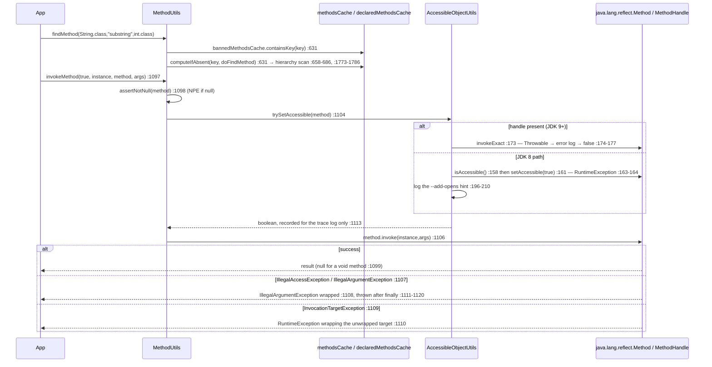
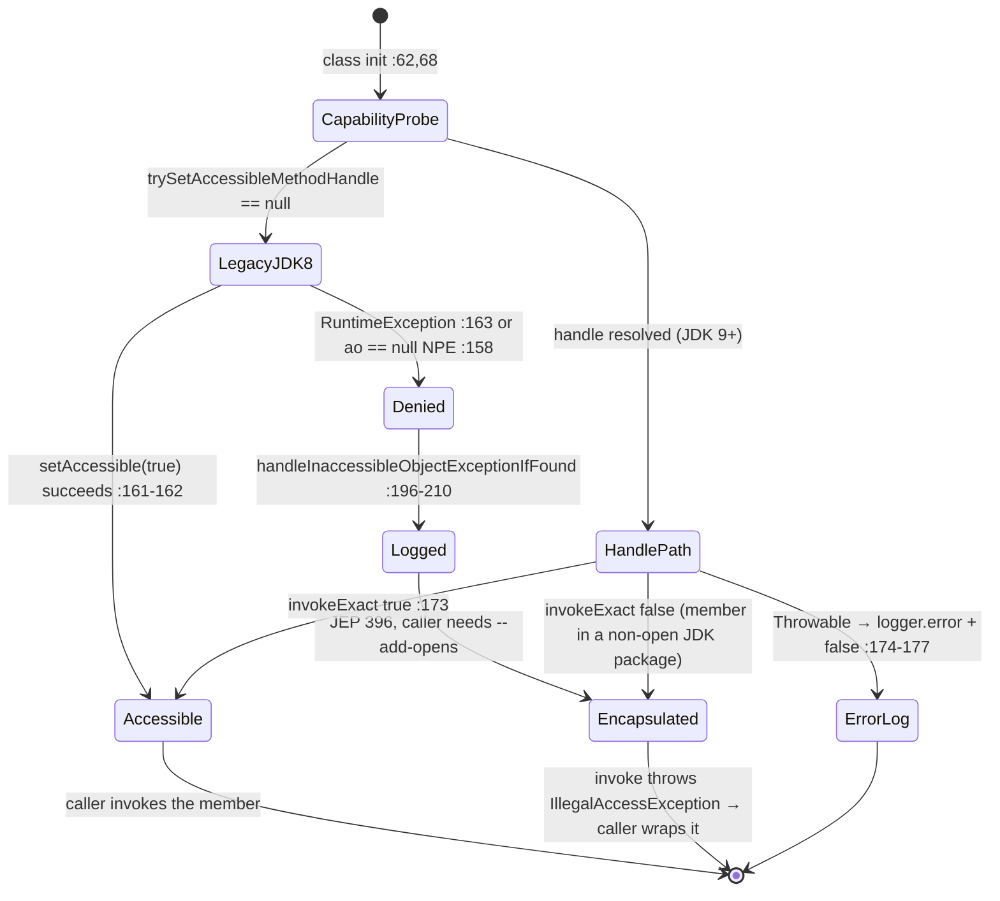

# Reflection, types and beans — Developer Guide

| | |
|---|---|
| **Layer** | Type-model / foundation layer — `io.microsphere.reflect`, `io.microsphere.reflect.generics`, `io.microsphere.internal.reflect`, `io.microsphere.beans`; see the [layer table](README.md#1-internal-dependency-structure) |
| **Packages** | `reflect` (19 types) · `reflect/generics` (2) · `internal/reflect` (1) · `beans` (4) = **26** main-source types |
| **Source line** | `release` branch, `0.3.20-SNAPSHOT` |
| **Analysis focus** | lookup + caching internals, the generic-type resolution algorithm, per-JDK accessibility degradation, JavaBeans introspection |
| **Verified outward edges** | `reflect → util, lang, lang.function, collection, constants, text, logging, annotation, invoke` · `beans → reflect` (`beans/BeanUtils.java:62-63`, `beans/BeanProperty.java:28`) · `internal/reflect → reflect` (`internal/reflect/ConstantPoolUtils.java:30-31`) |

All `file:line` references are relative to `microsphere-java-core/src/main/java/io/microsphere/` (main) or
`microsphere-java-core/src/test/java/io/microsphere/` (tests), read from the **`release` worktree** — never from the dirty
`main` checkout. After the first full mention they appear as `reflect/Foo.java:40-55`.

---

## 1. Role in the architecture

This group is the **bottom of the `core` stack**: `convert` discovers each converter's `(source, target)` pair through
`TypeUtils.resolveActualTypeArgumentClass` (`convert/Converter.java:99-110`), `metadata` and `json` read bean properties
via `BeanUtils` (`json/JSONUtils.java:43-45`), and `classloading`, `net`, `management`, `process`, `misc`, `invoke`,
`event` and `lang.invoke` all pull members reflectively (§7 lists the verified edges). Every performance or compatibility
decision made here is therefore multiplied across the library — which is why the group owns the caching (§3), the
generic-resolution algorithm (§4) and the JDK-9+ strong-encapsulation story (§5) instead of leaking them upward.

### 1.1 Build coordinates and JDK scope

| Fact | Value | Evidence |
|---|---|---|
| groupId / artifact | `io.github.microsphere-projects:microsphere-java-core` | root `pom.xml:12` |
| Version | `${revision}` = `0.3.20-SNAPSHOT`; newest published tag `0.3.20` | root `pom.xml:54` |
| CI JDK matrix | Temurin `8, 11, 17, 21, 25` | `.github/workflows/maven-build.yml:25` |
| Spring (test-only, used by `JavaTypeTest`) | `7.0.9` default / `5.3.39` under profile `java8-16` (`<jdk>[1.8,17)</jdk>`) | `microsphere-java-parent/pom.xml:22-23,33-36,40-46,54-62` |
| Bytecode level | **not declared in this reactor** — no `maven.compiler.*` / `<release>` property exists anywhere; it is inherited from the external parent `microsphere-build:0.3.16` | `microsphere-java-parent/pom.xml` parent block |

Because JDK 8 is in the matrix, no type in this group may assume a Java 9+ API exists at runtime; that constraint is the
reason `AccessibleObjectUtils` works through `MethodHandle`s (§5) and why `ReflectionUtils` recognises
`InaccessibleObjectException` **by class-name string** instead of `instanceof` (`reflect/ReflectionUtils.java:158`, `:537`).

> [!IMPORTANT]
> This is the only place in `core` that is allowed to reach into JDK reflection internals. `internal/reflect/ConstantPoolUtils.java:51,56` resolves `sun.reflect.ConstantPool` and `jdk.internal.reflect.ConstantPool` **by name**, and the package is deliberately namespaced `internal.*` to mark it non-public API. New internal-access needs must be added here, with a documented fallback, not in a consumer package.

---

## 2. Type inventory — all 26 types

### 2.1 `io.microsphere.reflect` — 19 types

| Type | Class of type | What it owns | Evidence |
|---|---|---|---|
| `AccessibleObjectUtils` | utility (`implements Utils`, private ctor `:213`) | 2 `MethodHandle` statics + 3 accessibility entry points | `reflect/AccessibleObjectUtils.java:62,68,97,142` |
| `MethodUtils` | utility | the 3 static caches + the whole method lookup / invoke / signature family | `reflect/MethodUtils.java:171,184,186` |
| `FieldUtils` | utility | hierarchical field search, forced-access read/write | `reflect/FieldUtils.java:815-844,1085` |
| `ConstructorUtils` | utility | `find*` returns `null` / empty, `newInstance` throws when nothing matches | `reflect/ConstructorUtils.java:328` |
| `ExecutableUtils` | utility (shared translator) | the `execute(...)` overloads that unwrap reflection exceptions, plus the library's only loose matcher `matchParameterTypes` | `reflect/ExecutableUtils.java:47,100,157,215,249-266` |
| `MemberUtils` | utility | modifier predicates (`isPublic`, `isStatic`, `asMember`) | `reflect/MemberUtils.java:36` |
| `Modifier` | model (enum over the `int` modifier bit masks) | one `int` mask per constant (`:144`), `matches(int)` (`:165`), nineteen static `is*` predicates (`:175-379`) and `matchesAny`/`matchesAll` (`:390-430`); caches nothing | `reflect/Modifier.java:28,144,165,390-430` (no `ConcurrentMap` import in the file) |
| `ReflectionUtils` | utility | `isInaccessibleObjectException`, caller-class detection, JDK-internal method lookup | `reflect/ReflectionUtils.java:158,507,533,537` |
| `ProxyUtils` | utility | proxy/un-proxy helpers | `reflect/ProxyUtils.java:41` |
| `TypeUtils` | utility (resolution engine) | generic-type predicates, `findTypes` family, `resolvedGenericTypesCache` | `reflect/TypeUtils.java:116,581-632,1092-1101` |
| `MultipleType` | **model** — immutable composite key over *several* types | wraps a `Type[]` (`:51`) and overrides `hashCode` (`:58`) / `equals` (`:63`) so it can key the resolution cache | `reflect/MultipleType.java:49,51,58,63`, `reflect/TypeUtils.java:116` |
| `JavaType` | **model** — serialisable type wrapper | `type`/`kind`/`source` identity + 3 `volatile` caches + nested `Kind` strategy enum | `reflect/JavaType.java:92,112-124,1162` |
| `ReflectiveDefinition` | **model** (base descriptor) | "since X / in class Y / named Z"; `transient` lazy class resolution (`:106`, `:183-187`), abstract `isPresent()` (`:202`) | `reflect/ReflectiveDefinition.java:92,106,183-187,202` |
| `MemberDefinition` | **model** | the abstract member level between the reflective base and the executable definitions | `reflect/MemberDefinition.java:77` |
| `ExecutableDefinition` | **model** | parameter types resolved from class names (`:162-167`) and kept in a `transient` array (`:71`) | `reflect/ExecutableDefinition.java:65,71,162-167` |
| `MethodDefinition` | **model** | method-specific `resolveMember()` (`:123`) + `isPresent()` | `reflect/MethodDefinition.java:58,123` |
| `ConstructorDefinition` | **model** | constructor-specific resolution via `findConstructor` (static import `:28`) | `reflect/ConstructorDefinition.java:52` |
| `ClassDefinition` | **model** | class-level descriptor (no member name) | `reflect/ClassDefinition.java:57` |
| `FieldDefinition` | **model** | field-level descriptor | `reflect/FieldDefinition.java:56` |

### 2.2 `reflect.generics` (2) and `internal.reflect` (1)

| Type | Class of type | Notes | Evidence |
|---|---|---|---|
| `ParameterizedTypeImpl` | model / `java.lang.reflect.ParameterizedType` implementation | maintained fork of the JDK-internal class; only portable way to *build* a `ParameterizedType`; three `final` fields (`:40-44`), the constructor validates arity (`:55-64`) | `reflect/generics/ParameterizedTypeImpl.java:38,40-44,55-64` |
| `TypeArgument` | model — immutable `(Type, int index)` pair | guards the ctor with `assertNotNull` / `assertTrue(index > -1)` (`:39-40`, imports `:22-23`), factory `create` at `:85`; the resolution algorithm's message object | `reflect/generics/TypeArgument.java:32,34-40,85` |
| `ConstantPoolUtils` | utility (JDK-internal adapter) | resolves `sun.reflect.ConstantPool` (`:51`) then `jdk.internal.reflect.ConstantPool` (`:56`), methods located via `MethodUtils.findMethod` | `internal/reflect/ConstantPoolUtils.java:30-31,51,56` |

### 2.3 `io.microsphere.beans` — 4 types

| Type | Class of type | Notes | Evidence |
|---|---|---|---|
| `BeanUtils` | utility (facade) | 2 tunables + `beanMetadataCache`; bean → `Map<String, Object>` recursion with depth guard | `beans/BeanUtils.java:124,149,151,452-472` |
| `BeanMetadata` | model — immutable wrapper over `java.beans.BeanInfo` | all three fields `final` (`:48-52`), unmodifiable property map (`:75`) | `beans/BeanMetadata.java:46-76,112-123` |
| `BeanProperty` | model — mutable value, immutable identity | class `:37`, value field `:43` + setter `:67`; reads the value eagerly through `MethodUtils.invokeMethod` (static import `:28`, call `:132`) | `beans/BeanProperty.java:28,37,43,132` |
| `ConfigurationProperty` | model (+ nested `Metadata`) | mutable config-property descriptor, setters at `:141,151`; `type` stored as a **`String`** (`:75`); nested `Metadata` fields `:234-239` | `beans/ConfigurationProperty.java:63,75,141,151,234-239` |

> [!NOTE]
> By class of type the 26 split cleanly: **11 utility classes** (9 in `reflect`, `internal.reflect.ConstantPoolUtils`, `beans.BeanUtils`) and **15 model / descriptor classes** (10 in `reflect` — `JavaType`, `MultipleType`, `Modifier` and the seven-type definition family — plus 2 in `reflect.generics` and 3 in `beans`). `JavaType.Kind` is a nested enum of a model class, not a 27th type. `ConfigurationProperty` is not an annotation here — it is a mutable model class in `io.microsphere.beans`; the same-named **annotation** lives in `io.microsphere.annotation` and is what `beans/BeanUtils.java:20` and `reflect/TypeUtils.java:19` import to declare their tunables.

---

## 3. Lookup, invocation and caching

### 3.1 The cache inventory (5 maps in the whole group)

`grep` for `ConcurrentMap` across the group returns exactly five declarations — the rest of the group is cache-free:

| Cache | Declaration | Key → value | Filled by | Eviction |
|---|---|---|---|---|
| resolved methods | `reflect/MethodUtils.java:171` | `MethodKey` → `Method` | `findMethod` `computeIfAbsent` (`:631`) | **none** (initial capacity 256 is only `new ConcurrentHashMap<>(256)`, `collection/MapUtils.java:730-732`) |
| banned methods | `reflect/MethodUtils.java:184` | `MethodKey` → `Method` | `initBannedMethods()` at class-init (`:188-190,215-235`) | none |
| declared methods per class | `reflect/MethodUtils.java:186` | `Class<?>` → `Method[]` | `doGetDeclaredMethods` (`:1808-1810`) | none |
| resolved generic type args | `reflect/TypeUtils.java:116` | `MultipleType` → `List<Type>` | `doResolveActualTypeArguments` (`:585`) | none |
| bean metadata | `beans/BeanUtils.java:151` | `Class<?>` → `BeanMetadata` | `getBeanMetadata` (`:285-287`) | none |

Three consequences for reviewers:

1. **Thread-safety is sound but not atomic-by-design.** Every map is a `ConcurrentHashMap` reached only through
   `computeIfAbsent`/`containsKey`/`get`, so no external lock is needed, and the mapping functions
   (`MethodUtils::doFindMethod` `:1820-1825`, the `TypeUtils` lambda `:585-631`, `BeanMetadata::of` `:286`) are pure
   read-only computations, so a duplicate computation is harmless.
2. **`microsphere.reflect.resolved-generic-types.cache.size` (`reflect/TypeUtils.java:93,103,108-114`) and
   `microsphere.bean.metadata.cache.size` (`beans/BeanUtils.java:139,144-149`) are *initial capacities*, not bounds** —
   `collection/MapUtils.java:730-732` shows the value goes straight into the `ConcurrentHashMap` constructor, so the
   `@ConfigurationProperty` description "The size of resolved generic types cache" (`reflect/TypeUtils.java:111`)
   over-promises and cannot cap memory (flagged in §10.3).
3. **No negative caching.** `computeIfAbsent` records nothing when the function returns `null`, so a lookup miss for a
   non-existent method re-walks the hierarchy on every call (`:631` → `:1820-1825` → `:658-686`); and `FieldUtils` /
   `ConstructorUtils` hold **no cache at all**, which is why `convert` and `metadata` resolve once and reuse.

### 3.2 The cache key: `MethodKey`

`reflect/MethodUtils.java:1827-1869` — three `final` fields (`declaredClass`, `methodName`, `parameterTypes`), a
`null`-tolerant constructor (`:1838` maps a `null` array to `EMPTY_CLASS_ARRAY`), content-based `equals` with
`arrayEquals` (`:1852-1854`) and a `toString()` that is the banned-method signature format (`:1867`).

Two subtleties a reviewer should know:

* `hashCode` (`:1858-1862`) calls `Objects.hash(this.parameterTypes)` — `hash` is the static import at `:84`. Because
  `Class[]` **is** an `Object[]`, the varargs are spread and each element contributes its (identity) `Class.hashCode()`.
  This stays consistent with `equals` only because a `Class` object is canonical per class loader; it is not a bug, but
  it is fragile and worth a comment in the code.
* The key **retains the caller's array reference** (`:1838`, no defensive copy), while `equals` compares content. A
  caller that mutates a varargs array after a lookup therefore changes the hash/equality of an entry already in the
  map. Use `clearMethodsCache()` (`:1715`) rather than sharing mutable arrays.

### 3.3 The lookup algorithm

```
findMethod(Class, name, paramTypes)                    reflect/MethodUtils.java:629-632
 ├─ bannedMethodsCache.containsKey(key) → null         :631
 └─ methodsCache.computeIfAbsent(key, doFindMethod)    :631 → :1820-1825
      └─ findDeclaredMethod(class,name,pt)             :658-686  (isInvalidDeclaringClass guard :659-661)
           ├─ doFindDeclaredMethod(self)               :1768-1771 → declaredMethodsCache :1808-1810
           │    └─ doFindMethod linear scan            :1773-1786 → matches :1788-1796
           │         └─ matchesParameterTypes: Objects.equals per element  :1799-1806
           ├─ recurse into superclass (interface → Object.class)  :666-667
           └─ recurse into each interface, first match wins       :671-676
```

Parameter matching is **exact** (`Objects.equals`, `:1801`): no primitive/wrapper coercion and no assignability. The
library's single loose matcher is `ExecutableUtils.matchParameterTypes` (`reflect/ExecutableUtils.java:249-266`) —
equal arity (`:252-254`), primitive parameter types widened to their wrapper (`resolveWrapperType`, `:258-260`), then
`parameterType.isInstance(arg)` (`:261`) — and it is reached only from the invoke-by-name path
(`reflect/MethodUtils.java:831`) and `ConstructorUtils.newInstance` (`reflect/ConstructorUtils.java:325`), which is why
`findMethod(int.class, "equals", int.class)` is `null` while `newInstance` can match loosely (see the User Guide
page §4.4 for the test evidence).

The three caches are public-clearable for tests: `clearMethodsCache()` `:1715`, `clearBannedMethodsCache()` `:1738`,
`clearDeclaredMethodsCache()` `:1745`.

### 3.4 Accessibility on the invoke path

`invokeMethod(forceAccess, instance, method, args)` (`reflect/MethodUtils.java:1097-1123`) is the template the field and
constructor paths copy:

| Step | Code | Behaviour |
|---|---|---|
| 1 | `:1098` | `assertNotNull(method, ...)` → **`NullPointerException`** — a real throw site, `@throws` is declared on the javadoc (`:1093-1094`) |
| 2 | `:1103-1104` | only when `forceAccess` is `true`, `trySetAccessible(method)` is attempted; its `false` result is *recorded for the trace log only* (`:1113-1114`), never used to abort |
| 3 | `:1106` | `method.invoke(...)` runs regardless of step 2 |
| 4 | `:1107-1108` | `IllegalAccessException` / `IllegalArgumentException` → `ExceptionUtils.wrap(e, IllegalArgumentException.class)` (static import `:76`) |
| 5 | `:1109-1110` | `InvocationTargetException` → the **target** exception is unwrapped and re-wrapped as `RuntimeException` |
| 6 | `:1111-1116` | `finally` logs at `trace` (single log statement, both success and failure paths) |
| 7 | `:1118-1120` | failure thrown **after** the `finally` block, so the log always precedes the throw |

The by-name overloads do **not** return "not found": they throw `IllegalArgumentException` built from a formatted
message (`reflect/MethodUtils.java:839`, format via `text.FormatUtils` static import `:63`).

> [!WARNING]
> `trySetAccessible` failing is *not* fatal on the invoke path. If you ask for `forceAccess = true` on a JDK-internal member and the module is not open, step 2 logs a JEP 396 hint (§5) and step 3 throws `IllegalAccessException` — surfacing to you as `IllegalArgumentException`, not as "access denied". Callers that treat the failure as an accessibility signal will misclassify it.

---

## 4. The generic-type resolution algorithm

### 4.1 Two engines, one hierarchy walker

`TypeUtils` resolves actual type arguments; `JavaType` wraps one `Type` with memoised derived views. Both delegate
hierarchy walking to **`io.microsphere.util.TypeFinder`** (`reflect/TypeUtils.java:59`, used at `:1100` and `:1104`). That
sharing creates a package-level cycle `reflect ⇄ util`, because `util/TypeFinder.java:34-35` imports `TypeUtils.asClass`
and `TypeUtils.isObjectType`; it is compile-time only — `TypeFinder`'s hooks are `static final` lambdas
(`util/TypeFinder.java:354-366`), so there is no initialisation loop.

### 4.2 `doResolveActualTypeArguments`, step by step

`reflect/TypeUtils.java:581-632` (public wrapper `resolveActualTypeArguments` `:577-579` returns `unmodifiableList`;
both are `@Nonnull`/`@Immutable`):

1. **Null short-circuit** — `type == null || baseClass == null` → shared `emptyList()` (`:582-584`).
2. **Memoise** — `resolvedGenericTypesCache.computeIfAbsent(of(type, baseClass), ...)` (`:585`, key type `MultipleType`).
3. **No type parameters** → `emptyList()` (`:587-591`).
4. **Fast path** — if `baseClass.equals(asClass(type))`, the answer is the parameterised type's own *actual* arguments
   filtered by `isActualType` (`:597-598`, `:634-649`); a `TypeVariable` argument is dropped, not resolved.
5. **Non-related types** → `emptyList()` (`:599-602`); resolution never throws for a nonsense pair.
6. **Collect the hierarchy** — `doGetHierarchicalTypes(type)` (`:606`, `:1103-1105`) = `TypeFinder` with
   `self=false, hierarchical=true, superclass=true, interfaces=true`, then filtered to types assignable to `baseClass` (`:604`).
7. **Build the `Class → TypeArgument[]` table** — `resolveTypeArgumentsMap` (`:610`, `:651-668`) walks the list
   **backwards** (`i = size-1 … 0`, `:660`) so the most distant supertypes fill first, then handles the queried type itself
   with `index = -1` (`:665`); `newTypeArguments` (`:732-734`) sizes each array to the base arity.
8. **Fill actual types** — per `ParameterizedType` (`:679-700`) each argument passing `isActualType(...)` is stored as
   `TypeArgument.create(actualTypeArgument, i)`, stopping at `min(actual, base)` arity (`:690`).
9. **Stop at the base class** — `if (klass == baseClass) return;` (`:702-704`).
10. **Propagate by *type-variable name*** — while holes remain (`actualTypesCount < baseTypeArgumentsLength`, `:706`) the
    algorithm compares **the name** of each of the class's own type parameters with each candidate supertype's parameter
    names (`:709-726`) and copies the resolved `TypeArgument` on a match (`:722-723`). This is how `D extends C<String>`
    answers `Comparable`'s `T` through several hops.
11. **Assemble** — the first table row filling all slots wins (`:616-628`), then `ofList(...)` (`:630`).

### 4.3 Recursion and loop guards

The walkers are recursive, and both are guarded — this is the part to re-check before touching either:

| Recursion | File:line | Guard |
|---|---|---|
| hierarchy walk (`addSuperTypes`) | `util/TypeFinder.java:323-352` | `isObjectType(type)` return (`:324-326`) stops at `Object`; `addIfAbsent(allTypes, superType)` (`:346`) makes the visited set the loop breaker for interface diamonds |
| direct-super-set build | `util/TypeFinder.java:243-273` | `addIfAbsent` on interfaces (`:270`) removes duplicated inherited interfaces |
| argument propagation | `reflect/TypeUtils.java:660-665`, `:709-728` | bounded by the already-deduplicated `hierarchicalTypes` list; the `klass == baseClass` early return (`:702-704`) prevents upward propagation past the target |
| whole resolution | `reflect/TypeUtils.java:585` | memoised, so a cyclic `(type, baseClass)` request cannot re-enter (each key is computed once per map bucket) |
| fast path filtering | `reflect/TypeUtils.java:642` | `isActualType` drops unresolved variables instead of recursing |

> [!NOTE]
> `TypeFinder` is a **template over two type domains**: `classGetSuperClassFunction`/`classGetInterfacesFunction`
> (`util/TypeFinder.java:354-356`) for `Class`, `genericTypeGetSuperClassFunction`/`genericTypeGetInterfacesFunction`
> (`:358-366`) for `Type` — the latter re-derive the raw class via `asClass(type)` and return `null` when the raw class is
> unknown, which is the degenerate case that keeps the walker from exploding on a `TypeVariable` or `WildcardType` root.

### 4.4 Per-`Type`-shape handling (`JavaType.Kind`)

`reflect/JavaType.java:1162-1327` is a strategy enum: each constant owns one `java.lang.reflect.Type` shape and the
four view methods (`getRawType` `:1294`, `getSuperType` `:1304`, `getInterfaces` `:1308`, `getGenericTypes` `:1312`).
`valueOf(Type)` (`:1316-1325`) picks the first constant whose `typeClass.isInstance(type)` matches, falling back to
`UNKNOWN`.

| Kind | Constant | How the shape is walked |
|---|---|---|
| `Class` | `CLASS` `:1167-1196` | raw = itself (`:1175-1177`); super = `getGenericSuperclass()` (`:1169-1172`); interfaces = `getGenericInterfaces()` (`:1180-1183`); generic types = a **`new Type[n]` of nulls** when the class declares type parameters (`:1186-1191`) — i.e. a raw class is *unresolved*, not empty |
| `ParameterizedType` | `PARAMETERIZED_TYPE` `:1201-1260` | raw/super/interfaces delegate by re-deriving `Kind` on the raw type (`:1203-1221`); `getGenericTypes` (`:1224-1236`) calls `TypeUtils.resolveActualTypeArguments(type, baseType)` where `type` is the **root source** of the `JavaType` (`resolveType` `:1249-1255`) and, on an empty answer, falls back to the declared arguments with non-actual ones nulled out (`toActualTypes` `:1238-1247`) |
| `TypeVariable` | `TYPE_VARIABLE` `:1265` | no overrides → raw/super `null`, interfaces/generic types `EMPTY_TYPE_ARRAY` (`:1294-1314`); a variable is *never* resolved by `JavaType` alone — resolution happens in `TypeUtils` §4.2 or through the owner type |
| `WildcardType` | `WILDCARD_TYPE ` `:1270` | same defaults; bounds are inspected by callers via `TypeUtils` predicates (`WILDCARD_TYPE_FILTER` `reflect/TypeUtils.java:86`), not by `Kind` |
| `GenericArrayType` | `GENERIC_ARRAY_TYPE` `:1275` | same defaults; component types are handled by `TypeUtils.getComponentType` (User Guide §3.6) |
| anything else | `UNKNOWN` `:1280` | `Type.class` matches last (`:1316-1325`), so primitives/`void` land here and degrade to empty views |

`JavaType`'s own caches are read-then-write `volatile` fields (`reflect/JavaType.java:120-124`) behind
`getSuperType()` (`:311-318`), `getInterfaces()` (`:341-349`) and `getGenericTypes()` (`:397-405`), each resolving
through `this.kind` (`:320-323`, `:351-354`, `:407-413`). Two threads may compute the same view twice and publish
different-but-equivalent objects; visibility is guaranteed, uniqueness is not.

---

## 5. Accessibility handling per JDK

### 5.1 Capability detection at class-initialisation

`AccessibleObjectUtils` never branches on a version number. Its two `static final MethodHandle` fields are resolved at
class load — `canAccessMethodHandle` (`reflect/AccessibleObjectUtils.java:62`) and `trySetAccessibleMethodHandle`
(`:68`) — through `invoke.MethodHandleUtils.findVirtual` (static import `:30`), which yields `null` when the JDK 9
method does not exist. Every decision below is a `null` test on one of those handles.

### 5.2 Degradation paths, exactly as coded

| Path | Lines | What happens when access is denied |
|---|---|---|
| `trySetAccessible(ao)` | `:97-104` | handle present → `trySetAccessible(handle, ao)`; handle absent (JDK 8) → legacy `setAccessible(ao)` |
| `trySetAccessible(handle, ao)` | `:170-178` | `invokeExact` inside `catch (Throwable)`; on any failure it logs `error` and returns `false` — **never throws** |
| legacy `setAccessible(ao)` (package-private) | `:157-168` | returns the **previous** flag; `setAccessible(true)` at `:161` is guarded only against `RuntimeException` (`:163-165`) → converted into the JEP 396 log, `false` never returned implicitly (the method returns the pre-call flag) |
| `canAccess(o, ao)` | `:142-149` | public members short-circuit `true` (`:144-146` via `MemberUtils.isPublic`, import `:33`); otherwise `tryCanAccess` (`:147`); `null` result (JDK 8) → falls back to `accessibleObject.isAccessible()` (`:148`) |
| `tryCanAccess(handle, o, ao)` | `:184-194` | returns `null` when the handle is absent, else the boxed JDK answer; `catch (Throwable)` → `error` log + `null` |
| `handleInaccessibleObjectExceptionIfFound(e)` | `:196-211` | recognises the exception **by name** through `ReflectionUtils.isInaccessibleObjectException` (import `:34`; `reflect/ReflectionUtils.java:507-508,533-534,537`), parses module/package out of the message with `StringUtils.substringBetween` (import `:35`) and logs the exact `--add-opens=<module>/<package>=ALL-UNNAMED` flag (`:204-208`) |

> [!WARNING]
> Three NPE-hardening audit items in this class: (a) `setAccessible(ao)` dereferences `ao.isAccessible()` at `:158` **before** the `try`, so `null` throws `NullPointerException` instead of degrading; (b) `canAccess(null, ...)` reaches the same `:148` dereference when `tryCanAccess` yields `null` (JDK 8); (c) `handleInaccessibleObjectExceptionIfFound` assumes the JDK message still contains the literal `"module "` / `"opens "` tokens (`:199-200`) — if the JDK wording changes, `moduleName`/`packageName` become `null` and the printed hint is `--add-opens=null/null=ALL-UNNAMED`. Only (a) and (b) are reachable from public API.

### 5.3 Where `--add-opens` is (and is not) needed

Nothing here *requires* a JVM option to load; options are only needed when the **consumer** forces access into a
non-opened JDK package — `invokeMethod`/`getFieldValue`/`setFieldValue` with `forceAccess = true`, or
`BeanUtils.resolvePropertiesAsMap` on a JDK-internal bean (§6). The reactor adds no `--add-opens` (they live in the
external `microsphere-build:0.3.16` parent), so a consuming project must, typically
`--add-opens=java.base/java.lang=ALL-UNNAMED`.

### 5.4 Internal-access consumer: `internal.reflect`

`ConstantPoolUtils` resolves the constant-pool class **old name first** (`internal/reflect/ConstantPoolUtils.java:51`
then `:56`) and caches its `Method` handles, located with `MethodUtils.findMethod` (`:30-31`). Its `invoke(...)` wrapper
catches `Throwable`, logs at `trace` and returns `null`, but `getConstantPool(...)` sits **outside** that guard, so an
unreachable `Class.getConstantPool` propagates — the one place where a JDK-internal access failure is not degraded.

---

## 6. The bean-property / introspection layer

### 6.1 Relationship to `java.beans.Introspector`

`BeanMetadata` is a thin, immutable shell around the JDK `BeanInfo`: the constructor calls
`Introspector.getBeanInfo(beanClass, Object.class)` inside `ThrowableSupplier.execute`, so the checked
`IntrospectionException` becomes a `RuntimeException` (`beans/BeanMetadata.java:55`, static import `:33`, `@throws`
declared `:144`); `Object.class` as the stop class is what drops the inherited `getClass()` property. The map is keyed by
**uncapitalised** names (`:72`, import `:35`), returned unmodifiable (`:75`), and `equals`/`hashCode` compare the bean class
only (`:112-123`). `BeanUtils` adds caching and the JavaBean verbs: `getBeanMetadata` memoises into `beanMetadataCache`
(`beans/BeanUtils.java:151,285-287`), `findWriteMethod` returns `null` after a `trace` log (`:321-334`), and
`findPropertyDescriptor` returns `null` for an unknown property. **No `throw` statement exists anywhere in `beans`**
(`grep "throw new" beans/` → no matches): failures surface only as the `RuntimeException` from `Introspector` (`:55`) or
from the reflective getter call.

### 6.2 `resolvePropertiesAsMap`: recursion and the depth guard

```
resolvePropertiesAsMap(bean)                     beans/BeanUtils.java:204  (default depth BEAN_PROPERTIES_MAX_RESOLVED_DEPTH :124)
 resolvePropertiesAsMap(bean, maxDepth)          :273-274  → MutableInteger.of(0)
  resolvePropertiesAsMap(bean, depth, maxDepth)  :452-472
   ├─ bean == null → emptyMap() :453-455   ·   depth.incrementAndGet() >= max → emptyMap() :457-459 (silent truncation)
   ├─ getBeanMetadata(beanClass) :462 → per-entry resolveProperty :465-469 → unmodifiableMap :471
   └─ resolveProperty(instance, descriptor, ...) :474-483
        readMethod == null → null :476-478 · trySetAccessible(readMethod) :479 (unconditional, ignores forceAccess) · invokeMethod :480
 resolveProperty(value, valueType, ...) :489-517 — leaf test, then array/list/set/queue/enumeration/map, else recurse as a bean (:516)
```

The counter is a shared mutable `MutableInteger` (`beans/BeanUtils.java:60` static import, type from `io.microsphere.lang`),
**not** a per-branch depth: it is incremented in place and never decremented, so with the default of 100 (`:91,113,124`) a
bean with 100 properties can have its 101st resolved as `emptyMap()`. The guard bounds *total increments*, not nesting.

### 6.3 Relationship to `JavaType` — and why it matters

`beans` imports **nothing** from `TypeUtils`/`JavaType`; property types come from `PropertyDescriptor.getPropertyType()`
(`beans/BeanUtils.java:481`), a raw `Class`. So `resolvePropertiesAsMap` is **type-erasure bound**: for
`Map<String, Order> orders` it recurses on `Map.class` and resolves values by runtime class, and a `List<Trade>` with
`null` elements yields no element type. Consumers needing the declared element type (`metadata`, `json`) go to the
`reflect` layer separately (`json/JSONUtils.java:22,43-45`) — the `JavaType`/`TypeUtils` API of §4. Guidance: keep them
apart; putting `JavaType` into `BeanMetadata` would make bean introspection inherit the generic-resolution cache and its
JDK-version behaviour differences.

---

## 7. Dependency graph (edges verified by import statements)



Evidence for the outbound edges: `reflect/TypeUtils.java:24,44-48,49-51,55-59` (util, collection, lang.function,
constants), `reflect/MethodUtils.java:35-48,63-81` (util, collection, lang.function, text, constants),
`reflect/AccessibleObjectUtils.java:26-35` (constants, invoke, logging, util, `ReflectionUtils`),
`reflect/ReflectionUtils.java:26` (invoke), `reflect/ConstructorUtils.java:22-24,32-40` (lang.function, collection, text,
util), `reflect/JavaType.java:19-20,51-53` (annotation, util), `beans/BeanUtils.java:20-26,44-69` (annotation, lang,
logging, util, collection, constants, reflect). No type in `reflect` imports `convert`, `beans`, `classloading`, `json`
or `net`, so the group sits at the bottom of the stack except for the deliberate `reflect ⇄ util` cycle.

---

## 8. Control-flow diagrams

### 8.1 Type-argument resolution (`TypeUtils.doResolveActualTypeArguments`)



### 8.2 A `MethodUtils.invokeMethod` call, including the accessibility attempts



### 8.3 Accessibility state machine (`AccessibleObjectUtils`)



---

## 9. Design patterns

| Pattern | Implementing class(es) | Evidence |
|---|---|---|
| **Facade over `java.lang.reflect`** | `MethodUtils`, `FieldUtils`, `ConstructorUtils`, `TypeUtils`, `JavaType`, `BeanUtils` — all static-entry, private-ctor utility shells | `reflect/AccessibleObjectUtils.java:213` (private ctor), `reflect/TypeUtils.java:1092-1101` (one protected core + flag-tuned public wrappers) |
| **Template Method** | `TypeFinder` walks a hierarchy whose "how do I get a supertype" step is injected; `BeanMetadata.buildPropertyDescriptorsMap` is the fixed skeleton over JDK `BeanInfo`; `JavaType.resolveSuperType/resolveInterfaces/resolveGenericTypes` are the override seams behind the final-looking getters | `util/TypeFinder.java:140-153,323-352`, `beans/BeanMetadata.java:60,66-75`, `reflect/JavaType.java:320-323,351-354,407-413` |
| **Strategy (enum-dispatch)** | `JavaType.Kind` — one constant per `Type` shape, `valueOf` selects it | `reflect/JavaType.java:1162-1327`, `:1316-1325` |
| **Flyweight / cached lookup** | the 5 `ConcurrentHashMap` caches, plus the shared constants `EMPTY_JAVA_TYPE_ARRAY`, `OBJECT_JAVA_TYPE`, `NULL_JAVA_TYPE` | `reflect/MethodUtils.java:171,184,186`, `reflect/TypeUtils.java:116`, `beans/BeanUtils.java:151`, `reflect/JavaType.java:98,104,110` |
| **Null Object** | `JavaType.NULL_JAVA_TYPE` (a real object for "no type", returned by the `from*` factories instead of `null`), `Modifier`/`TypeUtils` predicate constants, `TypeUtils.emptyList()` degenerate answers | `reflect/JavaType.java:110` + factories (User Guide §3.5), `reflect/TypeUtils.java:583,590,601`, `reflect/MethodUtils.java:1838` (`EMPTY_CLASS_ARRAY`) |
| **Immutable value object** | `MethodKey`, `MultipleType`, `TypeArgument`, `ParameterizedTypeImpl`, `BeanMetadata`, `JavaType`'s identity fields | `reflect/MethodUtils.java:1829-1838`, `reflect/MultipleType.java:49-63`, `reflect/generics/TypeArgument.java:32,34-40`, `beans/BeanMetadata.java:48-52,75`, `reflect/JavaType.java:112-116` |
| **Memento-ish declarative descriptor** | the definition family — a `Serializable` "resolve later" description (`isPresent()` answers without throwing) used to survive JDK/API differences | `reflect/ReflectiveDefinition.java:92,106,183-187`, `reflect/ExecutableDefinition.java:31-32,162-167` (both resolve through `ClassLoaderUtils`) |
| **Adapter (anti-corruption layer)** | `internal/reflect.ConstantPoolUtils` adapts `sun.*` / `jdk.internal.*` behind a name-based lookup with a `trace`-logged fallback | `internal/reflect/ConstantPoolUtils.java:30-31,51,56` |

---

## 10. Review notes: thread-safety, cache correctness, throw sites

### 10.1 Thread-safety verdict

* **Safe.** All five caches are `ConcurrentHashMap`s mutated only by `computeIfAbsent`
  (`reflect/MethodUtils.java:631,1809`, `reflect/TypeUtils.java:585`, `beans/BeanUtils.java:286`); `MethodKey` and
  `MultipleType` are effectively immutable; the banned-method map is filled in a static initialiser
  (`reflect/MethodUtils.java:188-190`) before publication, and the tunable `BANNED_METHODS_PROPERTY_NAME` is read at
  class-init (`:215-235`), so banning is JVM-wide and order-dependent — tests must clear all three caches
  (`:1715,1738,1745`).
* **Benign races.** `JavaType`'s `volatile` view caches (`reflect/JavaType.java:120-124`) allow duplicate computation but
  guarantee visibility; `AccessibleObjectUtils`' two handles are `static final`, assigned once (`:62,68`).
* **The one shared mutable object.** `BeanUtils.resolvePropertiesAsMap` passes a single `MutableInteger` through the whole
  recursion (`beans/BeanUtils.java:457`, created per call at `:274`), so the public method is safe but the counter is
  never decremented on unwind — the "total increments" caveat of §6.2. A subclass that injected a cached counter would not be.

### 10.2 Every actual throw site in the group

| # | Site | Throws | Trigger |
|---|---|---|---|
| 1 | `reflect/MethodUtils.java:839` | `IllegalArgumentException` | invoke-by-name found no matching method |
| 2 | `reflect/MethodUtils.java:1098` (`assertNotNull`) | `NullPointerException` | `invokeMethod(..., null method, ...)` |
| 3 | `reflect/FieldUtils.java:830-831` | `IllegalStateException` | `IllegalAccessException` while reading a field |
| 4 | `reflect/FieldUtils.java:1085` | `IllegalArgumentException` | `assertFieldMatchType` mismatch |
| 5 | `reflect/ConstructorUtils.java:328` | `IllegalArgumentException` | `newInstance(Class, args)` matched no constructor |
| 6 | `reflect/FieldUtils.java:492-493` + `getDeclaredField` family | `RuntimeException` | translated by `ThrowableSupplier.execute` (import `:35`, call `:493`) |
| 7 | `reflect/generics/ParameterizedTypeImpl.java:59` | `MalformedParameterizedTypeException` | raw type / argument arity mismatch |
| 8 | `reflect/TypeUtils.java:1568-1574` (`getTypeNames`) | via `Assert.assertNoNullElements` (import `:58`) | a `null` element in the varargs |
| 9 | `beans/BeanMetadata.java:55` | `RuntimeException` (from `IntrospectionException`) | a class the JDK `Introspector` rejects |
| 10 | `reflect/AccessibleObjectUtils.java:158` | `NullPointerException` | `setAccessible(null)` on the JDK 8 path / `canAccess(o, null)` fallback `:148` |
| 11 | `internal/reflect/ConstantPoolUtils.java:241` | propagates whatever `getConstantPool` throws | called outside the `catch (Throwable)` at `:243-247` |

Everything else in the group follows the library's **silent-degradation** policy and returns `null`, an empty
collection, `false`, or a neutral constant (`reflect/TypeUtils.java:582-601`, `beans/BeanUtils.java:453-459,476-478`,
`reflect/AccessibleObjectUtils.java:170-178`).

### 10.3 Javadoc-vs-code gaps found (input to the NPE-hardening audit)

1. `beans/BeanUtils.java:267` and `:446` both declare `@throws IllegalArgumentException if maxResolvedDepth is
   negative`, but `:273-274` and `:452-459` contain **no assertion** — a negative depth simply yields `emptyMap()` on
   the first call. Documented behaviour is not delivered; the degradation is silent.
2. `reflect/TypeUtils.java:573` declares `@throws IllegalArgumentException if either type or baseClass is null or
   invalid`, while `:582-584` returns `emptyList()` for `null` and `:599-601` for an unrelated type. The `@throws` is
   wrong in both directions (nothing is thrown, and "invalid" is never validated).
3. `reflect/FieldUtils.java` javadocs `@throws IllegalAccessException` (`:966` for `setFieldValue`, `:876` for
   `getFieldValue`) while `:1030` multi-catches `IllegalAccessException | IllegalArgumentException` and re-throws
   `IllegalArgumentException` — the checked exception cannot escape (User Guide §3.3).
4. `reflect/JavaType.java:114` declares `private final transient Kind kind` and the class `implements Serializable`
   (`:92`) with **no `readResolve` / `readObject` / explicit `serialVersionUID`** (verified by `grep`). A deserialised
   instance therefore has `kind == null`, and the first call to `getRawTypeClass()` (`:289`), `getSuperType()` (`:321`),
   `getInterfaces()` (`:352`), `getGenericTypes()` (`:413`) or any `is*Type()` predicate (`:651-768`) throws
   `NullPointerException`. Either drop `transient` (`Kind` is a serialisable enum) or recompute it on read.
5. `reflect/TypeUtils.java:111` describes the tunable as "The size of resolved generic types cache" when
   `:116` + `collection/MapUtils.java:730-732` use it only as the `ConcurrentHashMap` initial capacity.
6. `reflect/generics/TypeArgument.java:40` guards with `assertTrue(index > -1, () -> "The 'index' must not be
   positive")`: the condition enforces **non-negativity** while the message forbids **positivity**, so a violated guard
   reports the opposite of what was checked. The guard is live on the resolution hot path
   (`reflect/TypeUtils.java:698` calls `create(actualTypeArgument, i)` with `i >= 0`), so the misleading text will be
   what a reader debugs.

### 10.4 Cross-cutting reminders

Priority ordering is not decided in this group, but consumers that sort reflectively resolved members use
`io.microsphere.lang.Prioritized`, whose constants are inverted: `MAX_PRIORITY = Integer.MIN_VALUE`
(`lang/Prioritized.java:81`), `MIN_PRIORITY = Integer.MAX_VALUE` (`:86`), `NORMAL_PRIORITY = 0` (`:91`). `JavaTypeTest`
cross-checks resolution against Spring's `ResolvableType`, which is why `spring-core` is a test-scope dependency on this
branch (`microsphere-java-parent/pom.xml:54-62`).

---

## 11. See also

* User guide, same slice: [Reflection, types and beans](../../user-guide/microsphere-java-core/reflection-and-beans.md) — API reference, accessibility matrix, test-mined examples
* [Language abstractions](language-abstractions.md) — `Deprecation` / `Version` behind the definition family, `MutableInteger` behind the depth guard, `ThrowableSupplier.execute` behind every wrapped throw
* [Utilities and constants](util-and-constants.md) — `TypeFinder`, the hierarchy walker `TypeUtils` delegates to
* [Type conversion](type-conversion.md) — the first consumer above this layer
* [Class loading and artifacts](classloading-and-artifacts.md) — the other JDK-internals consumer, same `--add-opens` story
* [Configuration property metadata](configuration-metadata.md) — the main consumer of `io.microsphere.beans`
* Group index [README.md](README.md) · module index [../../developer-guide/README.md](../../developer-guide/README.md)
