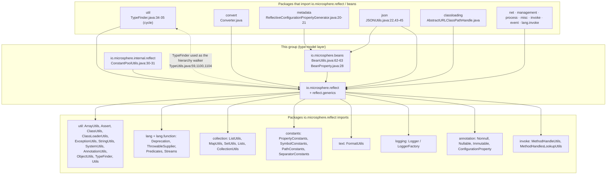
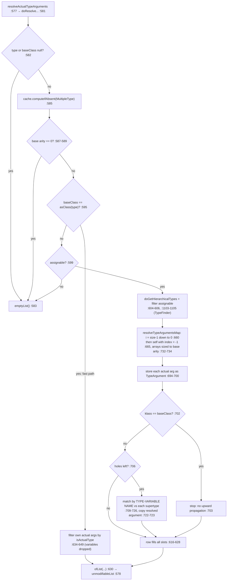
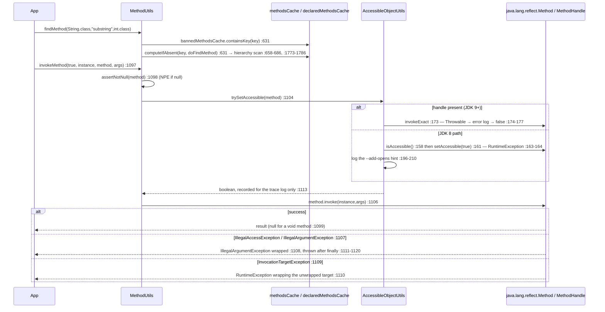
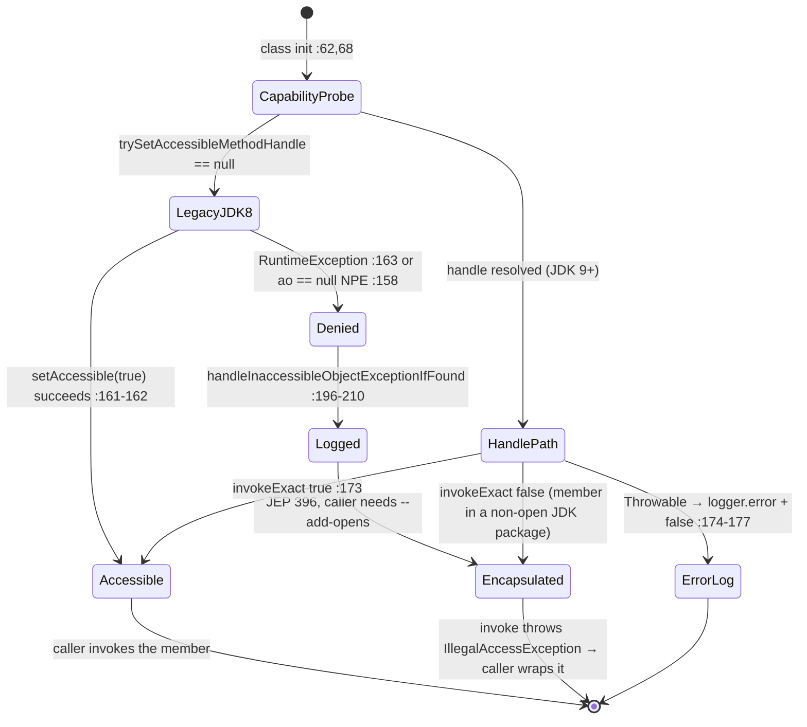

# 反射、类型与 Bean —— 开发者指南

| | |
|---|---|
| **层** | 类型模型 / 基础层 —— `io.microsphere.reflect`、`io.microsphere.reflect.generics`、`io.microsphere.internal.reflect`、`io.microsphere.beans`；参见[层表](./README.zh.md#1-内部依赖结构) |
| **包** | `reflect`（19 个类型）· `reflect/generics`（2 个）· `internal/reflect`（1 个）· `beans`（4 个）= **26** 个主源码类型 |
| **源码线** | `release` 分支，`0.3.20-SNAPSHOT` |
| **分析重点** | 查找 + 缓存的内部机制、泛型类型解析算法、按 JDK 区分的可访问性降级、JavaBeans 内省 |
| **已验证的出边** | `reflect → util, lang, lang.function, collection, constants, text, logging, annotation, invoke` · `beans → reflect`（`beans/BeanUtils.java:62-63`、`beans/BeanProperty.java:28`）· `internal/reflect → reflect`（`internal/reflect/ConstantPoolUtils.java:30-31`） |

所有 `file:line` 引用都相对于 `microsphere-java-core/src/main/java/io/microsphere/`（主源码）或
`microsphere-java-core/src/test/java/io/microsphere/`（测试源码），并且一律读自 **`release` 工作树** —— 绝不来自脏的
`main` 检出。首次完整提及之后，文中写作 `reflect/MethodUtils.java:40-55`。

---

## 1. 在架构中的位置

这一组是 **`core` 栈的最底部**：`convert` 通过 `TypeUtils.resolveActualTypeArgumentClass` 发现每个转换器的
`(source, target)` 对（`convert/Converter.java:99-110`），`metadata` 与 `json` 经由 `BeanUtils` 读取 Bean 属性
（`json/JSONUtils.java:43-45`），而 `classloading`、`net`、`management`、`process`、`misc`、`invoke`、`event` 和
`lang.invoke` 都以反射方式拉取成员（§7 列出经过验证的边）。因此这里做出的每一条性能或兼容性决策都会被全库放大 ——
这正是本组自己持有缓存（§3）、泛型解析算法（§4）与 JDK-9+ 强封装应对策略（§5），而不是把它们泄漏到上层的缘故。

### 1.1 构建坐标与 JDK 作用域

| 事实 | 值 | 证据 |
|---|---|---|
| groupId / artifact | `io.github.microsphere-projects:microsphere-java-core` | 根 `pom.xml:12` |
| 版本 | `${revision}` = `0.3.20-SNAPSHOT`；最新已发布标签 `0.3.20` | 根 `pom.xml:54` |
| CI JDK 矩阵 | Temurin `8, 11, 17, 21, 25` | `.github/workflows/maven-build.yml:25` |
| Spring（仅测试作用域，被 `JavaTypeTest` 使用） | 默认 `7.0.9` / 在 profile `java8-16`（`<jdk>[1.8,17)</jdk>`）下 `5.3.39` | `microsphere-java-parent/pom.xml:22-23,33-36,40-46,54-62` |
| 字节码级别 | **不在本 reactor 中声明** —— 任何位置都没有 `maven.compiler.*` / `<release>` 属性；它继承自外部父 POM `microsphere-build:0.3.16` | `microsphere-java-parent/pom.xml` 的 parent 块 |

因为 JDK 8 在矩阵之内，本组中没有任何类型可以假定 Java 9+ 的 API 在运行期存在；这个约束就是 `AccessibleObjectUtils`
通过 `MethodHandle` 工作的原因（§5），也是 `ReflectionUtils` **按类名字符串** 而不是用 `instanceof` 识别
`InaccessibleObjectException` 的原因（`reflect/ReflectionUtils.java:158`、`:537`）。

> [!IMPORTANT]
> 这是 `core` 中唯一被允许伸入 JDK 反射内部的地方。`internal/reflect/ConstantPoolUtils.java:51,56` **按名字**解析 `sun.reflect.ConstantPool` 与 `jdk.internal.reflect.ConstantPool`，并且该包刻意使用 `internal.*` 命名空间以标记其为非公开 API。新的内部访问需求必须加在这里，并配有文档化的回退路径，而不是加在某个消费者包里。

---

## 2. 类型清单 —— 全部 26 个类型

### 2.1 `io.microsphere.reflect` —— 19 个类型

| 类型 | 类型类别 | 它负责什么 | 证据 |
|---|---|---|---|
| `AccessibleObjectUtils` | 工具类（`implements Utils`，私有构造器 `:213`） | 2 个 `MethodHandle` 静态字段 + 3 个可访问性入口 | `reflect/AccessibleObjectUtils.java:62,68,97,142` |
| `MethodUtils` | 工具类 | 3 个静态缓存 + 整个方法查找 / 调用 / 签名方法族 | `reflect/MethodUtils.java:171,184,186` |
| `FieldUtils` | 工具类 | 层次化字段搜索、强制访问的读 / 写 | `reflect/FieldUtils.java:815-844,1085` |
| `ConstructorUtils` | 工具类 | `find*` 返回 `null` / 空集合，`newInstance` 在无匹配时抛出 | `reflect/ConstructorUtils.java:328` |
| `ExecutableUtils` | 工具类（共享翻译器） | 解包反射异常的 `execute(...)` 重载，以及全库唯一的宽松匹配器 `matchParameterTypes` | `reflect/ExecutableUtils.java:47,100,157,215,249-266` |
| `MemberUtils` | 工具类 | 修饰符谓词（`isPublic`、`isStatic`、`asMember`） | `reflect/MemberUtils.java:36` |
| `Modifier` | 模型（对 `int` 修饰符位掩码的枚举封装） | 每个常量持有一个 `int` 掩码（`:144`）、`matches(int)`（`:165`）、十九个静态 `is*` 谓词（`:175-379`）与 `matchesAny`/`matchesAll`（`:390-430`）；不缓存任何东西 | `reflect/Modifier.java:28,144,165,390-430`（文件中没有 `ConcurrentMap` import） |
| `ReflectionUtils` | 工具类 | `isInaccessibleObjectException`、调用者类探测、JDK 内部方法查找 | `reflect/ReflectionUtils.java:158,507,533,537` |
| `ProxyUtils` | 工具类 | 代理 / 解代理辅助方法 | `reflect/ProxyUtils.java:41` |
| `TypeUtils` | 工具类（解析引擎） | 泛型类型谓词、`findTypes` 方法族、`resolvedGenericTypesCache` | `reflect/TypeUtils.java:116,581-632,1092-1101` |
| `MultipleType` | **模型** —— 覆盖 *多个* 类型的不可变复合键 | 包装一个 `Type[]`（`:51`）并覆盖 `hashCode`（`:58`）/ `equals`（`:63`），因此可作为解析缓存的键 | `reflect/MultipleType.java:49,51,58,63`、`reflect/TypeUtils.java:116` |
| `JavaType` | **模型** —— 可序列化的类型包装器 | `type`/`kind`/`source` 身份 + 3 个 `volatile` 缓存 + 嵌套 `Kind` 策略枚举 | `reflect/JavaType.java:92,112-124,1162` |
| `ReflectiveDefinition` | **模型**（基础描述符） | “since X / in class Y / named Z”；`transient` 惰性类解析（`:106`、`:183-187`），抽象 `isPresent()`（`:202`） | `reflect/ReflectiveDefinition.java:92,106,183-187,202` |
| `MemberDefinition` | **模型** | 位于反射基类与可执行定义之间的抽象成员层 | `reflect/MemberDefinition.java:77` |
| `ExecutableDefinition` | **模型** | 参数类型由类名解析而来（`:162-167`），保存在 `transient` 数组中（`:71`） | `reflect/ExecutableDefinition.java:65,71,162-167` |
| `MethodDefinition` | **模型** | 方法专属的 `resolveMember()`（`:123`）+ `isPresent()` | `reflect/MethodDefinition.java:58,123` |
| `ConstructorDefinition` | **模型** | 构造器专属解析，经由 `findConstructor`（静态 import `:28`） | `reflect/ConstructorDefinition.java:52` |
| `ClassDefinition` | **模型** | 类级描述符（无成员名） | `reflect/ClassDefinition.java:57` |
| `FieldDefinition` | **模型** | 字段级描述符 | `reflect/FieldDefinition.java:56` |

### 2.2 `reflect.generics`（2 个）与 `internal.reflect`（1 个）

| 类型 | 类型类别 | 说明 | 证据 |
|---|---|---|---|
| `ParameterizedTypeImpl` | 模型 / `java.lang.reflect.ParameterizedType` 实现 | JDK 内部类的维护分支；*构造* `ParameterizedType` 的唯一可移植方式；三个 `final` 字段（`:40-44`），构造器校验元数（`:55-64`） | `reflect/generics/ParameterizedTypeImpl.java:38,40-44,55-64` |
| `TypeArgument` | 模型 —— 不可变 `(Type, int index)` 对 | 用 `assertNotNull` / `assertTrue(index > -1)` 守护构造器（`:39-40`，import `:22-23`），工厂 `create` 在 `:85`；解析算法的消息载体 | `reflect/generics/TypeArgument.java:32,34-40,85` |
| `ConstantPoolUtils` | 工具类（JDK 内部适配器） | 先解析 `sun.reflect.ConstantPool`（`:51`）再解析 `jdk.internal.reflect.ConstantPool`（`:56`），方法通过 `MethodUtils.findMethod` 定位 | `internal/reflect/ConstantPoolUtils.java:30-31,51,56` |

### 2.3 `io.microsphere.beans` —— 4 个类型

| 类型 | 类型类别 | 说明 | 证据 |
|---|---|---|---|
| `BeanUtils` | 工具类（外观） | 2 个可调参数 + `beanMetadataCache`；带深度护栏的 bean → `Map<String, Object>` 递归 | `beans/BeanUtils.java:124,149,151,452-472` |
| `BeanMetadata` | 模型 —— 对 `java.beans.BeanInfo` 的不可变外壳 | 三个字段全部 `final`（`:48-52`），属性映射不可修改（`:75`） | `beans/BeanMetadata.java:46-76,112-123` |
| `BeanProperty` | 模型 —— 值可变，身份不可变 | 类在 `:37`，值字段 `:43` + setter `:67`；通过 `MethodUtils.invokeMethod` 立即读取值（静态 import `:28`，调用 `:132`） | `beans/BeanProperty.java:28,37,43,132` |
| `ConfigurationProperty` | 模型（+ 嵌套 `Metadata`） | 可变的配置属性描述符，setter 在 `:141,151`；`type` 以 **`String`** 存储（`:75`）；嵌套 `Metadata` 字段 `:234-239` | `beans/ConfigurationProperty.java:63,75,141,151,234-239` |

> [!NOTE]
> 按类型类别划分，这 26 个类型可以干净地二分：**11 个工具类**（`reflect` 中 9 个、`internal.reflect.ConstantPoolUtils`、`beans.BeanUtils`）与 **15 个模型 / 描述符类**（`reflect` 中 10 个 —— `JavaType`、`MultipleType`、`Modifier` 以及七个类型的定义族 —— 外加 `reflect.generics` 中 2 个、`beans` 中 3 个）。`JavaType.Kind` 是模型类的嵌套枚举，并不是第 27 个类型。这里的 `ConfigurationProperty` 不是注解 —— 它是 `io.microsphere.beans` 中的可变模型类；同名的**注解**位于 `io.microsphere.annotation`，正是 `beans/BeanUtils.java:20` 与 `reflect/TypeUtils.java:19` 为声明其可调参数而 import 的那个。

---

## 3. 查找、调用与缓存

### 3.1 缓存清单（整组共 5 张映射表）

对本组 `grep` `ConcurrentMap` 只会得到五处声明 —— 其余部分完全没有缓存：

| 缓存 | 声明位置 | 键 → 值 | 由谁填充 | 淘汰 |
|---|---|---|---|---|
| 已解析方法 | `reflect/MethodUtils.java:171` | `MethodKey` → `Method` | `findMethod` 的 `computeIfAbsent`（`:631`） | **无**（初始容量 256 只是 `new ConcurrentHashMap<>(256)`，`collection/MapUtils.java:730-732`） |
| 被禁用方法 | `reflect/MethodUtils.java:184` | `MethodKey` → `Method` | 类初始化时的 `initBannedMethods()`（`:188-190,215-235`） | 无 |
| 每类声明方法 | `reflect/MethodUtils.java:186` | `Class<?>` → `Method[]` | `doGetDeclaredMethods`（`:1808-1810`） | 无 |
| 已解析实参类型 | `reflect/TypeUtils.java:116` | `MultipleType` → `List<Type>` | `doResolveActualTypeArguments`（`:585`） | 无 |
| Bean 元数据 | `beans/BeanUtils.java:151` | `Class<?>` → `BeanMetadata` | `getBeanMetadata`（`:285-287`） | 无 |

对评审者的三点影响：

1. **线程安全是成立的，但并非“设计上原子”。** 每张映射表都是 `ConcurrentHashMap`，且只通过
   `computeIfAbsent`/`containsKey`/`get` 触达，因此不需要外部锁；而映射函数
   （`MethodUtils::doFindMethod` `:1820-1825`、`TypeUtils` 的 lambda `:585-631`、`BeanMetadata::of` `:286`）
   都是纯只读计算，所以重复计算无害。
2. **`microsphere.reflect.resolved-generic-types.cache.size`（`reflect/TypeUtils.java:93,103,108-114`）与
   `microsphere.bean.metadata.cache.size`（`beans/BeanUtils.java:139,144-149`）是 *初始容量*，不是上限** ——
   `collection/MapUtils.java:730-732` 显示该值被直接传给 `ConcurrentHashMap` 构造器，因此
   `@ConfigurationProperty` 的描述“The size of resolved generic types cache”（`reflect/TypeUtils.java:111`）
   过度承诺，无法封顶内存占用（已在 §10.3 标记）。
3. **没有负缓存。** 函数返回 `null` 时 `computeIfAbsent` 什么都不记录，因此对一个不存在的方法的查找 miss 会
   每次调用都重新遍历层次结构（`:631` → `:1820-1825` → `:658-686`）；而 `FieldUtils` / `ConstructorUtils`
   **完全不持有缓存**，这就是 `convert` 与 `metadata` 必须自行解析一次再复用的原因。

### 3.2 缓存键：`MethodKey`

`reflect/MethodUtils.java:1827-1869` —— 三个 `final` 字段（`declaredClass`、`methodName`、`parameterTypes`）、
一个容忍 `null` 的构造器（`:1838` 把 `null` 数组换成 `EMPTY_CLASS_ARRAY`）、基于内容的 `equals`（用 `arrayEquals`，
`:1852-1854`），以及一个正好是被禁用方法签名格式的 `toString()`（`:1867`）。

评审者需要知道的两处微妙：

* `hashCode`（`:1858-1862`）调用 `Objects.hash(this.parameterTypes)` —— `hash` 是 `:84` 处的静态 import。因为
  `Class[]` **就是** `Object[]`，可变参数被展开，每个元素贡献其（身份式）`Class.hashCode()`。它与 `equals`
  保持一致只是因为一个 `Class` 对象在每个类加载器内是规范的；这不是 bug，但很脆弱，值得在代码里加一句注释。
* 该键 **保留了调用方的数组引用**（`:1838`，没有防御性拷贝），而 `equals` 比较的是内容。因此在查找之后修改
  varargs 数组的调用方，会改变 map 中已有条目的 hash / 相等性。请使用 `clearMethodsCache()`（`:1715`），
  而不要共享可变数组。

### 3.3 查找算法

```
findMethod(Class, name, paramTypes)                    reflect/MethodUtils.java:629-632
 ├─ bannedMethodsCache.containsKey(key) → null         :631
 └─ methodsCache.computeIfAbsent(key, doFindMethod)    :631 → :1820-1825
      └─ findDeclaredMethod(class,name,pt)             :658-686  (isInvalidDeclaringClass guard :659-661)
           ├─ doFindDeclaredMethod(self)               :1768-1771 → declaredMethodsCache :1808-1810
           │    └─ doFindMethod linear scan            :1773-1786 → matches :1788-1796
           │         └─ matchesParameterTypes: Objects.equals per element  :1799-1806
           ├─ recurse into superclass (interface → Object.class)  :666-667
           └─ recurse into each interface, first match wins       :671-676
```

参数匹配是 **精确** 的（`Objects.equals`，`:1801`）：没有基本类型 / 包装类型强制转换，也没有可赋值判断。
全库唯一的宽松匹配器是 `ExecutableUtils.matchParameterTypes`（`reflect/ExecutableUtils.java:249-266`）——
元数相等（`:252-254`）、把基本类型形参拓宽为其包装类型（`resolveWrapperType`，`:258-260`），随后测试
`parameterType.isInstance(arg)`（`:261`）—— 且只从按名调用路径（`reflect/MethodUtils.java:831`）与
`ConstructorUtils.newInstance`（`reflect/ConstructorUtils.java:325`）触达，这正是 `findMethod(int.class, "equals",
int.class)` 为 `null` 而 `newInstance` 可以宽松匹配的原因（测试证据见用户指南页 §4.4）。

三个缓存都为测试提供了公开清理入口：`clearMethodsCache()` `:1715`、`clearBannedMethodsCache()` `:1738`、
`clearDeclaredMethodsCache()` `:1745`。

### 3.4 调用路径上的可访问性

`invokeMethod(forceAccess, instance, method, args)`（`reflect/MethodUtils.java:1097-1123`）就是字段和构造器
路径照抄的模板：

| 步骤 | 代码 | 行为 |
|---|---|---|
| 1 | `:1098` | `assertNotNull(method, ...)` → **`NullPointerException`** —— 真实抛出点，javadoc 已声明 `@throws`（`:1093-1094`） |
| 2 | `:1103-1104` | 仅当 `forceAccess` 为 `true` 时才尝试 `trySetAccessible(method)`；其 `false` 结果 *只用于 trace 日志*（`:1113-1114`），从不用于中止 |
| 3 | `:1106` | 无论第 2 步结果如何，`method.invoke(...)` 都会执行 |
| 4 | `:1107-1108` | `IllegalAccessException` / `IllegalArgumentException` → `ExceptionUtils.wrap(e, IllegalArgumentException.class)`（静态 import `:76`） |
| 5 | `:1109-1110` | `InvocationTargetException` → **目标** 异常被解包后重新包装为 `RuntimeException` |
| 6 | `:1111-1116` | `finally` 以 `trace` 记录（单条日志语句，成功与失败路径都走） |
| 7 | `:1118-1120` | 失败在 `finally` 块 **之后** 抛出，因此日志总是先于抛出 |

按名重载 **不会** 返回“未找到”：它们抛出由格式化消息构造的 `IllegalArgumentException`
（`reflect/MethodUtils.java:839`，格式化通过 `text.FormatUtils` 静态 import `:63`）。

> [!WARNING]
> 在调用路径上 `trySetAccessible` 失败 *并不是* 致命的。如果你对某个 JDK 内部成员要求 `forceAccess = true` 而模块未打开，第 2 步会记录一条 JEP 396 提示（§5），第 3 步抛出 `IllegalAccessException` —— 到你手里表现为 `IllegalArgumentException`，而不是“access denied”。把该失败当作可访问性信号的调用方会误判。

---

## 4. 泛型类型解析算法

### 4.1 两个引擎，一个层次遍历器

`TypeUtils` 解析实参类型；`JavaType` 包装一个 `Type` 并记忆化派生视图。两者都把层次遍历委托给
**`io.microsphere.util.TypeFinder`**（`reflect/TypeUtils.java:59`，用于 `:1100` 与 `:1104`）。这种共享造成包级环
`reflect ⇄ util`，因为 `util/TypeFinder.java:34-35` import 了 `TypeUtils.asClass` 与 `TypeUtils.isObjectType`；
它只存在于编译期 —— `TypeFinder` 的钩子是 `static final` lambda（`util/TypeFinder.java:354-366`），所以不存在初始化死循环。

### 4.2 `doResolveActualTypeArguments` 逐步拆解

`reflect/TypeUtils.java:581-632`（公开包装 `resolveActualTypeArguments` `:577-579` 返回 `unmodifiableList`；
两者都标了 `@Nonnull`/`@Immutable`）：

1. **空值短路** —— `type == null || baseClass == null` → 共享的 `emptyList()`（`:582-584`）。
2. **记忆化** —— `resolvedGenericTypesCache.computeIfAbsent(of(type, baseClass), ...)`（`:585`，键类型 `MultipleType`）。
3. **无类型参数** → `emptyList()`（`:587-591`）。
4. **快路径** —— 若 `baseClass.equals(asClass(type))`，答案就是该参数化类型自身的 *实际* 实参，按 `isActualType`
   过滤（`:597-598`、`:634-649`）；`TypeVariable` 实参会被丢弃而不是被解析。
5. **无相关性的类型** → `emptyList()`（`:599-602`）；对一个荒谬的类型对，解析从不抛出。
6. **收集层次结构** —— `doGetHierarchicalTypes(type)`（`:606`、`:1103-1105`）= 以
   `self=false, hierarchical=true, superclass=true, interfaces=true` 运行 `TypeFinder`，随后过滤出可赋值给 `baseClass`
   的类型（`:604`）。
7. **构建 `Class → TypeArgument[]` 表** —— `resolveTypeArgumentsMap`（`:610`、`:651-668`）**倒序** 遍历该列表
   （`i = size-1 … 0`，`:660`），使最远的父类型先被填充，然后以 `index = -1` 处理被查询类型本身（`:665`）；
   `newTypeArguments`（`:732-734`）按基准元数定长每个数组。
8. **填入实际类型** —— 对每个 `ParameterizedType`（`:679-700`），通过 `isActualType(...)` 的实参被存为
   `TypeArgument.create(actualTypeArgument, i)`，并在 `min(actual, base)` 元数处停止（`:690`）。
9. **到基准类即停** —— `if (klass == baseClass) return;`（`:702-704`）。
10. **按 *类型变量名* 传播** —— 只要还有空洞（`actualTypesCount < baseTypeArgumentsLength`，`:706`），算法就把该类
    自身每个类型参数的 **名字** 与每个候选父类型的参数名比较（`:709-726`），命中即复制已解析的 `TypeArgument`
    （`:722-723`）。这就是 `D extends C<String>` 跨越多跳回答 `Comparable` 的 `T` 的机制。
11. **组装** —— 第一个填满所有槽位的表行获胜（`:616-628`），随后 `ofList(...)`（`:630`）。

### 4.3 递归与成环防护

两个遍历器都是递归的，且都设有护栏 —— 改动任何一侧之前要重新检查的正是这部分：

| 递归 | 文件:行 | 护栏 |
|---|---|---|
| 层次遍历（`addSuperTypes`） | `util/TypeFinder.java:323-352` | `isObjectType(type)` 返回（`:324-326`）在 `Object` 处停止；`addIfAbsent(allTypes, superType)`（`:346`）让已访问集合成为接口菱形的断环者 |
| 直接父类型集合构建 | `util/TypeFinder.java:243-273` | 对接口使用 `addIfAbsent`（`:270`）去掉重复继承的接口 |
| 实参传播 | `reflect/TypeUtils.java:660-665`、`:709-728` | 受已去重的 `hierarchicalTypes` 列表限界；`klass == baseClass` 提前返回（`:702-704`）阻止越过目标继续向上传播 |
| 整个解析 | `reflect/TypeUtils.java:585` | 记忆化，因此循环的 `(type, baseClass)` 请求无法重入（每个键每桶只计算一次） |
| 快路径过滤 | `reflect/TypeUtils.java:642` | `isActualType` 丢弃未解析的变量，而不是递归下去 |

> [!NOTE]
> `TypeFinder` 是 **跨两个类型域的模板**：面向 `Class` 的
> `classGetSuperClassFunction`/`classGetInterfacesFunction`（`util/TypeFinder.java:354-356`），面向 `Type` 的
> `genericTypeGetSuperClassFunction`/`genericTypeGetInterfacesFunction`（`:358-366`）—— 后者通过 `asClass(type)`
> 重新导出原始类，并在原始类未知时返回 `null`，正是这个退化分支让遍历器不会在 `TypeVariable` 或 `WildcardType`
> 根节点上失控。

### 4.4 按 `Type` 形态的处理（`JavaType.Kind`）

`reflect/JavaType.java:1162-1327` 是一个策略枚举：每个常量负责一种 `java.lang.reflect.Type` 形态以及四个视图方法
（`getRawType` `:1294`、`getSuperType` `:1304`、`getInterfaces` `:1308`、`getGenericTypes` `:1312`）。
`valueOf(Type)`（`:1316-1325`）挑选第一个 `typeClass.isInstance(type)` 命中的常量，兜底为 `UNKNOWN`。

| Kind | 常量 | 该形态如何被遍历 |
|---|---|---|
| `Class` | `CLASS` `:1167-1196` | raw = 自身（`:1175-1177`）；super = `getGenericSuperclass()`（`:1169-1172`）；interfaces = `getGenericInterfaces()`（`:1180-1183`）；当类声明了类型参数时 generic types 是一个 **填满 null 的 `new Type[n]`**（`:1186-1191`）—— 即原始类是 *未解析* 的，而不是空的 |
| `ParameterizedType` | `PARAMETERIZED_TYPE` `:1201-1260` | raw/super/interfaces 通过对原始类型重新求 `Kind` 来委派（`:1203-1221`）；`getGenericTypes`（`:1224-1236`）调用 `TypeUtils.resolveActualTypeArguments(type, baseType)`，其中 `type` 是该 `JavaType` 的 **根来源**（`resolveType` `:1249-1255`），若答案为空则回退到声明的实参并把非实际实参置空（`toActualTypes` `:1238-1247`） |
| `TypeVariable` | `TYPE_VARIABLE` `:1265` | 无覆盖 → raw/super 为 `null`，interfaces/generic types 为 `EMPTY_TYPE_ARRAY`（`:1294-1314`）；变量 *绝不* 由 `JavaType` 单独解析 —— 解析发生在 `TypeUtils` §4.2，或经由拥有者类型 |
| `WildcardType` | `WILDCARD_TYPE ` `:1270` | 同样的默认实现；边界由调用方通过 `TypeUtils` 谓词检查（`WILDCARD_TYPE_FILTER` `reflect/TypeUtils.java:86`），而不是由 `Kind` 检查 |
| `GenericArrayType` | `GENERIC_ARRAY_TYPE` `:1275` | 同样的默认实现；组件类型由 `TypeUtils.getComponentType` 处理（用户指南 §3.6） |
| 其他任何类型 | `UNKNOWN` `:1280` | `Type.class` 最后匹配（`:1316-1325`），因此基本类型 / `void` 落在这里并退化为空视图 |

`JavaType` 自己的缓存是读后写的 `volatile` 字段（`reflect/JavaType.java:120-124`），位于
`getSuperType()`（`:311-318`）、`getInterfaces()`（`:341-349`）与 `getGenericTypes()`（`:397-405`）之后，
各自通过 `this.kind` 解析（`:320-323`、`:351-354`、`:407-413`）。两个线程可能重复计算同一视图并发布
不同但等价的对象；可见性有保证，唯一性没有。

---

## 5. 按 JDK 区分的可访问性处理

### 5.1 类初始化时的能力探测

`AccessibleObjectUtils` 从不按版本号分支。它的两个 `static final MethodHandle` 字段在类加载时解析 ——
`canAccessMethodHandle`（`reflect/AccessibleObjectUtils.java:62`）与 `trySetAccessibleMethodHandle`（`:68`）——
经由 `invoke.MethodHandleUtils.findVirtual`（静态 import `:30`），当 JDK 9 的方法不存在时其结果为 `null`。
下面的每一个决策都是对这两个句柄之一的 `null` 测试。

### 5.2 完全按代码呈现的降级路径

| 路径 | 行号 | 访问被拒绝时会发生什么 |
|---|---|---|
| `trySetAccessible(ao)` | `:97-104` | 句柄存在 → `trySetAccessible(handle, ao)`；句柄缺失（JDK 8）→ 走旧式 `setAccessible(ao)` |
| `trySetAccessible(handle, ao)` | `:170-178` | `invokeExact` 被 `catch (Throwable)` 包住；任何失败都记录 `error` 并返回 `false` —— **绝不抛出** |
| 旧式 `setAccessible(ao)`（包私有） | `:157-168` | 返回 **先前** 的标志位；`:161` 处的 `setAccessible(true)` 只被 `RuntimeException` 防护（`:163-165`）→ 失败转成 JEP 396 日志，隐含地永不返回 `false`（该方法返回调用前的标志位） |
| `canAccess(o, ao)` | `:142-149` | 公开成员短路为 `true`（`:144-146`，经由 `MemberUtils.isPublic`，import `:33`）；否则 `tryCanAccess`（`:147`）；结果为 `null`（JDK 8）→ 回退到 `accessibleObject.isAccessible()`（`:148`） |
| `tryCanAccess(handle, o, ao)` | `:184-194` | 句柄缺失时返回 `null`，否则返回 JDK 答案的装箱值；`catch (Throwable)` → `error` 日志 + `null` |
| `handleInaccessibleObjectExceptionIfFound(e)` | `:196-211` | 通过 `ReflectionUtils.isInaccessibleObjectException` **按名字** 识别该异常（import `:34`；`reflect/ReflectionUtils.java:507-508,533-534,537`），用 `StringUtils.substringBetween`（import `:35`）从消息中解析出模块 / 包名，并记录确切的 `--add-opens=<module>/<package>=ALL-UNNAMED` 参数（`:204-208`） |

> [!WARNING]
> 该类中有三项 NPE 加固审计事项：(a) `setAccessible(ao)` 在 `try` **之前** 于 `:158` 解引用 `ao.isAccessible()`，因此传入 `null` 会抛出 `NullPointerException` 而不是降级；(b) 当 `tryCanAccess` 返回 `null`（JDK 8）时，`canAccess(null, ...)` 也会走到同一个 `:148` 解引用；(c) `handleInaccessibleObjectExceptionIfFound` 假定 JDK 消息仍包含字面量 `"module "` / `"opens "` 词元（`:199-200`）—— 若 JDK 措辞变化，`moduleName`/`packageName` 会是 `null`，打印出的提示变成 `--add-opens=null/null=ALL-UNNAMED`。只有 (a) 与 (b) 可从公开 API 触达。

### 5.3 `--add-opens` 需要（与不需要）的位置

这里没有任何东西 *要求* JVM 参数才能加载；只有当 **消费者** 强制访问某个未被打开的 JDK 包时才需要参数 ——
即 `forceAccess = true` 的 `invokeMethod`/`getFieldValue`/`setFieldValue`，或作用于 JDK 内部 bean 的
`BeanUtils.resolvePropertiesAsMap`（§6）。reactor 本身不添加 `--add-opens`（它们位于外部父 POM
`microsphere-build:0.3.16` 中），因此消费项目必须自己加，通常是 `--add-opens=java.base/java.lang=ALL-UNNAMED`。

### 5.4 内部访问的消费者：`internal.reflect`

`ConstantPoolUtils` **先旧名后新名** 解析常量池类（`internal/reflect/ConstantPoolUtils.java:51`，随后 `:56`），
并缓存其 `Method` 句柄，句柄由 `MethodUtils.findMethod` 定位（`:30-31`）。它的 `invoke(...)` 包装捕获 `Throwable`、
以 `trace` 记录并返回 `null`，但 `getConstantPool(...)` 位于该防护 **之外**，因此不可达的 `Class.getConstantPool`
会传播出来 —— 这是 JDK 内部访问失败未被降级的唯一一处。

---

## 6. Bean 属性 / 内省层

### 6.1 与 `java.beans.Introspector` 的关系

`BeanMetadata` 是 JDK `BeanInfo` 之外一层纤薄、不可变的外壳：构造器在 `ThrowableSupplier.execute` 内调用
`Introspector.getBeanInfo(beanClass, Object.class)`，于是受检的 `IntrospectionException` 变成 `RuntimeException`
（`beans/BeanMetadata.java:55`，静态 import `:33`，`:144` 声明了 `@throws`）；把 `Object.class` 作为终止类正是
丢掉继承而来的 `getClass()` 属性的机制。映射表以 **首字母小写** 的名字为键（`:72`，import `:35`），返回时不可修改
（`:75`），而 `equals`/`hashCode` 只比较 bean 类（`:112-123`）。`BeanUtils` 在其上补充了缓存与 JavaBean 动词：
`getBeanMetadata` 记忆化进 `beanMetadataCache`（`beans/BeanUtils.java:151,285-287`），`findWriteMethod` 在
`trace` 日志后返回 `null`（`:321-334`），`findPropertyDescriptor` 对未知属性返回 `null`。**`beans` 中不存在任何
`throw` 语句**（`grep "throw new" beans/` → 无匹配）：失败只会以 `Introspector` 抛出的 `RuntimeException`（`:55`）
或反射 getter 调用抛出的异常浮现。

### 6.2 `resolvePropertiesAsMap`：递归与深度护栏

```
resolvePropertiesAsMap(bean)                     beans/BeanUtils.java:204  (default depth BEAN_PROPERTIES_MAX_RESOLVED_DEPTH :124)
 resolvePropertiesAsMap(bean, maxDepth)          :273-274  → MutableInteger.of(0)
  resolvePropertiesAsMap(bean, depth, maxDepth)  :452-472
   ├─ bean == null → emptyMap() :453-455   ·   depth.incrementAndGet() >= max → emptyMap() :457-459 (silent truncation)
   ├─ getBeanMetadata(beanClass) :462 → per-entry resolveProperty :465-469 → unmodifiableMap :471
   └─ resolveProperty(instance, descriptor, ...) :474-483
        readMethod == null → null :476-478 · trySetAccessible(readMethod) :479 (unconditional, ignores forceAccess) · invokeMethod :480
 resolveProperty(value, valueType, ...) :489-517 — leaf test, then array/list/set/queue/enumeration/map, else recurse as a bean (:516)
```

计数器是一个共享可变的 `MutableInteger`（`beans/BeanUtils.java:60` 静态 import，类型来自 `io.microsphere.lang`），
**不是** 每分支深度：它就地自增且从不回退，所以默认值 100（`:91,113,124`）之下，一个拥有 100 个属性的 bean，
其第 101 个属性会被解析成 `emptyMap()`。该护栏约束的是 *总自增次数*，而不是嵌套层数。

### 6.3 与 `JavaType` 的关系 —— 以及为何重要

`beans` **没有** 从 `TypeUtils`/`JavaType` import 任何东西；属性类型来自
`PropertyDescriptor.getPropertyType()`（`beans/BeanUtils.java:481`），一个原始 `Class`。所以
`resolvePropertiesAsMap` 是 **受类型擦除约束的**：对 `Map<String, Order> orders`，它以 `Map.class` 递归并按
运行时类解析值；而含 `null` 元素的 `List<Trade>` 得不到元素类型。需要声明元素类型的消费者（`metadata`、`json`）
会另行使用 `reflect` 层（`json/JSONUtils.java:22,43-45`），即 §4 的 `JavaType`/`TypeUtils` API。
指导建议：让两者保持分离；把 `JavaType` 塞进 `BeanMetadata` 会让 Bean 内省继承泛型解析缓存及其随 JDK 版本变化的行为差异。

---

## 7. 依赖图（边由 import 语句验证）



出边的证据：`reflect/TypeUtils.java:24,44-48,49-51,55-59`（util、collection、lang.function、constants）、
`reflect/MethodUtils.java:35-48,63-81`（util、collection、lang.function、text、constants）、
`reflect/AccessibleObjectUtils.java:26-35`（constants、invoke、logging、util、`ReflectionUtils`）、
`reflect/ReflectionUtils.java:26`（invoke）、`reflect/ConstructorUtils.java:22-24,32-40`（lang.function、collection、
text、util）、`reflect/JavaType.java:19-20,51-53`（annotation、util）、`beans/BeanUtils.java:20-26,44-69`
（annotation、lang、logging、util、collection、constants、reflect）。`reflect` 中没有任何类型 import `convert`、
`beans`、`classloading`、`json` 或 `net`，所以除了刻意保留的 `reflect ⇄ util` 环之外，本组位于栈底。

---

## 8. 控制流图

### 8.1 类型实参解析（`TypeUtils.doResolveActualTypeArguments`）



### 8.2 一次 `MethodUtils.invokeMethod` 调用，包含可访问性尝试



### 8.3 可访问性状态机（`AccessibleObjectUtils`）



---

## 9. 设计模式

| 模式 | 实现类 | 证据 |
|---|---|---|
| **`java.lang.reflect` 之上的外观** | `MethodUtils`、`FieldUtils`、`ConstructorUtils`、`TypeUtils`、`JavaType`、`BeanUtils` —— 全是静态入口 + 私有构造器的工具外壳 | `reflect/AccessibleObjectUtils.java:213`（私有构造器）、`reflect/TypeUtils.java:1092-1101`（一个 protected 核心 + 由参数调节的公开包装） |
| **模板方法** | `TypeFinder` 遍历层次结构，而“如何取父类型”这一步被注入；`BeanMetadata.buildPropertyDescriptorsMap` 是 JDK `BeanInfo` 之上的固定骨架；`JavaType.resolveSuperType/resolveInterfaces/resolveGenericTypes` 是看似 final 的 getter 背后的覆盖缝 | `util/TypeFinder.java:140-153,323-352`、`beans/BeanMetadata.java:60,66-75`、`reflect/JavaType.java:320-323,351-354,407-413` |
| **策略（枚举分派）** | `JavaType.Kind` —— 每种 `Type` 形态一个常量，由 `valueOf` 选择 | `reflect/JavaType.java:1162-1327`、`:1316-1325` |
| **享元 / 缓存查找** | 5 个 `ConcurrentHashMap` 缓存，加上共享常量 `EMPTY_JAVA_TYPE_ARRAY`、`OBJECT_JAVA_TYPE`、`NULL_JAVA_TYPE` | `reflect/MethodUtils.java:171,184,186`、`reflect/TypeUtils.java:116`、`beans/BeanUtils.java:151`、`reflect/JavaType.java:98,104,110` |
| **空对象** | `JavaType.NULL_JAVA_TYPE`（代表“无类型”的真实对象，由 `from*` 工厂返回而非 `null`）、`Modifier`/`TypeUtils` 的谓词常量、`TypeUtils.emptyList()` 的退化解 | `reflect/JavaType.java:110` + 各工厂（用户指南 §3.5）、`reflect/TypeUtils.java:583,590,601`、`reflect/MethodUtils.java:1838`（`EMPTY_CLASS_ARRAY`） |
| **不可变值对象** | `MethodKey`、`MultipleType`、`TypeArgument`、`ParameterizedTypeImpl`、`BeanMetadata`、`JavaType` 的身份字段 | `reflect/MethodUtils.java:1829-1838`、`reflect/MultipleType.java:49-63`、`reflect/generics/TypeArgument.java:32,34-40`、`beans/BeanMetadata.java:48-52,75`、`reflect/JavaType.java:112-116` |
| **备忘录式的声明型描述符** | 定义族 —— 一个 `Serializable` 的“稍后解析”描述（用 `isPresent()` 作答而不抛出），用于跨越 JDK / API 差异 | `reflect/ReflectiveDefinition.java:92,106,183-187`、`reflect/ExecutableDefinition.java:31-32,162-167`（两者都经 `ClassLoaderUtils` 解析） |
| **适配器（防腐层）** | `internal/reflect.ConstantPoolUtils` 把 `sun.*` / `jdk.internal.*` 适配到按名字查找 + `trace` 日志回退之后 | `internal/reflect/ConstantPoolUtils.java:30-31,51,56` |

---

## 10. 评审要点：线程安全、缓存正确性、抛出点

### 10.1 线程安全结论

* **安全。** 五个缓存都是 `ConcurrentHashMap`，且只被 `computeIfAbsent` 修改
  （`reflect/MethodUtils.java:631,1809`、`reflect/TypeUtils.java:585`、`beans/BeanUtils.java:286`）；`MethodKey` 与
  `MultipleType` 实质不可变；被禁用方法映射在发布前的静态初始化器中填充
  （`reflect/MethodUtils.java:188-190`），而可调参数 `BANNED_METHODS_PROPERTY_NAME` 在类初始化时读取
  （`:215-235`），所以禁用是 JVM 全局且与顺序相关的 —— 测试必须清空三个缓存（`:1715,1738,1745`）。
* **良性竞态。** `JavaType` 的 `volatile` 视图缓存（`reflect/JavaType.java:120-124`）允许重复计算但保证可见性；
  `AccessibleObjectUtils` 的两个句柄是 `static final`，只赋值一次（`:62,68`）。
* **唯一的共享可变对象。** `BeanUtils.resolvePropertiesAsMap` 把同一个 `MutableInteger` 贯穿整棵递归
  （`beans/BeanUtils.java:457`，在 `:274` 每次调用时新建），因此公开方法是安全的，但计数器在回溯时从不递减 ——
  即 §6.2 的“总自增次数”告警。某个注入缓存计数器的子类就不会安全。

### 10.2 本组中所有真实的抛出点

| # | 位置 | 抛出 | 触发条件 |
|---|---|---|---|
| 1 | `reflect/MethodUtils.java:839` | `IllegalArgumentException` | 按名调用未找到匹配方法 |
| 2 | `reflect/MethodUtils.java:1098`（`assertNotNull`） | `NullPointerException` | `invokeMethod(..., null method, ...)` |
| 3 | `reflect/FieldUtils.java:830-831` | `IllegalStateException` | 读取字段时发生 `IllegalAccessException` |
| 4 | `reflect/FieldUtils.java:1085` | `IllegalArgumentException` | `assertFieldMatchType` 类型不匹配 |
| 5 | `reflect/ConstructorUtils.java:328` | `IllegalArgumentException` | `newInstance(Class, args)` 未匹配到任何构造器 |
| 6 | `reflect/FieldUtils.java:492-493` + `getDeclaredField` 族 | `RuntimeException` | 由 `ThrowableSupplier.execute` 翻译（import `:35`，调用 `:493`） |
| 7 | `reflect/generics/ParameterizedTypeImpl.java:59` | `MalformedParameterizedTypeException` | 原始类型 / 实参元数不匹配 |
| 8 | `reflect/TypeUtils.java:1568-1574`（`getTypeNames`） | 经由 `Assert.assertNoNullElements`（import `:58`） | varargs 中存在 `null` 元素 |
| 9 | `beans/BeanMetadata.java:55` | `RuntimeException`（来自 `IntrospectionException`） | JDK `Introspector` 拒绝某个类 |
| 10 | `reflect/AccessibleObjectUtils.java:158` | `NullPointerException` | JDK 8 路径上 `setAccessible(null)` / `canAccess(o, null)` 的回退 `:148` |
| 11 | `internal/reflect/ConstantPoolUtils.java:241` | 传播 `getConstantPool` 抛出的任何异常 | 调用位于 `:243-247` 的 `catch (Throwable)` **之外** |

本组其余部分遵循库的 **静默降级** 策略，返回 `null`、空集合、`false` 或中性常量
（`reflect/TypeUtils.java:582-601`、`beans/BeanUtils.java:453-459,476-478`、
`reflect/AccessibleObjectUtils.java:170-178`）。

### 10.3 发现的 Javadoc 与代码不一致（供 NPE 加固审计）

1. `beans/BeanUtils.java:267` 与 `:446` 都声明“`@throws IllegalArgumentException if maxResolvedDepth is
   negative`”，但 `:273-274` 与 `:452-459` 中 **没有任何断言** —— 负深度在第一次调用就简单地产生 `emptyMap()`。
   文档承诺的行为并未交付；降级是静默的。
2. `reflect/TypeUtils.java:573` 声明“`@throws IllegalArgumentException if either type or baseClass is null or
   invalid`”，而 `:582-584` 对 `null` 返回 `emptyList()`、`:599-601` 对无相关性类型也返回 `emptyList()`。
   该 `@throws` 双向错误（既不抛出，也从不校验“invalid”）。
3. `reflect/FieldUtils.java` 的 javadoc 声明 `@throws IllegalAccessException`（`setFieldValue` 在 `:966`，
   `getFieldValue` 在 `:876`），而 `:1030` 以 `IllegalAccessException | IllegalArgumentException` 多重捕获并改抛
   `IllegalArgumentException` —— 受检异常无法逸出（用户指南 §3.3）。
4. `reflect/JavaType.java:114` 声明 `private final transient Kind kind`，而该类 `implements Serializable`
   （`:92`）却 **没有 `readResolve` / `readObject` / 显式 `serialVersionUID`**（已用 `grep` 验证）。因此反序列化出的
   实例 `kind == null`，首次调用 `getRawTypeClass()`（`:289`）、`getSuperType()`（`:321`）、`getInterfaces()`（`:352`）、
   `getGenericTypes()`（`:413`）或任何 `is*Type()` 谓词（`:651-768`）都会抛 `NullPointerException`。
   要么去掉 `transient`（`Kind` 是可序列化枚举），要么在读取时重算它。
5. `reflect/TypeUtils.java:111` 把该可调参数描述为“The size of resolved generic types cache”，而
   `:116` + `collection/MapUtils.java:730-732` 只把它用作 `ConcurrentHashMap` 的初始容量。
6. `reflect/generics/TypeArgument.java:40` 的守护是 `assertTrue(index > -1, () -> "The 'index' must not be
   positive")`：条件要求 **非负**，消息却禁止 **为正**，因此一旦触发，报出的含义与真正校验的内容相反。该守护位于解析
   热路径之上（`reflect/TypeUtils.java:698` 以 `i >= 0` 调用 `create(actualTypeArgument, i)`），所以调试者读到的正是
   这句误导性文本。

### 10.4 横切提醒

优先级排序不在本组决定，但对反射解析出的成员做排序的消费者会使用 `io.microsphere.lang.Prioritized`，
其常量是反向的：`MAX_PRIORITY = Integer.MIN_VALUE`（`lang/Prioritized.java:81`）、
`MIN_PRIORITY = Integer.MAX_VALUE`（`:86`）、`NORMAL_PRIORITY = 0`（`:91`）。`JavaTypeTest` 会与 Spring 的
`ResolvableType` 交叉校验解析结果，这就是本分支上 `spring-core` 是测试作用域依赖的原因
（`microsphere-java-parent/pom.xml:54-62`）。

---

## 11. 另见

* 同一子片的用户指南：[反射、类型与 Bean](../../user-guide/microsphere-java-core/reflection-and-beans.zh.md) —— API 参考、可访问性矩阵、由测试挖掘出的示例
* [语言抽象](./language-abstractions.zh.md) —— 定义族背后的 `Deprecation` / `Version`、深度护栏背后的 `MutableInteger`、每一处被包装抛出背后的 `ThrowableSupplier.execute`
* [工具类与常量](./util-and-constants.zh.md) —— `TypeFinder`，即 `TypeUtils` 委托的层次遍历器
* [类型转换](./type-conversion.zh.md) —— 本层之上的第一个消费者
* [类加载与构件](./classloading-and-artifacts.zh.md) —— 另一个 JDK 内部机制消费者，同样的 `--add-opens` 故事
* [配置属性元数据](./configuration-metadata.zh.md) —— `io.microsphere.beans` 的主要消费者
* 分组索引 [./README.zh.md](./README.zh.md) · 模块索引 [../README.zh.md](../README.zh.md)
