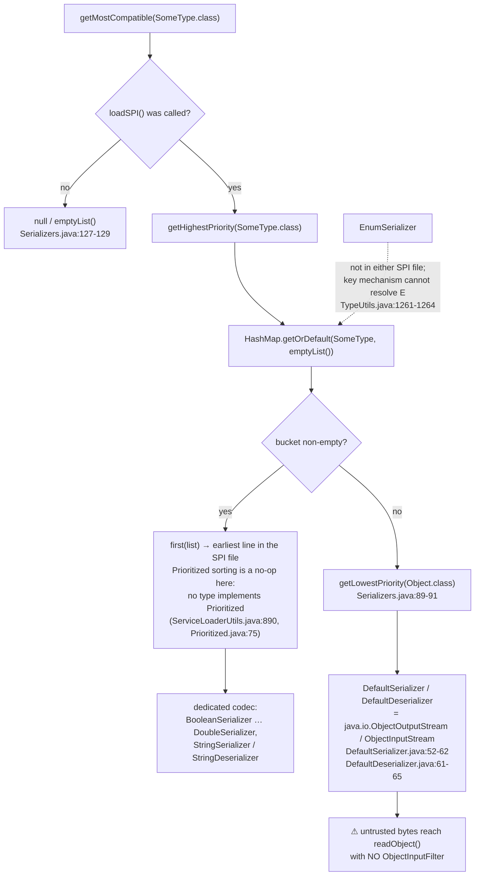
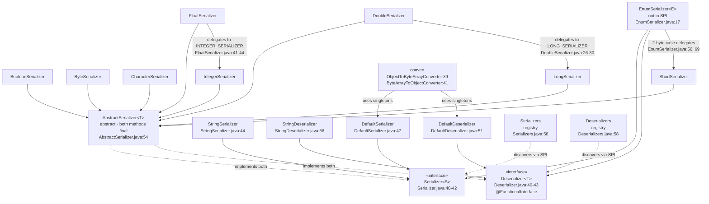

# Serialization — developer guide

Module: `io.github.microsphere-projects:microsphere-java-core` · Source line: `release` branch, `0.3.20-SNAPSHOT`
Package analysed: `io.microsphere.io.serializer` — **18 main-source types**.
Companion user-facing page: [User Guide — Serialization](../../user-guide/microsphere-java-core/serialization.md).

All `file:line` references are relative to `microsphere-java-core/src/main/java/io/microsphere/`
(main) or `microsphere-java-core/src/test/java/io/microsphere/` (test), read from the `release` worktree,
then shortened to `io/serializer/AbstractSerializer.java:40-55`.

---

## 1. Role in the architecture

`io.serializer` sits in the **Service layer** of the [developer index layer table](./README.md) — the same band as
`convert`, `event`, `logging`, `json` and `metadata`, and for the same reason: it is an SPI family discovered through
`META-INF/services`, and its implementations are looked up rather than wired.

The index draws two edges, and both are confirmed against the source rather than assumed:

* **`reflect` → `io.serializer` (it consumes the type model).** Three distinct reflective facilities are used, all in
  `io.microsphere.reflect`:
  * `TypeUtils.resolveTypeArgumentClasses(...)` derives the registry key for every provider
    (`io/serializer/Serializers.java:74`, `io/serializer/Deserializers.java:74`).
  * `JavaType.from(getClass()).as(AbstractSerializer.class).getGenericType(0).toClass()` resolves the encoded type `T`
    in the `AbstractSerializer` constructor (`io/serializer/AbstractSerializer.java:65-66`).
  * `MethodUtils.invokeStaticMethod(true, enumType, "values")` calls the generated `Enum.values()` with
    `forceAccess = true` (`io/serializer/EnumSerializer.java:39`; the flag's meaning is the parameter documented at
    `io/reflect/MethodUtils.java:898` and implemented at `:908-910`).
  Also `io.microsphere.annotation.Nonnull`, `io.microsphere.io.*` buffers, `io.microsphere.util.*` and
  `io.microsphere.collection.*` — all at or below the type-model layer.
* **`convert` → `io.serializer` (it is a consumer, not a dependency).**
  `ObjectToByteArrayConverter` imports `DefaultSerializer.DEFAULT_SERIALIZER`
  (`io/convert/ObjectToByteArrayConverter.java:21`) and calls it at `:39`;
  `ByteArrayToObjectConverter` imports `DefaultDeserializer.DEFAULT_DESERIALIZER`
  (`io/convert/ByteArrayToObjectConverter.java:22`) and calls it at `:41`.
  A grep for `import io.microsphere.io.serializer` across **all** main sources returns exactly those two files plus
  the test tree — so the direction is one-way, and `io.serializer` can be used with `convert` entirely absent.

**Boundary it owns:** `io.serializer` is the only place in `core` that converts between `Object`/`T` and `byte[]`.
It does not own framing, length prefixes, type tags, charset negotiation, or any of the record-level concerns that
`io.event`, `json` and `metadata` handle elsewhere. That narrow scope is why 18 types are enough.

---

## 2. Package and class map

| # | Type | Kind | Encodes | Extends / implements | In SPI file? |
|---|---|---|---|---|---|
| 1 | `Serializer<S>` | interface | — | — | is the service type |
| 2 | `Deserializer<T>` | `@FunctionalInterface` | — | — | is the service type |
| 3 | `AbstractSerializer<T>` | abstract base | any `T` | `implements Serializer<T>, Deserializer<T>` | — (abstract) |
| 4 | `BooleanSerializer` | final | `Boolean` | `extends AbstractSerializer<Boolean>` | both, line 1 |
| 5 | `ByteSerializer` | | `Byte` | `extends AbstractSerializer<Byte>` | both, line 2 |
| 6 | `CharacterSerializer` | | `Character` | `extends AbstractSerializer<Character>` | both, line 3 |
| 7 | `ShortSerializer` | | `Short` | `extends AbstractSerializer<Short>` | both, line 4 |
| 8 | `IntegerSerializer` | | `Integer` | `extends AbstractSerializer<Integer>` | both, line 5 |
| 9 | `LongSerializer` | final | `Long` | `extends AbstractSerializer<Long>` | both, line 6 |
| 10 | `FloatSerializer` | final | `Float` | `extends AbstractSerializer<Float>` | both, line 7 |
| 11 | `DoubleSerializer` | final | `Double` | `extends AbstractSerializer<Double>` | both, line 8 |
| 12 | `StringSerializer` | | `String` | `implements Serializer<String>` | `Serializer`, line 9 |
| 13 | `StringDeserializer` | | `String` | `implements Deserializer<String>` | `Deserializer`, line 9 |
| 14 | `DefaultSerializer` | | `Object` | `implements Serializer<Object>` | `Serializer`, line 10 |
| 15 | `DefaultDeserializer` | | `Object` | `implements Deserializer<Object>` | `Deserializer`, line 10 |
| 16 | `EnumSerializer<E>` | | `E extends Enum` | `implements Serializer<E>, Deserializer<E>` | **no** |
| 17 | `Serializers` | registry | — | — | — |
| 18 | `Deserializers` | registry | — | — | — |

Evidence for the inheritance column: `io/serializer/BooleanSerializer.java:12`, `ByteSerializer.java:31`,
`CharacterSerializer.java:29`, `ShortSerializer.java:11`, `IntegerSerializer.java:11`, `LongSerializer.java:11`,
`FloatSerializer.java:31`, `DoubleSerializer.java:16`, `StringSerializer.java:44`, `StringDeserializer.java:56`,
`DefaultSerializer.java:47`, `DefaultDeserializer.java:51`, `EnumSerializer.java:17`.

Two structural notes fall out of this table:

* Only the eight numeric classes extend `AbstractSerializer`. The `String`, `Object` and `Enum` codecs implement the
  raw interfaces and therefore **re-implement the `null` and width handling themselves** — or, in the `String` case,
  do not implement it at all (§3.4).
* Exactly four of the eighteen are `final` (`BooleanSerializer`, `LongSerializer`, `FloatSerializer`,
  `DoubleSerializer`), so the open-class pattern is not a package-wide convention.

---

## 3. Source analysis

### 3.1 The registry load loop

`Serializers.loadSPI()` (`io/serializer/Serializers.java:72-79`) is the whole registration mechanism:

```java
for (Serializer serializer : loadServicesList(Serializer.class, classLoader, true)) {
    List<Class<?>> typeArguments = resolveTypeArgumentClasses(serializer.getClass());
    Class<?> targetClass = first(typeArguments);
    List<Serializer> serializers = typedSerializers.computeIfAbsent(targetClass, k -> new LinkedList());
    serializers.add(serializer);
}
```

Four things are decided here, and the third is the one people misread.

**(a) The list is `Prioritized`-sorted, always.** `loadServicesList(Class, ClassLoader, boolean)` — the third
argument is `cached`, **not** `sorted` (`io/util/ServiceLoaderUtils.java:468-470`). Sorting is unconditional inside
the uncached worker: `sort(serviceList, COMPARATOR)` at `io/util/ServiceLoaderUtils.java:890`, with `COMPARATOR`
imported from `io.microsphere.lang.Prioritized` (`:30`). Because none of the eighteen types implements `Prioritized`
(a grep across the package finds no reference to it), the comparator takes its final branch and returns `0` for every
pair (`io/lang/Prioritized.java:71-75`), and `Collections.sort` is stable — so **the effective order is the SPI
file's declaration order**. `Serializers.java:76-77` then appends in that order, so `first(...)` is "earliest line in
the file". This is why `BooleanSerializer` beats everything for `Boolean`, and `DefaultSerializer` — being line 10 —
is always `getLowestPriority(Object.class)`.

**(b) The key is derived reflectively, from the provider's own type argument.**
`resolveTypeArgumentClasses` (`io/reflect/TypeUtils.java:1259-1265`) maps over `resolveTypeArguments`, which walks
**up the superclass chain**, at each level collecting generic-superclass arguments *then* generic-interface
arguments, stopping at `Object.class` (`io/reflect/TypeUtils.java:1198-1209`); `null` results from `asClass` are
filtered out (`:1263`). So:

| Provider | Why `first(...)` yields | Registry key |
|---|---|---|
| `IntegerSerializer` | generic superclass `AbstractSerializer<Integer>` is seen at the first level | `Integer.class` |
| `StringSerializer` | no superclass of interest; generic interface `Serializer<String>` | `String.class` |
| `DefaultSerializer` | generic interface `Serializer<Object>` (`io/serializer/DefaultSerializer.java:47`) | `Object.class` |

The consequence is that **the registry is flat, not polymorphic.** It is keyed on the *literal* type argument, so
`get(Integer.class)` never consults the `Number` or `Object` buckets — `get` is a single `HashMap.getOrDefault`
(`io/serializer/Serializers.java:127-129`). Only `getMostCompatible` bridges the gap, and it bridges it in exactly
one direction (§3.2).

**(c) `EnumSerializer` is excluded by construction, not by oversight.** It is generic over `E` and declares
`implements Serializer<E>, Deserializer<E>` (`io/serializer/EnumSerializer.java:17`), so its type arguments resolve to
a `TypeVariable`, which `asClass` cannot turn into a `Class` and `resolveTypeArgumentClasses` therefore drops
(`io/reflect/TypeUtils.java:1261-1264`). A key-producing mechanism cannot name a class for it, which matches the fact
that it appears in neither SPI file. It is instantiated per enum type instead (`EnumSerializer.java:27-31`).

**(d) `loadSPI` is append-only and non-idempotent.** Each call re-runs the loop and `add`s to the existing
`LinkedList` (`io/serializer/Serializers.java:76-77`). Nothing checks for duplicates. Whether a second call
doubles the lists depends entirely on the `cached` flag:

| | `Serializers.loadSPI` | `Deserializers.loadSPI` |
|---|---|---|
| call shape | `loadServicesList(Serializer.class, classLoader, true)` (`io/serializer/Serializers.java:73`) | `loadServicesList(Deserializer.class, classLoader)` (`io/serializer/Deserializers.java:73`) |
| resolves to | `cached = true` → `servicesCache` consulted | 2-arg overload → `cached = SERVICE_LOADER_CACHED` (`io/util/ServiceLoaderUtils.java:410-412`) |
| default | always cached | `false`, from `microsphere.service-loader.cached`, default `"false"` (`io/util/ServiceLoaderUtils.java:107`, `:112`, `:138`) |
| effect of calling twice | provider **instances** reused (same list), but the per-type lists still grow — see below | provider instances re-created **and** lists grow |

Note the residual bug even on the cached path: the returned service list is stable, but `serializers.add(serializer)`
at `:77` still executes a second time, so **`loadSPI()` is not idempotent for either registry.** Call it exactly once
per `Serializers` / `Deserializers` instance. The tests bear this out — both call `loadSPI()` once in a
`@BeforeEach` against a freshly constructed registry (`SerializersTest.java:51-54`,
`SerializersAndDeserializersTest.java:40-46`).

**(e) The only throw.** `loadServicesAsList` raises `IllegalArgumentException` when the service iterator is empty
(`io/util/ServiceLoaderUtils.java:882-886`). That is the failure mode of a stripped `META-INF/services` directory.
No lookup path in `Serializers`/`Deserializers` throws — misses surface as `null` or `emptyList()`.

### 3.2 The selection algorithm

`Serializers` exposes four accessors over one `Map<Class<?>, List<Serializer>>` field
(`io/serializer/Serializers.java:60`). `Deserializers` is the exact mirror (`:60`, `:87-129`).

| Accessor | Body | Behaviour |
|---|---|---|
| `get` | `getOrDefault(type, emptyList())` (`:127-129`) | `@Nonnull`; no fallback |
| `getHighestPriority` | `first(get(type))` (`:102-105`) | `null` when the bucket is empty — `ListUtils.first` returns `null` if `size < 1` (`io/collection/ListUtils.java:111-113`) |
| `getLowestPriority` | `last(get(type))` (`:114-117`) | `null` likewise (`io/collection/ListUtils.java:132-135`) |
| `getMostCompatible` | `getHighestPriority(type)`, else `getLowestPriority(Object.class)` (`:87-93`) | **unconditional JDK fallback** |

The last row is the design decision worth arguing with. `getMostCompatible` does not walk the supertype chain
searching for a compatible codec; it tries the exact bucket and otherwise **always** returns the lowest-priority
`Object`-keyed entry — `DefaultSerializer`. Since `Object` is populated by the SPI file's last line, and since `first`
and `last` of a one-element list coincide, `getMostCompatible(anything)` is `DefaultSerializer` for every type
without a dedicated codec. The `SerializersTest.java:70-80` assertions confirm the observable half of this: after
`loadSPI()`, `getMostCompatible` is non-`null` for all nine `SUPPORTED_CLASSES`, including `Object.class` itself —
where `getHighestPriority` and `getMostCompatible` return the same instance.

So the selection rule, stated exactly:

1. exact class match → highest-priority (first-in-file) codec;
2. no exact match → `DefaultSerializer` / `DefaultDeserializer` via the `Object` bucket;
3. never an exception, never a `Number`-or-supertype search.

Rule 2 is the reason this page carries a security section: a generic-looking API quietly routes unknown types into
unfiltered `ObjectInputStream.readObject()`.



### 3.3 The `AbstractSerializer` template

`AbstractSerializer<T>` is the package's only framework class, and both public methods are `final` — the extensibility
points are the three protected abstracts (`io/serializer/AbstractSerializer.java:119`, `:128`, `:137`).

The constructor does the work once, at construction (`:64-68`):

```java
JavaType type = from(getClass()).as(AbstractSerializer.class).getGenericType(0);
this.targetType = type.toClass();
this.bytesLength = calcBytesLength();
```

`bytesLength` is therefore a **cached virtual-method result captured into a `final` field**, and the subclass's
`calcBytesLength()` is invoked exactly once per instance — which is what makes the width guard on the hot path a
single integer comparison (`:87`). It also means `calcBytesLength()` must not depend on mutable subclass state, since
it runs before the subclass constructor body.

`serialize`/`deserialize` (`:70-92`) implement the degradation policy:

| Guard | Line | Result |
|---|---|---|
| `t == null` | `:73-75` | `null` |
| `bytes == null` | `:81-84` | `null` |
| `bytesLength != UNBOUND_BYTES_SIZE && bytesLength != bytes.length` | `:87-89` | `null` — silent |

The width guard is a *length equality check only*. It does not validate content, so a correctly sized but corrupt
buffer passes into `doDeserialize` and the subclass decides what happens — the numeric codecs do not check anything
further and simply reinterpret the bits (`io/serializer/IntegerSerializer.java:33-39`).

### 3.4 Layout order and its format-stability consequences

The task brief asks about "the class-descriptor writing order". Factually: **this package writes no class descriptor
of its own.** Two very different mechanisms exist, and only one is self-describing.

**Fixed-width codecs write no descriptor and no tag.** Every `AbstractSerializer` subclass emits *only* the value's
bytes, in a hand-written order, and `EnumSerializer` emits only an `ordinal` (`io/serializer/EnumSerializer.java:52-57`).
There is no type tag, no length prefix, no magic. The byte order sequence is:

| Family | Index 0 holds | Evidence |
|---|---|---|
| `Character`, `Short` | high byte | `io/serializer/CharacterSerializer.java:41-44` (`(byte) (c >>> 8)` first), `io/serializer/ShortSerializer.java:23-25` (`(byte) (shortValue >>> 8)` first) |
| `Integer`, `Float` | most-significant byte | `io/serializer/IntegerSerializer.java:23-28` (`>> 24` first); `FloatSerializer` inherits it by delegating to `INTEGER_SERIALIZER.doSerialize` (`io/serializer/FloatSerializer.java:41-44`) |
| `Long`, `Double` | **least-significant byte** | `io/serializer/LongSerializer.java:23-32` (`(byte) longValue` first); `DoubleSerializer` inherits it by delegating to `LONG_SERIALIZER.serialize` (`io/serializer/DoubleSerializer.java:26-30`) |
| `Enum` (2-byte case) | high byte, via `SHORT_SERIALIZER` | `io/serializer/EnumSerializer.java:56`, `:69` |

The consequences are real and permanent:

* The 4-byte and 8-byte families use **opposite byte orders**, and because `Float` routes through `Integer` while
  `Double` routes through `Long`, the split follows the *delegation target*, not any deliberate design. A record with
  an `int` field and a `long` field is big-endian then little-endian. Nothing in the bytes says so.
* Because nothing is tagged, the format is **not self-describing and not versionable**: widening a field, or swapping
  `Integer` for `Long`, produces plausible garbage rather than an error. The `deserialize` width guard catches a
  4-vs-8 swap (`io/serializer/AbstractSerializer.java:87-89`) and nothing subtler.
* `StringSerializer` adds no charset marker (`io/serializer/StringSerializer.java:57-59`) and `EnumSerializer`
  persists `ordinal()` rather than `name()` (`:49`), so **reordering enum constants silently reassigns the meaning of
  already-stored bytes**. Both sides must be pinned to the same enum declaration order.

**`DefaultSerializer` writes whatever `ObjectOutputStream` writes.** The class descriptor — magic `0xAC 0xED`, stream
version, class name, `serialVersionUID`, field descriptors — is emitted by the JDK, not here; the code contributes
exactly one call, `objectOutputStream.writeObject(source)` (`io/serializer/DefaultSerializer.java:58`).
Consequences: format stability is the JDK's guarantee, and `serialVersionUID` behaviour is the JDK's
recomputation rule. Grep for `serialVersionUID` across all 18 types returns nothing, so **the package neither pins
nor validates any `serialVersionUID`.** `DefaultDeserializer` likewise does not override `resolveClass`, install an
`ObjectInputFilter`, or bound the graph (`:61-65`); its only input validation is an emptiness check (`:57-59`).

### 3.5 Exception strategy of the two `Default*` classes

They are asymmetric in a way that is easy to miss:

| | `DefaultSerializer` | `DefaultDeserializer` |
|---|---|---|
| `catch` block | **none** (`io/serializer/DefaultSerializer.java:52-62`) | `catch (Exception e) { throw new IOException(e); }` (`:66-68`) |
| non-`Serializable` argument | propagates `NotSerializableException` as-is | n/a |
| `ClassNotFoundException` on read | n/a | collapses into `IOException` |
| `RuntimeException` from a target's `readObject` | n/a | also collapses into `IOException` — the `catch (Exception)` is unconditional |
| `close()` interference | cannot throw — `FastByteArrayOutputStream.close()` is a no-op (`io/io/FastByteArrayOutputStream.java:188-189`) | cannot throw — `FastByteArrayInputStream.close()` is a no-op (`io/io/FastByteArrayInputStream.java:157-158`) |
| `null` argument | not checked; behaviour is `ObjectOutputStream`'s | `null`/empty → `null` (`:57-59`) |

`toByteArray()` returns `Arrays.copyOf(buf, count)` (`io/io/FastByteArrayOutputStream.java:159-161`), so the returned
array is a private copy and the buffer's later GC cannot affect it.

The single unchecked-throw site reachable from this package is outside it:
`ByteArrayToObjectConverter.doConvert` casts the result to `Serializable` and wraps `IOException` in
`new RuntimeException(e)` (`io/convert/ByteArrayToObjectConverter.java:41-44`).



---

## 4. Round-trip sequence

```mermaid
sequenceDiagram
    autonumber
    participant Caller
    participant Reg as Serializers
    participant Ser as StringSerializer
    participant Buf as FastByteArrayOutputStream
    participant Des as StringDeserializer

    Note over Caller: callers must load once, before lookups
    Caller->>Reg: loadSPI()
    Reg->>Reg: loadServicesList(Serializer, cl, cached=true)  Serializers.java:73
    Reg->>Reg: sort(list, Prioritized.COMPARATOR)  ServiceLoaderUtils.java:890
    Reg->>Reg: resolveTypeArgumentClasses(provider) → key  Serializers.java:74-75
    Reg->>Reg: typedSerializers.computeIfAbsent(key, LinkedList).add(p)  :76-77

    Caller->>Reg: getHighestPriority(String.class)
    Reg-->>Caller: StringSerializer (first line-9 match; no fallback taken)
    Caller->>Ser: serialize("Test")
    Ser->>Ser: source.getBytes(charset)  StringSerializer.java:58
    Note over Ser,Buf: not used by StringSerializer — see the alt path below
    Ser-->>Caller: byte[4] = 54 65 73 74

    Caller->>Des: deserialize(bytes)
    Des->>Des: new String(bytes, charset)  StringDeserializer.java:70
    Des-->>Caller: "Test"

    alt unknown type — getMostCompatible path
        Caller->>Reg: getMostCompatible(Foo.class)
        Reg->>Reg: getHighestPriority(Foo.class) → null  Serializers.java:88
        Reg->>Reg: getLowestPriority(Object.class) → DefaultSerializer  :90
        Caller->>Ser: DefaultSerializer.serialize(foo)
        Ser->>Buf: try-with-resources, new ObjectOutputStream(this)  DefaultSerializer.java:54-55
        Buf-->>Ser: toByteArray() = copyOf(buf, count)  FastByteArrayOutputStream.java:160
        Ser-->>Caller: JDK stream bytes (0xAC 0xED …)
        Note over Caller: reverse path builds an ObjectInputStream<br/>and calls readObject() with NO filter  DefaultDeserializer.java:62-65
    end
```

---

## 5. Design patterns

| Pattern | Implementing class(es) | Evidence |
|---|---|---|
| **Strategy** | `Serializer<S>` / `Deserializer<T>`; selected per type by the registries | The interfaces declare one behaviour with no state (`io/serializer/Serializer.java:40-42`, `io/serializer/Deserializer.java:40-43`); the registry swaps implementations at runtime (`io/serializer/Serializers.java:87-117`) |
| **Registry** (of Strategies, keyed by `Class`) | `Serializers`, `Deserializers` | `Map<Class<?>, List<Serializer>> typedSerializers` (`io/serializer/Serializers.java:60`) plus `loadSPI`/`get*` (`:72-129`); the mirror at `io/serializer/Deserializers.java:60-129` |
| **Template Method** | `AbstractSerializer<T>` | `serialize`/`deserialize` are `final` (`io/serializer/AbstractSerializer.java:71`, `:80`) and delegate to abstract hooks `calcBytesLength`/`doSerialize`/`doDeserialize` (`:119`, `:128`, `:137`); the constructor calls the hook once and caches it (`:67`) |
| **Service Provider / Plug-in (SPI)** | `Serializers`, `Deserializers` | keyed on `META-INF/services/io.microsphere.io.serializer.Serializer` and `…Deserializer`; loaded via `loadServicesList` (`io/serializer/Serializers.java:73`) |
| **Flyweight / canonical instance** | the eight numeric `…SERIALIZER` singletons, `DEFAULT_SERIALIZER`, `DEFAULT_DESERIALIZER` | each is `public static final` and stateless after construction — e.g. `io/serializer/IntegerSerializer.java:13`, `io/serializer/BooleanSerializer.java:14`, `io/serializer/DefaultSerializer.java:49`, `io/serializer/DefaultDeserializer.java:53`. `ServiceLoader` instantiates a *second* set of these at `loadSPI()` time, since the SPI files name the same classes (`Serializers.java:73`) |
| **Null Object (as neutral degradation)** | `AbstractSerializer`, `DefaultDeserializer` | invalid input yields `null` instead of throwing: `io/serializer/AbstractSerializer.java:73-75`, `:81-84`, `:87-89`; `io/serializer/DefaultDeserializer.java:57-59`. Matches the [index degradation policy](./README.md) |
| **Adapter / delegation over codecs** | `FloatSerializer`, `DoubleSerializer`, `EnumSerializer` | bit-layout reuse rather than duplication: `io/serializer/FloatSerializer.java:41-44` → `INTEGER_SERIALIZER`, `io/serializer/DoubleSerializer.java:26-30` → `LONG_SERIALIZER`, `io/serializer/EnumSerializer.java:56`, `:69` → `SHORT_SERIALIZER`. Note this is *composition/delegation*, **not** the GoF Decorator — no codec wraps another's interface to add behaviour |
| **Facade (over the JDK stream)** | `DefaultSerializer`, `DefaultDeserializer` | collapse `OutputStream` + `ObjectOutputStream` + lifecycle into one `byte[]` call (`io/serializer/DefaultSerializer.java:52-62`) |
| **Type-token resolution** | `AbstractSerializer`, `Serializers`, `Deserializers` | `JavaType` (`io/serializer/AbstractSerializer.java:65`) and `resolveTypeArgumentClasses` (`io/serializer/Serializers.java:74`) recover `T` that erasure removed |
| **Reflection-based method invocation** | `EnumSerializer` | `invokeStaticMethod(true, enumType, "values")` (`io/serializer/EnumSerializer.java:39`) |

---

## 6. Extension points

### 6.1 Adding a `Serializer`

1. Implement `io.microsphere.io.serializer.Serializer<S>` — or, for a scalar type, extend `AbstractSerializer<S>`
   (`io/serializer/AbstractSerializer.java:54`) and inherit the `null` and width handling. `EnumSerializer` shows the
   alternative: implement the two interfaces directly (`io/serializer/EnumSerializer.java:17`).
2. **Declare the encoded type as a resolvable type argument.** `Serializers.loadSPI()` keys purely on
   `first(resolveTypeArgumentClasses(...))` (`io/serializer/Serializers.java:74-75`), so a class generic over `T`
   without a concrete argument in its supertype/interface list resolves to an empty list and lands under a `null` key
   (`io/reflect/TypeUtils.java:1261-1264`) — unreachable by `get(...)`. Bind the parameter: `extends AbstractSerializer<MyType>`.
3. Append the fully qualified class name to
   `microsphere-java-core/src/main/resources/META-INF/services/io.microsphere.io.serializer.Serializer`.
   Position matters: the current file is 10 lines ending with `io.microsphere.io.serializer.DefaultSerializer`, and
   earlier lines win `getHighestPriority` (`io/serializer/Serializers.java:102-105`).
4. Add `implements Prioritized` **only** if you must override file order — `Prioritized` entries sort ahead of
   non-`Prioritized` ones regardless of line position (`io/lang/Prioritized.java:65-73`). No built-in serializer does.
5. Ensure thread safety; it is a documented contract requirement (`io/serializer/Serializer.java:24-25`).

The same steps apply to `Deserializer`, with the `…serializer.Deserializer` service file (also 10 lines, ending
`io.microsphere.io.serializer.DefaultDeserializer`). Note `Deserializers.loadSPI()` uses the uncached overload
(`io/serializer/Deserializers.java:73`), so a provider's constructor runs on every `loadSPI()` call.

### 6.2 Replacing the JDK path — the important one

`Object.class` is the fallback bucket for `getMostCompatible` (`io/serializer/Serializers.java:89-91`), so overriding
the `Default*` entries is the supported way to change behaviour for all unknown types. Two options:

* **Register a filtered `Deserializer` bound to a concrete supertype** and prefer it by line position or
  `Prioritized`. This works only for types you can name.
* **Stop using `getMostCompatible`** and use `getHighestPriority`, treating `null` as "unsupported type — refuse".
  This is the cheaper fix and the one this page recommends, because it makes the JDK fallback opt-in instead of
  default. It is a behavioural change for existing callers, so it belongs to the module owner, not to a downstream patch.

**What is not an extension point.** `DefaultDeserializer`'s `ObjectInputStream` is created inside the method and never
exposed (`io/serializer/DefaultDeserializer.java:61-65`); there is no hook, no subclass, and no protected factory
method. You therefore **cannot** install a per-stream `java.io.ObjectInputFilter` on it. The only JDK lever that
reaches it is the process-global `jdk.serialFilter` / `jdk.io.objects.readData` property, which the library does not
read, set, or document. Any filtered deserialization must be a `Deserializer` of your own, registered as above.

### 6.3 Consuming from another `core` package

Prefer the singletons over the registry when the type is known at compile time — that is what `convert` does
(`io/convert/ObjectToByteArrayConverter.java:21,39`, `io/convert/ByteArrayToObjectConverter.java:22,41`). It avoids
`loadSPI()` entirely. Keep the dependency direction `convert → io.serializer`; `io.serializer` must not import
`convert`, and today it does not.

---

## 7. Thread safety and performance

### 7.1 Actual cache fields

| Field | Location | Type | Mutated after construction? | Consequence |
|---|---|---|---|---|
| `Serializers.typedSerializers` | `io/serializer/Serializers.java:60` | `Map<Class<?>, List<Serializer>>`, from `MapUtils.newHashMap()` → plain `HashMap` (`io/collection/MapUtils.java:478-480`) | **yes**, by `loadSPI()` (`:76-77`) | not concurrent-safe during load; safe to read concurrently once loading finished, provided no other writer |
| `Deserializers.typedDeserializers` | `io/serializer/Deserializers.java:60` | same | **yes** (`:76-77`) | same, and more likely to be re-loaded because caching is off |
| `Serializers.classLoader` / `Deserializers.classLoader` | `io/serializer/Serializers.java:62`, `Deserializers.java:62` | `final ClassLoader` | no | registry identity is fixed per instance |
| `ServiceLoaderUtils.servicesCache` | `io/util/ServiceLoaderUtils.java:140` | `ConcurrentMap<Class<?>, List<?>>` | yes, but atomically via `computeIfAbsent` (`:846`) | the *only* genuinely concurrent cache in this path; shared process-wide across every `cached = true` load |
| `AbstractSerializer.targetType` | `io/serializer/AbstractSerializer.java:56` | `final Class<T>` | no | resolved once in the constructor (`:65-66`); free afterwards |
| `AbstractSerializer.bytesLength` | `io/serializer/AbstractSerializer.java:58` | `final int` | no | captures `calcBytesLength()` at `:67`, so the width check is a field read, not a virtual call |
| `EnumSerializer.enums` | `io/serializer/EnumSerializer.java:23` | `final E[]` | no, but the array's *elements* are the live enum constants | `values()` invoked once per instance (`:29`, `:38-40`) |
| `EnumSerializer.bytesLength` | `io/serializer/EnumSerializer.java:25` | `final int` | no | width chosen once from the constant count (`:33-36`) |
| `StringSerializer.charset` / `StringDeserializer.charset` | `io/serializer/StringSerializer.java:46`, `StringDeserializer.java:58` | `final Charset` | no | the javadoc's thread-safety claim rests on this (`io/serializer/StringDeserializer.java:31-34`) |

**Verdict.** Every codec is immutable-after-construction and safe to share; that is the pattern the package follows,
and it is what the `Serializer`/`Deserializer` contracts demand (`io/serializer/Serializer.java:24-25`).
The two registries are **not** thread-safe to populate. `HashMap` + `LinkedList` under a non-atomic
`computeIfAbsent`-then-`add` sequence (`io/serializer/Serializers.java:76-77`) means concurrent `loadSPI()` calls can
lose entries or expose a partially built map during a resize. Populate on one thread at startup; publish before
readers exist.

### 7.2 Performance notes

* **Fixed-width codecs are allocation-minimal and branchless.** `IntegerSerializer` builds its array with four shifts
  and no `ByteBuffer` (`io/serializer/IntegerSerializer.java:23-28`); `BooleanSerializer` and `ByteSerializer` each
  allocate exactly one byte (`BooleanSerializer.java:26-30`, `ByteSerializer.java:41-43`). One array per call is the
  floor the `byte[]`-returning interface imposes; there is no internal pooling.
* **`Float`/`Double`/`Enum` pay one extra array copy** because they delegate to another codec and take its result
  (`io/serializer/FloatSerializer.java:43`, `DoubleSerializer.java:29`, `EnumSerializer.java:56`). The delegation is
  to the *singleton*, so no extra object is created.
* **`EnumSerializer` amortises a reflective `values()` call** across all uses of one instance
  (`io/serializer/EnumSerializer.java:29`), which is why it must be constructed once per enum type and cached, not
  per value.
* **`DefaultSerializer` is heavyweight by construction.** Per call it allocates a `FastByteArrayOutputStream` (32-byte
  initial buffer, `io/io/FastByteArrayOutputStream.java:68-69`), an `ObjectOutputStream`, the JDK's block-data
  machinery, and finally `Arrays.copyOf` in `toByteArray()` (`:159-161`). It also emits a full class descriptor per
  object, which is why the round trip in `DefaultSerializerAndDeserializerTest.java:39-45` yields many bytes for a
  four-character `String`. Treat it as a compatibility escape hatch, not a codec.
* **`loadSPI()` caching.** With `cached = true` the provider list is memoised in `servicesCache`
  (`io/util/ServiceLoaderUtils.java:845-846`), so repeat loads are cheap — but the registries' own per-type lists still
  grow (§3.1d), so caching does not make `loadSPI()` idempotent. The default is uncached for `Deserializer`
  (`:107`, `:138`), meaning every `Deserializers.loadSPI()` re-instantiates all ten providers reflectively.
* **`Serializable`-driven costs are not bounded here.** There is no size cap before `ObjectOutputStream.writeObject`
  (`io/serializer/DefaultSerializer.java:58`) and no depth/reference cap before `readObject`
  (`io/serializer/DefaultDeserializer.java:65`), so a large or deeply nested graph is limited only by the heap.

---

## 8. Testing strategy

`microsphere-java-core/src/test/java/io/microsphere/io/serializer/` holds 16 test classes. They partition cleanly
into three strategies.

**(a) Inherited round-trip harness for the `AbstractSerializer` family.**
`AbstractSerializerTest<T>` (`io/serializer/AbstractSerializerTest.java:21-64`) is itself abstract and `@Test`-free of
assertion logic: `test()` (`:23-26`) and `testNull()` (`:28-31`) both delegate to `test(Supplier<T>)` (`:33-51`),
which performs the entire contract check:

```java
byte[] bytes = serializer.serialize(value);
T deserialized = serializer.deserialize(bytes);
assertEquals(serializer.calcBytesLength(), serializer.getBytesLength());   // :38
...
assertSame(targetType, parameterType);                                     // :50
```

Three assertions are worth noting for anyone extending the package:

* `:38` proves `calcBytesLength()` is called more than once in the harness — once by the constructor (`:67`) and once
  directly here — so it must stay side-effect-free and must not depend on mutable subclass state.
* `:40-44` makes the `null` case a *value* case rather than a separate exception test, so a codec that throws on `null`
  fails the suite. This is the enforcement mechanism behind the §3.5 table.
* `:46-50` recovers `T` from the *test subclass's* own type argument via `JavaType`, then asserts
  `assertSame` against `getTargetType()` — a genuinely two-sided check that both reflection paths agree. It is also
  why `getTargetType()` matters beyond ergonomics.

`IntegerSerializerTest`, `BooleanSerializerTest`, `ByteSerializerTest`, `CharacterSerializerTest`,
`ShortSerializerTest`, `LongSerializerTest`, `FloatSerializerTest` and `DoubleSerializerTest` each supply just
`getSerializer()` and `getValue()` — e.g. `IntegerSerializerTest.java:33-41` returns `INTEGER_SERIALIZER` and
`MAX_VALUE`. Eight codecs are thereby covered for round trip, `null`, width consistency and type resolution at about
nine lines each.

**(b) Registry tests that assert the empty-before-load state.** `SerializersTest.java:37-47` declares
`SUPPORTED_CLASSES` as the contract surface, and each of its four tests follows the same shape — assert
empty/`null`, call `loadSPI()`, assert populated (`:56-67`, `:69-80`, `:82-93`, `:95-106`). Note
`SerializersTest.java:57` is spelled `testtGet` (a typo in the method name; it does test `get`). `get` is asserted
against `emptyList()` while the other three are asserted against `null`, pinning the `@Nonnull` distinction between
`:127-129` and `:102-117`. `DeserializersTest.java:35-98` mirrors it for `String` and `Object` only — the two keys
whose codecs are asymmetric (`StringSerializer` vs `StringDeserializer`) — with the same before/after pattern
(`:44-53`, `:55-64`, `:66-75`, `:77-86`, `:88-97`).

`SerializersAndDeserializersTest.java` is the only test that couples the two registries and asserts the *bytes*, not
just non-`null`-ness: `:49-56` pins `getHighestPriority(String.class)` to raw UTF-8 (proving the `String` bucket is
populated ahead of the `Object` fallback), and `:59-65` exercises `getMostCompatible(Integer.class)` through both
registries. Both `loadSPI()` calls happen in `@BeforeEach` on freshly built registries (`:40-46`) — the correct
pattern given §3.1(d).

**(c) Direct behaviour tests for the non-`AbstractSerializer` codecs.**
`StringSerializerAndDeserializerTest.java:34-74` is the most thorough in the package: default UTF-8 (`:40-46`), custom
`ISO_8859_1` (`:48-57`), empty string → `new byte[0]` → `""` (`:59-64`), and a UTF-16 round trip (`:66-73`).
It notably does **not** test `null`, which is exactly where these two classes deviate (§3.5, and pitfall 3 on the user
page). `EnumSerializerTest.java` covers the width boundary by pairing a small enum (`TimeUnit` → `1`, `:45`) against a
200-constant nested enum (`:62`, declared `:72-93`), round-trips every constant in both, and asserts both `null`
directions (`:54-55`). `DefaultSerializerAndDeserializerTest.java:37-46` round-trips a `String` and an `Integer`
through the JDK stream via a variable typed `Object`. `DefaultDeserializerTest.java:20-23` is a one-method test of the
`null → null` degradation.

**Coverage gaps that follow from this reading**, in rough order of consequence:

1. No test asserts anything about untrusted or hostile input, and no test references `ObjectInputFilter`. The
   `Default*` pair is tested only with trusted, JDK-round-trippable values.
2. `ByteSerializer` is registered in both SPI files but is missing from `SUPPORTED_CLASSES`
   (`io/serializer/SerializersTest.java:37-47`) and has no registry-level test — only its inherited
   `AbstractSerializerTest` round trip (`ByteSerializerTest.java:30-40`).
3. No test for `StringSerializer`/`StringDeserializer` on `null`, so the NPE asymmetry is undocumented by the suite.
4. No test for `loadSPI()` called twice, so the non-idempotent append (`io/serializer/Serializers.java:76-77`) is
   unprotected by the build.
5. `EnumSerializer` has no registry test at all, consistent with its absence from the SPI files; its
   `ordinal`-instability on enum reordering is untested.
6. No negative test for the width guard: nothing asserts `deserialize(new byte[3])` is `null` for
   `IntegerSerializer`, even though that is the behaviour at `io/serializer/AbstractSerializer.java:87-89`.
7. `SerializersTest.java:57` (`testtGet`) shows the suite is not name-checked by tooling.

---

## 9. See also

* [Reflection, types and beans](./reflection-and-beans.md) — the type model this package resolves its registry keys through (`TypeUtils.resolveTypeArgumentClasses`, `JavaType`, `MethodUtils.invokeStaticMethod`)
* [Type conversion](./type-conversion.md) — `ObjectToByteArrayConverter` / `ByteArrayToObjectConverter` are the only main-source consumers of `io.serializer`
* [I/O, NIO, scanning and file filters](./io-and-scanning.md) — the buffer and `io.event` side of the framing boundary described in §1
* [JSON](./json.md) — the neighbouring `io`-layer family that owns record-level structure this package deliberately does not
* [Language abstractions](./language-abstractions.md) — the `Prioritized` ordering contract behind `Serializers.getHighestPriority`
* [Serialization — User Guide](../../user-guide/microsphere-java-core/serialization.md) — caller-facing API reference and examples
* [Package index and layer diagram](./README.md)
* [中文版本](./serialization.zh.md)
