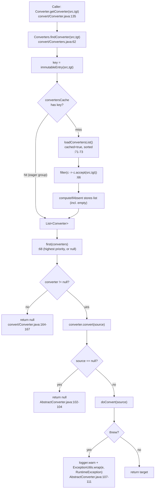
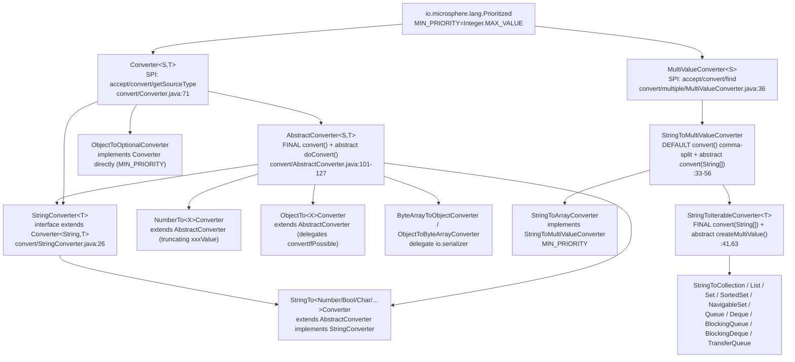
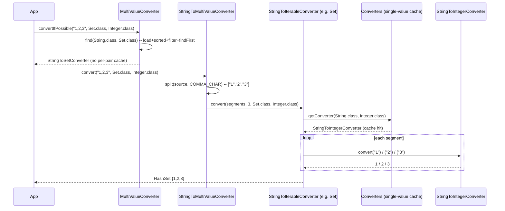
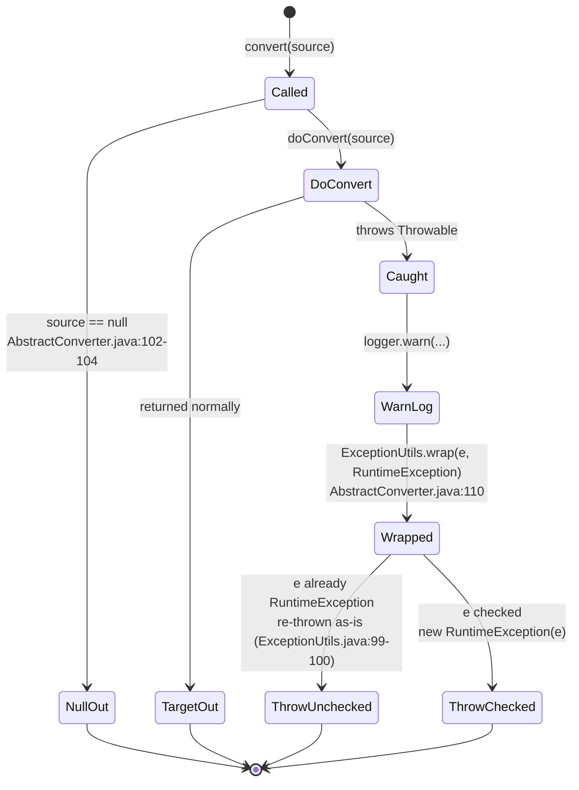

# Type conversion — Developer Guide

| | |
|---|---|
| **Layer** | Service layer (`convert`, `convert.multiple`) — built on the Type-model layer; see the [layer table](README.md#1-internal-dependency-structure) |
| **Packages** | `io.microsphere.convert` (38 main sources) · `io.microsphere.convert.multiple` (14 main sources) = **52** |
| **Source line** | `release` branch, `0.3.20-SNAPSHOT` |
| **Analysis focus** | converter selection and caching; multi-value dispatch; lossy-conversion decisions |
| **Verified outward edges** | `convert → reflect` (`TypeUtils.resolveActualTypeArgumentClass`), `convert → io.serializer` (byte[] ⇄ Object), `convert → util/lang/collection/logging/constants/annotation` |

Paths are relative to `microsphere-java-core/src/main/java/io/microsphere/` unless a `test/` path is spelled out;
after the first full mention they appear as `convert/Foo.java:40-55` / `convert/multiple/Foo.java:40-55`.

---

## 1. Role in the architecture

`convert` is a **Service-layer** package: it sits one level above the Type-model layer (`reflect`) and consumes it to
discover the generic signature of each converter. The `REFL --> CONV` edge from the developer index is literal:
`Converter.getSourceType()` / `getTargetType()` call
`io.microsphere.reflect.TypeUtils.resolveActualTypeArgumentClass(getClass(), Converter.class, 0|1)`
(`convert/Converter.java:23,99-110`), and the multi-value SPI does the same
(`convert/multiple/MultiValueConverter.java:24,62-64`, `convert/multiple/StringToIterableConverter.java:25,70-72`).
`MultiValueConverter` also reaches the Type-model layer through the same import.

The `CONV --> SERIAL` edge is real and narrow: only two converters leave the `convert` package for `io.serializer` —
`ByteArrayToObjectConverter` uses `DefaultDeserializer.DEFAULT_DESERIALIZER` (`convert/ByteArrayToObjectConverter.java:22,38-45`)
and `ObjectToByteArrayConverter` uses `DefaultSerializer.DEFAULT_SERIALIZER` (`convert/ObjectToByteArrayConverter.java:21,37-40`).
Every other converter stays inside the JDK plus Foundation-layer utilities.

`convert` is discovered and ordered through SPI: implementations are registered in
`src/main/resources/META-INF/services/` and selected first-match after sorting by `io.microsphere.lang.Prioritized`
(`convert/Converter.java:72`, `convert/Converters.java:62-72`). `metadata` (page 13) is the main in-library consumer.

> [!NOTE]
> Correction to the brief: the task hints at a "string→date converter", but **none exists on `release`**. The only
> temporal converter is `StringToDurationConverter` (`convert/StringToDurationConverter.java`), and the test suite
> asserts `convertIfPossible("1", Date.class)` is `null` (`convert/ConverterTest.java:50`). Any claim about date
> parsing was dropped for lack of evidence.

---

## 2. Package and class map

### 2.1 `io.microsphere.convert` — 38 types

| Role | Count | Types |
|---|---|---|
| Contracts | 2 | `Converter<S,T>` (`@FunctionalInterface`, extends `Prioritized`), `StringConverter<T>` (marker `extends Converter<String,T>`) |
| Registry / utils | 1 | `Converters` (package-private `implements Utils`) |
| Template base | 1 | `AbstractConverter<S,T>` (null-safe + priority-deriving) |
| `StringTo*` | 13 | `Boolean`, `Byte`, `Character`, `CharArray`, `Class`, `Double`, `Duration`, `Float`, `InputStream`, `Integer`, `Long`, `Short`, `String` |
| `NumberTo*` | 7 | `Byte`, `Character`, `Double`, `Float`, `Integer`, `Long`, `Short` |
| `ObjectTo*` | 11 | `Boolean`, `ByteArray`, `Byte`, `Character`, `Double`, `Float`, `Integer`, `Long`, `Optional`, `Short`, `String` |
| misc source | 2 | `ByteArrayToObjectConverter` (`byte[]→Object`), `PropertiesToStringConverter` (`Properties→String`) |
| single collection bridge | 1 | `MapToPropertiesConverter` (`Map→Properties`) |
| | **38** | 4 non-concrete + 34 concrete (all 34 registered in the service file) |

### 2.2 `io.microsphere.convert.multiple` — 14 types

| Role | Count | Types |
|---|---|---|
| Contract | 1 | `MultiValueConverter<S>` (`@FunctionalInterface`-like, extends `Prioritized`) |
| Splitting base contract | 1 | `StringToMultiValueConverter` (default comma-split + abstract `convert(String[]…)`) |
| Template base | 1 | `StringToIterableConverter<T extends Iterable>` (abstract `createMultiValue`) |
| Array leaf | 1 | `StringToArrayConverter` (implements `StringToMultiValueConverter` directly) |
| Collection leaves | 10 | `StringToCollection`, `StringToList`, `StringToSet`, `StringToSortedSet`, `StringToNavigableSet`, `StringToQueue`, `StringToDeque`, `StringToBlockingQueue`, `StringToBlockingDeque`, `StringToTransferQueue` |
| | **14** | 3 non-concrete + 11 concrete (all 11 registered) |

Concrete container each collection leaf builds (from `createMultiValue`, `multiValueType` is ignored):

| Leaf | Concrete result | Evidence |
|---|---|---|
| `StringToCollectionConverter` | `ArrayList` | `convert/multiple/StringToCollectionConverter.java:29-32` |
| `StringToListConverter` | `ArrayList` | `convert/multiple/StringToListConverter.java:30-31` |
| `StringToSetConverter` | `HashSet` | `convert/multiple/StringToSetConverter.java:29-32` |
| `StringToSortedSetConverter` / `StringToNavigableSetConverter` | `TreeSet` | `convert/multiple/StringToSortedSetConverter.java:30-31`, `.../StringToNavigableSetConverter.java:31-32` |
| `StringToQueueConverter` / `StringToDequeConverter` | `ArrayDeque` | `convert/multiple/StringToQueueConverter.java:31-32`, `.../StringToDequeConverter.java:30-31` |
| `StringToBlockingQueueConverter` | `ArrayBlockingQueue(size)` | `convert/multiple/StringToBlockingQueueConverter.java:30-33` |
| `StringToBlockingDequeConverter` | `LinkedBlockingDeque(size)` | `convert/multiple/StringToBlockingDequeConverter.java:29-32` |
| `StringToTransferQueueConverter` | `LinkedTransferQueue` | `convert/multiple/StringToTransferQueueConverter.java:30-32` |

---

## 3. Source analysis

### 3.1 How a converter is selected for `(sourceType, targetType)`

The single-value registry is `Converters` (package-private, `convert/Converters.java:42-77`). Selection is
`findConverter` (`:62-69`): build an immutable `(sourceType, targetType)` entry as the cache key, look it up in
`convertersCache` (a `ConcurrentMap`), and if absent compute the list of all loaded converters whose `accept(...)`
returns true; the returned converter is `first(converters)` (`:68`) — the highest-priority match, or `null` when the
list is empty. `Converter.getConverter` is a thin facade over this (`convert/Converter.java:135-137`).

`accept` is defined once on the interface (`convert/Converter.java:81-83`): a converter accepts a pair when its *own*
`getSourceType()` is assignable-from the requested source **and** its `getTargetType()` is assignable-from the requested
target, using `ClassUtils.isAssignableFrom`. Concrete converters do not override `accept` (except `StringToArrayConverter`,
which matches on `multiValueType.isArray()`, `convert/multiple/StringToArrayConverter.java:31-33`).

Priority ties the selection order. `AbstractConverter.resolvePriority()` (`convert/AbstractConverter.java:139-148`)
returns a **negative** number that grows in magnitude with the inheritance depth of source and target
(`-( (allClasses(source).size() << 16) | allClasses(target).size() )`), so more specific pairs carry smaller (earlier)
values and win `first(...)`. Because `Prioritized.MAX_PRIORITY = Integer.MIN_VALUE` and
`MIN_PRIORITY = Integer.MAX_VALUE` (`lang/Prioritized.java:81,86`), lower numeric = higher priority; the test
`convert/BaseConverterTest.java:75-79` asserts every `AbstractConverter`'s priority is negative.

### 3.2 The cache

Two layers of caching protect the hot path:

1. **Eager per-pair cache.** The static field `convertersCache` is populated at class load by `initConvertersCache()`
   (`convert/Converters.java:46,48-60`), which groups the sorted service list by each converter's *exact*
   `(getSourceType(), getTargetType())`. The common case (`String→Integer`, `Object→Integer`, …) therefore hits a
   pre-computed list without any filtering.
2. **Lazy miss fill.** `findConverter` uses `computeIfAbsent` (`convert/Converters.java:63-67`): a key that is *not* an
   exact registered pair (e.g. `Integer→Integer`, resolved by `ObjectToIntegerConverter`) triggers one full
   `loadConvertersList().stream().filter(accept)` scan, and the resulting list — including an empty list — is memoized.
   The underlying `loadConvertersList()` itself calls `ServiceLoaderUtils.loadServicesList(Converter.class, classLoader, true)`
   with `cached = true` (`convert/Converters.java:71-73`), so the raw SPI load is also cached and sorted.

The consequence for correctness: because the miss list is captured once, a converter registered only *after* the first
lookup of a given pair will not appear for that pair. The classloader used is fixed at `getClassLoader(Converters.class)`
(`convert/Converters.java:44`).

### 3.3 Multi-value dispatch (array / collection / map) and recursion into single-value conversion

Multi-value dispatch is a separate SPI with **no** per-pair cache. `MultiValueConverter.find(sourceType, targetType)`
(`convert/multiple/MultiValueConverter.java:73-81`) loads the service list, `.sorted()`, `.filter(accept)`,
`.findFirst()`, or `null`. `convertIfPossible` (`:83-90`) then calls the winning converter's `convert`. The sorted-set
of converters self-orders by the `StringToIterableConverter.getPriority()` formula
`MIN_PRIORITY - <# of Iterable-assignable interfaces of the supported type>` (`convert/multiple/StringToIterableConverter.java:74-78`):
`Collection` → `MAX_VALUE-1`, `Set` → `MAX_VALUE-2` (`convert/multiple/StringToSetConverterTest.java:113-116`), so the
narrowest matching container wins. Verified selection matrix:

> `convert/multiple/MultiValueConverterTest.java:44-75`

The recursion back into single-value conversion is the crux. Two template paths:

- **Array path** (`StringToArrayConverter`, which implements `StringToMultiValueConverter` directly, not via `Iterable`):
  `StringToMultiValueConverter.convert` splits the source on `COMMA_CHAR` (`convert/multiple/StringToMultiValueConverter.java:33-45`),
  then `StringToArrayConverter.convert` resolves the component type from `targetType.getComponentType()`, fetches
  `Converter.getConverter(String.class, componentType)`, and calls `converter.convert(segment)` per element, storing via
  `java.lang.reflect.Array.set` (`convert/multiple/StringToArrayConverter.java:36-49`). Note it ignores the `elementType`
  argument (`convert/multiple/StringToArrayConverterTest.java:56` passes `null` yet works) and **does not null-check the
  looked-up converter** — an unconvertible component type yields `NullPointerException`.

- **Iterable path** (`StringToIterableConverter`): the final `convert(String[]…)` obtains an
  `Optional<StringConverter>` via `getStringConverter(elementType)` = `getConverter(String.class, elementType)`
  (`convert/multiple/StringToIterableConverter.java:43-44,65-67`), creates the container from `createMultiValue`, and
  only fills it if a `Collection`. If no element converter exists it returns `null` instead of throwing
  (`convert/multiple/StringToIterableConverter.java:60`; proven `convert/multiple/StringToSetConverterTest.java:105`).

Both paths therefore delegate every element to the single-value `Converter` SPI covered in §3.1–3.2, reusing the same
per-pair cache.

### 3.4 The `Converter`-direct escape hatch

Every concrete converter except one extends `AbstractConverter` and therefore inherits its `null`-source short-circuit
(`convert/AbstractConverter.java:102-104`). `ObjectToOptionalConverter` deliberately implements `Converter` **directly**
(`convert/ObjectToOptionalConverter.java:28-38`) so that it can return `Optional.empty()` — not `null` — when the source
is `null` (`Optional.ofNullable(source)`); the test pins this divergence
(`convert/ObjectToOptionalConverterTest.java:43-52`: `accept(String.class, Optional.class)` is `true`, and
`convert(null)` equals `Optional.empty()`). It also sets `getPriority()` to `MIN_PRIORITY`
(`convert/ObjectToOptionalConverter.java:40-43`), so it is the last-resort strategy for any `Object→Optional` pair. This is
the template to copy when a converter must produce a non-`null` neutral value on absent input.

### 3.5 Exception-wrapping pipeline

`AbstractConverter.convert` wraps `doConvert` in `try/catch (Throwable)`, logs a warning, and rethrows
`ExceptionUtils.wrap(e, RuntimeException.class)` (`convert/AbstractConverter.java:106-112`). `wrap`
(`util/ExceptionUtils.java:98-104`) keeps the source unchanged when it is already assignable to the target type — so a
`NumberFormatException` or `IllegalArgumentException` from a `StringTo*` converter surfaces with its original identity
(`convert/StringToIntegerConverterTest.java:47-50`), while a *checked* `Throwable` is instantiated into a fresh
`RuntimeException`: an anonymous converter whose `doConvert` throws a plain `Throwable` is observed as `RuntimeException`
(`convert/AbstractConverterTest.java:81-91`). The `Map→Properties` case shows an *input-shape* throw surviving the same
path: `Properties.putAll` rejects a `null` value with `NullPointerException`, which re-emits unchanged
(`convert/MapToPropertiesConverterTest.java:53-57`). `ByteArrayToObjectConverter` short-circuits this pipeline itself by
catching `IOException` and throwing `new RuntimeException(e)` before `AbstractConverter` sees it
(`convert/ByteArrayToObjectConverter.java:42-44`).

### 3.6 Priority resolution and its fallback

`AbstractConverter`'s constructor calls `resolvePriority()` once and stores it in the `@Nullable Integer priority` field
(`convert/AbstractConverter.java:95-97`). `getPriority()` returns that value, or falls back to
`Converter.super.getPriority()` — `Prioritized.NORMAL_PRIORITY` = `0` — when the stored value is `null`
(`convert/AbstractConverter.java:150-153`). The default `resolvePriority()` is negative and depth-derived
(`convert/AbstractConverter.java:139-148`, proven `convert/BaseConverterTest.java:75-79`), but a subclass may override it
to return `null` to opt into neutral priority — a behaviour the test exercises directly
(`convert/AbstractConverterTest.java:39-58,71-74`). Because selection is `first(...)` over the sorted list
(`convert/Converters.java:68`), this fallback lets a hand-written converter sit at priority `0` between the negative
`AbstractConverter` strategies and the `Integer.MAX_VALUE` multi-value catch-alls.

---

## 4. Control-flow and hierarchy diagrams

### 4.1 Converter-selection / dispatch pipeline

### 4.2 Class hierarchy and Template-Method seams

The two Template-Method seams are `AbstractConverter.convert` (final) delegating to `doConvert` (abstract,
`convert/AbstractConverter.java:101-127`) and `StringToIterableConverter.convert` (final) delegating to `createMultiValue`
(abstract, `convert/multiple/StringToIterableConverter.java:41,63`). A third seam is the default method
`StringToMultiValueConverter.convert` (split) calling the abstract `convert(String[]…)`
(`convert/multiple/StringToMultiValueConverter.java:33-56`).

### 4.3 A multi-value conversion, end to end

### 4.4 `AbstractConverter.convert` template-method state machine

---

## 5. Design patterns

| Pattern | Implementing class(es) | Evidence |
|---|---|---|
| **Strategy (ordered by priority)** | every `Converter` / `MultiValueConverter`; the pair is the strategy key, `Prioritized.getPriority()` orders candidates | `convert/Converter.java:72` (extends `Prioritized`), `convert/Converters.java:66-68` (filter + `first`) |
| **Template Method** | `AbstractConverter.convert` (final) → `doConvert` (abstract); `StringToIterableConverter.convert` (final) → `createMultiValue` (abstract); `StringToMultiValueConverter.convert` (default split) → `convert(String[]…)` (abstract) | `convert/AbstractConverter.java:101-127`, `convert/multiple/StringToIterableConverter.java:41,63`, `convert/multiple/StringToMultiValueConverter.java:33-56` |
| **Registry / (light) Composite** | `Converters` holds the cache `ConcurrentMap<(source,target), List<Converter>>` and dispatches | `convert/Converters.java:46-60` |
| **Facade** | `Converter.getConverter` / `convertIfPossible`; `MultiValueConverter.find` / `convertIfPossible` hide loading, sorting, filtering | `convert/Converter.java:135-168`, `convert/multiple/MultiValueConverter.java:73-90` |
| **Flyweight (shared singletons)** | each concrete converter publishes a stateless `INSTANCE` (e.g. `StringToIntegerConverter.INSTANCE`) | `convert/StringToIntegerConverter.java:32`, repeated across `StringTo*`/`NumberTo*`/`ObjectTo*` |
| **Null Object (non-`null` neutral result)** | `ObjectToOptionalConverter` returns `Optional.empty()` instead of `null` on absent input, bypassing `AbstractConverter`'s null short-circuit | `convert/ObjectToOptionalConverter.java:28-43`, `convert/ObjectToOptionalConverterTest.java:48-52` |

---

## 6. Extension points — registering a custom converter

1. **Implement the SPI.** Prefer extending `AbstractConverter<S,T>`: you get `null`-safety, exception wrapping, logging,
   and auto-derived priority for free and only implement `protected abstract T doConvert(@Nonnull S source)`
   (`convert/AbstractConverter.java:101-127`). Implement `Converter<S,T>` directly only if you need a custom `convert`
   (like `ObjectToOptionalConverter`, `convert/ObjectToOptionalConverter.java:28-43`).
2. **Declare the generic signature.** `getSourceType()` / `getTargetType()` are read from the class's type arguments via
   `reflect` (`convert/Converter.java:99-110`); a raw or wildcard implementation will not resolve its pair.
3. **Register the class name** in
   `microsphere-java-core/src/main/resources/META-INF/services/io.microsphere.convert.Converter`
   (the exact filename). Multi-value converters go in
   `META-INF/services/io.microsphere.convert.multiple.MultiValueConverter`.
4. **Control ordering** by implementing `io.microsphere.lang.Prioritized` and overriding `getPriority()`; lower numeric
   wins `first(...)`. Default `AbstractConverter` priority is negative and depth-derived
   (`convert/AbstractConverter.java:139-148`).
5. **Classloader visibility**: converters are loaded with `getClassLoader(Converters.class)`
   (`convert/Converters.java:44`), so the implementation and its service file must be on a classloader visible to
   `microsphere-java-core`.
6. **Opt out of the template when needed.** Implement `Converter<S,T>` directly (rather than extending
   `AbstractConverter`) when you must return a *non-`null` neutral value* for absent input — `ObjectToOptionalConverter`
   does exactly this so `convert(null)` yields `Optional.empty()` (`convert/ObjectToOptionalConverter.java:28-43`) — or
   when you want a custom `getPriority()` that ignores depth. In that case you also own `equals`/`hashCode`; the default
   value-based ones live on `AbstractConverter` (`convert/AbstractConverter.java:155-173`, exercised by
   `convert/AbstractConverterTest.java:100-113`).

> [!WARNING]
> The single-value cache is populated at class load and on first miss, and a per-pair miss list is memoized
> (`convert/Converters.java:46-67`). A custom converter added at runtime *after* the first lookup of its pair will not be
> picked up for that pair; restart / re-load is required.

---

## 7. Thread-safety and performance

- `Converters.classLoader` is a `final static` field (`convert/Converters.java:44`); `convertersCache` is a
  `ConcurrentHashMap` (`:46`) accessed only via `computeIfAbsent` (`:64`), whose mapping function is executed atomically —
  so lazy miss-fill is safe under concurrency. The per-key `List<Converter>` values are `ArrayList`s written only inside
  the initialisation/miss function and thereafter read-only (`first(converters)`, `:68`).
- `AbstractConverter`'s only mutable-looking field is `@Nullable private Integer priority` (`convert/AbstractConverter.java:93`),
  assigned once in the constructor (`:95-97`) and never re-written; `convert` is declared `final` (`:101`). Because the
  field is not `final`, safe publication relies on the singleton being constructed before sharing — true for every
  `INSTANCE` (`convert/StringToIntegerConverter.java:32`).
- Concrete `StringTo*`/`NumberTo*`/`ObjectTo*` converters are **stateless**, hence safe to share. The single exception is
  `StringToInputStreamConverter`, which keeps a `final Charset` (`convert/StringToInputStreamConverter.java:41`) — still
  immutable per instance.
- **Performance asymmetry**: the single-value path is O(1) after the first lookup of a pair (cached, §3.2); the
  multi-value `MultiValueConverter.find` re-sorts and re-filters on **every call** because it has no per-pair cache
  (`convert/multiple/MultiValueConverter.java:73-81`), only the underlying cached service list. In tight multi-value loops,
  resolve the `MultiValueConverter` once and reuse it rather than calling `convertIfPossible` repeatedly.

---

## 8. Testing strategy

- **Shared harness.** `BaseConverterTest<S,T>` (`convert/BaseConverterTest.java:39-105`) is the abstract contract test:
  it resolves the source/target types from the subclass's generic signature (`:53-58`), then asserts
  `testConvert` (`:60-68`, `deepEquals` for arrays, `equals` otherwise), `testConvertOnNull` → `null` (`:70-73`),
  `testGetPriority` → negative (`:75-79`), `testAccept` (`:81-84`), `testGetSourceType`/`testGetTargetType` (`:86-94`),
  `testGetConverter` (registry returns an `equals` converter, `:96-99`) and `testConvertIfPossible` (`:101-104`).
  Concrete tests supply only `createConverter()`, `getSource()`, `getTarget()`.
- **Register every concrete converter** in `META-INF/services/io.microsphere.convert.Converter` so
  `ConverterTest.testGetConverter` can round-trip each registered pair through the registry
  (`convert/ConverterTest.java:38-43`) — note the shipped file lists `ObjectToOptionalConverter` twice (`:20` and `:32`),
  which is harmless because `first(...)` short-circuits but should be de-duplicated.
- **Edge tests to mirror.** Failure modes are asserted directly: `StringToIntegerConverterTest` expects
  `NumberFormatException` (`:47-50`); `StringToCharacterConverterTest` expects `IllegalArgumentException` for length>1
  and `null` for empty (`:48-56`); `ByteArrayToObjectConverterTest` expects `RuntimeException` on bad bytes (`:49-52`);
  `StringToBooleanConverterTest` asserts the `true/False/empty-null` lattice (`:49-55`).
- **Multi-value tests** check both the fixed concrete container and the sorted-selection: `MultiValueConverterTest.testFind`
  pins each `(String, target)` → converter class (`convert/multiple/MultiValueConverterTest.java:44-75`);
  `StringToArrayConverterTest` pins priority `Integer.MAX_VALUE` (`:66-69`) and null/empty behaviour (`:53-59`);
  `StringToSetConverterTest`/`StringToCollectionConverterTest` pin `MAX_VALUE-2`/`MAX_VALUE-1` (`:113-116`/`:114-117`) and
  the "null elementType → null" rule (`convert/multiple/StringToSetConverterTest.java:105`).
- **Recursion coverage.** To exercise the array NPE path, add a test converting to an array whose component type has no
  registered `String` converter; the production code dereferences the looked-up converter without a null check
  (`convert/multiple/StringToArrayConverter.java:40-46`).
- **Template-base contract.** `AbstractConverterTest` (`convert/AbstractConverterTest.java:37-127`) drives the seams §3.5–3.6
  describe: a subclass overriding `resolvePriority()` to `null` must yield `NORMAL_PRIORITY` from `getPriority()`
  (`:71-74`); a `doConvert` that throws a checked `Throwable` must surface as `RuntimeException` (`:81-91`); and
  `equals`/`hashCode` are value-based on `(sourceType, targetType, priority)` (`:100-113`, source at
  `convert/AbstractConverter.java:155-173`).
