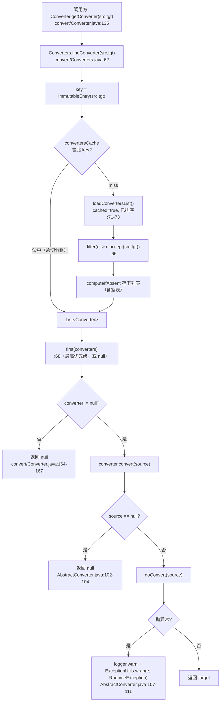
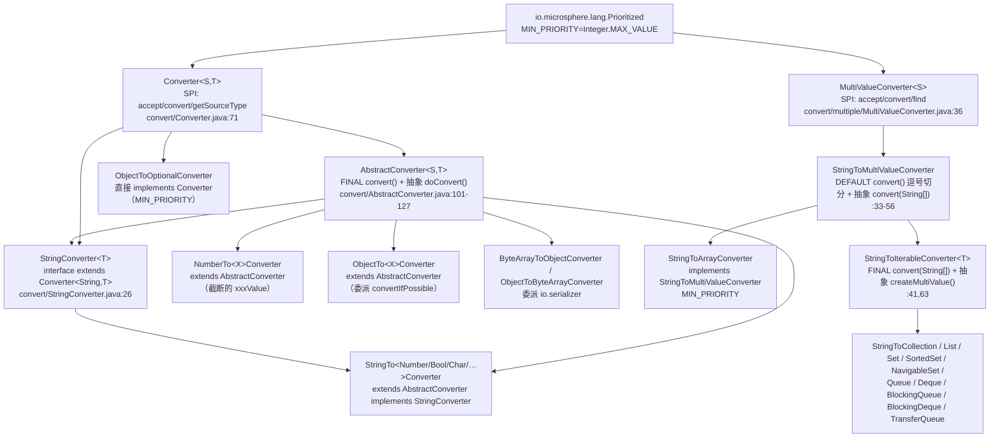
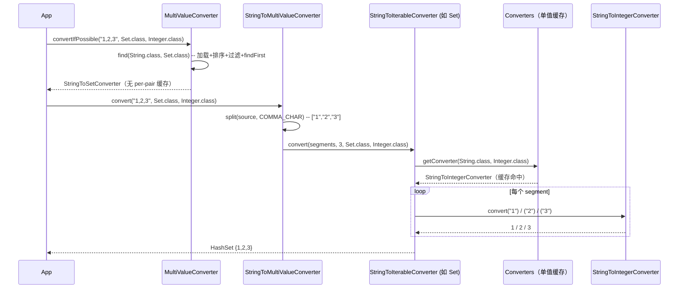
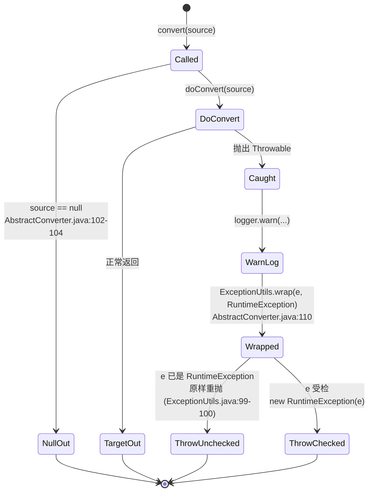

# 类型转换 — 开发者指南

| | |
|---|---|
| **层** | 服务层（`convert`、`convert.multiple`）——构建于类型模型层之上；参见[层表](./README.zh.md#1-内部依赖结构) |
| **包** | `io.microsphere.convert`（38 个主源文件）· `io.microsphere.convert.multiple`（14 个主源文件）= **52** |
| **源码线** | `release` 分支，`0.3.20-SNAPSHOT` |
| **分析重点** | 转换器选择与缓存；多值分发；有损转换决策 |
| **已核实的外向依赖边** | `convert → reflect`（`TypeUtils.resolveActualTypeArgumentClass`）、`convert → io.serializer`（byte[] ⇄ Object）、`convert → util/lang/collection/logging/constants/annotation` |

路径相对于 `microsphere-java-core/src/main/java/io/microsphere/`，除非写明了 `test/` 路径；首次完整出现后缩写为
`convert/AbstractConverter.java:40-55` / `convert/multiple/StringToArrayConverter.java:40-55`。

---

## 1. 在架构中的角色

`convert` 是一个**服务层**包：它比类型模型层（`reflect`）高一级，并消费后者来发现每个转换器的泛型签名。开发者索引里的
`REFL --> CONV` 边在源码中是字面存在的：`Converter.getSourceType()` / `getTargetType()` 调用
`io.microsphere.reflect.TypeUtils.resolveActualTypeArgumentClass(getClass(), Converter.class, 0|1)`
（`convert/Converter.java:23,99-110`），多值 SPI 也做同样的事（`convert/multiple/MultiValueConverter.java:24,62-64`、
`convert/multiple/StringToIterableConverter.java:25,70-72`）。`MultiValueConverter` 也通过同一 import 触达类型模型层。

`CONV --> SERIAL` 边真实存在且很窄：只有两个转换器离开 `convert` 包进入 `io.serializer`——
`ByteArrayToObjectConverter` 使用 `DefaultDeserializer.DEFAULT_DESERIALIZER`
（`convert/ByteArrayToObjectConverter.java:22,38-45`），`ObjectToByteArrayConverter` 使用
`DefaultSerializer.DEFAULT_SERIALIZER`（`convert/ObjectToByteArrayConverter.java:21,37-40`）。其他所有转换器都停留在
JDK 加基础层工具之内。

`convert` 通过 SPI 被发现并排序：实现注册在 `src/main/resources/META-INF/services/` 中，并按
`io.microsphere.lang.Prioritized` 排序后首个匹配选取（`convert/Converter.java:72`、`convert/Converters.java:62-72`）。
库内主要消费者是 `metadata`（第 13 页）。

> [!NOTE]
> 对任务简报的一处更正：简报暗示存在“string→date 转换器”，但 `release` 上**并不存在**。唯一的时间转换器是
> `StringToDurationConverter`（`convert/StringToDurationConverter.java`），且测试断言
> `convertIfPossible("1", Date.class)` 为 `null`（`convert/ConverterTest.java:50`）。任何关于日期解析的论断都因缺乏证据
> 而被舍弃。

---

## 2. 包与类映射

### 2.1 `io.microsphere.convert` — 38 个类型

| 角色 | 数量 | 类型 |
|---|---|---|
| 契约 | 2 | `Converter<S,T>`（`@FunctionalInterface`，extends `Prioritized`）、`StringConverter<T>`（标记 `extends Converter<String,T>`） |
| 注册表 / 工具 | 1 | `Converters`（包私有 `implements Utils`） |
| 模板基类 | 1 | `AbstractConverter<S,T>`（空值安全 + 优先级推导） |
| `StringTo*` | 13 | `Boolean`、`Byte`、`Character`、`CharArray`、`Class`、`Double`、`Duration`、`Float`、`InputStream`、`Integer`、`Long`、`Short`、`String` |
| `NumberTo*` | 7 | `Byte`、`Character`、`Double`、`Float`、`Integer`、`Long`、`Short` |
| `ObjectTo*` | 11 | `Boolean`、`ByteArray`、`Byte`、`Character`、`Double`、`Float`、`Integer`、`Long`、`Optional`、`Short`、`String` |
| 杂项源 | 2 | `ByteArrayToObjectConverter`（`byte[]→Object`）、`PropertiesToStringConverter`（`Properties→String`） |
| 单个集合桥接 | 1 | `MapToPropertiesConverter`（`Map→Properties`） |
| | **38** | 4 个非具体 + 34 个具体（34 个全部注册在 service 文件中） |

### 2.2 `io.microsphere.convert.multiple` — 14 个类型

| 角色 | 数量 | 类型 |
|---|---|---|
| 契约 | 1 | `MultiValueConverter<S>`（类 `@FunctionalInterface`，extends `Prioritized`） |
| 切分基契约 | 1 | `StringToMultiValueConverter`（default 逗号切分 + 抽象 `convert(String[]…)`） |
| 模板基类 | 1 | `StringToIterableConverter<T extends Iterable>`（抽象 `createMultiValue`） |
| 数组叶子 | 1 | `StringToArrayConverter`（直接 implements `StringToMultiValueConverter`） |
| 集合叶子 | 10 | `StringToCollection`、`StringToList`、`StringToSet`、`StringToSortedSet`、`StringToNavigableSet`、`StringToQueue`、`StringToDeque`、`StringToBlockingQueue`、`StringToBlockingDeque`、`StringToTransferQueue` |
| | **14** | 3 个非具体 + 11 个具体（11 个全部注册） |

每个集合叶子构建的具体容器（来自 `createMultiValue`，忽略 `multiValueType`）：

| 叶子 | 具体结果 | 证据 |
|---|---|---|
| `StringToCollectionConverter` | `ArrayList` | `convert/multiple/StringToCollectionConverter.java:29-32` |
| `StringToListConverter` | `ArrayList` | `convert/multiple/StringToListConverter.java:30-31` |
| `StringToSetConverter` | `HashSet` | `convert/multiple/StringToSetConverter.java:29-32` |
| `StringToSortedSetConverter` / `StringToNavigableSetConverter` | `TreeSet` | `convert/multiple/StringToSortedSetConverter.java:30-31`、`.../StringToNavigableSetConverter.java:31-32` |
| `StringToQueueConverter` / `StringToDequeConverter` | `ArrayDeque` | `convert/multiple/StringToQueueConverter.java:31-32`、`.../StringToDequeConverter.java:30-31` |
| `StringToBlockingQueueConverter` | `ArrayBlockingQueue(size)` | `convert/multiple/StringToBlockingQueueConverter.java:30-33` |
| `StringToBlockingDequeConverter` | `LinkedBlockingDeque(size)` | `convert/multiple/StringToBlockingDequeConverter.java:29-32` |
| `StringToTransferQueueConverter` | `LinkedTransferQueue` | `convert/multiple/StringToTransferQueueConverter.java:30-32` |

---

## 3. 源码分析

### 3.1 如何为 `(sourceType, targetType)` 选择转换器

单值注册表是 `Converters`（包私有，`convert/Converters.java:42-77`）。选择由 `findConverter` 完成（`:62-69`）：以不可变
`(sourceType, targetType)` entry 作缓存 key，在 `convertersCache`（一个 `ConcurrentMap`）中查找，若不存在则计算所有
`accept(...)` 为 true 的已加载转换器列表；返回的转换器是 `first(converters)`（`:68`）——优先级最高的匹配，或列表为空时
`null`。`Converter.getConverter` 是其之上的薄门面（`convert/Converter.java:135-137`）。

`accept` 在接口上定义一次（`convert/Converter.java:81-83`）：当转换器*自身*的 `getSourceType()` 可从所请求源类型
assignable，**且**其 `getTargetType()` 可从所请求目标类型 assignable 时接受该对，使用
`ClassUtils.isAssignableFrom`。具体转换器不覆写 `accept`（除 `StringToArrayConverter`，它按
`multiValueType.isArray()` 匹配，`convert/multiple/StringToArrayConverter.java:31-33`）。

优先级决定选取顺序。`AbstractConverter.resolvePriority()`（`convert/AbstractConverter.java:139-148`）返回一个**负**数，
其幅度随源与目标的继承深度增长（`-( (allClasses(source).size() << 16) | allClasses(target).size() )`），因此更具体的对
带更小（更靠前）的值并在 `first(...)` 中胜出。由于 `Prioritized.MAX_PRIORITY = Integer.MIN_VALUE` 且
`MIN_PRIORITY = Integer.MAX_VALUE`（`lang/Prioritized.java:81,86`），数值越低 = 优先级越高；测试
`convert/BaseConverterTest.java:75-79` 断言每个 `AbstractConverter` 的优先级都是负数。

### 3.2 缓存

两层缓存保护热路径：

1. **急切 per-pair 缓存。** 静态字段 `convertersCache` 在类加载时由 `initConvertersCache()` 填充
   （`convert/Converters.java:46,48-60`），它按每个转换器的*精确* `(getSourceType(), getTargetType())` 对已排序的服务列表
   分组。因此常见情况（`String→Integer`、`Object→Integer`……）命中预计算列表而无需任何过滤。
2. **惰性 miss 填充。** `findConverter` 使用 `computeIfAbsent`（`convert/Converters.java:63-67`）：一个*不*是已注册精确对
   的 key（例如由 `ObjectToIntegerConverter` 解析的 `Integer→Integer`）会触发一次全量
   `loadConvertersList().stream().filter(accept)` 扫描，所得列表（包括空列表）被记忆化。底层 `loadConvertersList()` 自身调用
   `ServiceLoaderUtils.loadServicesList(Converter.class, classLoader, true)`，`cached = true`
   （`convert/Converters.java:71-73`），所以原始 SPI 加载也被缓存且排序。

对正确性的推论：因为 miss 列表只捕获一次，仅在某个对的首次查找*之后*才注册的转换器，不会针对该对被看到。所用的
classloader 固定在 `getClassLoader(Converters.class)`（`convert/Converters.java:44`）。

### 3.3 多值分发（array / collection / map）以及向单值转换的递归

多值分发是一套独立 SPI，**没有** per-pair 缓存。`MultiValueConverter.find(sourceType, targetType)`
（`convert/multiple/MultiValueConverter.java:73-81`）加载服务列表，`.sorted()`、`.filter(accept)`、`.findFirst()`，或
`null`。随后 `convertIfPossible`（`:83-90`）调用胜出转换器的 `convert`。已排序的转换器集合按
`StringToIterableConverter.getPriority()` 公式自排序：
`MIN_PRIORITY - <所支持类型的 Iterable-assignable 接口数>`（`convert/multiple/StringToIterableConverter.java:74-78`）：
`Collection` → `MAX_VALUE-1`、`Set` → `MAX_VALUE-2`（`convert/multiple/StringToSetConverterTest.java:113-116`），因此
最窄的匹配容器胜出。已核实的选取矩阵：

> `convert/multiple/MultiValueConverterTest.java:44-75`

回落到单值转换的递归是要害。两条模板路径：

- **数组路径**（`StringToArrayConverter`，直接 implements `StringToMultiValueConverter`，不经 `Iterable`）：
  `StringToMultiValueConverter.convert` 按 `COMMA_CHAR` 切分源值
  （`convert/multiple/StringToMultiValueConverter.java:33-45`），随后 `StringToArrayConverter.convert` 从
  `targetType.getComponentType()` 得到组件类型，取 `Converter.getConverter(String.class, componentType)`，逐元素调用
  `converter.convert(segment)` 并用 `java.lang.reflect.Array.set` 存回（`convert/multiple/StringToArrayConverter.java:36-49`）。
  注意它忽略 `elementType` 参数（`convert/multiple/StringToArrayConverterTest.java:56` 传 `null` 仍工作）且**不检查取回的
  转换器是否为 null**——不可转换的组件类型导致 `NullPointerException`。

- **Iterable 路径**（`StringToIterableConverter`）：final 的 `convert(String[]…)` 通过
  `getStringConverter(elementType)` = `getConverter(String.class, elementType)` 得到一个
  `Optional<StringConverter>`（`convert/multiple/StringToIterableConverter.java:43-44,65-67`），由 `createMultiValue`
  创建容器，且仅当它是 `Collection` 时填充。若不存在元素转换器，它返回 `null` 而非抛异常
  （`convert/multiple/StringToIterableConverter.java:60`；由 `convert/multiple/StringToSetConverterTest.java:105` 证明）。

两条路径因此把每个元素委派给 §3.1–3.2 覆盖的单值 `Converter` SPI，复用同一 per-pair 缓存。

### 3.4 直接 implements `Converter` 的逃生口

除一个之外，每个具体转换器都 extends `AbstractConverter`，因此继承其对 `null` 源的短路处理
（`convert/AbstractConverter.java:102-104`）。`ObjectToOptionalConverter` 有意*直接* implements `Converter`
（`convert/ObjectToOptionalConverter.java:28-38`），以便在源为 `null` 时返回 `Optional.empty()`——而非 `null`
（`Optional.ofNullable(source)`）；测试钉住了这一分歧（`convert/ObjectToOptionalConverterTest.java:43-52`：
`accept(String.class, Optional.class)` 为 `true`，且 `convert(null)` 等于 `Optional.empty()`）。它还将 `getPriority()`
设为 `MIN_PRIORITY`（`convert/ObjectToOptionalConverter.java:40-43`），因此是任何 `Object→Optional` 对的最后兜底策略。
当转换器必须在缺失输入下产生非 `null` 的中性值时，这就是可复制的模板。

### 3.5 异常包装流水线

`AbstractConverter.convert` 把 `doConvert` 包在 `try/catch (Throwable)` 中，记录警告，并重抛
`ExceptionUtils.wrap(e, RuntimeException.class)`（`convert/AbstractConverter.java:106-112`）。`wrap`
（`util/ExceptionUtils.java:98-104`）在源已可赋值给目标类型时原样保留源——因此 `StringTo*` 转换器抛出的
`NumberFormatException` 或 `IllegalArgumentException` 以其原始身份浮现（`convert/StringToIntegerConverterTest.java:47-50`）；
而*受检* `Throwable` 被实例化为一个新的 `RuntimeException`：`doConvert` 抛普通 `Throwable` 的匿名转换器被观测为
`RuntimeException`（`convert/AbstractConverterTest.java:81-91`）。`Map→Properties` 案例展示了*输入形状*型抛出在同一
路径下幸存：`Properties.putAll` 以 `NullPointerException` 拒绝 `null` 值，且原样重抛
（`convert/MapToPropertiesConverterTest.java:53-57`）。`ByteArrayToObjectConverter` 自行短路本流水线，捕获 `IOException`
并在 `AbstractConverter` 看到它之前抛出 `new RuntimeException(e)`（`convert/ByteArrayToObjectConverter.java:42-44`）。

### 3.6 优先级解析及其回退

`AbstractConverter` 构造函数调用 `resolvePriority()` 一次并存入 `@Nullable Integer priority` 字段
（`convert/AbstractConverter.java:95-97`）。`getPriority()` 返回该值，或当存储值为 `null` 时回退到
`Converter.super.getPriority()`——即 `Prioritized.NORMAL_PRIORITY` = `0`（`convert/AbstractConverter.java:150-153`）。
默认 `resolvePriority()` 为负且由深度推导（`convert/AbstractConverter.java:139-148`，由
`convert/BaseConverterTest.java:75-79` 证明），但子类可覆写它返回 `null` 以选择中性优先级——测试直接演示了这一行为
（`convert/AbstractConverterTest.java:39-58,71-74`）。由于选择是 `first(...)` 于排序列表
（`convert/Converters.java:68`），该回退让手写转换器以优先级 `0` 居于负的 `AbstractConverter` 策略与
`Integer.MAX_VALUE` 的多值兜底之间。

---

## 4. 控制流与层次图

### 4.1 转换器选择 / 分发流水线



### 4.2 类层次与模板方法接缝



两条模板方法接缝是 final 的 `AbstractConverter.convert` 委派给抽象的 `doConvert`
（`convert/AbstractConverter.java:101-127`），以及 final 的 `StringToIterableConverter.convert` 委派给抽象的
`createMultiValue`（`convert/multiple/StringToIterableConverter.java:41,63`）。第三处接缝是 default 方法
`StringToMultiValueConverter.convert`（切分）调用抽象的 `convert(String[]…)`
（`convert/multiple/StringToMultiValueConverter.java:33-56`）。

### 4.3 一次多值转换的完整过程



### 4.4 `AbstractConverter.convert` 模板方法状态机



---

## 5. 设计模式

| 模式 | 实现类 | 证据 |
|---|---|---|
| **策略（按优先级排序）** | 每个 `Converter` / `MultiValueConverter`；该类型对是策略键，`Prioritized.getPriority()` 对候选排序 | `convert/Converter.java:72`（extends `Prioritized`）、`convert/Converters.java:66-68`（filter + `first`） |
| **模板方法** | `AbstractConverter.convert`（final）→ `doConvert`（抽象）；`StringToIterableConverter.convert`（final）→ `createMultiValue`（抽象）；`StringToMultiValueConverter.convert`（default 切分）→ `convert(String[]…)`（抽象） | `convert/AbstractConverter.java:101-127`、`convert/multiple/StringToIterableConverter.java:41,63`、`convert/multiple/StringToMultiValueConverter.java:33-56` |
| **注册表 / （轻量）组合** | `Converters` 持有以 `(source,target)→List<Converter>` 为键的缓存 `ConcurrentMap` 并分发 | `convert/Converters.java:46-60` |
| **门面** | `Converter.getConverter` / `convertIfPossible`；`MultiValueConverter.find` / `convertIfPossible` 隐藏加载、排序、过滤 | `convert/Converter.java:135-168`、`convert/multiple/MultiValueConverter.java:73-90` |
| **享元（共享单例）** | 每个具体转换器暴露一个无状态 `INSTANCE`（如 `StringToIntegerConverter.INSTANCE`） | `convert/StringToIntegerConverter.java:32`，各 `StringTo*`/`NumberTo*`/`ObjectTo*` 一致 |
| **空对象（非 `null` 中性结果）** | `ObjectToOptionalConverter` 在缺失输入下返回 `Optional.empty()` 而非 `null`，绕过 `AbstractConverter` 的 null 短路 | `convert/ObjectToOptionalConverter.java:28-43`、`convert/ObjectToOptionalConverterTest.java:48-52` |

---

## 6. 扩展点 — 通过 SPI 注册自定义转换器

1. **实现 SPI。** 推荐 extends `AbstractConverter<S,T>`：你免费获得 `null`-安全、异常包装、日志和自动推导的优先级，
   只需实现 `protected abstract T doConvert(@Nonnull S source)`（`convert/AbstractConverter.java:101-127`）。仅当你需要
   自定义 `convert` 时才直接 implements `Converter<S,T>`（如 `ObjectToOptionalConverter`，
   `convert/ObjectToOptionalConverter.java:28-43`）。
2. **声明泛型签名。** `getSourceType()` / `getTargetType()` 通过 `reflect` 从类的类型参数读取
   （`convert/Converter.java:99-110`）；裸类型或通配符实现无法解析出其类型对。
3. **注册类名**到 `microsphere-java-core/src/main/resources/META-INF/services/io.microsphere.convert.Converter`
   （确切文件名）。多值转换器注册到 `META-INF/services/io.microsphere.convert.multiple.MultiValueConverter`。
4. **控制排序**：implements `io.microsphere.lang.Prioritized` 并覆写 `getPriority()`；数值越低越先在 `first(...)` 中胜出。
   `AbstractConverter` 默认优先级为负且由深度推导（`convert/AbstractConverter.java:139-148`）。
5. **Classloader 可见性**：转换器以 `getClassLoader(Converters.class)` 加载（`convert/Converters.java:44`），因此实现及其
   service 文件必须在对 `microsphere-java-core` 可见的 classloader 上。
6. **需要时选择脱离模板。** 当你必须为缺失输入返回*非 `null` 的中性值*时——`ObjectToOptionalConverter` 正是如此，使
   `convert(null)` 得到 `Optional.empty()`（`convert/ObjectToOptionalConverter.java:28-43`）——或当你想要一个忽略深度的自定义
   `getPriority()` 时，直接 implements `Converter<S,T>`（而非 extends `AbstractConverter`）。此时你也自行拥有
   `equals`/`hashCode`；默认基于值的实现位于 `AbstractConverter`（`convert/AbstractConverter.java:155-173`，由
   `convert/AbstractConverterTest.java:100-113` 检验）。

> [!WARNING]
> 单值缓存在类加载与首次 miss 时填充，且 per-pair 的 miss 列表被记忆化（`convert/Converters.java:46-67`）。在该对首次
> 查找*之后*才在运行时加入的自定义转换器，不会针对该对被选取；需要重启 / 重新加载。

### 6.1 两个 SPI service 文件（逐字，`release`）

`src/main/resources/META-INF/services/io.microsphere.convert.Converter`——第 1 行注释是该文件自身头部，第 2 行空行，随后是
35 个转换器类名：

```
# io.microsphere.convert.Converter

io.microsphere.convert.ByteArrayToObjectConverter
io.microsphere.convert.MapToPropertiesConverter
io.microsphere.convert.NumberToByteConverter
io.microsphere.convert.NumberToCharacterConverter
io.microsphere.convert.NumberToDoubleConverter
io.microsphere.convert.NumberToFloatConverter
io.microsphere.convert.NumberToIntegerConverter
io.microsphere.convert.NumberToLongConverter
io.microsphere.convert.NumberToShortConverter
io.microsphere.convert.ObjectToBooleanConverter
io.microsphere.convert.ObjectToByteArrayConverter
io.microsphere.convert.ObjectToByteConverter
io.microsphere.convert.ObjectToCharacterConverter
io.microsphere.convert.ObjectToDoubleConverter
io.microsphere.convert.ObjectToFloatConverter
io.microsphere.convert.ObjectToIntegerConverter
io.microsphere.convert.ObjectToLongConverter
io.microsphere.convert.ObjectToOptionalConverter
io.microsphere.convert.ObjectToShortConverter
io.microsphere.convert.ObjectToStringConverter
io.microsphere.convert.PropertiesToStringConverter
io.microsphere.convert.StringToBooleanConverter
io.microsphere.convert.StringToByteConverter
io.microsphere.convert.StringToCharacterConverter
io.microsphere.convert.StringToCharArrayConverter
io.microsphere.convert.StringToDoubleConverter
io.microsphere.convert.StringToFloatConverter
io.microsphere.convert.StringToIntegerConverter
io.microsphere.convert.StringToLongConverter
io.microsphere.convert.ObjectToOptionalConverter
io.microsphere.convert.StringToShortConverter
io.microsphere.convert.StringToInputStreamConverter
io.microsphere.convert.StringToDurationConverter
io.microsphere.convert.StringToClassConverter
io.microsphere.convert.StringToStringConverter
```

对照文件核实，两点观察：

1. **`ObjectToOptionalConverter` 被列了两次**（文件第 20 行与第 32 行）。重复的 service 注册被允许且无害——
   `Converters.findConverter` 按类型对分组并返回 `first(...)`，因此重复项只是追加一个冗余的列表元素
   （`convert/Converters.java:52-58,68`）。这 35 行因此承载 34 个不同的具体 `Converter` 类，与 `convert` 包总数 38 减去
   4 个非具体类型（`Converter`、`StringConverter`、`Converters`、`AbstractConverter`）相符。
2. **`Converters`、`Converter`、`StringConverter`、`AbstractConverter` 都*未*列出**——只注册了 34 个具体策略，符合预期
   （见 §2.1 类映射）。

`src/main/resources/META-INF/services/io.microsphere.convert.multiple.MultiValueConverter`：

```
# io.microsphere.convert.multiple.MultiValueConverter
io.microsphere.convert.multiple.StringToArrayConverter
io.microsphere.convert.multiple.StringToBlockingDequeConverter
io.microsphere.convert.multiple.StringToBlockingQueueConverter
io.microsphere.convert.multiple.StringToCollectionConverter
io.microsphere.convert.multiple.StringToDequeConverter
io.microsphere.convert.multiple.StringToListConverter
io.microsphere.convert.multiple.StringToNavigableSetConverter
io.microsphere.convert.multiple.StringToQueueConverter
io.microsphere.convert.multiple.StringToSetConverter
io.microsphere.convert.multiple.StringToSortedSetConverter
io.microsphere.convert.multiple.StringToTransferQueueConverter
```

恰好列出 11 个具体多值转换器（头部注释 + 11 项）。抽象基类 `StringToIterableConverter` 与切分接口
`StringToMultiValueConverter` 都*未*注册，与 §2.2 类映射相符。

---

## 7. 线程安全与性能

- `Converters.classLoader` 是 `final static` 字段（`convert/Converters.java:44`）；`convertersCache` 是
  `ConcurrentHashMap`（`:46`），仅通过 `computeIfAbsent`（`:64`）访问，其映射函数原子执行——因此惰性 miss 填充在并发下
  安全。每个 key 的 `List<Converter>` 值是在初始化/miss 函数内写入、此后只读的 `ArrayList`（`first(converters)`，`:68`）。
- `AbstractConverter` 中看似可变的唯一字段是 `@Nullable private Integer priority`（`convert/AbstractConverter.java:93`），
  在构造函数中赋值一次（`:95-97`）且不再改写；`convert` 声明为 `final`（`:101`）。由于该字段非 `final`，安全发布依赖于
  单例在共享前已构造——对每个 `INSTANCE` 都成立（`convert/StringToIntegerConverter.java:32`）。
- 具体 `StringTo*`/`NumberTo*`/`ObjectTo*` 转换器是**无状态**的，因此可安全共享。唯一例外是
  `StringToInputStreamConverter`，它保留一个 `final Charset`（`convert/StringToInputStreamConverter.java:41`）——每实例仍不可变。
- **性能不对称**：单值路径在某对首次查找后即 O(1)（已缓存，§3.2）；多值 `MultiValueConverter.find` 在**每次调用**都重新
  排序并过滤，因为它没有 per-pair 缓存（`convert/multiple/MultiValueConverter.java:73-81`），只有底层缓存的服务列表。在
  紧凑的多值循环中，请解析一次 `MultiValueConverter` 并复用，而不是反复调用 `convertIfPossible`。

---

## 8. 测试策略

- **共享骨架。** `BaseConverterTest<S,T>`（`convert/BaseConverterTest.java:39-105`）是抽象契约测试：它从子类的泛型签名
  解析源/目标类型（`:53-58`），然后断言 `testConvert`（`:60-68`，数组用 `deepEquals`，否则用 `equals`）、
  `testConvertOnNull` → `null`（`:70-73`）、`testGetPriority` → 负数（`:75-79`）、`testAccept`（`:81-84`）、
  `testGetSourceType`/`testGetTargetType`（`:86-94`）、`testGetConverter`（注册表返回一个 `equals` 的转换器，`:96-99`）
  以及 `testConvertIfPossible`（`:101-104`）。具体测试只提供 `createConverter()`、`getSource()`、`getTarget()`。
- **注册每一个具体转换器**到 `META-INF/services/io.microsphere.convert.Converter`，以便
  `ConverterTest.testGetConverter` 能让每个已注册对往返穿过注册表（`convert/ConverterTest.java:38-43`）——注意随附文件把
  `ObjectToOptionalConverter` 列了两次（`:20` 和 `:32`），这无害，因为 `first(...)` 会短路，但应去重。
- **要镜像的边界测试。** 失败模式被直接断言：`StringToIntegerConverterTest` 期望 `NumberFormatException`（`:47-50`）；
  `StringToCharacterConverterTest` 对长度>1 期望 `IllegalArgumentException`、对空串期望 `null`（`:48-56`）；
  `ByteArrayToObjectConverterTest` 对垃圾字节期望 `RuntimeException`（`:49-52`）；`StringToBooleanConverterTest` 断言
  `true/false/空值` 结果矩阵（`:49-55`）。
- **多值测试**同时检查固定的具体容器与排序选取：`MultiValueConverterTest.testFind` 把每个 `(String, target)` 钉到转换器类
  （`convert/multiple/MultiValueConverterTest.java:44-75`）；`StringToArrayConverterTest` 钉住优先级 `Integer.MAX_VALUE`
  （`:66-69`）与 null/空行为（`:53-59`）；`StringToSetConverterTest`/`StringToCollectionConverterTest` 钉住
  `MAX_VALUE-2`/`MAX_VALUE-1`（`:113-116`/`:114-117`）以及“null 元素类型 → null”规则
  （`convert/multiple/StringToSetConverterTest.java:105`）。
- **递归覆盖。** 为触发数组的 NPE 路径，增加一个测试：转换到组件类型没有已注册 `String` 转换器的数组；生产代码解引用取回
  的转换器而不做 null 检查（`convert/multiple/StringToArrayConverter.java:40-46`）。
- **模板基类契约。** `AbstractConverterTest`（`convert/AbstractConverterTest.java:37-127`）驱动 §3.5–3.6 所描述的接缝：覆写
  `resolvePriority()` 返回 `null` 的子类，其 `getPriority()` 必须得到 `NORMAL_PRIORITY`（`:71-74`）；`doConvert` 抛受检
  `Throwable` 必须以 `RuntimeException` 浮现（`:81-91`）；而 `equals`/`hashCode` 基于 `(sourceType, targetType, priority)` 的值
  （`:100-113`，源码在 `convert/AbstractConverter.java:155-173`）。

---

## 9. 另见

* 面向使用者的参考：[类型转换 — 用户指南](../../user-guide/microsphere-java-core/type-conversion.zh.md)
* [语言抽象](./language-abstractions.zh.md) —— 本子系统进行选取时所依据的 `Prioritized` 秩运算
* [反射、类型与 Bean](./reflection-and-beans.zh.md) —— `TypeUtils.resolveActualTypeArgumentClass`，多值转换器收到的每个元素/组件类型的来源
* [序列化](./serialization.zh.md) —— `byte[] ⇄ Object` 背后的 `io.serializer` 后端
* [配置属性元数据](./configuration-metadata.zh.md) —— 库内转换能力的主要消费者
