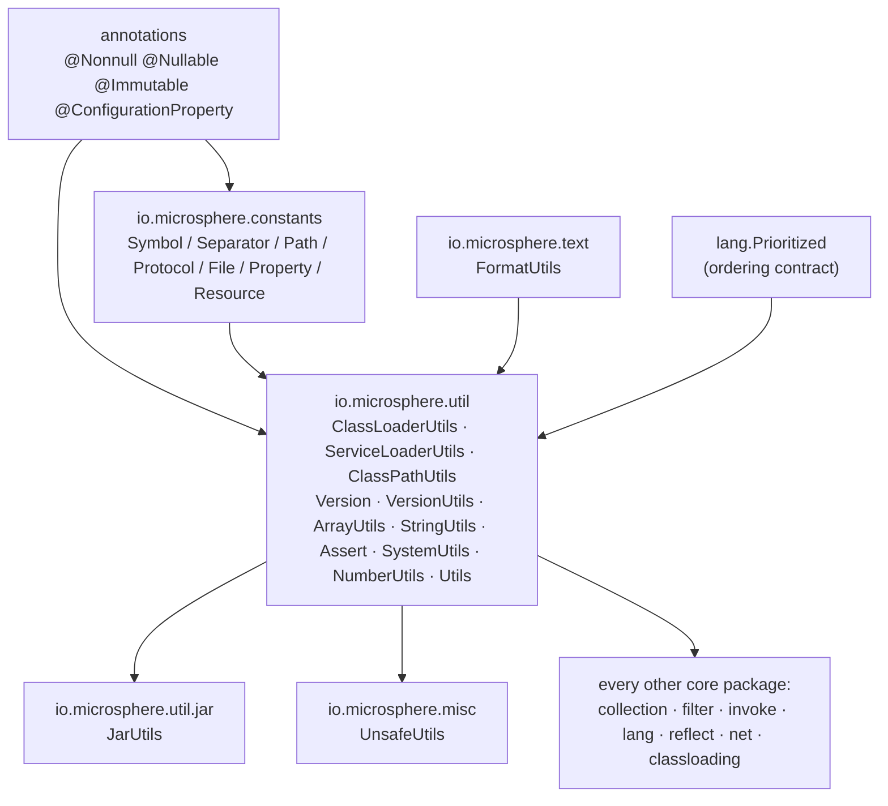
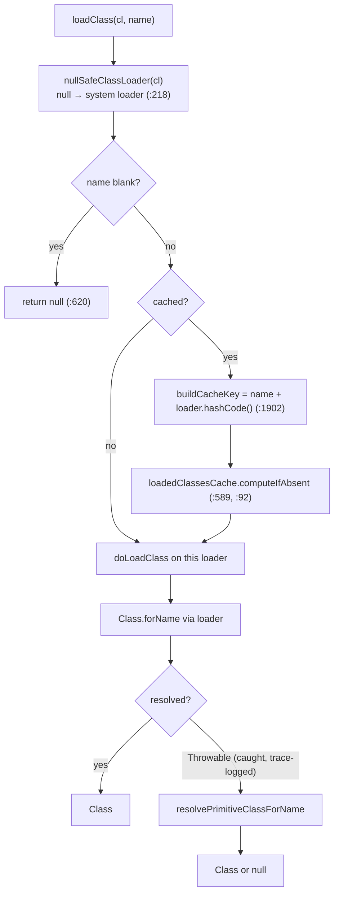
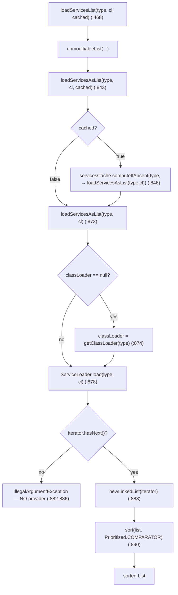
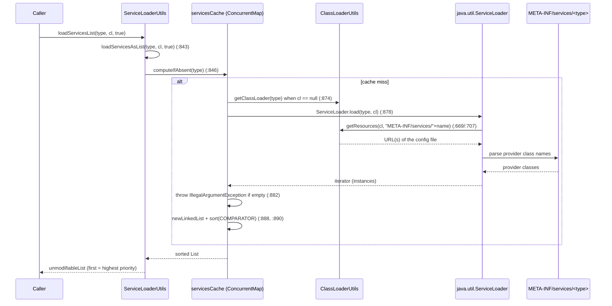
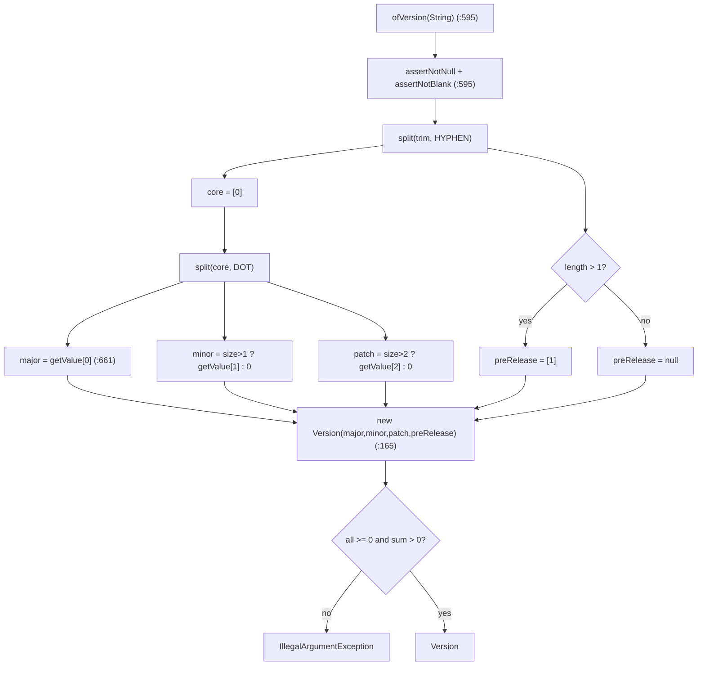

# Utilities, Constants and Text — Developer Guide

Module: `io.github.microsphere-projects:microsphere-java-core` · `0.3.20-SNAPSHOT` (`release` branch)
Packages: `io.microsphere.util` (34) · `io.microsphere.util.jar` (1) · `io.microsphere.constants` (8) ·
`io.microsphere.text` (1) · `io.microsphere.misc` (1) — 45 main types · Java 8 baseline, CI on JDK 8 / 11 / 17 / 21 / 25

Path prefix used below: `microsphere-java-core/src/main/java/io/microsphere/` (sources),
`microsphere-java-core/src/main/resources/` (SPI files) and `microsphere-java-core/src/test/java/io/microsphere/`
(tests). Full paths are given once, then shortened to the last two segments (e.g. `util/ClassLoaderUtils.java`).

---

## 1. Where this slice sits

This group is the **Foundation layer**: no type in it depends on any other `io.microsphere.*` package except
`io.microsphere.constants`, `io.microsphere.util` (intra-package), and the annotations module. Everything above —
`collection`, `filter`, `invoke`, `lang`, `reflect`, `net`, `classloading`, `event` — imports down into it.

Two inbound dependencies worth naming precisely:

* **`lang.Prioritized`** — `ServiceLoaderUtils` sorts every provider list with `Prioritized.COMPARATOR`
  (`util/ServiceLoaderUtils.java:890`); the comparator is imported from `io.microsphere.lang`. This is the one
  cross-package contract the slice leans on for behaviour, so `loadServices*` results depend on `Prioritized` living in
  `lang` (documented in [Language Abstractions](./language-abstractions.md)).
* **`text.FormatUtils`** is used *by* `ServiceLoaderUtils` to build its "no provider" message
  (`util/ServiceLoaderUtils.java:884`) and by `Version` (`util/Version.java`), so `text` is a leaf the `util` package
  calls into — it must stay free of upward imports.

Consumption runs outward too: `classloading.ArtifactDetector` is driven by `ClassLoaderUtils.findAllClassPathURLs`
(`util/ClassLoaderUtils.java:1550-1564`), and `Version.ofVersion(Class)` builds an `ArtifactDetector` to resolve a
library version (`util/Version.java:626-640`) — see [Class Loading and Artifacts](./classloading-and-artifacts.md).

---

## 2. Package / class map

| Type | Kind | Responsibility | Key hooks |
|---|---|---|---|
| `Utils` | marker interface | identifies a utility class by convention | `util/Utils.java` (empty) |
| `ClassLoaderUtils` | utility | class + resource resolution over a loader hierarchy; classpath mutation | `loadClass` (`:547`), `getResource` (`:783`), `ResourceType` (`:1931`) |
| `ServiceLoaderUtils` | utility | `ServiceLoader` facade: discovery, `Prioritized` sort, optional cache | `loadServicesList` (`:468`), `loadServicesAsList` (`:843`, `:873`) |
| `ClassPathUtils` | utility | boot/app classpath snapshots, runtime class location | `getBootstrapClassPaths` (`:127`), `getRuntimeClassLocation` (`:207`) |
| `Version` | value object | immutable, comparable semver-ish model | `ofVersion(String)` (`:595`), `Operator` (`:671`), `compareTo` (`:372`) |
| `VersionUtils` | utility | JDK version constants + comparison helpers | `CURRENT_JAVA_VERSION` (`:44`), `detectJavaMajorVersion` (`:284`) |
| `ArrayUtils` | utility | typed empty arrays, factory, search, reverse | `of` (`:211`), `contains` (`:1887`, `:1911`, `:2096`), `reverse` (`:2162`) |
| `StringUtils` | utility | blank checks, `split`, `contains`, index/replace | `isBlank` (`:81`), `split` (`:137`, `:163`) |
| `Assert` | utility (throws) | precondition guards; **not** a `Utils` | `assertNotNull` (`:131`), `assertNoNullElements` (`:348`) |
| `SystemUtils` | utility | OS/JDK flags, system-property access, encoding constants | `IS_JAVA_8` (`:357`), `getSystemProperty` (`:605`) |
| `NumberUtils` | utility (empty) | reserved placeholder — **no public methods** | `util/NumberUtils.java` |
| `text.FormatUtils` | utility | `{}` placeholder substitution | `format` (`text/FormatUtils.java:38`) |
| `util.jar.JarUtils` | utility | `URL`→`JarFile`, entry filtering, manifest path | `toJarFile` (`:86`), `filter` (`:193`), `MANIFEST_RESOURCE_PATH` (`:63`) |
| `misc.UnsafeUtils` | utility | `sun.misc.Unsafe` handle + field/array offsets | `getUnsafe` (`:564`), `offsetCache` (`:559`) |
| `constants.*` | constant interfaces | shared literals, aggregated by `Constants` | `constants/Constants.java:13-14` |

---

## 3. Source analysis of the loading / resolution algorithms

### 3.1 The class-loader hierarchy walk (`ClassLoaderUtils`)

The base primitive is `nullSafeClassLoader(classLoader)` (`util/ClassLoaderUtils.java:218`): a `null` loader never
throws here — it is replaced by the system class loader. On top of it, `getDefaultClassLoader()` (`:244`) tries, in
order: the **thread-context** loader → the loader that loaded `ClassLoaderUtils` itself → the default. `getClassLoader
(loadedClass)` (`:298`) returns a class's own loader, or (for a bootstrap-loaded class, where `getClassLoader()` is
`null`) falls back through the caller frames.

The full ancestor chain is built by `getInheritableClassLoaders(classLoader)` (`:1069`), which delegates to
`doGetInheritableClassLoaders` (`:1092`): it seeds a `LinkedHashSet` with the loader, then follows `getParent()` until
`null` — so the set is ordered **child → … → bootstrap** and is returned unmodifiable. `findLoadedClass` (`:497`) and
`loadClass` (`:547`) use that ordering to look for an already-defined class before attempting a fresh load.

The catch is deliberately a `Throwable` (not `Exception`) and only logged at trace (`:620`): a `NoClassDefFoundError`
from a half-linked class degrades to `null` just like a genuine miss. The consequence (pitfall 9 in the user guide) is
that `null` is ambiguous — it means "not here", not "does not exist".

### 3.2 Resource resolution order and `ResourceType`

`getResource(classLoader, resourceName)` (`:783`) is the *untyped* entry: it iterates `ResourceType.values()` in
declaration order — `DEFAULT`, `CLASS`, `PACKAGE` (`:1931`) — and returns the **first** loader hit. The typed variant
`getResource(classLoader, resourceType, resourceName)` (`:843`) skips that scan and pins one `ResourceType`, after
`resourceType.resolve(name)` normalises the key and `nullSafeClassLoader` fixes the loader. `getResources(...)`
(`:669`, `:707`) is the plural form and is the only one that declares `IOException` (it calls `loader.getResources`).

`ResourceType` is a per-constant **strategy**: each value answers `supports(name)` and `normalize(name)`:

| Constant | `supports` | `normalize` | Evidence |
|---|---|---|---|
| `DEFAULT` | always `true` | identity | `util/ClassLoaderUtils.java:1945` |
| `CLASS` | dotted class name or `*.class` | dots → slashes, keeps `.class` | `:1983` |
| `PACKAGE` | no `/` or `\`, not `*.class` | dotted package form | `:2030` |
| `resolve(name)` | returns `null` for blank / unsupported | `normalize` → `normalizePath` → strip leading `/` | `:2086` |

Because `resolve` returns `null` when a type does not apply, the typed `getResource` (`:843`) simply yields `null`
rather than searching under a malformed name — that null-check *is* the type guard, and it is why `CLASS` never matches
a package path and `PACKAGE` never matches a `.class` file.

`getClassResource` (`:1035`) is a thin specialisation: it appends `.class` to the binary name and forces
`ResourceType.CLASS`, so `getClassResource(cl, Foo.class)` resolves exactly one loader-visible `Foo.class`.

### 3.3 Service loading: caching, ordering, and the throw-on-empty

`loadServicesList` overloads funnel to one place. The public entry
`loadServicesList(serviceType, classLoader, cached)` (`:468`) wraps its result in `unmodifiableList` and delegates to
the package-private `loadServicesAsList(serviceType, classLoader, cached)` (`:843`):

Two branch-level facts the tests lock down:

* **Empty is a throw, not an empty list.** `loadServicesAsList(type, cl)` explicitly checks `!iterator.hasNext()` and
  throws `IllegalArgumentException` with a formatted message built via `FormatUtils.format` (`:882-886`, `:884`). The
  default `cached` value is `SERVICE_LOADER_CACHED` (`:411`), itself read once at class-init from
  `-Dmicrosphere.service-loader.cached` (`:112`, `:138`, default `"false"` at `:107`).
* **Ordering is `Prioritized`, never file order.** `sort(serviceList, COMPARATOR)` (`:890`) re-sorts after load; the
  `ServiceLoader` configuration-file order is irrelevant. `loadFirstService` / `loadLastService` (`:602`, `:719`) then
  return `ListUtils.first/last` of that sorted list, and `loadService` (`:828`) picks first-vs-last by a boolean.

### 3.4 Representative end-to-end call: a cached, ordered service load

Note the cache **key is the service type alone** (`:846`); the `classLoader` is captured by the lambda but not mixed
into the key, so two different loaders that request the same type share one cached list. That is the exact behaviour
recorded as pitfall 2 in the user guide.

### 3.5 Version parsing rules

`Version.ofVersion(String)` (`util/Version.java:595`) runs two splits:

1. `split(version.trim(), HYPHEN)` → `[0]` is the numeric core, `[1]` (if length > 1) is the pre-release tag.
2. `split(core, DOT)` → `major = getValue[0]`; `minor = size > 1 ? getValue[1] : 0`; `patch = size > 2 ? getValue[2] : 0`;
   any segments beyond three are ignored.

`getValue(String)` (`:661`) trims and `parseInt`s; a `NumberFormatException` is rethrown as
`IllegalArgumentException("contains the non-number part")`. The constructor (`:165`) asserts each part ≥ 0 and
`major+minor+patch > 0`, so `Version.of(0,0,0)` is rejected (`IllegalArgumentException`). Comparison is `compareTo`
(`:372`) — major, then minor, then patch, then `comparePreRelease` (`:403`), where a `null` pre-release ranks **after**
any non-null tag (`1.2.3 > 1.2.3-alpha > 1.2.3-beta` only insofar as beta/alpha compare lexically). `Operator.of(symbol)`
(`:766`) maps the five string operators `"=" < "<=" > ">="` (backed by `SymbolConstants`) to the `EQ/LT/LE/GT/GE`
enum (`:671`); anything else throws `IllegalArgumentException`. `ofVersion(Class)` (`:626-640`) defers to the running
JDK (`VersionUtils.CURRENT_JAVA_VERSION`) when the class's loader is `null` (bootstrap), and throws
`IllegalArgumentException` when the detected artifact carries no version.

The numeric core and the pre-release tag are split by the **first** hyphen, so `7.8.9-RC1` keeps `RC1` intact
(`util/VersionTest.java:331`). Beyond-three dot segments are silently dropped, which makes `ofVersion` tolerant of
Maven-style qualifiers that carry extra dots — the qualifier text simply never reaches `getValue`.

### 3.6 Classpath and JAR-manifest reading, across JDKs

`ClassPathUtils` computes two `static final` snapshots once, at class-init. `initBootstrapClassPaths` (`:68`) calls
`resolveClassPaths(runtimeMXBean.isBootClassPathSupported(), this::getBootClassPath)`; on JDK 9+ the boolean is
`false`, so `resolveClassPaths(boolean, Supplier)` (`:94`) short-circuits to `emptySet()` and only the `java.home`
containment heuristic (used upstream in `classloading`) still filters JDK libraries. `initClassPaths` (`:73`) always
splits `getClassPath()` on `PATH_SEPARATOR` via `resolveClassPaths(String)` (`:103`).

On the archive side, `JarUtils.toJarFile(URL)` (`util/jar/JarUtils.java:86`) first
`resolveJarAbsolutePath(url)` (`:168`) — which resolves the containing file through `net.URLUtils` — then opens a
`JarFile`; a missing archive logs the `IOException` and returns `null`, whereas a `null` URL throws
`NullPointerException` and a non-`jar`/`file` protocol throws `IllegalArgumentException` at
`assertJarURLProtocol` (`:111`). `filter(jarFile, JarEntryFilter)` (`:193`) returns a shared `emptyList()` for a `null`
jar. The manifest itself is addressed by the `MANIFEST_RESOURCE_PATH = "META-INF/MANIFEST.MF"` constant (`:63`) that the
`classloading` resolvers read through this utility.

`SystemUtils` reads JDK identity from `java.specification.version` via `matchesJavaVersion(prefix)` (`:638`), so
`IS_JAVA_8` = `matchesJavaVersion("1.8")` (`:357`) is independent of `VersionUtils.CURRENT_JAVA_VERSION`, which parses
`java.version` (`util/VersionUtils.java:266`). `getSystemProperty(key, default)` (`:605`) consults the cached copy
first, then `System.getProperty`, and returns the default after logging a warning if a `SecurityException` is thrown —
the property access never propagates a security failure.

### 3.7 Degradation policy: return-neutral vs. throw

The slice's central design rule is that lookups **degrade** (return `null`, an empty/immutable collection, or a neutral
`boolean`) rather than throw — but that rule has a documented, enumerable set of exceptions. Getting this boundary right
is the main risk for callers, so it is catalogued here per method:

| Method | Absent / invalid input → | Actually throws on | Evidence |
|---|---|---|---|
| `ClassLoaderUtils.doLoadClass` | `null` | — (catches `Throwable`, trace-logs) | `util/ClassLoaderUtils.java:620` |
| `ClassLoaderUtils.getResource` | `null` | — | `:783`, `:843` |
| `ClassLoaderUtils.getResources` | empty `Set` | declared `IOException` / `NullPointerException` | `:669`, `:707` |
| `ClassLoaderUtils.newURLClassLoader` | — | `IllegalArgumentException` (null URL element) | `:1667` |
| `ServiceLoaderUtils.loadServices*` | **throws** | `IllegalArgumentException` when zero providers | `:882-886` |
| `ServiceLoaderUtils.getServiceClasses(…, true)` | **throws** | `IllegalStateException` (unloadable / non-assignable) | `:262`, `:270`, `:276` |
| `ClassPathUtils.getBootstrapClassPaths` | empty `Set` (JDK 9+) | — | `:68`, `:94` |
| `StringUtils.split` | `EMPTY_STRING_ARRAY` / single-element | — | `:163` |
| `ArrayUtils.contains(int[],…)` | `false` for `null` array | — (but wrong on unsorted input) | `:1911` |
| `Version.ofVersion(String)` / `getValue` / `ofVersion(Class)` | — | `IllegalArgumentException` | `util/Version.java:595`, `:661`, `:626-640` |
| `Assert.*` | — | `IllegalArgumentException` / `ArrayIndexOutOfBoundsException` | `util/Assert.java:60-449` |
| `FormatUtils.format(null, …)` | `null` | — | `text/FormatUtils.java:62` |
| `JarUtils.toJarFile(missing)` | `null` | `NullPointerException` (null URL) / `IllegalArgumentException` (bad protocol) | `util/jar/JarUtils.java:86`, `:111` |
| `UnsafeUtils` static init | — | `UnsupportedOperationException` → `ExceptionInInitializerError` | `misc/UnsafeUtils.java:564`, `:570-572` |

The pattern is consistent: **resolution and lookup APIs degrade; construction, parsing, and assertion APIs throw.** The
`loadServices*` family is the one surprising case — a *loading* API that throws — because an empty `META-INF/services`
file is treated as a misconfiguration, not as a legitimate "no providers" state.

---

## 4. Design patterns (with the implementing class)

| Pattern | Implementing class(es) | Evidence |
|---|---|---|
| **Marker interface + static facade** | `Utils` adopted by `ClassLoaderUtils`, `ServiceLoaderUtils`, `ClassPathUtils`, `ArrayUtils`, `StringUtils`, `SystemUtils`, `VersionUtils`, `text.FormatUtils`, `util.jar.JarUtils`, `misc.UnsafeUtils` | `util/Utils.java` (empty); each is `abstract` + private ctor |
| **Facade (with delegation)** | `ClassLoaderUtils` presents classpath read/mutate while delegating to the `URLClassPathHandle` SPI | static `urlClassPathHandle` (`util/ClassLoaderUtils.java:94`), used at `:1550-1564`, `:1598-1603` |
| **Lazy holder / benign-race cache** | `loadedClassesCache` (`:92`), `servicesCache` (`:140` → `computeIfAbsent` `:846`), `UnsafeUtils.offsetCache` (`:559`) | `ConcurrentHashMap` `computeIfAbsent` — duplicate computation possible, no corruption |
| **Null object / neutral-value degradation** | `doLoadClass` returns `null` on any `Throwable` (`:620`); `getResourceAsString` returns `null` for a missing resource (`:875`); `NoOp`-style empties in `ClassPathUtils` on JDK 9+ (`:94`) | `util/ClassLoaderUtils.java:620`, `:875`; `util/ClassPathUtils.java:94` |
| **Strategy (per resource kind)** | `ResourceType.DEFAULT / CLASS / PACKAGE` each implement `supports` + `normalize`, selected by the `getResource` overload | `util/ClassLoaderUtils.java:1931`, `:1945`, `:1983`, `:2030`, `:2086` |
| **Value object + specification** | `Version` (`@Immutable`, `Comparable`, `Serializable`) with `equals`/`hashCode` (`:326`, `:346`) and `Operator` as a `BiPredicate` specification (`:671`) | `util/Version.java:95-102`, `:220-317`, `:671` |
| **Factory method** | `Version.of/ofVersion(...)` (`:441`, `:595`), `ArrayUtils.of/ofArray` (`:211`, `:375`), `ClassLoaderUtils.newURLClassLoader` (`:1667`) | see cited lines |
| **Composition of constant interfaces** | `Constants` `extends` the six literal interfaces so consumers can `import static Constants.*` | `constants/Constants.java:13-14` |
| **Template via comparison operator** | `Operator.EQ/LT/LE/GT/GE.test(v1, v2)` centralises `null` and identity handling around `compareTo` | `util/Version.java:671` |

> [!NOTE]
> `Assert` is the deliberate **anti-pattern** of the `Utils` convention (throws instead of degrading, and does not
> `implement Utils`), and `NumberUtils` is the deliberate **empty** utility — a placeholder that keeps its `implements
> Utils` marker but exposes no behaviour (`util/Assert.java`, `util/NumberUtils.java`). Both exceptions prove the rule.

---

## 5. Extension points

* **Provide more implementations of any SPI type.** `ServiceLoaderUtils` reads `META-INF/services/<fqcn>`
  (`SERVICES_PROVIDER_LOCATION` `util/ServiceLoaderUtils.java:119`, pattern `:127`) through `ClassLoaderUtils`, so a
  downstream module adds a provider by dropping one line in its own `META-INF/services` file — the core library ships
  thirteen such registrations. To influence *which* provider is picked first, implement
  `io.microsphere.lang.Prioritized` and return a smaller `getPriority()`; `sort(COMPARATOR)` (`:890`) honours it, and
  file order does not matter.
* **Toggle service caching globally.** Set `-Dmicrosphere.service-loader.cached=true` (`:112`, read at class-init
  `:138`) to make `SERVICE_LOADER_CACHED` default the `cached` flag on the two-argument overloads (`:411`). Callers that
  need per-loader isolation should still pass `cached = false` explicitly because the cache key ignores the loader
  (`:846`).
* **Plug a new classpath reader.** `ClassLoaderUtils` does not read `sun.misc.URLClassPath` itself; it holds the
  `ServiceLoadingURLClassPathHandle` facade (`:94`) which selects a `URLClassPathHandle` SPI implementation. Supporting a
  future loader is a `classloading`-package change, but the *seam lives here* — `findAllClassPathURLs` (`:1550-1564`)
  and `removeClassPathURL` (`:1598-1603`, which still requires a `SecureClassLoader`) are the entry points every caller
  funnels through.
* **Add literals without touching utilities.** The `constants` interfaces are pure open-for-extension-by-adding: a new
  separator belongs in `SeparatorConstants`, a protocol in `ProtocolConstants`, and the aggregate `Constants`
  (`constants/Constants.java:13-14`) picks it up automatically for wildcard importers.
* **Resource-kind normalisation is extensible per call.** Passing an explicit `ResourceType` to
  `getResource(cl, type, name)` (`:843`) is the supported way to override the `DEFAULT → CLASS → PACKAGE` probe order
  of the untyped overload (`:783`); `resolve` returns `null` (a clean miss) when the chosen type does not fit the name
  (`:2086`).

---

## 6. Thread safety and performance

* **`loadedClassesCache`** is `new ConcurrentHashMap<>(256)` (`util/ClassLoaderUtils.java:92`), filled via
  `computeIfAbsent` in `loadClass(...,true)` (`:589`). The key is `className + classLoader.hashCode()` (`:1902`):
  benign races can only duplicate a load; correctness rests on `hashCode` being stable, and a cross-loader `hashCode`
  collision would wrongly share a cached class — acceptable because loaders rarely collide, but it is the reason the
  cache is keyed per (name, loader) pair.
* **`servicesCache`** is a `ConcurrentMap<Class<?>, List<?>>` (`:140`) populated by `computeIfAbsent` (`:846`). The
  *value* list is wrapped unmodifiable at the boundary (`:469`), so published lists are safe to share; the loader is not
  part of the key (see §3.3). Loading is O(providers) plus a `Prioritized` sort each cache miss.
* **`UnsafeUtils.offsetCache`** is a `ConcurrentHashMap<String,Long>` (`misc/UnsafeUtils.java:559`) memoising field
  offsets; `getUnsafe()` (`:564`) runs once in the static initialiser, and its failure becomes an
  `ExceptionInInitializerError` (`:570-572`) — so the very first touch of the class is the riskiest moment, not any
  call site.
* **Immutable snapshots.** `ClassPathUtils.bootstrapClassPaths` / `classPaths` (`util/ClassPathUtils.java:61`, `:64`)
  and all `SystemUtils` `IS_JAVA_*` / property-value constants (`util/SystemUtils.java:347-517`) are `static final` and
  computed once — reading them is free, and they can never be refreshed at runtime (a flexibility tax).
* **`SystemUtils.systemPropertiesCopy` is *not* volatile.** It is a plain `private static Map<String,String>` (`:528`);
  `copySystemProperties()` synchronises on `SystemUtils.class` (`:548`), but readers that grab the copy outside that
  lock (`getSystemProperty`, `:605`) rely on the map already having been published. Mutate system properties only via
  the synchronised path.
* **`Version` is fully immutable** (`@Immutable`, all-final state, `:95-102`) with `equals`/`hashCode` (`:326`, `:346`),
  making it safe to publish and to use as a map key; `compareTo` (`:372`) allocates nothing.
* **Array searches.** `ArrayUtils.contains` for numeric primitives uses `Arrays.binarySearch` (`:1911-2069`) — O(log n)
  but **only correct on sorted data**; `boolean[]`/`Object[]` overloads are O(n) linear scans (`:1887`, `:2096`).
  `reverse(T[])` (`:2162`) is in-place and throws `NullPointerException` on a `null` array.
* **Uncached service loads allocate.** Each non-cached `loadServicesAsList` builds a `LinkedList` and sorts it
  (`:888`, `:890`); inside a loop, prefer the `cached = true` overload or hoist the result.

---

## 7. Testing strategy

Location: `microsphere-java-core/src/test/java/io/microsphere/{util,constants,text,misc}/`. Tests are JUnit 5
(`org.junit.jupiter.api.Test`); those needing a logger extend `LoggingTest` (e.g. `ServiceLoaderUtilsTest`,
`JarUtilsTest`).

* **Both `java.version` schemes are asserted, not assumed.** `VersionUtilsTest.testDetectJavaMajorVersion` pins modern
  (`"17.0.0"` → `"17"`) *and* legacy (`"1.8.0"` → `"8"`) *and* the no-dot case (`"1"` → `"1"`)
  (`util/VersionUtilsTest.java:142-150`); `testTestCurrentJavaVersion` compares against `CURRENT_JAVA_VERSION` rather
  than a literal (`:110-113`) — this is what keeps the same suite green across 8/11/17/21/25.
* **Degrade-vs-throw boundaries are pinned explicitly.** `ServiceLoaderUtilsTest` asserts that a provider-less type
  throws `IllegalArgumentException` for every `loadServicesList`/`loadServices`/`loadFirstService`/`loadLastService`
  shape (`util/ServiceLoaderUtilsTest.java:107-112`, `:139-143`, `:170-174`, `:200-205`), and that `getServiceClasses`
  throws `IllegalStateException` with `failFast=true` but degrades to an empty set with `failFast=false` (`:59-69`).
  `ClassLoaderUtilsTest` confirms class/resource lookups degrade to `null` for `null`/blank/missing inputs
  (`util/ClassLoaderUtilsTest.java:345-376`, `:438`).
* **`Prioritized` ordering is exercised through a real fixture.** The suite registers two `EventListener` providers and
  asserts `loadFirstService` yields `EchoEventListener2` while `loadLastService` yields `EchoEventListener`
  (`util/ServiceLoaderUtilsTest.java:211-232`) — directly proving the sort at `util/ServiceLoaderUtils.java:890`, not the
  `META-INF/services` file order.
* **`Version` semantics are covered edge-first.** `VersionTest` asserts null-comparison returns `false` never throws
  (`:218-221`), pre-release ranking (`:213-215`), `ofVersion(Class)` returning `"3.0.2"` for a jsr305 class and
  `CURRENT_JAVA_VERSION` for a bootstrap class (`:124-132`), and `IllegalArgumentException` for a class with no version
  metadata (`:134-137`, `:321-324`).
* **`JarUtils` mixes returns and throws deliberately, and the test checks each.** `JarUtilsTest` asserts a valid archive
  yields a `JarFile`, a missing one yields `null`, a bad protocol throws `IllegalArgumentException`, and a `null` URL
  throws `NullPointerException` (`util/jar/JarUtilsTest.java:104-125`), plus `filter(null, null)` == `emptyList()`
  (`:99-102`).
* **`StringUtils` / `Assert` / `FormatUtils` cover the text primitives.** `StringUtilsTest.testSplit` verifies null
  safety, single-element behaviour on a `null` delimiter, and empty-token preservation, cross-checking the char and
  string overloads agree (`util/StringUtilsTest.java:89-124`); `FormatUtilsTest` pins the surplus/deficit placeholder
  cases (`text/FormatUtilsTest.java:34-53`).
* **Writing new tests here.** For an SPI type, add a provider line to `src/test/resources/META-INF/services/...` and
  implement `Prioritized` to assert ordering. For degrade behaviour, assert `null`/empty against a resource that does
  not exist; for the throw paths, wrap in `assertThrows`. Prefer fixtures already on the test classpath — the canonical
  one is `javax.annotation.Nullable` → version `3.0.2` (`util/VersionTest.java:124-128`).

---

## 8. Known limits to keep in mind

* **`null` from `ClassLoaderUtils` is ambiguous.** A blank name, a caught `Throwable`, and a genuine miss all return
  `null` (`util/ClassLoaderUtils.java:620`); the caller cannot distinguish them without enabling trace logging.
* **The service cache is loader-blind.** `servicesCache` keys on type only (`:846`), so caching is unsafe for isolated
  loaders presenting the same type — pass `cached = false`.
* **`getAllLoadedClassesMap` mis-attributes loaders.** Its loop maps every inheritable loader to the *caller-supplied*
  loader's loaded classes (`util/ClassLoaderUtils.java:1142-1144`); do not treat its values as per-loader.
* **JDK-9+ boot classpath is always empty.** `ClassPathUtils.getBootstrapClassPaths()` yields `emptySet()` past JDK 8
  (`:68`, `:94`), so any "is this a JDK library?" check built on it silently degrades to the `java.home` heuristic.
* **`sun.misc.Unsafe` is a class-load-time risk.** `UnsafeUtils` can fail during static init with
  `ExceptionInInitializerError` (`misc/UnsafeUtils.java:570-572`) on JDKs where `sun.misc.Unsafe` is gone — it must be
  touched lazily/conditionally, never eagerly in a hot path shared across JVMs.
* **`NumberUtils` provides nothing.** It is a marked-but-empty utility (`util/NumberUtils.java`); do not depend on it,
  and do not read its existence as an API.

---

## 9. See also

* [Utilities, Constants and Text — User Guide](../../user-guide/microsphere-java-core/util-and-constants.md) — the operator-facing view of the same sources
* [Class Loading and Artifacts](./classloading-and-artifacts.md) — the `URLClassPathHandle` SPI that `ClassLoaderUtils` delegates to, and `Version.ofVersion(Class)`'s `ArtifactDetector`
* [Collections and Filters](./collections-and-filters.md) — `Lists`/`Sets`/`Prioritized` used by the service sort
* [Language Abstractions](./language-abstractions.md) — `io.microsphere.lang.Prioritized`, the ordering contract
