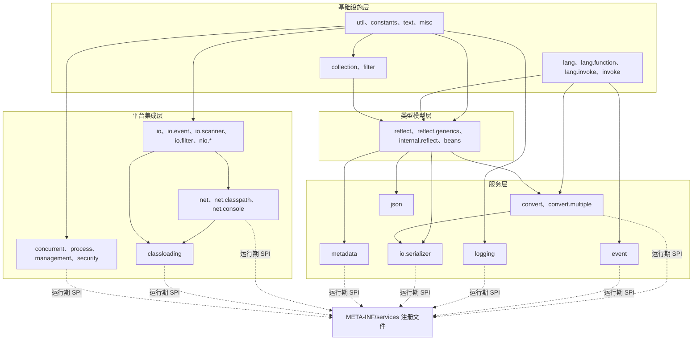

# `microsphere-java-core` 包分组索引（开发者文档）

模块：`io.github.microsphere-projects:microsphere-java-core` · 源码线：`release` 分支，`0.3.20-SNAPSHOT`
本目录的 14 篇是[用户文档分组索引](../../../user-guide/microsphere-java-core/zh/README.md)在源码层面的对应；英文版本在 [../README.md](../README.md)。

---

## 1. 内部依赖结构

`core` 只有一个构件，但其包之间形成严格的内部分层 —— 下层不引用上层，这正是它能在近乎空的 classpath 上工作的原因。

| 层 | 包 | 必须遵守的契约 |
|----|----|----------------|
| 基础设施层 | `util`、`constants`、`text`、`misc`、`lang*`、`invoke`、`collection`、`filter` | 不依赖 `core` 内任何其他包；只使用 Java 8 API；javadoc 承诺返回中性结果时不得因 `null` 抛异常 |
| 类型模型层 | `reflect`、`reflect.generics`、`internal.reflect`、`beans` | 唯一允许触碰 JDK 反射内部的层；每条内部访问路径都有 documented 的回退实现 |
| 服务层 | `convert`、`convert.multiple`、`io.serializer`、`event`、`logging`、`json`、`metadata` | 每个都是一族 SPI，经 `META-INF/services` 发现，并按 `Prioritized` 排序 |
| 平台集成层 | `io*`、`nio*`、`net*`、`classloading`、`concurrent`、`process`、`management`、`security` | JDK 版本敏感度最高；每篇页面都带版本矩阵与降级行为说明 |

---

## 2. 页面清单

| # | 页面 | 覆盖的包 | 主要分析主题 |
|---|------|----------|--------------|
| 1 | [工具类、常量与文本](util-and-constants.md) | `util`、`util.jar`、`constants`、`text`、`misc` | `Utils` 标记接口约定；类加载器与资源解析顺序；服务加载缓存；`Version` 解析 |
| 2 | [集合与过滤器](collections-and-filters.md) | `collection`、`filter` | `Delegating*` / `Unmodifiable*` / `Empty*` / `Singleton*` 家族；分配策略；过滤器组合 |
| 3 | [语言抽象](language-abstractions.md) | `lang`、`lang.function`、`lang.invoke`、`invoke` | `Prioritized` 排序运算；`Wrapper` 解包循环的终止条件；lambda/方法句柄内省 |
| 4 | [反射、类型与 JavaBean](reflection-and-beans.md) | `reflect`、`reflect.generics`、`internal.reflect`、`beans` | 泛型类型变量解析；`JavaType` 模型；按 JDK 分支的可访问性与 `setAccessible` 处理 |
| 5 | [类型转换](type-conversion.md) | `convert`、`convert.multiple` | 转换器选择与缓存；多值分派；有损转换的取舍 |
| 6 | [序列化](serialization.md) | `io.serializer` | 序列化/反序列化选择；对象反序列化的风险面 |
| 7 | [事件分发](events.md) | `event` | 监听器匹配、条件过滤、分发的并发性 |
| 8 | [I/O、NIO、扫描与文件过滤](io-and-scanning.md) | `io`、`io.event`、`io.scanner`、`io.filter`、`nio.*` | 扫描器插件式设计；`WatchService` 事件溢出处理；资源关闭纪律 |
| 9 | [网络与 URL 协议](net-and-url-protocols.md) | `net`、`net.classpath`、`net.console` | `URL.setURLStreamHandlerFactory` 的单次注册约束；子协议链式解析 |
| 10 | [日志](logging.md) | `logging` | 后端探测顺序与懒引导；JUL 回退；logger 发布安全性 |
| 11 | [类加载与构件探测](classloading-and-artifacts.md) | `classloading` | classpath URL 解析、`URLClassPathHandle` 的按 JDK 变体、JPMS 路径、禁用构件校验 |
| 12 | [JSON](json.md) | `json` | 分词/解析循环、转义处理、`JSONObject` 的 Map 选择与键顺序 |
| 13 | [配置属性元数据](configuration-metadata.md) | `metadata` | Reader/Loader/Generator 流水、元数据合并、排序规则 |
| 14 | [并发、进程、管理与安全](concurrency-process-and-management.md) | `concurrent`、`process`、`management`、`management.builder`、`security` | `ProcessIdResolver` 回退链；MBean 注册生命周期；SecurityManager 废弃处理 |

每篇开发者页面遵循同一骨架：在架构中的位置 → 包/类地图 → 带 `file:line` 的源码分析 → 点明实现类的设计模式 →
非直观控制流的 mermaid 流程图 → 扩展点 → 线程安全与性能说明 → 测试策略。

---

## 3. 贯穿式实现事实

* **发现机制**：子系统在 `src/main/resources/META-INF/services/` 中注册实现。`release` 分支的 `core` 提供 13 个这类
  注册文件（处理器模块另有 `javax.annotation.processing.Processor`）；完整清单与链接见[开发者文档索引](../../zh/README.md)
  的 1.3 节。
* **顺序**：在意顺序的地方实现都继承 `io.microsphere.lang.Prioritized`，选择规则是排序后取第一个匹配项。
  不要依赖 `ServiceLoader` 的文件顺序。
* **降级策略**：当前 JDK 无法提供的能力返回中性值或 no-op 句柄（例如 `NoOpURLClassPathHandle`、`Empty*` 集合），
  而不是抛异常。新代码必须遵循该策略，且每处降级都要在所属页面写明。
* **JDK 内部 API 被隔离**：`core` 中只有 `internal.reflect`、`classloading`、`net`、`process`、`management` 会伸入
  JDK 内部，并且都通过带版本检查的策略对象封装访问，从而保证库的其余部分可移植。
