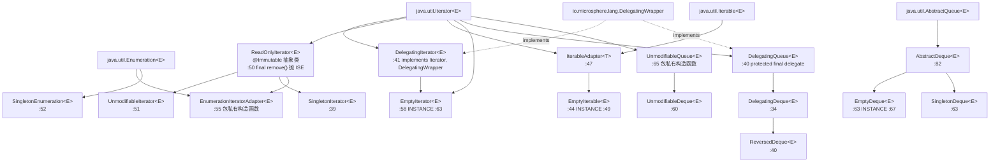
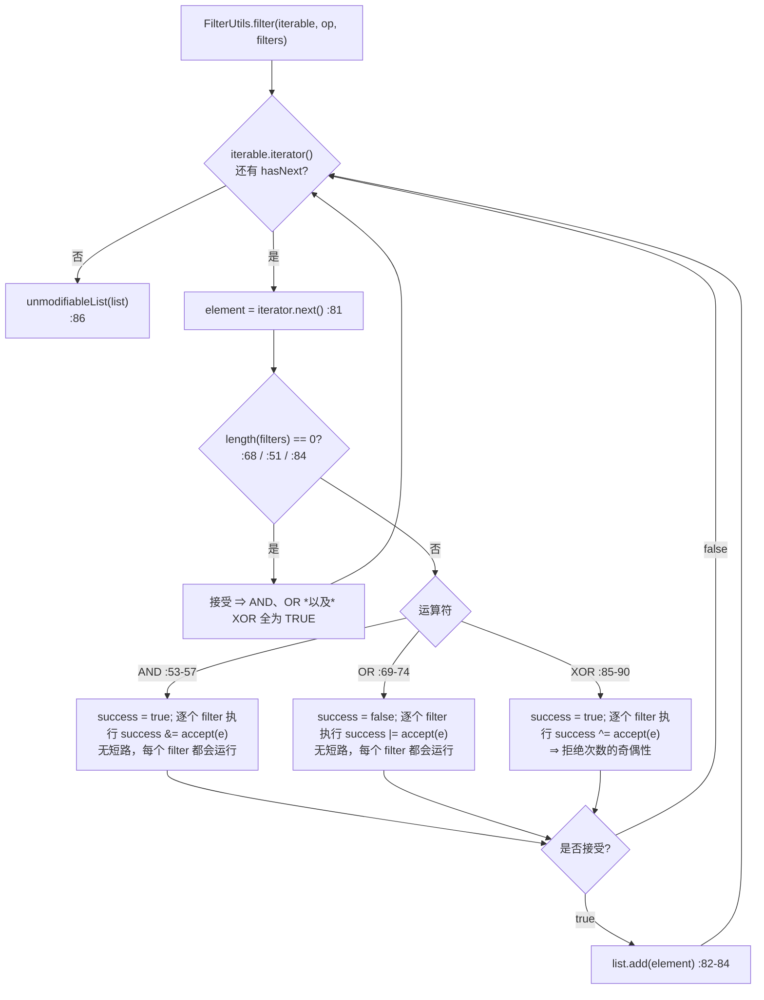
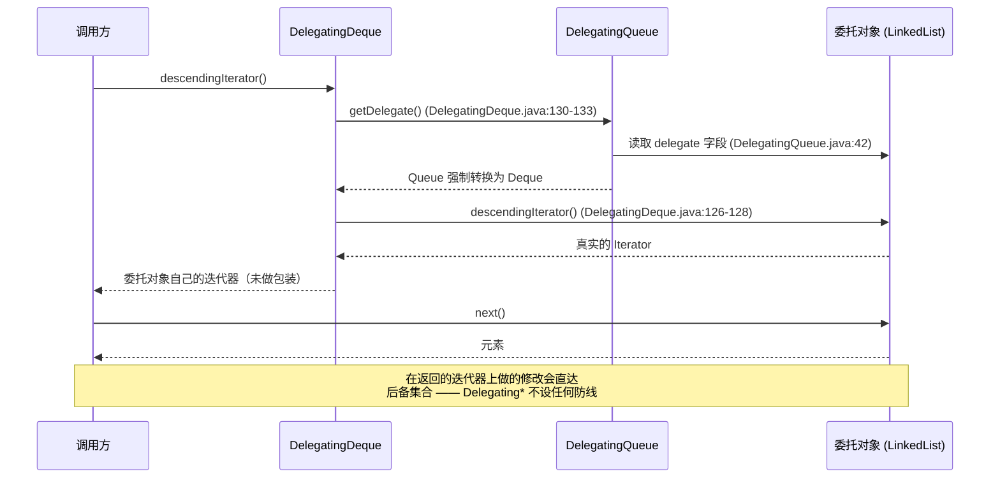

# 集合与过滤器（Collections and filters）—— 开发者指南

| | |
|---|---|
| **层级** | 基础设施层（Foundation，`collection`、`filter`）—— 参见[层级表](README.md#1-内部依赖结构) |
| **包** | `io.microsphere.collection`（32 个主源码）· `io.microsphere.filter`（9 个主源码）= **41** |
| **源码基线** | `release` 分支，`0.3.20-SNAPSHOT` |
| **分析重点** | `Delegating*` / `Unmodifiable*` / `Empty*` / `Singleton*` 家族、分配策略、过滤器组合 |
| **允许的导入** | `io.microsphere.util`、`io.microsphere.constants`、`io.microsphere.lang`、`io.microsphere.invoke`、`io.microsphere.annotation` —— 不得导入分层中更高的任何内容 |

路径除显式写出 `test/` 外，均相对于 `microsphere-java-core/src/main/java/io/microsphere/`；
首次完整提及之后缩写为 `collection/Foo.java:40-55` / `filter/Foo.java:40-55`。

---

## 1. 在架构中的角色

`collection` 与 `filter` 位于**基础设施层**：它们被类型模型层（`reflect` 读取 `Map.Entry` 键值对并迭代 `Collection`）
以及所有服务层导入，而自身不导入任何更高层的内容。开发者索引里的 `Util --> COLL` 这条边在源码中清晰可见：
`CollectionUtils` 使用 `io.microsphere.util.ArrayUtils.length` 与 `io.microsphere.util.ObjectUtils.defaultIfNull`
（`collection/CollectionUtils.java:34-35`），`QueueUtils` 使用 `io.microsphere.util.ClassUtils.isAssignableFrom`
（`collection/QueueUtils.java:41`），并且每个工具类都实现 `io.microsphere.util.Utils` 标记接口
（`collection/CollectionUtils.java:43`、`collection/QueueUtils.java:50`、`filter/FilterUtils.java:50`）。

`filter` 并**不是** `File` 谓词包——那是 `io.microsphere.io.filter`（第 8 页）。`io.microsphere.filter` 提供的是通用的
`Filter<T>` 契约（`filter/Filter.java:33-48`），外加扫描器所需的三类谓词域：`Class<?>`（`ClassFilter`，`:29`）、
`JarEntry`（`JarEntryFilter`，`:29`）以及 `String` 类名（`PackageNameClassNameFilter`，`:31`）。
在 `core` 内验证过的消费者（取自 `import io.microsphere.filter.*` 集合）：

| 消费者 | 导入 | 角色 |
|---|---|---|
| `io/microsphere/io/scanner/Scanner.java:7` | `Filter` | 通用扫描契约 —— `Scanner.scan(..., Filter)` |
| `io/microsphere/io/scanner/SimpleJarEntryScanner.java:8` | `JarEntryFilter` | 扫描期间过滤 jar 条目（`:96` `scan(URL, boolean, JarEntryFilter)`） |
| `io/microsphere/io/scanner/SimpleClassScanner.java:8` | `PackageNameClassNameFilter` | 扫描时的类名筛选 |
| `io/microsphere/io/filter/IOFileFilter.java:19` | `Filter` | 通往真正 `File` 谓词家族的桥梁 |
| `io/microsphere/util/ClassUtils.java:9` | `ClassFileJarEntryFilter` | 类条目判定 |
| `io/microsphere/util/jar/JarUtils.java:10` | `JarEntryFilter` | jar 条目遍历 |

反过来 —— 本切片自身从基础设施层其它位置导入了什么（这是仅有的对外依赖边；每一条都指向 `util`、`constants`、
`invoke` 或 `lang.function`）：

| 类型（导入语句所在 `file:line`） | 导入内容 | 包 |
|---|---|---|
| `ClassFileJarEntryFilter`（`filter/ClassFileJarEntryFilter.java:8`） | `FileConstants.CLASS_EXTENSION` | `io.microsphere.constants` |
| `PackageNameClassNameFilter`（`filter/PackageNameClassNameFilter.java:7-9`） | `SymbolConstants.DOT_CHAR`、`ClassUtils.resolvePackageName`、`StringUtils.isBlank` | `constants`、`util` |
| `PackageNameClassFilter`（`filter/PackageNameClassFilter.java:7`） | `SymbolConstants.DOT` | `constants` |
| `FilterOperator`（`filter/FilterOperator.java:4`） | `ArrayUtils.length` | `util` |
| `FilterUtils`（`filter/FilterUtils.java:14`） | `ListUtils.newArrayList` | `collection` |
| `EnumerationIteratorAdapter`（`collection/EnumerationIteratorAdapter.java:22-23`） | `ObjectUtils.defaultIfNull`、`Collections.emptyEnumeration` | `util` |
| `CollectionUtils`（`collection/CollectionUtils.java:32-35`） | `EmptyIterable.INSTANCE`、`ListUtils.isList`、`ArrayUtils.length`、`ObjectUtils.defaultIfNull` | `collection`（自身）、`util` |
| `QueueUtils`（`collection/QueueUtils.java:41`） | `ClassUtils.isAssignableFrom` | `util` |
| `Lists`（`collection/Lists.java:28`） | `MethodHandlesLookupUtils.findPublicStatic` | `invoke` |
| `DelegatingDeque`（`collection/DelegatingDeque.java:24-25`） | `MethodHandlesLookupUtils.findPublicVirtual`、`ThrowableSupplier.execute` | `invoke`、`lang.function` |

没有任何高于基础设施层的导入，并且 `io.microsphere.collection` 中不引用任何 `io.microsphere.filter` 类型 ——
本切片是依赖图上的一个叶子。

> [!NOTE]
> **纠正一个常见误解**：`io.microsphere.classloading` 并*不*导入 `io.microsphere.filter` —— 在 `release` 上该包中不存在
> 任何 `import io.microsphere.filter.` 出现。filter 的消费者是 `io.scanner`、`io.filter`、`util.ClassUtils` 与
> `util.jar.JarUtils`。

---

## 2. 包与类地图

### 2.1 `io.microsphere.collection` —— 32 个类型

| 家族 | 数量 | 类型 |
|---|---|---|
| `Delegating*` | 3 | `DelegatingIterator`、`DelegatingQueue`、`DelegatingDeque` |
| `Unmodifiable*` | 3 | `UnmodifiableIterator`、`UnmodifiableQueue`、`UnmodifiableDeque` |
| `Empty*` | 3 | `EmptyIterator`、`EmptyIterable`、`EmptyDeque` |
| `Singleton*` | 3 | `SingletonIterator`、`SingletonEnumeration`、`SingletonDeque` |
| 骨架 / 只读基类 | 2 | `ReadOnlyIterator`、`AbstractDeque` |
| 适配器 | 3 | `IterableAdapter`、`EnumerationIteratorAdapter`、`ArrayEnumeration` |
| `Map.Entry` 值类型 | 2 | `DefaultEntry`、`ImmutableEntry` |
| 视图 / 结构 | 2 | `ReversedDeque`、`ArrayStack` |
| `Utils` 工厂 | 11 | `CollectionUtils`、`ListUtils`、`MapUtils`、`SetUtils`、`QueueUtils`、`PropertiesUtils`、`EnumerationUtils`、`Lists`、`Maps`、`Sets`、`Iterators` |
| | **32** | |

### 2.2 `io.microsphere.filter` —— 9 个类型

| 角色 | 数量 | 类型 |
|---|---|---|
| 契约 | 1 | `Filter<T>`（`@FunctionalInterface`，继承 `Predicate<T>`） |
| 组合 | 2 | `FilterOperator`（枚举，3 个常量）、`FilterUtils`（2 个重载） |
| 子契约 | 2 | `ClassFilter`、`JarEntryFilter`（均为 `@FunctionalInterface`，方法体为空） |
| 实现 | 4 | `TrueClassFilter`、`PackageNameClassFilter`、`PackageNameClassNameFilter`、`ClassFileJarEntryFilter` |
| | **9** | |

---

## 3. 源码解析

### 3.1 两棵互不相交的迭代器树，仅通过 `ReadOnlyIterator` 相连

不存在公共的抽象包装基类。委托树用 `final` 方法把自己封闭起来；只读树才是扩展骨架 —— 而 `Empty*` 类型是有意分别从两棵树
中各选一个父类。

逐分支解读 `Deque` 阶梯：`AbstractDeque` 实现了 `Deque` 契约中*廉价*的一半，把*触碰元素*的那一半留为抽象 ——
`addFirst`/`addLast` 把 `false` 的 offer 翻译成 `IllegalStateException("Queue full")`
（`collection/AbstractDeque.java:84-94`，抛出点在 `:87`/`:93`），`removeFirst`/`removeLast` 把 `null` 翻译成
`NoSuchElementException`（`:96-112`，抛出点在 `:102`/`:111`），而六个 `Queue` 形状的方法被路由到它们的
`*First`/`*Last` 双胞胎（`offer→offerLast` `:129-132`、`poll→pollFirst` `:134-137`、`peek→peekFirst` `:139-142`、
`push→addFirst` `:119-122`、`pop→removeFirst` `:124-127`、`removeFirstOccurrence→remove(o)` `:114-117`）。
最后这条路由正是 `EmptyDeque.removeFirstOccurrence(...)` 无需覆写就返回 `false` 的原因：它会落到
`EmptyDeque.remove(Object)` 上（`collection/EmptyDeque.java:124-127`）。

### 3.2 `Empty*` 与 `Singleton*` 如何避免分配

| 类 | 分配策略 | 证据 |
|---|---|---|
| `EmptyIterator` | 一个 public static `INSTANCE`；委托对象就是 JDK 自己缓存的 `Collections.emptyIterator()` | `collection/EmptyIterator.java:63`、`:65-67` |
| `CollectionUtils.emptyIterator()` | **不做包装** —— 直接返回 JDK 缓存实例，因此 `EmptyIterator` 被完全绕过 | `collection/CollectionUtils.java:301-305` |
| `EmptyIterable` | 一个 public static `INSTANCE`，以 `super(null)` 构造；`IterableAdapter` 把这个 `null` 转换为 `EmptyIterator.INSTANCE` | `collection/EmptyIterable.java:49-53` + `collection/IterableAdapter.java:51-53` |
| `EmptyDeque` | 一个 public static `INSTANCE`（`EmptyDeque<?>`），并且 `QueueUtils` 把它缓存在 `static final Deque<?> EMPTY_DEQUE` 字段中，于是 `emptyQueue()` 与 `emptyDeque()` 强制转换的是*同一个*对象 | `collection/EmptyDeque.java:67`、`collection/QueueUtils.java:52`、`:125-129`、`:144-148` |
| `SingletonDeque` | 没有缓存（每个元素都需要自己的实例），只持有一个 `final E element`，并且每次 `iterator()` 调用都新造一个一次性迭代器 | `collection/SingletonDeque.java:67`、`:73-81` |
| `SingletonIterator` / `SingletonEnumeration` | 零拷贝：没有后备集合，只有 `element` 加一个 `boolean hasNext` 标志 | `collection/SingletonIterator.java:41-47`、`collection/SingletonEnumeration.java:54-60` |
| `ReversedDeque.of` | 分配记忆化 —— 当参数已经是 `ReversedDeque` 时原样返回，因此二次反转零开销 | `collection/ReversedDeque.java:46-52` |
| `Empty*` 迭代器具备身份稳定性 | `assertSame(emptyIterator(), emptyDeque.iterator())`，`descendingIterator()` 同理 | `collection/EmptyDequeTest.java:44-51`、`collection/EmptyQueueTest.java:45-47` |

`EmptyIterable` 与 `EmptyIterator` 并*不*是 `Serializable`（`:44`、`:58` 未声明该接口），而 `EmptyDeque` 与
`SingletonDeque` 是（两者都在 `:63`）。本包中每个 `Serializable` 类型的 `serialVersionUID` 都是 `-1L`
（`collection/EmptyDeque.java:65`、`collection/SingletonDeque.java:65`、`collection/UnmodifiableQueue.java:67`）。

### 3.3 每个包装类的 equals、`hashCode` 与 `toString`

每个包装类都重新实现了这三件套，其中出现三种截然不同的策略。

| 类型 | `equals` | `hashCode` | `toString` | 策略 |
|---|---|---|---|---|
| `DelegatingIterator` | `delegate.equals(obj)`，`final`（`collection/DelegatingIterator.java:79-82`） | `delegate.hashCode()`（`:74-77`） | `delegate.toString()`（`:84-87`） | **纯转发** —— 包装器是透明的 |
| `DelegatingQueue` | `delegate.equals(o)`（`:164-167`） | `delegate.hashCode()`（`:169-172`） | `delegate.toString()`（`:174-177`） | 纯转发 |
| `UnmodifiableQueue` | 先 `this == o` 短路，再 `delegate.equals(o)`（`collection/UnmodifiableQueue.java:190-196`） | `delegate.hashCode()`（`:198-201`） | `delegate.toString()`（`:203-206`） | 转发 + 身份短路 |
| `SingletonDeque` | 基于取值，`final`：`o instanceof SingletonDeque && Objects.equals(element, that.element)`（`collection/SingletonDeque.java:138-144`） | `Objects.hashCode(element)`（`:146-149`） | 未覆写 | **取值身份** —— 必须有，因为没有 `INSTANCE` 的包装器之间必须相等 |
| `ReversedDeque` | 顺序敏感：先比 size，再用 `Iterators.equals` 逐元素比较（`collection/ReversedDeque.java:170-184`） | 位置相关的 `31 * hashCode + element` 折叠（`:186-195`） | 自己的 `[a, b]` 构造逻辑（`:152-168`） | 反转视图在顺序不敏感的 `Collection.equals` 语义下**不应**与源相等 |
| `EmptyDeque` | 未覆写（`collection/EmptyDeque.java:69-132`） | 未覆写 | 未覆写 | 继承 `AbstractQueue`/`AbstractCollection` 的行为 —— 引用身份 |
| `DefaultEntry` | `o instanceof DefaultEntry` + 两个字段（`collection/DefaultEntry.java:76-82`） | `31 * key + value`（`:84-89`） | `key + "=" + value`（`:91-94`） | 值对象；`getKey`/`getValue` 为 `final`（`:59-67`） |
| `ImmutableEntry` | 继承 | 继承 | 继承 | 只覆写 `setValue` → UOE（`collection/ImmutableEntry.java:53-56`） |

`UnmodifiableDeque` **没有**重新覆写这三件套（`collection/UnmodifiableDeque.java:69-152` 只覆盖 `Deque` 专有方法），
因此它继承 `UnmodifiableQueue` 的「转发 + 短路」实现。`Iterators.equals`（`collection/Iterators.java:41-55`）是共享的
逐元素比较器：先比身份（`:42-44`），再做 null 安全处理（`:45-47`），然后成对 `Objects.equals`（`:49-53`），
最后检查「两者都耗尽」（`:54`）。

### 3.4 过滤器组合，逐分支解读

`FilterOperator` 是一个三常量枚举，每个常量都覆写 `accept(T, Filter<T>...)`（`filter/FilterOperator.java:102`）；
`createFilter`（`:111-120`）把运算符和 filter 数组捕获进一个匿名 `Filter` —— 每次组合一个对象，没有代理。

值得固化的三条性质：

* **空 filter 数组对三个运算符都是「全部接受」** —— `length == 0` 守卫在 `:51-52`（AND）、`:68-69`（OR）、
  `:84-85`（XOR）都返回 `true`。因此用运行时构造、可能为空的数组去组合 `AND` 的调用方，得到的是「全部通过」而不是
  「全部失败」。
* **XOR 的种子是 `true` 而不是 `false`**（`:86`），所以 `XOR` 计算的是*拒绝*的奇偶性：两个 filter 时，
  两者都接受以及恰好一个接受的情况都会通过……精确地说是 `true ^ a ^ b`，即拒绝的 filter 个数为偶数时接受。
  它的 javadoc 示例（`:33-34`）描述的是单次拒绝的情形。
* **没有短路。** AND 在第一个 `false` 之后继续折叠（`:54-56`），OR 在第一个 `true` 之后继续折叠（`:71-73`）；
  数组里的每个 filter 对每个元素都会被调用一次。有副作用或 `accept` 代价很高的 filter，不能指望自己被跳过。
* `FilterUtils.filter` 构造一个 `ArrayList` 并返回其 `Collections.unmodifiableList`
  （`filter/FilterUtils.java:78-86`）；单 filter 重载只是以 `AND` 委托过去（`:62-64`）。`Iterable` 参数在未做 null
  检查的情况下被解引用（`:79`），所以 `filter(null, ...)` 抛 `NullPointerException`。

### 3.5 版本分支：由 `MethodHandle` 守卫的 API

本切片中有两处需要比字节码目标更新的 JDK，两处采用同一种形态 —— 在静态字段里解析句柄，对 `null` 做分支，
并捕获 `Throwable` 作为第二重保险。

| 位置 | 解析目标 | 句柄为 `null` 时 | 抛 `Throwable` 时 |
|---|---|---|---|
| `collection/Lists.java:46-101`（为 `List.of` 准备的 11 个句柄） | `findPublicStatic(List.class, "of", ...)` | JDK 8 回退：`emptyList()` `:123-126`、`singletonList(e1)` `:156-159`、`ListUtils.of(elements)` `:520-523` | 同样回退，`catch (Throwable)` 在 `:127-131` |
| `collection/DelegatingDeque.java:39` | `findPublicVirtual(Deque.class, "reversed")` | `QueueUtils.reversedDeque(getDelegate())` —— 包内的 `ReversedDeque` 视图（`:142-145`） | `ThrowableSupplier.execute(...)` 包裹调用（`:146`） |

`Sets` 与 `Maps` 逐字复制了 `Lists` 的模式（`collection/Sets.java:121-559`、`collection/Maps.java:116-592`）。
由于 `List.of` 拒绝 `null`，而 Java 8 的回退实现（`Collections.singletonList`、
`ListUtils.ofList` → `unmodifiableList(asList(...))`，`collection/ListUtils.java:189-196`）不拒绝，
**同一行源码在不同 JDK 上的 null 许可是不同的** —— 测试通过显式传入句柄调用包私有辅助方法把这一分歧固化下来
（`collection/ListsTest.java:108`、`:112-114`）。

### 3.6 代表性调用：遍历一个 `Delegating*` 视图

对照 `Unmodifiable*` 路径：`UnmodifiableQueue.iterator()` 通过 `CollectionUtils.unmodifiableIterator` 包装委托对象的
迭代器（`collection/UnmodifiableQueue.java:90-93`），`UnmodifiableDeque` 对 `descendingIterator()` 做同样的事
（`collection/UnmodifiableDeque.java:149-152`），于是删除尝试会死在 `ReadOnlyIterator.remove()` 里
（`collection/ReadOnlyIterator.java:52-55`）。`Delegating*` 返回的是原始迭代器 —— 委托是透明的，而不是保护性的。

### 3.7 切片内部依赖的方向

这两个包**不是**共享内核的兄弟包 —— `filter` 位于 `collection` 之上，而且这条边是单向且可度量的：

* `filter/FilterUtils.java:14` 静态导入了 `io.microsphere.collection.ListUtils.newArrayList`，并把它用作累加缓冲区
  （`filter/FilterUtils.java:78`）。这是本切片中唯一的跨包使用。
* 在 `collection` 的全部 32 个文件中搜索 `io.microsphere.filter`，返回**零**次匹配 —— `collection` 里没有任何类知道
  `Filter` 的存在。（`ReversedDeque.removeIf` 等使用的是 `java.util.function.Predicate`
  （`collection/DelegatingQueue.java:130-132`），从来不是 `Filter`。）

对维护的影响：`Filter` 可以自由地增加默认方法，但任何对 `ListUtils.newArrayList` 语义的改动都会通过
`FilterUtils.filter` 被观察到；而把任一个包移到另一个 artifact 里，都会破坏
[开发者索引](README.md#1-内部依赖结构)的基础设施层规则（`collection` 不得导入 `filter`，
两者也都不得导入高于基础设施层的内容）。

---

## 4. 设计模式

| 模式 | 实现类 | 证据 |
|---|---|---|
| **装饰器**（透明型） | `DelegatingIterator`、`DelegatingQueue`、`DelegatingDeque` | 每个方法都转发（`collection/DelegatingIterator.java:49-67`、`collection/DelegatingQueue.java:49-177`）；`DelegatingWrapper` 标记该角色（`:40`、`collection/DelegatingIterator.java:41`） |
| **装饰器**（增加行为型） | `UnmodifiableIterator`、`UnmodifiableQueue`、`UnmodifiableDeque` | 读操作转发（`collection/UnmodifiableQueue.java:75-98`），写操作抛异常（`:105-168`） |
| **空对象（Null Object）** | `EmptyIterator`、`EmptyIterable`、`EmptyDeque` | 共享的 `INSTANCE` 字段（`collection/EmptyIterator.java:63`、`collection/EmptyIterable.java:49`、`collection/EmptyDeque.java:67`），由 `CollectionUtils.emptyIterable()` `:327-331` 返回 |
| **单例（按取值）** | `SingletonIterator`、`SingletonEnumeration`、`SingletonDeque` | 一个 `final E element` 字段，`size()` 硬编码为 `1`（`collection/SingletonDeque.java:133-136`） |
| **包装器 / 链** | `ReversedDeque extends DelegatingDeque extends DelegatingQueue` | 每个覆写都转发到双端队列的*另一端*（`collection/ReversedDeque.java:198-306`） |
| **不可变值对象** | `ImmutableEntry`、`DefaultEntry`、`SingletonDeque` | `key` 为 final（`collection/DefaultEntry.java:37`）、访问器为 `final`（`:59-67`）、`final equals`（`collection/SingletonDeque.java:138-144`） |
| **静态工厂方法** | 全部 11 个 `*Utils`/`Lists`/`Maps`/`Sets` 类，外加 `DefaultEntry.of`（`collection/DefaultEntry.java:55-57`）、`ImmutableEntry.of`（`collection/ImmutableEntry.java:67-69`）、`ReversedDeque.of`（`collection/ReversedDeque.java:46-52`）、`FilterOperator.createFilter`（`filter/FilterOperator.java:111-120`） | 每个工具类都是 `abstract` 且构造函数为 `private`（`collection/CollectionUtils.java:684-685`、`collection/QueueUtils.java:790-791`、`filter/FilterUtils.java:89`） |
| **策略** | `FilterOperator` 的各常量；`Lists` 的「句柄或回退」 | 按常量的 `accept`（`filter/FilterOperator.java:47-92`），按元数的句柄策略（`collection/Lists.java:123-132`） |
| **模板方法（骨架）** | `AbstractDeque`、`ReadOnlyIterator` | `AbstractDeque` 恰好覆写十个方法（`collection/AbstractDeque.java:84-142`），每个都路由到子类提供的 `offer*`/`poll*`/`peek*`/`get*`/`remove(Object)` 原语；`ReadOnlyIterator` 只固定了 `remove()`（`:52-55`） |
| **适配器** | `EnumerationIteratorAdapter`（`Enumeration`→`Iterator`，`collection/EnumerationIteratorAdapter.java:55-72`）、`IterableAdapter`（`Iterator`→`Iterable`，`collection/IterableAdapter.java:47-59`） | 构造函数负责归一化 `null`（`:59-61`、`:51-53`） |

---

## 5. 扩展点

| 基类 | 可否扩展 | 切点（seam） |
|---|---|---|
| `ReadOnlyIterator<E>`（`collection/ReadOnlyIterator.java:50`） | **可以** —— 抽象、public，且 `remove()` 是 final，子类无法意外放开修改能力 | 实现 `hasNext()`/`next()`；`EnumerationIteratorAdapter:55`、`UnmodifiableIterator:51`、`SingletonIterator:39` 都是这么做的 |
| `AbstractDeque<E>`（`collection/AbstractDeque.java:82`） | **可以** —— 抽象类，继承 `AbstractQueue` | 覆写 `iterator()`、`size()` 以及 `*First`/`*Last` 原语；测试夹具 `test/io/microsphere/collection/TestDeque.java:36` 正是这样做的，它额外加入 `maxCapacity`（`:38`、`:191-193`）以迫使 `offerFirst`/`offerLast` 返回 `false` |
| `DelegatingQueue<E>`（`collection/DelegatingQueue.java:40`） | **可以**，并且有意是唯一把 `delegate` 声明为 `protected final` 的家族（`:42`），子类可直接读取委托对象而不必绕 `getDelegate()` | `DelegatingDeque:34` 继承它，并把 `getDelegate()` 收窄为 `Deque<E>`（`:130-133`） |
| `DelegatingDeque<E>`（`collection/DelegatingDeque.java:34`） | **可以** —— `reversed(MethodHandle)` 之所以是 `protected`（`:142`），正是为了让子类提供自己的句柄 | `ReversedDeque:40` 继承它 |
| `DelegatingIterator<E>`（`collection/DelegatingIterator.java:41`） | 技术上可子类化，**实际上不行** —— 8 个方法全是 `final`（`:49-87`），且 `getDelegate()` 返回 `Object` | `EmptyIterator:58` 只能通过更换*委托对象*来特化，无法改动方法 |
| `UnmodifiableQueue<E>`（`collection/UnmodifiableQueue.java:65`） | 包外**不行** —— 构造函数是包私有的（`:71-73`） | `UnmodifiableDeque:60` 继承它，而后者自己的构造函数是 public 的（`:64-67`） |
| `EmptyDeque`、`SingletonDeque`、`Empty*` 迭代器 | 可子类化（public/隐式构造函数），但 `SingletonDeque.equals` 是 `final`（`:138-144`），子类无法放宽相等语义 | — |
| `ClassFileJarEntryFilter`（`filter/ClassFileJarEntryFilter.java:32`） | **可以** —— 除 public 的 `INSTANCE`（`:37`）之外还有 `protected` 构造函数（`:39-41`） | 在复用 `JarEntryFilter` 的同时扩展条目名规则 |
| `TrueClassFilter`（`filter/TrueClassFilter.java:27`） | **不行** —— 构造函数私有（`:34-36`）；类本身不是 `final`，但没有任何东西能继承它 | 使用 `INSTANCE`（`:32`），或自己写一个 `ClassFilter` lambda（`filter/ClassFilter.java:28-30`） |
| `Filter<T>` / `ClassFilter` / `JarEntryFilter` | lambda —— 三者都是 `@FunctionalInterface`（`filter/Filter.java:33`、`ClassFilter.java:28`、`JarEntryFilter.java:28`） | 当你需要拿回一个 `Filter` 而不是 `Predicate` 时，优先用 `FilterOperator.createFilter(...)` |

工具类（`CollectionUtils`、`QueueUtils`、`ListUtils`、`MapUtils`、`SetUtils`、`PropertiesUtils`、`EnumerationUtils`、
`Lists`、`Maps`、`Sets`、`Iterators`、`FilterUtils`）都是 `abstract` 且构造函数为 `private`，它们**不是**扩展点 ——
私有构造函数连抽象形态都无法实例化（`collection/CollectionUtils.java:684-685`、`collection/Lists.java:531-532`、
`filter/FilterUtils.java:89`）。

---

## 6. 线程安全与性能

| 声明 | 结论 |
|---|---|
| `DelegatingIterator`：`private final Iterator<E> delegate`（`:43`） | 委托对象可安全发布，但 `Iterator` 自身是有状态的 —— 该包装器**不是**线程安全的，且一次遍历之后不可复用 |
| `DelegatingQueue`：`protected final Queue<E> delegate`（`:42`） | final 字段，无其它状态；安全性继承自委托对象 |
| `UnmodifiableQueue`：`private final Queue<E> delegate`（`:69`） | 同上 |
| `UnmodifiableDeque`：新增**第二个**字段 `private final Deque<E> delegate`（`:62`），而 `super` 已经把同一个对象存进自己的 `private final Queue<E>`（`:69`） | 每个实例多一个引用，并且有两条读取路径（`getFirst()` 用本地字段 `:109-127`，`size()` 用继承来的 `:75-78`）。结果正确，但一个 `getDelegate()` 式的访问器本可以避免这份重复 |
| `SingletonIterator`：`private final E element`（`:41`）+ `private boolean hasNext`（`:43`） | **可变、无同步的标志位**：共享同一实例的两个线程可能都通过 `hasNext()` 并都拿到该元素。请把这些一次性对象只发布给单个消费者 |
| `SingletonEnumeration`：`private final E element`（`:54`）+ `private boolean hasNext`（`:56`） | 同样的注意事项；只有 `hasMoreElements()`/`nextElement()`（`:62-74`） |
| `Empty*` 单例 | 真正安全 —— `EmptyIterator` 除了 final 的 JDK 委托对象外没有状态（`:65-67`），`EmptyDeque` 只覆写返回常量值的方法（`:69-132`） |
| `QueueUtils.EMPTY_DEQUE` | `static final Deque<?>`（`:52`） —— 整个 JVM 一个实例，由 `emptyQueue()` 与 `emptyDeque()` 共享（`:125-148`） |
| `Lists` 的 11 个句柄 / `DelegatingDeque.reversedMethodHandle` | `static final`，在类初始化器中解析一次（`collection/Lists.java:46-101`、`collection/DelegatingDeque.java:39`）—— 没有每次调用的查找 |

由代码可直接推出的开销说明：

* `toIterable(Collection)` 是零开销的 —— `defaultIfNull(collection, () -> INSTANCE)` 在非 null 时返回集合本身
  （`collection/CollectionUtils.java:98-100`）；`toIterable(Iterator)` 与 `toIterator(Enumeration)` 各自恰好分配一个适配器
  （`:121-123`、`:144-146`）。
* 当参数不是 `Collection` 时，`size(Iterable)` 会完整遍历一遍（`collection/CollectionUtils.java:374-388`）；
  对一次性迭代器而言这还会*消耗*掉它。请优先使用 `size(Collection)`。
* `addAll(Collection, T...)` 对每个元素调用一次 `add` 而非 `addAll`，因此返回值统计的是真实插入数（`:454-472`）
  —— 在 `ArrayList` 上是 O(n)，并且集合为 `null` 时静默返回 `0`（`:455-457`）。
* `SingletonDeque.iterator()` 每次调用都会分配一个新的 `SingletonIterator`（`collection/SingletonDeque.java:73-81`），
  这正是该双端队列虽只持有一个元素却可重复迭代的原因。
* `ReversedDeque.toArray()` 先调 `super.toArray()` 再把副本反转（`collection/ReversedDeque.java:141-144`），
  即两次数组分配；`toArray(T[])` 则直接使用 `ArrayUtils.toArrayReversed`（`:146-150`）。
* 过滤器组合每次调用会分配一个 `ArrayList` 加一个不可修改包装器（`filter/FilterUtils.java:78-86`），
  并且每次 `createFilter` 分配一个匿名 `Filter`（`filter/FilterOperator.java:111-120`）。
* 容量预分配是一个被认真对待的话题：`MapUtils` 声明了 `MIN_LOAD_FACTOR = Float.MIN_VALUE`
  （`collection/MapUtils.java:61`）与 `FIXED_LOAD_FACTOR = 1.00f`（`:66`），而 `newFixedHashMap(int)` 不过是
  `newHashMap(size, FIXED_LOAD_FACTOR)`（`:980-983`）；`newFixedLinkedHashMap(int)` 同理（`:1005`）。
  `SetUtils` 复用了同一个常量 —— `newFixedHashSet(int)` → `newHashSet(size, FIXED_LOAD_FACTOR)`
  （`collection/SetUtils.java:658-661`），`newFixedLinkedHashSet(int)` → `newLinkedHashSet(size, FIXED_LOAD_FACTOR)`
  （`:681-684`）。负载因子 `1.00f` 意味着「这些元素不会触发扩容」，用一次较大的分配换取零次 rehash。

---

## 7. 测试策略

两个抽象契约阶梯承载了本包的大部分测试量，因此一个新包装类只需写一个工厂方法，就能继承整套一致性测试。

**只读迭代器阶梯** —— `test/io/microsphere/collection/ReadOnlyIteratorTest.java:41-75` 是 `public abstract`，
它通过 `protected abstract Iterator<?> createIterator()`（`:45`）取得实例。它断言四条只读不变式：
初始 `hasNext()` 为 true（`:48-50`）、第二次 `next()` 抛 `NoSuchElementException`（`:52-59`）、
`remove()` 抛 `IllegalStateException`（`:62-64`）、`forEachRemaining` 消费完毕后报告已耗尽（`:66-75`）。
三个子类向它提供实例：`SingletonIteratorTest.java:30-36`、`UnmodifiableIteratorTest.java:31`、
`SingletonEnumerationTest.java:31`。

**可变集合阶梯** —— `MutableCollectionTest<C extends Collection<Object>>`
（`test/io/microsphere/collection/MutableCollectionTest.java:45`，抽象类，`:55` 处有
`protected abstract C newInstance()`）覆盖整个 `Collection` 契约：size/isEmpty/contains（`:68-85`）、iterator（`:86`）、
两种 `toArray` 形式（`:98`、`:105`）、add/remove（`:116`、`:123`）、
containsAll/addAll/removeAll/removeIf/retainAll/clear（`:137-190`）、equals/hashCode/toString（`:191-221`）以及
spliterator/stream/parallelStream（`:222-236`）。它被特化为 `MutableQueueTest<Q extends Queue<Object>>`
（`:37`，在 `:40-70` 增加 offer/poll/element/peek），再特化为 `MutableDequeTest<D extends Deque<Object>>`
（`:39`，在 `:42-178` 增加 17 个 `Deque` 操作）。具体消费者：`DelegatingQueueTest.java:36`、
`DelegatingDequeTest.java:38`、`ReversedDequeTest.java:38`，以及值得注意的是 —— `LinkedListTest.java:32`，
它把库自己的一致性测试跑在 JDK 基线上，以证明这套测试不是自证循环。

其余测试套件是行为对照表而不是阶梯：

| 套件 | 固化的内容 |
|---|---|
| `AbstractDequeTest.java:39-240` | 骨架的路由，通过 `TestDeque` 夹具验证：满队列时 `addFirst` → `IllegalStateException`（`:51-54`）、空队列时 `removeFirst` → `NoSuchElementException`（`:74-79`）、`offer`→`offerLast`/`poll`→`pollFirst` 的 FIFO（`:218-228`）、`push`/`pop` 的 LIFO（`:231-239`）、`removeFirstOccurrence` 委托给 `remove(o)`（`:202-215`） |
| `EmptyDequeTest.java:39-92` / `EmptyQueueTest.java:40-84` | 「中性值 vs 抛异常」的分界，以及迭代器身份：`assertSame(emptyIterator(), ...)`（`:45`、`:50` / `:46`） |
| `UnmodifiableDequeTest.java:35-127` | 全部 12 个 `Deque` 修改方法的 UOE（`:45-121`）、读取操作透传（`:85-101`），以及 `descendingIterator() instanceof UnmodifiableIterator`（`:126`）；被测对象是一个*嵌套*包装器 —— `new UnmodifiableDeque(new SingletonDeque(TEST_ELEMENT))`（`:41`） |
| `DelegatingIteratorTest.java:42-100` | 转发行为，包括 `getDelegate()` 的身份（`:83`）以及透明的 `equals`/`hashCode`/`toString` 三件套（`:87-99`） |
| `CollectionUtilsTest.java:78-278` | null 容忍（`:81`、`:167`、`:230`、`:247`、`:252`）、`null`/空 相等规则（`:191-195`），以及空 queue/deque 工厂（`:272`、`:278`） |
| `ListsTest.java` / `SetsTest.java` / `MapsTest.java` | `MethodHandle` 分支的两端，办法是用 `null` 或故意错误的句柄调用包私有的 `ofList0`… 辅助方法（`ListsTest.java:108`、`:112-114`） |
| `DefaultEntryTest.java:34` / `ImmutableEntryTest.java:35-78` | 取值相等，以及 `setValue` 的 UOE（`:55`） |
| `filter/FilterTest.java:33-53` | `accept`/`test` 双向桥接 |
| `filter/FilterOperatorTest.java`、`filter/FilterUtilsTest.java:23-41` | 在 0..9 列表上的 AND/OR/XOR 组合，含单 filter 重载（`:33-35`） |
| `test/io/microsphere/collection/ArrayStackTest.java:38`、`AbstractEnumerationTest.java:45` → `ArrayEnumerationTest.java:31` | 栈与枚举契约 |

> [!TIP]
> 新增包装类时，请继承对应的阶梯而不是自己写断言：`Delegating` 风格的类应继承
> `MutableDequeTest`/`MutableQueueTest`，只读风格的类应继承 `ReadOnlyIteratorTest`。
> 阶梯里已经断言过 `equals`/`hashCode`/`toString` 以及 stream/spliterator 的透传行为。

---

## 8. 参见

* 面向使用者的参考：[集合与过滤器 —— 用户指南](../../../user-guide/microsphere-java-core/zh/collections-and-filters.md)
* [工具类、常量与文本](util-and-constants.md) —— `ArrayUtils`、`ObjectUtils`、`Assert`、`Utils` 标记接口
* [语言抽象](language-abstractions.md) —— `DelegatingWrapper`、`Prioritized`
* [I/O、NIO、扫描与文件过滤器](io-and-scanning.md) —— 真正的 `File` 谓词所在处，以及消费 `Filter` 的扫描器
* [类加载与构件探测](classloading-and-artifacts.md) —— `collection` 的下游消费者
* [English Developer Guide](collections-and-filters.md)
