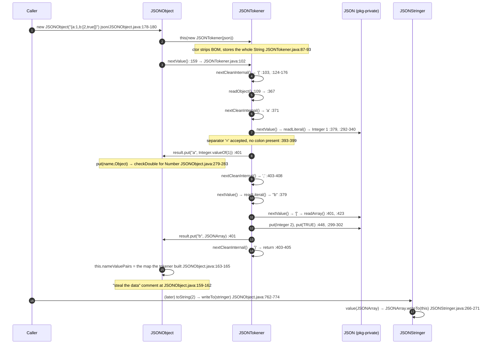
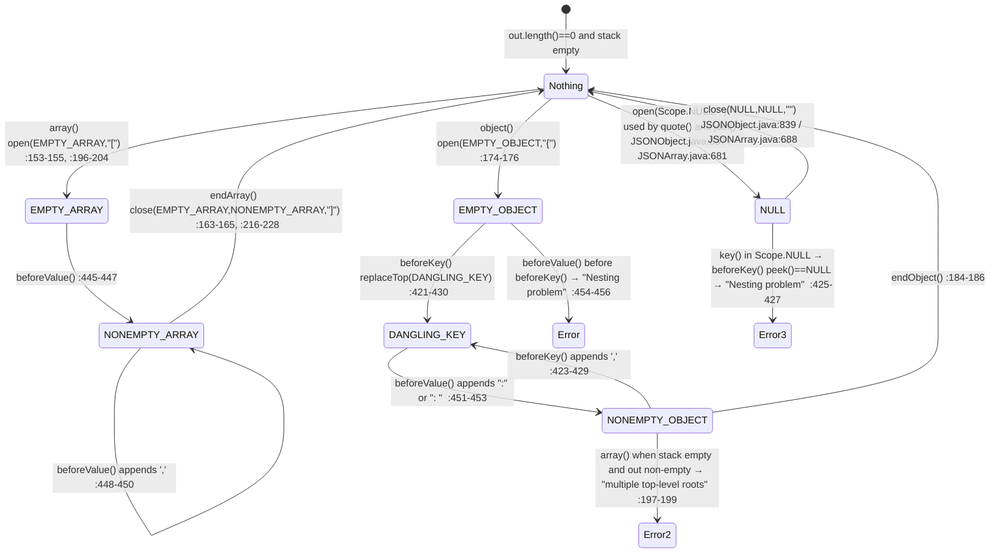
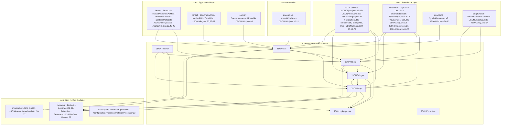

# JSON — 开发者指南

模块：`io.github.microsphere-projects:microsphere-java-core` · 源码线：`release` 分支，`0.3.20-SNAPSHOT`
被分析的包：`io.microsphere.json` —— **8 个主源码类型**（`JSON`、`JSONArray`、`JSONException`、`JSONObject`、
`JSONStringer`、`JSONTokener`、`JSONUtils`、`package-info.java`）。
面向使用者的同主题页面：[用户指南 — JSON](../../../user-guide/microsphere-java-core/zh/json.md)。

所有 `file:line` 引用都相对于 `microsphere-java-core/src/main/java/io/microsphere/`（主源码）
或 `microsphere-java-core/src/test/java/io/microsphere/`（测试），且读取自 `release` worktree，
之后简写为 `json/Foo.java:40-55`。

---

## 1. 架构定位：为什么这个库要自带一个 JSON 模型

`io.microsphere.json` **不是**项目为自己做的一个设计选择；它是一个**内部 fork（vendored fork）**。
这个包用一行字把这件事写明了：`json/package-info.java:19` —— "Fork the source code from org.json"，
而八个文件中的六个在许可证头里重复了这件事（`json/JSON.java:2`、`json/JSONArray.java:2`、`json/JSONException.java:2`、
`json/JSONObject.java:2`、`json/JSONStringer.java:2`、`json/JSONTokener.java:2` 都是
`Copyright (C) 2010 The Android Open Source Project`）。只有 `json/JSONUtils.java` 与 `json/package-info.java`
是 Microsphere 原创，带 ASF 许可证头以及 `@author Mercy` / `@since 1.0.0`
（`json/JSONUtils.java:2-16`、`:109-112`；`json/package-info.java:2-16`、`:21-22`）。

对这个代码库而言，有四个理由使这个 fork 是正确的选择，而且它们全部可以从源码树中核实：

1. **零依赖打包。** `microsphere-java-core/pom.xml:22-74` 只声明了一个 compile 依赖
   （`microsphere-java-annotations`）加若干可选日志后端。整个 reactor 里没有 Jackson、Gson 或 `org.json` 构件。
   一个卖点是"classpath 几乎为空"的库（`docs/current/developer-guide/microsphere-java-core/README.md:11-12`），
   不可能把它的元数据文档路由到第三方 JSON 栈上。
2. **`metadata` 需要的是输出，而不是模型。** 配置属性生成器是把 `name:value` 成对流式写入调用方提供的
   `StringBuilder` 来产出 JSON 的 —— 也就是 `JSONUtils.append`（`json/JSONUtils.java:146-467`），
   用在 `metadata/DefaultConfigurationPropertyGenerator.java:29-30,88-117`。任何第三方 JSON 树都撑不住这种调用形态。
3. **稳定、熟悉的 API 表面。** `JSONObject`/`JSONArray`/`JSONTokener`/`JSONStringer`/`JSONException`
   就是 Android 的 `org.json` API，上游已经冻结，所以这个 fork 没有自创 API 的风险。
4. **价值在桥接层。** `JSONUtils`（1480 行 —— 比六个 fork 来的类加起来还大）才是把 JSON 变成
   `List`/`Set`/`Queue`/`Enumeration`/数组/JavaBean 再变回来的地方（`json/JSONUtils.java:884-1212`），
   而它用的是库自己的 `beans`、`convert`、`reflect`、`collection` 层。这个集成才是本包存在于 `core` 的真正理由。

**它负责的边界：** `io.microsphere.json` 负责*JSON 对象模型、JSON 文本语法，以及 JSON↔Java 的桥接*。
它不负责传输、不负责字符集协商、不负责 `Reader`/`InputStream` 解析（tokener 只读 `String`，
`json/JSONTokener.java:75,87-93`），没有类型注册中心，也没有 `Mapper` 式的配置对象。
它对 `io.serializer` 是**补充**关系而非从属关系 —— 序列化那一族只覆盖二进制的 `Object`↔`byte[]`。

### 1.1 索引把它放在哪里 —— 以及其中一条不成立的说法

开发者索引把 `json` 放在 "Service layers" 这一层，该层的契约栏写的是
"Each is an SPI family discovered through `META-INF/services`, ordered by `Prioritized`"
（`docs/current/developer-guide/microsphere-java-core/README.md:70`）。

**这对 `io.microsphere.json` 并不成立**，而索引自己的图其实已经反映了这点：在拿到
`-.runtime SPI.->` 虚线边的八个包（`README.md:55-62`）里，`JSON` 是 Services 子图中唯一一个没有这种边的节点
（`README.md:29`）。对照源码树核实：

* `microsphere-java-core/src/main/resources/META-INF/services/` 下有 14 个文件 —— 分别对应
  `ArtifactResourceResolver`、`URLClassPathHandle`、`Converter`、`MultiValueConverter`、`EventDispatcher`、
  `Serializer`、`Deserializer`、`LoggerFactory`、三个 `metadata` 接口、`ExtendableProtocolURLStreamHandler` 与
  `ProcessIdResolver`。**不存在 `io.microsphere.json.*` 的服务文件。**
* 包中没有任何类型实现、引用或依赖 `io.microsphere.lang.Prioritized` 排序。

所以 `io.microsphere.json` 是一个普通的值模型/工具包，不是 SPI 家族，索引表格中的那一行要么把 `json` 从该层移除，
要么改写契约描述。图中另一个值得注意的遗漏是：任何把它当作依赖图来读的人都应看到，`json` 只有一条入边
（`REFL --> JSON`，`README.md:48`），而这个包实际上还 import 了 `collection`、`util`、`constants` 与
`lang.function`（见 §10）。

---

## 2. 类型清单

| # | 类型 | 种类 | 可见性 | 行数 | 来源 | 职责 |
|---|---|---|---|---|---|---|
| 1 | `JSONObject` | class | `public` | 888 | AOSP fork | 保序 name→value 映射；容纳 `NULL`、`wrap`、`quote`、`numberToString`（`json/JSONObject.java:83`、`:101`、`:859`、`:831`、`:803`） |
| 2 | `JSONArray` | class | `public` | 747 | AOSP fork | 紧凑的 `List` 包装器，带同一套取值方法（`json/JSONArray.java:76`、`:78`） |
| 3 | `JSONTokener` | class | `public` | 583 | AOSP fork | 作用于单个 `String` 的词法器 + 递归下降解析器（`json/JSONTokener.java:70-75`） |
| 4 | `JSONStringer` | class | `public` | 478 | AOSP fork | 模型唯一的写出器；`Scope` 栈 + 缩进（`json/JSONStringer.java:70-75`、`:81-118`） |
| 5 | `JSONException` | class | `public` | 47 | AOSP fork | 本包唯一的受检异常，只有一个构造器（`json/JSONException.java:41-45`） |
| 6 | `JSON` | class | **package-private**，靠私有构造器实现 final 效果 | 127 | AOSP fork | 强制转换辅助 + `checkDouble` + 两个 `typeMismatch` 工厂（`json/JSON.java:25`、`:27`、`:108`、`:117`） |
| 7 | `JSONUtils` | `abstract class … implements Utils` | `public` | 1480 | Microsphere | `StringBuilder` 写出器（34 个 `append` 重载）与 JSON↔集合/bean 读取器（`json/JSONUtils.java:113`、`:146-467`、`:884-1212`） |
| 8 | `package-info.java` | 包文档 | — | 25 | Microsphere | 记录了这次 fork（`json/package-info.java:19-22`） |

这张表里浮现出三个结构性事实，值得在做源码分析之前先说明：

* **fork 保留了 Android 的内部切分**：`JSON` 是包私有的，于是每一条强制转换规则都被 `JSONObject` 与 `JSONArray`
  *共享*而不是各自复制 —— 两者静态导入的是同样的五个方法（`json/JSONObject.java:30-35`、
  `json/JSONArray.java:26-31`）。
* **`JSONStringer` 的输出缓冲是包可见的**（`final StringBuilder out`，`json/JSONStringer.java:75`），
  而 `JSONArray.join` 直接往里写（`json/JSONArray.java:684,689`）。也就是说八个类型中有两个是通过字段而非方法耦合的。
* **`JSONObject` 与 `JSONUtils` 相互 import**：`JSONObject` 引入 `isJSONObject`/`isJSONArray`
  （`json/JSONObject.java:36-37`），`JSONUtils` 引入 `wrap`（`json/JSONUtils.java:64`）。在类型层面这是同一个包内的
  真环；它能编译，只因为两个方向都是静态工具调用。

---

## 3. 词法器与解析器：`JSONTokener` 的状态机

### 3.1 两个字段与游标运算

词法器状态的全部内容就是 `private final String in` + `private int pos`
（`json/JSONTokener.java:75`、`:81`）。构造函数会剥掉可选的 UTF-8 BOM，其余情况下它很乐意把 `null` 存下来，
javadoc 也承认这样构造出来的 tokener "throws `NullPointerExceptions` when methods are called"
（`:84-85`，代码 `:87-93`）。没有 `Reader`、没有缓冲区、没有字符集处理 —— 输入就是一整个内存中的 `String`。

四个包私有访问器承担全部字符移动：`charAt(int)` `:567-569`、`currentChar()` `:559-561`、
`nextChar()` `:563-565`（即 `charAt(this.pos++)`），而解析器回退的方式是直接改写 `pos` ——
`this.pos--` 出现在 `:119`、`:375`、`:445` —— 而不是通过 public 的 `back()` 辅助方法（`:553-557`）。
由于 `charAt` 永不做边界检查，所有"还有输入吗"的问题都必须先由 `hasNext()`（`:501-503`）回答；
解析路径始终遵守，legacy API 路径则一半遵守一半不遵守（`next(char)` 在 `:505-511` 把输入耗尽替换成 `'\0'`，
然后把这个替换值当作不匹配上报）。

### 3.2 分派循环

`nextValue()` 就是整个语法（`json/JSONTokener.java:102-122`）：调用 `nextCleanInternal()` 一次，然后按字符 switch。
`nextCleanInternal()`（`:124-176`）才是真正的词法器 —— 一个丢弃 ` \t\n\r`、消费 `/* … */`
（未闭合 ⇒ `syntaxError("Unterminated comment")`，`:141-149`）、`// …`（`:151-155`）与 `# …`（`:161-168`）
的循环，其他字符一律返回；一个不是注释起始特征的光 `/` 会作为字面字符返回（`:157-158`）。输入耗尽返回 `-1`
哨兵（`:175`）。

```mermaid
flowchart TD
    IN["nextValue()  JSONTokener.java:102-122"] --> CLEAN["nextCleanInternal()  :124-176"]
    CLEAN --> WS{"char class?"}
    WS -- "space / tab / CR / LF" --> CLEAN
    WS -- "'/' then '*'" --> CMT["skip /* … */ to indexOf(\"*/\")<br/>:141-149 — unterminated → syntaxError"]
    WS -- "'/' then '/'" --> EOL1["skipToEndOfLine()  :151-155, :182-190"]
    WS -- "'#'" --> EOL2["skipToEndOfLine() — non-RFC leniency  :161-168"]
    CMT --> CLEAN
    EOL1 --> CLEAN
    EOL2 --> CLEAN
    WS -- "-1 (exhausted)" --> EOIE["throw syntaxError(\"End of input\")<br/>:105-106, :470-472"]
    WS -- "'{'" --> RO["readObject()  :367-413"]
    WS -- "'['" --> RA["readArray()  :423-461"]
    WS -- "'\"' or \"'\"" --> NS["nextString(quote)  :203-240"]
    WS -- "anything else" --> PUSH["this.pos--  (un-read one char)  :119"]
    PUSH --> RL["readLiteral()  :292-340"]

    NS --> ESC{"c == '\\\\' ?"}
    ESC -- yes --> RE["readEscapeCharacter()  :251-283<br/>u → Integer.parseInt(hex,16) :258-260"]
    ESC -- no --> NS
    RE --> NS

    RL --> LIT{"literal form?"}
    LIT -- "null/true/false, ignore-case" --> SENT["NULL / TRUE / FALSE  :297-303"]
    LIT -- "no '.' → parseLong base 10/16/8" --> PROMOTE["≤ Integer range → int<br/>else → long  :306-322"]
    LIT -- "valueOf(literal)" --> DBL["Double  :332-336"]
    LIT -- "NumberFormatException" --> RAW["bare String  :338-339"]
```

三条复合路径都会递归回到 `nextValue()`：`readObject` 为键名调用它（`:379`）、为值调用它（`:401`）；
`readArray` 为每个元素调用它（`:448`）。这就是解析器的全部 —— 一个分派器、两个括号循环、一个字符串扫描器、
一个字面量扫描器。

### 3.3 宽松行为是有实际承载量的

`readObject` 接受 `:` **或** `=` 作为分隔符，随后吃掉紧跟的 `>` 以支持 `=>`
（`json/JSONTokener.java:388-399`），并且 `;` 与 `,` 都接受作为分隔（`:403-411`）。`readArray` 把没有前置值的
分隔符当作一个元素，并插入 **Java `null`** —— `result.put(null)` 在 `:438-443`，
对尾部的 `,:]` 在 `:433-437` 同理。它自己的 javadoc 把后果讲得很清楚：`"[]"` 是空数组，但 `"[,]"` 是等价于
`[null,null]` 的二元素数组（`:415-418`）。

这是关于解析路径最重要的一个内部事实：**类 javadoc 把九条语法错误列为故意的非错误**
（`json/JSONTokener.java:44-62`），所以 `nextValue()` 成功并不能说明输入是 JSON。还要注意这里产出的两种 null
不是同一个对象 —— `readLiteral` 对单词 `null` 返回 `NULL` 哨兵（`:297-298`），而 `readArray` 对悬空分隔符放入
裸 Java `null`（`:441`）。同一个解析器，两种 null 输出，取决于*命中了哪条规则*。

### 3.4 `new JSONObject(String)` 的端到端过程



这个 map 交接点是 fork 从上游继承下来、并且源码毫不掩饰地注释了的技巧：*"Getting the parser to
populate this could get tricky. Instead, just parse to temporary JSONObject and then steal the data from that"*
（`json/JSONObject.java:159-162`，代码 `:163-165`；数组侧的镜像是 `json/JSONArray.java:121-127`）。
临时对象会在每一次 `new JSONObject(String)` 之后变成垃圾 —— 用两次分配换来 `nameValuePairs` 保持 `final`。

### 3.5 递归深度：没有任何东西约束它

`readObject`（`json/JSONTokener.java:367-413`）与 `readArray`（`:423-461`）都不携带计数器，也不检查任何类似
最大嵌套级别的东西；唯一的停止条件是右括号和 `-1`。再叠加 `JSONStringer` 的字段注释
"Unlike the original implementation, this stack isn't limited to 20 levels of nesting"
（`json/JSONStringer.java:120-124`）—— 它与它自己的类 javadoc（`:61-62`）直接矛盾 —— 这个包在**读写两侧都没有
深度保护**。因此深层输入会以 `StackOverflowError` 失败，那是一个既不属于 `JSONException` 也不属于
`RuntimeException` 的 `Error`。`json/JSONTokenerTest.java` 与 `json/JSONStringerTest.java` 中没有任何相关测试。

---

## 4. `JSONObject`：底层 map 与键顺序

`JSONObject` 把一切都放在一个 `final` 字段里：`private final Map<String, Object> nameValuePairs`
（`json/JSONObject.java:116`），而每一条构造路径都会经由无参构造器的 `newLinkedHashMap()` 抵达它（`:121-123`）。
这个 helper 是库自己的 —— `collection/MapUtils.java:574-577` 返回一个不带容量参数的普通
`LinkedHashMap<>()` —— 于是：

* **迭代顺序就是插入顺序**，永远如此，包括对已存在键执行 `put` 之后（`LinkedHashMap` 并*不会*因此重排），
  以及 `remove` 之后再 `put`（此时键会被移到末尾）；
* **`toString()` 的输出是确定性的**，这正是 `json/JSONObjectTest.java:419` 可以断言精确字符串的原因；
* 这个 map **永远不会被包装、复制或改为不可变** —— `keys()` 直接迭代 `nameValuePairs.keySet()`
  （`:722-724`），`names()` 从它构建数组（`:732-734`），两者都是活视图。

最后这一点与文档相撞。`keys()` 的 javadoc 写着 "the order of the keys is undefined"
（`json/JSONObject.java:715-716`）—— 这是从 AOSP 文本继承来的，写就时该字段确实*可能*是 `HashMap`。
在本分支上它可证明是保序的，而 `json/JSONObjectTest.java:381-392` 断言的正是这个顺序。
相信 javadoc 的读者会刻意去依赖代码其实保证了的行为不被依赖；这是反方向的意外，应当改 javadoc 而不是改字段。

**写入路径。** `put(String,Object)` 是唯一有实质语义的那一个（`json/JSONObject.java:274-285`）：
Java `null` 值会**删除**该键（`:275-278`），任意 `Number` 都要经过 `JSON.checkDouble`（`:279-283`，
`:280-281` 处的注释解释了这是对原版只检查 float/double 的*故意*偏离），然后才在 `checkName` 拒绝 `null` 名字之后
进入 `doPut`（`:340-343`、`:345-350`）。四个基本类型重载（`:218-260`）装箱后委托，仍然声明
`throws JSONException`，因为 `checkName` 会抛。`accumulate`（`:317-338`）只对*新*值重复了 `checkDouble` 检查 ——
`:323` 处的注释说明了原因："check in accumulate, since array.put(Object) doesn't do any checking"。
这句注释是承认，不是解释：`JSONArray.put(Object)` 确实毫无防护（`json/JSONArray.java:225-228`），
所以 `accumulate(name, NaN)` 被检查而 `array.put((Object) NaN)` 不被检查，失败只在序列化时才浮出
（`json/JSONObject.java:803-809` → `json/JSONStringer.java:278-279`）。

**读取路径。** `get(String)` 区分*缺失*与*哨兵*：`nameValuePairs.get(name)` 返回 `null` 时抛
`"No value for <name>"`（`json/JSONObject.java:393-399`），而 `NULL` 值能通过，因为它是一个真实对象。
但 `getBoolean` 与 `getString` 从 `opt()` 而不是 `get()` 出发（`:421`、`:594`），所以对它们而言缺失键和显式
`null` 都会表现为来自 `JSON.typeMismatch` 的 `"Value at <name> is null."`（`json/JSON.java:108-115`）。
七个取值方法，两套错误词汇，由该方法恰好调用了哪个 helper 决定。`isNull`（`:370-373`）与 `has`（`:382-384`）
是让你得以区分两种 null 的那一对，而 `isNull` 用的是引用同一性（`value == NULL`）外加一个 `null` 检查 ——
它不调用哨兵那个坏掉的 `equals`。

**哨兵对象。** `NULL` 是一个匿名 `Object` 子类的静态字段（`json/JSONObject.java:101-114`），
它的 `equals` 故意接受 `null`，并带着一行注释 `// API specifies this broken equals implementation`
（`:105-106`），类 javadoc 也把这次契约违反明确写了出来（`:98-99`）。它的 `toString()` 返回 `"null"`
（`:109-112`），正是这一点让它无需特判就能正确序列化（`json/JSONStringer.java:276-277`）。
由于这里的 `equals` 是不对称的，`NULL.equals(null)` 为 `true` 而 `null.equals` 根本不可达，
并且 `NULL` 只是一个*按约定*的单例 —— 没有任何东西阻止别处出现第二个匿名实例。
`wrap` 因此写作 `o == null || o.equals(NULL)`（`json/JSONObject.java:861`），
在强制转换阶梯的**第一行**就调用了*调用方控制的* `equals`。

**相等性。** `equals` 比较底层 map（`json/JSONObject.java:777-788`），`hashCode` 委托给 map 的
（`:790-793`）；`equals` **不是** `final`，而 `JSONArray.equals` **是**（`json/JSONArray.java:728-739`）。
由于哨兵破坏了 `equals` 的对称性，两个持有 `NULL` 的 `JSONObject` 比较相等（两侧 map 都会走
`NULL.equals(NULL)`），这是设计意图 —— 但持有 `NULL` 的与持有 Java `null` 的同样相等，而后者根本不可能通过
`put` 构造出来（`:275-278`），只能来自 `readArray` 的悬空分隔符（`json/JSONTokener.java:441`）
或 `Map` 构造器（`json/JSONObject.java:147`，它存的是 `wrap(value)` —— 而 `wrap(null)` 返回 `NULL`，
所以 Map 这条路确实做了归一化）。

---

## 5. `JSONArray`：存储与那个 `null` 缺口

`JSONArray` 持有 `private final List<Object> values`（`json/JSONArray.java:78`），
由 `ListUtils.newArrayList()` 创建（`:83-85`，helper 在 `collection/ListUtils.java:313-315` → 普通 `ArrayList`）。
基本类型数组构造器是唯一提前定容的地方 —— `newArrayList(length)`（`json/JSONArray.java:155`，
helper 在 `collection/ListUtils.java:337-339`）—— 而 `getLength`/`Array.get` 来自 `java.lang.reflect.Array`，
所以**任何**数组类型都能通过，尽管 javadoc 承诺的是 "primitive array"（`:144-149`），
失败消息也写着 `"Not a primitive array: "`（`:150-153`）。

四个构造器，三种不同的 `null` 纪律：`JSONArray(Iterable)` 对参数做了防护（`:104-111`，`:106`）；
`JSONArray(Enumeration)` **没有** —— `:88-94` 那个裸的 `while (enumeration.hasMoreElements())` 对 `null` 参数
直接 NPE，打破了它的同胞刚刚建立的惯例；`JSONArray(JSONTokener)` 窃取解析出的 list（`:120-131`），
当 tokener 的第一个值不是数组时抛 `typeMismatch(object, "JSONArray")`（`json/JSON.java:117-123`）；
`JSONArray(Object array)` 用*受检的* `JSONException` 拒绝非数组（`:150-153`）。

`put(int, Object)` 是唯一会自行扩容的下标写入方法，中间的空洞用 null 填充
（`json/JSONArray.java:300-310`，填充循环在 `:305-307`），这意味着对空数组执行 `put(5, x)` 会得到一个六元素
list，其中前五个是 **Java `null`** —— 不是 `NULL`。这五个元素随后会让 `get(int)` 抛
`"Value at 0 is null."`（`:333-343`、`:336-338`），让 `isNull(int)` 返回 `true`（`:319-322`），
让 `opt(int)` 返回 `null`（`:352-357`，因为 `opt` 只做边界检查而不做 null 归一化），
并序列化成 `null`（`json/JSONStringer.java:276-277`，因为 `out.append(null)` 追加的是四个字符 `null`）。
所以 `[null,null,null,null,null,"x"]` 能经 `toString()` 往返，但它的元素无法通过 `get` 访问。
`readArray` 的悬空分隔符同理（§3.3）。这正是类 javadoc 中双重 null 警告（`json/JSONArray.java:49-52`）的具体来源。

针对该 list 的 `equals`（`json/JSONArray.java:728-739`）意味着：仅在 Java-`null` 与 `NULL` 元素上不同的两个数组是
**不相等**的，尽管两者打印完全一致 —— 因为 `ArrayList.equals` 用的是 `Objects.equals`，
`NULL.equals(null)` 为 `true` 而 `null.equals(NULL)` 永远不会执行，于是这个比较依赖于元素顺序。
它是 `final` 的，与 `JSONObject.equals`（§4）相反。

---

## 6. 写出器：`JSONStringer` 的作用域栈与缩进策略

`JSONStringer` 是一个作用在 `StringBuilder` 上的状态机，而它唯一的状态就是作用域栈 ——
`private final List<Scope> stack = newArrayList()`（`json/JSONStringer.java:124`）。`Scope` 是一个包私有的嵌套枚举，
六个常量（`:81-118`），其中五个是真正的语法状态，第六个（`NULL`）是为无括号输出准备的 hack。
分隔符与嵌套合法性**完全**由栈顶推导，经由 `peek()`（`:236-241`）、`replaceTop()`（`:248-250`）、
`beforeKey()`（`:421-430`）与 `beforeValue()`（`:439-457`）。



**缩进**是每个实例的常量，不是每次调用的参数：构造器构建一个空格串
（`char[indentSpaces]` 由 `Arrays.fill` 填充），任何 `<= 0` 都把 `indent` 置为 `null`
（`json/JSONStringer.java:136-144`）。`newline()` 随后追加 `\n` 加上**按栈内元素个数**重复的 `indent`
（`:388-397`），这就是右括号会比成员低一层的原因 —— `close()` 在调用 `newline()` **之前**先出栈
（`:222-225`）。`beforeValue()` 从同一个字段上取出 `":"` 或 `": "`（`:452`），所以紧凑输出与美化输出在每一对
键值上恰好只差一个字符，而 `json/JSONObjectTest.java:420` 断言的形状
（`"{\n \"name\": \"Mercy\",\n …\n}"`）正是这一组合，仅此而已。

**转义**是 `json/JSONStringer.java:338-386` 的那个 switch：`"`、`\` **以及 `/`** 在同一个分支里被反斜杠转义
（`:349-353`），随后是六个具名转义，所有 `<= 0x1F` 变成 `format("\\u%04x", c)`（`:375-381`）。
`U+2028`/`U+2029` **不**在这里转义 —— `:343-347` 的注释只引用 RFC 4627 —— 而 `JSONUtils.escape`
会转义它们（`json/JSONUtils.java:115-117`、`:1358-1361`）却**不**转义 `/`（`:130-144` 的表里没有 `/` 条目）。
两个编码器在两个方向上都是字节不兼容的，而 `json/JSONStringerTest.java:188-194` 与
`json/JSONUtilsTest.java:806-815` 各自只钉住了自己那一半。

**`Scope.NULL`** 就是 `JSONObject.quote(String)` 与 `JSONArray.join(String)` 复用这台机器产出无括号输出的方式：
两者都 `open(Scope.NULL, "")` 并 `close(Scope.NULL, Scope.NULL, "")`（`json/JSONObject.java:835-841`；
`json/JSONArray.java:680-689`）。`beforeValue()` 对该作用域从不动栈 —— 它穿过所有分支落到 `:454` 的
`context != Scope.NULL` 测试，结果为 false，于是什么都不追加、什么都不替换（`:439-457`）。
这正是 `join` 能够插入分隔符的唯一方式 —— 而 `join` 的做法是直接写进 `stringer.out`（`:684`），
并返回 `stringer.out.toString()`（`:689`）而不是 `stringer.toString()`。这很要紧：
`JSONStringer.toString()` 对空缓冲返回 **`null`**，并自认违反了 `Object.toString`
（`:465-466`、`:470-473`），所以如果 `quote` 不在 `json/JSONObject.java:832-834` 提前短路，它对 `null` 输入就会
返回 `null`。

---

## 7. `JSONUtils`：第二个编码器，加上 Java 桥接

`JSONUtils`（1480 行）是 fork 止步之处。这个类里住着两个职责，而它们在架构上毫不相干：

**（a）一个不经过对象模型的 `StringBuilder` 写出器。** 34 个
`append(StringBuilder, name, value)` 重载（`json/JSONUtils.java:146-467`），加上 `appendValue`（`:469-486`）、
`appendArray`（`:488-498`）、`appendName`（`:500-508`）以及私有 helper
`appendMap`/`appendIterable`/`appendString`/`appendType`（`:1388-1425`）。这是 `metadata` 走的路径，因为它不需要
一棵树（`metadata/DefaultConfigurationPropertyGenerator.java:88-117`）。设计观察：

* `appendName` 写的是 `'"' + name + '"' + ':'`，**完全不转义**（`:500-506`），而且更糟的是 —— 它把整个写入包在
  `if (isNotBlank(name))` 里（`:501`），所以 `null` 或空白名字会**什么都不输出**，连冒号都没有。
  紧随其后的那个 `append` 值就会直接贴在前文之后。调用方收不到任何信号。
* `appendValue` 的第一条语句是 `value.getClass()`（`:469-470`），所以 `null` 值就是 `NullPointerException` ——
  经由 `appendMap`/`appendIterable`（`:1388-1415`），任何 map 或集合中的*一个* `null` 都会同样传播。
  模型类对 `null` 是宽容的；这个类不是。
* 整个类中不存在任何有限性检查，所以 `append(builder, "n", Double.NaN)` 会输出 `NaN`（`:176-179`
  以及 `:483-485` 的 `else` 分支）。模型路径对同一个值是拒绝的（`json/JSON.java:27-32`）。
* `REPLACEMENT_CHARS` 是一个按 `char` 索引的 `String[128]`（`:130-144`），所以 `escape` 是 O(n) 并带一个
  `builder == null` 快路径 —— 但只有当输入确实不需要任何转义时才走得到（`:1349`、`:1378-1380`）。

**（b）JSON↔Java 桥接层。** `readValue`/`readValues`/`readArray` 共九个重载（`:884-1212`），加上
`writeValueAsString`（`:1234-1241`）与 `writeBeanAsString`（`:1272-1277`）。其机制组合了另外四个 `core` 包：
`ConstructorUtils.newInstance(true, beanClass)` 负责实例化，`MethodUtils.invokeMethod` 负责调用 setter，
`BeanUtils.getBeanMetadata`/`findWriteMethod` 负责定位属性，`Converter.convertIfPossible` 负责标量强制转换，
`TypeUtils.asParameterizedType`/`asClass` 负责恢复泛型类型（`json/JSONUtils.java:988-1007`、`:1427-1442`；
import 在 `:23`、`:63`、`:65-67`）。这半边有两处设计异味：

* `readValues(JSONArray, Class, Class)` 是一串六分支的 `if`/`else if` 阶梯，**走到尽头就 `return null`**
  （`:1125-1141`）—— 不支持的目标类型不算错误，而是一个静默的 `null`，
  在 `json/JSONUtilsTest.java:639-645` 有断言。
* `determineElementClass` 标注了 `@Nonnull`（`:1302`），却不做任何防护地解引用 `element.getClass()`
  （`:1306-1308`），所以含 Java `null` 元素的数组 —— §5 的 `put(int,Object)` 补洞或 §3.3 的悬空分隔符都能造出来 ——
  会从一个承诺非 `null` 的方法里抛 `NullPointerException`。而且尽管 javadoc 的例子另有说法（`:1288-1297`），
  它算的也不是*公共父类*：循环只在具体类之间收窄，第一次不匹配就径直跳到 `Object.class`（`:1312-1318`）。

`isUnknownClass`（`:510-512`）配合 `UNKNOWN_CLASS = Void.class`（`:119`）是包内部的哨兵，让感知 `Type` 的读取器
（`:1073-1094`）可以表达"调用方没告诉我，请推断"—— 一个包里的第三种 null 式约定。

---

## 8. 异常分类学

`JSONException` 是本包唯一声明的异常，而且它精简到了近乎别扭的程度：
`public class JSONException extends Exception`（`json/JSONException.java:41`），**只有**一个接收 `String` 的构造器
（`:43-45`）。对任何要往这里加代码的人来说，以下几点很重要：

* **没有 cause 构造器。** `throw new JSONException(msg, cause)` 编译不过，这就是为什么库里每一条重新包装的路径
  都必须改走 `ExceptionUtils.wrap` 并落到*另一种*异常类型上（`json/JSONUtils.java:803-812`、`:843-852`），
  也是为什么这个类的 javadoc 干脆劝调用方放弃并包装成 `RuntimeException`（`:30-39`）。
* **没有 `serialVersionUID`** —— 对八个文件全量 grep 一无所获，所以该类依赖 JDK 计算出的 UID。
* **没有 `JSONException()` 也没有 `JSONException(Throwable)`**，所以捕获到的 `JSONException` 无法带着新消息原样
  重新抛出。

四套词汇在同时使用，而它们之间的映射并不讲原则：

| 词汇 | 由谁抛出 | 位置 |
|---|---|---|
| 受检 `JSONException` | 格式错误的输入、缺失/越界的键、类型不匹配、`NaN`/无穷值的写入、`null` 名字、嵌套违规 | `json/JSONTokener.java:470-472`；`json/JSONObject.java:345-350`、`:393-399`、`:803-806`；`json/JSONArray.java:150-153`、`:333-343`；`json/JSONStringer.java:196-204`、`:216-228`、`:236-241`、`:261-264`、`:406-409`、`:421-430`、`:439-457`；经由 `json/JSON.java:108-123` |
| 非受检 `RuntimeException` | 两个模型类型的 `toString(int)`、`quote` | `json/JSONObject.java:762-766`、`:831-842`；`json/JSONArray.java:713-717`；都经由 `ThrowableAction.execute` → `handleException` `throw new RuntimeException(failure)`（`lang/function/ThrowableAction.java:105-107`、`:79-81`） |
| 非受检 `IllegalArgumentException` | 仅 `JSONUtils.jsonObject` / `jsonArray` | `json/JSONUtils.java:803-812`、`:843-852`，经由 `util/ExceptionUtils.java:97-104`、`:304-308` |
| 非受检 `NullPointerException` | `new JSONTokener(null)` 的读取、`appendValue(null)`、`determineElementClass`、`JSONArray(Enumeration)`、键为 `null` 的 `JSONObject(Map)` | `json/JSONTokener.java:501-503`；`json/JSONUtils.java:470`、`:1308`；`json/JSONArray.java:88-94`；`json/JSONObject.java:144-146`（在 `:131` 有文档说明） |
| 非受检 `NumberFormatException` | 畸形的 `\uXXXX` —— 无保护地 `Integer.parseInt(hex,16)` | `json/JSONTokener.java:258-260`，javadoc 在 `:200` 与 `:248` 已经承认 |
| 静默 `null` / 空操作 | `wrap` 失败、`writeValueAsString`、`readValues` 遇到不支持的目标、`put(name,null)` 删除键、空对象的 `names()` | `json/JSONObject.java:867-885`、`:732-734`；`json/JSONUtils.java:1234-1241`、`:1125-1141`；`json/JSONObject.java:275-278` |

`JSONStringer` 值得单列出来：它是**唯一**报告*写出*侧（而非读取侧）语法违规的类，而且只用两条消息之一 ——
`"Nesting problem"`（`:219`、`:238`、`:426`、`:455`）与更具体的
`"Nesting problem: multiple top-level roots"`（`:198`）/ `"Names must be non-null"`（`:408`）。
仅凭消息，调用方无法区分括号不匹配与键值顺序错误。

---

## 9. 设计模式

| 模式 | 实现类 | 本包中的证据 |
|---|---|---|
| **组合（Composite）** | `JSONObject`、`JSONArray` 构成的值树 | 每个节点持有的子节点正是它所属的那个联合体（`json/JSONObject.java:116`、`json/JSONArray.java:78`），而写出器是组件优先递归的：`JSONStringer.value(Object)` 把嵌套的 `JSONArray`/`JSONObject` 交回 `writeTo(this)` 而不是自行序列化（`json/JSONStringer.java:266-272` ↔ `json/JSONArray.java:719-725`、`json/JSONObject.java:768-774`）。不存在 `Component` 接口 —— 联合体靠 `instanceof` 判别，这也是递归对 `StackOverflowError` 敞开的原因（§3.5） |
| **哨兵 / 空对象（Sentinel / Null Object）** | `JSONObject.NULL` | 一个 `public static final Object` 匿名实例，其 `equals` 故意接受 `null`，`toString` 返回 `"null"`（`json/JSONObject.java:101-114`）；契约违反写在 `:98-99`，行为清单写在 `:87-97`。它让"键存在但无值"成为一等公民，也是 `JSONStringer` 能在 `:276-277` 用 `out.append(value)` 的原因 |
| **流畅式构造（Fluent Builder）** | `JSONObject` 的 `put` 族、`JSONArray` 的 `put` 族、`JSONStringer` 的动词 | 每个变更方法都返回 `this` —— `json/JSONObject.java:218-260`、`:284`、`:296-301`、`:317-338`；`json/JSONArray.java:176-228`、`:240-310`；`json/JSONStringer.java:153-155`、`:174-176`、`:261-287`、`:406-413`（javadoc `@return this stringer`，`:150`）。注意这里**没有**独立的 builder 类型，也没有 `build()` 步骤 —— 对象全程可变，所以这是流式链调，不是 GoF 的 Builder |
| **状态机（无表驱动）** | `JSONStringer.Scope` | 包私有枚举中的六个状态（`json/JSONStringer.java:81-118`），状态转移编码在 `beforeKey`/`beforeValue`/`open`/`close` 里针对 `peek()`/`replaceTop()` 的 `if` 链上（`:196-250`、`:421-457`）；javadoc 明确把它的两项职责描述为插入分隔符与检测嵌套错误（`:77-80`） |
| **策略（强制转换），经由包私有静态方法共享** | `JSON.toBoolean` / `toDouble` / `toInteger` / `toLong` / `toString` | 一份强制转换实现，被两个组合节点静态导入（`json/JSONObject.java:30-35`、`json/JSONArray.java:26-31`；定义在 `json/JSON.java:34-106`）。每个都返回 `null` 表示"无法转换"，由*调用方*决定是抛还是给默认值（`json/JSONObject.java:420-427` 对比 `:436-452`） |
| **访问者（非 GoF，javadoc 已承认）** | `JSONUtils.appendValue` + `JSONStringer.value(Object)` | 两处手写的运行时类型阶梯，而不是双重分派：`json/JSONUtils.java:469-486`（数组 → map → iterable → char 家族 → `Type` → 兜底）与 `json/JSONStringer.java:261-287`。`microsphere-lang-model` 中的 `JSONAnnotationValueVisitor` 把 `append`/`appendName` 的产出当作它的访问结果来消费（`microsphere-lang-model/src/main/java/io/microsphere/lang/model/util/JSONAnnotationValueVisitor.java:36-37`） |
| **适配器（Java ⇄ JSON）** | `JSONObject.wrap`、`JSONUtils.readValueAsBean`、`writeBeanAsString` | `wrap` 把 `Iterable`/数组/`Enumeration`/`Map`/`Class`/`CharSequence`/`Enum`/`java.*`/JavaBean 适配为 JSON 联合体（`json/JSONObject.java:859-886`），bean 路径则经由 `BeanUtils.resolvePropertiesAsMap` 与 `findWriteMethod` 反向适配（`json/JSONObject.java:25,881`；`json/JSONUtils.java:988-1007`） |
| **无模板的工厂方法** | 五个 `JSONObject` 构造器与六个 `JSONArray` 构造器 | 每个构造器都是一个*解析后窃取*或*复制并包装*的工厂，而不是对某个已有构造器的重载（`json/JSONObject.java:121-198`；`json/JSONArray.java:83-159`） |
| **静态工具类（符合标记约定）** | `JSONUtils` | `public abstract class JSONUtils implements Utils`（`json/JSONUtils.java:113`）配 `private` 构造器（`:1477-1478`）—— 即[工具类与常量](util-and-constants.md)中描述的全库约定。`JSON` 是包私有的并有 `private JSON()`（`json/JSON.java:25`、`:125-126`）；`JSONObject`/`JSONArray` 不是工具类，也就没有这类防护 |

**故意缺席的东西，值得记录下来以免有人再加回来：** 没有 `Registry`（什么都不被发现）、没有 `Factory` 接口、
没有 `Mapper` 式的配置对象、任何方法上都没有 `Context`/`Config` 参数，也没有 `Visitor` 接口。整个包对外是关闭的：
`JSONObject` 与 `JSONArray` 虽然非 `final`，但它们的 javadoc 逐字照抄 AOSP 并告诫不要继承
（`json/JSONArray.java:71-74`、`json/JSONStringer.java:64-68`、`json/JSONTokener.java:64-68`），
而 `json/JSONObject.java:47-82` **完全没有这类警告** —— 这个不对称是 fork 引入的，不是继承来的。

---

## 10. 包依赖

对八个文件中所有 `import io.microsphere.*` 与 `import static io.microsphere.*`
（仅主源码）做过 grep，另在本包之外对整个仓库 grep 过 `io.microsphere.json`，结果如下。



把这张图和 §1.1 中的索引说法对照着读：`json` 位于 **Service 层的顶端**，向下导入每一个更低的层，而向上只被一个同层
包（`metadata`）和两个下游模块使用。这让日后搬迁它是安全的 —— `core` 中类型模型层以下没有任何东西依赖它 ——
但这也意味着**要把 `json` 拆成独立构件，就必须同时抽出或内联 `beans`、`reflect`、`convert`、`collection`、
`constants`、`util` 与 `lang.function`**，因为光 `JSONUtils` 就触及了这七个
（`json/JSONUtils.java:22-25,43-73`）。六个 fork 来的类只需要 `beans`、`collection`、`util`、`lang.function`
（`json/JSONObject.java:25-45`、`json/JSONArray.java:25-35`、`json/JSONStringer.java:21,29`），拆出去成本低得多 ——
这正是主张把 `JSONUtils` 移到一个依赖 `json` 的独立模块的理由。

**已核实的非依赖。** `io.microsphere.net.classpath`、`io.microsphere.io*`、`io.microsphere.nio.*`、
`io.microsphere.concurrent`、`io.microsphere.process`、`io.microsphere.management`、`io.microsphere.security`、
`io.microsphere.logging`、`io.microsphere.event`、`io.microsphere.classloading` 与 `io.microsphere.filter`
中**零次**引用 `io.microsphere.json`。`io.microsphere.convert` 与 `io.microsphere.reflect` 使用的是
`JSONUtils` 的*下游*，而不是它本身 —— `json` 消费的唯一一个 `convert` 符号是
`Converter.convertIfPossible` 这个静态方法（`json/JSONUtils.java:63`），所以 `convert → json` 从不发生，
这里也不存在 `CONV --> SERIAL` 那样的边。

**测试专属的表面。** `src/test/java/io/microsphere/JSONTestUtils.java:34-64` 是一个共享 helper，
为非 JSON 测试构造 `JSONObject`/`JSONArray` 夹具，它往返的两个 bean 是
`src/test/java/io/microsphere/test/Data.java` 与 `MultipleValueData.java`；三个资源服务于解析测试 ——
`src/test/resources/test/json/data.json` 与 `array.json` 对应 `testNextValueOnReadObject`/
`testNextValueOnReadArray`（`json/JSONTokenerTest.java:59-73`），`clean.txt` 对应 `testNextCleanInternal`，
后者一直循环到读到 `'a'` 为止，从而证明了注释与空白跳过（`:152-159`）。§3.2 描述的 Integer→Long 提升
在其后两个测试方法处被钉住：`:241-242`。

---

## 11. 评审意见

### 11.1 线程安全

四个可变 fork 类中的三个用完全相同的 AOSP 措辞把自己声明为线程不安全：
`json/JSONTokener.java:64-68`、`json/JSONArray.java:71-74`、`json/JSONStringer.java:64-68`。
**`JSONObject` 没有** —— 它在 `json/JSONObject.java:47-82` 的 javadoc 块从未提及线程安全，尽管它的字段就是一个普通
`LinkedHashMap`（`:116`），而 `put`/`remove`/`accumulate` 都在无同步地修改它。今天这个遗漏无害
（`LinkedHashMap` 和 `ArrayList` 一样不安全），但它恰好是评审者最期待看到警告的那个类，因为 `JSONObject`
也正是人们会跨线程传递的那个类。建议为对齐而补上这段。

另外两点评审者不应错过：

* `JSONStringer` 原则上就无法共享：`out` 是唯一的 `StringBuilder`（`json/JSONStringer.java:75`），
  而 `toString()` 不做拷贝就读它（`:470-473`）。它的 `stack` 是 `ArrayList`（`:124`），所以跨线程复用会把两者都搞坏。
* 静态方法是安全的，因为它们无状态。`JSONUtils.REPLACEMENT_CHARS` 是一个 `static final String[]`，
  在 `static` 块中一次性填充（`json/JSONUtils.java:130-144`）且**之后再不修改** —— 但一个*数组*装的是一组可变引用，
  因此并非真正不可变；`U2028`/`U2029`（`:115-117`）与 `UNKNOWN_CLASS`（`:119`）则是名副其实的最终常量。
  `JSONObject.NULL` 是一个真正的单例，它的 `equals` 按设计对 `null` 非对称（`:101-114`）；共享它是安全的，
  但 `wrap` 的第一行就在**调用方提供**的对象上调用 `o.equals(NULL)`（`:861`），
  所以一个恶意或有 bug 的 `equals` 可以在一个看起来是纯静态函数的内部阻塞或抛出。

### 11.2 分配行为

这个 fork 只优化了一件事 —— *不泄漏输入字符串的 char 数组* —— 而每一条热路径都在为它付账：

* `nextString` 的无转义快路径返回 `new String(this.in.substring(start, this.pos - 1))`
  （`json/JSONTokener.java:219`），注释写着 "a new string avoids leaking memory"。在 Java 8+ 上 `substring`
  本来就会拷贝，所以这个额外的 `new String(...)` 如今是**对每一个 JSON 字符串值的第二次完整拷贝**。
  `readLiteral` 的放弃分支同样如此：`return new String(literal); // a new string avoids leaking memory`（`:339`）。
  这两行是纯粹的遗留开销，已无任何遗留收益。
* `nextToInternal` 会为每个字面量再产出一次 `substring`（`:349-358`），而 `readLiteral` 随后又重新解析它，
  所以一个数字在变成 `Integer` 之前要花掉两次 `String` 分配。
* 只有 `nextString` 是惰性分配 `StringBuilder` 的（`:209-232`），这是词法器里唯一真正好的决定。
* 每次序列化调用：`toString(int)` 都会构造一个全新的 `JSONStringer` —— 于是一个新的 `StringBuilder`、
  一个新的作用域栈 `ArrayList`、一个新的缩进 `String` —— 每个对象一次，
  而 `JSONStringer.java:136-144` 每个实例只构建一次缩进（所以一次调用内的递归 `writeTo` 共享它，这是正确的）。
  `json/JSONObject.java:762-766`、`json/JSONArray.java:713-717`。跨调用完全不复用，所以序列化 1000 个
  `JSONObject` 的列表要分配 1000 个 stringer 加 1000 个 list。
* `JSONUtils` 绕过了这一切，这正是 `metadata` 用它的原因：它追加进调用方的 `StringBuilder`，
  每份文档除了 `StringBuilder` 自身增长之外不分配任何东西（`json/JSONUtils.java:146-508`）。
  它也没有 join/escape 的 builder 分配，因为 `escape` 在遇到第一个需要替换的字符之前一直保持
  `builder == null` 的快路径（`:1349`、`:1378-1380`）。
* `JSONObject(Map)` 逐条经 `wrap` 复制 map（`json/JSONObject.java:135-149`）而不用 `putAll`；
  `JSONArray(Object array)` 会预先定容（`:155`）；`JSONArray(Iterable)`/`Enumeration` 不会（`:88-111`），
  因此会反复扩容。

### 11.3 对照静默降级策略看错误处理

库内的策略是静默降级 —— 返回中性值而不是抛异常。`io.microsphere.json` 是库声明的例外，而这个例外是**真实的，
但应用得并不一致**。按严重程度逐条评审：

1. **`JSONObject.getString` 报错时说错了类型。** `json/JSONObject.java:597` 调用的是
   `typeMismatch(name, object, "long")`。它的孪生方法 `json/JSONArray.java:556` 传的是 `"String"`。
   复制粘贴缺陷，只影响消息文本，而且因为没有任何测试断言取值方法的消息文本而一直没被发现。
2. **`JSONUtils.escape` 的文档契约是反的。** javadoc 的 `@return` 写着
   "the escaped string, or an empty string if the input is `null`"（`json/JSONUtils.java:1340`）；
   代码对任何零长度输入返回的是 `v` —— 也就是 `null`（`:1343-1346`）。
   `json/JSONUtilsTest.java:760-762` 断言的是*代码*的行为，所以这套测试钉住的是分歧而不是契约。
3. **`jsonObject(null)` 抛 `NullPointerException`，而它承诺的是 `IllegalArgumentException`。**
   `@throws` 在 `json/JSONUtils.java:801` 与 `:841`；`new JSONTokener(null)` 把 `null` 存下来
   （`:87-93`，javadoc 在 `:84-85` 承认），`hasNext()` 在 `:501-503` 解引用它，而这不是 `:806-810` 捕获的那个
   `JSONException`。没有测试覆盖它 —— `json/JSONTokenerTest.java:49-51` 构造了 tokener 却从不读取。
4. **`JSONStringer` 的嵌套上限被文档写了两遍，被实现了零遍。** 类 javadoc 说
   "at most 20 levels … may fail with a `JSONException`"（`json/JSONStringer.java:61-62`），字段注释说
   "isn't limited to 20 levels of nesting"（`:120-123`）。两个都没有生效；实际结果是 `StackOverflowError`（§3.5）。
   同一个类里相隔十二行 —— 这是最糟糕的一种文档缺陷。
5. **`keys()` 否认了代码提供的保证。** "the order of the keys is undefined"（`json/JSONObject.java:715-716`）
   对着 `LinkedHashMap`（`:116`、`:122`）和一个断言了该顺序的测试（`json/JSONObjectTest.java:381-392`）。见 §4。
6. **一个 `JSONException` 可以被夹带成 `NumberFormatException` 绕过捕获。**
   `json/JSONTokener.java:258-260` —— 输入是 `"\uZZZZ"`，而 javadoc 自己已经说了（`:200`、`:248`）。
7. **`accumulate` 用一条代码注释记录了另一个方法不安全。** `json/JSONObject.java:323` 对着
   `json/JSONArray.java:225-228`。这句注释是一个已知缺陷标记；它要么应该通过在 `put(Object)` 中补上检查来消灭，
   要么应该把这个缺口写进 `put` 的 javadoc。
8. **在抛异常的包内部还存在静默降级。** `wrap` 的 `catch (Exception ignored) {}`
   （`json/JSONObject.java:867-885`）、`writeValueAsString` 返回 `null`（`json/JSONUtils.java:1234-1241`）、
   `readValues` 走到尽头 `return null`（`:1125-1141`）、`readValueAsBean` 安静跳过匹配不上的键
   （`:988-1007`，由 `json/JSONUtilsTest.java:573-581` 证明），以及 `appendName` 对空白名字什么都不输出
   （`:500-508`）。五处这个包悄悄回到了库内策略却没有说明。它们都无法区分"无事可做"与"我失败了"。

### 11.4 fork 的卫生状况

* **六个类不带任何 `@author` 和 `@since`** —— 对本包 grep 只找到两个 `@since` 与两个 `@author`，
  都在原创文件里（`json/JSONUtils.java:109`、`:111`；`json/package-info.java:21`、`:22`）。
  读 Javadoc 的人无法分辨哪些是 fork 来的、哪些是原创，而许可证头恰恰做到了这件事 —— 结果 Javadoc 把它抹平了。
* **`json/JSONTokener.java:571-581` 的 `dehexchar` 是 `public static` 且在所有主源码中无人使用。**
  它是被保留的 legacy 表面 —— `:485-491` 的注释块写明了原因 ——
  但与 `more()`/`next()`/`skipTo()` 不同，它既不在解析器里被用到，在本包测试里也没被覆盖。
* **`json/JSONUtils.java:1358-1361` 用 `char` 比较和字符串常量处理那两个 Unicode 行分隔符**，
  而兄弟机制 —— `:130-144` 的 `REPLACEMENT_CHARS` 表 —— 用数组查表处理其余一切。
  一个 45 行的方法里有两套转义机制；如果把 `char` 索引的宽度加大，表本可以容纳两者，
  而 `0x2028 > 127` 大概就是它没有这么做的原因。
* **`json/JSONArray.java:150-153` 在 `isArray(array)` 对可能为 `null` 的参数返回 `false` *之后*，
  又去调用 `array.getClass()` 来拒绝非数组** —— `util/ClassUtils.java:329-331` 经由
  `getClass(Object)`（`:1967-1971`，对 `null` 宽容）委托到 `isArray(Class)`（`:347-348`，
  `type != null && type.isArray()`）。所以 `new JSONArray((Object) null)` 抛的是 `NullPointerException`，
  而不是文档承诺的 `JSONException`。
* **`json/JSONUtilsTest.java:319-334`（`testAppendOnObjectAsMap`）根本不含任何断言。**
  它执行了 `appendValue` 的 map 分支却丢弃结果，所以第二个编码器的 `Map` 路径虽有测试存在，实际上等于未测。
* **`json/JSONTokenerTest.java:48-51`（`testConstrcutorWithNull`）构造了 `new JSONTokener(null)` 却从不从中读取**，
  这恰恰是 §11.3 第 3 条缺陷得以存活的原因 —— tokener 自己的 javadoc 承诺的那个 NPE
  （`json/JSONTokener.java:84-85`）从未被执行路径触及。该测试方法名还拼错了（"Constrcutor"），
  与 [序列化](serialization.md)页面记录的 `testtGet` 拼写错误（`io/serializer/SerializersTest.java:57`）如出一辙：
  测试方法名称显然不受构建中任何工具的检查。
* **本包没有任何测试对*代码产生*的错误消息做断言。** 在 `src/test/java/io/microsphere/json/` 中 grep
  `"cannot be converted"`、`"No value for"` 与 `"is null"`，只命中 `json/JSONExceptionTest.java:36` 与 `:48`，
  两者断言的都是测试自己构造的消息 —— `new JSONException(message)` 与 `new JSONException(null)`。
  于是每一条 `JSON.typeMismatch` 字符串（`json/JSON.java:108-123`）与每一条 `syntaxError` 字符串
  （`json/JSONTokener.java:470-472`）都不受钉住，这就是 §11.3 第 1 条缺陷得以在
  `json/JSONObject.java:597` 长期潜伏的原因。

### 11.5 我会改的，按顺序

1. `json/JSONObject.java:597` —— `"long"` → `"String"`。一个 token，不改行为。
2. 把 `checkDouble` 防护加进 `json/JSONArray.java:225-228`，删掉 `json/JSONObject.java:323` 那句道歉式注释，
   并为 `put((Object) NaN)` → `toString()` 补一个测试。
3. 把 `json/JSONStringer.java:61-62` 改成与 `:120-123` 一致，然后要么真的给
   `JSONTokener.readObject`/`readArray` 加一个 `MAX_NESTING_DEPTH`，要么把这个说法彻底删掉 —— 目前的状态会让调用方
   误以为恶意输入是有界的。
4. 要么把 `json/JSONUtils.escape` 的 javadoc `:1340` 改为 `@return null if the input is null or empty`，
   要么让代码与文档一致；无论选哪个，都不应再让 `json/JSONUtilsTest.java:760-762` 去断言一个矛盾。
5. 把 `json/JSONTokener.java:258-260` 用 `catch (NumberFormatException e)` 包起来，重抛为
   `syntaxError("Invalid hexadecimal number in \\uXXXX escape sequence")`。这正是 AOSP 上游的文本，fork 把它丢了。
6. 对 `json/JSONUtils.java:470`、`:1308`、`json/JSONArray.java:88-94` 与 `:150-153` 做 `null` 防护，
   或者像 `json/JSONObject.java:131` 已经为自己的 `Map` 构造器做的那样，逐个用
   `@throws NullPointerException` 写明。
7. 修正 `docs/current/developer-guide/microsphere-java-core/README.md:70`，把 `json` 从 SPI 家族契约中移出，
   或者为 §10 中 `json` 真实存在的四条入边补上虚线。

---

## 12. 参见

* [用户指南 — JSON](../../../user-guide/microsphere-java-core/zh/json.md) —— API 表面、可运行示例、
  抛异常 vs 给默认值的表格，以及十三条陷阱。
* [配置属性元数据](configuration-metadata.md) —— `metadata` 是 `core` 内唯一的消费者，读写两侧都是
  （`metadata/DefaultConfigurationPropertyGenerator.java:29-30,88-117`、
  `metadata/ReflectiveConfigurationPropertyGenerator.java:22,24`、
  `metadata/DefaultConfigurationPropertyReader.java:29,43`）。
* [反射、类型与 JavaBean](reflection-and-beans.md) —— `BeanUtils.resolvePropertiesAsMap` /
  `findWriteMethod` / `getBeanMetadata` 以及 `ConstructorUtils` / `MethodUtils` / `TypeUtils`
  是 JavaBean 转换能够成立的前提（`json/JSONObject.java:25`、`json/JSONUtils.java:22-23,43-45,65-67`）。
* [类型转换](type-conversion.md) —— `Converter.convertIfPossible` 是每一次 JSON→Java 标量转换的叶子节点
  （`json/JSONUtils.java:63,1427-1442`），而 `convert` 自身并不依赖 `json`。
* [集合与过滤器](collections-and-filters.md) —— `MapUtils.newLinkedHashMap`
  （`collection/MapUtils.java:574-577`）与 `ListUtils.newArrayList`（`collection/ListUtils.java:313-315`）
  决定了 `JSONObject` 的键顺序与 `JSONArray` 的存储方式。
* [语言抽象](language-abstractions.md) —— `ThrowableAction.execute` 是 `toString(int)` 背后的
  受检→非受检转换层（`lang/function/ThrowableAction.java:79-81,105-107`）。
* [序列化](serialization.md) —— 同层的兄弟包，也是真正的 SPI 家族，即 `json` 常被误认成的那个（§1.1）。
