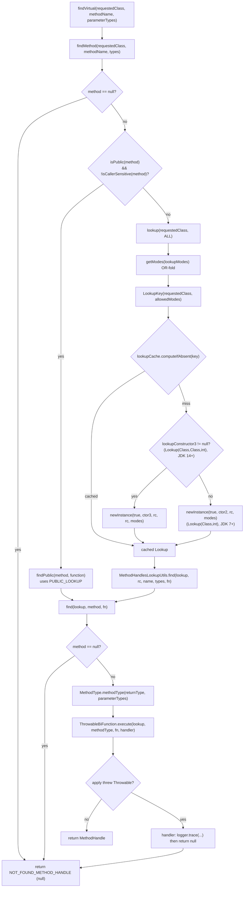

# 语言抽象（Language Abstractions）—— 开发者指南

`microsphere-java-core` 中 `io.microsphere.lang`、`io.microsphere.lang.function`、`io.microsphere.lang.invoke`
与 `io.microsphere.invoke` 四个包的内部设计（`0.3.20-SNAPSHOT`，`release` 分支）。

所有 `file:line` 引用均相对于 `release` worktree，例如
`microsphere-java-core/src/main/java/io/microsphere/lang/Prioritized.java:61`。

---

## 1. 在架构中的位置

这四个包是本库**最底层的词汇表**。它们几乎不依赖任何东西
（只依赖 `io.microsphere.util`、`io.microsphere.annotation`、`io.microsphere.constants` 以及彼此），
却被几乎所有其他分组所依赖。

### 1.1 在 main 源码中找到的 `Prioritized` 实现者

| 子系统 | 实现者 / 子契约 | 引用 |
|--------|-----------------|------|
| 事件 | `io.microsphere.event.EventListener<E extends Event> extends java.util.EventListener, Prioritized` | `event/EventListener.java:72` |
| 事件 | `io.microsphere.event.GenericEventListener`（具体类，承载优先级） | `event/GenericEventListener.java:72` |
| 类型转换 | `io.microsphere.convert.Converter<S, T> extends Prioritized` | `convert/Converter.java:72` |
| 类型转换 | `io.microsphere.convert.multiple.MultiValueConverter<S> extends Prioritized` | `convert/multiple/MultiValueConverter.java:36` |
| 日志 | `io.microsphere.logging.LoggerFactory implements Prioritized` | `logging/LoggerFactory.java:65` |
| 类加载 | `io.microsphere.classloading.URLClassPathHandle` / `AbstractURLClassPathHandle` / `ArtifactResourceResolver` | `classloading/URLClassPathHandle.java:71`、`classloading/AbstractURLClassPathHandle.java:78`、`classloading/ArtifactResourceResolver.java:49` |
| 进程标识 | `io.microsphere.process.ProcessIdResolver`（以及 `ClassicProcessIdResolver`） | `process/ProcessIdResolver.java:54` |
| 配置元数据 | `ConfigurationPropertyReader` / `Loader` / `Generator` | `metadata/ConfigurationPropertyReader.java:41`、`metadata/ConfigurationPropertyLoader.java:47`、`metadata/ConfigurationPropertyGenerator.java:56` |
| 排序消费方 | `ServiceLoaderUtils`（排序）、`ShutdownHookUtils`（优先级队列） | 见 §2.2 |

### 1.2 在 main 源码中找到的 `Wrapper` 实现者

| 子系统 | 实现者 | 引用 |
|--------|--------|------|
| 集合 | `io.microsphere.collection.DelegatingQueue<E> implements Queue<E>, DelegatingWrapper` | `collection/DelegatingQueue.java:40` |
| 集合 | `io.microsphere.collection.DelegatingIterator<E> implements Iterator<E>, DelegatingWrapper` | `collection/DelegatingIterator.java:41` |
| 并发 | `io.microsphere.concurrent.DelegatingBlockingQueue<E> implements BlockingQueue<E>, DelegatingWrapper` | `concurrent/DelegatingBlockingQueue.java:55` |
| 契约树 | `Wrapper` → `DelegatingWrapper`；`WrapperProcessor<W extends Wrapper>` 作为处理钩子 | `lang/Wrapper.java:71`、`lang/DelegatingWrapper.java:78`、`lang/WrapperProcessor.java:39` |

### 1.3 `Deprecation` 的消费方

`Deprecation` 是反射元数据模型中的一个字段，在那里始终是 `@Nonnull`：
`io.microsphere.reflect.ExecutableDefinition:91,114`（protected 构造器）与
`io.microsphere.reflect.ConstructorDefinition:70,91`。这正是注解处理器
`@Attribute`/`@MvcEndpoint` 元数据抽取所消费的数据。

---

## 2. 包 / 类地图

| 包 | 类型 | 种类 | 职责 |
|----|------|------|------|
| `io.microsphere.lang` | `Prioritized` | 接口，`extends Comparable<Prioritized>` | 排序契约 + 容错的 `Comparator` |
| | `Wrapper` | 接口 | unwrap 契约 |
| | `DelegatingWrapper` | 接口，`extends Wrapper` | 默认的单层委托 |
| | `WrapperProcessor<W>` | 接口 | 带类型的包装器后处理 SPI |
| | `Deprecation` | `final`、`@Immutable`、`Serializable` | 废弃描述符 + `Level` + `Builder` |
| | `MutableInteger` | 类，`extends Number` | 可变 `int` 盒子 |
| | `ClassDataRepository` | 类，`@Immutable`，`INSTANCE` | 缓存的 classpath/包索引 |
| `io.microsphere.lang.function` | `ThrowableFunction<T,R>` | `@FunctionalInterface` | 单参可抛异常函数 |
| | `ThrowableConsumer<T>` | `@FunctionalInterface` | 单参可抛异常消费者 |
| | `ThrowableSupplier<T>` | `@FunctionalInterface` | 可抛异常供应者 |
| | `ThrowableAction` | `@FunctionalInterface` | 无参可抛异常动作 |
| | `ThrowableBiFunction<T,U,R>` | `@FunctionalInterface` + 嵌套 `ExceptionHandler` | 双参可抛异常函数 |
| | `ThrowableBiConsumer<T,U>` | `@FunctionalInterface` | 双参可抛异常消费者 |
| | `Predicates` | 静态方法接口 | 谓词常量 + `and`/`or` |
| | `Streams` | 静态方法接口 | 数组/`Iterable` 过滤 |
| `io.microsphere.lang.invoke` | `LambdaUtils` | `abstract`，`implements Utils` | 从 lambda 类还原 SAM 参数类型 |
| `io.microsphere.invoke` | `MethodHandlesLookupUtils` | `abstract`，`implements Utils` | public lookup 的 `MethodHandle` 解析并优雅失败 |
| | `MethodHandleUtils` | `abstract`，`implements Utils` | 宽访问 `Lookup` 的创建 + 缓存、`LookupMode` |

### 2.1 值得了解的跨包耦合

`io.microsphere.invoke.MethodHandleUtils` **依赖** `io.microsphere.lang.function.ThrowableBiFunction`
（`MethodHandleUtils.java:19`、`:347`），也依赖 `MethodHandlesLookupUtils.NOT_FOUND_METHOD_HANDLE`
（`MethodHandleUtils.java:37`、`:350`）。所以 `lang.function` 并不是叶子包——它是 `java.lang.invoke` 代码的
异常边界机制，这也正是 `MethodHandleUtils.find` 能够承诺“返回 null 而不抛异常”的原因。

`io.microsphere.lang.invoke.LambdaUtils` 与 `io.microsphere.invoke` 分开，是因为它使用
`io.microsphere.internal.reflect.ConstantPoolUtils`，而不是 `Lookup`。

### 2.2 定义了 `Prioritized` 真实语义的两个消费方

- `ServiceLoaderUtils.java:30` 导入 `Prioritized.COMPARATOR`；`:890` 执行 `sort(serviceList, COMPARATOR)`。
- `ShutdownHookUtils.java:34` 导入同一个常量；`:114` 构造
  `static final PriorityBlockingQueue<Runnable> shutdownHookCallbacks = new PriorityBlockingQueue<>(SHUTDOWN_HOOK_CALLBACKS_CAPACITY, COMPARATOR)`。

---

## 3. 源码分析

### 3.1 `Prioritized`：顺序的计算与（并不存在的）缓存

```
Prioritized.java:56   public interface Prioritized extends Comparable<Prioritized>
Prioritized.java:81   int MAX_PRIORITY = MIN_VALUE;        // Integer.MIN_VALUE
Prioritized.java:86   int MIN_PRIORITY = MAX_VALUE;        // Integer.MAX_VALUE
Prioritized.java:91   int NORMAL_PRIORITY = 0;
Prioritized.java:98   default int getPriority() { return NORMAL_PRIORITY; }
Prioritized.java:103  default int compareTo(Prioritized that) { return compare(this.getPriority(), that.getPriority()); }
```

关键设计决策：

1. **名次，而非权重。** `MAX_PRIORITY = Integer.MIN_VALUE`（`:81`）反转了直觉读法，使得“最高优先级”在升序的
   `Integer.compare` 下排在*最前*。所有文档写“返回 `MAX_PRIORITY` 即可胜出”的消费方
   （`convert/Converter.java:52`）都依赖这一点。
2. **没有缓存。** `compareTo`（`:104`）每次比较都会调用 `getPriority()` 两次，而 `Comparator` 实现每次排序会调用
   `compareTo` `O(n log n)` 次。`Prioritized` 内部不做记忆化；缓存存在于*消费方*——
   `ServiceLoaderUtils.java:890` 在服务列表构建时排序一次，`ShutdownHookUtils.java:114` 则每次 offer 付出
   `O(log n)` 成本去维护一个堆，而不是重新排序。推论：对实现者而言，昂贵或不确定的 `getPriority()`
   既是性能隐患也是正确性隐患。
3. **`COMPARATOR` 是 `Comparator<Object>`，不是 `Comparator<Prioritized>`**（`:61`）。这是整个设计中承重的那一面：
   `:62-64` 用 `instanceof` 取代了强制转换，从而使 `null` 与外来对象成为合法输入。`:65-75` 的四路分支给出：
   两者都是 prioritized → 委托给 `compareTo`；仅左侧 → `-1`；仅右侧 → `1`；两者都不是 → `0`。
   由于 `null instanceof X` 为 `false`，`null` 被当作“非 prioritized”而排在最后——这正是
   `PrioritizedTest.java:66-72` 的期望。
4. **契约漂移。** `:96` 的 Javadoc 声称默认值是 `MIN_PRIORITY`，而 `:99` 的代码返回 `NORMAL_PRIORITY`。
   测试锁定的是代码。在未审计所有依赖 `0` 的 SPI 之前，不要“修正”代码。

注意这个排序对非 prioritized 子集而言是**一次稳定的划分，而不是全序**：`COMPARATOR` 对任意两个非 prioritized
元素都返回 `0`，因此它们的相对顺序取决于排序算法的稳定性（`Collections.sort` / `List.sort` 是稳定的；
`PriorityBlockingQueue` 不是）。

### 3.2 `Wrapper` / `DelegatingWrapper`：unwrap 循环如何终止

`Wrapper` 的 Javadoc（`Wrapper.java:77-82`）描述了*递归*的 unwrap 语义，但接口本身并未声明任何递归——
是否递归交由每个实现自由决定。`DelegatingWrapper`（`DelegatingWrapper.java:88-97`）把它落实为：

```
:89  if (getClass().equals(type))            -> return (T) this          // TERMINATES: identity
:92  else if (isWrapperFor(type))            -> return (T) getDelegate() // TERMINATES: one hop
:96  else                                    -> throw IllegalArgumentException
```

而 `isWrapperFor`（`:100-103`）只是单次 `type.isInstance(getDelegate())`，**不会递归进入 delegate**。
所以随库发布的默认实现从不循环：它至多一跳，并且只有一条抛出路径。

对于真正分层的包装器，循环终止由实现者必须保持的三个性质保证：

- **进展（Progress）**：每一跳必须返回严格不同的对象（`getDelegate()`），绝不能是 `this`。
- **无环（Acyclicity）**：任一对象不得在委托链中出现两次；JDK 的引用图是有限的，因此链必然结束。
- **有界失败（Bounded failure）**：终点不匹配必须抛 `IllegalArgumentException`（`:96`）而非返回 `null`，
  这样忽略 `isWrapperFor` 的调用方会得到响亮报错。`WrapperTest`/`DelegatingWrapperTest.java:49` 对此做了断言。

`Wrapper.tryUnwrap`（`Wrapper.java:113-121`）是该包中唯一的*静态*逻辑，它通过完全回避递归问题来收敛：
`instanceof Wrapper` → `isWrapperFor` → `unwrap`，否则 `return null`（`:120`）。
`WrapperTest` 的三个用例（`WrapperTest.java:38-49`）确认：“类型不对”、输入为 `null`、输入不是 `Wrapper`
三种情况都返回 `null`。

`DelegatingWrapperImpl`（`src/test/java/io/microsphere/lang/DelegatingWrapperImpl.java`）是参考的最小实现：
它只提供 `getDelegate()`。

### 3.3 `LambdaUtils`：如何还原 lambda 的 SAM 类型——用常量池，而不是 `SerializedLambda`

**已验证的否定结论：** `io.microsphere.lang.invoke` 中（以及按对全仓 main 源码的 grep，在 lambda 路径上）
没有任何地方使用 `java.lang.SerializedLambda`。`writeReplace`/`SerializedLambda` 技术**未被采用**。
实现改为读取**类常量池**：

```
LambdaUtils.java:53    public abstract class LambdaUtils implements Utils
LambdaUtils.java:99    if (!isLambdaClass(type)) return emptyList();
LambdaUtils.java:103   Method declaredMethod = findFunctionalInterfaceMethod(functionalInterface);
LambdaUtils.java:108   if (!functionalInterface.isAssignableFrom(type)) return emptyList();
LambdaUtils.java:115   int size = getSize(type);                              // ConstantPoolUtils
LambdaUtils.java:116   for (int i = size - 1; i > -1; i--) {                   // REVERSE scan
LambdaUtils.java:117       Member member = getMethodAt(type, i);
LambdaUtils.java:118-125  if (Method) { resolveParameterTypes(...); if (matched) break; }
```

为什么要逆向（`:116`）：合成类 `…$$Lambda/…` 的常量池中，lambda 的实现方法条目通常排在靠后位置，
从末尾开始扫描能最先命中，`:123` 的 `break` 随即短路。

`isLambdaClass`（`util/ClassUtils.java:639-645`）要求该类既是 synthetic，其名字又要匹配
`$$Lambda` + `/` 模式（`:668-670`）——这是 JDK 9+ 的命名形状。在 JDK 8 上（`…$$Lambda$123/0x…`）
该判定表现不同，而源码对此没有任何注释说明，属于一条兼容性注意事项。

`resolveParameterTypes(Method actualMethod, Class<?>… declaredParameterTypes)`（`:131-168`）是匹配核心：

- `:132-135` 读取实际类型，并按**声明**元数分配结果数组。
- `:136-146` **把接收者当作第一个参数**的情形（`actualLength < length`）：若方法为 `static` 立即拒绝
  （`:137-140`），否则槽 0 填 `actualMethod.getDeclaringClass()`（`:142`），其余实际参数整体后移一位
  （`:143-145`）。这正是让 `String::toUpperCase` 解析为 `(String)` 的机制。
- `:147-166` 常规位置匹配，**从右向左**推进（`index = length - 1 - i`，`:149`），以便变参式的尾部形状对齐；
  基本类型经 `resolvePrimitiveType` 归一（`:153`），引用类型经 `tryResolveWrapperType` 加宽（`:158`）
  并用 `isAssignableFrom` 校验（`:159`）。
- 失败的信号是**恒等**哨兵 `EMPTY_CLASS_ARRAY`（`:139`、`:155`、`:161`）——这就是
  `LambdaUtilsTest.java:150-153` 使用 `assertSame` 断言的原因。

当 JDK 禁止常量池访问时会怎样：`ConstantPoolUtils.invoke`（`internal/reflect/ConstantPoolUtils.java:240-249`）
把 `invokeMethod(true, constantPool, method, args)` 包在 `catch (Throwable)` 中并返回 `null`（`:248`）；
`getConstantPool`（`:251-253`）反射调用包级私有的 `Class.getConstantPool()`。于是 `getSize` 得到 `0`/`null`，
逆向循环一次都不执行，`LambdaUtils` 返回 `emptyList()`（`:113`）。该类在类初始化时先解析
`sun.reflect.ConstantPool`，失败则回退到 `jdk.internal.reflect.ConstantPool`（`:255-259`，名字见 `:51` 与 `:56`），
因此在 JDK ≤ 8 与 JDK 9+ 两种形状之间自选。**净效果：`LambdaUtils` 从不抛异常；被禁止的 JDK 只是让它变成空操作。**

接口计数判定 `allInterfaces.size() == 1`（`:72-77`）比看起来更严格：`isFunctionalInterface`
（`util/ClassUtils.java:698-707`）对带 `@FunctionalInterface` 注解的类型，以及对恰好只有一个抽象方法的接口
都会返回 true。`io.microsphere.event.EventListener` 的 lambda（带注解，`event/EventListener.java:71`）
还会经由 `Prioritized` 继承 `Comparable`，于是闭包中出现两个候选，单参数重载返回空——
`LambdaUtilsTest.java:74-75` 断言了这一点。

### 3.4 method handle 解析与被禁止访问时的行为

`MethodHandleUtils.find`（`MethodHandleUtils.java:346-357`）是一个三分支路由器：

1. `:348-351` `findMethod(...)` 返回 `null` → 返回 `NOT_FOUND_METHOD_HANDLE`（它就是 `null`，
   `MethodHandlesLookupUtils.java:67`）。
2. `:352-354` `isCandidateMethod`（`:366-368`：`isPublic && !isCallerSensitiveMethod`）→ 走 `findPublic(...)`，
   使用 `PUBLIC_LOOKUP`，无需特权构造器。
3. `:355-356` 否则 `lookup(requestedClass)`（全模式），并委托给
   `MethodHandlesLookupUtils.find(lookup, …)`。

特权 `Lookup` 由 `newLookup`（`:359-364`）产生，它优先使用 JDK 14+ 的三参私有构造器，否则回退到两参版本：

```
:360 if (lookupConstructor3 != null) return newInstance(true, ctor3, requested, requested, allowedModes);
:363 return newInstance(true, ctor2, requested, allowedModes);
```

`lookupConstructor1`（`Lookup(Class)`，`:157`）虽被加载但 `newLookup` 并未使用——属于历史遗留的已死状态。
三个 `Constructor` 字段（`:157`、`:162`、`:167`）在类初始化时解析，所以在某个构造器形状缺失的 JDK 上该字段为 `null`，
代码自动选择另一条分支。**这就是兼容机制**：没有 `if (javaVersion` 之类的判断，只有 null-存在性判断。

禁止访问的行为出现在两处：
- `newInstance(true, …)` 吞掉 `InvocationTargetException`/`InaccessibleObjectException` → `newLookup` 返回 `null`
  → `lookupCache` 不会为该键存入 `null`（`ConcurrentHashMap.computeIfAbsent` **不会**缓存 `null` 映射结果，
  见 §6）。
- `MethodHandlesLookupUtils.find`（`MethodHandlesLookupUtils.java:113-128`）把 `Lookup`+`MethodType` 交给
  `ThrowableBiFunction.execute(...)`（`:121`），并显式传入一个三参处理函数，它只在 `trace` 级别记录（`:123-125`）
  并**返回 `null`**（`:126`）。因此 `IllegalAccessException` / `WrongMethodTypeException` /
  `NoClassDefFoundError` 都被转换为 `null` handle，绝不向外抛异常。

`MethodType` 的构造对空参数数组做了特判（`:120`，
`isEmpty(parameterTypes) ? methodType(returnType) : methodType(returnType, parameterTypes)`），因为
`MethodType.methodType(Class, Class…)` 会区分零长度与 `null`。

### 3.5 `Deprecation`：不可变性的实现机制

`Deprecation.java:72-73` 是 `@Immutable public final class … implements Serializable`，并显式声明
`serialVersionUID`（`:75`）。五个字段全部 `private final`（`:77-90`）；两个构造器都是包级私有（`:92`、`:100`），
因此公开面只有工厂方法。5 参构造器只校验 `level`（`:102`）；拷贝构造器（`:92-98`）跳过校验，因为源对象已合法。
`equals`（`:136-149`）在 `o == this` 时短路，使用 `instanceof`（而非 `getClass()`）以便假想的子类仍可比较，
`level` 用 `==`（枚举身份）比较，其余走 `Objects.equals`。`hashCode`（`:152-154`）覆盖同样的五个字段。
`Builder`（`:186-243`）的构造器是 `protected`，因此可扩展，而 `level(@Nullable Level)` 把 `null` 归一为
`DEFAULT`（`:231`）——这是构建器中唯一的防御分支。`since(String)`（`:206-208`）通过 `Version.of` 转换，
所以无法解析的版本字符串会在 `Version` 内部失败，而不是在这里。

---

## 4. 实际存在的设计模式

| 模式 | 位置 | 证据 |
|------|------|------|
| **标记 / 契约接口** | `Wrapper`（`lang/Wrapper.java:71`）、`Prioritized`（`lang/Prioritized.java:56`）、`io.microsphere.util.Utils`（被 `LambdaUtils:53`、`MethodHandleUtils:87`、`MethodHandlesLookupUtils:62` 实现）、`Predicates:32`、`Streams:44` | 无实例状态；纯粹用于打标与授予某种能力。`Utils` 标记“静态工具，不供用户实现”。 |
| **Comparator 策略** | `Prioritized.COMPARATOR`（`lang/Prioritized.java:61`） | 单个共享的策略对象被注入 `PriorityBlockingQueue`（`ShutdownHookUtils.java:114`）与 `List.sort`（`ServiceLoaderUtils.java:890`）。 |
| **通过 `default` 实现的模板方法** | `DelegatingWrapper`（`lang/DelegatingWrapper.java:78-103`） | 子类只需实现一个抽象原语（`getDelegate()`）；`unwrap`/`isWrapperFor` 是继承来的骨架。`ThrowableFunction.execute` → `handleException`（`ThrowableFunction.java:71-101`）是同一形状。 |
| **Wrapper + 责任链** | `Wrapper`/`DelegatingWrapper`/`WrapperProcessor`，被 `DelegatingQueue:41`、`DelegatingIterator:41`、`DelegatingBlockingQueue:55` 消费 | 一个请求（“给我一个 `T`”）沿委托链传递；每一跳要么应答要么拒绝。`WrapperProcessor<W extends Wrapper>` 是可插拔的拦截过滤器。建立在 `Prioritized` 之上的 SPI 链（`Converter`、`ProcessIdResolver`、`ConfigurationProperty*`、`URLClassPathHandle`）是同一模式，只是用优先级作为路由键。 |
| **Builder（构建器）** | `Deprecation.Builder`（`lang/Deprecation.java:186-243`）+ `Deprecation.builder()`（`:250`） | 链式、容忍 null、以 `build()` 收尾；`of(…)` 各重载（`:254-278`）是委托给构建器的 telescoping 工厂。 |
| **不可变值对象** | `Deprecation`（`lang/Deprecation.java:72`）、`ClassDataRepository`（`:79` `@Immutable`） | `final` 类、`private final` 字段、完整的 `equals`/`hashCode`、`Serializable`。 |
| **适配器 / 函数式接口适配器** | 六个 `Throwable*` 接口（`lang/function/`） | 每个接口把一个 JDK `java.util.function` 形状适配成 `throws Throwable` 签名，再适配回来，靠的是 `execute`/`ExceptionHandler`。`MethodHandleUtils.find`（`:347`）之所以使用 `ThrowableBiFunction<Lookup, MethodType, MethodHandle>`，正是为了适配会抛 `NoSuchMethodException`/`IllegalAccessException` 的 `Lookup.findVirtual`。 |
| **以哨兵表达空对象** | `NOT_FOUND_METHOD_HANDLE = null`（`MethodHandlesLookupUtils.java:67`）、`EMPTY_CLASS_ARRAY` 恒等返回（`LambdaUtils.java:139`） | “缺失”被编码为一个稳定的引用，而不是异常。 |
| **单例 / 服务定位** | `ClassDataRepository.INSTANCE`（`:85`）、由 `Prioritized` 排序选出 `LoggerFactory` | |
| **类享元缓存** | `MethodHandleUtils.lookupCache`（`:169`），键为 `LookupKey`（`:253-285`） | 每个 `(requestedClass, allowedModes)` 共享一个 `Lookup` 实例。 |

---

## 5. 图

### 5.1 `MethodHandleUtils.findVirtual` 解析算法



上图对应 `MethodHandleUtils.java:319-321, 346-368` 与 `MethodHandlesLookupUtils.java:98-128`：
左侧分支决定是否走 `PUBLIC_LOOKUP`，中段是 `Lookup` 的缓存与 JDK 版本自选，右侧是所有失败都收敛为 `null` 的终点。

### 5.2 lambda 参数类型解析

```mermaid
flowchart TD
    A["resolveLambdaMethodParameterTypes(object, functionalInterface)"] --> B["type = getType(object)"]
    B --> C{"isLambdaClass(type)?<br/>synthetic && name matches $$Lambda + '/'"}
    C -- no --> Z["return Collections.emptyList()"]
    C -- yes --> D["declaredMethod = findFunctionalInterfaceMethod(functionalInterface)"]
    D --> E{declaredMethod == null?}
    E -- yes --> Z
    E -- no --> F{functionalInterface.isAssignableFrom(type)?}
    F -- no --> Z
    F -- yes --> G["size = ConstantPoolUtils.getSize(type)"]
    G --> H{"Class.getConstantPool() reachable?"}
    H -- "no (Throwable caught)" --> Z
    H -- yes --> I["i = size-1 down to 0"]
    I --> J["member = getMethodAt(type, i)"]
    J --> K{member instanceof Method?}
    K -- no --> I
    K -- yes --> L["resolveParameterTypes(actualMethod, declaredParameterTypes)"]
    L --> M{"actual.length < declared.length?"}
    M -- "yes, static" --> N["return EMPTY_CLASS_ARRAY (reject)"]
    M -- "yes, instance" --> O["slot0 = declaringClass<br/>shift remaining actual params"]
    M -- no --> P["right-to-left match:<br/>primitives via resolvePrimitiveType<br/>refs via tryResolveWrapperType + isAssignableFrom"]
    O --> Q
    P --> Q{mismatch?}
    Q -- yes --> N
    Q -- no --> R["matchedParameterTypes"]
    N --> S["continue scanning i--"]
    S --> I
    R --> T{result != EMPTY_CLASS_ARRAY?}
    T -- yes --> U["ofList(matched) ; break"]
    T -- no --> I
```

注意所有拒绝路径都汇入同一个 `Z`（空列表）——这是 §3.3 中“被禁止的 JDK 只是让它变成空操作”的图形表达。

### 5.3 契约层级与其实现者

```mermaid
classDiagram
    class Comparable~T~
    class Prioritized {
        <<interface>>
        +COMPARATOR Comparator~Object~
        +int MAX_PRIORITY = MIN_VALUE
        +int MIN_PRIORITY = MAX_VALUE
        +int NORMAL_PRIORITY
        +getPriority() int
        +compareTo(Prioritized) int
    }
    class Wrapper {
        <<interface>>
        +unwrap(Class~T~) T
        +isWrapperFor(Class~?~) boolean
        +tryUnwrap(Object, Class~T~)$ T
    }
    class DelegatingWrapper {
        <<interface>>
        +getDelegate() Object
        +unwrap(Class~T~) T
        +isWrapperFor(Class~?~) boolean
    }
    class WrapperProcessor~W~ {
        <<interface>>
        +process(W) W
    }
    class EventListener~E~
    class Converter~S,T~
    class MultiValueConverter~S~
    class LoggerFactory
    class ProcessIdResolver
    class URLClassPathHandle
    class ConfigurationPropertyReader
    class DelegatingQueue~E~
    class DelegatingIterator~E~
    class DelegatingBlockingQueue~E~
    class ThrowableBiFunction~T,U,R~ {
        <<interface>>
        +apply(T,U) R
        +execute(T,U,f,h)$ R
        +DEFAULT_EXCEPTION_HANDLER
    }
    class ExceptionHandler~T,U,R~ {
        <<interface>>
        +handle(T,U,Throwable) R
    }
    class MethodHandlesLookupUtils {
        <<abstract>>
        +NOT_FOUND_METHOD_HANDLE$
        +findPublicVirtual(...)$ MethodHandle
    }
    class MethodHandleUtils {
        <<abstract>>
        +ALL_MODES$ int
        +LookupMode$ enum
        +lookup(Class)$ Lookup
        +findVirtual(Class,String,Class...)$ MethodHandle
    }
    class Deprecation {
        <<immutable, Serializable>>
        +Level$ enum
        +Builder$
        +of(...)$ Deprecation
        +builder()$ Builder
    }
    class ExecutableDefinition
    class ConstructorDefinition

    Comparable <|-- Prioritized
    Prioritized <|.. EventListener~E~
    Prioritized <|-- Converter~S,T~
    Prioritized <|-- MultiValueConverter~S~
    Prioritized <|.. LoggerFactory
    Prioritized <|-- ProcessIdResolver
    Prioritized <|-- URLClassPathHandle
    Prioritized <|-- ConfigurationPropertyReader
    Wrapper <|-- DelegatingWrapper
    Wrapper ..> WrapperProcessor~W~ : processes
    DelegatingWrapper <|.. DelegatingQueue~E~
    DelegatingWrapper <|.. DelegatingIterator~E~
    DelegatingWrapper <|.. DelegatingBlockingQueue~E~
    ThrowableBiFunction *-- ExceptionHandler~T,U,R~
    MethodHandleUtils ..> ThrowableBiFunction~T,U,R~ : uses as exception boundary
    MethodHandleUtils --|> MethodHandlesLookupUtils : reuses NOT_FOUND + findPublic
    Deprecation <-- ExecutableDefinition : @Nonnull field
    Deprecation <-- ConstructorDefinition : @Nonnull field
```



---

## 6. 线程安全

| 组件 | 结论 | 理由 |
|------|------|------|
| `Prioritized` | 作为值安全，**若 `getPriority()` 有副作用则不安全** | `Comparator` 无状态（`lang/Prioritized.java:61`）；安全性取决于实现者在一次排序期间返回稳定的值。`COMPARATOR` 不得抛异常，因此 `null` 是设计上的合法输入。 |
| `Wrapper` / `DelegatingWrapper` | 取决于调用方 | `isWrapperFor` 后接 `unwrap` 是一个**检查后执行**的对（`lang/Wrapper.java:113-121`）：若 `getDelegate()` 可能在两次调用之间改变，`unwrap` 就会抛 `IllegalArgumentException`。请让 delegate 为 `final`。 |
| `Deprecation` | **不可变，可自由共享** | `final` 类、`final` 字段、`@Immutable`（`lang/Deprecation.java:72-90`）。`Builder` 按设计**不是**线程安全的（单线程构造），`level(@Nullable)` 是其中唯一的无锁归一化。 |
| `MutableInteger` | **非线程安全** | `private int value`（`lang/MutableInteger.java:48`）既无 `volatile` 也无锁；`getAndIncrement`（`:125`）等是读-改-写。尽管方法名与 `AtomicInteger` 同形，并发使用构成数据竞争。 |
| `ClassDataRepository` | 预热后实质只读 | 只以 `INSTANCE`（`:85`）暴露，标注 `@Immutable`（`:79`）并返回 `@Nonnull @Immutable` 视图；填充路径（`:196-237`）是惰性的，因此多线程首次访问可能重复计算同一张 map。请把它当作良性竞争——返回的集合由 `LinkedHashSet` 构造（`:234`）。 |
| `MethodHandleUtils` | 使用了 `ConcurrentMap`，但存在 **`computeIfAbsent` + `null` 的微妙之处** | `lookupCache`（`:169`）是 `newConcurrentHashMap()`；`lookup(...)`（`:305-309`）调用 `computeIfAbsent(key, MethodHandleUtils::newLookup)`。`ConcurrentHashMap` **不会**存储 `null` 结果，所以当 `newLookup` 返回 `null`（构造器被禁止）时该条目永不入缓存，每次调用都会重新尝试特权构造。`LookupKey`（`:253-285`）是一个正确的值类（`final` 不可变字段、`equals`/`hashCode` 覆盖两部分、`:266` 的引用相同短路）。 |
| `MethodHandleUtils` 类初始化 | 饿加载三个私有 `Constructor`（`:157-167`） | 因此该类的静态初始化只有在 `findConstructor`/`getDeclaredConstructor` 抛异常时才会响亮失败——而它们的契约是返回 `null`。`PUBLIC_LOOKUP`（`:174`）是 `MethodHandles.publicLookup()` 的静态终态快照。 |
| `MethodHandlesLookupUtils` | 无状态 | 只有 `null`/`PUBLIC_LOOKUP` 两个常量（`:67`、`:72`）；每次 `find` 都构造新的 `MethodType`，并把 `Logger` 的获取放在失败处理器内部（`:122`），因此 `LoggerFactory` 查找发生在失败路径而非热路径。 |
| `LambdaUtils` | 无状态，但**不免费** | 每次调用都会逆向遍历常量池（`:115-126`）并逐条反射。没有任何缓存，所以在热路径上调用它代价很高；请在你自己的层做记忆化。 |

---

## 7. 扩展点

1. **实现 `Prioritized`** 即可加入库中任何排序链（事件、转换器、SPI 服务、关闭钩子、进程 id 解析器、配置加载器、
   classpath 处理器）。优先使用 `MAX_PRIORITY`/`MIN_PRIORITY`/`NORMAL_PRIORITY` 常量而不是魔法数字，
   让名次语义保持可见。
2. **只通过提供 `getDelegate()` 来实现 `DelegatingWrapper`**，得到一层装饰器的能力。需要真正的传递性时请覆写
   `isWrapperFor`/`unwrap`，并确保对是 `Wrapper` 的 delegate 递归询问。
3. **注册一个 `WrapperProcessor<W>`** 以泛型方式拦截被包装的 bean；`W extends Wrapper` 边界让处理器无需强制转换即保持类型安全。
4. **把 `Throwable*` 用作 SPI 形状**：当回调必须暴露受检异常、但由调用方决定处理策略时。
   这些接口刻意保留了可覆写的 `handleException`（`ThrowableBiFunction` 除外，它的策略由 `ExceptionHandler` 参数
   或共享的 `DEFAULT_EXCEPTION_HANDLER` 决定）。
5. **继承 `Deprecation.Builder`**（`protected Builder()`，`lang/Deprecation.java:203`），在复用 `build()` 契约的同时加入校验。
6. **复用 `LookupMode` + `lookup(Class, LookupMode…)`**，而不是自己构造 `Lookup`，
   这样 `newLookup` 的缓存与 JDK 版本回退可以继续生效。
7. **只能通过 `protected` 复用方式扩展 `MethodHandlesLookupUtils`/`MethodHandleUtils`**——`find` 与 `findPublic`
   是 `protected`，因此库内部的子类可以提供自己的 `Lookup` 并继承“失败即返回 null”的行为。
   这两个类本身是 `abstract` 且构造器私有，即不供用户实现。

---

## 8. 测试策略

测试树：`microsphere-java-core/src/test/java/io/microsphere/lang/`、`…/lang/function/`、`…/lang/invoke/`、`…/invoke/`。

| 测试 | 覆盖 | 需要保留的关键断言 |
|------|------|--------------------|
| `lang/PrioritizedTest.java` | 默认方法、常量、`COMPARATOR` | `PrioritizedTest.java:42-53` 默认优先级是 `NORMAL_PRIORITY`；`:58-72` 完整的 `null`/外来元素矩阵。任何对 `COMPARATOR` 的重构都必须保持 `compare(null, null) == 0`。 |
| `lang/WrapperTest.java` | `Wrapper.tryUnwrap` | `:38-49` 三个 `null` 结果；它记录了 `tryUnwrap` **不是**“解不开就返回入参”的助手。 |
| `lang/DelegatingWrapperTest.java` + `lang/DelegatingWrapperImpl.java` | 最小 `getDelegate()` 实现 | `:38-49` 父类型匹配（`CharSequence`）、按精确类自我 unwrap、不匹配时抛 `IllegalArgumentException`。 |
| `lang/DeprecationTest.java` | 工厂、builder、`equals`/`hashCode`/`toString` | |
| `lang/MutableIntegerTest.java` | 所有 `getAnd*`/`*AndGet` 变换、`Number` 转换、`equals`/`hashCode` | |
| `lang/ClassDataRepositoryTest.java` | classpath/包索引 | |
| `lang/function/Throwable*Test.java`（6 个文件） | 每个接口的正常路径、默认处理器、自定义处理器、静态 `execute`、`compose`/`andThen` | |
| `lang/function/PredicatesTest.java`、`…/StreamsTest.java` | 谓词组合子、数组 + `Iterable` 过滤重载 | |
| `lang/invoke/LambdaUtilsTest.java` | 编译得到的 lambda、`LambdaMetafactory` 构造的 lambda、不匹配哨兵 | `:69-104` 基本类型/包装类型参数还原；`:134-144` 接口选错 → 空；`:148-154` `assertSame(EMPTY_CLASS_ARRAY, …)`；`:156-339` 四个手工构造的 `LambdaMetafactory` 夹具（`toUpperLambda`、`sumLambda`、`volumeLambda`、`replaceLambda`），分别覆盖带接收者的 virtual、static 以及 3 元 SAM 形状。 |
| `invoke/MethodHandleUtilsTest.java` | `lookup` 身份/缓存、virtual **与** static 各自四种可见性、`NOT_FOUND`、`handleInvokeExactFailure`、`LookupKey` 的 `equals`/`hashCode` | `:49-52` 的 `assertSame` 证明缓存生效；`:76-77` 方法不存在 → `null`；`:107-124` `LookupKey` 值语义，包含 `assertFalse(key.equals(this))`。 |
| `invoke/MethodHandlesLookupUtilsTest.java` | 仅 public 的 lookup 助手 | |
| `invoke/MethodHandleUtilsBenchmark.java` | handle 与反射路径的吞吐量对比 | 是基准，不是断言测试；不要纳入正确性门禁。 |

对维护者的测试含义：

- `lang`/`invoke` 这些工具是 **JDK 版本敏感**的，因此 CI 矩阵（JDK 8/11/17/21/25）才是 `newLookup` 的构造器选择
  与 `Class.getConstantPool()` 可用性的真正回归网。只在一个 JDK 上通过并不能作为兼容性证据。
- `resolveParameterTypes` 是包级私有并被测试直接调用——把它改成 `private` 会破坏 `LambdaUtilsTest.java:39`。
- 对两个哨兵契约（`EMPTY_CLASS_ARRAY`、`NOT_FOUND_METHOD_HANDLE`）请使用 `assertSame`：它们是恒等保证，不是值保证。
- 修改 `Deprecation` 时，请一并重跑 `reflect/ExecutableDefinition`/`ConstructorDefinition` 的测试——
  `lang/Deprecation.java:102` 的 `@Nonnull level` 不变式正是那些模型保持合法的前提。

---

## 9. 相关页面

- [用户指南：语言抽象](../../user-guide/microsphere-java-core/zh/language-abstractions.md)
- [反射、类型与 bean](zh/reflection-and-beans.md) —— `ConstantPoolUtils`、`MethodUtils.findFunctionalInterfaceMethod`、`ExecutableDefinition`
- [工具、常量与文本](zh/util-and-constants.md) —— `Version`、`ArrayUtils.EMPTY_CLASS_ARRAY`、`SymbolConstants`
- [集合与过滤器](zh/collections-and-filters.md)、[类型转换](zh/type-conversion.md)、[事件分发](zh/events.md) —— `Prioritized`/`Wrapper` 的消费方
