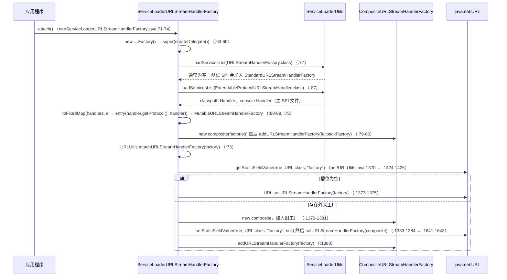
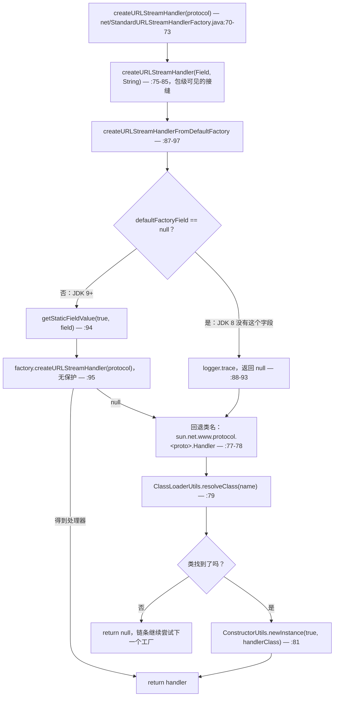
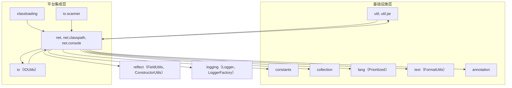

# 网络与 URL 协议 —— 开发者指南

| | |
|---|---|
| **层次** | 平台集成层（`net`、`net.classpath`、`net.console`）—— 见[分层图](README.md#1-内部依赖结构) |
| **包** | `io.microsphere.net`（10 个主源码）· `io.microsphere.net.classpath`（1）· `io.microsphere.net.console`（2）= **13** 个文件 / 3 359 行 |
| **源码基线** | `release` 分支，`0.3.20-SNAPSHOT`（标签 `0.3.20` 已发布） |
| **分析重点** | 只能写入一次的 `URL.factory` 槽位、JDK 8 → 25 的处理器选择、子协议的解析/改写/分发 |
| **对外导入** | `util`、`constants`、`text`、`lang`、`collection`、`reflect`、`logging`、`io`、`annotation` |

路径都相对于 `microsphere-java-core/src/main/java/io/microsphere/`；测试路径写作
`net/…Test.java`，相对于 `microsphere-java-core/src/test/java/io/microsphere/`。

---

## 1. 在架构中的角色

开发者索引把这一组放在**平台集成层**，其边为 `IO --> NET`、`NET --> CL` 与
`NET -.runtime SPI.-> SERVICES2`（`README.md:50-52`、`:60`），三者都能在源码中看到。`NET --> CL` 是加载期边而不是编译边：
`classloading/AbstractURLClassPathHandle.java:30-31`、`classloading/ArchiveFileArtifactResourceResolver.java:25`、
`classloading/StreamArtifactResourceResolver.java:38` 与 `classloading/URLClassPathHandle.java:26`
静态导入了 `URLUtils.EMPTY_URL_ARRAY`、`resolveBasePath` 与 `resolveArchiveFile`。`IO --> NET` 是一条调用边，
**而且它是双向的** —— `io/scanner/SimpleClassScanner.java:23-24` 使用 `ofURL`/`resolveArchiveFile`，
而 `net/URLUtils.java:10` 导入 `io.microsphere.io.IOUtils`，并在 `:676` 调用 `IOUtils.close(jarFile)`。
SPI 边则是激活机制：
`src/main/resources/META-INF/services/io.microsphere.net.ExtendableProtocolURLStreamHandler`，
其全部内容就是 `classpath` 与 `console` 两个处理器。

> [!IMPORTANT]
> **索引中的分层说法只对了一半。** `net` 既向下触达类型模型层
> （`net/StandardURLStreamHandlerFactory.java:29-31` 与 `net/URLUtils.java:56-57` 使用了 `reflect.ConstructorUtils` 与
> `reflect.FieldUtils`），也向上触达 `io` 与 `logging` —— 并且有三个 Foundation 类反过来导入它
> （`util/ClassLoaderUtils.java:46`、`util/ClassUtils.java:58`、`util/jar/JarUtils.java:37-39`），
> 所以 `util ⇄ net` 是一个真实的包循环。§8 绘制了每一条边，§12 的第 13 条列出了它们的代价。

从功能上看，这一组做的是一件 JDK 拒绝做的事：让 `java.net.URL` 的协议处理器注册表在 JVM 启动之后仍然
**可插拔、可重排、可检视**。`classpath:`、`console:` 以及 `URLUtils` 那六十来个方法，
要么是用来证明这个注册表可用，要么是它所需要的解析机械。规模本身就说明了问题：
`net/URLUtils.java` 占该组 3 359 行中的 1 724 行（51 %）；其余 1 635 行由九个处理器/工厂类型分享。

---

## 2. 包与类地图

### 2.1 `io.microsphere.net` —— 10 个类型

| 类型 | 行数 | 种类 | 职责 |
|---|---|---|---|
| `URLUtils`（`net/URLUtils.java:90`） | 1 724 | `abstract … implements Utils`，私有构造器 `:1722-1723` | 解析（`file:`/`jar:`/矩阵参数/查询参数）、编解码，**全部**对 `URL.factory` 的反射访问 |
| `ExtendableProtocolURLStreamHandler`（`net/ExtendableProtocolURLStreamHandler.java:132`） | 420 | 抽象 `URLStreamHandler` | 第三方继承的基类：命名约定（`:179-210`）、`_sp` 改写（`:328-392`）、分发（`:271-286`） |
| `DelegatingURLConnection`（`net/DelegatingURLConnection.java:43`） | 261 | 具体 `URLConnection` | 把 42 个方法（`:52-260`）转发给被包装的连接 |
| `CompositeSubProtocolURLConnectionFactory`（`net/…:76`） | 152 | 实现 `SubProtocolURLConnectionFactory` | 子协议工厂链条（`:124-138`） |
| `MutableURLStreamHandlerFactory`（`net/…:64`） | 139 | `implements URLStreamHandlerFactory`，`<H extends URLStreamHandler>` | 建立在普通 `HashMap` 上的协议 → 处理器注册表（`:66`、`:80-82`） |
| `CompositeURLStreamHandlerFactory`（`net/…:56`） | 135 | 实现 `URLStreamHandlerFactory` | 首个非 null 链条，在 add 时压平并重排（`:74-107`） |
| `StandardURLStreamHandlerFactory`（`net/…:56`） | 98 | 实现 `URLStreamHandlerFactory` | 重新暴露 JDK 自带的 `file:`/`jar:`/`http:` 处理器（`:70-97`） |
| `SubProtocolURLConnectionFactory`（`net/…:68`） | 92 | **接口**，2 个方法 | `supports(URL, List<String>)` `:80`、`create(URL, List<String>, Proxy)` `:91` |
| `ServiceLoaderURLStreamHandlerFactory`（`net/…:61`） | 92 | 继承 `DelegatingURLStreamHandlerFactory` | 入口点：`attach()` `:71-74`、委托构造 `:76-82` |
| `DelegatingURLStreamHandlerFactory`（`net/…:56`） | 84 | 带 null 断言构造器的基类 `:66-69` | 单委托包装器，`protected final getDelegate()` `:81-83` |

### 2.2 两个协议子包 —— 3 个类型

| 类型 | 行数 | 继承自 | 主体 |
|---|---|---|---|
| `net/classpath/Handler.java:40` | 64 | `ExtendableProtocolURLStreamHandler` | 一个覆写，`openConnection(URL, Proxy)` `:43-63` |
| `net/console/ConsoleURLConnection.java:35` | 60 | `java.net.URLConnection` | `connect()` 空操作 `:47-49`、`System.in` `:51-54`、`System.out` `:56-59` |
| `net/console/Handler.java:32` | 38 | `ExtendableProtocolURLStreamHandler` | 一个覆写，返回 `new ConsoleURLConnection(url)` `:34-37` |

两个 `Handler` 类都是顶层类、都位于 `io.microsphere.net` 的子包中、都命名为 `Handler` —— 这恰好是无参父类构造器
所强制的三个约束（`:179-210`）。这不是装饰：正是这个命名约定使得 JDK 自己的 `java.protocol.handler.pkgs`
查找（`net/URLUtils.java:134`、`net/ExtendableProtocolURLStreamHandler.java:212-235`）能够找到它们。

### 2.3 测试树 —— 19 个文件

`net/URLUtilsTest.java`（724）与 `net/DelegatingURLConnectionTest.java`（324）占据主导；有两个结构性夹具比它们的规模
更重要。`net/AbstractExtendableProtocolURLStreamHandlerTest.java`（163）是每个 `Handler` 测试都继承的模板 ——
`setUp()` 在 `new URL(getTestURL())` **之前**调用 `createHandler()`（`:62-67`），`tearDown()` 再次移除该系统属性
（`:69-72`）。`net/test/Handler.java`（37）声明了第四个协议（`test:`），它只存在于测试源码中、不出现在任何 SPI 文件里，
纯粹通过其父类构造器对 `java.protocol.handler.pkgs` 的副作用被抵达。三个 null 对象夹具
（`ConsoleSubProtocolURLConnectionFactory.java:34-45`、`FalseSubProtocolURLConnectionFactory.java:33-44`、
`NullSubProtocolURLConnectionFactory.java:33-44`）支撑起 §5.2。

---

## 3. 源码分析：处理器如何抵达 `java.net.URL`

### 3.1 注册链条

`java.net.URL` 只暴露一个公开注册点，即 `URL.setURLStreamHandlerFactory`，而且它**只能写一次**：
第二次调用抛出 `IllegalStateException`/`Error("factory already defined")`。这一组的应对是夺取那个槽位的所有权，
并在其后做多路复用。



这条链条有两个性质值得内化。

1. **`loadHandlers()` 以协议为键，而不是以类为键**（`:88-89`），经由 `collection/MapUtils.java:1036-1050`
   把 `handler.getProtocol() → handler` 填入一个用朴素 `put` 装填的固定 `LinkedHashMap`。于是 SPI 的声明顺序
   变成了迭代顺序，而同一协议的第二个提供者会**静默替换**第一个 —— 没有日志、没有异常。两个库都提供
   `classpath` 处理器时，最终生效的是 `ServiceLoader` 列在后面的那一个。
2. **`ServiceLoaderURLStreamHandlerFactory` 本身并不是 `java.net.URLStreamHandlerFactory` 的 SPI 提供者。**
   在本版本中，那个 service 文件只存在于**测试**资源里
   （`src/test/resources/META-INF/services/java.net.URLStreamHandlerFactory`，内容为
   `io.microsphere.net.StandardURLStreamHandlerFactory`）。因此运行期 `loadServicesList(URLStreamHandlerFactory.class)`
   （`:77`）返回空列表，composite 的唯一成员就是那个可变的 SPI 注册表 —— 正是
   `net/ServiceLoaderURLStreamHandlerFactoryTest.java:55-69` 所依赖的形态。

### 3.2 `attachURLStreamHandlerFactory`：四个分支，一种反射原语

`net/URLUtils.java:1365-1389` 是那个全局槽位唯一的写入者。

| 分支 | 条件 | 动作 | 行号 |
|---|---|---|---|
| 1 | `factory == null` | 返回 —— 静默空操作，尽管参数上并没有 `@Nullable` | `:1366-1368` |
| 2 | 槽位为空 | `URL.setURLStreamHandlerFactory(factory)` 并返回 —— 不会创建 composite | `:1373-1375` |
| 3 | 槽位中是 `CompositeURLStreamHandlerFactory` | 就地追加到它 | `:1376-1377`、`:1388` |
| 4 | 槽位中是一个**外来**工厂 | composite ← 旧工厂，**把 `URL.factory` 置 null**，安装 composite，追加 | `:1378-1385`、`:1388` |

分支 4 既巧妙又危险：JDK 之所以拒绝第二次调用，是因为 `URL.factory != null`，所以通过
`setStaticFieldValue(true, URL.class, "factory", null)`（`:1641-1643`）写入 `null` 就解除了那道卫兵，
同时把外来工厂保留为 0 号成员。之后没有任何代码重新读取该槽位，因此那个外来工厂此后再被触达的
**唯一**途径是 `CompositeURLStreamHandlerFactory.createURLStreamHandler`，它在第一个非 null 处理器处停下
（`:78-84`）。于是一个来者不拒的外来工厂会让此后加入的所有 microsphere 处理器都饿死；
而对未知协议返回 `null` 的工厂则表现正确。

### 3.3 `registerURLStreamHandler`：找到或创建一个可变注册表

`net/URLUtils.java:1461-1463` 是 `init()` 使用的便捷形式
（`net/ExtendableProtocolURLStreamHandler.java:237-241`）；真正干活的是 `:1502-1506` ——
取得一个可变工厂（`createIfAbsent = true`）、`addURLStreamHandler(protocol, handler)`，然后
`attachURLStreamHandlerFactory(factory)`。`getMutableURLStreamHandlerFactory(boolean)`（`:1614-1624`）
里含有一次值得细读的冗余重复赋值：第 `:1616` 行把槽位的值直接强转为 `MutableURLStreamHandlerFactory`
（`:1637-1639`），当槽位中是 composite 时它永远是 `null`，随后 `:1618` 才执行真正的成员查找
（`:1626-1635`）。结果是正确的，第一次调用是死代码。由此带来三条行为：

* 如果 composite 中**没有**可变成员，`createIfAbsent` 就现造一个（`:1620-1622`），`attach` 把它追加在
  *最后*（`:1388`）—— 注册从不重排既有处理器，因此新处理器可能被更早的成员遮蔽。
* 成员查找返回**第一个**可变工厂并忽略其后的（`:1626-1635`）；同一个 JVM 里存在两个注册表时，
  每次注册都落在第一个里。
* `MutableURLStreamHandlerFactory` 不做任何校验（`:91-94`）：`addURLStreamHandler(null, h)` 会被接受，
  之后与未知协议无从区分（`:112-114`、`:125-128`）。

---

## 4. 源码分析：处理器*选择*上的 JDK 版本分野

一旦这一组占住了那个槽位，它就必须让 `file:`、`jar:` 与 `http:` 仍然可解析，因为工厂是**替换**
JDK 的内建查找，而不是扩展它。这正是 `StandardURLStreamHandlerFactory` 的全部工作，
也是本组中唯一带显式版本分支的类型。

### 4.1 两种技术，依据字段是否存在而非版本号来选



静态初始化决定了哪条分支甚至有可能被走到：
`private static final Field defaultFactoryField = findField(URL.class, defaultFactoryFieldName); // JDK 9+`（`:68`，
字段名常量 `:63`，前缀常量 `net/URLUtils.java:139`）。代码从不查询 `SystemUtils.IS_JAVA_9`
（`util/SystemUtils.java:367`）或任何其他版本标记：该组的版本策略是**结构性探测** —— 问 JDK 那个私有字段是否存在，
据此分支。它能扛住任何一个 `IS_JAVA_8 … IS_JAVA_24` 常量都未建模的版本，这也是新 JDK 发布时 `net` 中
无需改动任何东西的原因。唯一另一处对 JDK 内部形态的依赖是类名约定
`sun.net.www.protocol.<protocol>.Handler`（`:78`），由于这些处理器仍在 `java.base` 中，它在 JDK 25 上依然可解析。

> [!WARNING]
> **`net/StandardURLStreamHandlerFactory.java:94-95` 是该组唯一一处无保护解引用。** `Field` 做了 null 检查
> （`:88-93`），但从它读出的值没有，于是 `factory.createURLStreamHandler(protocol)` 会作用在
> `URL.defaultFactory` 当时持有的任何东西上。在某个加固或精简过的运行时上，如果这次读取退化为 `null`，
> 该调用会抛出 `NullPointerException`，而**不是**落到 `<= JDK 8 works` 那条路径（`:77-83`），
> 且异常会逃逸进链条 —— `net/CompositeURLStreamHandlerFactory.java:80` 没有 catch，因此整个 composite 中断。
> 这是针对进行中的 NPE 加固审计的真实发现，而不是文档缺陷：紧邻的 `if (defaultFactoryField == null)`
> 证明作者当时确实在考虑"缺失"这一情形。

### 4.2 第二条选择路径：`java.protocol.handler.pkgs`

无参构造器会把处理器的*父*包发布进 JDK 自己的搜索属性：`appendHandlerPackage`
（`net/ExtendableProtocolURLStreamHandler.java:212-216`）在最后一个点处截断（`:219`），
并用 `'|'` 分隔符追加（`net/URLUtils.java:144`），经由 `setProperty(HANDLER_PACKAGES_PROPERTY_NAME, …)`
（`:234`，属性名 `:134`）。所以 `new io.microsphere.net.classpath.Handler()` 加入的是 `io.microsphere.net` ——
**而不是** `io.microsphere.net.classpath` —— 因为 JDK 会自己把 `<protocol>.Handler` 附加到每个列出的包之后。
这就是 `net/test/Handler.java` 在未附加任何工厂时也能工作的原因（`net/test/HandlerTest.java:37-65`），
也是 `net/URLUtilsTest.java:520` 仅仅为了那个属性副作用就构造
`new io.microsphere.net.console.Handler()`、然后再断言子协议解析的原因。

这两条路径互补，而把它们混用正是"本地能跑、CI 失败"的常见成因：

| | `URL.factory`（附加式） | `java.protocol.handler.pkgs`（属性式） |
|---|---|---|
| 谁在查询它 | microsphere 的 composite | JDK，在 `URL.getURLStreamHandler` 内部 |
| 运行期可重排 | 可以 —— 成员顺序（`:78-84`）加上 `Prioritized`（`:123-125`） | 不行 —— 首个匹配胜出，随后被缓存 |
| 实例同一性 | 每个 SPI/注册表条目一个 | 每个协议一个，伴随整个 JVM 生命周期 |
| 重复注册同一协议 | 最后一次 `put` 胜出，首个非 null 响应 | 被忽略（已经缓存过了） |
| 可否注销 | 可以，`clearURLStreamHandlerFactory()`（`:1641-1643`） | **不行** —— 那个缓存不可触及 |

最后那一行使 `clearURLStreamHandlerFactory()` 成为一个陷阱：它只清槽位，不清 `URL` 的按协议处理器缓存，
这就是为什么 `net/AbstractExtendableProtocolURLStreamHandlerTest.java:69-72` 重置的是*属性*，
而 `net/URLUtilsTest.java:149-152` 清的是*槽位*。这两处收尾并不可互换。

---

## 5. 源码分析：`ExtendableProtocolURLStreamHandler` —— 解析、改写、分发

### 5.1 子协议问题

`URLStreamHandler` 以一个协议字符串为键，但该组希望 `console:text://host/path` 的含义是"`console` 协议，
第一个子协议是 `text`"。JDK 无法解析这种写法。解决方案是**进来时改写、出去时重新格式化**：

```mermaid
flowchart TD
    S["new URL(\"test:text://localhost:12345/abc\")"] --> P["parseURL(u, spec, start, limit) — :328-337，final"]
    P --> Q{":// 在 start 之后找到了吗？"}
    Q -- "否" --> R["super.parseURL(u, spec, start, limit) — :335"]
    Q -- "是" --> T["reformSpec(u, spec, start, end, limit) — :370-392"]
    T --> U["split(subProtocol, ':') — :372-373"] --> V["matrix = buildMatrixString(\"_sp\", subProtocols) — :374 → net/URLUtils.java:887-888 → :1693-1715"] --> W["builder = protocol + spec[end..limit] — :379-381"]
    W --> X{"存在查询标记吗？"}
    X -- "是" --> Y1["把矩阵插到查询之前 — :383-386"]
    X -- "否" --> Y2["把矩阵追加在末尾 — :388"]
    Y1 --> Z["super.parseURL(u, actualSpec, …) — :333"]
    Y2 --> Z
    R --> AA
    Z --> AA["URL 状态：protocol=test，_sp 矩阵存活在 path 内部"]
    AA --> AB["openConnection(u) — :266-269，final"] --> AC["resolveSubProtocols(u) — :273 → net/URLUtils.java:1087-1089 → :1133-1144"] --> AE["按顺序遍历工厂 — :275-284"]
    AE --> AF{"supports(u, subProtocols) 且 create(...) != null？"}
    AF -- "是" --> AI["跳出并返回该连接 — :278-282"]
    AF -- "否，继续" --> AE
    AE -- "全部耗尽" --> AJ["openFallbackConnection(u, p) — :285，默认返回 null :297-299"]
```

微妙之处集中在 `reformSpec`：`;_sp=text` 必须落在查询**之前**、以及任何片段（fragment）**之前**，
因为 `URL` 自己会解析 `?` 与 `#` —— 于是有了 `:383-386` 处基于 `indexOf(QUERY_STRING, end)` 的插入，
而 `limit` 此时已经排除了片段（`:375`）。往返一致性是另一半：`toExternalForm`
（`:323-326` → `net/URLUtils.java:933-1016`）通过把 `_sp` 矩阵折叠回 scheme 部分
（`:961-971`，经由 `reformProtocol` `:1645-1663`），从已解析的状态重建出 `protocol:sub1:sub2://…` 形态。
由于 `equals`/`hashCode` 是 `final` 且定义在这个重建形态上（`:301-309`），`URL` 的相等性跟随改写结果，
而 `hostsEqual`（`:311-314`）比较的仍然是裸主机名 —— 这一非对称性被
`net/ExtendableProtocolURLStreamHandlerTest.java:206-223` 明确钉住。

### 5.2 分发矩阵，按测试逐一枚举

`openConnection(URL, Proxy)`（`:271-286`）遍历 `factories`，要求 `supports() == true` **且**
`create() != null` 才会停下。`net/ExtendableProtocolURLStreamHandlerTest.java:157-172`、`:186-198`
恰好穷举了四个可达状态：

| # | 链条状态 | 结果 | 证据 |
|---|---|---|---|
| 1 | 空链条 | `openFallbackConnection` → `null` | `net/ExtendableProtocolURLStreamHandlerTest.java:157-162` |
| 2 | 一个工厂，`supports()` 为 false | `null` | `:168`、`net/FalseSubProtocolURLConnectionFactory.java:33-44` |
| 3 | supports 为 true，`create()` 返回 null | `null` | `:169`、`net/NullSubProtocolURLConnectionFactory.java:33-44` |
| 4 | 两者都成功 | 该工厂的连接 | `:186-198`、`net/ConsoleSubProtocolURLConnectionFactory.java:34-45` |

对处理器而言 `openConnection` 返回 `null` 是合法的，但对调用方不是：`URL.openStream()` 会对它解引用，
于是 `new URL("test://x").openStream()` 抛出的是 `NullPointerException` 而不是 `IOException` ——
在 `net/test/HandlerTest.java:57-59` 以 `null` 的形式被断言。这是刻意的扩展契约
（`:288-299` 的 Javadoc："默认返回 `null`"），但它是一个**静默降级**的选择，带着未被声明的后果，
而忘记覆写 `openFallbackConnection` 的子类会把它原样交付出去。`CompositeSubProtocolURLConnectionFactory`
面对同一情形做了相反的选择：`supports()` 是 `selectFactoryIndex(...) > -1`
（`net/CompositeSubProtocolURLConnectionFactory.java:124-127`），而 `create()` 会用 `:135-138` 去索引
`:140-151` 返回的 `-1` 并抛出 `IndexOutOfBoundsException` —— 之所以安全，仅仅是因为调用方先检查 `supports`
（`net/CompositeSubProtocolURLConnectionFactoryTest.java:59-62`）。

### 5.3 构造之后再修改链条

`factories` 是一个私有内联 `List`（`:136`），有两条抵达路径：protected 的 init 钩子（`:254-255`，
从 `:243-247` 调用，随后在 `:246` 用 `Prioritized.COMPARATOR` 排序）与公开的 customizer（`:262-264`，
**不会**重新排序）。这一非对称性很重要 —— `customizeSubProtocolURLConnectionFactories`
尊重任意的 `add(index, …)` 修改（`net/ExtendableProtocolURLStreamHandlerTest.java:168-169`），
因此按位置插入就是文档化的手段，用以强制超越某个本会排在更前面的 `Prioritized` 工厂。

---

## 6. 源码分析：`URLUtils` —— 解析与反射引擎

### 6.1 一个 1 724 行类里的三种修饰符层级

| 层级 | 代表性成员 | 用途 |
|---|---|---|
| `public static` 解析 | `ofURL` `:180-186`、`resolveQueryParameters` `:324-327`、`resolveMatrixParameters` `:364-381`、`normalizePath` `:403-420`、`encode` `:457-459`/`:498-506`、`decode` `:543-545`/`:582-590`、`buildURI` `:789-809`、`toExternalForm` `:933-1016`、`getSubProtocol` `:1047-1050`、`resolveSubProtocols` `:1087-1089`/`:1133-1144`、`resolveProtocol` `:1184-1201`、`resolveAuthority` `:1247-1249`/`:1282-1285`、`resolvePath` `:1316-1318`、`isDirectoryURL` `:622-635`、`isJarURL` `:667-682`、`isArchiveURL` `:719-725`、`isArchiveProtocol` `:754-757` | 文档化的公开面 |
| `public static` 注册 | `attachURLStreamHandlerFactory` `:1365-1389`、`getURLStreamHandlerFactory` `:1424-1426`、`registerURLStreamHandler` `:1461-1463`/`:1502-1506`、`close` `:1528-1532` | JDK 槽位的唯一写入者 |
| `protected`/包级私有接缝 | `getMutableURLStreamHandlerFactory` `:1610-1624`、`findMutableURLStreamHandlerFactory` `:1626-1639`、`clearURLStreamHandlerFactory` `:1641-1643`、`reformProtocol` `:1645-1663`、`resolveParameters` `:1665-1691`、`buildString` `:1693-1715`、`getFirst` `:1717-1720`、`resolvePath(URL,boolean)` `:1534-1545`、`resolvePathFromFile(URL,boolean)` `:1551-1557`、`resolvePathFromJar` `:1582-1604`、`buildPath` `:1559-1580`、`truncateMatrixString` `:1606-1608` | 不借助反射的可测性 |

第 3 层正是 `net/URLUtilsTest.java` 无需任何容器的原因。以操作系统分支为例，它没有被 mock：
`resolvePathFromFile(url, boolean)` 把该标志作为参数接收（`:1551`），而包级私有的
`resolvePathFromFile(url)` 注入真实的 `IS_OS_WINDOWS`（`:1547-1549`，import 在 `:71`），
于是 Windows 路径可以在 Linux CI 上被断言（`net/URLUtilsTest.java:671-672`）。

### 6.2 路径解析：该组被消费最多的代码

`resolveArchiveFile(URL)`（`:275-301`）及其助手支撑着 `classloading` 与 `io.scanner`：

* `resolveBasePath(URL)`（`:245-248`） —— 做过 NPE 检查，委托给 `resolvePath(url, false)` 因此条目部分被丢弃。
* `resolveArchiveEntryPath(URL)`（`:212-220`） —— 互补的那一半：`!/` 之后的一切
  （`constants/SeparatorConstants.ARCHIVE_ENTRY_SEPARATOR`，长度常量 `:108`）。
* `resolvePath(URL, boolean)`（`:1534-1545`） —— 对协议做 `switch`，**没有 `default:`**：`file:` →
  `resolvePathFromFile`，`jar:` → `resolvePathFromJar`，其余（包括 `classpath:`）一路落到
  `truncateMatrixString(url.getPath())`（`:1544`）。因此协议为 `null` 时会在 `switch` 处抛异常。
* `buildPath(URL)`（`:1559-1580`）以预先算好的容量拼接 `"/" + authority + path`，随后
  `resolvePathFromFile` 只在 Windows 上剥掉前导 `/`（`:1553-1555`）—— 就是那一个布尔值构成了
  `file:///D:/test` → `D:/test` 的全部平台故事。
* `resolvePathFromJar`（`:1582-1604`）移除前导 `file:/`（`:1584-1587`），除非另有要求否则在 `!/` 处截断
  （`:1590-1592`），并且只在不存在盘符冒号时才重新加上前导 `/`（`:1594-1601`）。

### 6.3 引擎内部的 null 与失败策略

库级的**静默降级**策略大体成立，但例外多到需要一张表：

| 输入 | 结果 | 行号 |
|---|---|---|
| `attachURLStreamHandlerFactory(null)` | 空操作 | `:1366-1368` |
| `close(null)`、`close(nonHttp)` | 空操作；只有 `HttpURLConnection` 会被 `disconnect()` | `:1528-1532`，import 在 `:16` |
| `isDirectoryURL(null)` | `false` | `:622-625` |
| `isJarURL(null)`、`isArchiveURL(null)` | **`NullPointerException`** —— 没有卫兵；`isArchiveURL` 委托给 `isJarURL` | `:667-668`、`:719-720`；断言见 `net/URLUtilsTest.java:379-382` |
| `ofURL("malformed")` | **`IllegalArgumentException`**，包装了 `MalformedURLException` | `:180-186`；断言见 `:159-162` |
| `resolveProtocol("ht tp://x")` | `null`，并先执行 `logger.trace` | `:1184-1201` |
| `buildMatrixString(name, new String[0])` | **`null`**，尽管标注了 `@Nonnull` | `:886-889` → `:1693-1698`；Javadoc 自己就打印了 `null` |
| `encode`/`decode` 遇到不支持的字符集 | `IllegalArgumentException` | `:498-506`、`:582-590` |
| `DEFAULT_ENCODING` | `SystemUtils.FILE_ENCODING`，即 `file.encoding` 属性 —— **不是**其 Javadoc 所述的 `"UTF-8"` 字面量 | `:94-97` → `util/SystemUtils.java:332` |

最后一行是一个真实的跨 JDK 差异：除非显式设置，`file.encoding` 从 JDK 18 起才有 `UTF-8` 保证，
因此 `encode(value)`/`decode(value)` 在 CI 矩阵上并不稳定
（`.github/workflows/maven-build.yml:25` 跑 Temurin 8、11、17、21 与 25；`:33` `distribution: 'temurin'`）。
在意的调用方应使用显式重载（`:498-506`、`:582-590`）。还有一处文档缺陷随包发布：
`resolveSubProtocols(String)` 的 Javadoc 示例在行中间就把代码围栏闭合了，于是渲染结果读作
`[subproto1, s` / `` ``` `` / `ubproto2]`（`:1113-1119`）。

---

## 7. 设计模式

| 模式 | 位置 | 证据 |
|---|---|---|
| **Service Loader / 插件** | 委托图由两次 SPI 查找构建 | `net/ServiceLoaderURLStreamHandlerFactory.java:76-82`、`:84-91`；`ExtendableProtocolURLStreamHandler` 的主 SPI 文件 |
| **组合 + 职责链** | 遍历成员，在第一个非 null 处理器处停止；对 `supports`/`create` 采用同一形态 | `net/CompositeURLStreamHandlerFactory.java:74-86`；`net/CompositeSubProtocolURLConnectionFactory.java:124-138` |
| **装饰器（透明）** | `URLConnection` 之上的 42 个转发器；工厂 SPI 之上的一个转发器 | `net/DelegatingURLConnection.java:43-260`；`net/DelegatingURLStreamHandlerFactory.java:66-74` |
| **注册表** | 工厂接口背后的 `Map<String, H>` | `net/MutableURLStreamHandlerFactory.java:66`、`:80-128` |
| **模板方法** | 固定的 `setUp`/`tearDown` 顺序，抽象的 `createHandler`/`getTestURL`/`getTestURLWithSP`/`testOpenConnection` | `net/AbstractExtendableProtocolURLStreamHandlerTest.java:62-72`、`:109-124`、`:131-134` |
| **策略** | `Field` 注入接缝使 JDK 分支可以按调用选择 | `net/StandardURLStreamHandlerFactory.java:70-73` → `:75-85` |
| **空对象（Null Object）** | `openFallbackConnection` → `null`，加上三个链条状态夹具 | `net/ExtendableProtocolURLStreamHandler.java:297-299`；`net/False…`、`net/Null…`、`net/Console…SubProtocolURLConnectionFactory.java` |
| **约定优于配置** | 协议从包名推断；处理器按 `<package>.<protocol>.Handler` 定位 | `net/ExtendableProtocolURLStreamHandler.java:174-177`、`:191-196`；`net/URLUtils.java:134`、`:139`、`:149` |
| **静态工具 + 标记** | `abstract` 类、私有构造器、`implements Utils` | `net/URLUtils.java:90`、`:1722-1723`，import 在 `:13` |

**缺失**的部分同样重要：本组中没有任何工厂或处理器实现 `io.microsphere.lang.Prioritized`。
三处有序集合仍然使用 `Prioritized.COMPARATOR`
（`net/CompositeURLStreamHandlerFactory.java:119-129`、`net/CompositeSubProtocolURLConnectionFactory.java:119-122`、
`net/ExtendableProtocolURLStreamHandler.java:243-247`），但对两个非 `Prioritized` 对象该比较器返回 `0`
（`lang/Prioritized.java:61-76`），而 `Collections.sort` 是稳定的，所以**这里的一切顺序都是插入/SPI 顺序**。
排序是为将来做的铺垫，而不是当前行为；反过来假设会导致一次被误诊的处理器遮蔽缺陷。
常量是取反的 —— `MAX_PRIORITY = Integer.MIN_VALUE`（`lang/Prioritized.java:81`）、
`MIN_PRIORITY = Integer.MAX_VALUE`（`:86`）、`NORMAL_PRIORITY = 0`（`:91`）。

---

## 8. 对其他 core 包的依赖



每一条边都是一句具体的 import：

| 边 | 证据 | 符号 |
|---|---|---|
| `net → constants` | `net/URLUtils.java:9`，静态导入 `:36-54` | `SymbolConstants`、`PathConstants`、`ProtocolConstants`、`SeparatorConstants.ARCHIVE_ENTRY_SEPARATOR` |
| `net → collection` | `net/URLUtils.java:31-35`、`net/ServiceLoaderURLStreamHandlerFactory.java:29-30`、`net/CompositeSubProtocolURLConnectionFactory.java:28`、`net/ExtendableProtocolURLStreamHandler.java:32-33` | `size`、`first`、`newArrayList`、`newLinkedList`、`ofList`、`ofSet`、`toFixedMap`、`immutableEntry`、`newFixedLinkedHashMap`、`isEmpty` |
| `net → lang` | `net/CompositeURLStreamHandlerFactory.java:19`、`net/CompositeSubProtocolURLConnectionFactory.java:19`、`net/ExtendableProtocolURLStreamHandler.java:38` | `Prioritized`、`Prioritized.COMPARATOR` |
| `net → text` | `net/ExtendableProtocolURLStreamHandler.java:46` | `FormatUtils.format`，被 `toString` 使用（`:416-419`） |
| `net → annotation` | `net/URLUtils.java:6-8`、`net/ExtendableProtocolURLStreamHandler.java:19-20`、`net/ServiceLoaderURLStreamHandlerFactory.java:19-20` | `@Nonnull`、`@Nullable`、`@Immutable` |
| `net → reflect` | `net/StandardURLStreamHandlerFactory.java:29-31`、`net/URLUtils.java:56-57` | `findField`、`getStaticFieldValue`、`setStaticFieldValue`、`newInstance` |
| `net → logging` | `net/StandardURLStreamHandlerFactory.java:19`、`net/URLUtils.java:11`、`:55` | `Logger`、`getLogger`、`net/URLUtils.java:1194-1196` 处的 `logger.trace` |
| `net → io` | `net/URLUtils.java:10`，用于 `:676` | `IOUtils.close(JarFile)` |
| `net → util` | `net/URLUtils.java:12-13`、`:58-73`、`net/classpath/Handler.java:20`、`:30` | `ArrayUtils.EMPTY_URL_ARRAY`、`Utils`、`SystemUtils.FILE_ENCODING`/`IS_OS_WINDOWS`、`ClassLoaderUtils.getClassLoader`/`resolveClass`、`ClassPathUtils.getClassPaths`（`net/URLUtils.java:292`）、`ClassUtils.cast`（`:1638`）、`JarUtils.toJarFile`/`isDirectoryEntry`（`:626`、`:673`） |
| `util → net`（循环） | `util/ClassLoaderUtils.java:46`、`util/ClassUtils.java:58`、`util/jar/JarUtils.java:37-39` | `normalizePath`、`resolveProtocol`、`decode`、`resolveArchiveFile` |
| `classloading → net`、`io.scanner → net` | `classloading/*:25-38`、`io/scanner/SimpleClassScanner.java:23-24` | `EMPTY_URL_ARRAY`、`resolveBasePath`、`resolveArchiveFile`、`ofURL` |

`util ⇄ net` 与 `io ⇄ net` 这两个循环，是做 `module-info.java` 改造或构件拆分时必须最先切断的东西。
`net` 自己对 `IOUtils` 的使用（`:10`、`:676`）是两者中代价更低的那个：`JarFile` 自 JDK 7 起就是
`AutoCloseable`，所以这条边可以在不触碰行为的前提下消失。

---

## 9. 扩展点

| 你想要 | 使用 | 契约 |
|---|---|---|
| 由库提供的新协议 | 继承 `ExtendableProtocolURLStreamHandler`，命名为 `Handler`，顶层类，放在子包里，并登记进 SPI 文件 | `net/ExtendableProtocolURLStreamHandler.java:138-151`、`:179-210`；你的协议是**你的包名的最后一段**（`:174-177`、`:212-216`） |
| 运行期注册的协议 | `URLUtils.registerURLStreamHandler(handler)` 或 `(protocol, handler)` | `net/URLUtils.java:1461-1463`、`:1502-1506`；显式协议的构造器会跳过一切约定检查（`:153-155`） |
| 只服务某个子协议 | 实现 `SubProtocolURLConnectionFactory`，经 `customizeSubProtocolURLConnectionFactories` 加入 | `net/SubProtocolURLConnectionFactory.java:68-92`；`net/ExtendableProtocolURLStreamHandler.java:262-264` —— 该列表**不会**被重排 |
| 把一整个工厂插入全局链条 | `URLUtils.attachURLStreamHandlerFactory(...)` | `net/URLUtils.java:1365-1389`；优先选择成为 composite 的成员，而不是第二次调用 `URL.setURLStreamHandlerFactory` |
| 赢得优先级 | 实现 `Prioritized` | `lang/Prioritized.java:61-104`；接线路在 `net/CompositeURLStreamHandlerFactory.java:123-125` |
| 拦截连接的某一种行为 | 继承 `DelegatingURLConnection` | `net/DelegatingURLConnection.java:43-260`；**委托对象是 `private final`（`:45`）且没有访问器**，这与 `collection` 的 `Delegating*` 家族不同 |
| 用显式失败代替返回 `null` | 覆写 `openFallbackConnection` 或 `openConnection(URL, Proxy)` | `net/ExtendableProtocolURLStreamHandler.java:271-299`；`openConnection(URL)` 是 `final`（`:266-269`），`equals`、`hashCode`、`hostsEqual`、`toExternalForm`、`parseURL` 同样如此（`:301-337`） |

`net/classpath/Handler.java:43-63` 是"只覆写双参数 `openConnection`"的完整范例：它从不查询 `factories`，
因此自己应答所有子协议，并针对 `getClassLoader(Handler.class)` 解析（`:57`，import 在 `:30`）——
即加载 microsphere 的那个加载器，**不是**线程上下文加载器 —— 未命中时抛出 `IOException`（`:59-61`）。
这一未命中是该组除约定断言（`:179-210`）之外唯一的急切失败点。

---

## 10. 线程安全、性能与启动代价

* **明确声明非线程安全**：`MutableURLStreamHandlerFactory` 自己写了（`net/MutableURLStreamHandlerFactory.java:53-56`），
  它建立在普通 `HashMap` 之上（`:66`、`:81`）。`CompositeURLStreamHandlerFactory` 每次 add 都会修改其列表（`:94-107`），
  而 `createURLStreamHandler` 在没有任何同步的情况下遍历它（`:78-84`），所以注册属于启动阶段的事。
* **`getHandlers()` 是一个活动视图** —— `handlers.values()`（`:121-123`）—— 因此 `clearHandlers()`（`:135-138`）
  会通过任意调用方持有的引用把注册表清空。
* **全局修改是那条昂贵的路径。** `attachURLStreamHandlerFactory` 的分支 4 会执行一次反射读取、
  一次对 `URL.factory` 的反射写入、一次 `setURLStreamHandlerFactory` 调用以及两次列表排序
  （`:1379-1388` → `net/CompositeURLStreamHandlerFactory.java:104`）。从 JDK 16 起，
  `java.net.URL` 的私有静态字段默认并不对未命名模块开放，因此读取（`:1424-1426`）与写入（`:1641-1643`）
  都需要 `--add-opens java.base/java.net=ALL-UNNAMED`。又因为 `FieldUtils` 会静默降级可访问性失败，
  `getURLStreamHandlerFactory()` 可能**在工厂已经安装的情况下**返回 `null`，于是 `attach` 走分支 2，
  并把 `URL.setURLStreamHandlerFactory` 变成一个硬 `Error` —— 这是整个设计最坏情况下的失败形态。
* **每次修改都会重排**（`net/CompositeURLStreamHandlerFactory.java:104`、
  `net/CompositeSubProtocolURLConnectionFactory.java:92`、`:100`、`:114`、
  `net/ExtendableProtocolURLStreamHandler.java:246`）—— 以当前的基数（≤ 4）来说代价可忽略，
  只有按请求注册时才值得关注。
* **`isJarURL` 会触碰文件系统**：一个 `file:` URL 会被当作 `JarFile` 打开以证明它确实是
  （`net/URLUtils.java:667-682`，import 在 `:73`），并在 `finally` 中关闭（`:676`）；
  `isArchiveURL`（`:719-725`）继承了这份代价。只关心 scheme 时请使用 `isArchiveProtocol`（`:754-757`）。
* **相等性要重建字符串。** `toExternalForm` 预先算好了 `StringBuilder` 容量
  （`net/URLUtils.java:942-988`），但它位于热路径上，因为 `equals`/`hashCode` 定义在它之上
  （`net/ExtendableProtocolURLStreamHandler.java:301-309`），于是 microsphere 协议上每一次 `URL.equals`
  都要格式化两个完整的 URL 字符串。相关的还有 `resolveSubProtocols(URL)` 每次调用都重新解析
  `url.toString()`（`net/URLUtils.java:1087-1089`），调用点在 `openConnection`
  （`net/ExtendableProtocolURLStreamHandler.java:273`）。

---

## 11. 测试策略

| 关注点 | 机制 | 证据 |
|---|---|---|
| 不依赖工厂的处理器发现 | **先**构造处理器再构造 URL，使构造器把 `io.microsphere.net` 发布进该属性，之后再移除它 | `net/AbstractExtendableProtocolURLStreamHandlerTest.java:62-72`；`net/ExtendableProtocolURLStreamHandlerTest.java:140-146`、`:260-271` |
| 全局槽位卫生 | 工具类套件里的 `@AfterEach clearURLStreamHandlerFactory()`；处理器套件改为重置该属性 | `net/URLUtilsTest.java:149-152`；`net/AbstractExtendableProtocolURLStreamHandlerTest.java:69-72` |
| JDK 版本分支 | 一个包级可见的重载把 `Field` 作为参数，因此传 `null` 即可模拟 JDK 8 而无需真的跑在 JDK 8 上 | `net/StandardURLStreamHandlerFactory.java:75-85`；`net/StandardURLStreamHandlerFactoryTest.java:43-47` |
| 端到端 attach | 在 `@BeforeEach` 中 `attach()`，随后读取一个含非 ASCII 内容的真实 `classpath:` 资源 | `net/ServiceLoaderURLStreamHandlerFactoryTest.java:45-53`、`:55-69`、`:71-76` |
| 分发矩阵 | 三个 null 对象夹具分别对应"不支持"、"支持但什么都没创建"、"已创建" | `net/ExtendableProtocolURLStreamHandlerTest.java:157-172`、`:186-198` |
| 操作系统分支 | 该布尔值是方法参数，而不是静态读取 | `net/URLUtils.java:1551`；`net/URLUtilsTest.java:671-672` |
| 委托完整性 | 42 个转发器针对真实 `file:` 连接逐个断言 | `net/DelegatingURLConnectionTest.java:63-69`、`:76-79`、`:110-150`、`:200-221`、`:301-312` |

添加测试之前有两个关于顺序的隐患。`net/MutableURLStreamHandlerFactoryTest.java:79-88` 通过修改一个
同时也会收到 SPI 发现处理器的注册表来断言大小 1/2/3，因此这些计数取决于同一个 JVM 中此前运行了什么。
而且由于属性和槽位是由*不同*套件清理的，任何附加了工厂的测试都必须把它清掉，否则状态会泄漏给下一个类。

---

## 12. 评审注记

按调用方命中各条的可能性排序。

1. **对 `URL.defaultFactory` 取值的无保护解引用** —— `net/StandardURLStreamHandlerFactory.java:94-95`，
   就在针对 `Field` 的 null 卫兵旁边（`:88-93`）。它把一个 JDK 形态上的意外变成让 composite 中断的 NPE。
   价值最高的修复项；应归入 NPE 加固审计。
2. **`openConnection` 可以合法返回 `null`，于是 `URL.openStream()` 抛 NPE 而不是 `IOException`** ——
   `net/ExtendableProtocolURLStreamHandler.java:285`、`:297-299`；断言见 `net/test/HandlerTest.java:57-59`。
3. **标注 `@Nonnull` 的 `buildMatrixString(String, String...)` 返回 `null`** —— `net/URLUtils.java:886-889` →
   `:1693-1698`；`Map` 重载（`:841-842`）诚实地标了 `@Nullable`，所以缺陷只局限于这一个签名。
4. **链条为空时 `CompositeSubProtocolURLConnectionFactory.create` 抛 `IndexOutOfBoundsException`** ——
   `net/CompositeSubProtocolURLConnectionFactory.java:130-138` 用 `:140-151` 返回的 `-1` 做索引。
5. **SPI 加载期间重复协议被静默"后者胜出"** —— `net/ServiceLoaderURLStreamHandlerFactory.java:88-89`
   经由 `collection/MapUtils.java:1036-1050`；被遮蔽的处理器不会产生任何诊断信息。
6. **`registerURLStreamHandler(protocol, null)` 会存入 `null`** —— `net/URLUtils.java:1502-1506`，
   `net/MutableURLStreamHandlerFactory.java:91-94` 中没有校验；之后与未知协议无从区分（`:112-114`）。
7. **一次死掉的先前赋值，加上只取首个匹配的查找** —— `net/URLUtils.java:1616` 对 composite 永远得到 `null`，
   而 `:1626-1635` 只返回第一个可变成员。
8. **兄弟谓词之间 null 策略不一致** —— `isDirectoryURL` 有卫兵（`net/URLUtils.java:622-625`），
   而 `isJarURL`（`:667-668`）与 `isArchiveURL`（`:719-720`）直接解引用；`ofURL` 抛
   `IllegalArgumentException`（`:180-186`）。
9. **`DEFAULT_ENCODING` 的 Javadoc 写着 `"UTF-8"`，实际值是 `file.encoding`** —— `net/URLUtils.java:94-97` 对
   `util/SystemUtils.java:332`；在整个 CI 矩阵上是一个可移植性陷阱。
10. **对可能为 `null` 的协议做 `switch` 且没有 `default:`**（`net/URLUtils.java:1534-1545`），
    以及 `DelegatingURLConnection` 的构造器无卫兵地解引用（`:47-50`，`super(delegate.getURL())`）。
11. **`resolveSubProtocols(String)` 中被弄乱的 Javadoc 示例** —— `net/URLUtils.java:1113-1119`。
12. **`DelegatingURLConnection` 的委托对象对子类不可达** —— `:45` 是 `private final` 且没有访问器，
    于是 `:29-31` 关于"专用包装器基类"的承诺比 `collection/Delegating*` 家族弱得多。
13. **两处与文档化分层相悖的循环**（`util ⇄ net`、`io ⇄ net`，见 §8）—— 运行期无害，
    但它们使这一组在把四个字符串助手从 `util` 移出之前无法被抽离出去。

设计本身是稳健的，反射也只限于三处访问（读 `URL.factory`、写 `URL.factory`、读 `URL.defaultFactory`），
并且版本分野是按**结构**而不是按版本号决定的 —— 这就是同一条代码路径能覆盖 JDK 8 到 25 的原因。
缺陷聚集在两处：`StandardURLStreamHandlerFactory` 的"值缺失"分支，以及 `URLUtils` 内部前后不一的
`null` 策略。本版本的测试套件对这两点都是盲的，因为它总是跑在一个配合良好的 JDK 和一个已被填充的注册表上。

---

## 13. 另见

* [网络与 URL 协议 —— 用户指南](../../../user-guide/microsphere-java-core/zh/net-and-url-protocols.md) —— 可运行示例与陷阱清单
* [I/O、NIO、扫描与文件过滤器](io-and-scanning.md) —— `SimpleClassScanner` 调用 `ofURL`/`resolveArchiveFile`；`IOUtils.close` 被 `URLUtils` 反向调用
* [类加载与构件](classloading-and-artifacts.md) —— `URLUtils` 最大的消费者
* [集合与过滤器](collections-and-filters.md) —— 本组刻意**没有**遵循的 `Delegating*` 约定
* [语言抽象](language-abstractions.md) —— 三条有序链条背后的 `Prioritized` 秩运算
* [工具类、常量与文本](util-and-constants.md) —— `SystemUtils`、`ProtocolConstants`、`SeparatorConstants`
* [类型转换](type-conversion.md) —— `encode`/`decode` 的字符集参数经由 `CharsetUtils` 解析
* 英文原文：[Networking and URL protocols — Developer Guide](../net-and-url-protocols.md) · 子片索引：[README.md](README.md)
