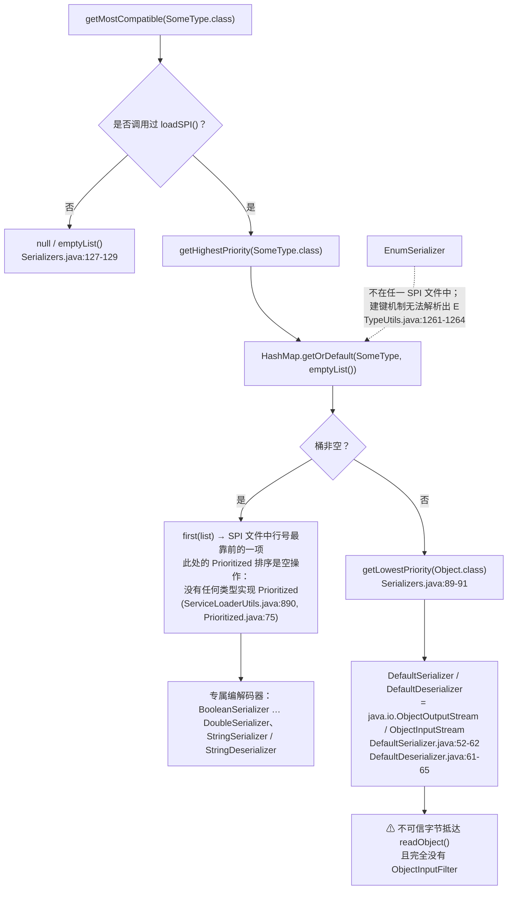
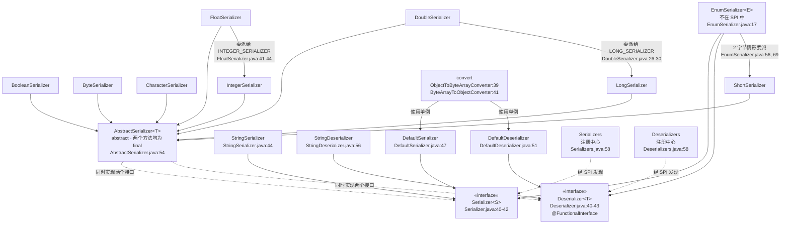
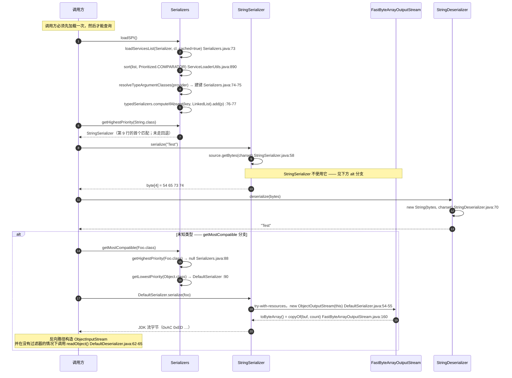

# 序列化 — 开发者指南

模块：`io.github.microsphere-projects:microsphere-java-core` · 源码线：`release` 分支，`0.3.20-SNAPSHOT`
分析对象包：`io.microsphere.io.serializer` — **18 个主干源码类型**。
面向使用者的同主题页面：[用户指南 — 序列化](../../../user-guide/microsphere-java-core/zh/serialization.md)。

所有 `file:line` 引用相对于 `microsphere-java-core/src/main/java/io/microsphere/`（主干）
或 `microsphere-java-core/src/test/java/io/microsphere/`（测试），读取自 `release` 工作树，
之后简写为 `io/serializer/Foo.java:40-55`。

---

## 1. 在架构中的位置

`io.serializer` 位于[开发者索引分层表](README.md)中的 **Service 层** —— 与 `convert`、`event`、`logging`、`json`、
`metadata` 同一层带，理由也相同：它是一个通过 `META-INF/services` 发现的 SPI 家族，其实现是被*查找*出来的，
而不是被装配进来的。

索引画了两条边，二者都已对照源码核实，而非想当然：

* **`reflect` → `io.serializer`（它消费类型模型）。** 用到了三处彼此独立的反射能力，全部来自 `io.microsphere.reflect`：
  * `TypeUtils.resolveTypeArgumentClasses(...)` 为每个提供者推导出注册中心键
    （`io/serializer/Serializers.java:74`、`io/serializer/Deserializers.java:74`）。
  * `JavaType.from(getClass()).as(AbstractSerializer.class).getGenericType(0).toClass()`
    在 `AbstractSerializer` 构造函数中解析出被编码的类型 `T`（`io/serializer/AbstractSerializer.java:65-66`）。
  * `MethodUtils.invokeStaticMethod(true, enumType, "values")` 以 `forceAccess = true` 调用生成的 `Enum.values()`
    （`io/serializer/EnumSerializer.java:39`；该标志的含义见参数文档 `io/reflect/MethodUtils.java:898`
    与实现 `:908-910`）。
  另外还有 `io.microsphere.annotation.Nonnull`、`io.microsphere.io.*` 缓冲区、`io.microsphere.util.*` 与
  `io.microsphere.collection.*` —— 全都处于类型模型层或更低层。
* **`convert` → `io.serializer`（前者是消费者，不是被依赖者）。**
  `ObjectToByteArrayConverter` 导入 `DefaultSerializer.DEFAULT_SERIALIZER`
  （`io/convert/ObjectToByteArrayConverter.java:21`）并在 `:39` 调用；
  `ByteArrayToObjectConverter` 导入 `DefaultDeserializer.DEFAULT_DESERIALIZER`
  （`io/convert/ByteArrayToObjectConverter.java:22`）并在 `:41` 调用。
  在**全部**主干源码中 grep `import io.microsphere.io.serializer`，结果恰好只有这两个文件加上测试树 ——
  因此方向是单向的，`io.serializer` 可以在完全没有 `convert` 的情况下使用。

**它所拥有的边界：** `io.serializer` 是 `core` 中唯一负责 `Object`/`T` 与 `byte[]` 互转的地方。
它不负责 framing、长度前缀、类型标记、字符集协商，也不负责其他包（`io.event`、`json`、`metadata`）
承担的记录级关注点。正是这个狭窄的范围，使得 18 个类型就够了。

---

## 2. 包与类地图

| # | 类型 | 种类 | 编码对象 | extends / implements | 是否在 SPI 文件中 |
|---|---|---|---|---|---|
| 1 | `Serializer<S>` | interface | — | — | 即 service 类型本身 |
| 2 | `Deserializer<T>` | `@FunctionalInterface` | — | — | 即 service 类型本身 |
| 3 | `AbstractSerializer<T>` | abstract 基类 | 任意 `T` | `implements Serializer<T>, Deserializer<T>` | —（抽象类） |
| 4 | `BooleanSerializer` | final | `Boolean` | `extends AbstractSerializer<Boolean>` | 两份，第 1 行 |
| 5 | `ByteSerializer` | | `Byte` | `extends AbstractSerializer<Byte>` | 两份，第 2 行 |
| 6 | `CharacterSerializer` | | `Character` | `extends AbstractSerializer<Character>` | 两份，第 3 行 |
| 7 | `ShortSerializer` | | `Short` | `extends AbstractSerializer<Short>` | 两份，第 4 行 |
| 8 | `IntegerSerializer` | | `Integer` | `extends AbstractSerializer<Integer>` | 两份，第 5 行 |
| 9 | `LongSerializer` | final | `Long` | `extends AbstractSerializer<Long>` | 两份，第 6 行 |
| 10 | `FloatSerializer` | final | `Float` | `extends AbstractSerializer<Float>` | 两份，第 7 行 |
| 11 | `DoubleSerializer` | final | `Double` | `extends AbstractSerializer<Double>` | 两份，第 8 行 |
| 12 | `StringSerializer` | | `String` | `implements Serializer<String>` | `Serializer`，第 9 行 |
| 13 | `StringDeserializer` | | `String` | `implements Deserializer<String>` | `Deserializer`，第 9 行 |
| 14 | `DefaultSerializer` | | `Object` | `implements Serializer<Object>` | `Serializer`，第 10 行 |
| 15 | `DefaultDeserializer` | | `Object` | `implements Deserializer<Object>` | `Deserializer`，第 10 行 |
| 16 | `EnumSerializer<E>` | | `E extends Enum` | `implements Serializer<E>, Deserializer<E>` | **否** |
| 17 | `Serializers` | 注册中心 | — | — | — |
| 18 | `Deserializers` | 注册中心 | — | — | — |

继承列的证据：`io/serializer/BooleanSerializer.java:12`、`ByteSerializer.java:31`、`CharacterSerializer.java:29`、
`ShortSerializer.java:11`、`IntegerSerializer.java:11`、`LongSerializer.java:11`、`FloatSerializer.java:31`、
`DoubleSerializer.java:16`、`StringSerializer.java:44`、`StringDeserializer.java:56`、`DefaultSerializer.java:47`、
`DefaultDeserializer.java:51`、`EnumSerializer.java:17`。

由这张表可直接得出两点结构性结论：

* 只有那八个数值类继承 `AbstractSerializer`。`String`、`Object`、`Enum` 三类编解码器直接实现原始接口，
  因此**必须自行重新实现 `null` 与宽度处理** —— 而在 `String` 的情况下，它根本没有实现（§3.4）。
* 十八个类型中恰好四个是 `final`（`BooleanSerializer`、`LongSerializer`、`FloatSerializer`、`DoubleSerializer`），
  所以"封闭类"并非本包的统一约定。

---

## 3. 源码分析

### 3.1 注册中心加载循环

`Serializers.loadSPI()`（`io/serializer/Serializers.java:72-79`）就是整套注册机制：

```java
for (Serializer serializer : loadServicesList(Serializer.class, classLoader, true)) {
    List<Class<?>> typeArguments = resolveTypeArgumentClasses(serializer.getClass());
    Class<?> targetClass = first(typeArguments);
    List<Serializer> serializers = typedSerializers.computeIfAbsent(targetClass, k -> new LinkedList());
    serializers.add(serializer);
}
```

这里决定了四件事，其中第三件最容易被误读。

**(a) 列表一定会经过 `Prioritized` 排序。** `loadServicesList(Class, ClassLoader, boolean)` —— 第三个参数是
`cached`，**不是** `sorted`（`io/util/ServiceLoaderUtils.java:468-470`）。排序在无缓存的工作方法内部是无条件执行的：
`sort(serviceList, COMPARATOR)` 位于 `io/util/ServiceLoaderUtils.java:890`，`COMPARATOR` 从
`io.microsphere.lang.Prioritized` 静态导入（`:30`）。由于十八个类型中没有一个实现 `Prioritized`
（在整个包中 grep 该名称没有任何命中），比较器走到最后的分支并对任意一对返回 `0`
（`io/lang/Prioritized.java:71-75`），而 `Collections.sort` 是稳定排序 —— 所以**实际生效的顺序就是 SPI 文件的声明顺序**。
`Serializers.java:76-77` 随后按该顺序追加，于是 `first(...)` 等价于"文件中行号最靠前的那个"。
这就是为什么 `BooleanSerializer` 在 `Boolean` 上胜过一切，而 `DefaultSerializer` —— 位于第 10 行 ——
永远是 `getLowestPriority(Object.class)` 的结果。

**(b) 键是通过反射从提供者自身的类型参数推导出来的。**
`resolveTypeArgumentClasses`（`io/reflect/TypeUtils.java:1259-1265`）映射在 `resolveTypeArguments` 之上，
后者**沿父类链向上**遍历，在每一层先收集泛型父类的实参、再收集泛型接口的实参，直到 `Object.class` 停止
（`io/reflect/TypeUtils.java:1198-1209`）；`asClass` 产生的 `null` 会被过滤掉（`:1263`）。于是：

| 提供者 | `first(...)` 为何产出该结果 | 注册中心键 |
|---|---|---|
| `IntegerSerializer` | 泛型父类 `AbstractSerializer<Integer>` 在第一层即被看到 | `Integer.class` |
| `StringSerializer` | 父类无可用实参；泛型接口 `Serializer<String>` | `String.class` |
| `DefaultSerializer` | 泛型接口 `Serializer<Object>`（`io/serializer/DefaultSerializer.java:47`） | `Object.class` |

带来的后果是：**注册中心是扁平的，不是多态的。** 它按*字面*类型参数建键，因此 `get(Integer.class)`
绝不会去查 `Number` 或 `Object` 桶 —— `get` 就是一次 `HashMap.getOrDefault`
（`io/serializer/Serializers.java:127-129`）。只有 `getMostCompatible` 跨越了这道鸿沟，
而它只朝一个方向跨越（§3.2）。

**(c) `EnumSerializer` 被排除是构造使然，而非疏漏。** 它泛型于 `E` 并声明
`implements Serializer<E>, Deserializer<E>`（`io/serializer/EnumSerializer.java:17`），
所以它的类型参数解析结果为 `TypeVariable`，而 `asClass` 无法把它变成 `Class`，
`resolveTypeArgumentClasses` 随即将其丢弃（`io/reflect/TypeUtils.java:1261-1264`）。
建键机制不可能为它命名出一个类，这与它出现在两个 SPI 文件之外的事实相吻合。
它改为按枚举类型逐个实例化（`EnumSerializer.java:27-31`）。

**(d) `loadSPI` 只追加、不幂等。** 每次调用都会重跑整个循环，并向已有的 `LinkedList` `add`
（`io/serializer/Serializers.java:76-77`）。没有任何去重检查。第二次调用是否让列表翻倍，
完全取决于 `cached` 标志：

| | `Serializers.loadSPI` | `Deserializers.loadSPI` |
|---|---|---|
| 调用形状 | `loadServicesList(Serializer.class, classLoader, true)`（`io/serializer/Serializers.java:73`） | `loadServicesList(Deserializer.class, classLoader)`（`io/serializer/Deserializers.java:73`） |
| 解析到 | `cached = true` → 查 `servicesCache` | 两参重载 → `cached = SERVICE_LOADER_CACHED`（`io/util/ServiceLoaderUtils.java:410-412`） |
| 默认值 | 始终缓存 | `false`，取自 `microsphere.service-loader.cached`，默认字符串 `"false"`（`io/util/ServiceLoaderUtils.java:107`、`:112`、`:138`） |
| 调用两次的效果 | 提供者**实例**被复用（同一列表），但按类型分组的列表仍在增长 —— 见下 | 提供者实例被重新创建，**并且**列表继续增长 |

注意即使在缓存路径上仍存在的残留问题：返回的服务列表是稳定的，但 `:77` 处的 `serializers.add(serializer)`
依然会执行第二次，所以**两个注册中心的 `loadSPI()` 都不幂等。** 每个 `Serializers` / `Deserializers`
实例只调用一次。测试也印证了这一点 —— 两者都在 `@BeforeEach` 中针对全新构造的注册中心调用一次
（`SerializersTest.java:51-54`、`SerializersAndDeserializersTest.java:40-46`）。

**(e) 唯一的抛出点。** 当服务迭代器为空时，`loadServicesAsList` 抛出 `IllegalArgumentException`
（`io/util/ServiceLoaderUtils.java:882-886`）。这就是 `META-INF/services` 目录被剥离后的失败形态。
`Serializers`/`Deserializers` 中没有任何查询路径会抛异常 —— 未命中表现为 `null` 或 `emptyList()`。

### 3.2 选择算法

`Serializers` 在一个 `Map<Class<?>, List<Serializer>>` 字段（`io/serializer/Serializers.java:60`）之上暴露四个访问器。
`Deserializers` 是它的精确镜像（`:60`、`:87-129`）。

| 访问器 | 方法体 | 行为 |
|---|---|---|
| `get` | `getOrDefault(type, emptyList())`（`:127-129`） | `@Nonnull`；无回退 |
| `getHighestPriority` | `first(get(type))`（`:102-105`） | 桶为空时为 `null` —— `ListUtils.first` 在 `size < 1` 时返回 `null`（`io/collection/ListUtils.java:111-113`） |
| `getLowestPriority` | `last(get(type))`（`:114-117`） | 同样可能为 `null`（`io/collection/ListUtils.java:132-135`） |
| `getMostCompatible` | `getHighestPriority(type)`，否则 `getLowestPriority(Object.class)`（`:87-93`） | **无条件的 JDK 回退** |

最后一行才是值得推敲的设计决策。`getMostCompatible` 并不会沿父类型链向上搜寻兼容的编解码器；
它先试精确桶，否则**总是**返回 `Object` 键下优先级最低的那一项 —— `DefaultSerializer`。
由于 `Object` 由 SPI 文件最后一行填充，且单元素列表的 `first` 与 `last` 重合，
所以对每个没有专属编解码器的类型，`getMostCompatible(anything)` 都是 `DefaultSerializer`。
`SerializersTest.java:70-80` 的断言证实了其中可观测的一半：`loadSPI()` 之后，
`getMostCompatible` 对全部九个 `SUPPORTED_CLASSES` 都非 `null`，包括 `Object.class` 本身 ——
而在 `Object.class` 上 `getHighestPriority` 与 `getMostCompatible` 返回同一实例。

于是选择规则可以精确陈述为：

1. 精确类匹配 → 优先级最高（文件中最靠前）的编解码器；
2. 无精确匹配 → 经 `Object` 桶得到 `DefaultSerializer` / `DefaultDeserializer`；
3. 绝不抛异常，也绝不做 `Number` 或父类型搜索。

第 2 条正是本页设有安全章节的原因：一个看起来泛用通用的 API，悄悄地把未知类型路由进了
无过滤的 `ObjectInputStream.readObject()`。



### 3.3 `AbstractSerializer` 模板

`AbstractSerializer<T>` 是本包唯一的框架类，且两个公开方法都是 `final` ——
可扩展点是那三个 protected 抽象方法（`io/serializer/AbstractSerializer.java:119`、`:128`、`:137`）。

构造函数把工作一次性做完（`:64-68`）：

```java
JavaType type = from(getClass()).as(AbstractSerializer.class).getGenericType(0);
this.targetType = type.toClass();
this.bytesLength = calcBytesLength();
```

因此 `bytesLength` 是一个**被缓存进 `final` 字段的虚方法结果**，子类的 `calcBytesLength()` 每个实例只被调用一次 ——
这正是让热路径上的宽度校验退化为一次整数比较的原因（`:87`）。
同时也意味着 `calcBytesLength()` 不能依赖可变的子类状态，因为它在子类构造函数体之前就已执行。

`serialize`/`deserialize`（`:70-92`）实现了退化策略：

| 守卫 | 行号 | 结果 |
|---|---|---|
| `t == null` | `:73-75` | `null` |
| `bytes == null` | `:81-84` | `null` |
| `bytesLength != UNBOUND_BYTES_SIZE && bytesLength != bytes.length` | `:87-89` | `null` — 静默 |

宽度校验**只是长度相等判断**。它不校验内容，所以一个尺寸正确但内容损坏的缓冲区会径直进入
`doDeserialize`，由子类决定后续 —— 各数值编解码器不再做任何检查，直接重新解释这些位
（`io/serializer/IntegerSerializer.java:33-39`）。

### 3.4 排布顺序及其格式稳定性后果

任务书询问"类描述符的写入顺序"。就事实而言：**本包不写入任何自有的类描述符。**
存在两种截然不同的机制，而其中只有一种是自描述的。

**定宽编解码器既不写描述符也不写标记。** 每个 `AbstractSerializer` 子类*只*输出值的字节，
按手写顺序；`EnumSerializer` 只输出一个 `ordinal`（`io/serializer/EnumSerializer.java:52-57`）。
没有类型标记、没有长度前缀、没有魔数。字节序序列如下：

| 一族 | 下标 0 存放 | 证据 |
|---|---|---|
| `Character`、`Short` | 高字节 | `io/serializer/CharacterSerializer.java:41-44`（先 `(byte) (c >>> 8)`）、`io/serializer/ShortSerializer.java:23-25`（先 `(byte) (shortValue >>> 8)`） |
| `Integer`、`Float` | 最高有效字节 | `io/serializer/IntegerSerializer.java:23-28`（先 `>> 24`）；`FloatSerializer` 通过委派给 `INTEGER_SERIALIZER.doSerialize` 继承了它（`io/serializer/FloatSerializer.java:41-44`） |
| `Long`、`Double` | **最低有效字节** | `io/serializer/LongSerializer.java:23-32`（先 `(byte) longValue`）；`DoubleSerializer` 通过委派给 `LONG_SERIALIZER.serialize` 继承了它（`io/serializer/DoubleSerializer.java:26-30`） |
| `Enum`（2 字节情形） | 高字节，经 `SHORT_SERIALIZER` | `io/serializer/EnumSerializer.java:56`、`:69` |

后果是真实且永久的：

* 4 字节族与 8 字节族使用**相反的字节序**，而且由于 `Float` 走 `Integer`、`Double` 走 `Long`，
  这个分裂跟随的是*委派目标*，并非任何有意设计。一条含 `int` 字段和 `long` 字段的记录就是先大端后小端。
  字节里没有任何信息说明这一点。
* 由于什么都没标记，该格式**既不自描述也不可版本化**：字段加宽、或把 `Integer` 换成 `Long`，
  产出的不是错误而是貌似合理的垃圾。`deserialize` 的宽度校验只能捕捉 4 与 8 的互换
  （`io/serializer/AbstractSerializer.java:87-89`），更细微的问题一律放过。
* `StringSerializer` 不写字符集标记（`io/serializer/StringSerializer.java:57-59`），
  `EnumSerializer` 持久化的是 `ordinal()` 而非 `name()`（`:49`），因此
  **重排枚举常量会静默改写已存储字节的含义。** 两侧都必须锚定在同一份枚举声明顺序上。

**`DefaultSerializer` 写的是 `ObjectOutputStream` 所写的一切。** 类描述符 —— 魔数 `0xAC 0xED`、流版本、
类名、`serialVersionUID`、字段描述符 —— 由 JDK 发出，不由此处发出；本包的代码只贡献了一次调用，
`objectOutputStream.writeObject(source)`（`io/serializer/DefaultSerializer.java:58`）。
后果是：格式稳定性是 JDK 的保证，`serialVersionUID` 行为是 JDK 的重算规则。
在 18 个类型中 grep `serialVersionUID` 返回零结果，所以**本包既不固定也不校验任何 `serialVersionUID`。**
`DefaultDeserializer` 同样没有覆写 `resolveClass`、没有安装 `ObjectInputFilter`、也没有限制对象图
（`:61-65`）；它唯一的输入校验是空值检查（`:57-59`）。

### 3.5 两个 `Default*` 类的异常策略

它们在一种很容易被忽略的意义上是不对称的：

| | `DefaultSerializer` | `DefaultDeserializer` |
|---|---|---|
| `catch` 块 | **没有**（`io/serializer/DefaultSerializer.java:52-62`） | `catch (Exception e) { throw new IOException(e); }`（`:66-68`） |
| 非 `Serializable` 参数 | 原样传播 `NotSerializableException` | 不适用 |
| 读取时的 `ClassNotFoundException` | 不适用 | 塌缩为 `IOException` |
| 目标类 `readObject` 抛出的 `RuntimeException` | 不适用 | 同样塌缩为 `IOException` —— `catch (Exception)` 是无条件的 |
| `close()` 的干扰 | 不可能抛异常 —— `FastByteArrayOutputStream.close()` 是空操作（`io/io/FastByteArrayOutputStream.java:188-189`） | 不可能抛异常 —— `FastByteArrayInputStream.close()` 是空操作（`io/io/FastByteArrayInputStream.java:157-158`） |
| `null` 参数 | 未检查；行为由 `ObjectOutputStream` 决定 | `null`/空 → `null`（`:57-59`） |

`toByteArray()` 返回 `Arrays.copyOf(buf, count)`（`io/io/FastByteArrayOutputStream.java:159-161`），
所以返回的数组是一份私有副本，缓冲区此后被 GC 不会影响它。

可从本包抵达的唯一非受检抛出点位于包外：
`ByteArrayToObjectConverter.doConvert` 把结果强转为 `Serializable`，并把 `IOException` 包装成
`new RuntimeException(e)`（`io/convert/ByteArrayToObjectConverter.java:41-44`）。



---

## 4. 往返时序



---

## 5. 设计模式

| 模式 | 实现类 | 证据 |
|---|---|---|
| **策略 Strategy** | `Serializer<S>` / `Deserializer<T>`；由注册中心按类型挑选 | 两个接口只声明一个行为、不含状态（`io/serializer/Serializer.java:40-42`、`io/serializer/Deserializer.java:40-43`）；注册中心在运行时替换实现（`io/serializer/Serializers.java:87-117`） |
| **注册中心 Registry**（按 `Class` 索引策略） | `Serializers`、`Deserializers` | `Map<Class<?>, List<Serializer>> typedSerializers`（`io/serializer/Serializers.java:60`）加上 `loadSPI`/`get*`（`:72-129`）；镜像见 `io/serializer/Deserializers.java:60-129` |
| **模板方法 Template Method** | `AbstractSerializer<T>` | `serialize`/`deserialize` 为 `final`（`io/serializer/AbstractSerializer.java:71`、`:80`），并委派给抽象钩子 `calcBytesLength`/`doSerialize`/`doDeserialize`（`:119`、`:128`、`:137`）；构造函数只调用该钩子一次并缓存（`:67`） |
| **服务提供者 / 插件 SPI** | `Serializers`、`Deserializers` | 以 `META-INF/services/io.microsphere.io.serializer.Serializer` 与 `…Deserializer` 为键；经 `loadServicesList` 加载（`io/serializer/Serializers.java:73`） |
| **享元 Flyweight / 规范实例** | 八个 `…SERIALIZER` 数值单例、`DEFAULT_SERIALIZER`、`DEFAULT_DESERIALIZER` | 每个都是 `public static final` 且构造完成后无状态 —— 例如 `io/serializer/IntegerSerializer.java:13`、`io/serializer/BooleanSerializer.java:14`、`io/serializer/DefaultSerializer.java:49`、`io/serializer/DefaultDeserializer.java:53`。由于 SPI 文件点名的是同一批类，`ServiceLoader` 会在 `loadSPI()` 时再实例化**第二套**（`Serializers.java:73`） |
| **空对象（作为中性退化）** | `AbstractSerializer`、`DefaultDeserializer` | 非法输入返回 `null` 而不抛异常：`io/serializer/AbstractSerializer.java:73-75`、`:81-84`、`:87-89`；`io/serializer/DefaultDeserializer.java:57-59`。与[索引中的退化策略](README.md)一致 |
| **适配器 / 编解码器间委派** | `FloatSerializer`、`DoubleSerializer`、`EnumSerializer` | 复用位排布而非重复实现：`io/serializer/FloatSerializer.java:41-44` → `INTEGER_SERIALIZER`，`io/serializer/DoubleSerializer.java:26-30` → `LONG_SERIALIZER`，`io/serializer/EnumSerializer.java:56`、`:69` → `SHORT_SERIALIZER`。注意这是*组合/委派*，**不是** GoF 装饰器 —— 没有任何编解码器为了增加行为而包装另一个的接口 |
| **外观 Facade（对 JDK 流）** | `DefaultSerializer`、`DefaultDeserializer` | 把 `OutputStream` + `ObjectOutputStream` + 生命周期压缩成一次 `byte[]` 调用（`io/serializer/DefaultSerializer.java:52-62`） |
| **类型令牌解析** | `AbstractSerializer`、`Serializers`、`Deserializers` | 用 `JavaType`（`io/serializer/AbstractSerializer.java:65`）和 `resolveTypeArgumentClasses`（`io/serializer/Serializers.java:74`）找回被擦除掉的 `T` |
| **基于反射的方法调用** | `EnumSerializer` | `invokeStaticMethod(true, enumType, "values")`（`io/serializer/EnumSerializer.java:39`） |

---

## 6. 扩展点

### 6.1 新增一个 `Serializer`

1. 实现 `io.microsphere.io.serializer.Serializer<S>` —— 或者，对于标量类型，继承 `AbstractSerializer<S>`
   （`io/serializer/AbstractSerializer.java:54`）以继承 `null` 与宽度处理。
   `EnumSerializer` 展示了另一条路：直接实现两个接口（`io/serializer/EnumSerializer.java:17`）。
2. **把被编码的类型声明为可解析的类型参数。** `Serializers.loadSPI()` 完全以
   `first(resolveTypeArgumentClasses(...))` 建键（`io/serializer/Serializers.java:74-75`），
   因此一个泛型于 `T`、且其父类/接口列表中不含具体实参的类会解析出空列表、落到 `null` 键下
   （`io/reflect/TypeUtils.java:1261-1264`）—— 无法被 `get(...)` 命中。请把参数绑死：
   `extends AbstractSerializer<MyType>`。
3. 把全限定类名追加到
   `microsphere-java-core/src/main/resources/META-INF/services/io.microsphere.io.serializer.Serializer`。
   位置很重要：当前文件是 10 行，以 `io.microsphere.io.serializer.DefaultSerializer` 结尾，
   而靠前的行在 `getHighestPriority` 中胜出（`io/serializer/Serializers.java:102-105`）。
4. **仅当你必须覆盖文件顺序时**才 `implements Prioritized` —— `Prioritized` 项无论行号在哪都会排在
   非 `Prioritized` 项之前（`io/lang/Prioritized.java:65-73`）。没有任何内置序列化器这么做。
5. 确保线程安全；这是契约明文要求（`io/serializer/Serializer.java:24-25`）。

`Deserializer` 步骤相同，服务文件换成 `…serializer.Deserializer`（同样 10 行，以
`io.microsphere.io.serializer.DefaultDeserializer` 结尾）。注意 `Deserializers.loadSPI()` 走的是不缓存的重载
（`io/serializer/Deserializers.java:73`），因此提供者的构造函数会在每次 `loadSPI()` 时执行。

### 6.2 替换 JDK 路径 —— 最关键的一条

`Object.class` 是 `getMostCompatible` 的回退桶（`io/serializer/Serializers.java:89-91`），
因此覆盖 `Default*` 条目是为所有未知类型改变行为的受支持方式。有两个选项：

* **注册一个绑定到具体父类型的、带过滤的 `Deserializer`**，并通过行号位置或 `Prioritized` 使其胜出。
  这仅对你能点名的类型有效。
* **不再使用 `getMostCompatible`**，改用 `getHighestPriority`，并把 `null` 视为"不支持的类型 —— 拒绝处理"。
  这是更省事的修法，也是本页推荐的做法，因为它把 JDK 回退从默认行为改成了显式选择。
  它对现有调用方属于行为变更，因此应当由模块负责人决定，而不是由下游打补丁。

**什么不是扩展点。** `DefaultDeserializer` 的 `ObjectInputStream` 在方法内部创建且从不外泄
（`io/serializer/DefaultDeserializer.java:61-65`）；没有钩子、没有子类化点、没有 protected 工厂方法。
因此你**无法**在它上面安装按流粒度的 `java.io.ObjectInputFilter`。唯一能触达它的 JDK 杠杆是
进程全局的 `jdk.serialFilter` / `jdk.io.objects.readData` 属性，而本库既不读取、也不设置、也不记录它。
任何带过滤的反序列化都必须是你自己写的、按上述方式注册的 `Deserializer`。

### 6.3 从另一个 `core` 包消费

当类型在编译期已知时，优先使用单例而非注册中心 —— `convert` 正是这么做的
（`io/convert/ObjectToByteArrayConverter.java:21,39`、`io/convert/ByteArrayToObjectConverter.java:22,41`），
这完全绕开了 `loadSPI()`。请保持 `convert → io.serializer` 的依赖方向；
`io.serializer` 不得导入 `convert`，而今天它确实没有。

---

## 7. 线程安全与性能

### 7.1 真实的缓存字段

| 字段 | 位置 | 类型 | 构造后是否被修改？ | 后果 |
|---|---|---|---|---|
| `Serializers.typedSerializers` | `io/serializer/Serializers.java:60` | `Map<Class<?>, List<Serializer>>`，来自 `MapUtils.newHashMap()` → 普通 `HashMap`（`io/collection/MapUtils.java:478-480`） | **会**，由 `loadSPI()`（`:76-77`） | 加载期间非并发安全；加载结束后若无其他写者，可安全并发读 |
| `Deserializers.typedDeserializers` | `io/serializer/Deserializers.java:60` | 同上 | **会**（`:76-77`） | 同上，且因缓存关闭而更可能被重复加载 |
| `Serializers.classLoader` / `Deserializers.classLoader` | `io/serializer/Serializers.java:62`、`Deserializers.java:62` | `final ClassLoader` | 否 | 每个实例的注册中心身份固定 |
| `ServiceLoaderUtils.servicesCache` | `io/util/ServiceLoaderUtils.java:140` | `ConcurrentMap<Class<?>, List<?>>` | 会，但经由 `computeIfAbsent` 原子完成（`:846`） | 这条路径上**唯一**真正并发安全的缓存；在所有 `cached = true` 的加载之间进程级共享 |
| `AbstractSerializer.targetType` | `io/serializer/AbstractSerializer.java:56` | `final Class<T>` | 否 | 构造函数中解析一次（`:65-66`）；此后零开销 |
| `AbstractSerializer.bytesLength` | `io/serializer/AbstractSerializer.java:58` | `final int` | 否 | 在 `:67` 捕获 `calcBytesLength()`，所以宽度检查是字段读取而非虚调用 |
| `EnumSerializer.enums` | `io/serializer/EnumSerializer.java:23` | `final E[]` | 否，但数组*元素*是活的枚举常量 | `values()` 每实例调用一次（`:29`、`:38-40`） |
| `EnumSerializer.bytesLength` | `io/serializer/EnumSerializer.java:25` | `final int` | 否 | 宽度按常量数量一次性确定（`:33-36`） |
| `StringSerializer.charset` / `StringDeserializer.charset` | `io/serializer/StringSerializer.java:46`、`StringDeserializer.java:58` | `final Charset` | 否 | javadoc 的线程安全论断正建立在这一点上（`io/serializer/StringDeserializer.java:31-34`） |

**结论。** 每个编解码器构造完成后即不可变、可安全共享；这就是本包遵循的模式，
也是 `Serializer`/`Deserializer` 契约所要求的（`io/serializer/Serializer.java:24-25`）。
两个注册中心在**填充时不是线程安全的**。`HashMap` + `LinkedList` 处在非原子的
`computeIfAbsent`-然后-`add` 序列中（`io/serializer/Serializers.java:76-77`），
意味着并发的 `loadSPI()` 可能丢失条目，或在 resize 期间暴露出半成品映射。
请在启动时于单一线程内完成填充；在读线程出现之前完成发布。

### 7.2 性能说明

* **定宽编解码器分配极少且无分支。** `IntegerSerializer` 用四次移位构造数组，不使用 `ByteBuffer`
  （`io/serializer/IntegerSerializer.java:23-28`）；`BooleanSerializer` 与 `ByteSerializer` 各自只分配一个字节
  （`BooleanSerializer.java:26-30`、`ByteSerializer.java:41-43`）。每次调用一个数组是返回 `byte[]` 的接口所设定的下限；
  内部没有对象池。
* **`Float`/`Double`/`Enum` 多付一次数组拷贝**，因为它们委派给另一个编解码器并取走其结果
  （`io/serializer/FloatSerializer.java:43`、`DoubleSerializer.java:29`、`EnumSerializer.java:56`）。
  委派目标是*单例*，因此不会创建额外对象。
* **`EnumSerializer` 把一次反射 `values()` 调用摊薄**到该实例的全部使用（`io/serializer/EnumSerializer.java:29`），
  这就是为什么它必须每个枚举类型构造一次并缓存，而不是每个值构造一次。
* **`DefaultSerializer` 就构造而言很重。** 每次调用分配一个 `FastByteArrayOutputStream`
  （初始缓冲 32 字节，`io/io/FastByteArrayOutputStream.java:68-69`）、一个 `ObjectOutputStream`、
  JDK 的块数据机制，最后在 `toByteArray()` 中一次 `Arrays.copyOf`（`:159-161`）。
  它还为每个对象发出完整的类描述符，这就是 `DefaultSerializerAndDeserializerTest.java:39-45` 里
  一个四字符 `String` 会产出大量字节的原因。把它当作兼容性逃生通道，而不是编解码器。
* **`loadSPI()` 缓存。** `cached = true` 时提供者列表被记忆在 `servicesCache`
  （`io/util/ServiceLoaderUtils.java:845-846`），重复加载很廉价 —— 但注册中心自身的按类型列表仍会增长（§3.1d），
  所以缓存并不能让 `loadSPI()` 变得幂等。`Deserializer` 一侧默认不缓存（`:107`、`:138`），
  意味着每次 `Deserializers.loadSPI()` 都会反射地重新实例化全部十个提供者。
* **由 `Serializable` 决定的开销在此不受约束。** `ObjectOutputStream.writeObject` 之前没有大小上限
  （`io/serializer/DefaultSerializer.java:58`），`readObject` 之前没有深度或引用上限
  （`io/serializer/DefaultDeserializer.java:65`），因此大而深或宽而浅的对象图只受堆限制。

---

## 8. 测试策略

`microsphere-java-core/src/test/java/io/microsphere/io/serializer/` 下有 16 个测试类，
它们清晰地划分为三种策略。

**(a) 为 `AbstractSerializer` 家族提供的继承式往返测试装置。**
`AbstractSerializerTest<T>`（`io/serializer/AbstractSerializerTest.java:21-64`）自身是抽象的，
且 `@Test` 方法中不含断言逻辑：`test()`（`:23-26`）与 `testNull()`（`:28-31`）都委派给
`test(Supplier<T>)`（`:33-51`），由后者完成整份契约校验：

```java
byte[] bytes = serializer.serialize(value);
T deserialized = serializer.deserialize(bytes);
assertEquals(serializer.calcBytesLength(), serializer.getBytesLength());   // :38
...
assertSame(targetType, parameterType);                                     // :50
```

有三条断言值得任何扩展本包的人留意：

* `:38` 证明 `calcBytesLength()` 在测试装置中被调用了不止一次 —— 一次由构造函数（`:67`），一次由这里直接调用 ——
  所以它必须无副作用，且不得依赖可变的子类状态。
* `:40-44` 把 `null` 情形当作一个*取值*情形来处理，而不是单独的异常测试，因此在 `null` 上抛异常的编解码器会让套件失败。
  这正是 §3.5 那张表背后的强制执行机制。
* `:46-50` 通过 `JavaType` 从*测试子类*自身的类型参数恢复出 `T`，然后对 `getTargetType()` 做 `assertSame` ——
  这是一个真正的双向校验，证明两条反射路径结论一致。它也说明 `getTargetType()` 的意义不止于便利性。

`IntegerSerializerTest`、`BooleanSerializerTest`、`ByteSerializerTest`、`CharacterSerializerTest`、
`ShortSerializerTest`、`LongSerializerTest`、`FloatSerializerTest`、`DoubleSerializerTest`
各自只提供 `getSerializer()` 与 `getValue()` —— 例如 `IntegerSerializerTest.java:33-41` 返回
`INTEGER_SERIALIZER` 与 `MAX_VALUE`。八个编解码器由此各自仅用约九行代码，就覆盖了往返、`null`、
宽度一致性与类型解析。

**(b) 断言"加载前为空"状态的注册中心测试。** `SerializersTest.java:37-47` 把 `SUPPORTED_CLASSES`
声明为契约表面，其四个测试都遵循同一形状 —— 先断言空/`null`，调用 `loadSPI()`，再断言已填充
（`:56-67`、`:69-80`、`:82-93`、`:95-106`）。注意 `SerializersTest.java:57` 的方法名拼作 `testtGet`
（方法名中的一个笔误；它测的确实是 `get`）。`get` 被断言等于 `emptyList()`，
而另外三个被断言为 `null`，这钉住了 `:127-129` 与 `:102-117` 之间的 `@Nonnull` 区别。
`DeserializersTest.java:35-98` 是它的镜像，但只覆盖 `String` 与 `Object` 两个键 ——
即那两个编解码器名称不对称的键（`StringSerializer` 对 `StringDeserializer`），
同样使用加载前/加载后的模式（`:44-53`、`:55-64`、`:66-75`、`:77-86`、`:88-97`）。

`SerializersAndDeserializersTest.java` 是唯一把两个注册中心耦合起来、并断言*字节*
而不只是断言非 `null` 的测试：`:49-56` 把 `getHighestPriority(String.class)` 钉死为原始 UTF-8
（证明 `String` 桶的填充优先于 `Object` 回退），`:59-65` 让 `getMostCompatible(Integer.class)`
穿过两个注册中心。两次 `loadSPI()` 都发生在 `@BeforeEach` 中、作用于刚构建的注册中心（`:40-46`）——
考虑到 §3.1(d)，这是正确的模式。

**(c) 针对非 `AbstractSerializer` 编解码器的直接行为测试。**
`StringSerializerAndDeserializerTest.java:34-74` 是全包最全面的：默认 UTF-8（`:40-46`）、
自定义 `ISO_8859_1`（`:48-57`）、空串 → `new byte[0]` → `""`（`:59-64`）、以及 UTF-16 往返（`:66-73`）。
值得注意的是它**没有**测 `null`，而这恰恰是这两个类偏离契约之处（§3.5，以及用户页面的第 3 条陷阱）。
`EnumSerializerTest.java` 通过并置一个小枚举（`TimeUnit` → `1`，`:45`）与一个 200 常量的内嵌枚举
（`:62`，声明于 `:72-93`）来覆盖宽度边界，两者都逐个常量往返，并断言两个方向的 `null`（`:54-55`）。
`DefaultSerializerAndDeserializerTest.java:37-46` 通过一个声明为 `Object` 的变量，
把一个 `String` 和一个 `Integer` 送过 JDK 流并还原。`DefaultDeserializerTest.java:20-23`
是单方法测试，验证 `null → null` 的退化。

**由以上阅读可直接推出的覆盖缺口**，按影响从大到小：

1. 没有任何测试对不可信或恶意输入做断言，也没有任何测试引用 `ObjectInputFilter`。
   `Default*` 这一对只用可信、可被 JDK 往返的值测试过。
2. `ByteSerializer` 在两个 SPI 文件中都有注册，却不在 `SUPPORTED_CLASSES` 中
   （`io/serializer/SerializersTest.java:37-47`），也没有注册中心层面的测试 —— 只有继承来的
   `AbstractSerializerTest` 往返（`ByteSerializerTest.java:30-40`）。
3. `StringSerializer`/`StringDeserializer` 没有 `null` 测试，所以 NPE 不对称性未被套件记录。
4. 没有针对 `loadSPI()` 二次调用的测试，因此非幂等追加（`io/serializer/Serializers.java:76-77`）
   没有构建保护。
5. `EnumSerializer` 完全没有注册中心测试，这与其不在 SPI 文件中相一致；
   它在枚举重排时 `ordinal` 不稳定的问题也未测试。
6. 宽度校验没有负面测试：没有任何测试断言 `IntegerSerializer` 上
   `deserialize(new byte[3])` 返回 `null`，尽管理论上就是
   `io/serializer/AbstractSerializer.java:87-89` 的行为。
7. `SerializersTest.java:57`（`testtGet`）说明该套件的方法名没有受工具检查。
