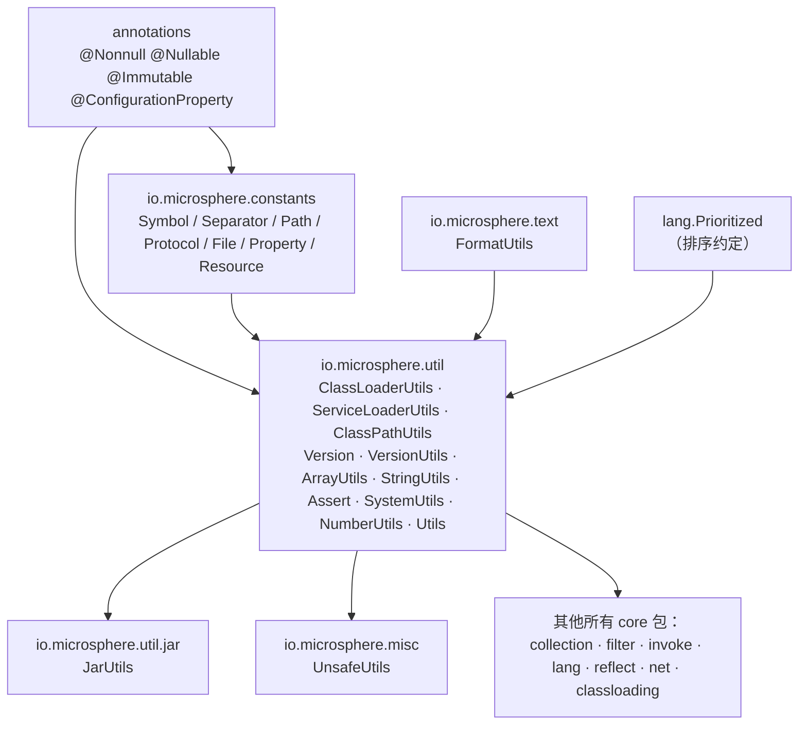
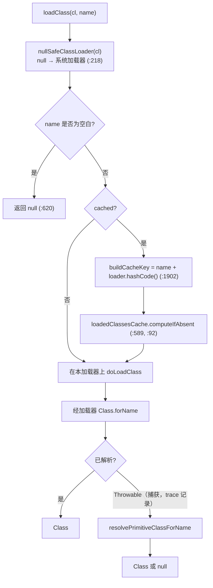
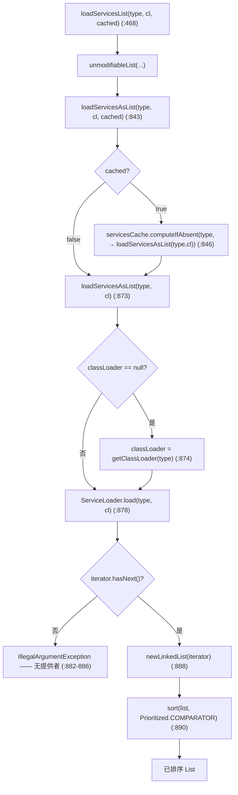
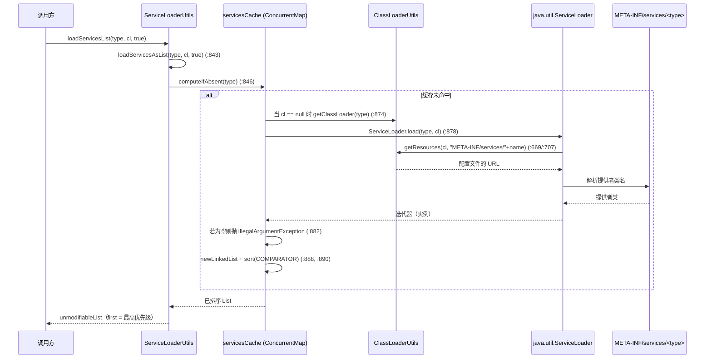
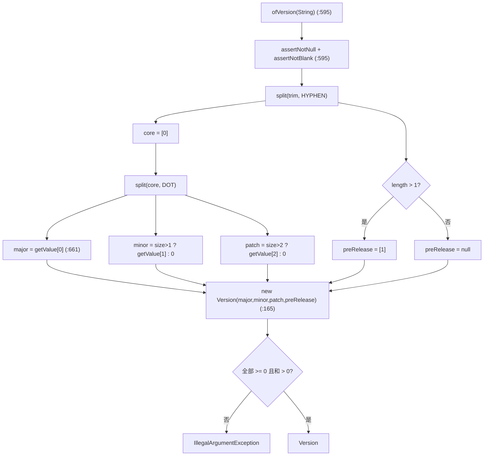

# 工具类、常量与文本 —— 开发者指南

模块：`io.github.microsphere-projects:microsphere-java-core` · `0.3.20-SNAPSHOT`（`release` 分支）
包：`io.microsphere.util`（34）· `io.microsphere.util.jar`（1）· `io.microsphere.constants`（8）·
`io.microsphere.text`（1）· `io.microsphere.misc`（1）—— 共 45 个主类型 · Java 8 基线，CI 覆盖 JDK 8 / 11 / 17 / 21 / 25

下文使用的路径前缀：`microsphere-java-core/src/main/java/io/microsphere/`（源码）、
`microsphere-java-core/src/main/resources/`（SPI 文件）与 `microsphere-java-core/src/test/java/io/microsphere/`
（测试）。完整路径只给出一次，之后缩短为最后两段（例如 `util/ClassLoaderUtils.java`）。

---

## 1. 本切片在架构中的位置

本组是**基础层（Foundation layer）**：其中没有任何类型依赖其他 `io.microsphere.*` 包，除了
`io.microsphere.constants`、`io.microsphere.util`（包内）以及注解模块。其上层的一切 —— `collection`、`filter`、
`invoke`、`lang`、`reflect`、`net`、`classloading`、`event` —— 都向下导入到它。

值得精确点名的两个入向依赖：

* **`lang.Prioritized`** —— `ServiceLoaderUtils` 用 `Prioritized.COMPARATOR` 对每个提供者列表排序
  （`util/ServiceLoaderUtils.java:890`）；该比较器从 `io.microsphere.lang` 导入。这是本切片在*行为*上唯一依赖的跨包
  契约，因此 `loadServices*` 的结果依赖于 `Prioritized` 位于 `lang` 中（见[语言抽象](language-abstractions.md)）。
* **`text.FormatUtils`** 被 `ServiceLoaderUtils` *用于*构造其“无提供者”消息
  （`util/ServiceLoaderUtils.java:884`），也被 `Version`（`util/Version.java`）使用；因此 `text` 是一个被 `util`
  包调用的叶子 —— 它必须保持不含向上导入。

向外被消费同样成立：`classloading.ArtifactDetector` 由 `ClassLoaderUtils.findAllClassPathURLs`
（`util/ClassLoaderUtils.java:1550-1564`）驱动，而 `Version.ofVersion(Class)` 会构建一个 `ArtifactDetector` 来解析
库版本（`util/Version.java:626-640`）—— 见[类加载与构件](classloading-and-artifacts.md)。

---

## 2. 包 / 类映射

| 类型 | 类别 | 职责 | 关键钩子 |
|---|---|---|---|
| `Utils` | 标记接口 | 以惯例标识一个工具类 | `util/Utils.java`（空） |
| `ClassLoaderUtils` | 工具类 | 跨加载器层级的类 + 资源解析；classpath 变更 | `loadClass`（`:547`）、`getResource`（`:783`）、`ResourceType`（`:1931`） |
| `ServiceLoaderUtils` | 工具类 | `ServiceLoader` 门面：发现、`Prioritized` 排序、可选缓存 | `loadServicesList`（`:468`）、`loadServicesAsList`（`:843`、`:873`） |
| `ClassPathUtils` | 工具类 | 引导/应用 classpath 快照、运行时类位置 | `getBootstrapClassPaths`（`:127`）、`getRuntimeClassLocation`（`:207`） |
| `Version` | 值对象 | 不可变、可比较的类 semver 模型 | `ofVersion(String)`（`:595`）、`Operator`（`:671`）、`compareTo`（`:372`） |
| `VersionUtils` | 工具类 | JDK 版本常量 + 比较助手 | `CURRENT_JAVA_VERSION`（`:44`）、`detectJavaMajorVersion`（`:284`） |
| `ArrayUtils` | 工具类 | 带类型的空数组、工厂、查找、反转 | `of`（`:211`）、`contains`（`:1887`、`:1911`、`:2096`）、`reverse`（`:2162`） |
| `StringUtils` | 工具类 | 空白判断、`split`、`contains`、索引/替换 | `isBlank`（`:81`）、`split`（`:137`、`:163`） |
| `Assert` | 工具类（抛异常） | 前置条件守卫；**不是** `Utils` | `assertNotNull`（`:131`）、`assertNoNullElements`（`:348`） |
| `SystemUtils` | 工具类 | OS/JDK 标志、系统属性访问、编码常量 | `IS_JAVA_8`（`:357`）、`getSystemProperty`（`:605`） |
| `NumberUtils` | 工具类（空） | 预留占位 —— **无公有方法** | `util/NumberUtils.java` |
| `text.FormatUtils` | 工具类 | `{}` 占位符替换 | `format`（`text/FormatUtils.java:38`） |
| `util.jar.JarUtils` | 工具类 | `URL`→`JarFile`、条目过滤、清单路径 | `toJarFile`（`:86`）、`filter`（`:193`）、`MANIFEST_RESOURCE_PATH`（`:63`） |
| `misc.UnsafeUtils` | 工具类 | `sun.misc.Unsafe` 句柄 + 字段/数组偏移 | `getUnsafe`（`:564`）、`offsetCache`（`:559`） |
| `constants.*` | 常量接口 | 共享字面量，由 `Constants` 聚合 | `constants/Constants.java:13-14` |

---

## 3. 加载 / 解析算法的源码分析

### 3.1 类加载器层级遍历（`ClassLoaderUtils`）

最底层的原语是 `nullSafeClassLoader(classLoader)`（`util/ClassLoaderUtils.java:218`）：`null` 加载器在这里绝不抛异常
—— 它被系统类加载器替代。在其之上，`getDefaultClassLoader()`（`:244`）按顺序尝试：**线程上下文**加载器 → 加载了
`ClassLoaderUtils` 自身的加载器 → 默认加载器。`getClassLoader(loadedClass)`（`:298`）返回某个类自身的加载器，或
（对于引导加载器加载、其 `getClassLoader()` 为 `null` 的类）通过调用方栈帧回退。

完整的祖先链由 `getInheritableClassLoaders(classLoader)`（`:1069`）构建，它委派给 `doGetInheritableClassLoaders`
（`:1092`）：先用该加载器播种一个 `LinkedHashSet`，然后沿 `getParent()` 一路跟进直到 `null` —— 因此集合按
**子 → … → 引导** 排序，并以不可修改形式返回。`findLoadedClass`（`:497`）与 `loadClass`（`:547`）利用这一排序，在
尝试全新加载之前先查找一个已定义的类。

该捕获刻意针对 `Throwable`（而非 `Exception`），且仅在 trace 级别记录（`:620`）：来自半成品链接类的
`NoClassDefFoundError` 会与真正的未命中一样降级为 `null`。其后果（user guide 陷阱 9）是 `null` 含义含糊 —— 它意味着
“此处没有”，而非“不存在”。

### 3.2 资源解析顺序与 `ResourceType`

`getResource(classLoader, resourceName)`（`:783`）是*无类型*入口：它按声明顺序遍历 `ResourceType.values()` ——
`DEFAULT`、`CLASS`、`PACKAGE`（`:1931`）—— 并返回**第一个**加载器命中。带类型的变体
`getResource(classLoader, resourceType, resourceName)`（`:843`）跳过那次扫描、锁定一个 `ResourceType`，前提是
`resourceType.resolve(name)` 规范化了键且 `nullSafeClassLoader` 修正了加载器。`getResources(...)`（`:669`、`:707`）
是复数形式，也是唯一声明 `IOException` 的一个（它调用 `loader.getResources`）。

`ResourceType` 是一个逐常量的**策略**：每个值回答 `supports(name)` 与 `normalize(name)`：

| 常量 | `supports` | `normalize` | 证据 |
|---|---|---|---|
| `DEFAULT` | 始终 `true` | 恒等 | `util/ClassLoaderUtils.java:1945` |
| `CLASS` | 点分式类名或 `*.class` | 点号 → 斜杠，保留 `.class` | `:1983` |
| `PACKAGE` | 不含 `/` 或 `\`、非 `*.class` | 点分包名形式 | `:2030` |
| `resolve(name)` | 对空白 / 不支持返回 `null` | `normalize` → `normalizePath` → 去掉前导 `/` | `:2086` |

因为当某类型不适用时 `resolve` 返回 `null`，带类型的 `getResource`（`:843`）便直接产出 `null` 而非以畸形名去搜索
—— 那次 null 检查*就是*类型守卫，也正是为何 `CLASS` 从不匹配包路径、`PACKAGE` 从不匹配 `.class` 文件。

`getClassResource`（`:1035`）是一个薄薄的特化：它在二进制名后追加 `.class` 并强制 `ResourceType.CLASS`，因此
`getClassResource(cl, Foo.class)` 恰好解析出一个加载器可见的 `Foo.class`。

### 3.3 服务加载：缓存、排序，以及“空即抛”

`loadServicesList` 的各重载汇流到一处。公有入口 `loadServicesList(serviceType, classLoader, cached)`（`:468`）把
结果包装进 `unmodifiableList`，并委派给包级私有的 `loadServicesAsList(serviceType, classLoader, cached)`（`:843`）：

测试锁定的两个分支级事实：

* **空意味着抛异常，而非空列表。** `loadServicesAsList(type, cl)` 显式检查 `!iterator.hasNext()` 并抛出
  `IllegalArgumentException`，其消息由 `FormatUtils.format` 构造（`:882-886`、`:884`）。默认的 `cached` 值是
  `SERVICE_LOADER_CACHED`（`:411`），它本身在类初始化时从 `-Dmicrosphere.service-loader.cached` 读取一次
  （`:112`、`:138`，`:107` 处默认 `"false"`）。
* **排序依据 `Prioritized`，绝不依据文件顺序。** `sort(serviceList, COMPARATOR)`（`:890`）在加载后重新排序；
  `ServiceLoader` 配置文件的顺序无关紧要。随后 `loadFirstService` / `loadLastService`（`:602`、`:719`）返回该有序列表
  的 `ListUtils.first/last`，而 `loadService`（`:828`）用一个布尔标志在 first/last 间选取。

### 3.4 一次代表性的端到端调用：带缓存、有序的服务加载

注意缓存**键仅为服务类型**（`:846`）；`classLoader` 被 lambda 捕获却未混入键中，因此两个不同加载器请求同一类型会共享
同一个缓存列表。这正是 user guide 中记为陷阱 2 的行为。

### 3.5 版本解析规则

`Version.ofVersion(String)`（`util/Version.java:595`）执行两次切分：

1. `split(version.trim(), HYPHEN)` → `[0]` 是数字核心，`[1]`（若长度 > 1）是预发布标签。
2. `split(core, DOT)` → `major = getValue[0]`；`minor = size > 1 ? getValue[1] : 0`；`patch = size > 2 ? getValue[2] : 0`；
   超出三段的其余段被忽略。

`getValue(String)`（`:661`）先 trim 再 `parseInt`；`NumberFormatException` 被重抛为
`IllegalArgumentException("contains the non-number part")`。构造函数（`:165`）断言每段 ≥ 0 且
`major+minor+patch > 0`，因此 `Version.of(0,0,0)` 被拒绝（`IllegalArgumentException`）。比较由 `compareTo`（`:372`）
完成 —— 先 major，再 minor，再 patch，最后 `comparePreRelease`（`:403`），其中 `null` 预发布排在任何非空标签**之后**
（`1.2.3 > 1.2.3-alpha > 1.2.3-beta`，且 beta/alpha 仅在词典序比较的范围内成立）。`Operator.of(symbol)`（`:766`）把
五个字符串运算符 `"=" < "<=" > ">="`（由 `SymbolConstants` 支撑）映射到 `EQ/LT/LE/GT/GE` 枚举（`:671`）；其余一律抛
`IllegalArgumentException`。`ofVersion(Class)`（`:626-640`）在类的加载器为 `null`（引导）时回落到当前运行的 JDK
（`VersionUtils.CURRENT_JAVA_VERSION`），并在检测到的构件不带版本时抛 `IllegalArgumentException`。

数字核心与预发布标签按**第一个**连字符切分，因此 `7.8.9-RC1` 完整保留了 `RC1`（`util/VersionTest.java:331`）。超出三个
的点分段被静默丢弃，这使得 `ofVersion` 能够容忍携带额外点号的 Maven 式限定符 —— 限定符文本根本不会到达 `getValue`。

### 3.6 跨 JDK 的 classpath 与 JAR 清单读取

`ClassPathUtils` 在类初始化时一次性计算两个 `static final` 快照。`initBootstrapClassPaths`（`:68`）调用
`resolveClassPaths(runtimeMXBean.isBootClassPathSupported(), this::getBootClassPath)`；在 JDK 9+ 上该布尔为 `false`，
于是 `resolveClassPaths(boolean, Supplier)`（`:94`）短路返回 `emptySet()`，只有 `java.home` 包含启发式（在上游
`classloading` 中使用）仍在过滤 JDK 库。`initClassPaths`（`:73`）始终通过 `resolveClassPaths(String)`（`:103`）以
`PATH_SEPARATOR` 切分 `getClassPath()`。

在归档侧，`JarUtils.toJarFile(URL)`（`util/jar/JarUtils.java:86`）先调用 `resolveJarAbsolutePath(url)`（`:168`）——
后者通过 `net.URLUtils` 解析出所在文件 —— 再打开一个 `JarFile`；缺失的归档会记录 `IOException` 并返回 `null`，而
`null` URL 抛 `NullPointerException`、非 `jar`/`file` 协议在 `assertJarURLProtocol`（`:111`）抛
`IllegalArgumentException`。`filter(jarFile, JarEntryFilter)`（`:193`）对 `null` jar 返回共享的 `emptyList()`。清单本身
由 `MANIFEST_RESOURCE_PATH = "META-INF/MANIFEST.MF"` 常量（`:63`）寻址，`classloading` 解析器经由本工具类读取它。

`SystemUtils` 通过 `matchesJavaVersion(prefix)`（`:638`）从 `java.specification.version` 读取 JDK 身份，因此
`IS_JAVA_8` = `matchesJavaVersion("1.8")`（`:357`）独立于 `VersionUtils.CURRENT_JAVA_VERSION`，后者解析 `java.version`
（`util/VersionUtils.java:266`）。`getSystemProperty(key, default)`（`:605`）先查缓存副本，再查 `System.getProperty`，
并在抛出 `SecurityException` 时记录一条警告后返回默认值 —— 属性访问从不传播安全失败。

### 3.7 降级策略：返回中性值 vs. 抛异常

本切片的核心设计规则是：查找类 API **降级**（返回 `null`、空/不可变集合，或中性的 `boolean`）而非抛异常 —— 但该规则
有一套已被文档化、可枚举的例外。把握这一边界是调用方的主要风险，因此在此逐方法编目：

| 方法 | 输入缺失 / 非法 → | 实际抛出条件 | 证据 |
|---|---|---|---|
| `ClassLoaderUtils.doLoadClass` | `null` | ——（捕获 `Throwable`，trace 记录） | `util/ClassLoaderUtils.java:620` |
| `ClassLoaderUtils.getResource` | `null` | —— | `:783`、`:843` |
| `ClassLoaderUtils.getResources` | 空 `Set` | 声明的 `IOException` / `NullPointerException` | `:669`、`:707` |
| `ClassLoaderUtils.newURLClassLoader` | —— | `IllegalArgumentException`（URL 元素为 null） | `:1667` |
| `ServiceLoaderUtils.loadServices*` | **抛异常** | 零提供者时 `IllegalArgumentException` | `:882-886` |
| `ServiceLoaderUtils.getServiceClasses(…, true)` | **抛异常** | 无法加载 / 不可赋值时 `IllegalStateException` | `:262`、`:270`、`:276` |
| `ClassPathUtils.getBootstrapClassPaths` | 空 `Set`（JDK 9+） | —— | `:68`、`:94` |
| `StringUtils.split` | `EMPTY_STRING_ARRAY` / 单元素 | —— | `:163` |
| `ArrayUtils.contains(int[],…)` | 数组为 `null` → `false` | ——（但未排序时结果错误） | `:1911` |
| `Version.ofVersion(String)` / `getValue` / `ofVersion(Class)` | —— | `IllegalArgumentException` | `util/Version.java:595`、`:661`、`:626-640` |
| `Assert.*` | —— | `IllegalArgumentException` / `ArrayIndexOutOfBoundsException` | `util/Assert.java:60-449` |
| `FormatUtils.format(null, …)` | `null` | —— | `text/FormatUtils.java:62` |
| `JarUtils.toJarFile(missing)` | `null` | `NullPointerException`（null URL）/ `IllegalArgumentException`（错误协议） | `util/jar/JarUtils.java:86`、`:111` |
| `UnsafeUtils` 静态初始化 | —— | `UnsupportedOperationException` → `ExceptionInInitializerError` | `misc/UnsafeUtils.java:564`、`:570-572` |

该模式是一致可预测的：**解析与查找类 API 降级；构造、解析与断言类 API 抛异常。** `loadServices*` 家族是唯一令人意外的
例外 —— 一个会抛异常的*加载*类 API —— 因为空的 `META-INF/services` 文件被当作配置错误，而非合法的“无提供者”状态。

---

## 4. 设计模式（含实现类）

| 模式 | 实现类 | 证据 |
|---|---|---|
| **标记接口 + 静态门面** | `Utils` 被 `ClassLoaderUtils`、`ServiceLoaderUtils`、`ClassPathUtils`、`ArrayUtils`、`StringUtils`、`SystemUtils`、`VersionUtils`、`text.FormatUtils`、`util.jar.JarUtils`、`misc.UnsafeUtils` 采用 | `util/Utils.java`（空）；每个都是 `abstract` + 私有构造函数 |
| **门面（带委派）** | `ClassLoaderUtils` 呈现 classpath 读/改能力，同时委派给 `URLClassPathHandle` SPI | 静态 `urlClassPathHandle`（`util/ClassLoaderUtils.java:94`），用于 `:1550-1564`、`:1598-1603` |
| **懒汉持有 / 良性竞争缓存** | `loadedClassesCache`（`:92`）、`servicesCache`（`:140` → `computeIfAbsent` `:846`）、`UnsafeUtils.offsetCache`（`:559`） | `ConcurrentHashMap` 的 `computeIfAbsent` —— 可能重复计算，但无损坏 |
| **空对象 / 中性值降级** | `doLoadClass` 在任何 `Throwable` 时返回 `null`（`:620`）；`getResourceAsString` 对缺失资源返回 `null`（`:875`）；JDK 9+ 上 `ClassPathUtils` 的 `NoOp` 式空集（`:94`） | `util/ClassLoaderUtils.java:620`、`:875`；`util/ClassPathUtils.java:94` |
| **策略（按资源种类）** | `ResourceType.DEFAULT / CLASS / PACKAGE` 各实现 `supports` + `normalize`，由 `getResource` 重载选择 | `util/ClassLoaderUtils.java:1931`、`:1945`、`:1983`、`:2030`、`:2086` |
| **值对象 + 规约** | `Version`（`@Immutable`、`Comparable`、`Serializable`）配 `equals`/`hashCode`（`:326`、`:346`）与作为 `BiPredicate` 规约的 `Operator`（`:671`） | `util/Version.java:95-102`、`:220-317`、`:671` |
| **工厂方法** | `Version.of/ofVersion(...)`（`:441`、`:595`）、`ArrayUtils.of/ofArray`（`:211`、`:375`）、`ClassLoaderUtils.newURLClassLoader`（`:1667`） | 见引用行 |
| **常量接口组合** | `Constants` `extends` 六个字面量接口，使消费者可 `import static Constants.*` | `constants/Constants.java:13-14` |
| **经由比较运算符的模板** | `Operator.EQ/LT/LE/GT/GE.test(v1, v2)` 把 `null` 与同一性处理围绕 `compareTo` 集中化 | `util/Version.java:671` |

> [!NOTE]
> `Assert` 是 `Utils` 约定的刻意**反模式**（抛异常而非降级，且不 `implement Utils`），而 `NumberUtils` 是刻意的**空**
> 工具类 —— 一个保留了 `implements Utils` 标记、却不暴露任何行为的占位类（`util/Assert.java`、`util/NumberUtils.java`）。
> 两个例外都反证了规则。

---

## 5. 扩展点

* **为任意 SPI 类型提供更多实现。** `ServiceLoaderUtils` 经 `ClassLoaderUtils` 读取 `META-INF/services/<fqcn>`
  （`SERVICES_PROVIDER_LOCATION` `util/ServiceLoaderUtils.java:119`，模式 `:127`），因此下游模块只需在自己的
  `META-INF/services` 文件里加一行即可添加一个提供者 —— core 库自带十三处这样的注册。要影响*哪个*提供者被最先选取，
  请实现 `io.microsphere.lang.Prioritized` 并返回更小的 `getPriority()`；`sort(COMPARATOR)`（`:890`）会尊重它，而文件
  顺序无关紧要。
* **全局切换服务缓存。** 设置 `-Dmicrosphere.service-loader.cached=true`（`:112`，在类初始化 `:138` 读取）可让
  `SERVICE_LOADER_CACHED` 成为两参数重载上 `cached` 标志的默认值（`:411`）。需要按加载器隔离的调用方仍应显式传
  `cached = false`，因为缓存键忽略加载器（`:846`）。
* **接入新的 classpath 读取器。** `ClassLoaderUtils` 不亲自读取 `sun.misc.URLClassPath`；它持有
  `ServiceLoadingURLClassPathHandle` 门面（`:94`），后者选择一个 `URLClassPathHandle` SPI 实现。支持未来的加载器是一处
  `classloading` 包的改动，但*接缝位于此处* —— `findAllClassPathURLs`（`:1550-1564`）与 `removeClassPathURL`
  （`:1598-1603`，仍要求 `SecureClassLoader`）是每个调用方都汇聚而过的入口点。
* **不触碰工具类即可添加字面量。** `constants` 接口是纯粹的“靠追加来扩展”：新分隔符归 `SeparatorConstants`，新协议归
  `ProtocolConstants`，而聚合接口 `Constants`（`constants/Constants.java:13-14`）会自动为通配导入者纳入它。
* **资源种类规范化可按调用扩展。** 向 `getResource(cl, type, name)`（`:843`）显式传入一个 `ResourceType`，是覆盖无类型
  重载（`:783`）之 `DEFAULT → CLASS → PACKAGE` 探测顺序的受支持方式；当所选类型不适配该名称时 `resolve` 返回 `null`
  （一次干净的未命中，`:2086`）。

---

## 6. 线程安全与性能

* **`loadedClassesCache`** 是 `new ConcurrentHashMap<>(256)`（`util/ClassLoaderUtils.java:92`），由
  `loadClass(...,true)`（`:589`）中的 `computeIfAbsent` 填充。键为 `className + classLoader.hashCode()`（`:1902`）：
  良性竞争只会重复一次加载；正确性依赖于 `hashCode` 稳定，而跨加载器的 `hashCode` 碰撞会错误地共享一个缓存类 —— 这可以
  接受，因为加载器很少碰撞，但正是缓存以（名称, 加载器）对为键的原因。
* **`servicesCache`** 是 `ConcurrentMap<Class<?>, List<?>>`（`:140`），由 `computeIfAbsent`（`:846`）填充。*值*列表在
  边界处以不可修改方式包装（`:469`），因此被发布的列表可安全共享；加载器不属于键的一部分（见 §3.3）。加载成本为
  O(提供者数) 加每次缓存未命中的一次 `Prioritized` 排序。
* **`UnsafeUtils.offsetCache`** 是 `ConcurrentHashMap<String,Long>`（`misc/UnsafeUtils.java:559`），记忆字段偏移量；
  `getUnsafe()`（`:564`）在静态初始化器中运行一次，其失败会变成 `ExceptionInInitializerError`（`:570-572`）—— 因此
  最危险的时刻是对该类的首次触碰，而非任何调用点。
* **不可变快照。** `ClassPathUtils.bootstrapClassPaths` / `classPaths`（`util/ClassPathUtils.java:61`、`:64`）以及全部
  `SystemUtils` 的 `IS_JAVA_*` / 属性值常量（`util/SystemUtils.java:347-517`）都是 `static final`、仅计算一次 —— 读取它们
  零成本，但它们在运行期永不刷新（一项灵活性代价）。
* **`SystemUtils.systemPropertiesCopy` *并非* volatile。** 它是一个普通的 `private static Map<String,String>`（`:528`）；
  `copySystemProperties()` 以 `SystemUtils.class` 为锁同步（`:548`），但在那把锁之外抓取副本的读者（`getSystemProperty`，
  `:605`）依赖于该 map 已被发布。请仅通过同步路径变更系统属性。
* **`Version` 完全不可变**（`@Immutable`，全 final 状态，`:95-102`）并带 `equals`/`hashCode`（`:326`、`:346`），因此可
  安全发布、可用作 map 键；`compareTo`（`:372`）不分配对象。
* **数组查找。** `ArrayUtils.contains` 对数值基本类型使用 `Arrays.binarySearch`（`:1911-2069`）—— O(log n)，但**仅在
  已排序数据上正确**；`boolean[]`/`Object[]` 重载是 O(n) 线性扫描（`:1887`、`:2096`）。`reverse(T[])`（`:2162`）原地
  进行，且对 `null` 数组抛 `NullPointerException`。
* **未缓存的服务加载会分配。** 每次非缓存的 `loadServicesAsList` 都构造一个 `LinkedList` 并排序（`:888`、`:890`）；
  在循环内请优先使用 `cached = true` 重载，或将结果外提。

---

## 7. 测试策略

位置：`microsphere-java-core/src/test/java/io/microsphere/{util,constants,text,misc}/`。测试为 JUnit 5
（`org.junit.jupiter.api.Test`）；需要记录器的测试继承 `LoggingTest`（如 `ServiceLoaderUtilsTest`、`JarUtilsTest`）。

* **两种 `java.version` 方案都被断言，而非假设。** `VersionUtilsTest.testDetectJavaMajorVersion` 锁定新式
  （`"17.0.0"` → `"17"`）*与*旧式（`"1.8.0"` → `"8"`）*与*无点号情形（`"1"` → `"1"`）
  （`util/VersionUtilsTest.java:142-150`）；`testTestCurrentJavaVersion` 与 `CURRENT_JAVA_VERSION` 比较而非硬编码字面量
  （`:110-113`）—— 这正是同一套测试能在 8/11/17/21/25 上保持通过的原因。
* **“降级 vs 抛异常”边界被显式锁定。** `ServiceLoaderUtilsTest` 断言一个无提供者的类型在每一种
  `loadServicesList`/`loadServices`/`loadFirstService`/`loadLastService` 形态下都抛 `IllegalArgumentException`
  （`util/ServiceLoaderUtilsTest.java:107-112`、`:139-143`、`:170-174`、`:200-205`），并断言 `getServiceClasses` 在
  `failFast=true` 时抛 `IllegalStateException`、在 `failFast=false` 时降级为空集（`:59-69`）。`ClassLoaderUtilsTest`
  确认类/资源查找对 `null`/空白/缺失输入降级为 `null`（`util/ClassLoaderUtilsTest.java:345-376`、`:438`）。
* **`Prioritized` 排序通过真实 fixture 得到验证。** 测试套件注册两个 `EventListener` 提供者，并断言 `loadFirstService`
  产出 `EchoEventListener2`、而 `loadLastService` 产出 `EchoEventListener`（`util/ServiceLoaderUtilsTest.java:211-232`）——
  直接证明了 `util/ServiceLoaderUtils.java:890` 处的排序，而非 `META-INF/services` 文件顺序。
* **`Version` 语义以边界优先的方式覆盖。** `VersionTest` 断言与 null 比较返回 `false` 而非抛异常（`:218-221`）、预发布
  排序（`:213-215`）、`ofVersion(Class)` 对 jsr305 类返回 `"3.0.2"`、对引导类返回 `CURRENT_JAVA_VERSION`（`:124-132`），
  以及对无版本元数据的类抛 `IllegalArgumentException`（`:134-137`、`:321-324`）。
* **`JarUtils` 有意混合返回与抛异常，且测试逐一检查。** `JarUtilsTest` 断言有效归档产出 `JarFile`、缺失者产出 `null`、
  错误协议抛 `IllegalArgumentException`、`null` URL 抛 `NullPointerException`（`util/jar/JarUtilsTest.java:104-125`），
  外加 `filter(null, null)` == `emptyList()`（`:99-102`）。
* **`StringUtils` / `Assert` / `FormatUtils` 覆盖文本原语。** `StringUtilsTest.testSplit` 验证空值安全、`null` 分隔符下的
  单元素行为、以及空 token 的保留，并交叉检查 char 与 string 两个重载结果一致（`util/StringUtilsTest.java:89-124`）；
  `FormatUtilsTest` 锁定多余/不足的占位符情形（`text/FormatUtilsTest.java:34-53`）。
* **在此编写新测试的方法。** 对一个 SPI 类型，往 `src/test/resources/META-INF/services/...` 加一行提供者，并实现
  `Prioritized` 以断言排序。对降级行为，针对一个不存在的资源断言 `null`/空；对抛异常路径，用 `assertThrows` 包裹。优先
  使用测试 classpath 上已存在的 fixture —— 标准的一个是 `javax.annotation.Nullable` → 版本 `3.0.2`
  （`util/VersionTest.java:124-128`）。

---

## 8. 需要留意的已知限制

* **来自 `ClassLoaderUtils` 的 `null` 含义含糊。** 空白名、被捕获的 `Throwable`、以及真正的未命中都返回 `null`
  （`util/ClassLoaderUtils.java:620`）；不开启 trace 日志，调用方无法区分它们。
* **服务缓存对加载器“视而不见”。** `servicesCache` 仅以类型为键（`:846`），因此对呈现同一类型的隔离加载器，缓存是不安全
  的 —— 请传 `cached = false`。
* **`getAllLoadedClassesMap` 错误归属加载器。** 其循环把每个可继承加载器都映射到*调用方提供的*加载器的已加载类
  （`util/ClassLoaderUtils.java:1142-1144`）；不要把它的值当作逐加载器的。
* **JDK 9+ 的引导 classpath 始终为空。** 超过 JDK 8 时 `ClassPathUtils.getBootstrapClassPaths()` 产出 `emptySet()`
  （`:68`、`:94`），因此任何基于它的“这是否是 JDK 库？”检查都会静默降级到 `java.home` 启发式。
* **`sun.misc.Unsafe` 是类加载期的风险。** 在 `sun.misc.Unsafe` 已被移除的 JDK 上，`UnsafeUtils` 可能在静态初始化期间以
  `ExceptionInInitializerError` 失败（`misc/UnsafeUtils.java:570-572`）—— 它必须被惰性/有条件地触碰，绝不能在跨 JVM 共享
  的热路径中急切加载。
* **`NumberUtils` 不提供任何功能。** 它是一个带标记却为空的工具类（`util/NumberUtils.java`）；不要依赖它，也不要把它的
  存在当作一项 API。

---

## 9. 另请参阅

* [工具类、常量与文本 —— 用户指南](../../../user-guide/microsphere-java-core/zh/util-and-constants.md) —— 同一批源码面向使用者的视角
* [类加载与构件](classloading-and-artifacts.md) —— `ClassLoaderUtils` 所委派的 `URLClassPathHandle` SPI，以及 `Version.ofVersion(Class)` 使用的 `ArtifactDetector`
* [集合与过滤器](collections-and-filters.md) —— 服务排序所用的 `Lists`/`Sets`/`Prioritized`
* [语言抽象](language-abstractions.md) —— `io.microsphere.lang.Prioritized`，排序约定
