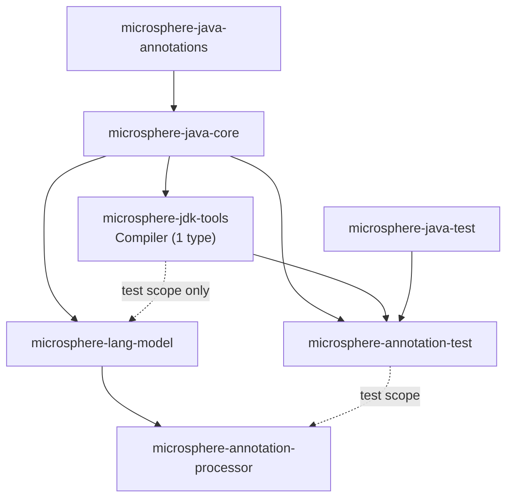
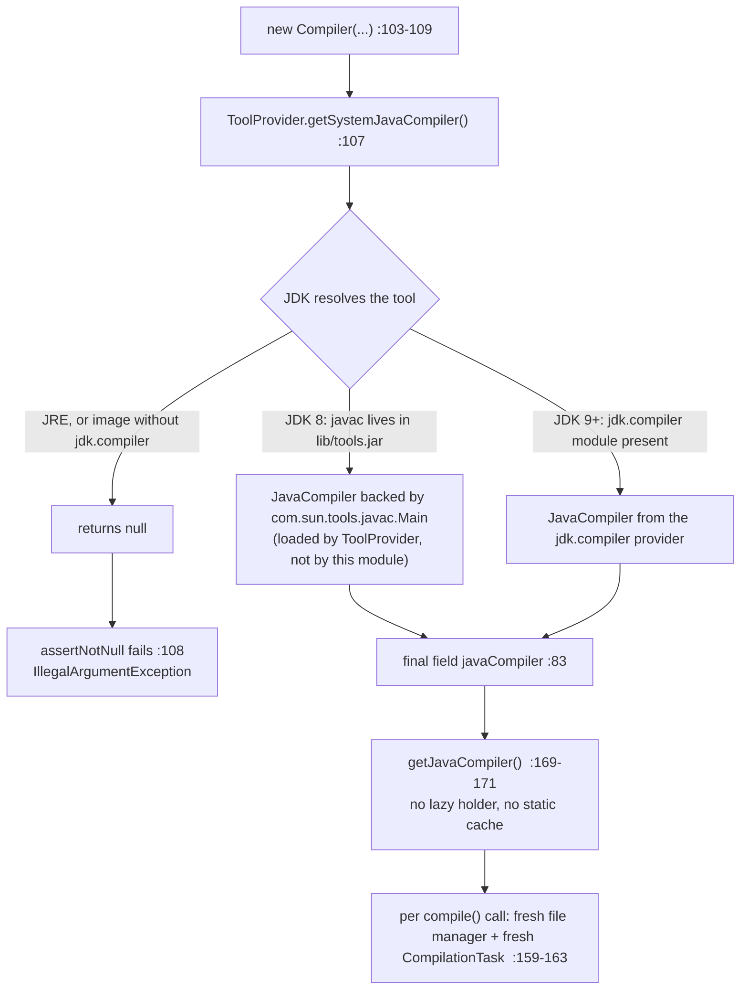
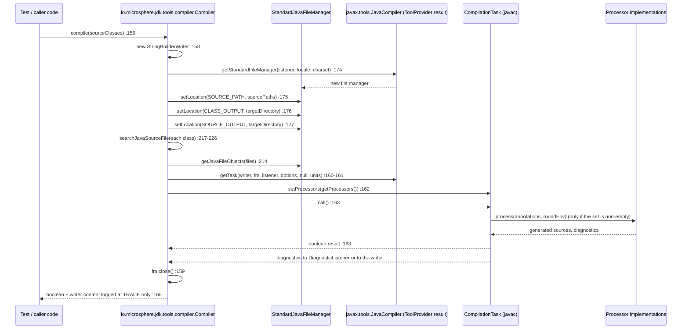

# JDK Tools: In-Process Compilation — Developer Guide

Module: `io.github.microsphere-projects:microsphere-jdk-tools` · `0.3.20-SNAPSHOT` (`release`, published as `0.3.20`)
One main type (`io.microsphere.jdk.tools.compiler.Compiler`) · one test type (`CompilerTest`) · CI on JDK 8 / 11 / 17 / 21 / 25

Path prefixes used below: `src/main/java/io/microsphere/jdk/tools/compiler/` and
`src/test/java/io/microsphere/jdk/tools/compiler/` inside `microsphere-jdk-tools/`; core classes are cited as
`microsphere-java-core/src/main/java/io/microsphere/…`.

---

## 1. Architecture position

`microsphere-jdk-tools` is the **portability shim** of the annotation-processing stack: the single place where the
project turns `Class` objects into a `javac` run. Everything above it (`microsphere-annotation-test`,
`microsphere-annotation-processor`) is written against `javax.tools` types that this module obtains and configures.
The shim is deliberately dumb — one class, no SPI, no service file, no `module-info.java`, no resources, and no build
configuration of its own.



Every edge, verified against a POM:

| Edge | Scope | Evidence |
|---|---|---|
| `jdk-tools → core` | compile | `microsphere-jdk-tools/pom.xml:26` (`<version>${revision}</version>` at `:27`) |
| `lang-model → jdk-tools` | **test** | `microsphere-lang-model/pom.xml:46`, `<scope>test</scope>` `:48` |
| `annotation-test → jdk-tools` | compile | `microsphere-annotation-test/pom.xml:33` |
| `annotation-processor → jdk-tools` | **absent** | the module's dependency list is core (`microsphere-annotation-processor/pom.xml:26`) + lang-model (`:33`) + test-scoped annotation-test (`:53`) |
| `annotation-processor → lang-model` | compile | `microsphere-annotation-processor/pom.xml:33` |
| version managed for consumers | — | `microsphere-java-dependencies/pom.xml:38` |
| reactor order | — | root `pom.xml:57-67` (`microsphere-jdk-tools` at `:62`) |

Test-scope dependencies of the module itself: `junit-jupiter` (`microsphere-jdk-tools/pom.xml:31-41`),
`microsphere-java-test` (`:44-49`), `mockito-core` (`:52-56`), `logback-classic` (`:59-63`). Everything from line 30
downward is test scope; the module has **one** compile dependency.

> [!NOTE]
> Two of those test dependencies are unused by the code that is actually there: `CompilerTest` imports no Mockito type
> and nothing from `io.microsphere.test` (`CompilerTest.java:1-28`), while `mockito-core` is declared at
> `microsphere-jdk-tools/pom.xml:52-56` and `microsphere-java-test` at `:44-49`. Same story for `lang-model`'s
> test-scoped dependency on this module — no source or test in `microsphere-lang-model` references `Compiler`.

---

## 2. The type, member by member

### 2.1 Fields (`Compiler.java:74-93`)

| Field | Declaration | Notes from the source |
|---|---|---|
| `logger` | `private static final Logger logger = getLogger(Compiler.class)` (`:74`) | core facade; the backend `LoggerFactory` is chosen once in a static initializer of `LoggerFactory` (`microsphere-java-core/src/main/java/io/microsphere/logging/LoggerFactory.java:73`, `:98`), so the field itself is not a lookup risk |
| `DEFAULT_OPTIONS` | `public static final String[] … = ofArray("-parameters", "-Xlint:-unchecked", "-nowarn", "-Xlint:deprecation")` (`:76-77`) | a **public mutable array** constant — `Compiler.DEFAULT_OPTIONS[0] = "-g"` is legal Java and rewrites the default for every instance in the JVM; the constructor installs the same array contents via `ofList` (`:104`, `:112`) |
| `sourcePaths` | `private final Set<File> sourcePaths` (`:79`) | `final` reference to a **mutable** `LinkedHashSet` (`SetUtils.newLinkedHashSet(E…)`, `microsphere-java-core/src/main/java/io/microsphere/collection/SetUtils.java:568`), insertion-ordered; `final` protects nothing here since `:117` mutates it |
| `targetDirectory` | `private final File targetDirectory` (`:81`) | never null-checked; `null` reaches `singleton(null)` at `:176` |
| `javaCompiler` | `private final JavaCompiler javaCompiler` (`:83`) | the only thread-safely published field; assigned once at `:107` |
| `processors` | `private Set<Processor> processors` (`:85`) | starts `null` (`getProcessors()` maps that to `emptySet()`, `:201-207`) |
| `options` | `private List<String> options` (`:87`) | set to `DEFAULT_OPTIONS` by every constructor (`:104`); reassignable to `emptyList()` by `options()` (`:112`) |
| `diagnosticListener` | `:89` | `null` until `diagnosticListener(...)`; `null` is legal for both `getTask` and `getStandardFileManager`, so diagnostics then go only to the writer |
| `locale` | `:91` | `null` = JVM default locale for file-manager/diagnostics localisation |
| `charset` | `:93` | `null` = platform default encoding (see §4.3) |

Construction order matters: `Compiler(File,File)` (`:103-109`) calls the **overridable** `options(...)` (`:104`)
before assigning `sourcePaths`, `targetDirectory` and `javaCompiler`. A subclass that overrides `options` therefore
runs during super-construction — the classic "overridable method called from a constructor" smell, harmless today
because `options` touches only the field it sets.

### 2.2 Constructors

```java
public Compiler()                                                  // :95-97   → defaultTargetDirectory()
public Compiler(File targetDirectory)                              // :99-101  → defaultSourceDirectory()
public Compiler(File defaultSourceDirectory, File targetDirectory) // :103-109
```

The three-hop delegation is worth reading as code, not as intent: `Compiler()` and `Compiler(File)` both call
`defaultSourceDirectory()` / `defaultTargetDirectory()`, and **those detect the directories of `Compiler.class`
itself** (`:228-240`), i.e. of the `microsphere-jdk-tools` module — never of the caller's project. Consequences:

* `defaultTargetDirectory()` (`:236-240`) is `<rootOfCompilerClass>/target/generated-classes`, where the root is
  `classPath.parent.parent` (`:267`). In a Maven reactor that is `microsphere-jdk-tools/target/generated-classes`;
  when the classes come from a repository jar, the same two hops land inside the local repository layout.
* `dir.mkdirs()` (`:238`) ignores its return value, so a read-only or missing parent directory is invisible until
  javac fails to write.
* `defaultSourceDirectory()` (`:228-230`) can legitimately return `null` (source not found, `:250-253`);
  `newLinkedHashSet(null)` (`SetUtils.java:568`) then stores a `null` element, and `new File((File) null, relativePath)`
  at `:220` degrades to a **current-working-directory-relative** lookup.

### 2.3 Fluent configuration (`:111-154`)

Nine setters, all returning `this` (`CompilerTest.java:117` and `:139` assert exactly that identity). Two distinct
merge semantics coexist and are the most common source of surprises:

| Append | Replace |
|---|---|
| `sourcePaths(File…)` → `CollectionUtils.addAll(this.sourcePaths, …)` (`:117`; core `collection/CollectionUtils.java:454`) | `options(String…)` → `this.options = ofList(options)` (`:112`) |
| `sourcePaths(Class…)` / `sourcePath(Class)` → one append per class (`:121-134`) | `processors(Processor…)` → `this.processors = ofSet(processors)` (`:137`) |

`sourcePath(Class)` is the degrading one: a class whose source is missing changes nothing and reports nothing at
caller level (`:129-133`).

### 2.4 `compile(Class…)` — the whole machinery in 11 lines (`:156-167`)

```java
JavaCompiler javaCompiler = getJavaCompiler();                 // :157 re-reads the final field into a local
StringBuilderWriter writer = new StringBuilderWriter();         // :158 core io/StringBuilderWriter.java:66
try (StandardJavaFileManager javaFileManager = getJavaFileManager()) {   // :159 fresh manager, closed at exit
    CompilationTask task = javaCompiler.getTask(writer, javaFileManager,
            getDiagnosticListener(), getOptions(), null, getJavaFileObjects(javaFileManager, sourceClasses)); // :160-161
    task.setProcessors(this.getProcessors());                   // :162
    return task.call();                                         // :163
} finally {
    logger.trace("The output of the Java compiler:\n{}", writer); // :165
}
```

Facts the shape encodes:

* The fifth `getTask` argument (`fileNames`) is `null` (`:161`); compilation units come only from
  `getJavaFileObjects` (`:209-215`).
* No `-classpath`/`-processorpath` option is ever passed (`DEFAULT_OPTIONS`, `:76-77`, plus whatever the caller sets),
  so the in-process `javac` inherits the **current JVM's class path** — that is precisely what makes it useful for
  processor tests: the classes under test and the processor itself are already loaded.
* `task.setProcessors(...)` is called unconditionally (`:162`). Because `getProcessors()` yields `emptySet()` when the
  field is `null` (`:201-207`) and `CompilationTask` processes annotations only for a **non-empty** processor set,
  "no explicit processors" means *no annotation processing*, and it also suppresses javac's own SPI discovery.
  `microsphere-annotation-test` compensates by loading `Processor` services itself and handing them over
  (`microsphere-annotation-test/src/main/java/io/microsphere/test/annotation/processing/CompilerInvocationInterceptor.java:60-62`).
* `task.call()` is synchronous and blocks the calling thread for the whole compilation.
* The captured `writer` is never returned, exposed or thrown: `finally` logs it at TRACE only (`:165`), including when
  the task itself threw. The output text survives solely in the log.

### 2.5 Source discovery: `Class` → `File`

| Step | Code | Behaviour |
|---|---|---|
| Relative path | `resolveJavaSourceFileRelativePath` (`:284-286`): `sourceClass.getName().replace(DOT_CHAR, separatorChar).concat(JAVA_EXTENSION)` | uses the **binary** name, so a nested class yields `Outer$Inner.java` — a path that never exists. Nested classes are therefore silently dropped by `:212`. Constants: core `constants/SymbolConstants.java:79`, `constants/FileConstants.java:81` |
| Locate | `searchJavaSourceFile` (`:217-226`) | first existing candidate across `sourcePaths` in insertion order, else `null` |
| Root | `detectRootDirectory` (`:264-271`) | `detectClassPath(...).getParentFile().getParentFile()` — two unguarded hops (`:267`); assumes exactly the `target/classes` layout |
| Class path | `detectClassPath` (`:273-282`) | `ProtectionDomain` → `CodeSource` → `new File(location.getPath())` (`:277-278`); `UnsupportedOperationException` when the code source is absent (`:280-281`) |
| Scan | `detectSourcePath` (`:242-262`) | `SimpleFileScanner.INSTANCE.scan(rootDirectory, true, file → absolutePath.endsWith(relativePath))` (`:246-247`; core `io/scanner/SimpleFileScanner.java:57`, `:87`) then `first(sourceFiles)` (`:249`; core `collection/CollectionUtils.java:542`) |

The scan is a full recursive walk of the module root (including `target/`), and `endsWith` on an absolute path accepts
any directory that happens to end with the relative path. Non-existent roots do **not** throw: `File#listFiles()`
returns `null` and the scanner yields an empty set, so `detectSourcePath` returns `null` after a TRACE log (`:251-253`)
— the case `CompilerTest.java:186` pins for `Test.class`.

### 2.6 How the tool instance is located, cached, and which class loader is involved

* **Location:** `javax.tools.ToolProvider.getSystemJavaCompiler()` — statically imported at `:64`, invoked exactly
  once per `Compiler` at `:107`. That is the only contact point with the compiler implementation in the whole module.
* **Caching:** the result is memoised in the `final` field `javaCompiler` (`:83`) and served by a plain getter
  (`:169-171`). It is **not** a lazy holder, **not** a static cache, **not** double-checked locking: it is eager,
  per-instance, constructor-time. The JVM-wide singleton lives inside `ToolProvider` itself, so N `Compiler` instances
  share one `JavaCompiler` object and the Nth construction costs one null check.
* **Class loader choice: none.** `Compiler` never builds a class loader, never touches
  `Thread.currentThread().getContextClassLoader()`, and never uses the system loader. The loader decision belongs to
  `ToolProvider` (the `jdk.compiler` module's provider on JDK 9+, its `tools.jar` lookup on JDK 8), and the loaded
  implementation is reachable to `Compiler` only through the `javax.tools` interfaces. Your processors never pass
  through that loader either: they are instantiated by the caller and injected at `:162`, so javac performs no
  processor discovery or loading of its own.
* **Reflective lookups: zero in this module.** No `Class.forName`, no `Method`/`Field`/`MethodHandle` use, no
  `setAccessible`. The only reflective-adjacent work runs inside core: the `List.of`/`Set.of` method-handle bindings
  (`microsphere-java-core/src/main/java/io/microsphere/collection/Lists.java:101`, `Sets.java:99`) used by `:112` and
  `:137`, and the logging facade's `ServiceLoader` (`logging/LoggerFactory.java:73-96`).

---

## 3. Version-adaptation strategy actually implemented

**There is no version branch in this module.** `Compiler.java` imports nothing from `io.microsphere.util` for version
probing (no `JavaVersion`, no `SystemUtils.IS_JAVA_*`, no `Runtime.version()`), and contains no `if` on a JDK number.
The adaptation is a **single code path that trusts one JDK API**:

1. `getSystemJavaCompiler()` (`:107`) — the JDK resolves `tools.jar` (8) or the `jdk.compiler` service (9+) internally.
2. `assertNotNull(...)` (`:108`) — the only "is a compiler reachable?" signal the module acts on.
3. Everything after that is plain `javax.tools`: `getStandardFileManager`, `getTask`, `setProcessors`, `call`.



> [!IMPORTANT]
> This is the opposite of the strategy `microsphere-java-core` uses for `URLClassPath` internals, where two
> per-JDK strategies are selected at runtime (`classloading/ClassicURLClassPathHandle.java:35-41` for
> `sun.misc.URLClassPath`/`urls`, `classloading/ModernURLClassPathHandle.java:35-41` for
> `jdk.internal.loader.URLClassPath`/`unopenedUrls`). `microsphere-jdk-tools` needs none of that machinery **because it
> never reads a JDK-internal member**: `javax.tools` is the supported, version-stable surface.

The two indirect JDK dependencies that *do* exist are inherited from core and are behaviour-preserving:

| Site | JDK 8 | JDK 9+ | Net effect |
|---|---|---|---|
| `options(...)` → `ofList` (`:112`) | `unmodifiableList(asList(…))` (`microsphere-java-core/src/main/java/io/microsphere/collection/ListUtils.java:191-196`) | `List.of(…)` via method handle (`Lists.java:101`, `:513-529`) | both unmodifiable; a null option would throw inside `List.of` but the `catch (Throwable)` fallback swallows it and returns the JDK-8 style list (`Lists.java:526-527`) |
| `processors(...)` → `ofSet` (`:137`) | linked-hash-set builder | `Set.of(…)` (`Sets.java:99`, `:552-568`) | same null-tolerance conclusion (`Sets.java:565-567`) |

On module access flags: because no `com.sun.tools.javac` *sub*package is referenced, neither `--add-exports` nor
`--add-opens` is required for this module, on any JDK in the matrix. CI confirms it — the build line passes no such
flag (`.github/workflows/maven-build.yml:38-45`) and there is no `.mvn/jvm.config` in the repository (only
`.mvn/wrapper/maven-wrapper.properties`). When a downstream harness *does* reach for `com.sun.tools.javac.processing`
(the usual case in processor test frameworks), the flag belongs to the forked compiler/Surefire JVM of **that**
module, and the module name is `jdk.compiler`, not `java.compiler`.

---

## 4. Error handling

### 4.1 Every throw site in the module

| Site | Exception | Condition | Evidence |
|---|---|---|---|
| `Compiler.java:108` | `IllegalArgumentException` | no compiler reachable (JRE, stripped image) | message text `"No Java compiler available. Ensure this process is running on a JDK (not just a JRE)."`; thrown by core `util/Assert.java:149-153` |
| `Compiler.java:281` | `UnsupportedOperationException` | `sourceClass.getProtectionDomain().getCodeSource() == null` | message `"The source {} is based on the file system, the class path can't be detected."` (`:280`; `{}` is core's `FormatUtils` placeholder, `text/FormatUtils.java:17`, `:38`), pinned by `CompilerTest.java:92` |
| `Compiler.java:159`, `:163`, `:173-177` | `IOException` (declared) | file-manager creation, `setLocation` on invalid dirs, close, javac I/O | `compile(...) throws IOException` (`:156`), `getJavaFileManager() throws IOException` (`:173`) |
| `Compiler.java:163` | whatever `task.call()` raises | a processor throwing, javac internals failing | unguarded — nothing in `compile` catches |

Potential-but-unguarded paths (no `try`, no check):

* `:267` — `classPath.getParentFile().getParentFile()` NPEs if the class-path entry sits at a filesystem root.
* `:278` — `new File(location.getPath())` for a non-`file:` scheme (`jrt:/…`, a `jar:` URL) yields a `File` that does
  not exist; the failure surfaces later as a `null` source path, never as an error.
* `:238` — `mkdirs()` ignored.
* `:176-177` — `singleton(this.targetDirectory)` accepts a `null` `File`.

### 4.2 Against the library's silent-degradation policy

`microsphere-java` generally degrades quietly; this module is the exception with **two** fail-fast sites
(`:108`, `:281`) and a rich set of degrading ones (`:130-133`, `:212`, `:225`, `:249-253`, `:195-198`, `:203-205`).
The split is coherent — "cannot compile" throws, "cannot find a source file" returns `null` — but it is undocumented:
the class has exactly one Javadoc block (`:66-71`), no method comments, no `@throws`, and no `@Nullable`/`@Nonnull`
annotations anywhere in the file. For the open NPE-hardening audit, the concrete items here are:

1. `:108` throws `IllegalArgumentException` from a **constructor**, with no `@throws` in the Javadoc — callers cannot
   discover it without reading the source (the "silent" reading of the policy is broken here on purpose, because a
   `Compiler` without a compiler is useless).
2. `:89`–`:93` and `:85` are nullable fields handed straight to javac (`:160-161`, `:162`, `:174`); each is legal but
   none is annotated, so the nullability contract exists only in the code.
3. `getCharset()` (`:189-191`) returns `java.nio.charset.Charset` and is passed as the encoding argument of
   `getStandardFileManager` (`:174`), whose `javax.tools` contract is the encoding **name**; nothing in the module
   converts `Charset` → name (`:151-154` stores it unchanged). The test chain `.charset(UTF_8)` … `compile(...)`
   (`CompilerTest.java:164-167`) exercises exactly this pairing, so it is the highest-value item to verify here.
4. `CompilerTest.java:146` says "with mocked compiler it's safe to call", but the test declares no mock and no
   Mockito import — a comment/behaviour contradiction on top of the unused `mockito-core` dependency
   (`microsphere-jdk-tools/pom.xml:52-56`).
5. `:259` logs `"The source file[path : '{}] of {} was found in the source directory[path :'{}']"` — unbalanced quotes
   in the template; harmless (TRACE only) but it shows the log channel is asserted by no test.

### 4.3 A compile request, end to end



Note where information goes to die: with `diagnosticListener == null` (the field default, `:89`) javac writes
diagnostics into the `StringBuilderWriter`, and the only consumer of that writer is `logger.trace` (`:165`). A failed
`compile()` returning `false` is therefore silent unless trace is enabled on
`io.microsphere.jdk.tools.compiler.Compiler` or a listener was registered.

---

## 5. Thread safety and reuse of the compiler instance

* **Safely published:** only `javaCompiler` (`:83`, written in the constructor before `compile` can be reached) and
  the static `logger` / `DEFAULT_OPTIONS` (`:74`, `:76`). Reads at `:157` and `:174` are therefore race-free.
* **Not safe:** the seven mutable configuration fields (`:79-93`) and the live `LinkedHashSet` at `:79`. `compile()`
  hands that very set to javac (`:175`) while `sourcePaths(File…)` (`:117`) can still be appending to it, and
  `searchJavaSourceFile` (`:219`) iterates it. Concurrent configure + compile on one instance can produce
  `ConcurrentModificationException` or a torn configuration.
* **Reuse pattern that *is* supported:** build one `Compiler` per compilation unit of work, configure it once, then
  call `compile(...)` as often as you like from the owning thread. Each `compile` builds a fresh file manager and a
  fresh `CompilationTask` (`:159`, `:160-161`), so per-call javac state never leaks between compiles even though the
  `JavaCompiler` object itself is shared JVM-wide.
* **Sharing one `JavaCompiler` across threads is `ToolProvider`'s contract, not this module's.** `Compiler` adds no
  synchronisation around `getTask`/`call` (`:160-163`); if you must compile concurrently, use one `Compiler` per
  thread and separate target directories, because `CLASS_OUTPUT` and `SOURCE_OUTPUT` both point at the same directory
  (`:176-177`) and two compiles writing it concurrently will interleave.
* **Cost of construction is one virtual call plus the source-directory walk** (`:228-230` → `:242-262`). That walk is
  the expensive part — a recursive scan of the module root — so caching a configured `Compiler` (per §2.4 rules) is
  the right optimisation, not caching raw `detectSourcePath` results by hand.

---

## 6. Design patterns (with the proving code)

| Pattern | Where it actually is | Evidence |
|---|---|---|
| **Facade** | `Compiler` fronts the `javax.tools` tool family (`JavaCompiler`, `StandardJavaFileManager`, `CompilationTask`, `DiagnosticListener`, `Processor`) behind one type | imports `:22-27`, `:64`; the only client-visible javac call is `:107` |
| **Facade (JDK-side, not ours)** | the per-JDK part of the facade is `ToolProvider` itself; this module funnels through it rather than duplicating it | `:64`, `:107` |
| **Fluent configuration / soft Builder** | nine `return this` setters (`:111-154`) with `compile(...)` as a repeatable terminal operation (`:156`) — no `build()` and no state freeze | `CompilerTest.java:117`, `:139` |
| **Eager per-instance caching** (deliberately *not* an initialization-on-demand holder) | `private final JavaCompiler javaCompiler` assigned in the constructor | `:83`, `:107`, `:169-171` |
| **Adapter** | `StringBuilderWriter` adapts `java.io.Writer` to a `StringBuilder` so javac output is capturable in-process; `Compiler` adapts it into `getTask`'s writer slot | `:158`, `:160`; core `io/StringBuilderWriter.java:66`, `:73` |
| **Strategy (inherited from core, not local)** | the `List.of`/`Set.of` method-handle choice behind `options`/`processors` | `:112`, `:137`; core `collection/Lists.java:101`, `:520-529`, `collection/Sets.java:99`, `:559-568` |
| **Singleton (eager, via core)** | `SimpleFileScanner.INSTANCE` drives the source-file walk | `:246`; core `io/scanner/SimpleFileScanner.java:57` |
| **Specification / predicate** | the filename filter lambda passed to the scanner | `:247` |
| **Fail-fast guard** | `assertNotNull` on the tool lookup | `:108`; core `util/Assert.java:149-153` |

Absent by design: SPI registration (no `META-INF/services` file exists in this module), extension points (every
method is concrete and non-protected), and a `module-info.java` (none in the repository, so this module is always on
the classpath / in the unnamed module).

---

## 7. Test coverage map

`src/test/java/io/microsphere/jdk/tools/compiler/CompilerTest.java` — 11 methods, all against real `javac`:

| Test | Pins | Lines |
|---|---|---|
| `testDefaultConstructor` | `Compiler()` resolves a `JavaCompiler` | `:38-44` |
| `testTargetDirectoryConstructor` | `Compiler(File)` likewise | `:47-55` |
| `testSourceAndTargetDirectoryConstructor` | `Compiler(File,File)` likewise | `:58-67` |
| `testDefaultDirectories` | the three package-private `default*` statics; root dir exists | `:70-83` |
| `testDetectClassPath` | project class path exists; **bootstrap class → `UnsupportedOperationException`** | `:86-93` |
| `testResolveJavaSourceFileRelativePath` | binary-name → `separatorChar` path + `.java` | `:96-104` |
| `testSourcePathsMethod` | fluent identity; both `File…` and `Class…` overloads | `:107-121` |
| `testProcessorsMethod` | fluent identity with an anonymous `AbstractProcessor` | `:124-140` |
| `testCompile` | a real end-to-end compile plus the full setter chain | `:143-170` |
| `testDetectRootDirectory` | two-hop root resolution from `target/classes` | `:173-178` |
| `testDetectSourcePath` | project classes resolve; a JDK type resolves to `null` | `:181-187` |

Uncovered by any test: `getOptions()` / `getProcessors()` content (§4.1 of the User Guide), the `IllegalArgumentException`
at `:108`, the `emptyList()` branch at `:195-198`, `getJavaFileManager()` used standalone (`:173-179`), and locale/
charset effects on diagnostics.

---

## 8. Review notes: what breaks on a future JDK

1. **`getSystemJavaCompiler()` is the load-bearing assumption.** It holds as long as the JDK ships a `JavaCompiler`
   service in `jdk.compiler`. The first realistic break is not a JDK release but a **runtime image**: a `jlink` image
   (or a minimal container JRE) built without `jdk.compiler` now reaches `:108` and throws where it previously
   worked, and the message is the only clue.
2. **`-Xlint:-unchecked` / `-nowarn` / `-Xlint:deprecation` are javac *options*, not an API.** A future JDK that turns
   unknown `-Xlint` sub-options into errors, or that starts warning about them, makes every `compile(...)` fail before
   your processor runs — with the explanation only in the TRACE writer (`:165`). If that happens, the fix is in
   `DEFAULT_OPTIONS` (`:76-77`), and it needs a version branch where none exists today: the natural insertion point is
   the constructor at `:104`, choosing an option set from the detected runtime rather than a constant.
3. **No `--release` / `--source` is ever passed** (`:76-77`, `:112`). Today the compile inherits the running JDK's
   default source level, so a class that compiles on 25 may not compile on 8 from the same call site — the
   *behaviour* is already version-dependent even though the *code* is not. Adding `-source`/`--release` support means
   deciding whether `DEFAULT_OPTIONS` should grow a placeholder or whether a new `release(String)` setter belongs next
   to `charset(...)` (`:151-154`).
4. **The `target/classes` two-hop (`:267`) is a build-layout assumption.** Gradle's `build/classes/java/main`,
   IDE out-of-tree build directories, and `jar:`/`jrt:` code sources all break it in different ways: the hops either
   land somewhere useless (silent `null` from `detectSourcePath`, `:249-253`) or NPE (`:267`). A layout-aware root
   detector — the same problem core's `URLClassPathHandle` family solved for class loaders
   (§3 callout) — is the structural fix.
5. **Nested classes can never be compiled through `compile(Class…)`** because `resolveJavaSourceFileRelativePath`
   (`:284-286`) maps `Outer$Inner` to a non-existent `Outer$Inner.java`, and the miss is filtered out at `:212`. If a
   future test needs an inner class as a compilation unit, the adapter must strip everything after `$`.
6. **`DEFAULT_OPTIONS` is a mutable public array** (`:76-77`). Any hardening that copies it (`clone()` /
   `List<String>`) changes the public field's type and is a binary-incompatible edit — schedule it with a major release.
7. **Encoding plumbing (§4.2 item 3)** is the one place where this module's call site and the `javax.tools` signature
   disagree in type terms; it should be settled before an update to a JDK that tightens the file-manager API.
8. **Thread-safety documentation, not code, is the cheap win.** Adding `@Nullable`/`@Nonnull` and a class-level
   "not thread-safe; one instance per compilation" note to `:66-71` would make §2.1, §4.2 and §5 discoverable without
   reading the file.

---

## 9. See also

* [microsphere-jdk-tools — User Guide](../user-guide/microsphere-jdk-tools.md) — coordinates, per-JDK table, API and pitfalls
* [microsphere-annotation-test — User Guide](../user-guide/microsphere-annotation-test.md) — the consumer that drives `Compiler` from JUnit 5
* [microsphere-annotation-processor](microsphere-annotation-processor.md) — processors compiled by that harness
* [microsphere-lang-model](microsphere-lang-model.md) — the `javax.lang.model` layer of the same toolchain
* [Class Loading and Artifact Detection — Developer Guide](microsphere-java-core/classloading-and-artifacts.md) —
  the contrast case: per-JDK strategies where internals *are* reflected into
* Chinese version: [中文开发者指南](zh/microsphere-jdk-tools.md)
