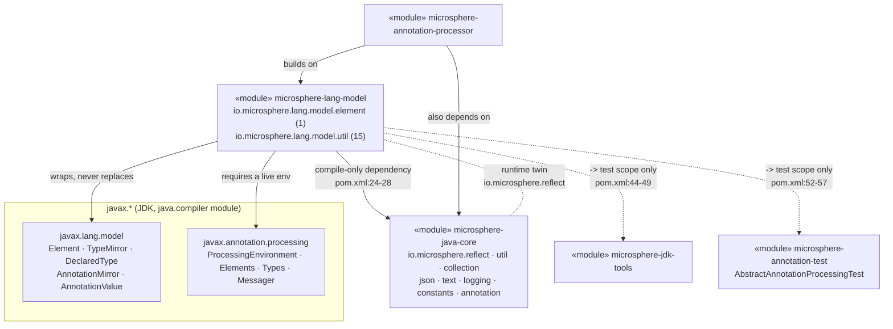
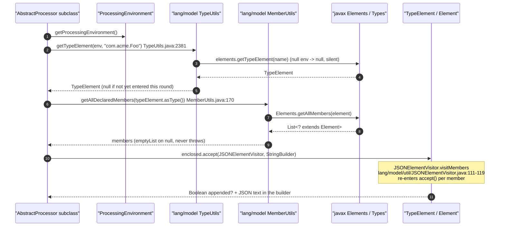
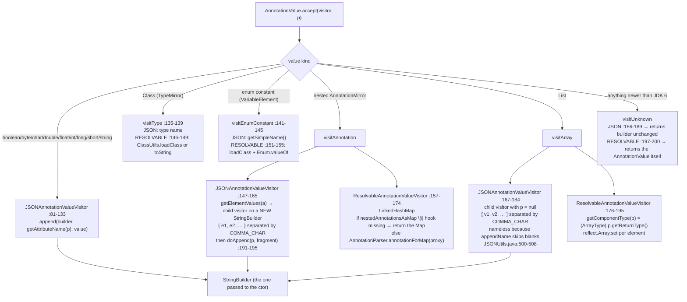

# Language Model (`javax.lang.model`) — developer guide

Module: `io.github.microsphere-projects:microsphere-lang-model` · Source line: `release` branch, `0.3.20-SNAPSHOT`
(tag `0.3.20` published; root `pom.xml:54`), `groupId` at root `pom.xml:12`.
Packages analysed: `io.microsphere.lang.model.element` (1 type) + `io.microsphere.lang.model.util` (15 types) =
**16 main-source types**, covered by 17 test classes.
Companion user-facing page: [User Guide — Language Model](../../user-guide/microsphere-lang-model.md).

All `file:line` references are relative to `microsphere-lang-model/src/main/java/io/microsphere/` (main) or
`microsphere-lang-model/src/test/java/io/microsphere/` (test), read from the `release` worktree, then shortened to
`lang/model/util/TypeUtils.java:60-88`. Cross-module references keep the module prefix, e.g.
`microsphere-java-core/src/main/java/io/microsphere/reflect/TypeUtils.java:1543`.

---

## 1. Architecture position

`io.microsphere.lang.model` is the **compile-time counterpart of the runtime `io.microsphere.reflect` layer**. That is
not a metaphor — the method surfaces are deliberately name-mirrored, and the module even imports from `reflect`
directly:

| Concept | Compile-time (`javax.lang.model`) | Runtime (`java.lang.reflect`) | Evidence |
|---|---|---|---|
| Same-type test | `lang/model/util/TypeUtils.isSameType(TypeMirror, CharSequence)` | no direct twin — `reflect` has `getTypeName(Type)` | `lang/model/util/TypeUtils.java:261-266`, `microsphere-java-core/src/main/java/io/microsphere/reflect/TypeUtils.java:1543` |
| Type name extraction | `lang/model/util/TypeUtils.getTypeName(TypeMirror)` | `reflect/TypeUtils.getTypeName(Type)` / `getTypeNames(Type...)` | `lang/model/util/TypeUtils.java:2457`, `…reflect/TypeUtils.java:1543,1568` |
| Type-name reuse across layers | `ElementUtils.matchParameterTypes` imports `io.microsphere.reflect.TypeUtils.getTypeNames` | — | `lang/model/util/ElementUtils.java:38`, `:656-659` |
| Method lookup | `lang/model/util/MethodUtils.findMethod(TypeElement, String, Type...)` | `reflect/MethodUtils.findMethod(Class, String, Class...)` | `lang/model/util/MethodUtils.java:635,664`, `…reflect/MethodUtils.java:593,629` |
| Hierarchical method enumeration | `getAllDeclaredMethods(TypeElement)` | `getAllDeclaredMethods(Class)` | `lang/model/util/MethodUtils.java:136,161`, `…reflect/MethodUtils.java:354` |
| Field lookup | `lang/model/util/FieldUtils.findField(Element, String)` | `reflect/FieldUtils.findField(Class, String)` | `lang/model/util/FieldUtils.java:267,294`, `…reflect/FieldUtils.java:109,152,184` |
| Constructor lookup | `lang/model/util/ConstructorUtils.findConstructor(TypeElement, Type...)` | `reflect/ConstructorUtils.findConstructor(Class, Class...)` | `lang/model/util/ConstructorUtils.java:151,179`, `…reflect/ConstructorUtils.java:264` |
| Generic-argument resolution | *absent* (the model gives it to you for free via `DeclaredType#getTypeArguments`) | `reflect/TypeUtils.resolveTypeArguments(Class)` | `…reflect/TypeUtils.java:1198` |

Two edges make the layering concrete:

* **`lang-model` → `microsphere-java-core` (compile scope, the only one).** `pom.xml:24-28`. The imports actually used
  are `io.microsphere.util.*` (`Utils`, `ArrayUtils`, `StringUtils`, `ClassLoaderUtils`, `Assert`, `CharSequenceComparator`),
  `io.microsphere.collection.*` (`CollectionUtils`, `ListUtils`, `MapUtils`), `io.microsphere.lang.function.*`
  (`Predicates`, `Streams`), `io.microsphere.reflect.*` (`MethodUtils`, `TypeUtils`), `io.microsphere.text.FormatUtils`,
  `io.microsphere.logging.*`, `io.microsphere.json.JSONUtils`, `io.microsphere.constants.SymbolConstants` and
  `io.microsphere.annotation.*` — see `lang/model/util/TypeUtils.java:20-61`,
  `lang/model/util/JSONAnnotationValueVisitor.java:31-40`.
* **`annotation-processor` → `lang-model` + `core`.** This module has no dependency on `annotation-processor` and must
  not gain one; the direction is one-way. `microsphere-jdk-tools` and `microsphere-annotation-test` sit *below* the
  test boundary (`pom.xml:44-49`, `:52-57`) and are never reachable from `src/main/java`.

**Boundary it owns:** everything that must hold *while `javac` is running, before classes exist*. The moment a real
`Class` is on the processor's classpath, `ClassUtils.loadClass` (`lang/model/util/ClassUtils.java:78`) crosses over
into `io.microsphere.util.ClassLoaderUtils.resolveClass` and hands control to the runtime layer.



---

## 2. Type inventory (16 types)

| # | Type | Kind | Wraps (`javax.lang.model` type) | Key static / public members |
|---|---|---|---|---|
| 1 | `StringAnnotationValue` | concrete class, `@Immutable` | implements `AnnotationValue` | ctor `:37-39`, `getValue()` `:41-44`, `accept()` → `visitString` `:46-49` — `lang/model/element/StringAnnotationValue.java` |
| 2 | `AnnotationUtils` | interface of `static` methods (`extends Utils`) | `AnnotatedConstruct`, `AnnotationMirror`, `AnnotationValue`, `DeclaredType`, `TypeMirror` | 4 constants `:106,111,117,119`; `getAnnotation` `:141-175`; `findAnnotation` `:509-612`; `findMetaAnnotation` `:640-692`; `getElementValues` `:1373-1529`; `getAttributesMap` `:1190-1329`; `getAttribute` `:1695-1782`; `getElementTypes` `:1841-1875` |
| 3 | `ClassUtils` | interface of `static` methods | `TypeMirror` → `java.lang.Class` | `getClassName(TypeMirror)` `:57`, `loadClass(TypeMirror)` `:78`, `loadClass(String)` `:98` — `lang/model/util/ClassUtils.java` |
| 4 | `ConstructorUtils` | interface of `static` methods | `ExecutableElement` (kind `CONSTRUCTOR`) | `getDeclaredConstructors` `:87,123`, `findConstructor` `:151,179`, `findDeclaredConstructors` `:220,239`, `filterDeclaredConstructors` `:278` |
| 5 | `ElementUtils` | interface of `static` methods (`extends Utils`) | `Element`, `ElementKind`, `ExecutableElement`, `VariableElement` | 8 kind predicates `:87-296`; `toElementKind` `:389-400`; 3 `matchesElementType` `:430-502`; `matchesElementKind` `:526-528`; `hasModifiers` `:578-589`; `filterElements` `:622-633`; `matchParameterType(s/Names)` `:656-733` |
| 6 | `ExecutableElementComparator` | `final`-ish class, singleton, `implements Comparator<ExecutableElement>` | `ExecutableElement`, `VariableElement` | `INSTANCE` `:60`, private ctor `:62`, `compare` `:66-92` |
| 7 | `FieldUtils` | interface of `static` methods | `VariableElement` (kind `FIELD`) | `getDeclaredField(s)` `:107-187`, `getAllDeclaredFields` `:213-239`, `findField` `:267-294`, `find/findAllDeclaredFields` `:330-445`, `filterDeclaredFields` `:488`, `isEnumMemberField` `:524`, `isNonStaticField` `:554`, `isField` `:580,618`, `get(All)NonStaticFields` `:644-734`, `equalsFieldName` `:760` |
| 8 | `JSONAnnotationValueVisitor` | concrete class, extends `SimpleAnnotationValueVisitor6<StringBuilder, ExecutableElement>` | `AnnotationValue` | ctor `:76-79`, 11 scalar/`TypeMirror` visits `:81-145`, `visitAnnotation` `:147-165`, `visitArray` `:167-184`, `visitUnknown` `:186-189`, `doAppend` `:191-195` |
| 9 | `JSONElementVisitor` | abstract class, extends `ElementKindVisitor6<Boolean, StringBuilder>` | `Element` hierarchy | ctor w/ `FALSE` fallback `:59-61`; 5 `final` visits `:63-109`; `visitMembers` `:111-119`; `supports` + 5 `supportsXxx` `:130-197`; `doVisitPackage`/`doVisitTypeParameter` `:206-219` |
| 10 | `AnnotatedElementJSONElementVisitor` | abstract class, extends `JSONElementVisitor` | `Element` + `TypeElement` of a named annotation | ctor `:102-112`; fields `processingEnv`/`elements`/`annotationClassName`/`annotationType`/`annotationTypeElement`/`elementTypes` `:90-100`; `getAnnotationClassName()` `:119-122`; `supports(Element)` `:124-126` |
| 11 | `LoggerUtils` | interface of `static` methods (`extends Utils`) | *nothing* — SLF4J-style façade over `io.microsphere.logging` | `LOGGER` `:32`, `trace`/`debug`/`info`/`warn`/`error` `:34-52` |
| 12 | `MemberUtils` | interface of `static` methods | `Element` (any member kind) | `getDeclaredMembers` `:98,122,196,222`, `getAllDeclaredMembers` `:146,170`, `findDeclaredMembers` `:250,278,388,419`, `findAllDeclaredMembers` `:310,349` |
| 13 | `MessagerUtils` | interface of `static` methods (`extends Utils`) | `Messager`, `ProcessingEnvironment`, `Diagnostic.Kind` | 5×2 `printX` pairs `:63-246`; `printMessage` `:268-309` |
| 14 | `MethodUtils` | interface of `static` methods | `ExecutableElement` (methods) | `getDeclaredMethods` `:86,111`, `getAllDeclaredMethods` `:136,161`, `find/findAllDeclaredMethods` `:196-451`, `findPublicNonStaticMethods` `:338,373`, `filterDeclaredMethods` `:487`, `isMethod` `:522`, `findMethod` ×6 `:575-728`, `getOverrideMethod` `:764`, `getMethodName` `:841`, `getReturnTypeName` `:866`, `getMethodParameterType(Mirrors/Names)` `:896,938`, `matches*` `:967-1127` |
| 15 | `ResolvableAnnotationValueVisitor` | concrete class, extends `SimpleAnnotationValueVisitor6<Object, ExecutableElement>` | `AnnotationValue` → runtime objects | 2 `static final` reflective hooks `:76-78`; 3 ctors `:88-99`; 13 visit methods `:101-200`; package-private `getComponentType` `:189-195` |
| 16 | `TypeUtils` | interface of `static` methods (`extends Utils`) | `TypeMirror`, `DeclaredType`, `TypeElement`, `Element`, `ProcessingEnvironment` | `SIMPLE_TYPE_NAMES` `:77-82`; 2 traversal functions `:88,94`; ~100 statics in 5 families `:120-2505`; `typeElementFinder` `:2500-2505` |

Two structural observations:

* **11 of 16 are `interface`s containing only `static` methods** (the `Utils` convention) — `AnnotationUtils`,
  `ClassUtils`, `ConstructorUtils`, `ElementUtils`, `FieldUtils`, `LoggerUtils`, `MemberUtils`, `MessagerUtils`,
  `MethodUtils`, `TypeUtils`, plus `ExecutableElementComparator` which is the odd one out as a real `class`.
  Interfaces were chosen over final classes purely to host `static` methods on JDK 8 without a utility-class idiom.
* **Exactly two types are abstract and one is a singleton** — the visitor pair `JSONElementVisitor` /
  `AnnotatedElementJSONElementVisitor` and `ExecutableElementComparator.INSTANCE`. Everything else is directly usable.

---

## 3. Source analysis: how a `TypeMirror` is resolved and compared

### 3.1 Comparison is name-string equality

The comparison primitive is one method; everything else delegates to it:

```java
static boolean isSameType(TypeMirror type, CharSequence typeName) {   // TypeUtils.java:261
    if (type == null && typeName == null) {
        return true;
    }
    return Objects.equals(valueOf(type), valueOf(typeName));          // :265
}
```

`lang/model/util/TypeUtils.java:261-266`. The three sibling overloads just normalise their arguments first:
`(Element, Type)` `:177-179`, `(Element, CharSequence)` `:203-205`, `(TypeMirror, Type)` `:235-237`.

Consequences worth stating plainly:

1. **`javax.lang.model.util.Types` is never consulted.** The module obtains no `Types` handle in this path, so
   `isSameType` works with zero infrastructure — but it is a *textual* test, not the compiler's equivalence relation.
   `TypeMirror#toString()` is specified as the canonical name, so declared types and primitives behave correctly;
   type-variable *usages*, capture wildcards and anonymous types do not have a canonical-name guarantee.
2. **`null`/`null` is `true` while every sibling predicate returns `false` on `null`.** Compare `isArrayType` `:289-291`,
   `isEnumType` `:340-343`, `isSimpleType` `:149-151` — all `x != null && …`. The `isSameType` rule is an "equal nulls"
   special case, which makes `isSameType(null, null)` a tautology rather than a check.
3. `isSimpleType` is a membership test against a hard-coded name list built from `io.microsphere.util.ClassUtils.SIMPLE_TYPES`
   (`:77-82`), so it is source-of-truth-literal, not model-derived.

### 3.2 Resolution: `Element` ⇄ `TypeMirror` ⇄ `TypeElement`

The conversion lattice is acyclic and total:

```mermaid
flowchart TD
    E["Element"] -->|asType()| TM["TypeMirror"]
    E -->|isTypeElement :555| TE["TypeElement"]
    TM -->|ofDeclaredType :763-765<br/>isDeclaredType ? cast : null| DT["DeclaredType"]
    DT -->|asElement()| TE
    TE -->|asType()| DT
    E -->|ofTypeElement :652-654| TE
    TM -->|ofTypeElement :680-683| TE
    TE -->|getTypeParameters| TPE["TypeParameterElement"]
    TE -->|getEnclosedElements| M["members (Element)"]
    M -->|ElementFilter.fieldsIn / methodsIn| V["VariableElement · ExecutableElement"]
    P["ProcessingEnvironment"] -. "getTypeElement(name) :2381<br/>getDeclaredType :2401-2433" .-> TE
```

Three properties of the `of*` family matter for callers:

* **They return `null`, never throw.** `ofTypeElement(Element)` `:652-654`, `ofTypeElement(TypeMirror)` `:680-683`,
  `ofTypeElement(DeclaredType)` `:706-711`, `ofDeclaredType(Element)` `:737-739`, `ofDeclaredType(TypeMirror)` `:763-765`.
  A `PackageElement` or a primitive `TypeMirror` yields `null` and callers must handle it — `AnnotationUtils` does,
  which is why `findAllAnnotations(Element, …)` has an explicit `typeElement == null` branch
  (`lang/model/util/AnnotationUtils.java:868-874`).
* **Traversal is function-injected.** `TYPE_ELEMENT_GET_SUPERCLASS` (`:88`) and `TYPE_ELEMENT_GET_INTERFACES` (`:94-97`)
  are `public static` fields passed into `io.microsphere.util.TypeFinder` by `typeElementFinder` (`:2500-2505`). The
  same BFS engine `core` uses at runtime is therefore reused here with a different pair of edge functions — this is the
  single most load-bearing design decision in the module.
* **`getTypeName` is the only reflective call.** `:2456-2478` — it asks the *element* for `getTypeParameters()` and, if
  non-empty, reflectively invokes `"getTypeArguments"` on the `TypeMirror` (`:2466`, `invokeMethod(true, …)`) because
  `TypeMirror` has no such method, then renders `<` + `List<TypeMirror>.toString()` + `>` (`:2470-2472`). It is the one
  place where a `TypeMirror` implementation's private surface is relied upon.

### 3.3 Sequence: from a processor to a member and back



---

## 4. Source analysis: `AnnotationValue` trees and the JSON they produce

### 4.1 Dispatch

Both visitors extend the JDK-6 `SimpleAnnotationValueVisitor6`, so `AnnotationValue.accept(v, p)` — *not* the
visitors' own code — chooses the branch. `p` is the `ExecutableElement` attribute method throughout.



### 4.2 Emitted structure

The grammar implemented by `JSONAnnotationValueVisitor` is:

| Input | Output | Producing lines |
|---|---|---|
| scalar (`boolean`…`String`) | `"name":literal` | `:81-133` |
| `Class` value | `"name":"fully.qualified.Name"` | `:135-139` |
| enum constant | `"name":"CONSTANT"` (simple name only — the owning type is **not** emitted) | `:141-145` |
| nested annotation | `"name":{ "a":x,"b":y }` | `:147-165` |
| array | `"name":[e1,e2,…]`, each `ei` rendered namelessly | `:167-184` |
| unknown | nothing appended | `:186-189` |

Notes that are easy to miss:

* **The visitor emits fragments, not documents.** It never writes a top-level `{`/`}`; the caller owns the enclosing
  object, and the leading `{` seen in `visitAnnotation` is written into a *child* builder (`:151-152`). The only
  delimiter characters come from `SymbolConstants` (`:31-35`).
* **The attribute name is resolved from `p`, not from the value.** `getAttributeName` is
  `MethodUtils.getMethodName` (`AnnotationUtils.java:1015-1017` → `MethodUtils.java:841-843`), which returns `null`
  for a `null` method; `JSONUtils.appendName` then skips writing the name (`…json/JSONUtils.java:500-508`). Array
  elements exploit this: `visitArray` passes `null` deliberately (`:176`).
* **`visitAnnotation` recurses through `getElementValues(a)` with the default-on overload** (`:149` →
  `AnnotationUtils.java:1464-1466`), so defaults appear in JSON — see the assertion `"since":{"module":"","value":"1.0.0"}`
  where `"module":""` is a default
  (`lang/model/util/JSONAnnotationValueVisitorTest.java:113-116`).
* **`ResolvableAnnotationValueVisitor` reaches into `sun.reflect.annotation.AnnotationParser`** — resolved once into
  `static final` fields (`:76-78`) with `io.microsphere.reflect.MethodUtils.findMethod`, then invoked with
  `invokeStaticMethod(true, …)` (`:173`). The `null`-tolerant branch (`:168`) means a JDK that hides that class simply
  returns the `Map` instead of an annotation proxy — degradation, not failure. But `getComponentType` (`:189-195`)
  performs an unchecked `(ArrayType)` cast and dereferences `p`, so visiting an *array* with `p == null` throws
  `NullPointerException`/`ClassCastException`.
* **`visitArray` in the resolvable visitor needs `p` to know the component type**, whereas `StringAnnotationValue`
  (`lang/model/element/StringAnnotationValue.java:46-49`) hard-wires `visitString` and therefore never touches `p` —
  making it safe to feed to a visitor with `null` parameter, as the test does
  (`lang/model/element/StringAnnotationValueTest.java:49-52`).

### 4.3 The element side

`JSONElementVisitor` is the other half of the JSON story and it is *not* a JSON emitter: it appends nothing itself. It
is a **filtering traversal framework** — a gate (`supportsXxx`), a recursion (`visitMembers` `:111-119`), and a
"did anything get written?" boolean protocol (`TRUE` means "content appended"). `visitType` `:87-101` is the only
composite: it runs `super.visitType` for the type header, then recurses into `getEnclosedElements()` and ORs the
result. `AnnotatedElementJSONElementVisitor` `:124-126` supplies the concrete filter — "only elements whose kind is in
the annotation's `@Target`", computed once in the constructor from `getElementTypes(annotationType)`
(`:111`, `AnnotationUtils.java:1871-1875`).

---

## 5. Source analysis: `ExecutableElement` ordering

`compare` (`lang/model/util/ExecutableElementComparator.java:66-92`) is a four-stage cascade:

| Stage | Code | Line | Notes |
|---|---|---|---|
| 0 | `if (e1.equals(e2)) return 0;` | `:68-70` | Uses `Element#equals`, which in `javac` is identity of the symbol table entry. **It dereferences `e1` unconditionally.** |
| 1 | `CharSequenceComparator.INSTANCE.compare(e1.getSimpleName(), e2.getSimpleName())` | `:73` | From `io.microsphere.util.CharSequenceComparator` (`:19,23`) |
| 2 | `ps1.size() - ps2.size()` | `:77-80` | Arithmetic difference, not `Integer.compare` — overflow is unreachable in practice |
| 3 | per-index `asType().toString()` comparison, first non-zero wins | `:82-89` | Compares the `TypeMirror` text, i.e. exactly the `isSameType` notion of §3.1 |

Ordering properties:

* **Not consistent with `equals`.** Two structurally identical methods from different `TypeElement`s compare `0`
  (`lang/model/util/ExecutableElementComparatorTest.java:59-60` proves `AutoCloseable#close()` reached via the test type
  and via `AutoCloseable.class` compare `0`), while `e1.equals(e2)` is `false`. A `TreeSet` with this comparator will
  therefore *deduplicate overloads across the hierarchy* — which is what metadata generation wants, but is not what a
  `HashSet` would do.
* **Total only within one simple-name bucket.** Stage 1 short-circuits, so ordering never reaches stage 3 for methods
  of different names.
* **Name-first, not signature-first.** Generated output is grouped by method name.

**No `Prioritized` interaction exists.** `Prioritized` is referenced nowhere in the module's main sources (grep across
all 16 types finds no occurrence; the singleton comparator is `Comparator`, not `Prioritized`). The warning belongs to
callers who compose the two: `io.microsphere.lang.Prioritized`'s constants are **inverted** relative to their names —
`MAX_PRIORITY = Integer.MIN_VALUE` (`:81`), `MIN_PRIORITY = Integer.MAX_VALUE` (`:86`), `NORMAL_PRIORITY = 0` (`:91`) —
so if you sort a member list with `Prioritized.COMPARATOR` *after* `ExecutableElementComparator`, "highest priority"
means the numerically smallest value. Do not chain the two without stating which one wins.

---

## 6. Source analysis: `MessagerUtils` ⇄ `Diagnostic.Kind`

`printMessage(Messager, Kind, String, Object...)` (`lang/model/util/MessagerUtils.java:292-309`) is the single funnel.
The five `ProcessingEnvironment` overloads (`:63-65`, `:127-129`, `:174-176`, `:221-223`, `:268-270`) are pure adapters
that call `processingEnv.getMessager()`, and the four level-specific `Messager` overloads are pure adapters that fix the
`Kind` (`:104`, `:151`, `:198`, `:245`).

| `Diagnostic.Kind` | `Messager.printMessage` | `LoggerUtils` call | Switch branch |
|---|---|---|---|
| `NOTE` | yes (`:294`) | `info(pattern, args)` | `:303-304` |
| `WARNING` | yes | `warn(pattern, args)` | `:299-301` |
| `MANDATORY_WARNING` | yes | `warn(pattern, args)` — **same branch as `WARNING`** | `:299-301` |
| `ERROR` | yes | `error(pattern, args)` | `:296-297` |
| `OTHER` (and any future `Kind`) | yes | `debug(pattern, args)` | `:306-307` (`default`) |

Three design facts follow:

1. **The message is formatted twice along two paths.** `messager.printMessage(kind, format(pattern, args))` sends the
   *substituted* text (`:293-294`), while `LoggerUtils` receives the raw `pattern` plus `args` (`:297`–`:307`), so the
   logging backend applies its own placeholder rules. A pattern valid for `{}`
   (`microsphere-java-core/src/main/java/io/microsphere/text/FormatUtils.java:17`, `:38-39`) is not necessarily valid
   for the backend, and vice versa. The javadoc of `MessagerUtils` claims `{0}` / "`String#format` syntax"
   (`lang/model/util/MessagerUtils.java:56-61`, `:78-82`) — **this is a documentation defect**; the tests use `"Hello, {}!"`
   (`lang/model/util/MessagerUtilsTest.java:55-56`).
2. **`MANDATORY_WARNING` is deliberately collapsed onto `warn`.** The distinction survives only in the `Messager`
   channel; the log channel cannot recover it.
3. **`LoggerUtils.LOGGER` is a `static` interface constant** named `"microsphere-lang-model"`
   (`lang/model/util/LoggerUtils.java:32`) — the *module*, not the caller, is the logger name. Processor authors
   cannot route this module's diagnostics to a per-processor category, and `Logback` is a test-scope dependency
   (`pom.xml:60-64`) precisely so the module itself never binds a backend at compile scope.

There is **no** null handling: `:294` dereferences `messager`, `:295` dereferences `kind`, and the five
`ProcessingEnvironment` overloads dereference `processingEnv` before the call. The `assertDoesNotThrow` wrapper in the
tests (`MessagerUtilsTest.java:55-80`) is only evidence about the happy path.

---

## 7. Design patterns

| Pattern | Proving class(es) | Evidence |
|---|---|---|
| **Visitor (double dispatch)** | `JSONAnnotationValueVisitor`, `ResolvableAnnotationValueVisitor`, `StringAnnotationValue` | The dispatch lives in `AnnotationValue.accept`, and `StringAnnotationValue` proves it: its whole behaviour is `return v.visitString(this.value, p)` (`lang/model/element/StringAnnotationValue.java:46-49`). The two visitors override per-kind hooks only (`lang/model/util/JSONAnnotationValueVisitor.java:81-189`, `lang/model/util/ResolvableAnnotationValueVisitor.java:101-200`) |
| **Visitor (acceptor-driven traversal)** | `JSONElementVisitor`, `AnnotatedElementJSONElementVisitor` | `Element.accept(this, jsonBuilder)` inside `visitMembers` (`lang/model/util/JSONElementVisitor.java:111-119`); the subclass narrows *which* elements are visited, not how (`lang/model/util/AnnotatedElementJSONElementVisitor.java:124-126`) |
| **Template Method + Strategy hybrid** | `JSONElementVisitor` | `final` gates `visitPackage`/`visitVariable`/`visitExecutable`/`visitType`/`visitTypeParameter` (`:63-109`) with `protected` extension points `supports*` (`:130-197`) and `doVisit*` (`:206-219`) |
| **Wrapper / Adapter** | `StringAnnotationValue` | Implements the JDK `AnnotationValue` interface over a plain `String` so caller-produced values enter JDK-shaped APIs (`lang/model/element/StringAnnotationValue.java:33-49`), marked `@Immutable` (`:32`) |
| **Facade / Utils** | `TypeUtils`, `ElementUtils`, `AnnotationUtils`, `MemberUtils`, `FieldUtils`, `MethodUtils`, `ConstructorUtils`, `ClassUtils`, `MessagerUtils`, `LoggerUtils` | All are `interface`s of `static` methods extending `io.microsphere.util.Utils` (e.g. `lang/model/util/TypeUtils.java:69`, `lang/model/util/ElementUtils.java:58`, `lang/model/util/AnnotationUtils.java:101`), collapsing `Elements` + `Types` + `Element` + `AnnotationMirror` + `AnnotationValue` + `Messager` into name-based calls |
| **Comparator / Strategy** | `ExecutableElementComparator` | `implements Comparator<ExecutableElement>` (`:55`), private ctor (`:62`), shared immutable `INSTANCE` (`:60`); the strategy is fixed (no key extractor is injectable) |
| **Singleton (canonical instance)** | `ExecutableElementComparator`, `AnnotationUtils.DEFAULT_ANNOTATION_VALUE_VISITOR` | `:60` / `lang/model/util/AnnotationUtils.java:111` — the shared visitor is stateless and therefore safe to reuse (`lang/model/util/ResolvableAnnotationValueVisitor.java:84-99` fields are `final`) |
| **Null Object / silent degradation** | every `Utils` interface | `emptyList()`/`emptyMap()`/`null`/`false` instead of throwing — `lang/model/util/ElementUtils.java:622-633`, `lang/model/util/AnnotationUtils.java:1509-1512`, `lang/model/util/TypeUtils.java:652-654` |
| **Registry (read-only, injected)** | `TypeUtils.TYPE_ELEMENT_GET_SUPERCLASS` / `TYPE_ELEMENT_GET_INTERFACES` | `Function` constants (`:88`, `:94-97`) handed to `io.microsphere.util.TypeFinder` (`:2500-2505`) so the shared BFS engine can walk a non-reflective graph |
| **Reflective bridge across a layer boundary** | `ClassUtils`, `ResolvableAnnotationValueVisitor` | `TypeMirror` → `Class` (`lang/model/util/ClassUtils.java:78-98`) and `AnnotationMirror` → annotation proxy via `AnnotationParser.annotationForMap` (`lang/model/util/ResolvableAnnotationValueVisitor.java:76-78,173`) |

Not present: no Builder, no Decorator (the child `JSONAnnotationValueVisitor` instances in `visitAnnotation`/`visitArray`
are *fresh collaborators over a different buffer*, `:153`/`:173` — not wrappers around an existing one), and no SPI or
`META-INF/services` file in `src/main/resources` (there is no `src/main/resources` directory at all).

---

## 8. Review notes

### 8.1 Null handling vs. the silent-degradation policy — every throw site

The policy holds for 14 of 16 types. Complete list of the sites that can throw, verified line by line:

| # | Site | Trigger | Exception |
|---|---|---|---|
| 1 | `lang/model/util/AnnotatedElementJSONElementVisitor.java:103` | `processingEnv == null` | `Assert.assertNotNull` → unchecked |
| 2 | `lang/model/util/AnnotatedElementJSONElementVisitor.java:104` | `annotationClassName == null` | same |
| 3 | `lang/model/util/AnnotatedElementJSONElementVisitor.java:110` | the annotation is not resolvable via `Elements.getTypeElement` | same, message `"The annotation can't be found by name : …"` |
| 4 | `lang/model/util/MessagerUtils.java:64` | `printNote(null, …)` | `NullPointerException` |
| 5 | `lang/model/util/MessagerUtils.java:128` | `printWarning(null, …)` | `NullPointerException` |
| 6 | `lang/model/util/MessagerUtils.java:175` | `printMandatoryWarning(null, …)` | `NullPointerException` |
| 7 | `lang/model/util/MessagerUtils.java:222` | `printError(null, …)` | `NullPointerException` |
| 8 | `lang/model/util/MessagerUtils.java:269` | `printMessage(null, kind, …)` | `NullPointerException` |
| 9 | `lang/model/util/MessagerUtils.java:294` | `messager == null` | `NullPointerException` |
| 10 | `lang/model/util/MessagerUtils.java:295` | `kind == null` | `NullPointerException` (switch on `null`) |
| 11 | `lang/model/util/ExecutableElementComparator.java:68` | `e1 == null` | `NullPointerException` |
| 12 | `lang/model/util/ExecutableElementComparator.java:73` | `e1 != null`, `e2 == null` | `NullPointerException` |
| 13 | `lang/model/util/TypeUtils.java:1360-1365` | a `null` element in `typeFilters` | declared `throws IllegalArgumentException` (`:1356`) |
| 14 | `lang/model/util/TypeUtils.java:2034-2068` | same, `DeclaredType` family | documented `@throws` (`:2034`, `:2064`) |
| 15 | `lang/model/util/TypeUtils.java:2498-2505` | `typeElementFinder` with invalid parameters / failing assertions | documented `IllegalArgumentException` |
| 16 | `lang/model/util/JSONElementVisitor.java:72-77,79-85,87-101` | `null` element with the default `supports` (returns `true`, `:130-132`) | `NullPointerException` inside `ElementKindVisitor6` |
| 17 | `lang/model/util/ResolvableAnnotationValueVisitor.java:189-195` | `visitArray` with `p == null` or a non-array return type | `NullPointerException` / `ClassCastException` |
| 18 | `lang/model/util/AnnotationUtils.java:1781` | an `Entry` whose value is `null` | `NullPointerException` (`annotationValue.accept(...)` unchecked) |

### 8.2 Contract inconsistencies worth fixing

* **Javadoc vs. code, placeholder syntax.** `MessagerUtils.java:56`, `:60`, `:78`, `:82`, `:100`, `:124`, `:147`, `:161`,
  `:183`, `:206`, `:241`, `:265`, `:289` advertise `String#format` / `{0}`; the implementation is `{}`-based
  (`FormatUtils.java:17`).
* **Javadoc vs. code, non-existent hook.** `AnnotatedElementJSONElementVisitor.java:67-74` instructs subclasses to
  `@Override protected boolean doVisitType(TypeElement, StringBuilder)`. No such method is declared anywhere:
  `JSONElementVisitor` defines only `doVisitPackage` and `doVisitTypeParameter` (`:206-219`), and `visitType` is `final`
  (`:88`), so the documented override cannot compile.
* **Duplicated javadoc blocks.** `AnnotationUtils.java:1816-1839` and `MessagerUtils.java:85-102` each carry the same
  javadoc twice — the second block wins, and the first is dead text that drifts.
* **Typo in a javadoc source line.** `MessagerUtils.java:4` reads "additional inpatternion".
* **`getAnnotation` javadoc overstates inheritance.** `AnnotationUtils.java:132-134` says "an element that may inherit
  annotations from its parent" — `getAnnotation` reads `getAnnotationMirrors()` only (`:797`); inheritance is
  `getAllAnnotations`/`findAllAnnotations` (`:315-320`, `:863-875`).
* **`matchesAttributeValue` javadoc vs. `one == another`.** `AnnotationUtils.java:1072-1073` imply `false` for `null`s;
  `:1082-1083` returns `true` when both are the same reference (including both `null`).

### 8.3 Thread safety

* **`ExecutableElementComparator.INSTANCE`** — stateless (`:55-63`); the only fields are none. Safe to share, and the
  `private` constructor makes that the only option.
* **`ResolvableAnnotationValueVisitor` static fields** — `ANNOTATION_PARSER_CLASS` and `annotationForMapMethod`
  (`:76-78`) are initialised in the interface/class initialiser under the JVM's `<clinit>` lock, are `static final`, and
  are never reassigned; the *resolved* `Method` may be `null` on JDKs that hide `sun.reflect.annotation`, and the
  `:168` branch handles that. Instance fields `classValuesAsString` / `nestedAnnotationsAsMap` are `final` (`:84-86`).
  **But the shared singleton `AnnotationUtils.DEFAULT_ANNOTATION_VALUE_VISITOR` (`AnnotationUtils.java:111`) is the
  one object every `getAttribute` call funnels through** — it is safe only because `ResolvableAnnotationValueVisitor`
  keeps no per-call state. `visitAnnotation` builds a fresh `LinkedHashMap` (`:159-166`) and `visitArray` a fresh array
  (`:178-186`), so no field is written after construction. Adding any mutable field to that class would immediately
  make `AnnotationUtils.getAttribute` racy.
* **`JSONAnnotationValueVisitor`** holds a `final StringBuilder` (`:74-79`) and mutates it. `StringBuilder` is not
  thread-safe, so one instance must stay confined to one thread. Its nested children (`:153`, `:173`) are per-call and
  confined — fine.
* **`LoggerUtils.LOGGER`** (`:32`) — an interface constant, one per JVM, delegated to `io.microsphere.logging`.
* **No `Element`/`TypeElement` cache exists anywhere** in the module, so there is no stale-symbol hazard. Every
  traversal (`getAllTypeElements` `TypeUtils.java:1169`, `getAllDeclaredMembers` `MemberUtils.java:146,170`) recomputes,
  which is correct under `javac` (symbol tables mutate between rounds) but is the module's main performance
  characteristic. Note also that `javax.lang.model` elements are documented as **not safe to hold across rounds** — so
  this module's no-cache stance is the right one, and a future cache would be a defect, not an optimisation.

---

## 9. Extension points and testing observations

### 9.1 Extending

1. **New annotation attribute rendering** → subclass `JSONAnnotationValueVisitor` and override only the kinds you care
   about; the recursion uses `new JSONAnnotationValueVisitor(...)` literally (`:153`, `:173`), so **overridden methods
   are not used for nested values.** If you need recursion to honour your subclass, you must reimplement
   `visitAnnotation`/`visitArray`. This is a real limitation, not a style preference.
2. **New element-to-JSON pipeline** → extend `AnnotatedElementJSONElementVisitor`, pass a resolvable annotation class
   name (`:102-112`), override `supports(Element)` or the base `visitTypeAsClass`/`visitVariableAsField` family from
   `ElementKindVisitor6` — see `lang/model/util/JSONElementVisitorTest.java:61-136` for the complete working override
   set. Do **not** try to override `visitType`/`visitVariable`/`visitExecutable`; they are `final`.
3. **A new member-kind utility** → follow the existing convention: `interface XUtils extends Utils`, pairs of
   `TypeElement`/`TypeMirror` overloads, `getDeclaredX` → `getAllDeclaredX` → `findX` → `filterX`, `@Nonnull @Immutable`
   on every list-returning method, `emptyList()` on `null`.
4. **A new ordering** → `ExecutableElementComparator` cannot be parameterised (private ctor, `final`-less but with a
   hard-coded cascade). Add a second comparator class rather than mutating `INSTANCE`, because downstream code already
   shares the singleton.

### 9.2 Test surface

17 test classes under `src/test/java/`, all but `StringAnnotationValueTest` extending `UtilTest`
(`lang/model/util/UtilTest.java:48`), which itself extends
`io.microsphere.test.annotation.processing.AbstractAnnotationProcessingTest` from `microsphere-annotation-test`
(`:20`) — that is how a live `ProcessingEnvironment`, `Elements` and `Messager` appear inside Surefire, and why
`-Dsurefire.useSystemClassLoader=false` is required in CI (`.github/workflows/maven-build.yml:43`). `UtilTest` fixes
the test subject to `io.microsphere.test.service.TestServiceImpl` (`:52`), and `AnnotationUtilsTest.java:127-134`
depends on that fixture having exactly four directly-present annotations and five hierarchically
(`AnnotationUtilsTest.java:175-181`) — assertions a downstream fork will break immediately.

The suite's structure tells you what the module considers its contract: every `Utils` test has an
`…OnNull` sibling (`ElementUtilsTest.java:106-110`, `:121-123`, `:132-136`, `:146-148`;
`AnnotationUtilsTest.java:112-124`, `:136-140`, `:183-187`), which is how the silent-degradation policy is enforced.
The visible gaps:

1. No test exercises `MessagerUtils` with a `null` `Messager` or `ProcessingEnvironment`, so §8.1 rows 4–10 are
   undocumented by the build.
2. No test exercises `ExecutableElementComparator` with a `null` element (rows 11–12).
3. `JSONElementVisitorTest`'s `*OnUnsupported` cases (`:146-149`, `:174-178`, `:194-198`, `:228-233`, `:247-251`) pass
   `null` elements, but *only* because `supports` is overridden to return `false` (`:63-67`) — the default-supports
   path (row 16) is untested and would throw.
4. `ResolvableAnnotationValueVisitor`'s `classValuesAsString` / `nestedAnnotationsAsMap` constructors
   (`:92-99`) and its `sun.reflect` fallback branch (`:168`) have no coverage of the fallback itself.
5. `ExecutableElementComparatorTest.java:67-70` overrides `equals(Object)` on the *test class* with a pure
   `super.equals(object)` call — dead code, harmless, but it shows the comparator's `equals` path being probed from the
   wrong side.
6. `AnnotatedElementJSONElementVisitorTest.java:37-49` tests only `getAnnotationClassName()` and `supports()`; no
   visitor run and therefore no JSON output is asserted anywhere in that test.
