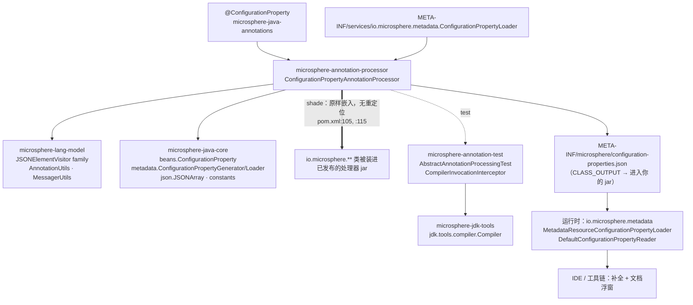
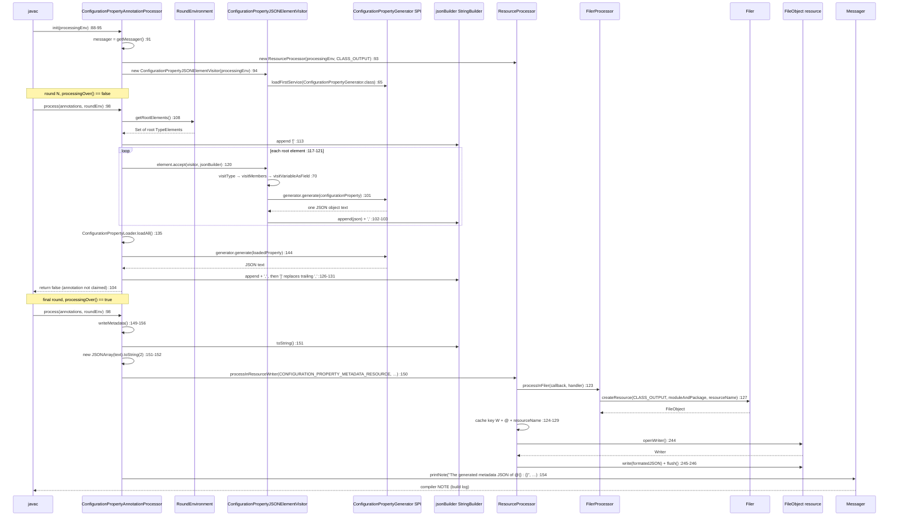
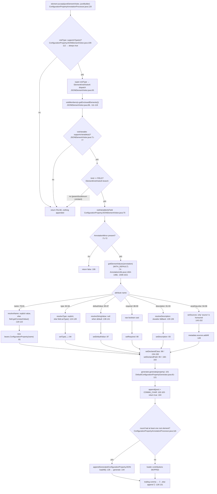

# 注解处理器（Annotation Processor）— 开发者指南

模块：`io.github.microsphere-projects:microsphere-annotation-processor` · `0.3.20-SNAPSHOT`（`release` 分支）
包：`io.microsphere.annotation.processor`（4 个主类型，4 个测试类 + 1 个 SPI 夹具）· Java 8 基线，CI 覆盖 JDK 8 / 11 / 17 / 21 / 25

下文使用的路径前缀：`microsphere-annotation-processor/src/main/java/io/microsphere/`（主源码，引用时写作
`annotation/processor/…`）、`microsphere-annotation-processor/src/test/java/io/microsphere/`（测试），其余一律使用完整的
`microsphere-<module>/src/...` 路径。

---

## 1. 架构位置：编译期那一半

元数据特性被拆成两个模块、两个数据流方向。本模块在 `javac` 运行期间**写出**
`META-INF/microsphere/configuration-properties.json`；`microsphere-java-core` 里的 `io.microsphere.metadata` 在运行时
**读取**它，而该包的某个 SPI（`ConfigurationPropertyLoader`）会在编译期把属性*回灌*进本模块的产出。IDE 是同一份文件的
第三类消费者。



由源码证明的边：

* **`pom.xml:24-28`** 声明 `microsphere-java-core`（compile），**`:31-35`** 声明 `microsphere-lang-model`；
  **`:51-56`** 声明 `microsphere-annotation-test` 且为 `test` 作用域（`:53`、`:55`）。
* **processor → lang-model** — `ConfigurationPropertyJSONElementVisitor extends AnnotatedElementJSONElementVisitor`
  （`annotation/processor/ConfigurationPropertyJSONElementVisitor.java:57`，导入在 `:23`），而后者继承
  `JSONElementVisitor`（`microsphere-lang-model/src/main/java/io/microsphere/lang/model/util/AnnotatedElementJSONElementVisitor.java:88`）；
  静态导入见 `ConfigurationPropertyJSONElementVisitor.java:38-43` 与
  `ConfigurationPropertyAnnotationProcessor.java:43`。
* **processor → core** — 模型 bean（`ConfigurationPropertyJSONElementVisitor.java:22`）、`JSONArray` 写出
  （`ConfigurationPropertyAnnotationProcessor.java:22`，使用于 `:151-152`）、`ResourceConstants`（`:21`、`:39`）、
  `SymbolConstants`（`:40-42`）、`ConfigurationPropertyGenerator` SPI（`:23`）以及
  `ConfigurationPropertyLoader.loadAll`（`:44`，调用点 `:135`）。
* **运行时消费者** — `MetadataResourceConfigurationPropertyLoader` 指向完全相同的常量
  （`microsphere-java-core/src/main/java/io/microsphere/constants/ResourceConstants.java:54`），而
  `DefaultConfigurationPropertyReader` 解析的正是这里产出的数组形状。这些 reader 的分析见
  [配置属性元数据 — 开发者指南](./microsphere-java-core/configuration-metadata.zh.md)。

> [!NOTE]
> `annotation-processor → core` 这条边既是 Maven 边也是运行时边：处理器在**它自己运行期间**就需要 core 的模型、JSON 与
> SPI 类，也就是它们必须位于处理器 classpath 上。这正是 `pom.xml:103-121` 的 `maven-shade-plugin` 配置解决的问题——
> 也正是给同时依赖 core 的使用者制造重复类问题的根源（§9）。

---

## 2. 类型清单

| 类型 | 可见性 | 职责 | 关键成员 |
|---|---|---|---|
| `ConfigurationPropertyAnnotationProcessor`（`annotation/processor/ConfigurationPropertyAnnotationProcessor.java:78`） | `public` | Java EE 的 `Processor`：逐轮累加、末轮写出、诊断输出 | `init` `:88-95`、`process` `:97-105`、`resolveMetadata` `:107-110` / `:112-132`、`appendGeneratedConfigurationPropertyJSON` `:134-140` / `:142-147`、`writeMetadata` `:149-156`、`toJSON` `:158-160`、`getSupportedSourceVersion` `:162-165` |
| `ConfigurationPropertyJSONElementVisitor`（`ConfigurationPropertyJSONElementVisitor.java:57`） | **包私有** | 把一个被标注的 `VariableElement` 变成一个 JSON 对象 | 常量 `:59`、构造器 `:63-66`、`visitVariableAsField` `:68-107`、`supportsType` `:109-112`、`getGenerator` `:114-117`、各解析方法 `:119-141`、`setSources` `:143-152`、`setDeclaredClass/Field` `:154-163` |
| `FilerProcessor`（`annotation/processor/FilerProcessor.java:76`） | `public` | 带异常处理器地访问 `Filer`；通过反射提供 `JavaFileManager` 逃生口 | 构造器 `:80-82`、`processInFiler` `:84-90` / `:92-96`、`getJavaFileManager` `:103-106` |
| `ResourceProcessor`（`annotation/processor/ResourceProcessor.java:84`） | `public` | 限定 Location 的资源读写，带 `FileObject` 缓存与类型化 I/O 回调 | 标志 `:86-88`、构造器 `:100-110`、`processInResource` `:112-118` / `:120-149`、`getResource` `:151-154`、`InputStream`/`Reader`/`CharSequence` `:156-213`、`OutputStream`/`Writer` `:215-252`、`exists` `:254-256` |

测试：`ConfigurationPropertyAnnotationProcessorTest`（1 个测试）、`ConfigurationPropertyJSONElementVisitorTest`
（3 个测试 + 7 个被编译的类）、`FilerProcessorTest`（3 个测试）、`ResourceProcessorTest`（15 个测试），另有
`TestConfigurationPropertyLoader` 夹具，注册在
`src/test/resources/META-INF/services/io.microsphere.metadata.ConfigurationPropertyLoader`。

名字里带 “processor” 的两个类其实**不是** `Processor` 实现——它们是 helper。只有
`ConfigurationPropertyAnnotationProcessor` 实现了 `javax.annotation.processing.Processor`（经由
`AbstractProcessor` 间接实现，`ConfigurationPropertyAnnotationProcessor.java:78`）。

---

## 3. 轮次处理与 `RoundEnvironment` 的使用

`process()` 刻意写得极简（`ConfigurationPropertyAnnotationProcessor.java:97-105`）：

```java
public boolean process(Set<? extends TypeElement> annotations, RoundEnvironment roundEnv) {
    if (roundEnv.processingOver()) {
        writeMetadata();
    } else {
        resolveMetadata(roundEnv);
    }
    return false;
}
```

这七行导出五个事实：

1. **`annotations` 参数被忽略。** 哪些注解到来了，是由 `@SupportedAnnotationTypes`（`:77`）决定的，而不是这一轮的集合——
   因此无论目标注解是否存在，处理器每轮都会运行一次。
2. **用的是根元素，不是被标注元素。** `resolveMetadata(RoundEnvironment)` 调用
   `roundEnv.getRootElements()`（`:108`），并把每个元素交给访问器（`:117-121`）。`getElementsAnnotatedWith`
   从未使用；过滤是访问器的职责。后果：只有**本轮编译的**元素才可能被写出，因此依赖 jar 里被标注的字段在构造上就是不可见的。
3. **累加器状态跨轮次存活。** `jsonBuilder` 在 `init()` 中只创建一次（`:92`），而每个非末轮都会给自己的产出套上一对新的
   `[` … `]`（`:113`、`:126-131`）。于是有两个非空轮次的编译就会得到 `[…][…]`，那不是 JSON 数组——见 §9。
4. **写出恰好发生一次，在末轮。** `writeMetadata()`（`:149-156`）由 `roundEnv.processingOver()`（`:99`）把门；普通轮次
   什么都不写，所以在末轮之前失败的编译不会留下任何资源。
5. **`return false`（`:104`）意味着注解未被认领。** 这是多个处理器共享同一注解时的惯常选择，也是为什么在开启
   `-proc:only`/`-Xlint:processing` 的构建里，即使处理成功，javac 仍可能为该注解打印
   “No processor claimed any of these annotations” 警告。

`init()`（`:88-95`）立即构造三个协作者：`Messager`（`:91`）、累加器（`:92`）、绑定到
`StandardLocation.CLASS_OUTPUT` 的 `ResourceProcessor`（`:93`，导入在 `:46`）以及访问器（`:94`）。
`ResourceProcessor` 与访问器的构造器都可能抛异常（§9），这就是配置错误的处理器路径会表现为
“Annotation processor … failed to initialize” 而不是“资源缺失”的原因。

两个包私有方法 `resolveMetadata(Set)`（`:112`）与 `toJSON()`（`:158`）是为测试而存在的；它们是进入累加逻辑的唯一缝隙。

一次完整编译：普通轮次，随后是末轮：



---

## 4. 支持的注解类型、源码版本与选项

| 契约 | 代码实际返回什么 | 引用 |
|---|---|---|
| `getSupportedAnnotationTypes()` | 继承自 `AbstractProcessor`，读取类级别的 `@SupportedAnnotationTypes(CONFIGURATION_PROPERTY_ANNOTATION_CLASS_NAME)`——恰好一个 FQN：`io.microsphere.annotation.ConfigurationProperty` | `ConfigurationPropertyAnnotationProcessor.java:77`，取值见 `ConfigurationPropertyJSONElementVisitor.java:59` |
| `getSupportedSourceVersion()` | 已覆写，返回 `SourceVersion.latestSupported()`——即当前 JDK 提供的最高级别 | `ConfigurationPropertyAnnotationProcessor.java:162-165`，静态导入 `:45` |
| `getSupportedOptions()` | **未覆写**；`AbstractProcessor` 的默认实现读取并不存在的 `@SupportedOptions` 注解并返回空集合。代码中没有任何地方消费 `-A…` 选项 | `ConfigurationPropertyAnnotationProcessor.java:78-166`（不存在该覆写） |

注解本身是 `@Target(FIELD)` / `@Retention(RUNTIME)`
（`microsphere-java-annotations/src/main/java/io/microsphere/annotation/ConfigurationProperty.java:36-38`），含六个属性——
`name`（`:60`）、`type`（`:67`）、`defaultValue`（`:74`）、`required`（`:81`）、`description`（`:88`）、`source`（`:95`）——
以及三个来源常量（`:43`、`:48`、`:53`）。

两点结构性说明：

* 支持的注解类型是以**字符串常量**而非类字面量声明的，因此即使 `microsphere-java-annotations` 不存在，处理器也能被编译和
  加载。但*访问器*会针对**被编译工程**的 classpath 立即解析该类型
  （`microsphere-lang-model/src/main/java/io/microsphere/lang/model/util/AnnotatedElementJSONElementVisitor.java:108-110`）
  并在解析失败时抛出——因此注解必须是被构建工程的 compile 作用域依赖。
* `latestSupported()` 与 `ElementKindVisitor6` 基类
  （`microsphere-lang-model/src/main/java/io/microsphere/lang/model/util/JSONElementVisitor.java:57`）组合在一起，意味着处理器
  *接受*任何当前源码级别，而它的分发表只认识 Java 6 时代的元素种类。晚于 Java 6 的种类（record 组件、模块声明）会落到
  `FALSE` 默认值（`:59-61`、`:130-132`）并被丢弃，不产生任何诊断。

---

## 5. 访问器：`AnnotationMirror` → 模型 → JSON



值得钉住的机制：

* **每个被标注字段一个 JSON 对象，逐字追加。** 访问器直接写入共享的 `StringBuilder`，并给每条记录补一个逗号
  （`ConfigurationPropertyJSONElementVisitor.java:101-103`）；处理器在收尾时把那个尾逗号变成 `]`
  （`ConfigurationPropertyAnnotationProcessor.java:126-131`）。这里没有逐属性的转义工作——引号由 `JSONUtils.append` 负责
  （`microsphere-java-core/src/main/java/io/microsphere/metadata/DefaultConfigurationPropertyGenerator.java:29-30`、`:88`）。
* **属性顺序就是注解的声明顺序。** `getElementValues(annotation)` 以 `WITH_DEFAULT` 委托
  （`microsphere-lang-model/src/main/java/io/microsphere/lang/model/util/AnnotationUtils.java:1464-1466`），并按注解类型的
  *声明方法*顺序构建 `LinkedHashMap`，缺失的值用默认值填充（`:1509-1521`）。因此 `name`
  （`ConfigurationProperty.java:60`）总是第一个条目，这正是 `ConfigurationPropertyJSONElementVisitor.java:81`
  处延迟创建 `configurationProperty` 对其余五个分支安全的原因。代码里没有任何东西强制这个顺序；若注解类型的属性顺序被调整，
  `:82-96` 的其他分支就会 NPE。
* **“未指定”等于“推导出来”，而不是“省略”。** `matchesDefaultAttributeValue`
  （`AnnotationUtils.java:1145-1150`）控制着三处推导：name → 字段的常量值（`:119-122`），type → `field.asType()` 再经
  `TypeUtils.getTypeName` 解析（`:124-128`，导入在 `:43`），description → `elements.getDocComment`（`:130-136`）。
  `defaultValue` 用同一个判断反向得到 `null`，generator 随后省略该键（`:138-141` +
  `DefaultConfigurationPropertyGenerator.java:100-104`）。
* **`declaredClass` / `declaredField` 总是被填充**，分别取自外层元素的类型名和字段的简单名（`:98-99`、`:154-163`）——
  IDE 跳转到的就是这一对值。
* **generator 是一次运行期 SPI 查找，每个访问器实例解析一次。**
  `loadFirstService(ConfigurationPropertyGenerator.class)`（`ConfigurationPropertyJSONElementVisitor.java:65`，导入在 `:44`），
  同一个实例通过 `getGenerator()` 被复用于 loader 贡献的属性
  （`:114-117` → `ConfigurationPropertyAnnotationProcessor.java:143-144`）。由于
  `DefaultConfigurationPropertyGenerator.getPriority()` 返回 `MIN_PRIORITY`
  （`DefaultConfigurationPropertyGenerator.java:161-164`），而 `Prioritized.MIN_PRIORITY` 是 `Integer.MAX_VALUE`
  （`microsphere-java-core/src/main/java/io/microsphere/lang/Prioritized.java:86`），`MAX_PRIORITY` 是 `Integer.MIN_VALUE`
  （`:81`），`NORMAL_PRIORITY` 是 `0`（`:91`），**任何**额外注册的 generator 都会排在默认实现之前并静默改变输出格式。
* **`io.microsphere.json` 被用了两次，且并不对称。** 生成阶段是 generator 里的字符串拼接，本模块唯一真正的 JSON API
  调用发生在 `ConfigurationPropertyAnnotationProcessor.java:151-152`（`new JSONArray(...).toString(2)`）。JSON 模型属于
  core，不是 Jackson 也不是 Gson。

---

## 6. 通过 `Filer` 写入资源

`FilerProcessor` 独占对 `Filer` 的唯一交互（`annotation/processor/FilerProcessor.java:92-96`）：

```java
public <T> T processInFiler(ThrowableFunction<Filer, T> filerCallback, BiFunction<Filer, Throwable, T> exceptionHandler) {
    Filer filer = processingEnv.getFiler();
    return filerCallback.execute(filer, exceptionHandler);
}
```

单参数重载提供的是**降级**处理器：一条 mandatory warning 加上 `null`（`:84-90`，经由
`MessagerUtils.printMandatoryWarning`，见
`microsphere-lang-model/src/main/java/io/microsphere/lang/model/util/MessagerUtils.java:174-176`）。
`getJavaFileManager()` 通过反射读取 `Filer` 实现类的私有字段 `fileManager`（`:103-106`，
`FieldUtils.getFieldValue(true, filer, "fileManager")`）——这是对 `javac` 内部实现的显式依赖，好在它被包装成返回 `null`
而不是抛错。

`ResourceProcessor` 在其之上叠加了 Location、缓存与类型化 I/O（`annotation/processor/ResourceProcessor.java:84`）：

* 每个实例绑定一个 `Location` 与一个 `moduleAndPackage`（`:90-94`）；处理器使用的实例是 `CLASS_OUTPUT` 加 `""`
  （`ConfigurationPropertyAnnotationProcessor.java:93`、`ResourceProcessor.java:100-102`），因此资源名就是完整的
  classpath 相对路径。
* 一个以 `("W"|"R") + "@" + resourceName` 为键的 `Map<String, FileObject>` 缓存（`:98`、`:123-130`）——同一轮编译里第二次
  写同名资源会复用句柄，而不会再碰 `Filer.createResource`，这使 `processInResourceWriter`（`:235-252`）在*轮次内*是幂等的，
  在*构建之间*不是。
* 写使用 `filer.createResource(location, moduleAndPackage, name)`，读使用 `filer.getResource(...)`（`:127-128`）。读路径还会
  额外检查 `exists(resource)`，不存在时打印一条 `NOTE` 并把 `Optional.empty()` 交给回调（`:132-143`）。`exists` 的判据是
  `getLastModified() > 0`（`:254-256`）——因此内存中的 `FileObject` 可能被判定为不存在。
* 每个回调体都运行在 try-with-resources 中并显式 `flush()`（`:224-232`、`:243-251`）。
* **默认处理器会抛。** 与 `FilerProcessor` 不同，`ResourceProcessor` 的便捷重载会告警**并且**
  `throw wrap(e, RuntimeException.class)`（`:112-118`、`:156-162`、`:176-182`、`:195-201`、`:215-220`、`:235-240`），而
  外层 `processInResource` 处理器把任何 `Filer` 层失败也送进同一个处理器（`:145-148`）。

于是元数据写出路径是：`writeMetadata()`（`ConfigurationPropertyAnnotationProcessor.java:149-156`）→
`processInResourceWriter` → `processInResource(FOR_WRITING)` → `FilerProcessor.processInFiler` →
`Filer.createResource(CLASS_OUTPUT, "", "META-INF/microsphere/configuration-properties.json")` →
`FileObject.openWriter()` → `writer.write(formatedJSON)` → `flush` → 关闭 → `printNote(messager, …)`
（`MessagerUtils.java:103-105`）。这条路径上有两个错误通道，而它们彼此矛盾：`Filer` 层的那个降级为 `null` + 警告，
回调层的那个重抛进 `process()` 并中断编译。

---

## 7. 设计模式（附证明类）

| 模式 | 证明类 | 证据 |
|---|---|---|
| **访问者 Visitor**（对 `javax.lang.model` 元素的双重分派） | `ConfigurationPropertyJSONElementVisitor` | `element.accept(jsonElementVisitor, jsonBuilder)`（`ConfigurationPropertyAnnotationProcessor.java:120`）、`visitVariableAsField` 覆写（`ConfigurationPropertyJSONElementVisitor.java:68-107`）、成员遍历 `JSONElementVisitor.java:111-119` |
| **模板方法 Template Method**（`final` 分派 + `supports*`/`doVisit*` 钩子） | `JSONElementVisitor`（lang-model），具体子类是 `ConfigurationPropertyJSONElementVisitor` | `visitType` 是 `final`，依次调用 `supportsType`、`super.visitType`、`visitMembers`（`JSONElementVisitor.java:87-101`）；钩子 `:130-197`；子类恰好覆写一个钩子（`ConfigurationPropertyJSONElementVisitor.java:109-112`） |
| **外观 Facade**（对 `javax.annotation.processing.Filer`） | `FilerProcessor` 与 `ResourceProcessor` | `FilerProcessor.java:76-107` 隐藏 `getFiler()` 与异常处理；`ResourceProcessor.java:84-257` 隐藏 Location、存在性、缓存与流生命周期 |
| **服务提供者 SPI**（Java EE 的 `Processor` 契约本身，加上库自己的两个 SPI） | `ConfigurationPropertyAnnotationProcessor` | 按名字注册在 `src/main/resources/META-INF/services/javax.annotation.processing.Processor:1`；`ConfigurationPropertyJSONElementVisitor.java:65`（`ConfigurationPropertyGenerator`）与 `ConfigurationPropertyAnnotationProcessor.java:135`（`ConfigurationPropertyLoader`）是发生在**编译期**的第二、第三个 SPI 查找 |
| **策略 Strategy**（单个属性渲染可替换） | `ConfigurationPropertyJSONElementVisitor.generator` | `ConfigurationPropertyGenerator` 字段及其两个已发布实现（`DefaultConfigurationPropertyGenerator.java:78-165`、`ReflectiveConfigurationPropertyGenerator`），按优先级解析 |
| **回调 / 带失败处理器的命令** | `FilerProcessor.processInFiler`、`ResourceProcessor.processInResource` | `ThrowableFunction`/`ThrowableConsumer` 与 `BiFunction`/`BiConsumer` 成对出现（`FilerProcessor.java:22-27`、`:84-96`；`ResourceProcessor.java:22-23`、`:120-149`） |
| **空对象 / 静默降级** | `FilerProcessor` 默认处理器；`ResourceProcessor` 读分支 | `null` + mandatory warning（`FilerProcessor.java:84-90`）；资源缺失时 `Optional.empty()` + `NOTE`（`ResourceProcessor.java:136-142`） |
| **近似 Builder 的累加** | `ConfigurationPropertyAnnotationProcessor.jsonBuilder` | 单个 `StringBuilder` 字段（`:82`）跨轮次被改写（`:113-131`）——没有中间对象模型的累加 |

---

## 8. 测试策略

四个测试类都继承 `AbstractAnnotationProcessingTest`
（`io/microsphere/annotation/processor/ConfigurationPropertyAnnotationProcessorTest.java:34`），它通过
`@ExtendWith(CompilerInvocationInterceptor.class)` 挂载 JUnit 5 扩展
（`microsphere-annotation-test/src/main/java/io/microsphere/test/annotation/processing/AbstractAnnotationProcessingTest.java:53`）。
拦截器在每个测试方法执行前，用进程内的 `io.microsphere.jdk.tools.compiler.Compiler`
（`.../CompilerInvocationInterceptor.java:54-55`、`:63`）编译测试类加上 `addCompiledClasses`
（`:133-134`）提供的类，注入一个驱动处理器（`:57-58`），随后追加在测试 classpath 上发现的全部 `Processor`
（`:60-61`）——本模块的处理器正是这样被使用的：它的发现方式与真实消费者的构建完全一致。`tools.jar` 的差异交给
`microsphere-jdk-tools`，因此 JDK 8 与 JDK 25 走同一条代码路径。

| 套件 | 它真正钉住了什么 | 行数 |
|---|---|---|
| `ConfigurationPropertyAnnotationProcessorTest` | `resolveMetadata(Set)` 在空集合上不抛异常并产出非空字符串；`init()` 与 `processingEnv` 的装配 | `:36-43` |
| `ConfigurationPropertyJSONElementVisitorTest` | 注解 FQN 常量；`supportsType` 对 `NULL_TYPE_ELEMENT` 也返回 `true`；`setSources` 对未知属性名是空操作且容忍 `null` 参数；为喂给该轮次而编译的七个类 | `:46-74` |
| `FilerProcessorTest` | 经包装器调用 `createSourceFile`；新建的源文件上 `exists(...)` 为 `false`；抛异常的回调返回 `null`；`getJavaFileManager()` 通过反射解析成功 | `:50-68` |
| `ResourceProcessorTest` | 针对 `CLASS_OUTPUT` 与 `SOURCE_PATH` 的读写对称性、缺失资源的 `Optional.empty()` 分支、每个默认处理器的 `assertThrows(RuntimeException.class, …)` 以及自定义处理器返回 `null` 的变体、资源清理 | `:56-194`（清理 `:71-74`，抛异常用例 `:82-90`、`:106-114`、`:124-132`、`:141-149`、`:159-169`、`:179-189`，`exists(null)` `:191-194`） |
| `TestConfigurationPropertyLoader` | 夹具：为每个 JDK 简单类型生成一个属性，带随机 `sources`/`targets`，用以证明 loader → generator → 文件这条路径 | `io/microsphere/annotation/processor/TestConfigurationPropertyLoader.java:41-71` |

改动本模块之前需要补齐的缺口：

* **没有对生成内容的断言。** 唯一的“空场景”测试用的是 `assertNotNull`
  （`ConfigurationPropertyAnnotationProcessorTest.java:42`），于是 `[]`、`[,` 与畸形 JSON 在那里无法区分。
  `toJSON()`（`ConfigurationPropertyAnnotationProcessor.java:158-160`）之所以是包私有，正是为了方便补上内容断言。
* **`visitVariableAsField` 没有直接测试**——六个属性分支
  （`ConfigurationPropertyJSONElementVisitor.java:79-96`）只被间接覆盖，而 `name` 先于 `type` 的顺序假设（§5）完全未被测试。
* **`writeMetadata()` 未被测试**（`:149-156`）：多轮次拼接（§9）与 `FileAlreadyExistsException` 路径都没有覆盖。
* **没有测试在 generator SPI 缺席的情况下运行处理器**
  （`ConfigurationPropertyJSONElementVisitor.java:65`），而这是本模块最灾难性的失败模式。

---

## 9. 评审备注

1. **`getSupportedSourceVersion()` 返回 `latestSupported()`**（`ConfigurationPropertyAnnotationProcessor.java:164`），
   而已发布字节码级别来自外部父 POM `microsphere-build:0.3.16`（整个 reactor 中不存在任何
   `maven.compiler.*`/`<release>` 属性）。因此处理器向 javac 承诺了最新源码级别，自身却是按 Java 8 API 编译、并通过
   `ElementKindVisitor6` 分派的
   （`microsphere-lang-model/src/main/java/io/microsphere/lang/model/util/JSONElementVisitor.java:57`）。
   稳妥的读法：对已标注的 `static final` 字段而言，更新的*源码*级别是可用的，但晚于 Java 6 的元素种类会被静默跳过而不是
   被拒绝。把级别钉成 `SourceVersion.RELEASE_8` 会破坏 JDK 25 上的构建；保持 `latestSupported()` 是务实选择——但应当配一个
   `visitUnknown` 诊断。
2. **多轮次拼接是一个潜伏的构建破坏者。** `jsonBuilder` 从不重置
   （`ConfigurationPropertyAnnotationProcessor.java:92`），而每个非末轮都会闭合自己的数组（`:113`、`:126-131`），于是第二个
   非空轮次产生 `"[…][…]"`。末轮接着执行 `new JSONArray(text)`（`:151`），异常会被 `ResourceProcessor` 的默认写处理器包装后
   重抛（`ResourceProcessor.java:235-240`）——异常逃出 `process()`，即**与库的静默降级策略相反**，而任何一个共存的生产源码的
   处理器都可能触发它。
3. **loader 贡献被“是否存在注解字段”卡住。** `appendGeneratedConfigurationPropertyJSON` 只在
   `if (!elements.isEmpty())` 内部被调用（`ConfigurationPropertyAnnotationProcessor.java:116`，调用点 `:123`），所以没有
   被标注字段的模块产出 `[]` 并丢弃所有 `ConfigurationPropertyLoader` 结果。结合第 2 点，这个调用点还是*按轮次*的，因此只要
   有多个含根元素的轮次，loader 属性就会被重复追加。
4. **静默失败模式**（每一种都会产出构建成功但元数据错误或缺失的结果）：
   * `FilerProcessor.processInFiler` 把任何 `Filer` 失败吞成 `null` + mandatory warning（`FilerProcessor.java:84-90`）。
   * 读路径上的资源缺失变成 `Optional.empty()` + `NOTE`（`ResourceProcessor.java:136-142`）。
   * `exists()` 依赖 `getLastModified() > 0`（`:254-256`），因此内存中或刚创建的对象会被判为不存在
     （`FilerProcessorTest.java:52-54` 断言的正是这一点）。
   * 未知的注解属性落入 `setSources`，而它除 `"source"` 之外一概忽略
     （`ConfigurationPropertyJSONElementVisitor.java:94-96`、`:143-152`）——给 `@ConfigurationProperty` 新增属性会静默地产出
     零元数据，而不报编译错误。
   * 镜像不存在时 `visitVariableAsField` 返回 `false`（`:106`）——这是正常且正确的路径。
   * `ConfigurationPropertyLoader.loadAll()` 会记录日志并丢弃抛异常的 loader
     （`microsphere-java-core/src/main/java/io/microsphere/metadata/ConfigurationPropertyLoader.java:101-103`），于是编译期贡献
     可能只剩一行 `error` 日志就消失了。
   * 根元素迭代没有排序（`ConfigurationPropertyAnnotationProcessor.java:117-121`），因此 JSON 中的条目顺序取决于 javac 集合的
     顺序；本代码并不保证跨 JDK 版本的逐字节可重现性。
5. **本模块的每一个抛出点**，对照已记录的静默降级策略：

   | 位置 | 抛出 | 触发时机 | 策略判定 |
   |---|---|---|---|
   | `ConfigurationPropertyJSONElementVisitor.java:65` | `IllegalArgumentException`（经 `ServiceLoaderUtils.java:599-604`） | 未注册任何 `ConfigurationPropertyGenerator` | 违反——直接杀死构建 |
   | `AnnotatedElementJSONElementVisitor.java:103-104` | 经 `Assert.assertNotNull` 抛 `IllegalArgumentException`/`NullPointerException` | `processingEnv` 或 `annotationClassName` 为 `null` | 可接受（编程错误） |
   | `AnnotatedElementJSONElementVisitor.java:110` | `Assert.assertNotNull` | 被构建工程的 classpath 上没有该注解类型 | 违反——表现为“processor failed to initialize” |
   | `ConfigurationPropertyJSONElementVisitor.java:84-96` | `NullPointerException` | `name` 不是元素值的第一个条目（§5） | 违反——脆弱 |
   | `ConfigurationPropertyJSONElementVisitor.java:81` | 对 `null` 名字的断言（`beans/ConfigurationProperty.java:120`） | 非 `String` 常量字段却未写 `name` | 违反 |
   | `ConfigurationPropertyJSONElementVisitor.java:89` | `NullPointerException`/`ClassCastException` | `(boolean) annotationValue.getValue()` 拆箱 | 违反 |
   | `ConfigurationPropertyJSONElementVisitor.java:121` | `ClassCastException` | 常量不是 `String` 时的 `(String) value` | 违反 |
   | `ConfigurationPropertyAnnotationProcessor.java:151` | JSON 解析失败 | 累加结果畸形（§9.2） | 违反 |
   | `ResourceProcessor.java:116`、`:160`、`:180`、`:199`、`:218`、`:238` | `throw wrap(e, RuntimeException.class)` | 每个读/写便捷方法的默认处理器 | 设计上违反——传入你自己的处理器即可规避（`:120-149`、`:164-174`、`:184-193`、`:204-213`、`:222-233`、`:242-252`） |
   | `FilerProcessor.java:84-90` | 不抛 | 默认处理器降级为 `null` | 符合 |

   十行里有六行在 `ResourceProcessor` 内，并且就读方法而言是*有文档的*行为，但写方法（`:235-240`）位于元数据路径上，于是
   本模块绝不该失败的那件事——写一个 JSON 文件——恰恰就是会抛的那件事。
6. **shade 的后果。** `pom.xml:103-121` 把 `maven-shade-plugin:shade` 绑定到 `package`（`:108-111`），`artifactSet`
   恰好只有 `io.github.microsphere-projects:microsphere-java-core`（`:113-117`），再无其他：没有 `<relocations>`、没有
   `<minimizeJar>`、没有 `<filters>`、没有 `<shadedArtifactAttached>`、也没有覆盖 `<createDependencyReducedPom>`。
   行为因此就是插件的默认值：core 的类与其 `META-INF/services/*` 文件都**以原名**被复制进处理器 jar，shaded 归档取代
   `target/microsphere-annotation-processor-<version>.jar` 成为主构件（shade 前的 jar 被改名为
   `original-microsphere-annotation-processor-<version>.jar`），并且会写出一份 dependency-reduced POM，其中
   `microsphere-java-core` 依赖不再出现。因此同时依赖两个构件的使用者，会在 classpath 上得到 `io.microsphere.**` 的两份
   逐字副本；赢家是 classpath 顺序，而内嵌那份固定在产出本处理器发布版时所用的 core 构建上（`pom.xml:24-28`，根
   `${revision}` 在 `pom.xml:54`）。评审者应把 shading 视为针对*处理器 classpath* 的实现便利（它让单个
   `annotationProcessorPaths` 条目就足够用），而不是一层公开 API——core 的包名什么都没被重定位，所以这份重复无法靠 exclude
   core 来规避。
7. **需要关注的跨模块耦合。** `CONFIGURATION_PROPERTY_ANNOTATION_CLASS_NAME` 是一个重复的字符串字面量
   （`ConfigurationPropertyJSONElementVisitor.java:59`），而不是 `ClassUtils.getClassName(ConfigurationProperty.class)`——
   注解若挪包，处理器会以 `Assert` 失败而非编译错误的形式崩掉。重命名 `configuration-properties.json`
   （`microsphere-java-core/src/main/java/io/microsphere/constants/ResourceConstants.java:43`、`:54`）会同时改变这里的写出
   目标、每一个运行时 loader，以及所有手写的伴生文件。

---

* 面向使用者的参考：[注解处理器 — 用户指南](../user-guide/module-microsphere-annotation-processor.zh.md)
* 运行时那一半：[配置属性元数据 — 开发者指南](./microsphere-java-core/configuration-metadata.zh.md)
* 运行时那一半的用户视角：[配置属性元数据 — 用户指南](../user-guide/microsphere-java-core/configuration-metadata.zh.md)
* 邻近模块：[microsphere-lang-model](../user-guide/module-microsphere-lang-model.zh.md) · [microsphere-annotation-test](../user-guide/module-microsphere-annotation-test.zh.md) · [microsphere-java-annotations](../user-guide/module-microsphere-java-annotations.zh.md)
* 英文版本：[English Developer Guide](./module-microsphere-annotation-processor.md)
