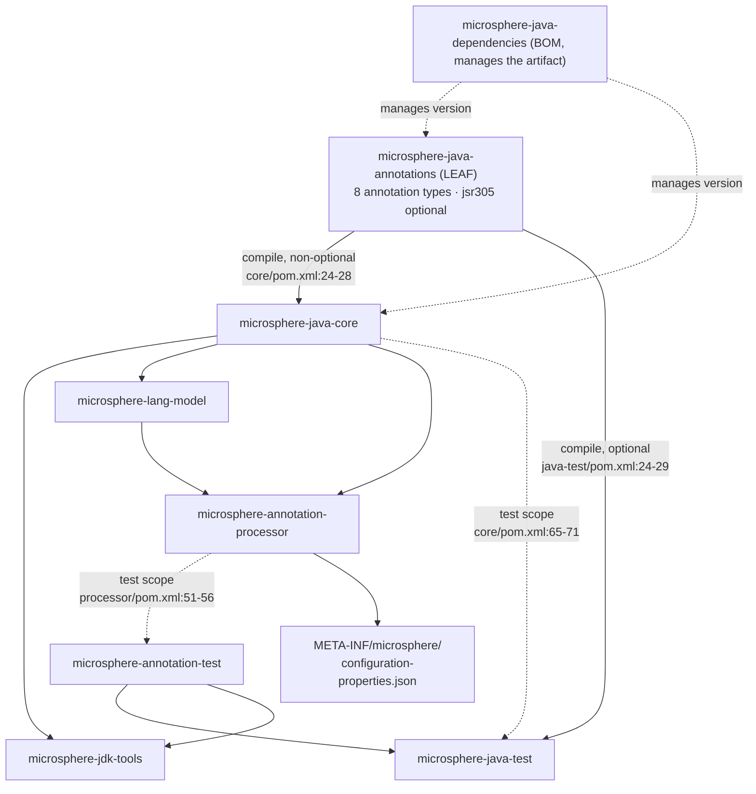
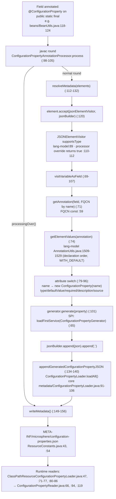

# Microsphere Java Annotations — Developer Guide

Module: `io.github.microsphere-projects:microsphere-java-annotations` · `0.3.20-SNAPSHOT` (`release` branch)
Packages: `io.microsphere.annotation` (6 types) · `io.microsphere.annotation.concurrent` (2 types) — 8 annotation
interfaces, 6 test classes, no other code · no `maven.compiler.*` / `<release>` property exists anywhere in the
reactor, so the bytecode level is inherited from the external parent `microsphere-build:0.3.16` (`pom.xml:6-10`); CI
on JDK 8 / 11 / 17 / 21 / 25 (`.github/workflows/maven-build.yml:25`, `:33`).

Path prefixes used below (all relative to the module root, and opened line-by-line before citation):

* `annotation/…` = `microsphere-java-annotations/src/main/java/io/microsphere/annotation/…`
* `concurrent/…` = `microsphere-java-annotations/src/main/java/io/microsphere/annotation/concurrent/…`
* `src/test/java/io/microsphere/annotation/…` for this module's tests
* other modules are cited with their full module prefix, e.g. `microsphere-java-core/src/main/java/io/microsphere/…`

---

## 1. Where this module sits

It is the **contract layer**: a leaf artifact that every other module may annotate with, and that depends on nothing
in the reactor. Its single compile dependency is `com.google.code.findbugs:jsr305`, declared `optional`
(`microsphere-java-annotations/pom.xml:24-28`); its only other dependencies are JUnit 5 at `test` scope
(`microsphere-java-annotations/pom.xml:30-41`).



Two inbound facts, verified rather than assumed:

* **`core` does depend on this module at compile scope and does not mark it optional**
  (`microsphere-java-core/pom.xml:24-28`). Every annotation core publishes (`@Nonnull`, `@Nullable`, `@Immutable`,
  `@ConfigurationProperty`) therefore resolves through this artifact, and consumers get it transitively. `core` asks
  for `jsr305` at **test** scope only (`microsphere-java-core/pom.xml:73-78`), so `javax.annotation.*` is deliberately
  *not* part of core's runtime contract.
* **The processor reaches the annotation by name, not by class identity.**
  `CONFIGURATION_PROPERTY_ANNOTATION_CLASS_NAME = "io.microsphere.annotation.ConfigurationProperty"`
  (`microsphere-annotation-processor/src/main/java/io/microsphere/annotation/processor/ConfigurationPropertyJSONElementVisitor.java:59`)
  is what `@SupportedAnnotationTypes` is given
  (`.../ConfigurationPropertyAnnotationProcessor.java:77`) and what drives the mirror lookup
  (`.../ConfigurationPropertyJSONElementVisitor.java:71`). The class object is never required to match.

Verified consumer census (main sources across the whole `release` worktree, counted by import statement):

| Annotation | Main-source files importing it | Production reflective readers | Compile-time readers |
|---|---|---|---|
| `@Nonnull` | 99 | none (tests only, `src/test/java/io/microsphere/annotation/NonnullTest.java:36`) | none — analyzer-facing |
| `@Nullable` | 76 | none (test only, `…/NullableTest.java:36`) | none |
| `@Immutable` | 74 | none (test only, `…/ImmutableTest.java:36`) | none |
| `@ConfigurationProperty` | 14 core/utility files, 2 test-support files | `microsphere-java-test/src/test/java/io/microsphere/test/model/ConfigurationPropertyModelTest.java:84-85` | `microsphere-annotation-processor` (by name) |
| `@Since` | 2 (`microsphere-java-test/src/main/java/io/microsphere/test/annotation/TestAnnotation.java:69`, `…/service/TestServiceImpl.java:70`) | none in production; used as a fixture in `microsphere-java-core/src/test/java/io/microsphere/util/AnnotationUtilsTest.java:469` | none |
| `@Experimental` | **0** | **0** — `assertNull` proves invisibility (`…/ExperimentalTest.java:35`) | none |
| `@ThreadSafe` / `@NotThreadSafe` | **0** | **0** (impossible: `CLASS` retention) | **0** |

> [!IMPORTANT]
> Reading the census bottom-up: five of the eight annotations have **no production reflective reader** in the
> repository. The only cross-module reflective consumer of an annotation *class object* is
> `ConfigurationPropertyModelTest` (`:84-85`); everything else either annotates or reads the generated JSON resource.
> This is not an accident — it is the definition of "contract layer": the library states promises, tools act on them.

---

## 2. The eight-type inventory

| Type | `@Target` | `@Retention` | `@Documented` | Attributes | JSR-305 linkage | Evidence |
|---|---|---|---|---|---|---|
| `annotation/Nonnull.java` | **absent** → all declaration contexts, no type-use | `RUNTIME` (`:33`) | yes (`:32`) | none | `@javax.annotation.Nonnull` (`:34`) + `@TypeQualifierNickname` (`:35`) | `:32-36` |
| `annotation/Nullable.java` | absent (as above) | `RUNTIME` (`:35`) | yes (`:34`) | none | `@javax.annotation.Nonnull(when = MAYBE)` (`:36`) + `@TypeQualifierNickname` (`:37`) | `:34-38`, `:24` |
| `annotation/Immutable.java` | absent (as above) | `RUNTIME` (`:32`) | yes (`:31`) | none | **none** | `:31-34` |
| `annotation/Since.java` | all 10 element types (`:43-54`) | `RUNTIME` (`:42`) | yes (`:55`) | `module()` `""` (`:61`), `value()` **required** (`:66`) | none | `:42-56` |
| `annotation/Experimental.java` | `ANNOTATION_TYPE, CONSTRUCTOR, FIELD, METHOD, TYPE` (`:38-44`) | `SOURCE` (`:37`) | yes (`:36`) | `description()` `""` (`:50`) | none | `:36-50` |
| `annotation/ConfigurationProperty.java` | `FIELD` (`:37`) | `RUNTIME` (`:36`) | yes (`:35`) | `name` `""` (`:60`), `type` `String.class` (`:67`), `defaultValue` `""` (`:74`), `required` `false` (`:81`), `description` `""` (`:88`), `source` `{}` (`:95`) | none | `:35-95` |
| `concurrent/ThreadSafe.java` | `TYPE` (`:27`) | `CLASS` (`:28`) | yes (`:26`) | none | none applied (unused import at `:9`) | `:26-29` |
| `concurrent/NotThreadSafe.java` | `TYPE` (`:26`) | `CLASS` (`:27`) | yes (`:25`) | none | none applied (unused import at `:9`) | `:25-28` |

Three groupings explain the retention spread, and each is an intentional (if undocumented) decision:

1. **`SOURCE` ×1** — `@Experimental` is a warning to the author at the point of use; once compiled there is nothing to
   enforce, so paying for a runtime attribute costs nothing and buys nothing.
2. **`CLASS` ×2** — the JCIP pair is aimed at bytecode analyzers; `RUNTIME` would only enlarge the constant pool.
3. **`RUNTIME` ×5** — `@Nonnull` / `@Nullable` / `@Immutable` are readable by reflective utilities
   (`io.microsphere.util.AnnotationUtils`), `@Since` carries data an introspection tool needs, and
   `@ConfigurationProperty` must be readable both by the `javax.lang.model` visitor *and* reflectively.

---

## 3. Source analysis: how the nullability annotations get their scope

### 3.1 Scope is defined by what is *absent*

`annotation/Nonnull.java:32-36` and `annotation/Nullable.java:34-38` declare `@Documented`, `@Retention(RUNTIME)`,
the JSR-305 qualifier and `@TypeQualifierNickname` — but **no `@Target`**. Per JLS §9.6.4.1 an annotation type with no
`@Target` is applicable in every *declaration* context (type, field, method, parameter, constructor, local variable,
package, annotation type) and in **no type-use context**. The practical consequences, in this order of importance:

| Placement | Legal? | Why |
|---|---|---|
| `@Nonnull public static Foo get()` | yes | method declaration |
| `void f(@Nonnull String s)` | yes | parameter declaration |
| `@Nonnull class X {}` | yes | type declaration — and it is what the tests do (`src/test/java/io/microsphere/annotation/NonnullTest.java:31`) |
| `package-info.java` annotated with `@Nonnull` | yes | no `@Target` ⇒ `PACKAGE` is allowed |
| `List<@Nonnull String>` | **no** | requires `ElementType.TYPE_USE`; only `@Since` declares it (`annotation/Since.java:53`) |
| `@Nonnull` on a `record` component's type | **no** | same reason |

### 3.2 There is no default-nullability mechanism

A JSR-305 project normally opts into "everything is non-null unless stated otherwise" with a package-level
`@TypeQualifierDefault(ElementType.METHOD) @Nonnull` sitting in `package-info.java`. Verified absence in `release`:

* `@TypeQualifierDefault` occurs in **no** Java source file in the worktree (the only hits are documentation prose and
  the analysis caches under `.understand-anything/`).
* The module ships **no** `package-info.java`; the only one in the reactor is
  `microsphere-java-core/src/main/java/io/microsphere/json/package-info.java`.

So the scope of `@Nonnull` is exactly *the elements someone annotated*, element by element. Adding a package-level
default later would silently change the meaning of 99 files, which is the main reason to treat this as a deliberate
limit rather than an oversight.

### 3.3 The nickname mechanism, and what `when = MAYBE` buys

```mermaid
sequenceDiagram
    participant SRC as Your source
    participant CL as Compiled .class (RUNTIME-visible)
    participant REF as Java reflection
    participant AN as JSR-305-aware analyzer
    participant JP as jsr305 on classpath
    SRC->>CL: @Nonnull (io.microsphere) retained :33 RUNTIME
    CL->>REF: element.getAnnotation(Nonnull.class) → instance
    Note over REF: works with NO extra jars — Nonnull itself has no javax.annotation dependency in its own bytecode
    CL->>AN: annotation type carries @javax.annotation.Nonnull + @TypeQualifierNickname (:34-35)
    JP-->>AN: resolves javax.annotation.Nonnull / meta.When
    AN->>AN: treat as the ALWAYS qualifier; Nullable maps to when=MAYBE (:36)
    Note over JP,AN: jsr305 is optional (pom.xml:24-28) → without it the alias does not resolve and only the marker survives
```

Mechanically: `@TypeQualifierNickname` (imported at `annotation/Nonnull.java:19`, `annotation/Nullable.java:19`) tells
a conforming analyzer *"the qualifier to apply is the one annotated on me"*. Both microsphere annotations therefore
alias the **same** JSR-305 type, distinguished only by its `when` parameter — `@Nonnull` inherits the default
(`ALWAYS`), `@Nullable` sets `when = MAYBE` via the static import at `annotation/Nullable.java:24`. Using `MAYBE`
rather than `javax.annotation.Nullable` keeps one qualifier type in the dataflow lattice and makes "nullable" a
property of the same predicate instead of a second, competing one.

> [!WARNING]
> Because `jsr305` is `optional`, the meta-annotations are **not** transitively available to consumers
> (`microsphere-java-annotations/pom.xml:27`), and `core` narrows it further to `test` scope
> (`microsphere-java-core/pom.xml:73-78`). Reflectively, `Nonnull.class.getAnnotation(javax.annotation.Nonnull.class)`
> only answers when `jsr305` is present on the runtime classpath. Nothing in the module's own six tests asserts the
> aliasing resolves — see [§8](#8-testing-strategy).

### 3.4 Provenance is visible in the headers

`annotation/Nonnull.java:1-15` and `annotation/Nullable.java:1-15` carry the Spring Framework copyright block
(`Copyright 2002-2019 the original author or authors`), while `ConfigurationProperty`, `Experimental`, `Immutable` and
`Since` carry the ASF block, and `concurrent/ThreadSafe.java:1-6` / `concurrent/NotThreadSafe.java:1-6` carry the JCIP
attribution (`Copyright (c) 2005 Brian Goetz`, `Official home: http://www.jcip.net`). The naming follows suit:
`Nonnull` (lower-case second letter) mirrors `javax.annotation.Nonnull`, not Spring's `NonNull`
(`annotation/Nonnull.java:36`).

---

## 4. Source analysis: the thread-safety pair

`concurrent/ThreadSafe.java` and `concurrent/NotThreadSafe.java` are near-mirror images of each other:

| Aspect | `ThreadSafe` | `NotThreadSafe` |
|---|---|---|
| Javadoc body | `:18-22` (the JCIP definition verbatim) | `:18-21` |
| `@Documented` | `:26` | `:25` |
| `@Target(TYPE)` | `:27` | `:26` |
| `@Retention(CLASS)` | `:28` | `:27` |
| Cross `@see` | `:24` | `:23` |
| Author / `@since` javadoc tags | **absent** | **absent** |

Three observations that matter to a maintainer:

1. **The JSR-305 imports are dead and cross-wired.** `ThreadSafe.java:9` imports
   `javax.annotation.concurrent.NotThreadSafe`, and `NotThreadSafe.java:9` imports
   `javax.annotation.concurrent.ThreadSafe`. Neither is applied — there is no
   `@javax.annotation.concurrent.ThreadSafe` meta-annotation on the type — so this pair has **no** nickname aliasing,
   unlike `@Nonnull`/`@Nullable`. A SpotBugs/FindBugs run will not read `io.microsphere.annotation.concurrent.ThreadSafe`
   as the JCIP/JSR-305 claim it names. Either delete the imports or add the meta-annotations plus
   `@TypeQualifierNickname`-style linkage; the current state is the worst of both.
2. **Neither annotation is used anywhere in `release`.** Searching the whole worktree for
   `io.microsphere.annotation.concurrent` yields only the two declaring files. Core documents safety with
   `@Immutable` and structure instead — `@Immutable` sits directly on the two snapshot fields
   (`microsphere-java-core/src/main/java/io/microsphere/util/ClassPathUtils.java:60-61`, `:63-64`), on the caches
   returned by `ConcurrentHashMap`-backed utilities (`…/util/ClassLoaderUtils.java:92`,
   `…/util/ServiceLoaderUtils.java:140`) and on the unmodifiable publication itself
   (`…/util/ServiceLoaderUtils.java:468-469`).
3. **`@Immutable` is in the wrong package for this pairing.** `javax.annotation.concurrent` hosts both `Immutable` and
   the thread-safety pair; Microsphere splits them: `Immutable` in `io.microsphere.annotation`
   (`annotation/Immutable.java:17`), the pair in `io.microsphere.annotation.concurrent`
   (`concurrent/ThreadSafe.java:7`). The consequence is that the "state cannot be seen to change" promise
   (`annotation/Immutable.java:24-25`) and the "no invalid interleaving" promise (`concurrent/ThreadSafe.java:18-22`)
   are annotated by unrelated types with different retentions (`RUNTIME` vs `CLASS`), and neither links to JSR-305.

---

## 5. Source analysis: `@ConfigurationProperty` and every reader of it

### 5.1 The attribute contract

`annotation/ConfigurationProperty.java:55-95` declares six attributes plus three `String` constants (`:43`, `:48`,
`:53`) that form the closed vocabulary of `source()`. The javadoc frames the intended target as
"the Java field whose modifiers usually are `static` and `final` for the configuration property"
(`annotation/ConfigurationProperty.java:27-28`) and points at the generator module
("The module that named `microsphere-annotation-processor` generates the metadata resource in the classpath", `:30`).

Every reader of `ConfigurationProperty.class` (grep of the full worktree, all hits):

| Reader | Kind | Evidence |
|---|---|---|
| `ConfigurationPropertyModelTest` | runtime reflection over `getDeclaredFields()` | `microsphere-java-test/src/test/java/io/microsphere/test/model/ConfigurationPropertyModelTest.java:84` (`isAnnotationPresent`), `:85` (`getAnnotation`) |
| `ConfigurationPropertyJSONElementVisitorTest` | compiles the annotation into a test compilation | `microsphere-annotation-processor/src/test/java/io/microsphere/annotation/processor/ConfigurationPropertyJSONElementVisitorTest.java:54`, name assertion `:59` |
| `ConfigurationPropertyAnnotationProcessor` | `@SupportedAnnotationTypes` + import | `.../processor/ConfigurationPropertyAnnotationProcessor.java:20`, `:77` |
| `ConfigurationPropertyJSONElementVisitor` | by-name mirror lookup, six-attribute mapping | `.../processor/ConfigurationPropertyJSONElementVisitor.java:59`, `:71`, `:79-96` |
| `TestAnnotation` / `TestServiceImpl` | annotation-typed attribute carrier (`ConfigurationProperty[] properties()`) | `microsphere-java-test/src/main/java/io/microsphere/test/annotation/TestAnnotation.java:71`, `…/service/TestServiceImpl.java:72-74` |
| `io.microsphere.metadata.*` | **does not read the annotation** — reads the generated JSON and models it as `io.microsphere.beans.ConfigurationProperty` | `microsphere-java-core/src/main/java/io/microsphere/metadata/ConfigurationPropertyLoader.java:44` (`@see` only), `…/metadata/ConfigurationPropertyReader.java:38` |



### 5.2 Three defaults are not defaults

The visitor treats "author omitted the attribute" as "infer it", via
`matchesDefaultAttributeValue` (`microsphere-lang-model/src/main/java/io/microsphere/lang/model/util/AnnotationUtils.java:1145`):

| Attribute | Declared default | What the processor actually emits when omitted | Evidence |
|---|---|---|---|
| `name()` | `""` (`annotation/ConfigurationProperty.java:60`) | `field.getConstantValue()` — the field's own literal value; `null` for non-constant fields | `.../ConfigurationPropertyJSONElementVisitor.java:119-122` |
| `type()` | `String.class` (`:67`) | `field.asType()` — the field's declared Java type | `:124-128` |
| `description()` | `""` (`:88`) | `elements.getDocComment(field)` — the field's javadoc | `:130-136` |

The `type()` row is a documented-vs-actual divergence: the annotation javadoc promises `String`, yet the generated
metadata for `microsphere.io.buffer.size` is `"type": "int"`
(`microsphere-java-core/src/main/resources/META-INF/microsphere/configuration-properties.json:32`), matching the
`int` field annotated at `microsphere-java-core/src/main/java/io/microsphere/io/IOUtils.java:85-89`. Fix the javadoc,
not the visitor.

### 5.3 A load-bearing ordering dependency

`visitVariableAsField` creates the model **only** inside the `name` branch (`:79-81`) and dereferences it in every
later branch (`:84`, `:87`, `:90`, `:93`, `:95`) — so it implicitly requires `name()` to be visited first. That holds
today because `getElementValues` iterates `getDeclaredMethods(annotationType)` in declaration order
(`microsphere-lang-model/.../AnnotationUtils.java:1514`, `:1518-1527`) and `name()` is the first attribute declared
(`annotation/ConfigurationProperty.java:60`). **Reordering the attributes of the annotation interface would make the
processor throw `NullPointerException`** — nothing in either file records the constraint. Either iterate
`name` explicitly first or hoist construction out of the switch.

The remaining steps are mechanical but worth knowing: sources are appended to `Metadata.getSources()` in the `else`
branch (`:95`, implemented `:143-152`), `declaredClass` / `declaredField` are always overwritten from the field itself
(`:154-163`), the array brackets are stitched by replacing a trailing comma (`:126-131`), and the JSON is re-parsed
through `JSONArray` purely to be pretty-printed at indent 2 (`:151-152`).

### 5.4 Generation is optional; consumption is SPI

The processor registers itself through `META-INF/services/javax.annotation.processing.Processor:1`
(`microsphere-annotation-processor/src/main/resources/`). Output format is pluggable
(`ConfigurationPropertyGenerator`, default `DefaultConfigurationPropertyGenerator`, registered at
`microsphere-java-core/src/main/resources/META-INF/services/io.microsphere.metadata.ConfigurationPropertyGenerator:1`;
a second, unregistered implementation is `…/metadata/ReflectiveConfigurationPropertyGenerator.java:73-79`). On the
read side, `ConfigurationPropertyLoader.loadAll()` (`…/metadata/ConfigurationPropertyLoader.java:91-106`) swallows any
`Throwable` per loader and logs it (`:101-103`) — the module family's silent-degradation policy — and core ships one
loader, `AdditionalMetadataResourceConfigurationPropertyLoader`, registered at
`microsphere-java-core/src/main/resources/META-INF/services/io.microsphere.metadata.ConfigurationPropertyLoader:1`,
reading `META-INF/microsphere/additional-configuration-properties.json`
(`…/metadata/AdditionalMetadataResourceConfigurationPropertyLoader.java:36`, name at
`microsphere-java-core/src/main/java/io/microsphere/constants/ResourceConstants.java:60`).

---

## 6. Design patterns (with the proving file)

| Pattern | Implementing type(s) | Evidence |
|---|---|---|
| **Marker annotation** | `@Immutable`, `@Nonnull`, `@Nullable`, `@ThreadSafe`, `@NotThreadSafe` — empty bodies, no attributes | `annotation/Immutable.java:33-34`, `annotation/Nonnull.java:36-37`, `annotation/Nullable.java:38-39`, `concurrent/ThreadSafe.java:29-30` |
| **Meta-annotation / composed annotation** | `@Nonnull` and `@Nullable` compose `@javax.annotation.Nonnull` + `@TypeQualifierNickname` onto themselves | `annotation/Nonnull.java:34-35`, `annotation/Nullable.java:36-37` |
| **Nickname / alias (JSR-305 idiom)** | one provider qualifier, two public names, parameterised by `when` | `annotation/Nullable.java:24`, `:36` |
| **Contract-by-annotation** | fields declare their own configuration contract; the processor, not the field owner, enforces and publishes it | `microsphere-java-core/src/main/java/io/microsphere/beans/BeanUtils.java:118-124` → `…/processor/ConfigurationPropertyJSONElementVisitor.java:70-107` |
| **Annotation as value carrier (composite)** | another annotation exposes `Since since()` and `ConfigurationProperty[] properties()` | `microsphere-java-test/src/main/java/io/microsphere/test/annotation/TestAnnotation.java:69`, `:71` |
| **Default-inference (a null-object variant)** | omitted attributes are replaced by facts from the element itself | `…/processor/ConfigurationPropertyJSONElementVisitor.java:119-136` |
| **Visitor over `javax.lang.model`** | `AnnotatedElementJSONElementVisitor` subclassing, `visitVariableAsField` override | `microsphere-lang-model/src/main/java/io/microsphere/lang/model/util/AnnotatedElementJSONElementVisitor.java:88`, `:120`; override at `…/ConfigurationPropertyJSONElementVisitor.java:69-70` |
| **SPI + service-locator** | generator/loader/reader discovered through `META-INF/services` | `…/ConfigurationPropertyJSONElementVisitor.java:65`; `…/metadata/ConfigurationPropertyLoader.java:93` |
| **Paired opposites** | `ThreadSafe` ⇄ `NotThreadSafe`, `Nonnull` ⇄ `Nullable`, `Since` ⇄ `Experimental` (`@see Experimental`) | `concurrent/ThreadSafe.java:24`, `concurrent/NotThreadSafe.java:23`, `annotation/Since.java:39` |
| **Retention-tiering** | the deliberate `SOURCE` / `CLASS` / `RUNTIME` split per audience | §2 inventory table |

---

## 7. Retention and target choices: review notes

* **`@Experimental` is invisible by construction.** `SOURCE` (`annotation/Experimental.java:37`) means no class file,
  no reflection, no bytecode tooling. Its own test asserts that invisibility
  (`src/test/java/io/microsphere/annotation/ExperimentalTest.java:35`). If the intent ever becomes "warn at runtime",
  the retention must move to `RUNTIME` — a **binary-incompatible** decision for tools that cached `SOURCE` behaviour.
* **`@Experimental` is called a "marker annotation" but is not one.** The javadoc opens with "The marker annotation
  indicates a feature is experimental" (`annotation/Experimental.java:31`) while the type declares
  `description()` (`:50`). Marker = no attributes; this is a *descriptive* annotation. Same wording drift in
  `annotation/ConfigurationProperty.java:65`, where the javadoc tag is misspelled `@reurn`.
* **`@Nullable`'s javadoc points at the wrong sibling.** `@see javax.annotation.Nonnull`
  (`annotation/Nullable.java:31`) — technically true (that *is* the qualifier it aliases) but confusing next to
  `annotation/Nonnull.java:29` which cites the same type. Both should also state the `when` distinction.
* **`CLASS` retention makes the `concurrent` pair runtime-unobservable and, so far, tool-unobservable too**, since it
  carries no JSR-305 alias (§4 note 1) and zero usages. `@Documented` (`:26`/`:25`) is the only effect it currently has.
* **No `@Target` on three of the five `RUNTIME` types** (`Nonnull`, `Nullable`, `Immutable`) is the widest applicability
  the language offers — convenient for authors, unrecoverable later: adding a restrictive `@Target` is a
  source-breaking change for anyone already using it in a position you would exclude. It also silently blocks
  type-use placement, which is where modern nullness tools prefer to read.
* **The `concurrent` pair omits `@author` and `@since`** (`concurrent/ThreadSafe.java:17-25`,
  `concurrent/NotThreadSafe.java:17-24`) while all six root-package types carry `@since 1.0.0`
  (`annotation/ConfigurationProperty.java:33` and siblings). Any "generated API history" tool keyed on `@since`
  javadoc will skip the pair.
* **Annotations never throw — and never enforce.** Consistent with the library-wide silent-degradation policy, no
  promise is checked at runtime. Where core does need a check, it is written by hand: `@Nonnull String name` paired
  with `assertNotNull(...)` (`microsphere-java-core/src/main/java/io/microsphere/beans/ConfigurationProperty.java:115`,
  `:119-120`). Treat that pairing as the convention for new APIs.
* **`io.microsphere.lang.Deprecation` does not read `@Since`.** Its `getSince()` returns a `Version` parsed from its
  own model (`microsphere-java-core/src/main/java/io/microsphere/lang/Deprecation.java:111`), and the class imports
  only `Immutable`/`Nonnull`/`Nullable` (`:19-21`). The two lifecycle mechanisms are parallel, not connected.

---

## 8. Testing strategy

Location: `microsphere-java-annotations/src/test/java/io/microsphere/annotation/` — six JUnit 5 classes, one per
annotation with attributes or a retention worth pinning (`ThreadSafe`/`NotThreadSafe` have no test, consistent with
having no observable runtime behaviour).

| Test | What it pins | Evidence |
|---|---|---|
| `NonnullTest` / `NullableTest` / `ImmutableTest` | `RUNTIME` retention is real: a class-level annotation is retrievable | `NonnullTest.java:31` + `:36`; `NullableTest.java:31` + `:36`; `ImmutableTest.java:31` + `:36` |
| `ExperimentalTest` | `SOURCE` retention is real: the same call returns `null` | `ExperimentalTest.java:30` + `:35` (`assertNull`) |
| `SinceTest` | both attributes round-trip reflectively, including the required `value()` | `SinceTest.java:30` + `:35-37` |
| `ConfigurationPropertyTest` | the three `source()` constants are exact strings | `ConfigurationPropertyTest.java:38-40` |

> [!TIP]
> Gaps to close when you touch this module. (1) No test asserts the JSR-305 aliasing resolves — add
> `assertNotNull(Nonnull.class.getAnnotation(javax.annotation.Nonnull.class))` and the `when = MAYBE` equivalent;
> `jsr305` is already on this module's classpath (`microsphere-java-annotations/pom.xml:24-28`). (2) No test asserts
> that `@Nonnull` on a *parameter* or *method* is retained as well as on a type. (3) No test asserts `@Target` contents
> — `Since.class.getAnnotation(Target.class)` is already exercised that way in core
> (`microsphere-java-core/src/test/java/io/microsphere/util/AnnotationUtilsTest.java:473`).
> (4) The processor behaviour that gives `@ConfigurationProperty` its value is tested in
> `microsphere-annotation-processor` and the `microsphere-annotation-test` javac harness, not here — keep it that way,
> since this module must not acquire a test dependency on `core`.

---

## 9. Extension points

* **Add a ninth annotation** — keep the invariants: no in-repo dependency, no class files, retention chosen on purpose
  (default to `RUNTIME` only if something must read it live), `@Documented` always, `@since` javadoc always, and both
  guide pages' inventory tables updated in the same change.
* **Opt into package-wide nullability** — the only missing JSR-305 piece is `@TypeQualifierDefault` (§3.2). Adding
  `package-info.java` here changes the *meaning* of 99 already-annotated files, so it must land with an analyzer
  configuration change and a release note, not quietly.
* **Give the `concurrent` pair real teeth** — either drop `concurrent/ThreadSafe.java:9` and
  `concurrent/NotThreadSafe.java:9` or turn them into `@javax.annotation.concurrent.ThreadSafe` / `…NotThreadSafe`
  meta-annotations so bytecode analyzers honour them.
* **Extend the metadata pipeline** — implement `ConfigurationPropertyGenerator` (JSON shape),
  `ConfigurationPropertyLoader` (extra sources) or `ConfigurationPropertyReader` (extra formats) and register via
  `META-INF/services`; `loadAll()` already tolerates failing loaders
  (`microsphere-java-core/src/main/java/io/microsphere/metadata/ConfigurationPropertyLoader.java:101-103`).

---

## 10. See also

* [Microsphere Java Annotations — User Guide](../user-guide/module-microsphere-java-annotations.md) — per-annotation contracts and pitfalls
* [Configuration Metadata — Developer Guide](./microsphere-java-core/configuration-metadata.md) — the readers downstream of the generated JSON
* [Language Abstractions — Developer Guide](./microsphere-java-core/language-abstractions.md) — `Deprecation`, `io.microsphere.util.AnnotationUtils` and its `isMetaAnnotation` family (`.../util/AnnotationUtils.java:535`)
* [microsphere-annotation-processor](./module-microsphere-annotation-processor.md) — the compile-time consumer: processing rounds, `Filer`/`Messager` use and the shaded artifact
* [中文版本](./module-microsphere-java-annotations.zh.md)
* [Module index](./README.md)
