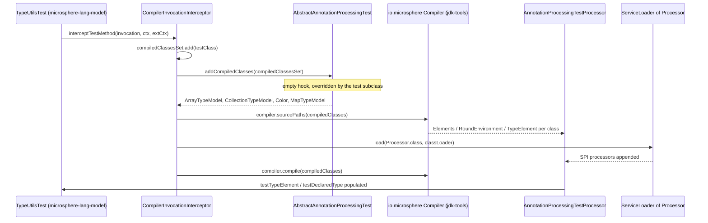

# Microsphere Java Test — Developer Guide

| | |
|---|---|
| **Artifact** | `io.github.microsphere-projects:microsphere-java-test` (`0.3.20-SNAPSHOT`, `release` branch) |
| **Role** | Shared *fixture* artifact — types whose only purpose is to be reflected over, compiled, or annotation-processed by other modules |
| **Main-source types** | 16 — `io.microsphere.test.annotation` (1) · `io.microsphere.test.model` (11) · `io.microsphere.test.service` (4) |
| **Executable logic** | None beyond getters, setters, `toString()` and `"[ECHO] " + message` concatenation |
| **Dependencies** | 9 declared, **all `optional`**, none with `<scope>` — `microsphere-java-test/pom.xml:21-85` |
| **Shipped resources** | `src/main/resources/junit-platform.properties`, `src/main/resources/logback-test.xml`; **no `META-INF/services` files** |
| **Tests** | 14 JUnit 5 test classes under `src/test/java/io/microsphere/test/` |
| **Bytecode level** | Not set in this repository; inherited from the external parent `microsphere-build:0.3.16` (`pom.xml:6-10`). CI matrix: Temurin `java: [ '8' , '11' , '17' , '21' , '25' ]` (`.github/workflows/maven-build.yml:25`, `distribution: 'temurin'` `:33`) |

> [!NOTE]
> **Citation shorthand used on this page.** Paths are relative to `microsphere-java-test/src/main/java/io/microsphere/`
> for module sources (`test/model/Model.java:29`), and to `microsphere-java-test/src/test/java/io/microsphere/` for its
> own tests (`test/service/TestServiceImplTest.java:31`). Cross-module paths are written in full.

---

## 1. Where this module sits

`microsphere-java-test` is the 6th module in the reactor (`pom.xml:63`, `<modules>` at `pom.xml:58-66`), which places it
after `microsphere-java-annotations` (`:60`), `microsphere-java-core` (`:61`) and `microsphere-jdk-tools` (`:62`), and
before `microsphere-annotation-test` (`:64`), `microsphere-lang-model` (`:65`) and `microsphere-annotation-processor`
(`:66`). The ordering is not cosmetic: it is the reason `microsphere-annotation-test` can depend on the fixtures at
compile scope (`microsphere-annotation-test/pom.xml:24-28`) and re-export them downward.

```mermaid
graph TD
    subgraph PROD["Production layer"]
        ANNO["microsphere-java-annotations"]
        CORE["microsphere-java-core"]
        JDKTOOLS["microsphere-jdk-tools"]
    end
    subgraph FIX["Fixture layer"]
        JTEST["microsphere-java-test"]
    end
    subgraph HARNESS["Harness layer"]
        ATEST["microsphere-annotation-test"]
    end
    subgraph CONSUMERS["lang-model / processor"]
        LANGMODEL["microsphere-lang-model"]
        AP["microsphere-annotation-processor"]
    end
    ANNO --> CORE
    CORE --> JDKTOOLS
    ANNO -. optional .-> JTEST
    JTEST -. test scope : microsphere-java-core/pom.xml:66-71 .-> CORE
    JTEST -. test scope : microsphere-jdk-tools/pom.xml:45-48 .-> JDKTOOLS
    JTEST -- compile scope : microsphere-annotation-test/pom.xml:24-28 --> ATEST
    JDKTOOLS --> ATEST
    ATEST -. test scope : microsphere-lang-model/pom.xml:52-57 .-> LANGMODEL
    LANGMODEL --> AP
```

**Why a separate artifact rather than a `src/test` tree per module.** Three mechanisms make the split load-bearing:

1. **A fixture must be visible to `javac` as source, not only as bytecode.** The harness feeds `Class<?>` objects into a
   real compiler invocation (`microsphere-annotation-test/src/main/java/io/microsphere/test/annotation/processing/CompilerInvocationInterceptor.java:52-63`),
   which then exposes them as `TypeElement`/`DeclaredType`. For that to work, the *same* class must also be on the
   runtime classpath so the test can compare the reflective view against the language-model view. A copy inside each
   module's `src/test` would produce two distinct class objects loaded by different class loaders.
2. **The optional-dependency trick only works in a jar.** `microsphere-java-test` asks for JUnit, Mockito, Logback,
   JAX-RS, JAX-WS and Spring as `optional` (`microsphere-java-test/pom.xml:31-84`), so consumers keep full control of
   versions (`microsphere-lang-model/pom.xml:30-91` declares all of them again at `test` scope). Fixtures inside a
   `src/test` tree cannot express that contract at all.
3. **The annotations on `TestServiceImpl` would otherwise leak into a production jar.** `@Service`, `@ComponentScans`,
   `@ServiceMode`, `@Cacheable` and `@TestAnnotation` all live on one type (`test/service/TestServiceImpl.java:41-76`),
   and `spring-context`/`spring-web` are compile-scope-optional dependencies of this module
   (`microsphere-java-test/pom.xml:73-83`). Hosting the fixture in `microsphere-java-core` would drag Spring into a
   module that is supposed to stay dependency-free.

---

## 2. The sixteen-type inventory

| # | Type | Kind | Declared at | Supertypes / notable members | Purpose |
|---|---|---|---|---|---|
| 1 | `TestAnnotation` | annotation | `test/annotation/TestAnnotation.java:43` | `RUNTIME`, `TYPE`, `@Documented` (`:40-42`) | 14 attributes covering every annotation member kind |
| 2 | `Ancestor` | class | `test/model/Ancestor.java:27` | `implements Serializable` | Level 3 of the POJO chain; `boolean z` (`:29`) |
| 3 | `Parent` | class | `test/model/Parent.java:25` | `extends Ancestor` | Level 2; `byte b`, `short s`, `int i`, `long l` (`:27-33`) |
| 4 | `Model` | class | `test/model/Model.java:29` | `extends Parent` | Level 1; `float`, `double`, `TimeUnit`, `String`, `BigInteger`, `BigDecimal` (`:31-41`) |
| 5 | `PrimitiveTypeModel` | class | `test/model/PrimitiveTypeModel.java:25` | getters only (`:43-73`) | All 8 primitives, no setters |
| 6 | `SimpleTypeModel` | class | `test/model/SimpleTypeModel.java:29` | 13 accessor pairs + 1 orphan field | Wrapper catalogue incl. `Void` (`:31`); `private int invalid` has no accessor (`:57`) |
| 7 | `Color` | enum | `test/model/Color.java:25` | `RED(1)`, `YELLOW(2)`, `BLUE(3)` | Enum with state, `getValue()` (`:44`), overridden `toString()` (`:38-42`) |
| 8 | `ArrayTypeModel` | class | `test/model/ArrayTypeModel.java:25` | 5 array fields | `int[]`, `String[]`, `PrimitiveTypeModel[]`, `Model[]`, `Color[]` (`:27-35`) |
| 9 | `CollectionTypeModel` | class | `test/model/CollectionTypeModel.java:31` | 5 `Collection` sub-interfaces | `Collection`/`List`/`Queue`/`Deque`/`Set`, element kinds vary (`:33-41`) |
| 10 | `MapTypeModel` | class | `test/model/MapTypeModel.java:31` | 5 `Map` variants | `Map`/`SortedMap`/`NavigableMap`/**`HashMap`**/**`TreeMap`** (`:33-41`) |
| 11 | `StringArrayList` | class | `test/model/StringArrayList.java:29` | `extends ArrayList<String>` | Empty body — a type argument fixed by inheritance |
| 12 | `ConfigurationPropertyModel` | class | `test/model/ConfigurationPropertyModel.java:29` | 5 fields, each `@ConfigurationProperty` | Metadata fixture; property names prefixed `microsphere.annotation.processor.` (`:31-44`) |
| 13 | `TestService` | interface | `test/service/TestService.java:36` | `@Path("/echo")` (`:35`) | 5 methods with JAX-RS annotations; spurious `<T>` on `echo` (`:39`) |
| 14 | `DefaultTestService` | class | `test/service/DefaultTestService.java:29` | `implements TestService` | Full implementation; `echo` returns `"[ECHO] " + message` (`:34-36`) |
| 15 | `GenericTestService` | class | `test/service/GenericTestService.java:27` | `extends DefaultTestService implements TestService, EventListener` | Re-declares `TestService`, adds the `EventListener` marker (`:19`, `:27`) |
| 16 | `TestServiceImpl` | class | `test/service/TestServiceImpl.java:77` | `extends GenericTestService implements TestService, AutoCloseable, Serializable` | The annotation-saturated leaf; 2 constructors (`:84-90`) |

Family sizes: 1 / 11 / 4 = 16, matching the declared package split. Kind split: **1 annotation interface + 1 interface +
1 enum + 13 classes**. Of the 16 types, 14 have a dedicated test class; `TestAnnotation` and `TestService` do not —
they are exercised indirectly through `TestServiceImpl` and through `microsphere-lang-model`
(`microsphere-lang-model/src/test/java/io/microsphere/lang/model/util/AnnotationUtilsTest.java:714`).

---

## 3. Source analysis: how a fixture reaches a `TypeElement`

The consumption path is a Template Method driven by a JUnit 5 `InvocationInterceptor` that lives in the *harness*
module, not here. The fixtures supply the classes; the harness compiles them.



Evidence for each hop:

| Hop | Source |
|---|---|
| Interceptor entry point | `microsphere-annotation-test/src/main/java/io/microsphere/test/annotation/processing/CompilerInvocationInterceptor.java:42-44` |
| Test class added first | `CompilerInvocationInterceptor.java:47-49` |
| Hook invocation | `CompilerInvocationInterceptor.java:50` |
| Hook is empty by default | `microsphere-annotation-test/src/main/java/io/microsphere/test/annotation/processing/AbstractAnnotationProcessingTest.java:133-134` |
| Compiler receives the classes | `CompilerInvocationInterceptor.java:52-55` |
| SPI processors loaded | `CompilerInvocationInterceptor.java:59-62` |
| Compile triggered | `CompilerInvocationInterceptor.java:63` |
| Fixture override in a consumer | `microsphere-lang-model/src/test/java/io/microsphere/lang/model/util/TypeUtilsTest.java:189-193` |
| Populated language-model handles | `AbstractAnnotationProcessingTest.java:110-126`, `:136-142` |

A second, entirely independent discovery path exists for the **runtime** view: `microsphere-java-core` simply reflects
on these classes with `Class#getDeclaredFields()` and friends, as its own `io.microsphere.test` fixtures do
(`microsphere-java-core/src/test/java/io/microsphere/reflect/TypeUtilsTest.java:22-29`). The two paths converge only at
the assertion, where a test compares a `TypeMirror` against a `Class`.

```mermaid
flowchart LR
    FIXTURE["test/model/Model.java:29"] -->|bytecode on test classpath| REFL["java.lang.reflect: getDeclaredFields()"]
    FIXTURE -->|sourcePaths(compiledClasses)| JAVAC["javac: TypeElement + DeclaredType"]
    REFL --> A1["core assertions (microsphere-java-core/pom.xml:66-71)"]
    JAVAC --> A2["lang-model assertions (TypeUtilsTest.java:189-193)"]
    A1 --> SAME["same Class object, two views"]
    A2 --> SAME
```

> [!IMPORTANT]
> There is **no `META-INF/services` file in this module**. `src/main/resources` contains only
> `junit-platform.properties` and `logback-test.xml`, confirmed by listing the directory. The fixtures are discovered
> by *direct compile-time reference* (`import io.microsphere.test.model.ArrayTypeModel` at
> `microsphere-lang-model/src/test/java/io/microsphere/lang/model/util/TypeUtilsTest.java:19`) or by being handed to
> `addCompiledClasses` — never by the service loader. The `ServiceLoader<Processor>` call at
> `CompilerInvocationInterceptor.java:60` belongs to the harness and resolves `microsphere-annotation-processor`
> registrations, not anything from here.

---

## 4. Source analysis: the two axes of the model package

The eleven `test.model` types are not a random grab bag; they sit on two orthogonal axes, and every field comment in
the source is a note about which axis it is probing.

**Axis A — inheritance depth.** `Ancestor` → `Parent` → `Model` gives a 1-, 2- and 3-level chain from the same root:

```java
public class Ancestor implements Serializable {

    private boolean z;

public class Parent extends Ancestor {

    private byte b;

    private short s;

    private int i;

    private long l;

public class Model extends Parent {

    private float f;

    private double d;

    private TimeUnit tu;

    private String str;

    private BigInteger bi;

    private BigDecimal bd;
```

(`test/model/Ancestor.java:27-29`, `test/model/Parent.java:25-33`, `test/model/Model.java:29-41` — condensed into one
block, declarations verbatim.) A field-walking utility that stops at `getDeclaredFields()` sees 6 fields on `Model`;
one that recurses through `getSuperclass()` sees 11. `StringArrayList` (`test/model/StringArrayList.java:29`) is the
zero-field extreme of the same axis: it adds nothing but a resolved supertype argument.

**Axis B — element kind.** `ArrayTypeModel`, `CollectionTypeModel` and `MapTypeModel` each hold five fields whose
element kind increases in complexity in the same order, and the source comments say so explicitly:

| Kind probed | `ArrayTypeModel` (`test/model/ArrayTypeModel.java:27-35`) | `CollectionTypeModel` (`test/model/CollectionTypeModel.java:33-41`) | `MapTypeModel` (`test/model/MapTypeModel.java:33-41`) |
|---|---|---|---|
| primitive | `int[] integers` | — | — |
| simple | `String[] strings` | `Collection<String> strings` | `Map<String, String> strings` |
| enum | `Color[] colors` | `List<Color> colors` | `SortedMap<String, Color> colors` |
| flat POJO | `PrimitiveTypeModel[] primitiveTypeModels` | `Queue<PrimitiveTypeModel> primitiveTypeModels` | `NavigableMap<Color, PrimitiveTypeModel> primitiveTypeModels` |
| hierarchical POJO | `Model[] models` | `Deque<Model> models` | `HashMap<String, Model> models` |
| POJO array as element | — | `Set<Model[]> modelArrays` | `TreeMap<PrimitiveTypeModel, Model[]> modelArrays` |

Two deliberate asymmetries make the axes testable:

- **Accessor completeness varies.** `PrimitiveTypeModel` ships getters only (`test/model/PrimitiveTypeModel.java:43-73`);
  `SimpleTypeModel` ships getters and setters for 13 fields but *no* accessor for `private int invalid`
  (`test/model/SimpleTypeModel.java:57`); `StringArrayList` ships nothing at all
  (`test/model/StringArrayList.java:29-30`). A bean-introspection path therefore gets three different answers from
  three fixtures in one package.
- **Declared raw types vary within the same role.** `MapTypeModel` declares two fields with concrete classes
  (`test/model/MapTypeModel.java:39`, `:41`) while the other three use interfaces (`:33`, `:35`, `:37`). Consumers that
  normalise to `Map` lose that information, which is exactly what
  `microsphere-lang-model/src/test/java/io/microsphere/lang/model/util/TypeUtilsTest.java:189-193` is set up to catch.

`Color` (`test/model/Color.java:25-46`) and `ConfigurationPropertyModel` (`test/model/ConfigurationPropertyModel.java:29-44`)
are the package's two "value-carrying" fixtures: the first proves an enum with a constructor argument and a
`toString()` override round-trips through both views, the second proves every attribute of `@ConfigurationProperty`
(`name`, `type`, `defaultValue`, `required`, `description`) survives annotation extraction.

---

## 5. Source analysis: the service ladder

Four types, one interface, three levels of implementation, each level adding one orthogonal characteristic:

| Level | Type | What the level adds | Source |
|---|---|---|---|
| 0 | `TestService` | JAX-RS contract: `@Path("/echo")`, `@GET`/`@POST`/`@PUT`, `@PathParam`, `@DefaultValue`; five methods | `test/service/TestService.java:35-54` |
| 1 | `DefaultTestService` | One concrete implementation of all five; three return `null`, two return a value | `test/service/DefaultTestService.java:29-56` |
| 2 | `GenericTestService` | Re-declares `TestService` (redundantly) and adds `java.util.EventListener`; overrides `echo` with an identical body | `test/service/GenericTestService.java:27-31` |
| 3 | `TestServiceImpl` | Spring + JAX-WS + `@TestAnnotation` metadata; two constructors; `AutoCloseable` + `Serializable` | `test/service/TestServiceImpl.java:41-90` |

The redundant `implements TestService` at both `test/service/GenericTestService.java:27` and
`test/service/TestServiceImpl.java:77` — although `DefaultTestService` already implements it at
`test/service/DefaultTestService.java:29` — is the fixture doing its job: a naive hierarchy walker that collects
interfaces by `getInterfaces()` will encounter `TestService` three times, and the consumer's expected-value array
proves the deduplication worked:

```java
private static final Type[] ALL_TYPES = ofArray(SELF_TYPE, SUPER_CLASS, DefaultTestService.class, Object.class, TestService.class, EventListener.class, AutoCloseable.class, Serializable.class);
```

(`microsphere-lang-model/src/test/java/io/microsphere/lang/model/util/TypeUtilsTest.java:131`, with
`SELF_TYPE = TestServiceImpl.class` at `:121` and `SUPER_CLASS = GenericTestService.class` at `:126`; `:136`, `:141`
and `:146` give the trimmed variants.)

`@TestAnnotation` on `TestServiceImpl` (`test/service/TestServiceImpl.java:57-76`) is the single largest annotation
literal in the module and the reason `@since` on `TestAnnotation` is mandatory
(`test/annotation/TestAnnotation.java:69`): the literal has to spell out `since = @Since("1.0.0")` at
`test/service/TestServiceImpl.java:70`, exercising nested-annotation values, and
`@ConfigurationProperty[]` array values at `test/service/TestServiceImpl.java:71-75`.

---

## 6. Design patterns (with the proving file)

| Pattern | Where it is genuinely present | Evidence |
|---|---|---|
| **Fixture Object / Object Mother** | Every type in the module; each supplies a canonical, cheap-to-construct shape | `test/model/Model.java:29`, `test/model/ArrayTypeModel.java:25` |
| **Template Method (hook)** | `addCompiledClasses` — empty in the base class, overridden by consumers to nominate fixtures | `microsphere-annotation-test/.../AbstractAnnotationProcessingTest.java:133-134`, overridden at `microsphere-lang-model/src/test/java/io/microsphere/lang/model/util/TypeUtilsTest.java:189` |
| **Marker Interface** | `Serializable` on `Ancestor`, `EventListener` on `GenericTestService`, `AutoCloseable`/`Serializable` on `TestServiceImpl` | `test/model/Ancestor.java:27`, `test/service/GenericTestService.java:27`, `test/service/TestServiceImpl.java:77` |
| **Inheritance ladder (layered fixture)** | Two independent three-level chains, one for fields, one for services | `test/model/Ancestor.java:27` → `Parent.java:25` → `Model.java:29`; `DefaultTestService.java:29` → `GenericTestService.java:27` → `TestServiceImpl.java:77` |
| **Type Token / generic superclass capture** | `StringArrayList extends ArrayList<String>` with an empty body | `test/model/StringArrayList.java:29-30` |
| **Value-Carrying Enum** | `Color(int value)` with `getValue()` and `toString()` | `test/model/Color.java:31-46` |
| **Null Object / stub** | Three `TestService` methods return `null` rather than throwing | `test/service/DefaultTestService.java:44-56` |
| **Annotation Decorator stacking** | Framework metadata layered on one leaf type without touching its behaviour | `test/service/TestServiceImpl.java:41-76`, `:93` |
| **Constructor Chaining / telescoping defaults** | `TestServiceImpl()` delegates to `this(null)` | `test/service/TestServiceImpl.java:84-86` |
| **Test Double (Mockito)** | Mocked `ApplicationContext` and `Environment`, plus field injection | `test/service/TestServiceImplTest.java:27-32` |
| **SPI via `ServiceLoader`** | Present in the *consumer* harness, absent from this module | `microsphere-annotation-test/.../CompilerInvocationInterceptor.java:59-62` |

Deliberately **not** claimed: no Builder, no Factory, no Singleton, no Strategy, no Observer. There is no dispatch,
no registry and no state machine anywhere in the 16 types — which is the point of a fixture module.

---

## 7. Shipped resources and their classpath side effects

The module packages two files from `src/main/resources`, which means they are visible on every consumer's classpath —
including, in practice, every consumer's *test* classpath.

```properties
junit.jupiter.extensions.autodetection.enabled = true
```

(`src/main/resources/junit-platform.properties:1`.) JUnit Platform reads `junit-platform.properties` from *any*
 classpath root, so this single line turns on `ServiceLoader`-based extension auto-detection for the whole test run of
any module that depends on this artifact. Note that the harness does **not** rely on it: `AbstractAnnotationProcessingTest`
registers its interceptor explicitly with `@ExtendWith(CompilerInvocationInterceptor.class)`
(`microsphere-annotation-test/src/main/java/io/microsphere/test/annotation/processing/AbstractAnnotationProcessingTest.java:53`).

The second file is a complete Logback configuration:

```xml
<configuration>

    <property name="ENCODER_PATTERN" value="%d{yyyy-MM-dd HH:mm:ss.SSS} %X{traceId} %level %logger{0} [%t] %m%n"/>

    <appender name="FILE" class="ch.qos.logback.core.FileAppender">
        <file>test.log</file>
        <append>false</append>
        <immediateFlush>false</immediateFlush>
```

(`src/main/resources/logback-test.xml:1-12`; the file continues with an `ASYNC` appender wrapping `FILE` at `:14-16`,
a `STDOUT` console appender at `:18-22`, `root level="INFO"` at `:24-26`, and a logger named `io.microsphere` at level
`TRACE` with `additivity="false"` at `:28-30`.) Because `logback-test.xml` is picked up by name before
`logback.xml`, a consumer that depends on this artifact can end up writing `test.log` into its working directory.

> [!WARNING]
> Both resources are **package-time decisions with run-time consequences**. If you maintain this module, treat
> `src/main/resources` as an API surface: adding a third file there (for example another `META-INF/services` entry or a
> second properties file) publishes it to every consumer simultaneously. If you consume this module and want the old
> behaviour back, add your own `src/test/resources/junit-platform.properties` and `logback-test.xml` — the copy in your
> own source tree takes precedence in Surefire's classpath ordering.

---

## 8. Testing strategy

Fourteen test classes cover the fourteen types that have a paired test (`TestService` and `TestAnnotation` have no direct test). The
shape is uniform and worth matching when extending the module:

| Concern | Convention | Evidence |
|---|---|---|
| Test class naming | `<Type>Test`, package-private class | `test/model/ModelTest.java:17`, `test/service/TestServiceImplTest.java:18` |
| Fixture construction | `@BeforeEach` creates a fresh instance, no shared state | `test/model/ModelTest.java:21-24` |
| Default-value contract | Every field asserted `0`/`0.0f`/`null` before any setter runs | `test/model/ModelTest.java:27-37` |
| Reference identity | `assertSame` on the collection actually passed in | `test/model/CollectionTypeModelTest.java:59` |
| Aliasing contract | Mutating the source collection after `set…` is asserted visible | `test/model/CollectionTypeModelTest.java:124-134` |
| Null assignment | Each setter called with `null` and re-read | `test/model/CollectionTypeModelTest.java:105-121` |
| Inheritance | `assertTrue(model instanceof Parent, …)` | `test/model/ModelTest.java:84` |
| Test doubles | `mock(ApplicationContext.class)` / `mock(Environment.class)` | `test/service/TestServiceImplTest.java:27-28` |
| Field injection | `testService.context = mockContext;` on a `protected` field | `test/service/TestServiceImplTest.java:32` |
| Both constructors | no-arg yields `null` environment | `test/service/TestServiceImplTest.java:71-74` |

The module's own tests are **behavioural tests of the fixtures**, not of library logic. That is a subtle but real
obligation: because `CollectionTypeModelTest.java:124-134` asserts that the setters alias rather than copy, a future
"improvement" that defensive-copies inside `setColors` (`test/model/CollectionTypeModel.java:55-57`) would fail here —
and would also silently change what consumers observe through reflection.

> [!TIP]
> When you add a fixture type, add the paired `<Type>Test` in the same commit and assert the four things the existing
> tests assert: defaults, set/get identity, null assignment, and any aliasing or inheritance contract. Consumers
> (`microsphere-java-core`, `microsphere-lang-model`) hard-code expected field and type lists, so a fixture without a
> local test is a fixture that can change underneath them unnoticed.

---

## 9. Extension points

| I want to… | Extension point | How |
|---|---|---|
| Nominate more fixtures for a `javac` round | `addCompiledClasses(Set<Class<?>>)` | Override it in your test class, exactly as `TypeUtilsTest.java:189-193` does |
| Expose the fixtures to a new module | Add a `test`-scoped dependency | Copy `microsphere-java-core/pom.xml:66-71`; only reach for compile scope if you are a harness module like `microsphere-annotation-test` (`microsphere-annotation-test/pom.xml:24-28`) |
| Add a new annotation-member kind to the coverage matrix | `TestAnnotation` | Add the attribute at `test/annotation/TestAnnotation.java:45-71` **and** give it a value in the literal at `test/service/TestServiceImpl.java:57-76`, otherwise the mandatory-attribute problem bites |
| Probe a new type shape | New class in `test.model` | Follow the one-field-per-kind convention; keep accessors symmetric unless asymmetry is the thing under test |
| Probe a new framework annotation surface | `TestServiceImpl` class-level annotations | Add the dependency as `optional` in `microsphere-java-test/pom.xml:21-85` first |
| Change test logging for consumers | `src/main/resources/logback-test.xml` | Be aware it is published, not local — see §7 |
| Adjust JUnit extension discovery | `src/main/resources/junit-platform.properties` | Same caveat; the harness uses explicit `@ExtendWith` (`AbstractAnnotationProcessingTest.java:53`) |

This module has **no SPI of its own** to extend (§3 note above), which means extending it is always a source-level or
POM-level change — never a registration.

---

## 10. Review notes: weaknesses and surprises

1. **`@ServiceMode` with no members** (`test/service/TestServiceImpl.java:42`, import at `:30`). The other annotations
   on that type all carry values; this one carries none. Whatever the intent, an assertion loop that iterates
   annotation *member* values will see zero entries for it — so if that is the case under test it deserves a comment,
   and if it is not, the attribute is missing.
2. **A type parameter that nothing uses.** `TestService.echo` is declared `<T> String echo(...)`
   (`test/service/TestService.java:39`) while every implementer overrides the erased form
   (`test/service/DefaultTestService.java:34`, `test/service/GenericTestService.java:29`,
   `test/service/TestServiceImpl.java:94`). If a spurious type variable is the fixture's purpose, say so; otherwise
   delete it — it is also the only generic signature in the module.
3. **Dead field.** `DefaultTestService` declares `private String name`
   (`test/service/DefaultTestService.java:31`) with no accessor and no reader anywhere in the module. Every other
   fixture field is reachable; this one is invisible to reflection-based consumers except through
   `getDeclaredFields()`, which makes it look accidental.
4. **`SimpleTypeModel.invalid`** (`test/model/SimpleTypeModel.java:57`) is presumably intentional — an unreachable
   field is a good probe — but its name is the only one in the module that encodes a judgement rather than a type,
   and no test asserts anything about it.
5. **Copy-paste in the element-kind comments.** `CollectionTypeModel.modelArrays` is `Set<Model[]>` yet its comment
   reads "The composite element is hierarchical POJO type" (`test/model/CollectionTypeModel.java:41`), identical to
   the `Deque<Model>` line above it (`:39`). The same wording appears on `HashMap<String, Model>`
   (`test/model/MapTypeModel.java:39`). The array-in-collection cases are the interesting ones and they are labelled as
   if they were plain POJOs.
6. **Concrete declared types break the package's own convention.** `HashMap` and `TreeMap` as field types
   (`test/model/MapTypeModel.java:39`, `:41`) while `ArrayTypeModel` and `CollectionTypeModel` stay on interfaces.
   Useful for testing declared-vs-normalised resolution, but undocumented — a reader must diff the three models to
   notice it.
7. **`TreeMap<PrimitiveTypeModel, Model[]>` has no natural key order.** `PrimitiveTypeModel` implements nothing and
   overrides nothing (`test/model/PrimitiveTypeModel.java:25-74`), so the field can only ever be assigned a
   comparator-supplied map or `null`. No test does so; `MapTypeModelTest` presumably only asserts null defaults.
8. **Published test resources.** `junit-platform.properties` and `logback-test.xml` under `src/main/resources` (§7) are
   the module's most surprising design decision. Moving them to `src/test/resources` would keep them for this module's
   own 14 tests and stop them from being imposed on 3+ downstream modules — but it would also break the (undocumented,
   apparently intentional) convenience the reactor currently enjoys.
9. **Every dependency is `optional`, including `microsphere-java-annotations`**
   (`microsphere-java-test/pom.xml:24-29`). `TestAnnotation` imports `io.microsphere.annotation.ConfigurationProperty`
   and `Since` (`test/annotation/TestAnnotation.java:20-21`), so a consumer that omits the annotations artifact cannot
   *read* `@TestAnnotation` at runtime. It compiles fine — annotation classes are only needed when reflectively
   resolved — which makes the failure mode silent rather than loud.
10. **Package-name collision with `microsphere-java-core`.** core's test tree owns
    `microsphere-java-core/src/test/java/io/microsphere/test/` (`A.java`, `Data.java`, `StringIntegerHashMap.java`, …)
    while this module owns `io.microsphere.test.annotation|model|service`. Both are `io.microsphere.test`. Nothing
    breaks at runtime, but it defeats split-package checks (JPMS) and reads as a mistake to a new contributor.
11. **No test for the two interface-shaped fixtures.** `TestAnnotation` and `TestService` are covered only through
    `TestServiceImpl` and through `microsphere-lang-model`. A regression in `TestAnnotation`'s attribute set would
    surface first in a different module's build.
12. **Redundant `implements TestService`.** Declared three times down the ladder
    (`test/service/DefaultTestService.java:29`, `test/service/GenericTestService.java:27`,
    `test/service/TestServiceImpl.java:77`). Harmless and arguably useful as a duplicate-interface probe — but again
    undocumented.

---

## 11. See also

- [Developer guide index](./README.md)
- Chinese version of this page: [./module-microsphere-java-test.zh.md](./module-microsphere-java-test.zh.md)
- User guide for this module: [../user-guide/module-microsphere-java-test.md](../user-guide/module-microsphere-java-test.md)
- [microsphere-java-annotations](./module-microsphere-java-annotations.md) — supplies `@Since` and `@ConfigurationProperty`, the
  annotation-typed attributes of `@TestAnnotation` (`test/annotation/TestAnnotation.java:69`, `:71`)
- [microsphere-annotation-test](./module-microsphere-annotation-test.md) — the harness whose `addCompiledClasses` hook is this
  module's main consumption point (`AbstractAnnotationProcessingTest.java:133-134`)
- [microsphere-lang-model](./module-microsphere-lang-model.md) — the largest consumer of the model and service fixtures
- [microsphere-jdk-tools](./module-microsphere-jdk-tools.md) — supplies the `Compiler` the fixtures are fed into
  (`CompilerInvocationInterceptor.java:54-55`)
- [microsphere-annotation-processor](./module-microsphere-annotation-processor.md) — reads `ConfigurationPropertyModel`
- Core module pages: [./microsphere-java-core/README.md](./microsphere-java-core/README.md), especially
  [reflection-and-beans.md](./microsphere-java-core/reflection-and-beans.md) and
  [configuration-metadata.md](./microsphere-java-core/configuration-metadata.md)
