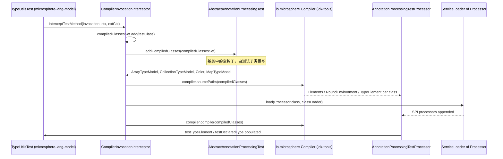

# Microsphere Java Test — 开发者指南

| | |
|---|---|
| **构件** | `io.github.microsphere-projects:microsphere-java-test`（`0.3.20-SNAPSHOT`，`release` 分支） |
| **角色** | Shared *fixture* artifact — types whose only purpose is to be reflected over, compiled, or annotation-processed by other modules |
| **主源码类型** | 16 — `io.microsphere.test.annotation` (1) · `io.microsphere.test.model` (11) · `io.microsphere.test.service` (4) |
| **可执行逻辑** | None beyond getters, setters, `toString()` and `"[ECHO] " + message` concatenation |
| **依赖** | 9 declared, **all `optional`**, none with `<scope>` — `microsphere-java-test/pom.xml:21-85` |
| **随包发布的资源** | `src/main/resources/junit-platform.properties`, `src/main/resources/logback-test.xml`; **no `META-INF/services` files** |
| **测试** | 14 JUnit 5 test classes under `src/test/java/io/microsphere/test/` |
| **字节码级别** | Not set in this repository; inherited from the external parent `microsphere-build:0.3.16` (`pom.xml:6-10`). CI matrix: Temurin `java: [ '8' , '11' , '17' , '21' , '25' ]` (`.github/workflows/maven-build.yml:25`, `distribution: 'temurin'` `:33`) |

> [!NOTE]
> **本页使用的引用简写。** 模块源码的路径相对于 `microsphere-java-test/src/main/java/io/microsphere/`
> （`test/model/Model.java:29`），本模块自身测试的路径相对于 `microsphere-java-test/src/test/java/io/microsphere/`
> （`test/service/TestServiceImplTest.java:31`）。跨模块路径写全。

---

## 1. 本模块在架构中的位置

`microsphere-java-test` 是 reactor 中第 6 个模块（`pom.xml:63`，`<modules>` 在 `pom.xml:58-66`），这个位置排在
`microsphere-java-annotations`（`:60`）、`microsphere-java-core`（`:61`）和 `microsphere-jdk-tools`（`:62`）之后，
并排在 `microsphere-annotation-test`（`:64`）、`microsphere-lang-model`（`:65`）和
`microsphere-annotation-processor`（`:66`）之前。这个顺序并非装饰性的：正是它使得
`microsphere-annotation-test` 能够以 compile 作用域依赖这些夹具
（`microsphere-annotation-test/pom.xml:24-28`）并把它们向下游再导出。

```mermaid
graph TD
    subgraph PROD["生产层"]
        ANNO["microsphere-java-annotations"]
        CORE["microsphere-java-core"]
        JDKTOOLS["microsphere-jdk-tools"]
    end
    subgraph FIX["夹具层"]
        JTEST["microsphere-java-test"]
    end
    subgraph HARNESS["测试装置层"]
        ATEST["microsphere-annotation-test"]
    end
    subgraph CONSUMERS["lang-model / processor"]
        LANGMODEL["microsphere-lang-model"]
        AP["microsphere-annotation-processor"]
    end
    ANNO --> CORE
    CORE --> JDKTOOLS
    ANNO -. optional .-> JTEST
    JTEST -. test scope : microsphere-java-core/pom.xml:66-71 .-> CORE
    JTEST -. test scope : microsphere-jdk-tools/pom.xml:45-48 .-> JDKTOOLS
    JTEST -- compile scope : microsphere-annotation-test/pom.xml:24-28 --> ATEST
    JDKTOOLS --> ATEST
    ATEST -. test scope : microsphere-lang-model/pom.xml:52-57 .-> LANGMODEL
    LANGMODEL --> AP
```

**为什么是独立构件、而不是每个模块各自的 `src/test` 树。** 有三个机制使这次拆分真正承重：

1. **夹具必须能以源码形式对 `javac` 可见，而不只是字节码。** 测试装置把 `Class<?>` 对象喂进一次真实的编译器调用
   （`microsphere-annotation-test/src/main/java/io/microsphere/test/annotation/processing/CompilerInvocationInterceptor.java:52-63`），
   随后它们以 `TypeElement`/`DeclaredType` 的形式暴露出来。要让这件事成立，*同一个*类也必须位于运行时 classpath
   上，这样测试才能把反射视图与语言模型视图做对比。每个模块 `src/test` 里的一份副本会产生由不同 class loader 加载
   的两个不同 Class 对象。
2. **"全 optional"这个技巧只有打成 jar 才成立。** `microsphere-java-test` 以 `optional` 方式请求 JUnit、Mockito、
   Logback、JAX-RS、JAX-WS 与 Spring（`microsphere-java-test/pom.xml:31-84`），因此消费方完全掌握自己的版本
   （`microsphere-lang-model/pom.xml:30-91` 又把它们全部按 `test` 作用域声明了一遍）。位于 `src/test` 树之内的夹具
   根本无法表达这一契约。
3. **`TestServiceImpl` 上的注解否则会漏进生产 jar。** `@Service`、`@ComponentScans`、`@ServiceMode`、`@Cacheable`
   和 `@TestAnnotation` 全部叠在同一个类型上（`test/service/TestServiceImpl.java:41-76`），而
   `spring-context`/`spring-web` 是本模块 compile 作用域的 optional 依赖
   （`microsphere-java-test/pom.xml:73-83`）。如果把这些夹具放进 `microsphere-java-core`，就会把 Spring 拖进一个本应
   保持无依赖的模块。

---

## 2. 十六个类型的完整清单

| # | 类型 | 种类 | 声明位置 | 父类型 / 值得注意的成员 | 用途 |
|---|---|---|---|---|---|
| 1 | `TestAnnotation` | annotation | `test/annotation/TestAnnotation.java:43` | `RUNTIME`, `TYPE`, `@Documented` (`:40-42`) | 14 attributes covering every annotation member kind |
| 2 | `Ancestor` | class | `test/model/Ancestor.java:27` | `implements Serializable` | Level 3 of the POJO chain; `boolean z` (`:29`) |
| 3 | `Parent` | class | `test/model/Parent.java:25` | `extends Ancestor` | Level 2; `byte b`, `short s`, `int i`, `long l` (`:27-33`) |
| 4 | `Model` | class | `test/model/Model.java:29` | `extends Parent` | Level 1; `float`, `double`, `TimeUnit`, `String`, `BigInteger`, `BigDecimal` (`:31-41`) |
| 5 | `PrimitiveTypeModel` | class | `test/model/PrimitiveTypeModel.java:25` | getters only (`:43-73`) | All 8 primitives, no setters |
| 6 | `SimpleTypeModel` | class | `test/model/SimpleTypeModel.java:29` | 13 accessor pairs + 1 orphan field | Wrapper catalogue incl. `Void` (`:31`); `private int invalid` has no accessor (`:57`) |
| 7 | `Color` | enum | `test/model/Color.java:25` | `RED(1)`, `YELLOW(2)`, `BLUE(3)` | Enum with state, `getValue()` (`:44`), overridden `toString()` (`:38-42`) |
| 8 | `ArrayTypeModel` | class | `test/model/ArrayTypeModel.java:25` | 5 array fields | `int[]`, `String[]`, `PrimitiveTypeModel[]`, `Model[]`, `Color[]` (`:27-35`) |
| 9 | `CollectionTypeModel` | class | `test/model/CollectionTypeModel.java:31` | 5 `Collection` sub-interfaces | `Collection`/`List`/`Queue`/`Deque`/`Set`, element kinds vary (`:33-41`) |
| 10 | `MapTypeModel` | class | `test/model/MapTypeModel.java:31` | 5 `Map` variants | `Map`/`SortedMap`/`NavigableMap`/**`HashMap`**/**`TreeMap`** (`:33-41`) |
| 11 | `StringArrayList` | class | `test/model/StringArrayList.java:29` | `extends ArrayList<String>` | Empty body — a type argument fixed by inheritance |
| 12 | `ConfigurationPropertyModel` | class | `test/model/ConfigurationPropertyModel.java:29` | 5 fields, each `@ConfigurationProperty` | Metadata fixture; property names prefixed `microsphere.annotation.processor.` (`:31-44`) |
| 13 | `TestService` | interface | `test/service/TestService.java:36` | `@Path("/echo")` (`:35`) | 5 methods with JAX-RS annotations; spurious `<T>` on `echo` (`:39`) |
| 14 | `DefaultTestService` | class | `test/service/DefaultTestService.java:29` | `implements TestService` | Full implementation; `echo` returns `"[ECHO] " + message` (`:34-36`) |
| 15 | `GenericTestService` | class | `test/service/GenericTestService.java:27` | `extends DefaultTestService implements TestService, EventListener` | Re-declares `TestService`, adds the `EventListener` marker (`:19`, `:27`) |
| 16 | `TestServiceImpl` | class | `test/service/TestServiceImpl.java:77` | `extends GenericTestService implements TestService, AutoCloseable, Serializable` | The annotation-saturated leaf; 2 constructors (`:84-90`) |

各族数量：1 / 11 / 4 = 16，与声明的包划分一致。种类分布为 **1 annotation interface + 1 interface + 1 enum +
13 classes**。16 个类型中有 14 个拥有专属测试类；`TestAnnotation` 与 `TestService` 没有——它们通过 `TestServiceImpl`
以及 `microsphere-lang-model` 被间接测试（`microsphere-lang-model/src/test/java/io/microsphere/lang/model/util/AnnotationUtilsTest.java:714`）。

---

## 3. 源码分析：一个夹具如何抵达 `TypeElement`

消费路径是一个由 JUnit 5 `InvocationInterceptor` 驱动的模板方法，而这个拦截器位于*装置*模块、不在本模块。夹具提供
类；装置负责编译它们。



每一跳的证据：

| 跳 | 源码 |
|---|---|
| 拦截器入口 | `microsphere-annotation-test/src/main/java/io/microsphere/test/annotation/processing/CompilerInvocationInterceptor.java:42-44` |
| 最先加入测试类自身 | `CompilerInvocationInterceptor.java:47-49` |
| 钩子被调用 | `CompilerInvocationInterceptor.java:50` |
| 钩子默认为空实现 | `microsphere-annotation-test/src/main/java/io/microsphere/test/annotation/processing/AbstractAnnotationProcessingTest.java:133-134` |
| 编译器接收到这些类 | `CompilerInvocationInterceptor.java:52-55` |
| 通过 SPI 装载 Processor | `CompilerInvocationInterceptor.java:59-62` |
| 触发编译 | `CompilerInvocationInterceptor.java:63` |
| 消费方对钩子的覆写 | `microsphere-lang-model/src/test/java/io/microsphere/lang/model/util/TypeUtilsTest.java:189-193` |
| 被填充的语言模型句柄 | `AbstractAnnotationProcessingTest.java:110-126`, `:136-142` |

**运行时**视图还存在第二条完全独立的发现路径：`microsphere-java-core` 只是用 `Class#getDeclaredFields()`
之类反射这些类，正如它自己的 `io.microsphere.test` 夹具那样
（`microsphere-java-core/src/test/java/io/microsphere/reflect/TypeUtilsTest.java:22-29`）。两条路径只在断言处汇合，
测试在那里把一个 `TypeMirror` 与一个 `Class` 相比较。

```mermaid
flowchart LR
    FIXTURE["test/model/Model.java:29"] -->|测试 classpath 上的字节码| REFL["java.lang.reflect: getDeclaredFields()"]
    FIXTURE -->|sourcePaths(compiledClasses)| JAVAC["javac: TypeElement + DeclaredType"]
    REFL --> A1["core 的断言 (microsphere-java-core/pom.xml:66-71)"]
    JAVAC --> A2["lang-model 的断言 (TypeUtilsTest.java:189-193)"]
    A1 --> SAME["同一个 Class 对象，两个视图"]
    A2 --> SAME
```

> [!IMPORTANT]
> 本模块**没有 `META-INF/services` 文件**。`src/main/resources` 只包含 `junit-platform.properties` 和
> `logback-test.xml`，已通过列目录确认。这些夹具是通过*直接的编译期引用*
> （`import io.microsphere.test.model.ArrayTypeModel`，见
> `microsphere-lang-model/src/test/java/io/microsphere/lang/model/util/TypeUtilsTest.java:19`）被发现，或者被交给
> `addCompiledClasses`——从来不是通过 service loader。`CompilerInvocationInterceptor.java:60` 处的
> `ServiceLoader<Processor>` 调用属于装置模块，解析的是 `microsphere-annotation-processor` 的注册项，与本模块无关。

---

## 4. 源码分析：model 包的两条轴

`test.model` 里的十一个类型不是随机拼凑的；它们坐落在两条正交的轴上，而源码中每一处字段注释都是关于它在探测哪条
轴的说明。

**轴 A——继承深度。** `Ancestor` → `Parent` → `Model` 从同一个根出发给出 1、2、3 层深的链：

```java
public class Ancestor implements Serializable {

    private boolean z;

public class Parent extends Ancestor {

    private byte b;

    private short s;

    private int i;

    private long l;

public class Model extends Parent {

    private float f;

    private double d;

    private TimeUnit tu;

    private String str;

    private BigInteger bi;

    private BigDecimal bd;
```

（`test/model/Ancestor.java:27-29`、`test/model/Parent.java:25-33`、`test/model/Model.java:29-41`——合并为一个代码块，
声明保持逐字原样。）一个只停在 `getDeclaredFields()` 的字段遍历工具在 `Model` 上看到 6 个字段；一个沿
`getSuperclass()` 递归的工具看到 11 个。`StringArrayList`（`test/model/StringArrayList.java:29`）是同一条轴上零字段的
极端形态：它除了一个被解析出的父类型参数之外什么都不添加。

**轴 B——元素种类。** `ArrayTypeModel`、`CollectionTypeModel` 和 `MapTypeModel` 各持有五个字段，其元素种类按同一种
顺序递增复杂度，源码注释明确写着：

| 探测的种类 | `ArrayTypeModel` (`test/model/ArrayTypeModel.java:27-35`) | `CollectionTypeModel` (`test/model/CollectionTypeModel.java:33-41`) | `MapTypeModel` (`test/model/MapTypeModel.java:33-41`) |
|---|---|---|---|
| primitive | `int[] integers` | — | — |
| simple | `String[] strings` | `Collection<String> strings` | `Map<String, String> strings` |
| enum | `Color[] colors` | `List<Color> colors` | `SortedMap<String, Color> colors` |
| 扁平 POJO | `PrimitiveTypeModel[] primitiveTypeModels` | `Queue<PrimitiveTypeModel> primitiveTypeModels` | `NavigableMap<Color, PrimitiveTypeModel> primitiveTypeModels` |
| 层级 POJO | `Model[] models` | `Deque<Model> models` | `HashMap<String, Model> models` |
| POJO 数组作为元素 | — | `Set<Model[]> modelArrays` | `TreeMap<PrimitiveTypeModel, Model[]> modelArrays` |

两处刻意的不对称使这两条轴可测：

- **访问器完备性不同。** `PrimitiveTypeModel` 只有 getter（`test/model/PrimitiveTypeModel.java:43-73`）；
  `SimpleTypeModel` 为 13 个字段提供 getter 与 setter，但对 `private int invalid` *没有*任何访问器
  （`test/model/SimpleTypeModel.java:57`）；`StringArrayList` 什么都不提供
  （`test/model/StringArrayList.java:29-30`）。因此一个 bean 自省路径会从同一个包里的三个夹具得到三个不同的答案。
- **同一角色内的声明原始类型不同。** `MapTypeModel` 用具体类声明了两个字段
  （`test/model/MapTypeModel.java:39`、`:41`），而另外三个用接口（`:33`、`:35`、`:37`）。归一化到 `Map` 的消费方会
  丢失这份信息，而 `microsphere-lang-model/src/test/java/io/microsphere/lang/model/util/TypeUtilsTest.java:189-193`
  正是为捕捉这一点而搭起来的。

`Color`（`test/model/Color.java:25-46`）与 `ConfigurationPropertyModel`
（`test/model/ConfigurationPropertyModel.java:29-44`）是这个包的两个"值承载"夹具：前者证明一个带构造参数并覆写了
`toString()` 的枚举能在两个视图中往返，后者证明 `@ConfigurationProperty` 的每个属性
（`name`、`type`、`defaultValue`、`required`、`description`）都能在注解抽取中存活。

---

## 5. 源码分析：服务梯

四个类型，一个接口，三级实现，每一级增加一个正交特征：

| 层级 | 类型 | 该层级增加了什么 | 源码 |
|---|---|---|---|
| 0 | `TestService` | JAX-RS 契约：`@Path("/echo")`、`@GET`/`@POST`/`@PUT`、`@PathParam`、`@DefaultValue`；五个方法 | `test/service/TestService.java:35-54` |
| 1 | `DefaultTestService` | 五个方法的一个具体实现；三个返回 `null`，两个返回实值 | `test/service/DefaultTestService.java:29-56` |
| 2 | `GenericTestService` | 重复声明 `TestService`（冗余）并加上 `java.util.EventListener`；用完全相同的方法体覆写 `echo` | `test/service/GenericTestService.java:27-31` |
| 3 | `TestServiceImpl` | Spring + JAX-WS + `@TestAnnotation` 元数据；两个构造器；`AutoCloseable` + `Serializable` | `test/service/TestServiceImpl.java:41-90` |

`test/service/GenericTestService.java:27` 与 `test/service/TestServiceImpl.java:77` 处冗余的
`implements TestService`——尽管 `DefaultTestService` 在 `test/service/DefaultTestService.java:29` 已经实现过它——
正是夹具在发挥作用：一个朴素的层次遍历器若用 `getInterfaces()` 收集接口，会遇到 `TestService` 三次，而消费方的期望值
数组证明了去重是有效的：

```java
private static final Type[] ALL_TYPES = ofArray(SELF_TYPE, SUPER_CLASS, DefaultTestService.class, Object.class, TestService.class, EventListener.class, AutoCloseable.class, Serializable.class);
```

（`microsphere-lang-model/src/test/java/io/microsphere/lang/model/util/TypeUtilsTest.java:131`，其中
`SELF_TYPE = TestServiceImpl.class` 在 `:121`，`SUPER_CLASS = GenericTestService.class` 在 `:126`；`:136`、`:141`
和 `:146` 给出了裁剪后的变体。）

`TestServiceImpl` 上的 `@TestAnnotation`（`test/service/TestServiceImpl.java:57-76`）是本模块中最大的单个注解字面量，
也是 `TestAnnotation` 的 `@since` 成为必填项的原因（`test/annotation/TestAnnotation.java:69`）：该字面量必须在
`test/service/TestServiceImpl.java:70` 处写出 `since = @Since("1.0.0")`，从而执行嵌套注解值，并在
`test/service/TestServiceImpl.java:71-75` 处执行 `@ConfigurationProperty[]` 数组值。

---

## 6. 设计模式（附证明文件）

| 模式 | 真实存在的位置 | 证据 |
|---|---|---|
| **Fixture Object / Object Mother** | 本模块的每个类型；各自提供一个规范、构造廉价的形状 | `test/model/Model.java:29`, `test/model/ArrayTypeModel.java:25` |
| **Template Method（钩子）** | `addCompiledClasses`——基类中为空，由消费方覆写以提名夹具 | `microsphere-annotation-test/.../AbstractAnnotationProcessingTest.java:133-134`, overridden at `microsphere-lang-model/src/test/java/io/microsphere/lang/model/util/TypeUtilsTest.java:189` |
| **Marker Interface** | `Ancestor` 上的 `Serializable`、`GenericTestService` 上的 `EventListener`、`TestServiceImpl` 上的 `AutoCloseable`/`Serializable` | `test/model/Ancestor.java:27`, `test/service/GenericTestService.java:27`, `test/service/TestServiceImpl.java:77` |
| **继承梯（分层夹具）** | 两条互不相干的三级链，一条给字段、一条给服务 | `test/model/Ancestor.java:27` → `Parent.java:25` → `Model.java:29`; `DefaultTestService.java:29` → `GenericTestService.java:27` → `TestServiceImpl.java:77` |
| **Type Token / 泛型父类型捕获** | `StringArrayList extends ArrayList<String>` 且方法体为空 | `test/model/StringArrayList.java:29-30` |
| **值承载枚举** | `Color(int value)` 配 `getValue()` 与 `toString()` | `test/model/Color.java:31-46` |
| **Null Object / 桩** | 三个 `TestService` 方法返回 `null` 而非抛异常 | `test/service/DefaultTestService.java:44-56` |
| **注解装饰叠加** | 框架元数据层层加在一个叶子类型上，却不改动其行为 | `test/service/TestServiceImpl.java:41-76`, `:93` |
| **构造器链 / 阶梯式默认值** | `TestServiceImpl()` 委托给 `this(null)` | `test/service/TestServiceImpl.java:84-86` |
| **Test Double（Mockito）** | 被 mock 的 `ApplicationContext` 与 `Environment`，加上字段注入 | `test/service/TestServiceImplTest.java:27-32` |
| **经由 `ServiceLoader` 的 SPI** | 存在于*消费方*装置中，本模块中不存在 | `microsphere-annotation-test/.../CompilerInvocationInterceptor.java:59-62` |

刻意**不予**声称：没有 Builder、没有 Factory、没有 Singleton、没有 Strategy、没有 Observer。16 个类型中没有任何
分派、注册表或状态机——而这正是一个夹具模块的意义。

---

## 7. 随包发布的资源及其 classpath 副作用

本模块从 `src/main/resources` 打包了两个文件，这意味着它们在每一个消费方的 classpath 上都可见——实际上也包括每个
消费方的 *test* classpath。

```properties
junit.jupiter.extensions.autodetection.enabled = true
```

（`src/main/resources/junit-platform.properties:1`。）JUnit Platform 会从*任意* classpath 根读取
`junit-platform.properties`，所以这一行会为任何依赖本构件的模块在整个测试运行中打开基于 `ServiceLoader` 的扩展自动
探测。请注意该装置并**不**依赖它：`AbstractAnnotationProcessingTest` 用
`@ExtendWith(CompilerInvocationInterceptor.class)` 显式注册了自己的拦截器
（`microsphere-annotation-test/src/main/java/io/microsphere/test/annotation/processing/AbstractAnnotationProcessingTest.java:53`）。

第二个文件是一份完整的 Logback 配置：

```xml
<configuration>

    <property name="ENCODER_PATTERN" value="%d{yyyy-MM-dd HH:mm:ss.SSS} %X{traceId} %level %logger{0} [%t] %m%n"/>

    <appender name="FILE" class="ch.qos.logback.core.FileAppender">
        <file>test.log</file>
        <append>false</append>
        <immediateFlush>false</immediateFlush>
```

（`src/main/resources/logback-test.xml:1-12`；该文件继续包含包裹 `FILE` 的 `ASYNC` appender（`:14-16`）、一个
`STDOUT` 控制台 appender（`:18-22`）、`root level="INFO"`（`:24-26`），以及一个名为 `io.microsphere`、级别 `TRACE`、
`additivity="false"` 的 logger（`:28-30`）。）由于 `logback-test.xml` 会先于 `logback.xml` 被按名字拾取，依赖本构件的
消费方可能最终把工作目录下的 `test.log` 写出来。

> [!WARNING]
> 这两个资源都是**打包期的决定、运行时的后果**。如果你是本模块的维护者，请把 `src/main/resources` 当作一个 API
> 界面：在那里新增第三个文件（例如另一个 `META-INF/services` 条目或第二份 properties 文件）会同时把它发布给所有
> 消费方。如果你是消费方并希望恢复旧行为，请添加你自己的 `src/test/resources/junit-platform.properties` 和
> `logback-test.xml`——位于你自己源码树中的那份副本在 Surefire 的 classpath 排序中优先。

---

## 8. 测试策略

十四个测试类覆盖了拥有配对测试的十四个类型（`TestService` 与 `TestAnnotation` 没有直接测试）。形状高度统一，扩展本
模块时值得照此匹配：

| 关注点 | 约定 | 证据 |
|---|---|---|
| 测试类命名 | `<Type>Test`，package-private 类 | `test/model/ModelTest.java:17`, `test/service/TestServiceImplTest.java:18` |
| 夹具构造 | `@BeforeEach` 新建实例，不共享状态 | `test/model/ModelTest.java:21-24` |
| 默认值契约 | 在任何 setter 运行前断言每个字段为 `0`/`0.0f`/`null` | `test/model/ModelTest.java:27-37` |
| 引用同一性 | 对实际传入的集合使用 `assertSame` | `test/model/CollectionTypeModelTest.java:59` |
| 别名（aliasing）契约 | 在 `set…` 之后修改源集合，断言其可见 | `test/model/CollectionTypeModelTest.java:124-134` |
| 置空赋值 | 每个 setter 以 `null` 调用并重新读取 | `test/model/CollectionTypeModelTest.java:105-121` |
| 继承 | `assertTrue(model instanceof Parent, …)` | `test/model/ModelTest.java:84` |
| 测试替身 | `mock(ApplicationContext.class)` / `mock(Environment.class)` | `test/service/TestServiceImplTest.java:27-28` |
| 字段注入 | 对 `protected` 字段执行 `testService.context = mockContext;` | `test/service/TestServiceImplTest.java:32` |
| 两个构造器 | 无参构造导致 environment 为 `null` | `test/service/TestServiceImplTest.java:71-74` |

本模块自身的测试是在**测夹具的行为**，而不是测库的逻辑。这是一条微妙但真实的义务：由于
`CollectionTypeModelTest.java:124-134` 断言 setter 是别名存储而非拷贝存储，未来一次在 `setColors`
（`test/model/CollectionTypeModel.java:55-57`）内部做防御性拷贝的"改进"会在这里失败——并且还会悄然改变消费方通过
反射所观察到的东西。

> [!TIP]
> 新增夹具类型时，在同一次提交里加上配对的 `<Type>Test`，并断言既有测试所断言的四件事：默认值、set/get 的同一性、
> 置空赋值，以及任何别名或继承契约。消费方（`microsphere-java-core`、`microsphere-lang-model`）会把期望的字段与类型
> 列表硬编码下来，因此一个没有本地测试的夹具，就是一个可以在它们脚下悄然变形的夹具。

---

## 9. 扩展点

| 我想…… | 扩展点 | 做法 |
|---|---|---|
| 为一次 `javac` 轮次提名更多夹具 | `addCompiledClasses(Set<Class<?>>)` | 在你的测试类中覆写它，正如 `TypeUtilsTest.java:189-193` 所做 |
| 把夹具暴露给一个新模块 | 添加一个 `test` 作用域依赖 | 照抄 `microsphere-java-core/pom.xml:66-71`；只有当你也是像 `microsphere-annotation-test` 那样的装置模块时才使用 compile 作用域（`microsphere-annotation-test/pom.xml:24-28`） |
| 往覆盖率矩阵添加一种新的注解成员种类 | `TestAnnotation` | 在 `test/annotation/TestAnnotation.java:45-71` 添加属性，**并且**在 `test/service/TestServiceImpl.java:57-76` 的字面量里给它一个值，否则必填属性的问题会咬人 |
| 探测一种新的类型形状 | `test.model` 中的新类 | 遵循"每个种类一个字段"的约定；除非不对称本身才是被测对象，否则保持访问器对称 |
| 探测新的框架注解散布面 | `TestServiceImpl` 的类级注解 | 先在 `microsphere-java-test/pom.xml:21-85` 把该依赖声明为 `optional` |
| 修改消费方的测试日志 | `src/main/resources/logback-test.xml` | 注意它是被发布的、不是本地的——见 §7 |
| 调整 JUnit 扩展发现 | `src/main/resources/junit-platform.properties` | 同样的告诫；装置使用显式 `@ExtendWith`（`AbstractAnnotationProcessingTest.java:53`） |

本模块**没有属于自己的 SPI**（见上文 §3 的说明），这意味着扩展它永远是源码级或 POM 级的改动——绝不是注册。

---

## 10. 评审意见：薄弱点与意外之处

1. **不带任何成员的 `@ServiceMode`**（`test/service/TestServiceImpl.java:42`，import 在 `:30`）。该类型上的其他注解
   都带值，唯独这个一个都不带。无论意图如何，一个遍历注解*成员*值的断言循环在它上面会看到零个条目——所以如果这正
   是被测场景，就值得配一条注释；如果不是，那就是缺了属性。
2. **一个没有任何用途的类型参数。** `TestService.echo` 被声明为 `<T> String echo(...)`
   （`test/service/TestService.java:39`），而每个实现者覆写的都是擦除后的形式
   （`test/service/DefaultTestService.java:34`、`test/service/GenericTestService.java:29`、
   `test/service/TestServiceImpl.java:94`）。如果多余的类型变量正是夹具的目的，请写明；否则删掉它——它也是本模块中
   唯一的泛型签名。
3. **死字段。** `DefaultTestService` 声明了 `private String name`（`test/service/DefaultTestService.java:31`），
   没有访问器，模块内也没有任何读取点。其他每个夹具字段都是可达的；这一个对基于反射的消费方不可见，只能通过
   `getDeclaredFields()` 看到，这让它看起来像无心之失。
4. **`SimpleTypeModel.invalid`**（`test/model/SimpleTypeModel.java:57`）大概是有意的——不可达字段是个不错的探针——
   但它是模块中唯一一个名字编码了判断而非类型、且没有任何测试对它做出断言的字段。
5. **元素种类注释里的复制粘贴。** `CollectionTypeModel.modelArrays` 是 `Set<Model[]>`，其注释却写着
   "The composite element is hierarchical POJO type"（`test/model/CollectionTypeModel.java:41`），与紧邻其上的
   `Deque<Model>` 那一行（`:39`）措辞完全相同。同样的措辞也出现在 `HashMap<String, Model>`
   （`test/model/MapTypeModel.java:39`）。数组装进集合恰恰是最有趣的情形，却被标注得好像它们是普通 POJO。
6. **具体声明类型打破了包自身的约定。** `HashMap` 与 `TreeMap` 作为字段类型
   （`test/model/MapTypeModel.java:39`、`:41`），而 `ArrayTypeModel` 与 `CollectionTypeModel` 全用接口。这对测试
   "声明类型 vs 归一化类型"的解析有用，但没有文档——读者必须把三个模型互相对比才能注意到。
7. **`TreeMap<PrimitiveTypeModel, Model[]>` 没有自然键序。** `PrimitiveTypeModel` 什么都没实现、什么都没覆写
   （`test/model/PrimitiveTypeModel.java:25-74`），因此该字段只能被赋以一个自带 comparator 的 map 或 `null`。没有测试
   这样做；`MapTypeModelTest` 大概只断言了 null 默认值。
8. **被发布的测试资源。** 位于 `src/main/resources` 下的 `junit-platform.properties` 与 `logback-test.xml`（§7）是本
   模块最出人意料的设计决策。把它们移到 `src/test/resources` 可以让它们继续服务于本模块自己的 14 个测试，同时不再
   强加给 3 个以上下游模块——但那也会破坏 reactor 当前享有的（未写文档、看起来是刻意的）便利。
9. **每个依赖都是 `optional`，包括 `microsphere-java-annotations`**（`microsphere-java-test/pom.xml:24-29`）。
   `TestAnnotation` 导入了 `io.microsphere.annotation.ConfigurationProperty` 与 `Since`
   （`test/annotation/TestAnnotation.java:20-21`），因此省略 annotations 构件的消费方在运行时无法*读取*
   `@TestAnnotation`。它照样能编译通过——只有在反射解析时才需要注解类——这让失败模式变成静默而非响亮。
10. **与 `microsphere-java-core` 的包名冲突。** core 的测试树拥有
    `microsphere-java-core/src/test/java/io/microsphere/test/`（`A.java`、`Data.java`、`StringIntegerHashMap.java`……），
    而本模块拥有 `io.microsphere.test.annotation|model|service`。两者都是 `io.microsphere.test`。运行时什么都不坏，
    但它会挡住 split-package 检查（JPMS），并且在新贡献者眼中读起来像一个错误。
11. **两个接口形态的夹具没有测试。** `TestAnnotation` 与 `TestService` 只通过 `TestServiceImpl` 和
    `microsphere-lang-model` 被覆盖。`TestAnnotation` 属性集的一次回归会先在另一个模块的构建中暴露。
12. **冗余的 `implements TestService`。** 沿梯级声明了三次（`test/service/DefaultTestService.java:29`、
    `test/service/GenericTestService.java:27`、`test/service/TestServiceImpl.java:77`）。无害，甚至可以当作重复接口的
    探针——但同样没有文档。

---

## 11. 另见

* [开发者指南索引](./README.zh.md)
* 本页英文版：[English Developer Guide](./module-microsphere-java-test.md)
* 本模块的用户指南：[microsphere-java-test —— 用户指南](../user-guide/module-microsphere-java-test.zh.md)
* [microsphere-java-annotations](./module-microsphere-java-annotations.zh.md) —— 提供 `@Since` 与 `@ConfigurationProperty`，即
  `@TestAnnotation` 的两个注解型属性（`test/annotation/TestAnnotation.java:69`, `:71`）
* [microsphere-annotation-test](./module-microsphere-annotation-test.zh.md) —— 其 `addCompiledClasses` 钩子是本模块主要消费点的
  装置（`AbstractAnnotationProcessingTest.java:133-134`）
* [microsphere-lang-model](./module-microsphere-lang-model.zh.md) —— 模型与服务夹具的最大消费方
* [microsphere-jdk-tools](./module-microsphere-jdk-tools.zh.md) —— 提供夹具被送入的那个 `Compiler`
  （`CompilerInvocationInterceptor.java:54-55`）
* [microsphere-annotation-processor](./module-microsphere-annotation-processor.zh.md) —— 读取 `ConfigurationPropertyModel`
* core 模块页面：[microsphere-java-core 子包索引](./microsphere-java-core/README.zh.md)，尤其是
  [反射、类型与 Bean](./microsphere-java-core/reflection-and-beans.zh.md) 与
  [配置属性元数据](./microsphere-java-core/configuration-metadata.zh.md)
