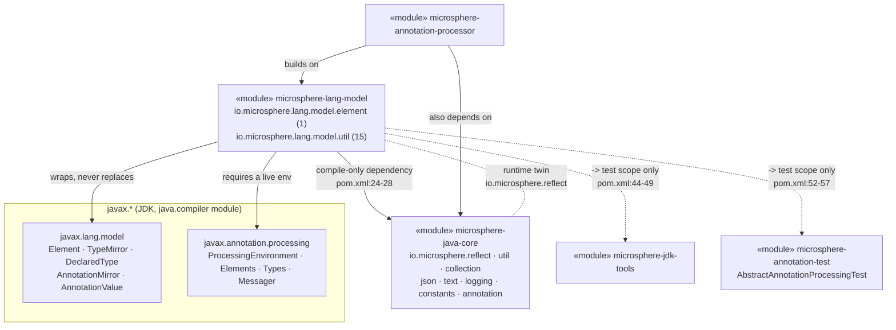
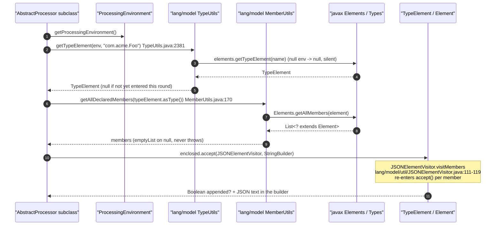
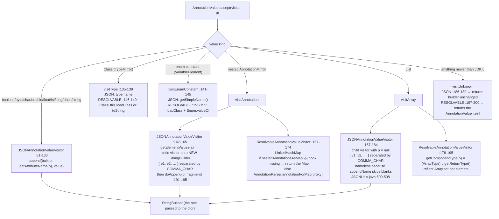

# 语言模型（`javax.lang.model`）—— 开发者指南

模块：`io.github.microsphere-projects:microsphere-lang-model` · 源码线：`release` 分支，`0.3.20-SNAPSHOT`
（已发布标签 `0.3.20`；根 `pom.xml:54`），`groupId` 位于根 `pom.xml:12`。
所分析的包：`io.microsphere.lang.model.element`（1 个类型）+ `io.microsphere.lang.model.util`（15 个类型）=
**16 个主源类型**，由 17 个测试类覆盖。
配套的使用者页面：[用户指南 —— 语言模型](../user-guide/module-microsphere-lang-model.zh.md) · 英文版本：[English Developer Guide](./module-microsphere-lang-model.md)。

所有 `file:line` 引用均相对于 `microsphere-lang-model/src/main/java/io/microsphere/`（主源码）或
`microsphere-lang-model/src/test/java/io/microsphere/`（测试），读取自 `release` 工作树，之后简化为
`lang/model/util/TypeUtils.java:60-88`。跨模块引用保留模块前缀，例如
`microsphere-java-core/src/main/java/io/microsphere/reflect/TypeUtils.java:1543`。

---

## 1. 架构定位

`io.microsphere.lang.model` 是**运行期 `io.microsphere.reflect` 层的编译期对应物**。这并不
只是一个比喻 —— 两侧的方法签名是刻意按名称镜像的，本模块甚至直接从 `reflect`
import：

| 概念 | 编译期（`javax.lang.model`） | 运行期（`java.lang.reflect`） | 证据 |
|---|---|---|---|
| 同类型判断 | `lang/model/util/TypeUtils.isSameType(TypeMirror, CharSequence)` | 无直接对应 —— `reflect` 只有 `getTypeName(Type)` | `lang/model/util/TypeUtils.java:261-266`、`microsphere-java-core/src/main/java/io/microsphere/reflect/TypeUtils.java:1543` |
| 类型名提取 | `lang/model/util/TypeUtils.getTypeName(TypeMirror)` | `reflect/TypeUtils.getTypeName(Type)` / `getTypeNames(Type...)` | `lang/model/util/TypeUtils.java:2457`、`…reflect/TypeUtils.java:1543,1568` |
| 跨层复用类型名 | `ElementUtils.matchParameterTypes` import 了 `io.microsphere.reflect.TypeUtils.getTypeNames` | — | `lang/model/util/ElementUtils.java:38`、`:656-659` |
| 方法查找 | `lang/model/util/MethodUtils.findMethod(TypeElement, String, Type...)` | `reflect/MethodUtils.findMethod(Class, String, Class...)` | `lang/model/util/MethodUtils.java:635,664`、`…reflect/MethodUtils.java:593,629` |
| 跨层级方法枚举 | `getAllDeclaredMethods(TypeElement)` | `getAllDeclaredMethods(Class)` | `lang/model/util/MethodUtils.java:136,161`、`…reflect/MethodUtils.java:354` |
| 字段查找 | `lang/model/util/FieldUtils.findField(Element, String)` | `reflect/FieldUtils.findField(Class, String)` | `lang/model/util/FieldUtils.java:267,294`、`…reflect/FieldUtils.java:109,152,184` |
| 构造器查找 | `lang/model/util/ConstructorUtils.findConstructor(TypeElement, Type...)` | `reflect/ConstructorUtils.findConstructor(Class, Class...)` | `lang/model/util/ConstructorUtils.java:151,179`、`…reflect/ConstructorUtils.java:264` |
| 泛型实参解析 | *不存在*（模型通过 `DeclaredType#getTypeArguments` 免费提供） | `reflect/TypeUtils.resolveTypeArguments(Class)` | `…reflect/TypeUtils.java:1198` |

两条边让分层关系变得具体：

* **`lang-model` → `microsphere-java-core`（编译作用域，也是唯一一条）。** `pom.xml:24-28`。实际用到的
  import 是 `io.microsphere.util.*`（`Utils`、`ArrayUtils`、`StringUtils`、`ClassLoaderUtils`、`Assert`、`CharSequenceComparator`）、
  `io.microsphere.collection.*`（`CollectionUtils`、`ListUtils`、`MapUtils`）、`io.microsphere.lang.function.*`
  （`Predicates`、`Streams`）、`io.microsphere.reflect.*`（`MethodUtils`、`TypeUtils`）、`io.microsphere.text.FormatUtils`、
  `io.microsphere.logging.*`、`io.microsphere.json.JSONUtils`、`io.microsphere.constants.SymbolConstants` 与
  `io.microsphere.annotation.*` —— 见 `lang/model/util/TypeUtils.java:20-61`、
  `lang/model/util/JSONAnnotationValueVisitor.java:31-40`。
* **`annotation-processor` → `lang-model` + `core`。** 本模块不依赖 `annotation-processor`，也绝
  不能新增该依赖；方向是单向的。`microsphere-jdk-tools` 与 `microsphere-annotation-test` 位于测试边界*之下*
  （`pom.xml:44-49`、`:52-57`），从 `src/main/java` 永不可达。

**它所承担的边界：** 一切必须在 *`javac` 运行期间、类尚不存在之时* 成立的逻辑。一旦处理器
的 classpath 上出现真实的 `Class`，`ClassUtils.loadClass`（`lang/model/util/ClassUtils.java:78`）就跨过边界
进入 `io.microsphere.util.ClassLoaderUtils.resolveClass`，把控制权交给运行期层。



---

## 2. 类型清单（16 个类型）

| # | 类型 | 种类 | 包装对象（`javax.lang.model` 类型） | 关键 static / public 成员 |
|---|---|---|---|---|
| 1 | `StringAnnotationValue` | 具体类，`@Immutable` | 实现 `AnnotationValue` | 构造器 `:37-39`、`getValue()` `:41-44`、`accept()` → `visitString` `:46-49` —— `lang/model/element/StringAnnotationValue.java` |
| 2 | `AnnotationUtils` | `static` 方法 `interface`（`extends Utils`） | `AnnotatedConstruct`、`AnnotationMirror`、`AnnotationValue`、`DeclaredType`、`TypeMirror` | 4 个常量 `:106,111,117,119`；`getAnnotation` `:141-175`；`findAnnotation` `:509-612`；`findMetaAnnotation` `:640-692`；`getElementValues` `:1373-1529`；`getAttributesMap` `:1190-1329`；`getAttribute` `:1695-1782`；`getElementTypes` `:1841-1875` |
| 3 | `ClassUtils` | `static` 方法 `interface` | `TypeMirror` → `java.lang.Class` | `getClassName(TypeMirror)` `:57`、`loadClass(TypeMirror)` `:78`、`loadClass(String)` `:98` —— `lang/model/util/ClassUtils.java` |
| 4 | `ConstructorUtils` | `static` 方法 `interface` | `ExecutableElement`（kind 为 `CONSTRUCTOR`） | `getDeclaredConstructors` `:87,123`、`findConstructor` `:151,179`、`findDeclaredConstructors` `:220,239`、`filterDeclaredConstructors` `:278` |
| 5 | `ElementUtils` | `static` 方法 `interface`（`extends Utils`） | `Element`、`ElementKind`、`ExecutableElement`、`VariableElement` | 8 个 kind 谓词 `:87-296`；`toElementKind` `:389-400`；3 个 `matchesElementType` `:430-502`；`matchesElementKind` `:526-528`；`hasModifiers` `:578-589`；`filterElements` `:622-633`；`matchParameterType(s/Names)` `:656-733` |
| 6 | `ExecutableElementComparator` | 近似 `final` 的类、单例、`implements Comparator<ExecutableElement>` | `ExecutableElement`、`VariableElement` | `INSTANCE` `:60`、私有构造器 `:62`、`compare` `:66-92` |
| 7 | `FieldUtils` | `static` 方法 `interface` | `VariableElement`（kind 为 `FIELD`） | `getDeclaredField(s)` `:107-187`、`getAllDeclaredFields` `:213-239`、`findField` `:267-294`、`find/findAllDeclaredFields` `:330-445`、`filterDeclaredFields` `:488`、`isEnumMemberField` `:524`、`isNonStaticField` `:554`、`isField` `:580,618`、`get(All)NonStaticFields` `:644-734`、`equalsFieldName` `:760` |
| 8 | `JSONAnnotationValueVisitor` | 具体类，继承 `SimpleAnnotationValueVisitor6<StringBuilder, ExecutableElement>` | `AnnotationValue` | 构造器 `:76-79`、11 个标量/`TypeMirror` visit `:81-145`、`visitAnnotation` `:147-165`、`visitArray` `:167-184`、`visitUnknown` `:186-189`、`doAppend` `:191-195` |
| 9 | `JSONElementVisitor` | 抽象类，继承 `ElementKindVisitor6<Boolean, StringBuilder>` | `Element` 层级 | 以 `FALSE` 兜底的构造器 `:59-61`；5 个 `final` visit `:63-109`；`visitMembers` `:111-119`；`supports` + 5 个 `supportsXxx` `:130-197`；`doVisitPackage`/`doVisitTypeParameter` `:206-219` |
| 10 | `AnnotatedElementJSONElementVisitor` | 抽象类，继承 `JSONElementVisitor` | `Element` + 某个具名注解的 `TypeElement` | 构造器 `:102-112`；字段 `processingEnv`/`elements`/`annotationClassName`/`annotationType`/`annotationTypeElement`/`elementTypes` `:90-100`；`getAnnotationClassName()` `:119-122`；`supports(Element)` `:124-126` |
| 11 | `LoggerUtils` | `static` 方法 `interface`（`extends Utils`） | *无* —— 基于 `io.microsphere.logging` 的 SLF4J 风格外观 | `LOGGER` `:32`、`trace`/`debug`/`info`/`warn`/`error` `:34-52` |
| 12 | `MemberUtils` | `static` 方法 `interface` | `Element`（任意成员 kind） | `getDeclaredMembers` `:98,122,196,222`、`getAllDeclaredMembers` `:146,170`、`findDeclaredMembers` `:250,278,388,419`、`findAllDeclaredMembers` `:310,349` |
| 13 | `MessagerUtils` | `static` 方法 `interface`（`extends Utils`） | `Messager`、`ProcessingEnvironment`、`Diagnostic.Kind` | 5×2 组 `printX` 对 `:63-246`；`printMessage` `:268-309` |
| 14 | `MethodUtils` | `static` 方法 `interface` | `ExecutableElement`（方法） | `getDeclaredMethods` `:86,111`、`getAllDeclaredMethods` `:136,161`、`find/findAllDeclaredMethods` `:196-451`、`findPublicNonStaticMethods` `:338,373`、`filterDeclaredMethods` `:487`、`isMethod` `:522`、`findMethod` ×6 `:575-728`、`getOverrideMethod` `:764`、`getMethodName` `:841`、`getReturnTypeName` `:866`、`getMethodParameterType(Mirrors/Names)` `:896,938`、`matches*` `:967-1127` |
| 15 | `ResolvableAnnotationValueVisitor` | 具体类，继承 `SimpleAnnotationValueVisitor6<Object, ExecutableElement>` | `AnnotationValue` → 运行期对象 | 2 个 `static final` 反射钩子 `:76-78`；3 个构造器 `:88-99`；13 个 visit 方法 `:101-200`；包私有 `getComponentType` `:189-195` |
| 16 | `TypeUtils` | `static` 方法 `interface`（`extends Utils`） | `TypeMirror`、`DeclaredType`、`TypeElement`、`Element`、`ProcessingEnvironment` | `SIMPLE_TYPE_NAMES` `:77-82`；2 个遍历函数 `:88,94`；5 族约 100 个 static `:120-2505`；`typeElementFinder` `:2500-2505` |

两点结构性观察：

* **16 个中有 11 个是只含 `static` 方法的 `interface`**（即 `Utils` 约定）—— `AnnotationUtils`、`ClassUtils`、
  `ConstructorUtils`、`ElementUtils`、`FieldUtils`、`LoggerUtils`、`MemberUtils`、`MessagerUtils`、`MethodUtils`、
  `TypeUtils`，另外 `ExecutableElementComparator` 作为真正的 `class` 是唯一的例外。
  选择 interface 而非 final 类，纯粹是为了在 JDK 8 上承载 `static` 方法而无需工具类惯用法。
* **恰好两个类型是抽象的、一个是单例** —— 访问器对 `JSONElementVisitor` /
  `AnnotatedElementJSONElementVisitor` 与 `ExecutableElementComparator.INSTANCE`。其余都可直接使用。

---

## 3. 源码分析：`TypeMirror` 如何被解析与比较

### 3.1 比较就是名称字符串相等

比较原语只有一个方法，其余全部委托给它：

```java
static boolean isSameType(TypeMirror type, CharSequence typeName) {   // TypeUtils.java:261
    if (type == null && typeName == null) {
        return true;
    }
    return Objects.equals(valueOf(type), valueOf(typeName));          // :265
}
```

见 `lang/model/util/TypeUtils.java:261-266`。三个兄弟重载只是先把参数归一化：
`(Element, Type)` `:177-179`、`(Element, CharSequence)` `:203-205`、`(TypeMirror, Type)` `:235-237`。

值得直说的推论：

1. **从不求助 `javax.lang.model.util.Types`。** 这条路径上模块不获取任何 `Types` 句柄，因此
   `isSameType` 零基础设施可用 —— 但它是*文本*判定，不是编译器的等价关系。
   `TypeMirror#toString()` 被规定为规范名，所以声明类型与原始类型表现正确；
   而类型变量*用法*、capture 通配与匿名类型并没有规范名的保证。
2. **`null`/`null` 返回 `true`，而每个兄弟谓词遇到 `null` 都返回 `false`。** 对比 `isArrayType` `:289-291`、
   `isEnumType` `:340-343`、`isSimpleType` `:149-151` —— 全是 `x != null && …`。`isSameType` 的规则
   是一条“null 相等”特例，使 `isSameType(null, null)` 成为同义反复而非一次检查。
3. `isSimpleType` 是相对硬编码名称列表的成员判断，该列表由 `io.microsphere.util.ClassUtils.SIMPLE_TYPES` 构建
   （`:77-82`），因此它是字面源，而非由模型推导。

### 3.2 解析：`Element` ⇄ `TypeMirror` ⇄ `TypeElement`

转换格是无环且全覆盖的：

```mermaid
flowchart TD
    E["Element"] -->|asType()| TM["TypeMirror"]
    E -->|isTypeElement :555| TE["TypeElement"]
    TM -->|ofDeclaredType :763-765<br/>isDeclaredType ? cast : null| DT["DeclaredType"]
    DT -->|asElement()| TE
    TE -->|asType()| DT
    E -->|ofTypeElement :652-654| TE
    TM -->|ofTypeElement :680-683| TE
    TE -->|getTypeParameters| TPE["TypeParameterElement"]
    TE -->|getEnclosedElements| M["members (Element)"]
    M -->|ElementFilter.fieldsIn / methodsIn| V["VariableElement · ExecutableElement"]
    P["ProcessingEnvironment"] -. "getTypeElement(name) :2381<br/>getDeclaredType :2401-2433" .-> TE
```

`of*` 家族有三个性质对调用方重要：

* **它们返回 `null`，从不抛异常。** `ofTypeElement(Element)` `:652-654`、`ofTypeElement(TypeMirror)` `:680-683`、
  `ofTypeElement(DeclaredType)` `:706-711`、`ofDeclaredType(Element)` `:737-739`、`ofDeclaredType(TypeMirror)` `:763-765`。
  `PackageElement` 或原始类型 `TypeMirror` 会得到 `null`，调用方必须自行处理 —— `AnnotationUtils` 就是这么做的，
  这正是 `findAllAnnotations(Element, …)` 存在显式 `typeElement == null` 分支的原因
  （`lang/model/util/AnnotationUtils.java:868-874`）。
* **遍历采用函数注入。** `TYPE_ELEMENT_GET_SUPERCLASS`（`:88`）与 `TYPE_ELEMENT_GET_INTERFACES`（`:94-97`）是
  `public static` 字段，由 `typeElementFinder`（`:2500-2505`）传入 `io.microsphere.util.TypeFinder`。同一套
  `core` 在运行期使用的 BFS 引擎在此以另一对边函数被复用 —— 这是
  模块中最关键的一条设计决策。
* **`getTypeName` 是唯一的反射调用。** `:2456-2478` —— 它先向*元素*询问 `getTypeParameters()`，若非空则对
  `TypeMirror` 反射调用 `"getTypeArguments"`（`:2466`，`invokeMethod(true, …)`），因为 `TypeMirror` 并无此方法，
  然后渲染 `<` + `List<TypeMirror>.toString()` + `>`（`:2470-2472`）。这是全模块唯一依赖某个
  `TypeMirror` 实现私有表面的地方。

### 3.3 时序：从处理器到成员再回来



---

## 4. 源码分析：`AnnotationValue` 树与其产生的 JSON

### 4.1 分派

两个访问器都继承 JDK 6 的 `SimpleAnnotationValueVisitor6`，因此选择分支的是 `AnnotationValue.accept(v, p)` ——
*而不是*访问器自身的代码。全程 `p` 都是那个 `ExecutableElement` 属性方法。



### 4.2 产生的结构

`JSONAnnotationValueVisitor` 实现的文法是：

| 输入 | 输出 | 产生位置 |
|---|---|---|
| 标量（`boolean`…`String`） | `"name":literal` | `:81-133` |
| `Class` 值 | `"name":"fully.qualified.Name"` | `:135-139` |
| 枚举常量 | `"name":"CONSTANT"`（仅简单名 —— **不**输出所属类型） | `:141-145` |
| 嵌套注解 | `"name":{ "a":x,"b":y }` | `:147-165` |
| 数组 | `"name":[e1,e2,…]`，每个 `ei` 无名渲染 | `:167-184` |
| unknown | 不追加任何内容 | `:186-189` |

容易被忽略的几点：

* **访问器输出的是片段，不是完整文档。** 它从不写顶层 `{`/`}`；外层对象由调用方负责，而 `visitAnnotation`
  中看到的起始 `{` 是写进*子* builder 的（`:151-152`）。唯一的分隔字符来自 `SymbolConstants`（`:31-35`）。
* **属性名取自 `p`，而非取自值。** `getAttributeName` 就是 `MethodUtils.getMethodName`
  （`AnnotationUtils.java:1015-1017` → `MethodUtils.java:841-843`），对 `null` 方法返回 `null`；随后
  `JSONUtils.appendName` 跳过名称写入（`…json/JSONUtils.java:500-508`）。数组元素正是利用这一
  点：`visitArray` 故意传 `null`（`:176`）。
* **`visitAnnotation` 经由带默认值开启的重载 `getElementValues(a)` 递归**（`:149` →
  `AnnotationUtils.java:1464-1466`），因此默认值会出现在 JSON 中 —— 参见断言
  `"since":{"module":"","value":"1.0.0"}`，其中 `"module":""` 就是默认值
  （`lang/model/util/JSONAnnotationValueVisitorTest.java:113-116`）。
* **`ResolvableAnnotationValueVisitor` 伸手进入 `sun.reflect.annotation.AnnotationParser`** —— 通过
  `io.microsphere.reflect.MethodUtils.findMethod` 一次性解析到 `static final` 字段（`:76-78`），再以
  `invokeStaticMethod(true, …)` 调用（`:173`）。容忍 `null` 的分支（`:168`）意味着隐藏该类的 JDK 只是返回
  `Map` 而非注解代理 —— 是降级，不是失败。但 `getComponentType`（`:189-195`）执行未检查的 `(ArrayType)`
  转换并解引用 `p`，因此以 `p == null` visit *数组*会抛
  `NullPointerException`/`ClassCastException`。
* **可解析访问器中的 `visitArray` 需要 `p` 才能知道组件类型**，而 `StringAnnotationValue`
  （`lang/model/element/StringAnnotationValue.java:46-49`）硬编码了 `visitString`，因此从不触碰 `p` ——
  这使它可安全地喂给参数为 `null` 的访问器，测试正
  是如此（`lang/model/element/StringAnnotationValueTest.java:49-52`）。

### 4.3 元素那一侧

`JSONElementVisitor` 是 JSON 故事的另一半，而它*并不是* JSON 发射器：它自己什么都不追加。它是一个
**带过滤的遍历框架** —— 一道门闸（`supportsXxx`）、一次递归（`visitMembers` `:111-119`），以及一套
“是否写入了内容”的布尔协议（`TRUE` 表示“已追加内容”）。`visitType` `:87-101` 是唯一的复合实现：先执行
`super.visitType` 得到类型头部，再递归 `getEnclosedElements()` 并对结果做 OR。
`AnnotatedElementJSONElementVisitor` `:124-126` 提供具体过滤器 —— “只处理 kind 位于注解的 `@Target`
集合中的元素”，在构造器中由 `getElementTypes(annotationType)` 一次性算出
（`:111`，`AnnotationUtils.java:1871-1875`）。

---

## 5. 源码分析：`ExecutableElement` 排序

`compare`（`lang/model/util/ExecutableElementComparator.java:66-92`）是一个四阶段级联：

| 阶段 | 代码 | 行号 | 说明 |
|---|---|---|---|
| 0 | `if (e1.equals(e2)) return 0;` | `:68-70` | 使用 `Element#equals`，在 `javac` 中即符号表表项的同一性。**它无条件解引用 `e1`。** |
| 1 | `CharSequenceComparator.INSTANCE.compare(e1.getSimpleName(), e2.getSimpleName())` | `:73` | 来自 `io.microsphere.util.CharSequenceComparator`（`:19,23`） |
| 2 | `ps1.size() - ps2.size()` | `:77-80` | 算术差值而非 `Integer.compare` —— 溢出在实践中不可达 |
| 3 | 按下标比较 `asType().toString()`，首个非零即返回 | `:82-89` | 比较的是 `TypeMirror` 文本，也就是 §3.1 中的 `isSameType` 语义 |

排序性质：

* **与 `equals` 不一致。** 来自不同 `TypeElement` 的两个结构相同的方法比较结果为 `0`
  （`lang/model/util/ExecutableElementComparatorTest.java:59-60` 证明了经测试类型与经 `AutoCloseable.class`
  得到的 `AutoCloseable#close()` 比较为 `0`），而 `e1.equals(e2)` 为 `false`。因此用该比较器的
  `TreeSet` 会*跨层级对重载去重* —— 这正是元数据生成想要的，但不是
  `HashSet` 的行为。
* **仅在同一个简单名桶内是全序。** 第 1 阶段会短路，因此名称不同的方法永远走不到第 3 阶段。
* **以名称优先，而非签名优先。** 生成的输出按方法名分组。

**不存在任何 `Prioritized` 交互。** 模块主源码中没有任何位置引用 `Prioritized`（对全部 16 个类型 grep
无命中；该单例是 `Comparator` 而非 `Prioritized`）。这条警告属于同时组合两者的调用方：
`io.microsphere.lang.Prioritized` 的常量相对其命名是**反转的** ——
`MAX_PRIORITY = Integer.MIN_VALUE`（`:81`）、`MIN_PRIORITY = Integer.MAX_VALUE`（`:86`）、`NORMAL_PRIORITY = 0`（`:91`）——
因此若你在 `ExecutableElementComparator` *之后*用 `Prioritized.COMPARATOR` 对成员列表再排序，“最高优先级”
指的是数值最小的那个。不明确哪个优先就不要串联两者。

---

## 6. 源码分析：`MessagerUtils` ⇄ `Diagnostic.Kind`

`printMessage(Messager, Kind, String, Object...)`（`lang/model/util/MessagerUtils.java:292-309`）是唯一的漏斗。
五个 `ProcessingEnvironment` 重载（`:63-65`、`:127-129`、`:174-176`、`:221-223`、`:268-270`）只是调用
`processingEnv.getMessager()` 的适配器，四个按级别的 `Messager` 重载也只是固定了
`Kind` 的适配器（`:104`、`:151`、`:198`、`:245`）。

| `Diagnostic.Kind` | `Messager.printMessage` | `LoggerUtils` 调用 | switch 分支 |
|---|---|---|---|
| `NOTE` | 是（`:294`） | `info(pattern, args)` | `:303-304` |
| `WARNING` | 是 | `warn(pattern, args)` | `:299-301` |
| `MANDATORY_WARNING` | 是 | `warn(pattern, args)` —— **与 `WARNING` 同一分支** | `:299-301` |
| `ERROR` | 是 | `error(pattern, args)` | `:296-297` |
| `OTHER`（以及未来任何 `Kind`） | 是 | `debug(pattern, args)` | `:306-307`（`default`） |

由此得出三条设计事实：

1. **消息沿两条路径被格式化了两次。** `messager.printMessage(kind, format(pattern, args))` 发送*已替换*的文本
   （`:293-294`），而 `LoggerUtils` 收到的是原始 `pattern` 加 `args`（`:297`–`:307`），所以日志后端会套用其自身的
   占位符规则。对 `{}` 合法的模式（`microsphere-java-core/src/main/java/io/microsphere/text/FormatUtils.java:17`、
   `:38-39`）未必对后端合法，反之亦然。`MessagerUtils` 的 javadoc 声称支持 `{0}` / “`String#format` 语法”
   （`lang/model/util/MessagerUtils.java:56-61`、`:78-82`）—— **这是文档缺陷**；测试使用的是
   `"Hello, {}!"`（`lang/model/util/MessagerUtilsTest.java:55-56`）。
2. **`MANDATORY_WARNING` 被刻意并入 `warn`。** 该区分只在 `Messager` 通道中保留；日志通道无法还原。
3. **`LoggerUtils.LOGGER` 是一个 `static` 接口常量**，名为 `"microsphere-lang-model"`
   （`lang/model/util/LoggerUtils.java:32`）—— logger 名是*模块*而非调用方。处理器作者无法把本模块的诊断
   路由到按处理器划分的类别，而 `Logback` 之所以是测试作用域依赖（`pom.xml:60-64`），正是为了让模块
   自身从不在编译作用域绑定任何后端。

**完全没有** null 处理：`:294` 解引用 `messager`，`:295` 解引用 `kind`，五个 `ProcessingEnvironment`
重载在调用前就解引用了 `processingEnv`。测试中的 `assertDoesNotThrow` 包装
（`MessagerUtilsTest.java:55-80`）只证明了正常路径。

---

## 7. 设计模式

| 模式 | 举证类 | 证据 |
|---|---|---|
| **Visitor（双重分派）** | `JSONAnnotationValueVisitor`、`ResolvableAnnotationValueVisitor`、`StringAnnotationValue` | 分派位于 `AnnotationValue.accept`，而 `StringAnnotationValue` 就是证明：它的行为整体就是 `return v.visitString(this.value, p)`（`lang/model/element/StringAnnotationValue.java:46-49`）。两个访问器只覆写按 kind 划分的钩子（`lang/model/util/JSONAnnotationValueVisitor.java:81-189`、`lang/model/util/ResolvableAnnotationValueVisitor.java:101-200`） |
| **Visitor（acceptor 驱动遍历）** | `JSONElementVisitor`、`AnnotatedElementJSONElementVisitor` | `visitMembers` 内部的 `Element.accept(this, jsonBuilder)`（`lang/model/util/JSONElementVisitor.java:111-119`）；子类收窄的是*访问哪些*元素，而非如何访问（`lang/model/util/AnnotatedElementJSONElementVisitor.java:124-126`） |
| **Template Method + Strategy 混合** | `JSONElementVisitor` | `final` 门闸 `visitPackage`/`visitVariable`/`visitExecutable`/`visitType`/`visitTypeParameter`（`:63-109`）配合 `protected` 扩展点 `supports*`（`:130-197`）与 `doVisit*`（`:206-219`） |
| **Wrapper / Adapter** | `StringAnnotationValue` | 在裸 `String` 之上实现 JDK 的 `AnnotationValue` 接口，使调用方产生的值可以进入 JDK 形态的 API（`lang/model/element/StringAnnotationValue.java:33-49`），并标记 `@Immutable`（`:32`） |
| **Facade / Utils** | `TypeUtils`、`ElementUtils`、`AnnotationUtils`、`MemberUtils`、`FieldUtils`、`MethodUtils`、`ConstructorUtils`、`ClassUtils`、`MessagerUtils`、`LoggerUtils` | 全部是继承 `io.microsphere.util.Utils` 的 `static` 方法 `interface`（例如 `lang/model/util/TypeUtils.java:69`、`lang/model/util/ElementUtils.java:58`、`lang/model/util/AnnotationUtils.java:101`），把 `Elements` + `Types` + `Element` + `AnnotationMirror` + `AnnotationValue` + `Messager` 折叠为按名称调用 |
| **Comparator / Strategy** | `ExecutableElementComparator` | `implements Comparator<ExecutableElement>`（`:55`）、私有构造器（`:62`）、共享不可变 `INSTANCE`（`:60`）；策略是固定的（无法注入键提取器） |
| **Singleton（规范实例）** | `ExecutableElementComparator`、`AnnotationUtils.DEFAULT_ANNOTATION_VALUE_VISITOR` | `:60` / `lang/model/util/AnnotationUtils.java:111` —— 共享访问器无状态因而可安全复用（`lang/model/util/ResolvableAnnotationValueVisitor.java:84-99` 的字段都是 `final`） |
| **Null Object / 静默降级** | 每个 `Utils` interface | 以 `emptyList()`/`emptyMap()`/`null`/`false` 代替抛异常 —— `lang/model/util/ElementUtils.java:622-633`、`lang/model/util/AnnotationUtils.java:1509-1512`、`lang/model/util/TypeUtils.java:652-654` |
| **Registry（只读、注入式）** | `TypeUtils.TYPE_ELEMENT_GET_SUPERCLASS` / `TYPE_ELEMENT_GET_INTERFACES` | `Function` 常量（`:88`、`:94-97`）交给 `io.microsphere.util.TypeFinder`（`:2500-2505`），使共享 BFS 引擎可以遍历一张非反射的图 |
| **跨层边界的反射桥** | `ClassUtils`、`ResolvableAnnotationValueVisitor` | `TypeMirror` → `Class`（`lang/model/util/ClassUtils.java:78-98`），以及 `AnnotationMirror` → 注解代理，经由 `AnnotationParser.annotationForMap`（`lang/model/util/ResolvableAnnotationValueVisitor.java:76-78,173`） |

不存在：没有 Builder，没有 Decorator（`visitAnnotation`/`visitArray` 中的子 `JSONAnnotationValueVisitor` 实例是
*基于另一个缓冲区的崭新协作者*，`:153`/`:173` —— 并非既有对象的包装器），`src/main/resources` 中也没有 SPI 或
`META-INF/services` 文件（根本不存在 `src/main/resources` 目录）。

---

## 8. 评审记录

### 8.1 null 处理与静默降级策略 —— 全部抛出点

该策略对 16 个类型中的 14 个成立。可能抛异常的位置完整清单，逐行核实：

| # | 位置 | 触发条件 | 异常 |
|---|---|---|---|
| 1 | `lang/model/util/AnnotatedElementJSONElementVisitor.java:103` | `processingEnv == null` | `Assert.assertNotNull` → 非受检 |
| 2 | `lang/model/util/AnnotatedElementJSONElementVisitor.java:104` | `annotationClassName == null` | 同上 |
| 3 | `lang/model/util/AnnotatedElementJSONElementVisitor.java:110` | 注解无法通过 `Elements.getTypeElement` 解析 | 同上，消息 `"The annotation can't be found by name : …"` |
| 4 | `lang/model/util/MessagerUtils.java:64` | `printNote(null, …)` | `NullPointerException` |
| 5 | `lang/model/util/MessagerUtils.java:128` | `printWarning(null, …)` | `NullPointerException` |
| 6 | `lang/model/util/MessagerUtils.java:175` | `printMandatoryWarning(null, …)` | `NullPointerException` |
| 7 | `lang/model/util/MessagerUtils.java:222` | `printError(null, …)` | `NullPointerException` |
| 8 | `lang/model/util/MessagerUtils.java:269` | `printMessage(null, kind, …)` | `NullPointerException` |
| 9 | `lang/model/util/MessagerUtils.java:294` | `messager == null` | `NullPointerException` |
| 10 | `lang/model/util/MessagerUtils.java:295` | `kind == null` | `NullPointerException`（对 `null` switch） |
| 11 | `lang/model/util/ExecutableElementComparator.java:68` | `e1 == null` | `NullPointerException` |
| 12 | `lang/model/util/ExecutableElementComparator.java:73` | `e1 != null`、`e2 == null` | `NullPointerException` |
| 13 | `lang/model/util/TypeUtils.java:1360-1365` | `typeFilters` 中存在 `null` 元素 | 声明 `throws IllegalArgumentException`（`:1356`） |
| 14 | `lang/model/util/TypeUtils.java:2034-2068` | 同上，`DeclaredType` 家族 | 文档化 `@throws`（`:2034`、`:2064`） |
| 15 | `lang/model/util/TypeUtils.java:2498-2505` | `typeElementFinder` 参数非法或断言失败 | 文档化 `IllegalArgumentException` |
| 16 | `lang/model/util/JSONElementVisitor.java:72-77,79-85,87-101` | 使用默认 `supports`（返回 `true`，`:130-132`）时传入 `null` 元素 | `ElementKindVisitor6` 内部 `NullPointerException` |
| 17 | `lang/model/util/ResolvableAnnotationValueVisitor.java:189-195` | `visitArray` 且 `p == null` 或返回类型非数组 | `NullPointerException` / `ClassCastException` |
| 18 | `lang/model/util/AnnotationUtils.java:1781` | `Entry` 的值为 `null` | `NullPointerException`（`annotationValue.accept(...)` 未检查） |

### 8.2 值得修复的契约不一致

* **javadoc 与代码不符：占位符语法。** `MessagerUtils.java:56`、`:60`、`:78`、`:82`、`:100`、`:124`、`:147`、
  `:161`、`:183`、`:206`、`:241`、`:265`、`:289` 宣称支持 `String#format` / `{0}`；实现基于
  `{}`（`FormatUtils.java:17`）。
* **javadoc 与代码不符：不存在的钩子。** `AnnotatedElementJSONElementVisitor.java:67-74` 指示子类
  `@Override protected boolean doVisitType(TypeElement, StringBuilder)`。任何位置都没有声明该方法：
  `JSONElementVisitor` 只定义了 `doVisitPackage` 与 `doVisitTypeParameter`（`:206-219`），且 `visitType` 是 `final`
  （`:88`），因此文档所述的覆写根本无法编译。
* **重复的 javadoc 块。** `AnnotationUtils.java:1816-1839` 与 `MessagerUtils.java:85-102` 各自把同一段 javadoc
  写了两遍 —— 生效的是第二块，第一块是会长年漂移的死文字。
* **javadoc 中的拼写错误。** `MessagerUtils.java:4` 写着 “additional inpatternion”。
* **`getAnnotation` 的 javadoc 夸大了继承行为。** `AnnotationUtils.java:132-134` 说“an element that may inherit
  annotations from its parent”，但 `getAnnotation` 只读取 `getAnnotationMirrors()`（`:797`）；继承语义属于
  `getAllAnnotations`/`findAllAnnotations`（`:315-320`、`:863-875`）。
* **`matchesAttributeValue` 的 javadoc 与 `one == another`。** `AnnotationUtils.java:1072-1073` 暗示对 `null` 返回
  `false`；而 `:1082-1083` 在两者为同一引用（包括两者都是 `null`）时返回 `true`。

### 8.3 线程安全

* **`ExecutableElementComparator.INSTANCE`** —— 无状态（`:55-63`）；没有任何字段。可安全共享，且
  `private` 构造器使这成为唯一选项。
* **`ResolvableAnnotationValueVisitor` 的静态字段** —— `ANNOTATION_PARSER_CLASS` 与 `annotationForMapMethod`
  （`:76-78`）在 JVM 的 `<clinit>` 锁保护下于类初始化时赋值，是 `static final` 且从不
  重新赋值；在隐藏 `sun.reflect.annotation` 的 JDK 上*解析出的* `Method` 可能为 `null`，由 `:168` 分支处理。
  实例字段 `classValuesAsString` / `nestedAnnotationsAsMap` 是 `final`（`:84-86`）。
  **但共享单例 `AnnotationUtils.DEFAULT_ANNOTATION_VALUE_VISITOR`（`AnnotationUtils.java:111`）是所有
  `getAttribute` 调用都汇入的对象** —— 它安全只是因为 `ResolvableAnnotationValueVisitor` 不保留任何
  每次调用的状态。`visitAnnotation` 创建新的 `LinkedHashMap`（`:159-166`），`visitArray` 创建新数组
  （`:178-186`），构造之后不写任何字段。一旦给该类加入任何可变字段，`AnnotationUtils.getAttribute`
  立刻变成竞态代码。
* **`JSONAnnotationValueVisitor`** 持有一个 `final StringBuilder`（`:74-79`）并对其写入。`StringBuilder`
  非线程安全，因此一个实例必须限定在单线程内使用。它的嵌套子实例（`:153`、`:173`）是
  每次调用新建且限定的 —— 没问题。
* **`LoggerUtils.LOGGER`**（`:32`）—— 接口常量，每个 JVM 一个，委托给 `io.microsphere.logging`。
* **模块中任何位置都不存在 `Element`/`TypeElement` 缓存**，因此没有过期符号 hazard。每次遍历
  （`getAllTypeElements` `TypeUtils.java:1169`、`getAllDeclaredMembers` `MemberUtils.java:146,170`）都重新计算，
  这在 `javac` 下是正确的（符号表在轮次之间会变），但也是本模块的主要性能特征。另需注意
  `javax.lang.model` 的元素被文档化为**跨轮次持有是不安全的** —— 因此本模块的不缓存立场是正确
  选择，未来若加入缓存将是缺陷而非优化。

---

## 9. 扩展点与测试观察

### 9.1 如何扩展

1. **新的注解属性渲染** → 继承 `JSONAnnotationValueVisitor`，只覆写你关心的 kind；但递归使用的是
   `new JSONAnnotationValueVisitor(...)` 字面量（`:153`、`:173`），因此**覆写的方法不会作用于嵌套值。**
   若希望递归尊重你的子类，必须重写 `visitAnnotation`/`visitArray`。这是真实的限制，不是风格偏好。
2. **新的元素到 JSON 流水线** → 继承 `AnnotatedElementJSONElementVisitor`，传入可解析的注解类名
   （`:102-112`），覆写 `supports(Element)` 或来自 `ElementKindVisitor6` 的基类
   `visitTypeAsClass`/`visitVariableAsField` 家族 —— 完整可用的覆写集合见
   `lang/model/util/JSONElementVisitorTest.java:61-136`。**不要**尝试覆写 `visitType`/`visitVariable`/`visitExecutable`；它们是 `final`。
3. **新的成员种类工具** → 沿用既有约定：`interface XUtils extends Utils`，成对的
   `TypeElement`/`TypeMirror` 重载，`getDeclaredX` → `getAllDeclaredX` → `findX` → `filterX`，每个返回列表的方法都标
   `@Nonnull @Immutable`，`null` 时返回 `emptyList()`。
4. **新的排序** → `ExecutableElementComparator` 无法参数化（私有构造器，虽然不 `final` 但级联是硬编码的）。
   请新增第二个比较器类而不要修改 `INSTANCE`，因为下游代码已经
   共享该单例。

### 9.2 测试面

`src/test/java/` 下有 17 个测试类，除 `StringAnnotationValueTest` 外全部继承 `UtilTest`
（`lang/model/util/UtilTest.java:48`），而 `UtilTest` 自身继承来自 `microsphere-annotation-test` 的
`io.microsphere.test.annotation.processing.AbstractAnnotationProcessingTest`（`:20`）—— 这就是活的
`ProcessingEnvironment`、`Elements` 与 `Messager` 如何出现在 Surefire 内部的原因，也是 CI 必须加
`-Dsurefire.useSystemClassLoader=false` 的原因（`.github/workflows/maven-build.yml:43`）。
`UtilTest` 把测试主体固定为 `io.microsphere.test.service.TestServiceImpl`（`:52`），而
`AnnotationUtilsTest.java:127-134` 依赖该夹具恰好有四个直接存在的注解与五个层级继承来的
（`AnnotationUtilsTest.java:175-181`）—— 下游 fork 会立即打破这些断言。

测试套件的结构揭示了模块自视为契约的内容：每个 `Utils` 测试都有一个 `…OnNull` 兄弟方法
（`ElementUtilsTest.java:106-110`、`:121-123`、`:132-136`、`:146-148`；`AnnotationUtilsTest.java:112-124`、
`:136-140`、`:183-187`），静默降级策略正是靠它落实。可见的空白：

1. 没有测试以 `null` 的 `Messager` 或 `ProcessingEnvironment` 执行 `MessagerUtils`，因此 §8.1 第 4–10 行在构建中没有文档化证据。
2. 没有测试以 `null` 元素执行 `ExecutableElementComparator`（第 11–12 行）。
3. `JSONElementVisitorTest` 的 `*OnUnsupported` 用例（`:146-149`、`:174-178`、`:194-198`、`:228-233`、`:247-251`）传入 `null` 元素，但*仅仅*因为 `supports` 被覆写为返回 `false`（`:63-67`）—— 默认 supports 那条路径（第 16 行）未被测试，且会抛异常。
4. `ResolvableAnnotationValueVisitor` 的 `classValuesAsString` / `nestedAnnotationsAsMap` 构造器（`:92-99`）与其 `sun.reflect` 兜底分支（`:168`）没有针对兜底本身的覆盖。
5. `ExecutableElementComparatorTest.java:67-70` 在*测试类*上覆写了 `equals(Object)`，实现只是一句纯粹的
   `super.equals(object)` —— 死代码，无害，但说明比较器的 `equals` 路径是从错误
   一侧被试探的。
6. `AnnotatedElementJSONElementVisitorTest.java:37-49` 只测了 `getAnnotationClassName()` 与 `supports()`；没有运行任何访问器，因此该测试中没有任何位置断言 JSON 输出。

---

## 10. 参见

* [语言模型 —— 使用者指南](../user-guide/module-microsphere-lang-model.zh.md) —— 面向使用者的坐标、API 面与陷阱
* [注解处理器 —— 开发者指南](./module-microsphere-annotation-processor.zh.md) —— 在处理轮次中消费这些访问器的模块
* [注解测试框架 —— 开发者指南](./module-microsphere-annotation-test.zh.md) —— 针对本模块进行编译的进程内 `javac` 框架
* [JDK 工具 —— 开发者指南](./module-microsphere-jdk-tools.zh.md) —— 本层读取的 `ProcessingEnvironment` 在此创建
* [JSON —— 开发者指南](./microsphere-java-core/json.zh.md) —— `JSONElementVisitor` 写入的 `io.microsphere.json` 层
* [反射、类型与 Bean —— 开发者指南](./microsphere-java-core/reflection-and-beans.zh.md) —— 同一 `AnnotatedElement` 模型的运行期反射对应物
* [开发者指南索引](./README.zh.md) · 英文版本：[Language Model Developer Guide](./module-microsphere-lang-model.md)
