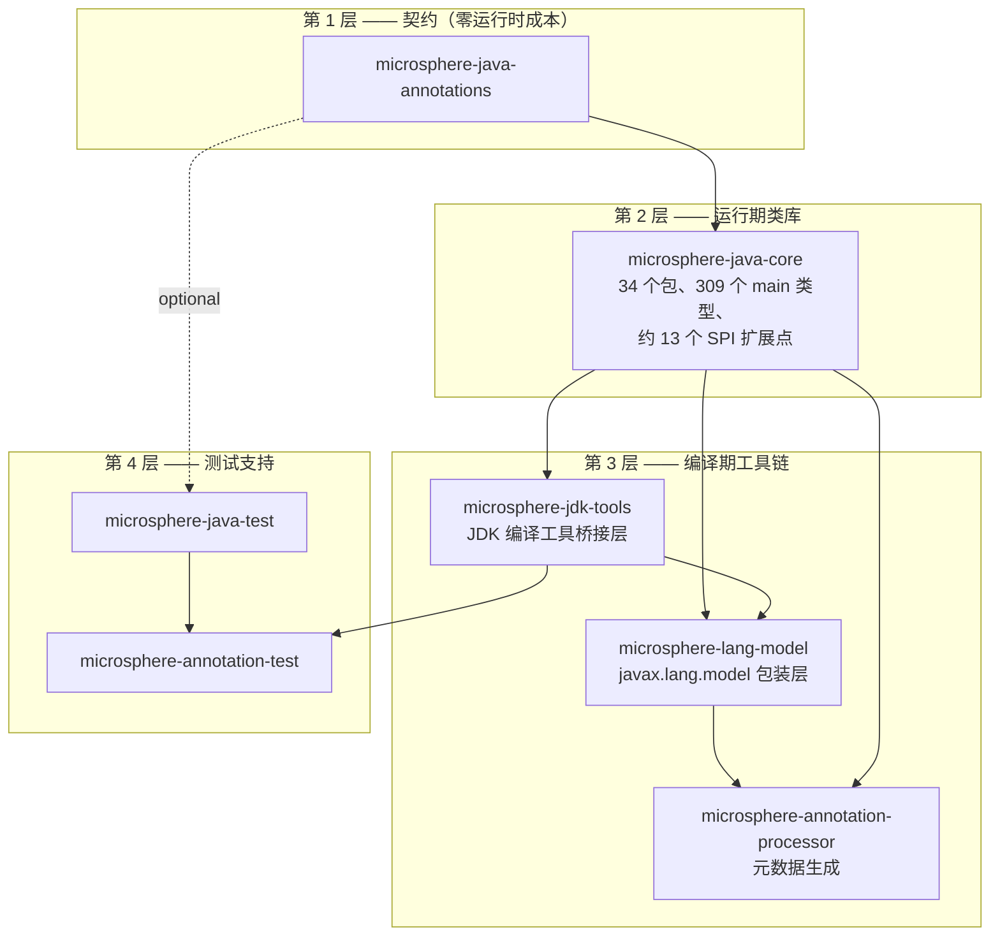
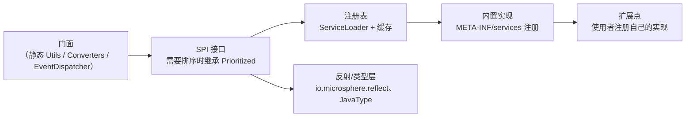
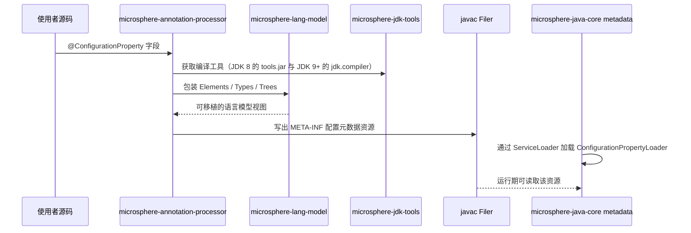
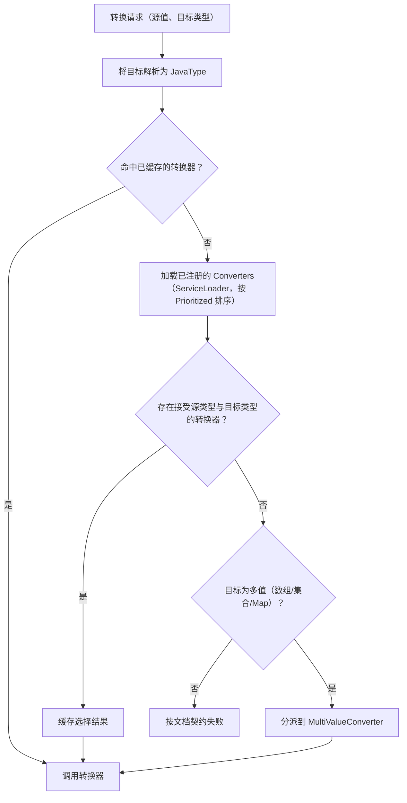

# Microsphere Java 开发者文档 —— `release` 分支（`current`）

读者对象：需要**阅读、修改或扩展** `microsphere-java` 的人 —— 库的维护者，或基于其 SPI 构建框架的作者。
本目录给出架构设计、带 `file:line` 引用的类级源码分析、代码库中实际使用的设计模式，以及复杂控制流的流程图。

所记录的源码线：**`release` 分支**，`revision = 0.3.20-SNAPSHOT`（该版本线已发布为 `0.3.20`，即仓库中最新的标签）。
每个页面的中文版位于英文文件所在目录的 `zh/` 子目录中。

* 文档总目录与版本线：[../../../zh/README.md](../../../zh/README.md)
* 用户文档（API 用法、坐标、JDK 支持）：[../../user-guide/zh/README.md](../../user-guide/zh/README.md)

---

## 1. 架构设计

### 1.1 分层

仓库是 Maven 多模块聚合工程（聚合 POM `microsphere-java` → 构建约定 `microsphere-java-parent` →
BOM `microsphere-java-dependencies` → 七个代码模块）。模块构成四层，依赖方向严格向下：

| 层 | 源码树中成立的事实 |
|----|--------------------|
| 契约层 | 只包含注解，不依赖 `core`。在此引入运行期依赖会破坏「零成本」承诺。 |
| 运行期层 | `core` 仅依赖 `annotations`，其余集成（`slf4j-api`、`commons-logging`、`javax.annotation-api`、`jsr305`）均为 optional。每个子系统都通过 `META-INF/services` 接入，而不是硬依赖。 |
| 工具链层 | 唯一接触 `jdk.compiler` 内部 API 的层；该接触面被刻意收敛到 `microsphere-jdk-tools`，以保证栈的其余部分可移植。 |
| 测试支持层 | `microsphere-java-test` 的依赖**全部**为 optional，从而让使用者的 JUnit/Mockito/Spring 版本优先。 |

### 1.2 反复出现的子系统骨架

`core` 中大多数子系统遵循同一个五段式结构，看过一次之后所有子系统都能按同一路径阅读：

改代码前应当知道的三个结论：

* 实现是**有序的**，通常通过 `io.microsphere.lang.Prioritized`；改动 `getOrder()` 是行为变更，不是样式调整。
* 实现是在**运行期被发现**的，因此类改名或包迁移会静默破坏下游使用方 —— `src/main/resources/META-INF/services/`
  下的注册文件必须同步迁移。
* 当前 JDK 无法提供的能力必须**降级为 no-op 或回退实现**，而不是抛异常。空值安全与降级策略在各页面中说明。

### 1.3 `release` 分支上的 SPI 清单

以下每一项都在 `microsphere-java-core/src/main/resources/`（或下文注明的模块）下拥有 `META-INF/services` 文件：

| SPI | 模块 | 用途 | 文档页面 |
|-----|------|------|----------|
| `io.microsphere.convert.Converter` | core | 单值类型转换 | [类型转换](../microsphere-java-core/zh/type-conversion.md) |
| `io.microsphere.convert.multiple.MultiValueConverter` | core | 数组/集合/Map 转换 | [类型转换](../microsphere-java-core/zh/type-conversion.md) |
| `io.microsphere.io.serializer.Serializer` | core | 二进制序列化 | [序列化](../microsphere-java-core/zh/serialization.md) |
| `io.microsphere.io.serializer.Deserializer` | core | 二进制反序列化 | [序列化](../microsphere-java-core/zh/serialization.md) |
| `io.microsphere.event.EventDispatcher` | core | 事件分发策略 | [事件分发](../microsphere-java-core/zh/events.md) |
| `io.microsphere.logging.LoggerFactory` | core | 日志后端委托链 | [日志](../microsphere-java-core/zh/logging.md) |
| `io.microsphere.classloading.ArtifactResourceResolver` | core | 定位构件元数据 | [类加载与构件探测](../microsphere-java-core/zh/classloading-and-artifacts.md) |
| `io.microsphere.classloading.URLClassPathHandle` | core | 按 JDK 版本访问 URLClassPath | [类加载与构件探测](../microsphere-java-core/zh/classloading-and-artifacts.md) |
| `io.microsphere.net.ExtendableProtocolURLStreamHandler` | core | 自定义 URL 协议处理器 | [网络与 URL 协议](../microsphere-java-core/zh/net-and-url-protocols.md) |
| `io.microsphere.process.ProcessIdResolver` | core | 进程 id 探测 | [并发、进程、管理与安全](../microsphere-java-core/zh/concurrency-process-and-management.md) |
| `io.microsphere.metadata.ConfigurationPropertyReader` | core | 读取属性元数据 | [配置属性元数据](../microsphere-java-core/zh/configuration-metadata.md) |
| `io.microsphere.metadata.ConfigurationPropertyLoader` | core | 加载属性元数据资源 | [配置属性元数据](../microsphere-java-core/zh/configuration-metadata.md) |
| `io.microsphere.metadata.ConfigurationPropertyGenerator` | core | 生成属性元数据 | [配置属性元数据](../microsphere-java-core/zh/configuration-metadata.md) |
| `javax.annotation.processing.Processor` | microsphere-annotation-processor | 编译期元数据生成 | [注解处理器](microsphere-annotation-processor.md) |

---

## 2. 跨模块流程

### 2.1 配置属性元数据：注解 → 处理器 → 资源 → 运行期读取

### 2.2 转换分派（所有 SPI 型子系统的代表）

---

## 3. 代码库中的设计模式

| 模式 | 使用位置 | 动机 |
|------|----------|------|
| 静态工具类 + 标记接口 | `util`、`collection`、`reflect`、`text` 中实现 `io.microsphere.util.Utils` 的类 | 统一发现方式，不可实例化的 API 面 |
| 服务提供者（SPI）+ 注册表 | 上表 14 个 SPI，经 `ServiceLoader` 工具类加载 | 零配置扩展，不硬依赖第三方集成 |
| 策略模式 | `Converter`、`MultiValueConverter`、`LoggerFactory`、`ArtifactResourceResolver`、`ProcessIdResolver` 的选择 | 按 JDK / 按类型在运行期决定行为 |
| 有序策略 | `io.microsphere.lang.Prioritized` 的实现者（监听器、转换器、加载器） | 确定性的分派顺序 |
| 包装器 / 职责链 | `io.microsphere.lang.Wrapper` 的解包循环、`URLClassPathHandle` 各变体、委托式集合 | 跨层抽象的统一解包 |
| 装饰器模式 | `io.microsphere.collection` / `concurrent` 中的 `Delegating*` 集合与执行器 | 不复制数据即可加入空安全或只读语义 |
| 空对象模式 | `Empty*` 集合、`NoOpURLClassPathHandle` | 以优雅降级替代 `null` 或异常 |
| 不可变值对象 | `JavaType`、`Artifact`、`MavenArtifact`、`ImmutableEntry` | 可安全跨线程与缓存共享 |
| 模板方法 | `AbstractConverter`、`AbstractDeque`、`AbstractArtifactResourceResolver`、`AbstractURLClassPathHandle` | 共享生命周期、可替换细节 |
| 建造者模式 | `io.microsphere.management.builder.*` 的 MBean 构建器 | 多步构建 JMX 描述符 |
| 门面模式 | `Logger`/`LoggerFactory`、`Converters`、`EventDispatcher`、`BeanUtils` | 为子系统提供小面积 API |
| 访问者模式 | `microsphere-lang-model` 与处理器中的 `javax.lang.model` 元素访问器 | 遍历编译期模型 |

每个模块页面都会指出具体模式，并给出实现类的 `file:line` 引用。

---

## 4. 页面清单

### 4.1 `microsphere-java-core`（14 篇）

| 页面 | 覆盖的包 | 源码分析重点 |
|------|----------|--------------|
| [工具类、常量与文本](../microsphere-java-core/zh/util-and-constants.md) | `util`、`util.jar`、`constants`、`text`、`misc` | 类加载器与资源解析、服务加载缓存、版本解析 |
| [集合与过滤器](../microsphere-java-core/zh/collections-and-filters.md) | `collection`、`filter` | 委托/不可变包装类内部实现，零分配的空集合与单例集合 |
| [语言抽象](../microsphere-java-core/zh/language-abstractions.md) | `lang`、`lang.function`、`lang.invoke`、`invoke` | `Prioritized` 排序、`Wrapper` 解包循环、lambda/方法句柄内省 |
| [反射、类型与 JavaBean](../microsphere-java-core/zh/reflection-and-beans.md) | `reflect`、`reflect.generics`、`internal.reflect`、`beans` | 泛型解析算法、`JavaType` 模型、按 JDK 处理可访问性 |
| [类型转换](../microsphere-java-core/zh/type-conversion.md) | `convert`、`convert.multiple` | 转换器选择、缓存、泛型实参解析 |
| [序列化](../microsphere-java-core/zh/serialization.md) | `io.serializer` | 序列化/反序列化分派，以及安全相关的反序列化路径 |
| [事件分发](../microsphere-java-core/zh/events.md) | `event` | 监听器解析、条件过滤、分发线程安全性 |
| [I/O、NIO、扫描与文件过滤](../microsphere-java-core/zh/io-and-scanning.md) | `io`、`io.event`、`io.scanner`、`io.filter`、`nio.*` | 扫描器插件式设计、`WatchService` 到事件流水线的映射 |
| [网络与 URL 协议](../microsphere-java-core/zh/net-and-url-protocols.md) | `net`、`net.classpath`、`net.console` | Handler 注册约束、子协议链式解析 |
| [日志](../microsphere-java-core/zh/logging.md) | `logging` | 后端探测顺序、懒初始化、JUL 回退 |
| [类加载与构件探测](../microsphere-java-core/zh/classloading-and-artifacts.md) | `classloading` | classpath URL 解析、JPMS 与 `sun.misc` 路径、禁用构件校验 |
| [JSON](../microsphere-java-core/zh/json.md) | `json` | 分词/解析循环、`JSONObject` 的 Map 选择与顺序语义 |
| [配置属性元数据](../microsphere-java-core/zh/configuration-metadata.md) | `metadata` | Reader/Loader/Generator 流水与合并 |
| [并发、进程、管理与安全](../microsphere-java-core/zh/concurrency-process-and-management.md) | `concurrent`、`process`、`management`、`management.builder`、`security` | `ProcessIdResolver` 回退链、MBean 注册、SecurityManager 废弃处理 |

英文索引：[microsphere-java-core/README.md](../microsphere-java-core/README.md)。

### 4.2 其他模块

| 页面 | 模块 | 重点 |
|------|------|------|
| [microsphere-java-annotations](microsphere-java-annotations.md) | annotations | Retention 策略选择及其对反射/编译期消费方的影响 |
| [microsphere-jdk-tools](microsphere-jdk-tools.md) | jdk-tools | JDK 工具发现：`tools.jar`（8）与 `jdk.compiler`（9+） |
| [microsphere-lang-model](microsphere-lang-model.md) | lang-model | 基于 `javax.lang.model` 的适配层、访问者遍历、缓存 |
| [microsphere-annotation-processor](microsphere-annotation-processor.md) | annotation-processor | 处理器生命周期、处理轮次、`Filer`/`Messager` 用法、选项处理 |
| [microsphere-java-test](microsphere-java-test.md) | java-test | 夹具生命周期、JUnit 5 扩展装配、optional 依赖设计 |
| [microsphere-annotation-test](microsphere-annotation-test.md) | annotation-test | 进程内 `javac` 框架、内存文件管理器、诊断信息收集 |

---

## 5. 构建、测试与兼容性基础设施

| 方面 | 取值 | 定义位置 |
|------|------|----------|
| Reactor 构建顺序 | parent → dependencies → annotations → core → jdk-tools → java-test → annotation-test → lang-model → annotation-processor | 根 `pom.xml` 的 `<modules>` |
| 版本方案 | `${revision}` flatten 模式（`release` 分支上 `revision=0.3.20-SNAPSHOT`） | 根 `pom.xml` 属性 |
| 语言级别 | 目标字节码为 Java 8；该级别继承自外部 `microsphere-build` 父 POM，因此本仓库的 POM 中看不到 `maven.compiler` 配置 | 根 `pom.xml` 的 `<parent>`（`microsphere-build` `0.3.16`） |
| 依赖管理链 | `microsphere-java-parent` 导入 `microsphere-all-bom` `0.3.13` 与 `spring-framework-bom`；`microsphere-java-dependencies` 再统一管理七个模块版本 | `microsphere-java-parent/pom.xml`、`microsphere-java-dependencies/pom.xml` |
| 按 JDK 切换的测试栈 | profile `java8-16`（激活条件 `[1.8,17)`）将 Spring 固定为 `5.3.39`；其余情况使用 Spring `7.0.9` | `microsphere-java-parent/pom.xml:21-24,52-64` |
| CI JDK 矩阵 | Temurin `8`、`11`、`17`、`21`、`25` | `.github/workflows/maven-build.yml:25` |
| CI 构建命令 | `mvn --batch-mode --update-snapshots -Drevision=0.0.1-SNAPSHOT -Dsurefire.useSystemClassLoader=false test --activate-profiles test,coverage` | `.github/workflows/maven-build.yml:37-45` |
| CI 触发条件 | push 到 `main`/`dev`；针对 `main`/`dev`/`release` 的 pull request | `.github/workflows/maven-build.yml:14-18` |
| 发布使用的 JDK | 单次 Java `11` 运行 | `.github/workflows/maven-publish.yml:41` |
| 测试框架 | JUnit 5（Jupiter），配合 `microsphere-java-test` 夹具 | 各模块 pom、`src/test/java` |
| 额外测试工具 | Mockito、Logback（测试日志）、Spring（转换交叉验证）、JMH（core 基准测试） | `microsphere-java-core/pom.xml` 的 test 作用域 |

> [!NOTE]
> CI 以 `-Dsurefire.useSystemClassLoader=false` 运行 Surefire。在本地复现类加载器、构件探测与 URL 协议相关测试时请保留该参数，
> 这些正是默认类加载器隔离会改变可观测行为的区域。

> [!NOTE]
> 在本工作区的自动化 shell 会话中 Maven 目前不可靠。构建请使用普通终端，或依赖 CI；源码级阅读与 grep 分析不需要构建。

---

## 6. 修改本代码时请遵循的约定

* 所有 public 与 protected 成员都带 `@Nonnull` / `@Nullable`；新增 API 同样必须标注。
* 新增 API 需要 `@Since`，标注其将要发布的版本。
* 当前 JDK 无法提供的能力应静默降级（no-op / 中性值），并在页面中说明该降级行为 —— 不要为了「修复 NPE」而新增
  `assertNotNull` 式抛异常。
* 新增 SPI 实现必须与实现类在同一次提交中注册进 `META-INF/services`。
* 子系统行为变更要同步更新文档：用户文档页面（API、示例、JDK 矩阵）与开发者文档页面（源码分析、模式、流程图）。
