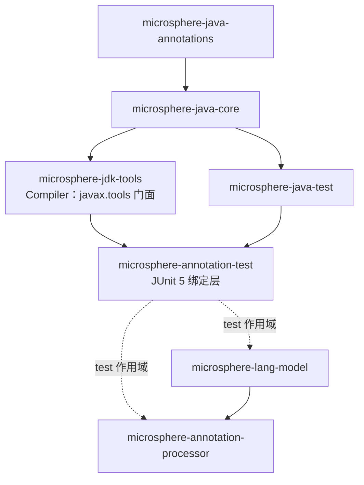
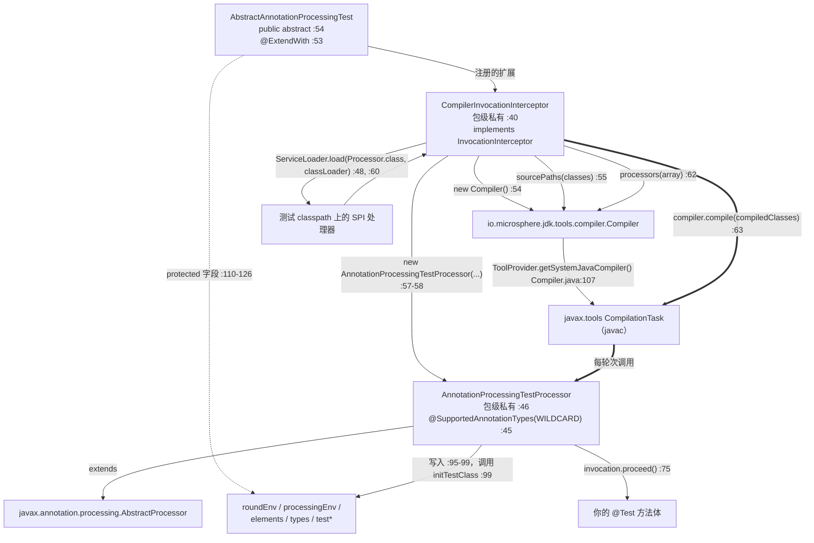
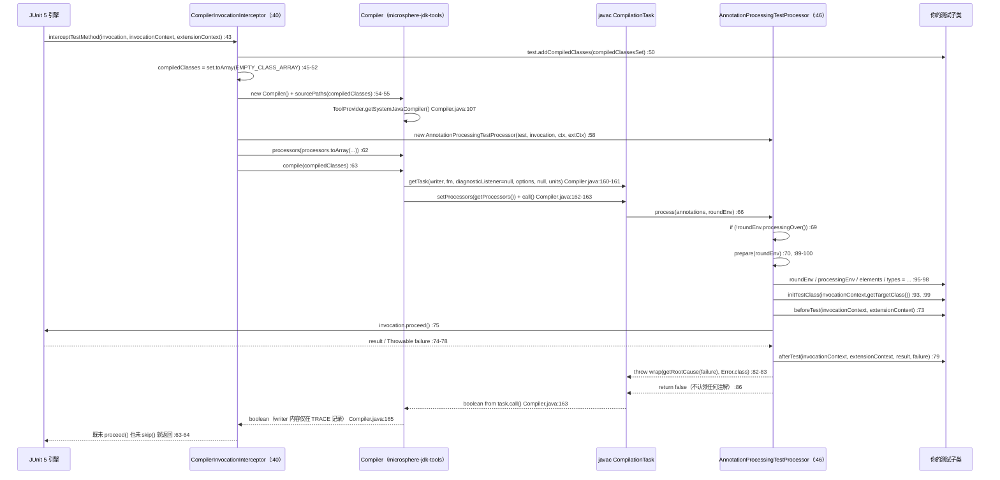

# Annotation Test：注解处理器测试框架 —— 开发者指南

模块：`io.github.microsphere-projects:microsphere-annotation-test` · `0.3.20-SNAPSHOT`（`release`，发布为 `0.3.20`）
三个主代码类型，其中一个是 public · 一个测试类型 · CI 运行于 JDK 8 / 11 / 17 / 21 / 25

下文使用的路径前缀：`processing/` = `microsphere-annotation-test/src/main/java/io/microsphere/test/annotation/processing/`，
`test-src/` = `microsphere-annotation-test/src/test/java/io/microsphere/test/annotation/processing/`，
`Compiler.java` = `microsphere-jdk-tools/src/main/java/io/microsphere/jdk/tools/compiler/Compiler.java`。

> [!NOTE]
> 段落中出现的裸 `:NN` 引用，指向该段落中最近一次被引用的文件；跨模块的引用总会写明文件名。

---

## 1. 架构位置

本仓库的注解处理技术栈有四个层次，而本模块是这套栈的 **JUnit 绑定层**：



### 1.1 为什么框架要从 `microsphere-jdk-tools` 里拆出来

| 理由 | 证据 |
|---|---|
| **`microsphere-jdk-tools` 必须不知道 JUnit 的存在。** `Compiler.java` 只 import `javax.tools`、`javax.annotation.processing`、`io.microsphere.*` 与 JDK 类型（`Compiler.java:19-64`）—— 没有任何 `org.junit.*` | 框架的两个类型是从**主源码**里 import JUnit 5 扩展 API 的：`CompilerInvocationInterceptor.java:20-22`（`ExtensionContext`、`InvocationInterceptor`、`ReflectiveInvocationContext`）与 `AnnotationProcessingTestProcessor.java:19-21`；基类也一样（`AbstractAnnotationProcessingTest.java:21-23`） |
| **生产 / 测试的作用域边界。** `jdk-tools` 是可以被生产代码使用的 compile 作用域构件；框架永远只是测试依赖 | `microsphere-lang-model/pom.xml:52-57` 与 `microsphere-annotation-processor/pom.xml:50-56` 都用 `<scope>test</scope>` 声明本模块（`:56`、`:55`） |
| **依赖形状不同。** `jdk-tools` 只有一个 compile 依赖（core）；本模块额外加上 `microsphere-java-test`，并复刻了后者的 optional 测试夹具清单 | `microsphere-annotation-test/pom.xml:24-28`（`microsphere-java-test`，artifactId 在 `:26`）、`:31-35`（`microsphere-jdk-tools`，artifactId 在 `:33`）；optional 清单 `:38-89` 对比 `microsphere-java-test/pom.xml:24-83` |
| **职责周期不同。** `Compiler` 是一个*机械式*门面（配置 → `compile`），而框架拥有一套*协议*：轮次、钩子、失败的重新包装 | `Compiler.java:111-167` 对比 `AnnotationProcessingTestProcessor.java:66-87` |
| **这里没有任何运行期代码。** 没有 `META-INF/services`、没有资源、没有 `module-info.java` —— 模块的全部内容就是 `pom.xml` 加三个 `.java` 文件 | 由模块目录树核实：`microsphere-annotation-test/pom.xml`、`processing/AbstractAnnotationProcessingTest.java`、`processing/AnnotationProcessingTestProcessor.java`、`processing/CompilerInvocationInterceptor.java`、`test-src/AnnotationProcessingTest.java` |

仓库与依赖边，全部对照 POM 核实过：

| 依赖边 | 作用域 | 证据 |
|---|---|---|
| `annotation-test → microsphere-java-test` | compile | `microsphere-annotation-test/pom.xml:26`（`${revision}` 在 `:27`） |
| `annotation-test → microsphere-jdk-tools` | compile | `microsphere-annotation-test/pom.xml:33`（`${revision}` 在 `:34`） |
| `annotation-test → JUnit 5 / Mockito / Logback / JAX-RS / JAX-WS / Spring` | optional | `microsphere-annotation-test/pom.xml:41`、`:48`、`:54`、`:61`、`:68`、`:75`、`:82`、`:88` |
| `lang-model → annotation-test` | **test** | `microsphere-lang-model/pom.xml:54`，`<scope>test</scope>` 在 `:56` |
| `annotation-processor → annotation-test` | **test** | `microsphere-annotation-processor/pom.xml:53`，`<scope>test</scope>` 在 `:55` |
| 为使用方统一管理的版本 | —— | `microsphere-java-dependencies/pom.xml:50` |
| 仓库构建顺序 | 9 个中的第 7 个 | 根 `pom.xml:58-66`（`microsphere-annotation-test` 在 `:64`） |
| 模块 parent | `microsphere-java-parent` `${revision}` | `microsphere-annotation-test/pom.xml:5-10`；仓库 parent `microsphere-build:0.3.16` 见根 `pom.xml:6-10` |

> [!WARNING]
> compile 作用域依赖 `microsphere-java-test`（`microsphere-annotation-test/pom.xml:24-28`）**没有被本模块任何源文件
> 使用**：三个主代码类型只 import `io.microsphere.annotation.Nonnull`/`Nullable`
> （`AbstractAnnotationProcessingTest.java:19-20`）、`io.microsphere.jdk.tools.compiler.Compiler`
> （`CompilerInvocationInterceptor.java:19`）以及 `io.microsphere` 的 core 辅助类
> （`AnnotationProcessingTestProcessor.java:34-36`、`CompilerInvocationInterceptor.java:30-32`）。
> `@Nonnull` / `@Nullable` 来自 `microsphere-java-annotations`
> （`microsphere-java-annotations/src/main/java/io/microsphere/annotation/Nonnull.java`），
> 经由 `microsphere-jdk-tools → microsphere-java-core` 传递而来（`microsphere-java-core/pom.xml:24-28`）。

---

## 2. 类型清单

| 类型 | 全限定名 | 可见性 | 规模 | 职责 |
|---|---|---|---|---|
| `AbstractAnnotationProcessingTest` | `io.microsphere.test.annotation.processing.AbstractAnnotationProcessingTest`（`processing/AbstractAnnotationProcessingTest.java:17`、`:54`） | `public abstract` | 164 行；27 个常量（`:56-108`）、9 个字段（`:110-126`）、4 个方法（`:133`、`:136`、`:150`、`:161`） | 用户的基类：状态容器 + 模板钩子；在 `:53` 声明扩展 |
| `AnnotationProcessingTestProcessor` | `io.microsphere.test.annotation.processing.AnnotationProcessingTestProcessor`（`processing/AnnotationProcessingTestProcessor.java:46`） | **包级私有** `class` | 106 行；4 个字段（`:48-54`）、3 个方法（`:66`、`:89`、`:102`） | 被注入 `javac` 的 `AbstractProcessor`；把一次编译轮次转换成一次测试调用 |
| `CompilerInvocationInterceptor` | `io.microsphere.test.annotation.processing.CompilerInvocationInterceptor`（`processing/CompilerInvocationInterceptor.java:40`） | **包级私有** `class` | 65 行；1 个方法（`:43`） | JUnit 5 的 `InvocationInterceptor`，负责组装并启动编译 |
| `AnnotationProcessingTest` | `io.microsphere.test.annotation.processing.AnnotationProcessingTest`（`test-src/AnnotationProcessingTest.java:44`） | `public class`（测试源码） | 101 行；2 个 `@Test` 方法（`:46`、`:77`） | 框架的自测，同时充当自己的扩展（`:44`、`:78`） |

两个值得记录的结构性事实：框架*唯一*的 public 类型就是基类，因此
`AnnotationProcessingTestProcessor` 与 `CompilerInvocationInterceptor` 在使用方代码中不可达（`:46`、`:40`）；
而这两个包级私有类型与基类位于**同一个包**中，这正是处理器能直接写测试实例 `protected` 字段
（`AnnotationProcessingTestProcessor.java:95-99`）、拦截器能调用 `test.addCompiledClasses(...)`
（`CompilerInvocationInterceptor.java:50`）的原因。

---

## 3. 进程内编译流程

### 3.1 类 / 钩子结构



### 3.2 `JavaCompiler` 与 `CompilationTask` 从哪里来

`microsphere-annotation-test` 中没有任何代码直接触碰编译器 API。拦截器的两行
`Compiler compiler = new Compiler();` / `compiler.sourcePaths(compiledClasses);`
（`CompilerInvocationInterceptor.java:54-55`）把一切委托了出去：

1. `Compiler()` → `Compiler(defaultTargetDirectory())` → `Compiler(File, File)`（`Compiler.java:95-109`）；最后一个
   构造函数安装 `DEFAULT_OPTIONS`（`:104`、`:76-77`），并在 `:107` 通过
   `javax.tools.ToolProvider.getSystemJavaCompiler()`（静态 import 在 `:64`）解析工具，`null` 时在 `:108` 快速失败。
2. `sourcePaths(Class...)`（`CompilerInvocationInterceptor.java:55` → `Compiler.java:121-126`）借助 `detectSourcePath`
   把每个类换算成源码**目录**（`Compiler.java:242-262`），定位不到源码的类被静默跳过（`Compiler.java:129-133`）。
3. 随后 `compile(Class...)`（`CompilerInvocationInterceptor.java:63` → `Compiler.java:156-167`）在每次调用中新建一个
   `StringBuilderWriter`（`:158`）、新建一个 `StandardJavaFileManager`，把 `SOURCE_PATH` 设为收集到的源码目录、
   并把 `CLASS_OUTPUT` **和** `SOURCE_OUTPUT` 都设为同一个目标目录（`:175-177`），把每个类解析成它的 `.java`
   并丢弃找不到的（`:209-215`、`:217-226`），调用 `getTask(writer, fm, listener, options, null, units)`（`:160-161`）——
   注意 `fileNames` 传的是 `null` —— 然后 `task.setProcessors(getProcessors())`（`:162`）与阻塞式的 `task.call()`（`:163`）。
4. **这一层不存在任何缓存。** `interceptTestMethod` 每个测试方法执行一次
   （`CompilerInvocationInterceptor.java:43`），因此有 *N* 个 `@Test` 方法的类就会做 *N* 次独立的 `Compiler`
   构造，并对同一份源码集合做 *N* 次编译。

### 3.3 处理器是如何被注入的

```java
// CompilerInvocationInterceptor.java:57-62
LinkedList<Processor> processors = new LinkedList<>();
processors.add(new AnnotationProcessingTestProcessor(test, invocation, invocationContext, extensionContext));
// 加载 Processor 的 SPI 实例
ServiceLoader<Processor> loadedProcessors = load(Processor.class, classLoader);
loadedProcessors.forEach(processors::add);
compiler.processors(processors.toArray(new Processor[0]));
```

这六行带来四个结论：

* 测试处理器拿到了**完整的 JUnit 调用三元组** —— `Invocation<Void>`、`ReflectiveInvocationContext<Method>`、
  `ExtensionContext` —— 外加测试实例（`CompilerInvocationInterceptor.java:58`，构造函数见
  `AnnotationProcessingTestProcessor.java:56-63`）。这就是一次编译器回调得以执行测试方法的全部凭据。
* SPI 查找使用的类加载器是**测试类自己的加载器**（`CompilerInvocationInterceptor.java:48`，在 `:60` 使用），
  而不是 `javac` 创建的处理器加载器。配合 `task.setProcessors(...)`（`Compiler.java:162`），`javac` 自身的处理器发现
  机制被完全抑制 —— 这也正是拦截器必须手工做这件事的原因（`Compiler.java:201-207`：字段未设置意味着 `emptySet()`，
  而空集合意味着*根本不进行*注解处理）。
* 顺序是被请求的，但不被保证：`LinkedList` 在 `CompilerInvocationInterceptor.java:62` 被摊平成数组，又被
  `processors(Processor...)` 重新装进一个 `Set`（`Compiler.java:136-139` → `Sets.ofSet`，
  `microsphere-java-core/src/main/java/io/microsphere/collection/Sets.java:552-557`）。JDK 9+ 上那是 `Set.of`
  （迭代顺序未定义，`Sets.java:97`、`:563-564`）；JDK 8 的回退路径是保持插入序的 `LinkedHashSet`
  （`Sets.java:560-561` → `microsphere-java-core/src/main/java/io/microsphere/collection/SetUtils.java:155-168`）。
* `ServiceLoader` 失败是无人保护的（`CompilerInvocationInterceptor.java:60-61`）：一条畸形的
  `META-INF/services/javax.annotation.processing.Processor` 记录会在编译开始之前就把
  `ServiceConfigurationError` 抛出 `interceptTestMethod`。

### 3.4 拦截器钩子究竟做了什么

`CompilerInvocationInterceptor` 只实现了 `InvocationInterceptor` 的一个方法 ——
`interceptTestMethod(Invocation<Void>, ReflectiveInvocationContext<Method>, ExtensionContext)`
（`CompilerInvocationInterceptor.java:42-44`）。它的契约是*环绕通知*：调用方（JUnit 引擎）交给它一个被挂起的调用，
期待它要么 `invocation.proceed()`，要么有意地跳过。该钩子**并不**自己调用 `proceed()`；它把调用交给处理器（`:58`），
然后阻塞在 `compiler.compile(...)`（`:63`）。`proceed()` 稍后在**同一个线程**上、从 `javac` 的轮次内部发生
（`AnnotationProcessingTestProcessor.java:75`）。

仅从代码就能看出的后果：

* `compile(...)` 返回的 `boolean` 被丢弃（`CompilerInvocationInterceptor.java:63`），方法也没有调用
  `invocation.skip()`（`:43-64`）。如果没有任何非末轮次走到处理器，JUnit 看到的是一个正常返回的拦截器，
  于是把测试记为通过。
* 签名上的 `throws Throwable`（`:44`）正是失败被重新抛出后能够原样逃逸出轮次的原因
  （`AnnotationProcessingTestProcessor.java:83`）。

### 3.5 带钩子判定节点的轮次时序



### 3.6 诊断信息是如何被捕获的 —— 基本没被捕获

| 诊断来源 | 代码路径 | 最终去向 |
|---|---|---|
| `javac` 在你编译单元上的 error/warning | `getTask(..., diagnosticListener, ...)`（`Compiler.java:160-161`）传入的 listener 字段一直是 `null`（`Compiler.java:89`）—— 框架从未调用 `diagnosticListener(...)`（`Compiler.java:141-144`） | 写进 `StringBuilderWriter`（`Compiler.java:158`），在 `finally` 里以 **TRACE** 记录一次（`Compiler.java:165`）随后丢弃 |
| 被测处理器通过 `ProcessingEnvironment#getMessager()` 输出的信息 | `javac` 的 reporter，同一个 writer | 同上一条 TRACE |
| `compile(...)` 的 `boolean` | 被返回（`Compiler.java:163`） | 在 `CompilerInvocationInterceptor.java:63` 被**丢弃** |
| 你测试方法抛出的 throwable | 被捕获进 `failure`（`AnnotationProcessingTestProcessor.java:76-77`），原样传给 `afterTest`（`:79`） | 重新抛出为 `wrap(getRootCause(failure), Error.class)`（`:82-83`）—— `AssertionError` 原样保留，其余一律变成 `java.lang.Error`（`microsphere-java-core/src/main/java/io/microsphere/util/ExceptionUtils.java:98-104`、`:304-308`；根因回溯见 `microsphere-java-core/src/main/java/io/microsphere/util/ThrowableUtils.java:47`） |
| `javac` 选项 | 拦截器从不调用 `options(...)`，于是 `DEFAULT_OPTIONS` 原样生效（`Compiler.java:76-77`，在 `:104` 安装） | `-parameters`、`-Xlint:-unchecked`、`-nowarn`、`-Xlint:deprecation` —— 警告是被刻意压掉的 |

> [!IMPORTANT]
> 框架的失败通道是**异常**，不是日志。凡是 `javac` 自己上报的内容 —— 损坏的源文件、你的处理器发出的 `Messager`
> `ERROR`、不受支持的 `-source` 组合 —— 在默认日志级别下全部不可见，因为被捕获 writer 唯一的消费者是
> `logger.trace`（`Compiler.java:165`）。所以排查“什么都没做”的框架测试，要从打开
> `io.microsphere.jdk.tools.compiler.Compiler` 的 TRACE 开始。

---

## 4. 实际实现的 JDK 9+ 适配策略

整个模块里没有任何版本分支 —— 没有 `JavaVersion` 判定、没有 `Runtime.version()`、没有 `Class.forName`、
没有 `setAccessible`、没有 `tools.jar` 路径运算、也没有 `--add-exports` 字符串（已遍历
`microsphere-annotation-test` 全部源码核实；唯一的 JDK 工具引用是 `CompilerInvocationInterceptor.java:19` 的 import）。
适配是被委托出去的，而委托对象如下：

| 机制 | 代码 | 为什么在 JDK 9+ 上重要 |
|---|---|---|
| 只经由 `javax.tools` 获取工具 | `Compiler.java:107`，并在 `:108` 设守卫 | JDK 8 需要 `lib/tools.jar`，JDK 9+ 需要 `jdk.compiler` 模块；`ToolProvider` 在两者之上都是受支持的解析入口，因此不读 `com.sun.tools.javac`，也就没有什么需要 `--add-exports` |
| `getSupportedSourceVersion()` → `latestSupported()` | `AnnotationProcessingTestProcessor.java:102-105`（静态 import 在 `:37`） | `AbstractProcessor` 的默认实现会报告一个固定 release，在每个更新版本的 JDK 上都会触发“supported source version … less than `-source`”警告；`latestSupported()` 跟随当前 JDK，这正是同一个 jar 能在 8 → 25 全绿的原因 |
| `@SupportedAnnotationTypes(WILDCARD)` | `AnnotationProcessingTestProcessor.java:45`，`WILDCARD` = `"*"`（`microsphere-java-core/src/main/java/io/microsphere/constants/SymbolConstants.java:313`） | 无论注解集合是什么，框架都参与轮次；配合 `:69`，协议不依赖注解类型是否存在 |
| 处理器以对象形式传入，而非由 `javac` 发现 | `CompilerInvocationInterceptor.java:57-62` → `Compiler.java:162` | 没有 `-processorpath`，没有模块路径式处理器加载：被注入的实例始终留在无名模块 / 测试类加载器里（`:48`） |
| 本模块不含 `module-info.java`，也不含 `META-INF/services` | 模块目录树（见 §1.1） | 框架永远是 classpath 代码；它不与任何 `Processor` 的模块化提供者竞争 |
| 不带模块开关的 CI | `.github/workflows/maven-build.yml:25`（矩阵 `8`/`11`/`17`/`21`/`25`）、`:33`（`distribution: 'temurin'`）、`:38-45`（构建命令行），`-Dsurefire.useSystemClassLoader=false` 在 `:43` | 在矩阵里的任何 JDK 上运行这些测试都不需要 `--add-opens` / `--add-exports`。注意 `:43` 的开关**只存在于 CI**：本仓库没有任何 POM 配置 `maven-surefire-plugin` |

> [!WARNING]
> 确实有一个 JDK 相关行为泄漏进了框架，而且它是静默的：§3.3 描述的处理器集合（`Sets.ofSet` → JDK 9+ 的 `Set.of`，
> `Sets.java:563-567`）同时**拒绝重复元素**。两个等值的处理器实例，或者一个 `null` 元素，都会让方法句柄抛异常 ——
> 于是 `catch (Throwable)` 回退路径改为返回保序的 `LinkedHashSet` 版本（`Sets.java:565-567`）。也就是说同一个测试，
> 处理器迭代顺序在 JDK 9+ 与 JDK 8 上可能不同。今天框架不依赖这个顺序，但任何将来“我的处理器必须第一个跑”的假设，
> 从构造上就是 JDK 版本脆弱的。

---

## 5. 设计模式（附证明代码）

| 模式 | 所在位置 | 证据 |
|---|---|---|
| **模板方法（Template Method）** | 基类把算法骨架定义为四个空的 `protected` 钩子加一个具体步骤，由处理器驱动 | 钩子 `AbstractAnnotationProcessingTest.java:133-134`、`:150-151`、`:161-163`；具体步骤 `initTestClass` `:136-142`；驱动者 `AnnotationProcessingTestProcessor.java:70`、`:73`、`:79`、`:99` |
| **环绕通知 / 拦截器**（JUnit 5 `InvocationInterceptor`） | 扩展挂起测试方法调用，再从另一个执行上下文中重新进入 | `CompilerInvocationInterceptor.java:40`（`implements InvocationInterceptor`）、`:42-44`（唯一覆盖的方法）、`:63`（阻塞在编译中）、`AnnotationProcessingTestProcessor.java:75`（恢复） |
| **延迟命令（Deferred Command）** | `Invocation<Void>` 被存进字段，稍后由另一个对象调用 | 字段 `AnnotationProcessingTestProcessor.java:50`，赋值 `:60`，调用 `:75` |
| **观察者 / 回调配对（before–finally–after）** | `beforeTest` / `afterTest` 用 `finally` 把 `proceed()` 括起来，并把 `result` 与 `failure` 送进钩子 | `AnnotationProcessingTestProcessor.java:71-80` |
| **门面（Facade，委托式）** | 所有编译器机制都藏在 `microsphere-jdk-tools` 的单一类型之后；框架只做配置与调用 | `CompilerInvocationInterceptor.java:19`、`:54-55`、`:62-63`；`Compiler.java:72`、`:111-167` |
| **黑板 / 共享可变上下文** | 测试实例是一块“字段黑板”，由一个协作者写入、另一个读取，且同包 | 写入 `AnnotationProcessingTestProcessor.java:95-99`；声明 `AbstractAnnotationProcessingTest.java:110-126` |
| **策略（可服务插拔）** | 测试 classpath 上每个 SPI `Processor` 都会加入轮次，因此无需改动框架即可扩展行为 | `CompilerInvocationInterceptor.java:48`、`:60-61` |
| **Object Mother / 测试数据目录** | 27 个预先带好类型的 `null` 与空值，使重载的 `javax.lang.model` API 无需强制转换即可调用 | `AbstractAnnotationProcessingTest.java:56-108`；使用方示例 `microsphere-lang-model/src/test/java/io/microsphere/lang/model/util/MethodUtilsTest.java:108` |
| **适配器（两个，很小）** | `@SupportedAnnotationTypes` + `getSupportedSourceVersion()` 把 `AbstractProcessor` 适配成“任意注解、任意 JDK” | `AnnotationProcessingTestProcessor.java:45`、`:102-105` |
| **快速失败守卫（委托式）** | 唯一刻意的中止点在 `Compiler` 对工具的空值检查 | `Compiler.java:107-108` |

同样值得记录的**缺失项**：没有 builder（框架暴露的是“钩子即 setter”，不是流式 builder —— 对比
`Compiler.java:111-154`），没有 holder / 懒缓存（每个测试方法一个全新 `Compiler` 和一个全新处理器，
`CompilerInvocationInterceptor.java:54`、`:58`），注入字段上没有 `@Nullable`/`@Nonnull`
（`AbstractAnnotationProcessingTest.java:110-126` 不带任何注解），也没有本模块自身类型的服务注册（见 §1.1）。

---

## 6. 扩展点

| 扩展点 | 签名 | 契约 |
|---|---|---|
| 追加编译单元 | `protected void addCompiledClasses(@Nonnull Set<Class<?>> compiledClasses)`（`AbstractAnnotationProcessingTest.java:133`） | 每个测试方法调用一次，且在编译器构建之前（`CompilerInvocationInterceptor.java:50`）；该集合保持插入序并去重（`:45`、`SetUtils.java:491`）；测试类已经在集合里（`:49`） |
| 每轮次前置 | `protected void beforeTest(ReflectiveInvocationContext<Method>, ExtensionContext)`（`:150`） | 每个非末轮次执行，字段填充之后被调用（`AnnotationProcessingTestProcessor.java:70`、`:73`） |
| 每轮次收尾 | `protected void afterTest(ReflectiveInvocationContext<Method>, ExtensionContext, @Nullable Object result, @Nullable Throwable failure)`（`:161`） | 在 `finally` 中执行（`:78-80`）；`failure` 是**未经**再包装的原始 throwable（`:76-79`） |
| 重设模型目标 | `protected void initTestClass(@Nonnull Class<?> testClass)`（`:136`） | 具体方法，子类可直接调用；改写五个 `test*` 字段（`:137-141`）—— 用法见 `microsphere-lang-model/src/test/java/io/microsphere/lang/model/util/UtilTest.java:52` |
| 继承来的状态 | 九个 `protected` 字段（`:110-126`）+ 27 个常量（`:56-108`） | 这就是框架的全部读取型 API |
| 追加 JUnit 行为 | 在你的子类上实现任意 JUnit 5 回调接口 | 本模块自己的测试正是这么做的：`implements TestExecutionExceptionHandler`（`test-src/AnnotationProcessingTest.java:44`）加 `@ExtendWith(AnnotationProcessingTest.class)`（`:78`） |
| 处理器侧扩展 | 通过 `META-INF/services/javax.annotation.processing.Processor` 注册你的 `Processor` | 在 `CompilerInvocationInterceptor.java:60-61` 被拾取 |

编译器本身**没有**扩展点：`new Compiler()` 是硬编码的（`CompilerInvocationInterceptor.java:54`），因此目标目录
（`Compiler.java:99-101`、`:236-240`）、`options`（`:111-114`）、`diagnosticListener`（`:141-144`）、`locale`（`:146-149`）
与 `charset`（`:151-154`）都无法从使用方代码触达。要改其中任何一项就得 fork `CompilerInvocationInterceptor` ——
而从 `io.microsphere.test.annotation.processing` 之外做不到，因为该类型是包级私有的（`:40`）。
本该解决此问题的 protected 工厂方法并不存在；这是本模块最主要的结构性限制。

---

## 7. 测试策略

`microsphere-annotation-test` 只有**一个**测试类，而且它是用框架来测试框架本身：
`test-src/AnnotationProcessingTest.java:44` 继承了 `AbstractAnnotationProcessingTest`。

| 测试 | 锁定的行为 | 行号 |
|---|---|---|
| `test()` | 全部 27 个常量：每个 `NULL_*` 都是 `null`，每个 `EMPTY_*` 等于一个全新的空数组 | `:46-75` |
| `testOnFailure()` | 失败路径：一个会抛异常的方法体（`:81`）必须让原始 throwable 抵达 `afterTest`（`:85-90`） | `:77-82` |
| `afterTest` 覆盖 | `failure.getMessage()` 是 `"For testing"`，即在被钩子看到之前既没被吞也没被改写 | `:84-90` |
| `handleTestExecutionException` | 刻意抛出的失败**不会**被重新抛出，于是 `testOnFailure` 以通过收场 | `:92-100` |

最后一行最有意思：因为框架会以 `Error` 形式重新抛出（`AnnotationProcessingTestProcessor.java:83`），
一个方法体抛异常的测试就必须在 JUnit 层面把这个 `Error` 吞掉才可能通过 —— 而 `testOnFailure` 能通过的唯一理由，
就是 `handleTestExecutionException(ExtensionContext, Throwable)` 无论收到什么都不重新抛出
（`test-src/AnnotationProcessingTest.java:93-100`）。`if ("testOnFailure".equals(method.getName()))` 这个分支（`:96`）
里除了一句 `// ingnore`（`:97`，原文如此）什么都没有，因此该处理器吞掉的是**每个**测试方法的失败，而不只是那一个。

两个包级私有类型都没有专属单元测试（`src/test/java` 下不存在
`AnnotationProcessingTestProcessor` 或 `CompilerInvocationInterceptor` 的 `*Test` 对应物）。它们的覆盖完全
是**间接且跨模块的**，这才是本构件真正的测试策略：

* `microsphere-lang-model`：`UtilTest`（`microsphere-lang-model/src/test/java/io/microsphere/lang/model/util/UtilTest.java:48`）
  继承框架，另有 14 个测试类继承 `UtilTest` —— 它们每一个都在走完整的轮次往返，而 `addCompiledClasses`
  （`MethodUtilsTest.java` 的 `:83-85`、`TypeUtilsTest.java` 的 `:189-194`）走的正是编译单元扩展点。
* `microsphere-annotation-processor`：四个直接子类 ——
  `ConfigurationPropertyAnnotationProcessorTest.java:34`、`FilerProcessorTest.java:41`、
  `ResourceProcessorTest.java:54`、`ConfigurationPropertyJSONElementVisitorTest.java:44`。
* CI 在 Temurin 8 / 11 / 17 / 21 / 25 上运行这一切（`.github/workflows/maven-build.yml:25`、`:33`），
  带 `-Dsurefire.useSystemClassLoader=false`（`:43`）与 `test,coverage` profile（`:45`）。

没有任何测试覆盖的部分：§8 列出的每一个失败分支 —— 编译单元被丢弃、`compile` 返回 `false`、
`ServiceConfigurationError`、`initTestClass` 内部的 NPE，以及 `processingOver()` 短路
（`AnnotationProcessingTestProcessor.java:69`）。

---

## 8. 评审意见：在源码中发现的脆弱点

按对“看起来全绿的测试套件”可能造成的伤害从大到小排列。

1. **“空过”是默认的失败形态。** `interceptTestMethod` 忽略 `compile()` 的 `boolean`
   （`CompilerInvocationInterceptor.java:63`），既未 proceed 也未 skip：如果处理器的 `process()` 从未在
   `!roundEnv.processingOver()` 的条件下被到达（`AnnotationProcessingTestProcessor.java:69`），测试方法体就一次都没跑，
   而 JUnit 报告成功。可达性会悄无声息地失败：磁盘上找不到的源码被过滤掉（`Compiler.java:209-215`），
   而 `null` 的 `JavaCompiler` 会在构造处以 `IllegalArgumentException` 中止（`Compiler.java:107-108`）。
   可选修复：断言 `proceed()` 确实被调用过（在 `afterTest` 里置一个标志位），或者尊重 `compile` 的返回值。
2. **诊断信息被丢弃。** 从未注册过 `diagnosticListener`（见 §3.6），于是 javac 的错误与 `Messager` 输出只活在
   一条 TRACE 日志里（`Compiler.java:165`）。与第 1 条叠加，正是框架测试难以排查的根因。
3. **异常类型在逃逸途中被销毁。** `wrap(getRootCause(failure), Error.class)`
   （`AnnotationProcessingTestProcessor.java:82-83`）让 `AssertionError` 原样通过
   （`ExceptionUtils.java:99-101`），但把其它任何 throwable 用消息加 cause 重建为 `java.lang.Error`
   （`ExceptionUtils.java:102-103`、`:304-308`）。`getRootCause` 还会丢弃包装链（`ThrowableUtils.java:47`），
   中间上下文随之消失。
4. **`afterTest` 可能拿到 `null` 的 `failure`，而编译依旧可能是失败的** —— 处理器自己的抛出（`:83`）在钩子的视野之外，
   而对 `void` 测试方法 `result` 恒为 `null`（`:71`、`:75`）。
5. **逐方法重新编译。** 每个 `@Test` 一个 `Compiler` 加一整个 `javac` 轮次
   （`CompilerInvocationInterceptor.java:43-63`）；30 个方法的子类会把同一份源码编译 30 次。而且所有测试都写进**同一个**
   输出目录：`CLASS_OUTPUT` = `SOURCE_OUTPUT` = `<root of Compiler.class>/target/generated-classes`
   （`Compiler.java:176-177`、`:236-240`）—— 在仓库构建中那就是 `microsphere-jdk-tools/target/generated-classes`，
   被所有使用本框架的模块共享。
6. **处理器注册顺序在不同 JDK 上不稳定** —— 见 §4 的警告
   （`Sets.java:563-567` 对比 `SetUtils.java:155-168`）。
7. **多个非末轮次会重跑整个测试体。** `process()` 是逐轮次回调查（`AnnotationProcessingTestProcessor.java:66`），
   唯一的守卫是 `processingOver()`（`:69`）；没有“已经跑过”的标志位，所以一个会生成代码的处理器会让断言与 `beforeTest`
   被成倍执行。
8. **共享可变状态没有任何发布协议。** 九个字段（`AbstractAnnotationProcessingTest.java:110-126`）不是 `volatile`，
   由 `prepare` 写入（`AnnotationProcessingTestProcessor.java:95-99`）。今天安全**仅仅**因为 `task.call()`
   是在调用线程上同步执行的（`Compiler.java:163`）；代码里没有任何东西保证这一点，因此若某个编译器实现改在别的线程上跑
   轮次，框架会静默失效。
9. **`initTestClass` 毫无防护。** `elements.getTypeElement(name)` 可能返回 `null`，下一行就直接解引用
   （`AbstractAnnotationProcessingTest.java:139-140`）；`(DeclaredType) testTypeMirror`（`:141`）是未检查转换，
   对非 declared type 会抛 `ClassCastException`。该方法是在轮次*进行中*被调用的
   （`AnnotationProcessingTestProcessor.java:99`），所以 NPE 会按第 3 条的方式被包装后浮出。
10. **两处用不同 API 解析“测试类”。** 拦截器使用 `extensionContext.getTestClass().get()`
    （`CompilerInvocationInterceptor.java:47`），而处理器使用 `invocationContext.getTargetClass()`
    （`AnnotationProcessingTestProcessor.java:93`）—— 一个值、两个来源，拦截器这一侧还带着不设防的
    `Optional#get()` 式访问（`:46`、`:47`）。如果框架将来支持 `@Nested` 类，请把它们统一。
11. **基类公开 API 里的裸类型。** `EMPTY_COLLECTION_ARRAY`（`:62`）、`NULL_COLLECTION`（`:64`）、`NULL_LIST`（`:66`）、
    `NULL_TYPE_ARRAY`（`:78`）/ `EMPTY_TYPE_ARRAY`（`:80`）/ `NULL_TYPE`（`:82`）、`NULL_CLASS`（`:90`）、
    `NULL_CLASS_ARRAY`（`:92`）、`NULL_PREDICATE_ARRAY`（`:96`）都是裸类型声明，使用方测试因此继承了一批
    unchecked-conversion 警告。`NULL_TYPE_ARRAY`（`:78`）与 `EMPTY_TYPE_ARRAY`（`:80`）是 `java.lang.reflect.Type[]`，
    不是 `javax.lang.model` 类型 —— 很容易和 `NULL_TYPE_MIRROR_ARRAY`（`:60`）混淆。
12. **未被使用的 compile 作用域依赖。** `microsphere-java-test`（`microsphere-annotation-test/pom.xml:24-28`）
    是 compile 作用域且被源码引用为零（见 §1 警告）；另有六个 optional 声明（`:38-89`）同样未被主源码使用。
    它们抬高了两个使用方的传递性测试 classpath。
13. **Javadoc 的 `@since 1.0.0` 与发布线 `0.3.20`。** 三个类型都写着 `@since 1.0.0`
    （`AbstractAnnotationProcessingTest.java:51`、`AnnotationProcessingTestProcessor.java:43`、
    `CompilerInvocationInterceptor.java:38`），而 `${revision}` 是 `0.3.20-SNAPSHOT`（根 `pom.xml:54`）。无害，
    但意味着不能用这些 `@since` 标签为本构件定位年代。
14. **`AnnotationProcessingTestProcessor` 是包级私有但并非 `final`。** 同包子类无从禁止，其构造函数（`:56`）也是包级私有；
    另外两个类型同样不是 `final`（`CompilerInvocationInterceptor.java:40`）。对一个内部类型来说这没问题，
    但它意味着“包级私有”是框架提供的唯一访问控制，而本模块还依赖 JUnit 能够实例化包级私有的扩展类这一约定
    （`AbstractAnnotationProcessingTest.java:53`）。

---

## 9. 参见

* [microsphere-annotation-test —— 用户指南](../../user-guide/zh/microsphere-annotation-test.md) —— 坐标、三类型 API
  走查、七步处理器测试配方与陷阱清单
* [microsphere-jdk-tools —— 开发者指南](microsphere-jdk-tools.md) —— `Compiler.java` 的逐行分析、`ToolProvider`
  解析流程，以及本框架所依赖的源码发现遍历
* [microsphere-lang-model —— 开发者指南](microsphere-lang-model.md) —— `UtilTest`，本框架最大的使用方
* [microsphere-annotation-processor —— 开发者指南](microsphere-annotation-processor.md) —— 在真实编译轮次内被演练的那些处理器
* [集合与过滤器 —— 开发者指南](../microsphere-java-core/zh/collections-and-filters.md) —— `Sets.ofSet` /
  `SetUtils` / `SetUtils.newLinkedHashSet`，即 §3.3 与 §4 背后那个依赖 JDK 版本的集合选择
* 英文原版：[English Developer Guide](../microsphere-annotation-test.md)
