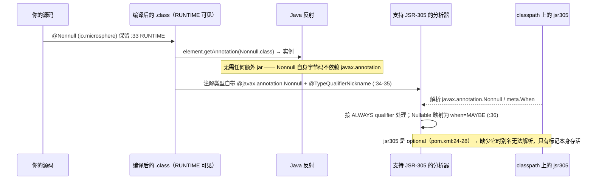
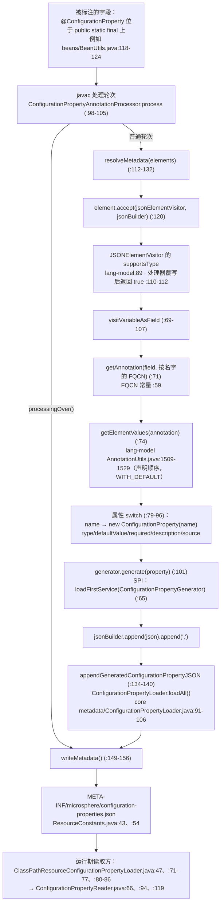

# Microsphere Java Annotations —— 开发者指南

模块：`io.github.microsphere-projects:microsphere-java-annotations` · `0.3.20-SNAPSHOT`（`release` 分支）
包：`io.microsphere.annotation`（6 个类型）· `io.microsphere.annotation.concurrent`（2 个类型）—— 8 个注解接口、
6 个测试类，再无其他代码 · 整个 reactor 中不存在任何 `maven.compiler.*` / `<release>` 属性，因此字节码级别继承自
外部父工程 `microsphere-build:0.3.16`（`pom.xml:6-10`）；CI 跑在 JDK 8 / 11 / 17 / 21 / 25
（`.github/workflows/maven-build.yml:25`、`:33`）。

下文使用的路径前缀（均相对于模块根目录，引用前都逐行打开确认过）：

* `annotation/…` = `microsphere-java-annotations/src/main/java/io/microsphere/annotation/…`
* `concurrent/…` = `microsphere-java-annotations/src/main/java/io/microsphere/annotation/concurrent/…`
* 本模块测试位于 `src/test/java/io/microsphere/annotation/…`
* 其他模块一律带完整模块前缀引用，例如 `microsphere-java-core/src/main/java/io/microsphere/…`

---

## 1. 本模块在架构中的位置

它是**契约层（contract layer）**：一个叶子构件，其他每个模块都可以用它来加注解，而它不依赖 reactor 里的任何东西。
它唯一的编译依赖是 `com.google.code.findbugs:jsr305`，声明为 `optional`
（`microsphere-java-annotations/pom.xml:24-28`）；除此之外只有 `test` 作用域的 JUnit 5
（`microsphere-java-annotations/pom.xml:30-41`）。

```mermaid
graph TD
    ANN["microsphere-java-annotations（叶子）<br/>8 个注解类型 · jsr305 optional"]
    CORE["microsphere-java-core"]
    JDK["microsphere-jdk-tools"]
    LM["microsphere-lang-model"]
    AP["microsphere-annotation-processor"]
    JT["microsphere-java-test"]
    AT["microsphere-annotation-test"]
    DEP["microsphere-java-dependencies（BOM，管理版本）"]
    ANN -->|"compile，非 optional<br/>core/pom.xml:24-28"| CORE
    ANN -->|"compile，optional<br/>java-test/pom.xml:24-29"| JT
    CORE --> JDK
    CORE --> LM
    CORE --> AP
    LM --> AP
    AT --> JT
    AT --> JDK
    AP -.->|"test 作用域<br/>processor/pom.xml:51-56"| AT
    CORE -.->|"test 作用域<br/>core/pom.xml:65-71"| JT
    AP --> META["META-INF/microsphere/<br/>configuration-properties.json"]
    DEP -.->|管理版本| ANN
    DEP -.->|管理版本| CORE
```

两条入向事实，都是验证得来而非假设：

* **`core` 确实在 compile 作用域依赖本模块，并且没有标 optional**
  （`microsphere-java-core/pom.xml:24-28`）。因此 core 发布的每一个注解（`@Nonnull`、`@Nullable`、`@Immutable`、
  `@ConfigurationProperty`）都经由本构件解析，消费者会传递性地拿到它们。core 只在 **test** 作用域声明 `jsr305`
  （`microsphere-java-core/pom.xml:73-78`），所以 `javax.annotation.*` 是被*有意*排除在 core 的运行期契约之外的。
* **处理器是按名字、而不是按类标识触达注解的。**
  `CONFIGURATION_PROPERTY_ANNOTATION_CLASS_NAME = "io.microsphere.annotation.ConfigurationProperty"`
  （`microsphere-annotation-processor/src/main/java/io/microsphere/annotation/processor/ConfigurationPropertyJSONElementVisitor.java:59`）
  就是喂给 `@SupportedAnnotationTypes` 的值
  （`.../ConfigurationPropertyAnnotationProcessor.java:77`），也是驱动 mirror 查找的值
  （`.../ConfigurationPropertyJSONElementVisitor.java:71`）。整个过程从不要求 `Class` 对象在场。

已验证的消费方普查（整个 `release` worktree 的主源码，按 import 语句计数）：

| 注解 | 导入它的主源码文件 | 生产环境反射读取方 | 编译期读取方 |
|---|---|---|---|
| `@Nonnull` | 99 | 无（仅测试，`src/test/java/io/microsphere/annotation/NonnullTest.java:36`） | 无 —— 面向分析器 |
| `@Nullable` | 76 | 无（仅测试，`…/NullableTest.java:36`） | 无 |
| `@Immutable` | 74 | 无（仅测试，`…/ImmutableTest.java:36`） | 无 |
| `@ConfigurationProperty` | 14 个 core/工具文件，2 个测试支撑文件 | `microsphere-java-test/src/test/java/io/microsphere/test/model/ConfigurationPropertyModelTest.java:84-85` | `microsphere-annotation-processor`（按名字） |
| `@Since` | 2（`microsphere-java-test/src/main/java/io/microsphere/test/annotation/TestAnnotation.java:69`、`…/service/TestServiceImpl.java:70`） | 生产环境无；在 `microsphere-java-core/src/test/java/io/microsphere/util/AnnotationUtilsTest.java:469` 作为夹具使用 | 无 |
| `@Experimental` | **0** | **0** —— `assertNull` 证明了不可见（`…/ExperimentalTest.java:35`） | 无 |
| `@ThreadSafe` / `@NotThreadSafe` | **0** | **0**（不可能有：`CLASS` retention） | **0** |

> [!IMPORTANT]
> 从下往上读这张普查表：八个注解里有五个在仓库中**没有任何生产环境的反射读取方**。唯一跨模块、读取注解*类对象*的
> 反射消费方是 `ConfigurationPropertyModelTest`（`:84-85`）；其余代码要么在打注解，要么在读生成的 JSON 资源。
> 这不是意外——这正是“契约层”的定义：库声明承诺，工具据此行动。

---

## 2. 八个类型的清单

| 类型 | `@Target` | `@Retention` | `@Documented` | 属性 | JSR-305 关联 | 证据 |
|---|---|---|---|---|---|---|
| `annotation/Nonnull.java` | **缺失** → 所有声明上下文，不含 type-use | `RUNTIME`（`:33`） | 是（`:32`） | 无 | `@javax.annotation.Nonnull`（`:34`）+ `@TypeQualifierNickname`（`:35`） | `:32-36` |
| `annotation/Nullable.java` | 缺失（同上） | `RUNTIME`（`:35`） | 是（`:34`） | 无 | `@javax.annotation.Nonnull(when = MAYBE)`（`:36`）+ `@TypeQualifierNickname`（`:37`） | `:34-38`、`:24` |
| `annotation/Immutable.java` | 缺失（同上） | `RUNTIME`（`:32`） | 是（`:31`） | 无 | **无** | `:31-34` |
| `annotation/Since.java` | 全部 10 个 element type（`:43-54`） | `RUNTIME`（`:42`） | 是（`:55`） | `module()` `""`（`:61`）、`value()` **必填**（`:66`） | 无 | `:42-56` |
| `annotation/Experimental.java` | `ANNOTATION_TYPE, CONSTRUCTOR, FIELD, METHOD, TYPE`（`:38-44`） | `SOURCE`（`:37`） | 是（`:36`） | `description()` `""`（`:50`） | 无 | `:36-50` |
| `annotation/ConfigurationProperty.java` | `FIELD`（`:37`） | `RUNTIME`（`:36`） | 是（`:35`） | `name` `""`（`:60`）、`type` `String.class`（`:67`）、`defaultValue` `""`（`:74`）、`required` `false`（`:81`）、`description` `""`（`:88`）、`source` `{}`（`:95`） | 无 | `:35-95` |
| `concurrent/ThreadSafe.java` | `TYPE`（`:27`） | `CLASS`（`:28`） | 是（`:26`） | 无 | 未应用（`:9` 处 import 未被使用） | `:26-29` |
| `concurrent/NotThreadSafe.java` | `TYPE`（`:26`） | `CLASS`（`:27`） | 是（`:25`） | 无 | 未应用（`:9` 处 import 未被使用） | `:25-28` |

三组划分解释了 retention 的分布，而每一组都是有意的（尽管未被文档化的）决定：

1. **`SOURCE` ×1** —— `@Experimental` 是在使用点给作者看的警告；一旦编译完成就再没有东西可强制执行，因此为它付出
   运行期属性的代价既不花钱也不赚到什么。
2. **`CLASS` ×2** —— JCIP 那一对，指向字节码分析器；改成 `RUNTIME` 只会撑大常量池。
3. **`RUNTIME` ×5** —— `@Nonnull` / `@Nullable` / `@Immutable` 可被反射式工具读取
   （`io.microsphere.util.AnnotationUtils`），`@Since` 携带内省工具需要的数据，而 `@ConfigurationProperty` 必须同时
   可被 `javax.lang.model` 访问者*以及*反射读取。

---

## 3. 源码分析：可空性注解的作用范围从何而来

### 3.1 范围由“缺了什么”定义

`annotation/Nonnull.java:32-36` 和 `annotation/Nullable.java:34-38` 声明了 `@Documented`、
`@Retention(RUNTIME)`、JSR-305 的 qualifier 和 `@TypeQualifierNickname` —— 但**没有 `@Target`**。按
JLS §9.6.4.1，没有 `@Target` 的注解类型适用于每一个*声明*上下文（type、field、method、parameter、constructor、
local variable、package、annotation type），而**不**适用于任何 type-use 上下文。按重要性排序的实际后果：

| 放置位置 | 合法？ | 原因 |
|---|---|---|
| `@Nonnull public static Foo get()` | 是 | 方法声明 |
| `void f(@Nonnull String s)` | 是 | 参数声明 |
| `@Nonnull class X {}` | 是 | 类型声明 —— 测试就是这么做的（`src/test/java/io/microsphere/annotation/NonnullTest.java:31`） |
| 用 `@Nonnull` 标注 `package-info.java` | 是 | 没有 `@Target` ⇒ `PACKAGE` 被允许 |
| `List<@Nonnull String>` | **否** | 需要 `ElementType.TYPE_USE`；只有 `@Since` 声明了它（`annotation/Since.java:53`） |
| `@Nonnull` 用于 `record` 分量的类型 | **否** | 同一原因 |

### 3.2 不存在默认可空性机制

典型的 JSR-305 项目会用一个包级别的
`@TypeQualifierDefault(ElementType.METHOD) @Nonnull` 放在 `package-info.java` 里，来选择“除非明说，否则一切都非空”。
在 `release` 上验证其缺席：

* `@TypeQualifierDefault` 在 worktree 中**任何** Java 源文件里都不出现（仅有的命中来自文档正文以及
  `.understand-anything/` 下的分析缓存）。
* 本模块**不**提供 `package-info.java`；reactor 中唯一的一个是
  `microsphere-java-core/src/main/java/io/microsphere/json/package-info.java`。

因此 `@Nonnull` 的作用范围恰好就是*有人标注过的那些元素*，逐元素计。日后加入包级默认会悄悄改变 99 个文件的*含义*，
这正是应把它当作有意限制、而非疏漏的主要理由。

### 3.3 昵称机制，以及 `when = MAYBE` 换来什么

机制上：`@TypeQualifierNickname`（在 `annotation/Nonnull.java:19`、`annotation/Nullable.java:19` 导入）告诉合规的
分析器*“要应用的 qualifier 就是加在我身上的那一个”*。于是两个 microsphere 注解都别名到**同一个** JSR-305 类型，
仅由它的 `when` 参数区分 —— `@Nonnull` 继承默认值（`ALWAYS`），`@Nullable` 通过 `annotation/Nullable.java:24` 的
静态 import 设置 `when = MAYBE`。选择 `MAYBE` 而不是 `javax.annotation.Nullable`，让数据流格（lattice）里只保留
一个 qualifier 类型，使“可空”成为同一个谓词的一个属性，而不是第二个与之竞争的谓词。

> [!WARNING]
> 由于 `jsr305` 是 `optional`，这些元注解对消费者**不是**传递可用的
> （`microsphere-java-annotations/pom.xml:27`），而 core 进一步把它收窄为 `test` 作用域
> （`microsphere-java-core/pom.xml:73-78`）。反射地看，
> `Nonnull.class.getAnnotation(javax.annotation.Nonnull.class)` 只有在运行期 classpath 上有 `jsr305` 时才有答案。
> 本模块自己的六个测试中没有任何一个断言别名可以解析 —— 见 [§8](#8-测试策略)。

### 3.4 出处在文件头里可见

`annotation/Nonnull.java:1-15` 和 `annotation/Nullable.java:1-15` 携带 Spring Framework 的版权声明块
（`Copyright 2002-2019 the original author or authors`），而 `ConfigurationProperty`、`Experimental`、`Immutable`
和 `Since` 携带 ASF 声明块，`concurrent/ThreadSafe.java:1-6` / `concurrent/NotThreadSafe.java:1-6` 则携带 JCIP
署名（`Copyright (c) 2005 Brian Goetz`、`Official home: http://www.jcip.net`）。命名也一脉相承：
`Nonnull`（第二个字母小写）对齐的是 `javax.annotation.Nonnull`，而不是 Spring 的 `NonNull`
（`annotation/Nonnull.java:36`）。

---

## 4. 源码分析：线程安全注解对

`concurrent/ThreadSafe.java` 与 `concurrent/NotThreadSafe.java` 几乎互为镜像：

| 方面 | `ThreadSafe` | `NotThreadSafe` |
|---|---|---|
| javadoc 正文 | `:18-22`（逐字引用 JCIP 定义） | `:18-21` |
| `@Documented` | `:26` | `:25` |
| `@Target(TYPE)` | `:27` | `:26` |
| `@Retention(CLASS)` | `:28` | `:27` |
| 交叉 `@see` | `:24` | `:23` |
| `@author` / `@since` javadoc 标签 | **缺失** | **缺失** |

三条对维护者重要的观察：

1. **JSR-305 的 import 既是死代码又交叉接错。** `ThreadSafe.java:9` 导入
   `javax.annotation.concurrent.NotThreadSafe`，`NotThreadSafe.java:9` 导入
   `javax.annotation.concurrent.ThreadSafe`。两者都没有被应用 —— 类型上并没有
   `@javax.annotation.concurrent.ThreadSafe` 这个元注解 —— 所以这一对**没有**任何昵称别名，与
   `@Nonnull`/`@Nullable` 不同。跑一次 SpotBugs/FindBugs 不会把
   `io.microsphere.annotation.concurrent.ThreadSafe` 读成它所命名的那个 JCIP/JSR-305 声明。要么删掉 import，
   要么补上元注解以及 `@TypeQualifierNickname` 式的 linkage；当前状态是两边最差的部分都占了。
2. **两个注解在 `release` 中都没有被任何地方使用。** 在整个 worktree 搜索
   `io.microsphere.annotation.concurrent`，结果只有声明它自己的那两个文件。core 是用 `@Immutable` 和结构来文档化
   安全性的 —— `@Immutable` 直接标注在两个快照字段上
   （`microsphere-java-core/src/main/java/io/microsphere/util/ClassPathUtils.java:60-61`、`:63-64`），标注在由
   `ConcurrentHashMap` 支撑的工具所返回的缓存上（`…/util/ClassLoaderUtils.java:92`、
   `…/util/ServiceLoaderUtils.java:140`），也标注在不可修改的发布物本身上
   （`…/util/ServiceLoaderUtils.java:468-469`）。
3. **`@Immutable` 放错了包，就这一对的搭配而言。** `javax.annotation.concurrent` 同时容纳 `Immutable` 和线程安全
   注解对；Microsphere 把它们拆开了：`Immutable` 在 `io.microsphere.annotation`
   （`annotation/Immutable.java:17`），注解对则在 `io.microsphere.annotation.concurrent`
   （`concurrent/ThreadSafe.java:7`）。后果是“状态看不到变化”这个承诺（`annotation/Immutable.java:24-25`）和
   “没有非法交错”这个承诺（`concurrent/ThreadSafe.java:18-22`）由两个互不相关、retention 也不同（`RUNTIME` vs
   `CLASS`）的类型来标注，而且两者都不关联 JSR-305。

---

## 5. 源码分析：`@ConfigurationProperty` 以及它每一个读取方

### 5.1 属性契约

`annotation/ConfigurationProperty.java:55-95` 声明了六个属性，外加三个 `String` 常量（`:43`、`:48`、`:53`），
后者构成 `source()` 的封闭词汇表。javadoc 把预期目标描述为“作为配置属性的那个 Java 字段，其修饰符*通常*是
`static` 和 `final`”（`annotation/ConfigurationProperty.java:27-28`），并指向生成器模块（“名为
`microsphere-annotation-processor` 的模块会在 classpath 中生成元数据资源”，`:30`）。

`ConfigurationProperty.class` 的每一个读取方（对全 worktree 的 grep，列出所有命中）：

| 读取方 | 种类 | 证据 |
|---|---|---|
| `ConfigurationPropertyModelTest` | 对 `getDeclaredFields()` 做运行期反射 | `microsphere-java-test/src/test/java/io/microsphere/test/model/ConfigurationPropertyModelTest.java:84`（`isAnnotationPresent`）、`:85`（`getAnnotation`） |
| `ConfigurationPropertyJSONElementVisitorTest` | 把注解编进一次测试编译 | `microsphere-annotation-processor/src/test/java/io/microsphere/annotation/processor/ConfigurationPropertyJSONElementVisitorTest.java:54`，名字断言 `:59` |
| `ConfigurationPropertyAnnotationProcessor` | `@SupportedAnnotationTypes` + import | `.../processor/ConfigurationPropertyAnnotationProcessor.java:20`、`:77` |
| `ConfigurationPropertyJSONElementVisitor` | 按名字的 mirror 查找、六属性映射 | `.../processor/ConfigurationPropertyJSONElementVisitor.java:59`、`:71`、`:79-96` |
| `TestAnnotation` / `TestServiceImpl` | 注解类型的属性载体（`ConfigurationProperty[] properties()`） | `microsphere-java-test/src/main/java/io/microsphere/test/annotation/TestAnnotation.java:71`、`…/service/TestServiceImpl.java:72-74` |
| `io.microsphere.metadata.*` | **不读注解** —— 读生成的 JSON，并建模为 `io.microsphere.beans.ConfigurationProperty` | `microsphere-java-core/src/main/java/io/microsphere/metadata/ConfigurationPropertyLoader.java:44`（仅 `@see`）、`…/metadata/ConfigurationPropertyReader.java:38` |

### 5.2 有三个“默认值”其实不是默认值

访问者把“作者省略了属性”当作“去推断它”，经由
`matchesDefaultAttributeValue`
（`microsphere-lang-model/src/main/java/io/microsphere/lang/model/util/AnnotationUtils.java:1145`）：

| 属性 | 声明的默认值 | 省略时处理器实际写出的内容 | 证据 |
|---|---|---|---|
| `name()` | `""`（`annotation/ConfigurationProperty.java:60`） | `field.getConstantValue()` —— 字段自己的字面量值；非常量字段为 `null` | `.../ConfigurationPropertyJSONElementVisitor.java:119-122` |
| `type()` | `String.class`（`:67`） | `field.asType()` —— 字段声明的 Java 类型 | `:124-128` |
| `description()` | `""`（`:88`） | `elements.getDocComment(field)` —— 字段的 javadoc | `:130-136` |

`type()` 这一行是*文档与实际*的分歧：注解 javadoc 承诺 `String`，然而为 `microsphere.io.buffer.size` 生成的元数据是
`"type": "int"`
（`microsphere-java-core/src/main/resources/META-INF/microsphere/configuration-properties.json:32`），与
`microsphere-java-core/src/main/java/io/microsphere/io/IOUtils.java:85-89` 处被标注的 `int` 字段一致。要改的是
javadoc，不是访问者。

### 5.3 一条承重的顺序依赖

`visitVariableAsField` **只**在 `name` 分支里创建模型（`:79-81`），却在之后每个分支里解引用它
（`:84`、`:87`、`:90`、`:93`、`:95`）—— 于是它隐含要求 `name()` 最先被访问。今天这条成立，是因为
`getElementValues` 按声明顺序迭代 `getDeclaredMethods(annotationType)`
（`microsphere-lang-model/.../AnnotationUtils.java:1514`、`:1518-1527`），而 `name()` 就是第一个声明的属性
（`annotation/ConfigurationProperty.java:60`）。**调整注解接口里属性的顺序会让处理器抛出
`NullPointerException`** —— 两个文件里都没有任何地方记录这个约束。要么显式先迭代 `name`，要么把构造移出 switch。

剩下的步骤是机械的但值得知道：sources 是在 `else` 分支里追加到 `Metadata.getSources()` 的（`:95`，实现在
`:143-152`），`declaredClass` / `declaredField` 总是用字段自身覆写（`:154-163`），数组的中括号是靠替换结尾逗号
拼出来的（`:126-131`），而 JSON 被 `JSONArray` 重新解析一遍纯粹是为了按缩进 2 美化输出（`:151-152`）。

### 5.4 生成是 optional；消费是 SPI

处理器通过 `META-INF/services/javax.annotation.processing.Processor:1` 注册自己
（`microsphere-annotation-processor/src/main/resources/`）。输出格式可插拔
（`ConfigurationPropertyGenerator`，默认实现 `DefaultConfigurationPropertyGenerator`，注册于
`microsphere-java-core/src/main/resources/META-INF/services/io.microsphere.metadata.ConfigurationPropertyGenerator:1`；
第二个未注册的实现是 `…/metadata/ReflectiveConfigurationPropertyGenerator.java:73-79`）。读取侧，
`ConfigurationPropertyLoader.loadAll()`（`…/metadata/ConfigurationPropertyLoader.java:91-106`）对每个 loader
吞掉任何 `Throwable` 并记录日志（`:101-103`）—— 这就是模块家族的静默降级策略 —— 而 core 只发布一个 loader，
`AdditionalMetadataResourceConfigurationPropertyLoader`，注册于
`microsphere-java-core/src/main/resources/META-INF/services/io.microsphere.metadata.ConfigurationPropertyLoader:1`，
读取 `META-INF/microsphere/additional-configuration-properties.json`
（`…/metadata/AdditionalMetadataResourceConfigurationPropertyLoader.java:36`，名字定义在
`microsphere-java-core/src/main/java/io/microsphere/constants/ResourceConstants.java:60`）。

---

## 6. 设计模式（附证明文件）

| 模式 | 实现类型 | 证据 |
|---|---|---|
| **标记注解（marker annotation）** | `@Immutable`、`@Nonnull`、`@Nullable`、`@ThreadSafe`、`@NotThreadSafe` —— 空体，无属性 | `annotation/Immutable.java:33-34`、`annotation/Nonnull.java:36-37`、`annotation/Nullable.java:38-39`、`concurrent/ThreadSafe.java:29-30` |
| **元注解 / 组合注解** | `@Nonnull` 与 `@Nullable` 把 `@javax.annotation.Nonnull` + `@TypeQualifierNickname` 组合到自己身上 | `annotation/Nonnull.java:34-35`、`annotation/Nullable.java:36-37` |
| **昵称 / 别名（JSR-305 惯用法）** | 一个 provider qualifier，两个公开名字，用 `when` 参数区分 | `annotation/Nullable.java:24`、`:36` |
| **以注解立约（contract-by-annotation）** | 字段声明自己的配置契约；强制执行并发布它的是处理器，不是字段的主人 | `microsphere-java-core/src/main/java/io/microsphere/beans/BeanUtils.java:118-124` → `…/processor/ConfigurationPropertyJSONElementVisitor.java:70-107` |
| **注解作为值载体（复合）** | 另一个注解暴露 `Since since()` 和 `ConfigurationProperty[] properties()` | `microsphere-java-test/src/main/java/io/microsphere/test/annotation/TestAnnotation.java:69`、`:71` |
| **默认值推断（null-object 的一个变体）** | 省略的属性被元素自身的事实替代 | `…/processor/ConfigurationPropertyJSONElementVisitor.java:119-136` |
| **`javax.lang.model` 上的访问者** | `AnnotatedElementJSONElementVisitor` 继承 + `visitVariableAsField` 覆写 | `microsphere-lang-model/src/main/java/io/microsphere/lang/model/util/AnnotatedElementJSONElementVisitor.java:88`、`:120`；覆写位于 `…/ConfigurationPropertyJSONElementVisitor.java:69-70` |
| **SPI + 服务定位** | generator/loader/reader 通过 `META-INF/services` 发现 | `…/ConfigurationPropertyJSONElementVisitor.java:65`；`…/metadata/ConfigurationPropertyLoader.java:93` |
| **成对相反数** | `ThreadSafe` ⇄ `NotThreadSafe`、`Nonnull` ⇄ `Nullable`、`Since` ⇄ `Experimental`（`@see Experimental`） | `concurrent/ThreadSafe.java:24`、`concurrent/NotThreadSafe.java:23`、`annotation/Since.java:39` |
| **按受众分层 retention** | 刻意做出的 `SOURCE` / `CLASS` / `RUNTIME` 划分 | §2 清单表 |

---

## 7. retention 与 target 选择：评审意见

* **`@Experimental` 在构造上就是不可见的。** `SOURCE`（`annotation/Experimental.java:37`）意味着没有类文件、
  没有反射、没有字节码工具。它自己的测试就在断言这种不可见性
  （`src/test/java/io/microsphere/annotation/ExperimentalTest.java:35`）。如果意图哪天变成“在运行期告警”，
  retention 就必须迁移到 `RUNTIME` —— 对缓存了 `SOURCE` 行为的工具而言这是一个**二进制不兼容**的决定。
* **`@Experimental` 被称作“marker annotation”，但它并不是。** javadoc 开头写着
  “The marker annotation indicates a feature is experimental”（`annotation/Experimental.java:31`），
  而类型却声明了 `description()`（`:50`）。marker = 无属性；这是一个*描述型*注解。同样的措辞漂移还出现在
  `annotation/ConfigurationProperty.java:65`，那里的 javadoc 标签被拼成了 `@reurn`。
* **`@Nullable` 的 javadoc 指向了“错的”兄弟。** `@see javax.annotation.Nonnull`（`annotation/Nullable.java:31`）
  —— 技术上没错（那*确实*是它别名的 qualifier），但和 `annotation/Nonnull.java:29` 引用同一个类型并列时很令人困惑。
  两处都应该把 `when` 的差异写清楚。
* **`CLASS` retention 让 `concurrent` 那一对在运行期不可观测，而到目前为止在工具侧也不可观测**，因为它不带
  JSR-305 别名（§4 第 1 条）且使用次数为零。`@Documented`（`:26`/`:25`）是它目前唯一生效的地方。
* **五个 `RUNTIME` 类型里有三个没有 `@Target`**（`Nonnull`、`Nullable`、`Immutable`），这是语言所能给出的最宽
  适用范围 —— 对作者方便，但事后无法收回：补一个受限的 `@Target`，对所有已经在你打算排除的位置上使用它的人来说
  都是一次破坏源码的变更。它同时也悄悄堵死了 type-use 放置，而那正是现代空值工具更偏爱读取的位置。
* **`concurrent` 那一对省略了 `@author` 和 `@since`**（`concurrent/ThreadSafe.java:17-25`、
  `concurrent/NotThreadSafe.java:17-24`），而根包下六个类型全都带着 `@since 1.0.0`
  （`annotation/ConfigurationProperty.java:33` 及其兄弟）。任何基于 `@since` javadoc 生成“API 历史”的工具都会跳过
  这一对。
* **注解从不抛异常 —— 也从不强制执行。** 与全库的静默降级策略一致，没有任何承诺会在运行期被检查。core 真需要
  检查时是手写出来的：`@Nonnull String name` 与 `assertNotNull(...)` 配对
  （`microsphere-java-core/src/main/java/io/microsphere/beans/ConfigurationProperty.java:115`、`:119-120`）。
  请把这种配对当作新 API 的约定。
* **`io.microsphere.lang.Deprecation` 不读 `@Since`。** 它的 `getSince()` 返回的是从自身模型解析出的 `Version`
  （`microsphere-java-core/src/main/java/io/microsphere/lang/Deprecation.java:111`），而该类只导入了
  `Immutable`/`Nonnull`/`Nullable`（`:19-21`）。这两套生命周期机制是平行的，并未打通。

---

## 8. 测试策略

位置：`microsphere-java-annotations/src/test/java/io/microsphere/annotation/` —— 六个 JUnit 5 类，每个属性或非平凡
retention 值得钉住的注解一个类（`ThreadSafe`/`NotThreadSafe` 没有测试，这与它们没有可观测的运行期行为相一致）。

| 测试 | 钉住什么 | 证据 |
|---|---|---|
| `NonnullTest` / `NullableTest` / `ImmutableTest` | `RUNTIME` retention 是真的：类级注解可以取回 | `NonnullTest.java:31` + `:36`；`NullableTest.java:31` + `:36`；`ImmutableTest.java:31` + `:36` |
| `ExperimentalTest` | `SOURCE` retention 是真的：同一个调用返回 `null` | `ExperimentalTest.java:30` + `:35`（`assertNull`） |
| `SinceTest` | 两个属性能完整反射往返，包括必填的 `value()` | `SinceTest.java:30` + `:35-37` |
| `ConfigurationPropertyTest` | 三个 `source()` 常量是精确字符串 | `ConfigurationPropertyTest.java:38-40` |

> [!TIP]
> 改动本模块时应补上的缺口。（1）没有测试断言 JSR-305 别名可以解析 —— 请添加
> `assertNotNull(Nonnull.class.getAnnotation(javax.annotation.Nonnull.class))` 以及 `when = MAYBE` 的等价断言；
> `jsr305` 已经在本模块的 classpath 上（`microsphere-java-annotations/pom.xml:24-28`）。（2）没有测试断言
> `@Nonnull` 在*参数*或*方法*上同样被保留，而不只是在类型上。（3）没有测试断言 `@Target` 的内容 ——
> core 里已经用这种方式做过
> `Since.class.getAnnotation(Target.class)`
> （`microsphere-java-core/src/test/java/io/microsphere/util/AnnotationUtilsTest.java:473`）。
> （4）赋予 `@ConfigurationProperty` 价值的那些处理器行为，是在 `microsphere-annotation-processor` 和
> `microsphere-annotation-test` 的 javac 框架里测试的，而不是这里 —— 请保持现状，因为本模块绝不能增加对 `core` 的
> 测试依赖。

---

## 9. 扩展点

* **新增第九个注解** —— 保持这些不变式：不引入仓库内依赖、不产生类文件、retention 要有意识地选
  （只有在必须有东西实时读取它时才默认 `RUNTIME`）、永远加 `@Documented`、永远加 `@since` javadoc，
  并在同一次变更里更新两份指南各自的清单表。
* **启用包级别可空性** —— 唯一缺失的 JSR-305 部件就是 `@TypeQualifierDefault`（§3.2）。在这里加入
  `package-info.java` 会改变 99 个已标注文件的*含义*，所以它必须伴随一次分析器配置变更和一条 release note 落地，
  而不是悄悄发生。
* **让 `concurrent` 那一对真正有牙齿** —— 要么删掉 `concurrent/ThreadSafe.java:9` 和
  `concurrent/NotThreadSafe.java:9`，要么把它们变成
  `@javax.annotation.concurrent.ThreadSafe` / `…NotThreadSafe` 元注解，好让字节码分析器认账。
* **扩展元数据流水线** —— 实现 `ConfigurationPropertyGenerator`（JSON 形状）、
  `ConfigurationPropertyLoader`（额外来源）或 `ConfigurationPropertyReader`（额外格式），通过 `META-INF/services`
  注册；`loadAll()` 已经能容忍失败的 loader
  （`microsphere-java-core/src/main/java/io/microsphere/metadata/ConfigurationPropertyLoader.java:101-103`）。

---

## 10. 延伸阅读

* [Microsphere Java Annotations —— 用户指南](../../user-guide/zh/microsphere-java-annotations.md) —— 逐注解的契约与陷阱
* [配置属性元数据 —— 开发者指南](../microsphere-java-core/zh/configuration-metadata.md) —— 生成 JSON 下游的那些读取方
* [语言抽象 —— 开发者指南](../microsphere-java-core/zh/language-abstractions.md) —— `Deprecation`、`io.microsphere.util.AnnotationUtils` 及其 `isMetaAnnotation` 一族（`.../util/AnnotationUtils.java:535`）
* [microsphere-annotation-processor](../microsphere-annotation-processor.md) —— 编译期消费方
* 英文版：[English Developer Guide](../microsphere-java-annotations.md)
* [模块索引](README.md)
