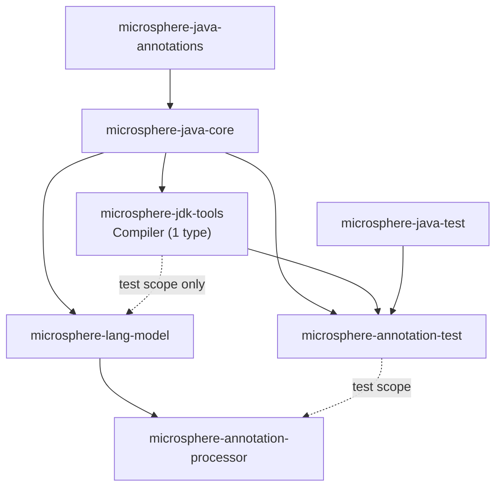
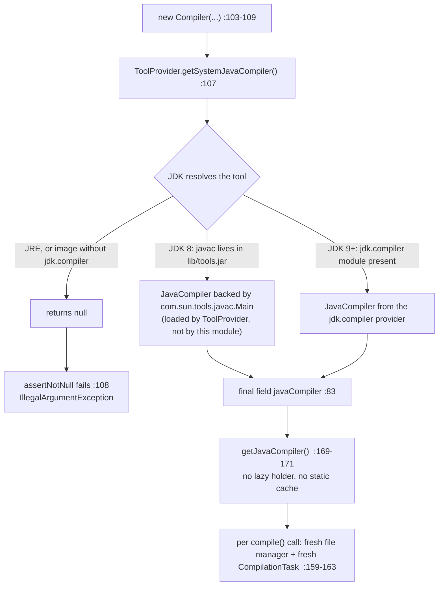
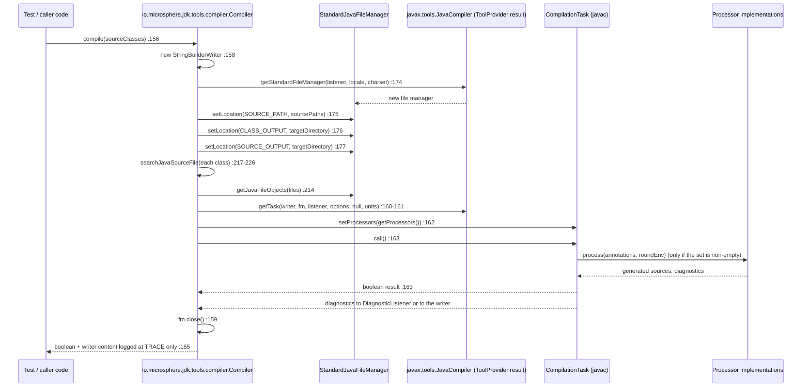

# JDK Tools：进程内编译 —— 开发者指南

模块：`io.github.microsphere-projects:microsphere-jdk-tools` · `0.3.20-SNAPSHOT`（`release`，已发布为 `0.3.20`）
主源码只有一个类型（`io.microsphere.jdk.tools.compiler.Compiler`）· 测试一个类型（`CompilerTest`）· CI 覆盖 JDK 8 / 11 / 17 / 21 / 25

下文使用的路径前缀：`microsphere-jdk-tools/` 下的 `src/main/java/io/microsphere/jdk/tools/compiler/` 与
`src/test/java/io/microsphere/jdk/tools/compiler/`；core 的类以
`microsphere-java-core/src/main/java/io/microsphere/…` 形式引用。

---

## 1. 架构定位

`microsphere-jdk-tools` 是注解处理栈的**可移植性垫片（portability shim）**：
项目中唯一把 `Class` 对象变成一次 `javac` 运行的地方。
它之上的所有层（`microsphere-annotation-test`、`microsphere-annotation-processor`）
都是围绕本模块取到并配置好的 `javax.tools` 类型编写的。
这个垫片刻意做得很“笨”：一个类、没有 SPI、没有 service 文件、
没有 `module-info.java`、没有资源、也没有属于自己的构建配置。



每条依赖边，均已对照 POM 核实：

| 依赖边 | 作用域 | 证据 |
|---|---|---|
| `jdk-tools → core` | compile | `microsphere-jdk-tools/pom.xml:26`（`:27` 为 `<version>${revision}</version>`） |
| `lang-model → jdk-tools` | **test** | `microsphere-lang-model/pom.xml:46`，`:48` 为 `<scope>test</scope>` |
| `annotation-test → jdk-tools` | compile | `microsphere-annotation-test/pom.xml:33` |
| `annotation-processor → jdk-tools` | **不存在** | 该模块的依赖清单只有 core（`microsphere-annotation-processor/pom.xml:26`）+ lang-model（`:33`）+ 测试作用域的 annotation-test（`:53`） |
| `annotation-processor → lang-model` | compile | `microsphere-annotation-processor/pom.xml:33` |
| 为使用方统一管理版本 | — | `microsphere-java-dependencies/pom.xml:38` |
| 反应堆顺序 | — | 根 `pom.xml:57-67`（`microsphere-jdk-tools` 在 `:62`） |

本模块自己的测试依赖：`junit-jupiter`（`microsphere-jdk-tools/pom.xml:31-41`）、`microsphere-java-test`（`:44-49`）、
`mockito-core`（`:52-56`）、`logback-classic`（`:59-63`）。第 30 行往下全部是 test 作用域；本模块**只有**一个 compile 依赖。

> [!NOTE]
> 这些测试依赖中有两个并未被现存代码使用：`CompilerTest` 没有导入任何 Mockito 类型，也没有引用 `io.microsphere.test`
> （`CompilerTest.java:1-28`），而 `mockito-core` 只在 `microsphere-jdk-tools/pom.xml:52-56` 声明、
> `microsphere-java-test` 只在 `:44-49` 声明。`lang-model` 对本模块的 test 依赖也是同样情况 ——
> `microsphere-lang-model` 没有任何源码或测试引用 `Compiler`。

---

## 2. 逐成员解析 `Compiler`

### 2.1 字段（`Compiler.java:74-93`）

| 字段 | 声明 | 源码层面的说明 |
|---|---|---|
| `logger` | `private static final Logger logger = getLogger(Compiler.class)`（`:74`） | core 门面；后端 `LoggerFactory` 在其自身的静态初始化中选定的（`microsphere-java-core/src/main/java/io/microsphere/logging/LoggerFactory.java:73`、`:98`），因此该字段本身不构成加载风险 |
| `DEFAULT_OPTIONS` | `public static final String[] … = ofArray("-parameters", "-Xlint:-unchecked", "-nowarn", "-Xlint:deprecation")`（`:76-77`） | 一个**公开的、可变数组**常量 —— `Compiler.DEFAULT_OPTIONS[0] = "-g"` 是合法 Java，会改写整个 JVM 内所有实例的默认值；构造器通过 `ofList` 装入同一份内容（`:104`、`:112`） |
| `sourcePaths` | `private final Set<File> sourcePaths`（`:79`） | `final` 引用指向一个**可变**的 `LinkedHashSet`（`SetUtils.newLinkedHashSet(E…)`，`microsphere-java-core/src/main/java/io/microsphere/collection/SetUtils.java:568`），保持插入顺序；既然 `:117` 会改它，`final` 在这里保护不了任何东西 |
| `targetDirectory` | `private final File targetDirectory`（`:81`） | 从未做判空；`null` 会直接进入 `:176` 的 `singleton(null)` |
| `javaCompiler` | `private final JavaCompiler javaCompiler`（`:83`） | 唯一被安全发布的字段，在 `:107` 赋值 |
| `processors` | `private Set<Processor> processors`（`:85`） | 初值为 `null`（`getProcessors()` 将其映射为 `emptySet()`，`:201-207`） |
| `options` | `private List<String> options`（`:87`） | 每个构造器都会把它设为 `DEFAULT_OPTIONS`（`:104`）；`options()` 可把它重新赋值（`:112`） |
| `diagnosticListener` | `:89` | 直到调用 `diagnosticListener(...)` 前都是 `null`；`null` 对 `getTask` 与 `getStandardFileManager` 都合法，此时诊断信息只进入 writer |
| `locale` | `:91` | `null` 表示使用 JVM 默认 locale 来做文件管理/诊断本地化 |
| `charset` | `:93` | `null` 表示平台默认编码（见 §4.3） |

构造顺序值得注意：`Compiler(File,File)`（`:103-109`）在给 `sourcePaths`、`targetDirectory`、`javaCompiler` 赋值
**之前**调用了**可被子类覆写的** `options(...)`（`:104`）。因此覆写 `options` 的子类会在父类构造期间执行 —— 这是典型的
“构造器调用可覆写方法”坏味道；今天无害，只是因为 `options` 只写它自己负责的那个字段。

### 2.2 构造器

```java
public Compiler()                                                  // :95-97   → defaultTargetDirectory()
public Compiler(File targetDirectory)                              // :99-101  → defaultSourceDirectory()
public Compiler(File defaultSourceDirectory, File targetDirectory) // :103-109
```

三层委托应当按代码来读，而不是按意图来读：`Compiler()` 与 `Compiler(File)` 都会调用
`defaultSourceDirectory()` / `defaultTargetDirectory()`，而这两个方法探测的是 **`Compiler.class` 自己的**目录
（`:228-240`），永远不是调用方的工程目录。由此得出：

* `defaultTargetDirectory()`（`:236-240`）是 `<Compiler.class 的根>/target/generated-classes`，其中根目录等于
  `classPath.parent.parent`（`:267`）。在 Maven 反应堆里它是 `microsphere-jdk-tools/target/generated-classes`；
  当类来自仓库 jar 时，同样两次上跳会落在本地仓库布局内部。
* `dir.mkdirs()`（`:238`）忽略返回值，于是只读目录或缺失父目录的问题一直隐形的，直到 javac 写不出文件。
* `defaultSourceDirectory()`（`:228-230`）完全可能返回 `null`（找不到源文件，`:250-253`）；`newLinkedHashSet(null)`
  （`SetUtils.java:568`）随后把 `null` 存进集合，而 `:220` 的 `new File((File) null, relativePath)` 退化为
  **相对于当前工作目录**的查找。

### 2.3 链式配置（`:111-154`）

九个设置方法全部 `return this`（`CompilerTest.java:117` 与 `:139` 断言的正是这个同一性）。两种截然不同的合并语义
并存，这也是最容易踩坑之处：

| 追加 | 替换 |
|---|---|
| `sourcePaths(File…)` → `CollectionUtils.addAll(this.sourcePaths, …)`（`:117`；core `collection/CollectionUtils.java:454`） | `options(String…)` → `this.options = ofList(options)`（`:112`） |
| `sourcePaths(Class…)` / `sourcePath(Class)` → 每个类追加一次（`:121-134`） | `processors(Processor…)` → `this.processors = ofSet(processors)`（`:137`） |

`sourcePath(Class)` 是降级的那一个：源文件缺失的类既不改变状态，也不向调用方报告（`:129-133`）。

### 2.4 `compile(Class…)` —— 11 行代码承载全部机制（`:156-167`）

```java
JavaCompiler javaCompiler = getJavaCompiler();                 // :157 把 final 字段重新读进局部变量
StringBuilderWriter writer = new StringBuilderWriter();         // :158 core io/StringBuilderWriter.java:66
try (StandardJavaFileManager javaFileManager = getJavaFileManager()) {   // :159 每次新建，退出即关闭
    CompilationTask task = javaCompiler.getTask(writer, javaFileManager,
            getDiagnosticListener(), getOptions(), null, getJavaFileObjects(javaFileManager, sourceClasses)); // :160-161
    task.setProcessors(this.getProcessors());                   // :162
    return task.call();                                         // :163
} finally {
    logger.trace("The output of the Java compiler:\n{}", writer); // :165
}
```

这段形状编码出来的事实：

* `getTask` 的第五个参数（`fileNames`）是 `null`（`:161`）；编译单元只来自 `getJavaFileObjects`（`:209-215`）。
* 从不传 `-classpath`/`-processorpath`（`DEFAULT_OPTIONS`，`:76-77`，外加调用方自设的选项），因此进程内的 `javac`
  继承**当前 JVM 的 classpath** —— 这正是它对处理器测试有价值的原因：被测类与处理器本身都已被加载。
* `task.setProcessors(...)` 无条件调用（`:162`）。由于字段为 `null` 时 `getProcessors()` 返回 `emptySet()`
  （`:201-207`），而 `CompilationTask` 只对**非空**处理器集合执行注解处理，所以“没有显式处理器”意味着*不做注解处理*，
  并且它同时也压制了 javac 自身的 SPI 发现。`microsphere-annotation-test` 通过自己加载 `Processor` 服务再交给它来补偿
  （`microsphere-annotation-test/src/main/java/io/microsphere/test/annotation/processing/CompilerInvocationInterceptor.java:60-62`）。
* `task.call()` 是同步的，会阻塞调用线程直到编译结束。
* 捕获到的 `writer` 从不返回、暴露或随异常抛出：`finally` 只在 TRACE 级别输出它（`:165`），即使任务本身抛异常也照样输出。
  那段文本只存在于日志里。

### 2.5 源文件发现：`Class` → `File`

| 步骤 | 代码 | 行为 |
|---|---|---|
| 相对路径 | `resolveJavaSourceFileRelativePath`（`:284-286`）：`sourceClass.getName().replace(DOT_CHAR, separatorChar).concat(JAVA_EXTENSION)` | 使用的是**二进制名**，因此嵌套类得到 `Outer$Inner.java` —— 一个永不存在的路径。嵌套类于是被 `:212` 静默丢弃。常量定义见 core `constants/SymbolConstants.java:79`、`constants/FileConstants.java:81` |
| 定位 | `searchJavaSourceFile`（`:217-226`） | 按插入顺序返回 `sourcePaths` 中第一个存在的候选，否则 `null` |
| 根目录 | `detectRootDirectory`（`:264-271`） | `detectClassPath(...).getParentFile().getParentFile()` —— 两次无保护的跳转（`:267`）；假定布局恰好是 `target/classes` |
| class path | `detectClassPath`（`:273-282`） | `ProtectionDomain` → `CodeSource` → `new File(location.getPath())`（`:277-278`）；无 code source 时抛 `UnsupportedOperationException`（`:280-281`） |
| 扫描 | `detectSourcePath`（`:242-262`） | `SimpleFileScanner.INSTANCE.scan(rootDirectory, true, file → absolutePath.endsWith(relativePath))`（`:246-247`；core `io/scanner/SimpleFileScanner.java:57`、`:87`）之后 `first(sourceFiles)`（`:249`；core `collection/CollectionUtils.java:542`） |

这里是一次对整个模块根目录（含 `target/`）的递归遍历，而绝对路径上的 `endsWith` 会接受任何恰好以该相对路径结尾的目录。
目录不存在**不会**抛异常：`File#listFiles()` 返回 `null`，扫描器给出空集合，于是 `detectSourcePath` 记一条 TRACE 后
返回 `null`（`:251-253`）—— 即 `CompilerTest.java:186` 为 `Test.class` 钉住的那个用例。

### 2.6 工具实例如何被定位、缓存，涉及哪个类加载器

* **定位：** `javax.tools.ToolProvider.getSystemJavaCompiler()` —— 在 `:64` 静态导入，在 `:107` 每个 `Compiler` 恰好
  调用一次。这是整个模块与编译器实现之间唯一的接触点。
* **缓存：** 结果记忆在 `final` 字段 `javaCompiler`（`:83`），由一个朴素 getter 提供（`:169-171`）。它**不是**懒加载
  holder，**不是**静态缓存，**不是**双重检查锁：它是急切的、实例级、构造期完成的。JVM 范围的单例保存在
  `ToolProvider` 自己内部，因此 N 个 `Compiler` 实例共享同一个 `JavaCompiler` 对象，第 N 次构造的成本就是一次判空。
* **类加载器选择：没有。** `Compiler` 从不构建类加载器，从不触碰
  `Thread.currentThread().getContextClassLoader()`，也不使用系统加载器。
  加载器决策属于 `ToolProvider`（JDK 9+ 是 `jdk.compiler` 模块的 provider，JDK 8 是它自己的 `tools.jar` 查找），
  而 `Compiler` 只能通过 `javax.tools` 接口接触被加载的实现。
  你的处理器同样不经过那个加载器：它们由调用方实例化并在 `:162` 注入，
  因此 javac 不会自行做处理器发现或加载。
* **反射查找：本模块为零。** 没有 `Class.forName`，没有 `Method`/`Field`/`MethodHandle`，没有 `setAccessible`。
  唯一的反射式工作在 core 内部：`options`/`processors` 背后的 `List.of`/`Set.of` 方法句柄绑定
  （`microsphere-java-core/src/main/java/io/microsphere/collection/Lists.java:101`、`Sets.java:99`），以及日志门面的
  `ServiceLoader`（`logging/LoggerFactory.java:73-96`）。

---

## 3. 实际实现的版本适配策略

**本模块没有版本分支。** `Compiler.java` 没有为版本探测导入任何 `io.microsphere.util` 内容
（没有 `JavaVersion`，没有 `SystemUtils.IS_JAVA_*`，没有 `Runtime.version()`），也没有基于 JDK 号的 `if`。
适配是**一条完全信任某个 JDK API 的单一代码路径**：

1. `getSystemJavaCompiler()`（`:107`）—— 由 JDK 内部完成 `tools.jar`（8）或 `jdk.compiler` 服务（9+）的解析。
2. `assertNotNull(...)`（`:108`）—— 本模块唯一会据此行动的“编译器是否可达”信号。
3. 之后全是朴素的 `javax.tools`：`getStandardFileManager`、`getTask`、`setProcessors`、`call`。



> [!IMPORTANT]
> 这与 `microsphere-java-core` 处理 `URLClassPath` 内部结构的策略正好相反：后者在运行期选择两套按 JDK 划分的策略
> （`classloading/ClassicURLClassPathHandle.java:35-41` 对应 `sun.misc.URLClassPath`/`urls`，
> `classloading/ModernURLClassPathHandle.java:35-41` 对应 `jdk.internal.loader.URLClassPath`/`unopenedUrls`）。
> `microsphere-jdk-tools` 之所以不需要那套机制，是因为**它从不读取 JDK 内部成员**：`javax.tools` 就是受支持、
> 跨版本稳定的那一层。

确实存在的两处间接 JDK 依赖都来自 core，且不改变行为：

| 调用点 | JDK 8 | JDK 9+ | 最终效果 |
|---|---|---|---|
| `options(...)` → `ofList`（`:112`） | `unmodifiableList(asList(…))`（`microsphere-java-core/src/main/java/io/microsphere/collection/ListUtils.java:191-196`） | 通过方法句柄调用 `List.of(…)`（`Lists.java:101`、`:513-529`） | 两者都不可变；null 选项本会在 `List.of` 内抛异常，但 `catch (Throwable)` 兜住并返回 JDK-8 风格列表（`Lists.java:526-527`） |
| `processors(...)` → `ofSet`（`:137`） | 链表散列集构造 | `Set.of(…)`（`Sets.java:99`、`:552-568`） | 对 null 的容忍度结论相同（`Sets.java:565-567`） |

关于模块访问参数：由于从不引用 `com.sun.tools.javac` 的**子包**，本模块在矩阵内任何 JDK 上都不需要 `--add-exports`
或 `--add-opens`。CI 印证了这一点 —— 构建行没有传此类参数（`.github/workflows/maven-build.yml:38-45`），仓库里也没有
`.mvn/jvm.config`（只有 `.mvn/wrapper/maven-wrapper.properties`）。当下游框架*确实*伸手去拿
`com.sun.tools.javac.processing`（处理器测试框架的常见做法）时，参数属于**那个**模块被 fork 出的编译器/Surefire JVM，
并且模块名是 `jdk.compiler` 而不是 `java.compiler`。

---

## 4. 错误处理

### 4.1 本模块的每一个抛出点

| 位置 | 异常 | 触发条件 | 证据 |
|---|---|---|---|
| `Compiler.java:108` | `IllegalArgumentException` | 编译器不可达（JRE、被裁剪的镜像） | 消息原文 `"No Java compiler available. Ensure this process is running on a JDK (not just a JRE)."`；由 core `util/Assert.java:149-153` 抛出 |
| `Compiler.java:281` | `UnsupportedOperationException` | `sourceClass.getProtectionDomain().getCodeSource() == null` | 消息 `"The source {} is based on the file system, the class path can't be detected."`（`:280`；`{}` 是 core `FormatUtils` 的占位符，`text/FormatUtils.java:17`、`:38`），由 `CompilerTest.java:92` 钉住 |
| `Compiler.java:159`、`:163`、`:173-177` | `IOException`（已声明） | 文件管理器创建、对非法目录的 `setLocation`、close、javac 的 I/O | `compile(...) throws IOException`（`:156`）、`getJavaFileManager() throws IOException`（`:173`） |
| `Compiler.java:163` | `task.call()` 抛出的任何异常 | 处理器抛异常、javac 内部失败 | 无保护 —— `compile` 不捕获任何东西 |

存在可能但无保护的路径（没有 `try`、没有检查）：

* `:267` —— 若 class-path 项位于文件系统根，`classPath.getParentFile().getParentFile()` 会 NPE。
* `:278` —— 对非 `file:` 方案（`jrt:/…`、`jar:` URL）执行 `new File(location.getPath())` 得到的是不存在的 `File`；
  该失败稍后表现为 `null` 源路径，永远不会表现为错误。
* `:238` —— 忽略 `mkdirs()` 返回值。
* `:176-177` —— `singleton(this.targetDirectory)` 接受 `null` 的 `File`。

### 4.2 对照本库的“静默降级”策略

`microsphere-java` 通常安静降级；本模块是例外，
它带**两个** fail-fast 点（`:108`、`:281`）以及一组降级点（`:130-133`、`:212`、`:225`、`:249-253`、`:195-198`、`:203-205`）。
这条分界线是自洽的 —— “不能编译”抛异常，“找不到某个源文件”返回 `null`。
但它没有任何文档：类里只有一个 Javadoc 块（`:66-71`），没有方法注释、没有 `@throws`、
文件里也没有任何 `@Nullable`/`@Nonnull`。
针对当前进行中的 NPE 加固审计，本模块的具体条目是：

1. `:108` 在**构造器**里抛 `IllegalArgumentException`，Javadoc 未写 `@throws` —— 不读源码就无从发现（这里刻意违背
   “静默”策略，因为没有编译器的 `Compiler` 毫无用处）。
2. `:89`–`:93` 与 `:85` 是可空字段，被直接交给 javac（`:160-161`、`:162`、`:174`）；每一个都合法，但没有任何注解，
   可空契约只存在于代码里。
3. `getCharset()`（`:189-191`）返回 `java.nio.charset.Charset`，并被作为 `getStandardFileManager` 的编码实参传入
   （`:174`），而 `javax.tools` 契约里该参数是编码**名称**；模块内没有任何 `Charset` → 名称的转换（`:151-154` 原样存储）。
   测试链 `.charset(UTF_8)` … `compile(...)`（`CompilerTest.java:164-167`）恰好覆盖这一对实参，因此它是本节价值最高的
   核实项。
4. `CompilerTest.java:146` 声称“with mocked compiler it's safe to call”，但该测试既没有 mock 也没有 Mockito 导入 ——
   在未使用的 `mockito-core` 依赖（`microsphere-jdk-tools/pom.xml:52-56`）之上又叠了一层注释/行为矛盾。
5. `:259` 打印 `"The source file[path : '{}] of {} was found in the source directory[path :'{}']"` —— 模板里的引号不配对；
   无害（仅 TRACE），但说明这条日志通道没有任何测试断言它。

### 4.3 一次编译请求的完整链路



注意信息在哪里“走丢”：当 `diagnosticListener == null`（字段默认，`:89`）时 javac 把诊断写进 `StringBuilderWriter`，
而该 writer 唯一的消费者是 `logger.trace`（`:165`）。因此除非为
`io.microsphere.jdk.tools.compiler.Compiler` 打开 trace，或注册了监听器，返回 `false` 的失败编译就是无声的。

---

## 5. 线程安全与编译器实例的复用

* **安全发布的：**只有 `javaCompiler`（`:83`，在 `compile` 可被调用之前于构造器中写入）以及静态的 `logger` /
  `DEFAULT_OPTIONS`（`:74`、`:76`）。因此 `:157` 与 `:174` 的读取是无竞争的。
* **不安全的：**七个可变配置字段（`:79-93`）以及 `:79` 那个活的 `LinkedHashSet`。`compile()` 把该集合作为
  `SOURCE_PATH` 交给 javac（`:175`），此时 `sourcePaths(File…)`（`:117`）可能仍在追加，而 `searchJavaSourceFile`
  （`:219`）正在迭代它。同一实例上“配置 + 编译”并发可能产生 `ConcurrentModificationException` 或撕裂的配置。
* **受支持的复用方式：**为每一轮工作构造一个 `Compiler`，配置一次，然后在持有它的线程里反复调用 `compile(...)`。
  每次 `compile` 都新建文件管理器与新建 `CompilationTask`（`:159`、`:160-161`），所以即便 `JavaCompiler` 对象在 JVM
  范围内共享，每轮 javac 状态也不会互相泄漏。
* **跨线程共享同一个 `JavaCompiler` 是 `ToolProvider` 的契约，不是本模块的契约。** `Compiler` 在
  `getTask`/`call`（`:160-163`）周围没有加任何同步；若必须并发编译，请每线程一个 `Compiler` 并使用不同输出目录，
  因为 `CLASS_OUTPUT` 与 `SOURCE_OUTPUT` 都指向同一个目录（`:176-177`），并发写入会互相交织。
* **构造成本 = 一次虚调用 + 源目录遍历**（`:228-230` → `:242-262`）。
  昂贵的部分是那次遍历（递归扫描模块根目录），
  所以正确的优化是按 §2.4 的规则缓存已配置好的 `Compiler`，
  而不是手工缓存 `detectSourcePath` 的结果。

---

## 6. 设计模式（附证明代码）

| 模式 | 真实所在位置 | 证据 |
|---|---|---|
| **外观（Facade）** | `Compiler` 用一个类型 fronts 整个 `javax.tools` 工具族（`JavaCompiler`、`StandardJavaFileManager`、`CompilationTask`、`DiagnosticListener`、`Processor`） | 导入见 `:22-27`、`:64`；面向客户端的唯一 javac 调用是 `:107` |
| **外观（JDK 侧，不属于我们）** | 按 JDK 适配的那部分外观就是 `ToolProvider` 本身；本模块汇聚到它，而不是复制它 | `:64`、`:107` |
| **链式配置 / 弱 Builder** | 九个 `return this` 的设置方法（`:111-154`），`compile(...)` 是可重复执行的终结操作（`:156`）—— 没有 `build()`，也没有状态冻结 | `CompilerTest.java:117`、`:139` |
| **实例级急切缓存**（刻意**不是** initialization-on-demand holder） | `private final JavaCompiler javaCompiler` 在构造器中赋值 | `:83`、`:107`、`:169-171` |
| **适配器（Adapter）** | `StringBuilderWriter` 把 `java.io.Writer` 适配到 `StringBuilder`，使 javac 输出可在进程内捕获；`Compiler` 把它适配进 `getTask` 的 writer 槽位 | `:158`、`:160`；core `io/StringBuilderWriter.java:66`、`:73` |
| **策略（Strategy，继承自 core 而非本地）** | `options`/`processors` 背后的 `List.of`/`Set.of` 方法句柄选择 | `:112`、`:137`；core `collection/Lists.java:101`、`:520-529`，`collection/Sets.java:99`、`:559-568` |
| **单例（急切式，位于 core）** | `SimpleFileScanner.INSTANCE` 驱动源文件遍历 | `:246`；core `io/scanner/SimpleFileScanner.java:57` |
| **规约 / 谓词** | 传给扫描器的文件名过滤 lambda | `:247` |
| **fail-fast 守卫** | 对工具查找结果的 `assertNotNull` | `:108`；core `util/Assert.java:149-153` |

刻意缺席的东西：SPI 注册（本模块没有 `META-INF/services` 文件）、扩展点（所有方法都是具体的、非 `protected`）、
`module-info.java`（整个仓库都没有，因此本模块始终位于 classpath / 未命名模块中）。

---

## 7. 测试覆盖地图

`src/test/java/io/microsphere/jdk/tools/compiler/CompilerTest.java` —— 11 个方法，全部针对真实 `javac`：

| 测试 | 钉住的行为 | 行号 |
|---|---|---|
| `testDefaultConstructor` | `Compiler()` 能解析出 `JavaCompiler` | `:38-44` |
| `testTargetDirectoryConstructor` | `Compiler(File)` 同理 | `:47-55` |
| `testSourceAndTargetDirectoryConstructor` | `Compiler(File,File)` 同理 | `:58-67` |
| `testDefaultDirectories` | 三个包级私有的 `default*` 静态方法；根目录存在 | `:70-83` |
| `testDetectClassPath` | 项目 class path 存在；**bootstrap 类 → `UnsupportedOperationException`** | `:86-93` |
| `testResolveJavaSourceFileRelativePath` | 二进制名 → `separatorChar` 路径 + `.java` | `:96-104` |
| `testSourcePathsMethod` | 链式同一性；`File…` 与 `Class…` 两个重载 | `:107-121` |
| `testProcessorsMethod` | 匿名 `AbstractProcessor` 下的链式同一性 | `:124-140` |
| `testCompile` | 一次真正的端到端编译 + 完整设置链 | `:143-170` |
| `testDetectRootDirectory` | 由 `target/classes` 出发的两级根目录解析 | `:173-178` |
| `testDetectSourcePath` | 项目内的类可解析；JDK 类型解析为 `null` | `:181-187` |

没有任何测试覆盖：`getOptions()` / `getProcessors()` 的内容（用户指南 §4.1）、`:108` 的
`IllegalArgumentException`、`:195-198` 的 `emptyList()` 分支、独立调用 `getJavaFileManager()`（`:173-179`），
以及 locale/charset 对诊断的影响。

---

## 8. 评审笔记：未来哪个 JDK 会出问题

1. **`getSystemJavaCompiler()` 是承重假设。** 只要 JDK 还在 `jdk.compiler` 里提供 `JavaCompiler` 服务，它就成立。
   第一个现实风险不是某个 JDK 版本，而是**运行期镜像**：不含 `jdk.compiler` 的 `jlink` 镜像（或极简容器 JRE）会走到
   `:108` 并抛异常，而那条消息就是唯一线索。
2. **`-Xlint:-unchecked` / `-nowarn` / `-Xlint:deprecation` 是 javac *选项*，不是 API。** 未来若有 JDK 把未知的
   `-Xlint` 子选项变成错误，或开始对其自身发出警告，那么在你处理器运行之前每次 `compile(...)` 都会失败 —— 解释只存在于
   TRACE writer 里（`:165`）。真到那一步，改动点在 `DEFAULT_OPTIONS`（`:76-77`），并且需要在今天并不存在的地方加版本
   分支：自然的插入点是构造器 `:104`，按运行期探测来选择选项集合，而不是用常量。
3. **从不传 `--release` / `--source`**（`:76-77`、`:112`）。于是今天的编译继承运行 JDK 的默认源级别，同一个调用点在 25
   上能编译的类在 8 上未必能 —— 即使*代码*与版本无关，*行为*已经是版本相关的。若要支持 `-source`/`--release`，就得决定
   是扩展 `DEFAULT_OPTIONS` 的占位，还是在 `charset(...)`（`:151-154`）旁边新增一个 `release(String)` 设置方法。
4. **`target/classes` 两级上跳（`:267`）是对构建布局的假定。** Gradle 的 `build/classes/java/main`、IDE 的树外输出
   目录、以及 `jar:`/`jrt:` code source 会以不同方式破坏它：两次上跳要么落到无用之处（`detectSourcePath` 静默返回
   `null`，`:249-253`），要么 NPE（`:267`）。结构性的修复是做成“布局感知”的根目录探测器 —— 与 core 的
   `URLClassPathHandle` 家族针对类加载器解决的问题同类（§3 的提示框）。
5. **嵌套类永远无法通过 `compile(Class…)` 编译**，因为 `resolveJavaSourceFileRelativePath`（`:284-286`）把
   `Outer$Inner` 映射为不存在的 `Outer$Inner.java`，未命中项在 `:212` 被过滤掉。若将来确有测试需要把内部类当作编译
   单元，适配器必须先剥掉 `$` 之后的部分。
6. **`DEFAULT_OPTIONS` 是公开可变数组**（`:76-77`）。任何加固（`clone()` / 改为 `List<String>`）都会改变公开字段的类型，
   属于二进制不兼容改动 —— 请安排在大版本里做。
7. **编码管线（§4.2 第 3 条）**是本模块调用点与 `javax.tools` 签名在类型层面不一致的唯一位置；在升级到收紧文件管理器
   API 的 JDK 之前应当先把它定论。
8. **线程安全方面最划算的是补文档而不是改代码。** 在 `:66-71` 加上 `@Nullable`/`@Nonnull` 以及类级的
   “非线程安全；每轮编译一个实例”说明，就能让人不必读完整文件也了解 §2.1、§4.2 与 §5 的内容。

---

## 9. 参见

* [microsphere-jdk-tools —— 用户指南](../microsphere-jdk-tools.md) —— 坐标、分 JDK 行为表、API 与陷阱
* [microsphere-annotation-test](../microsphere-annotation-test.md) —— 在 JUnit 5 中驱动 `Compiler` 的使用方
* [microsphere-annotation-processor](../microsphere-annotation-processor.md) —— 由该测试框架编译的处理器
* [microsphere-lang-model](../microsphere-lang-model.md) —— 同一工具链的 `javax.lang.model` 层
* [类加载与构件识别 —— 开发者指南](../microsphere-java-core/zh/classloading-and-artifacts.md) —— 对照案例：
  在确实需要反射内部成员之处采用的按 JDK 策略
* 英文版：[English Developer Guide](../microsphere-jdk-tools.md)
