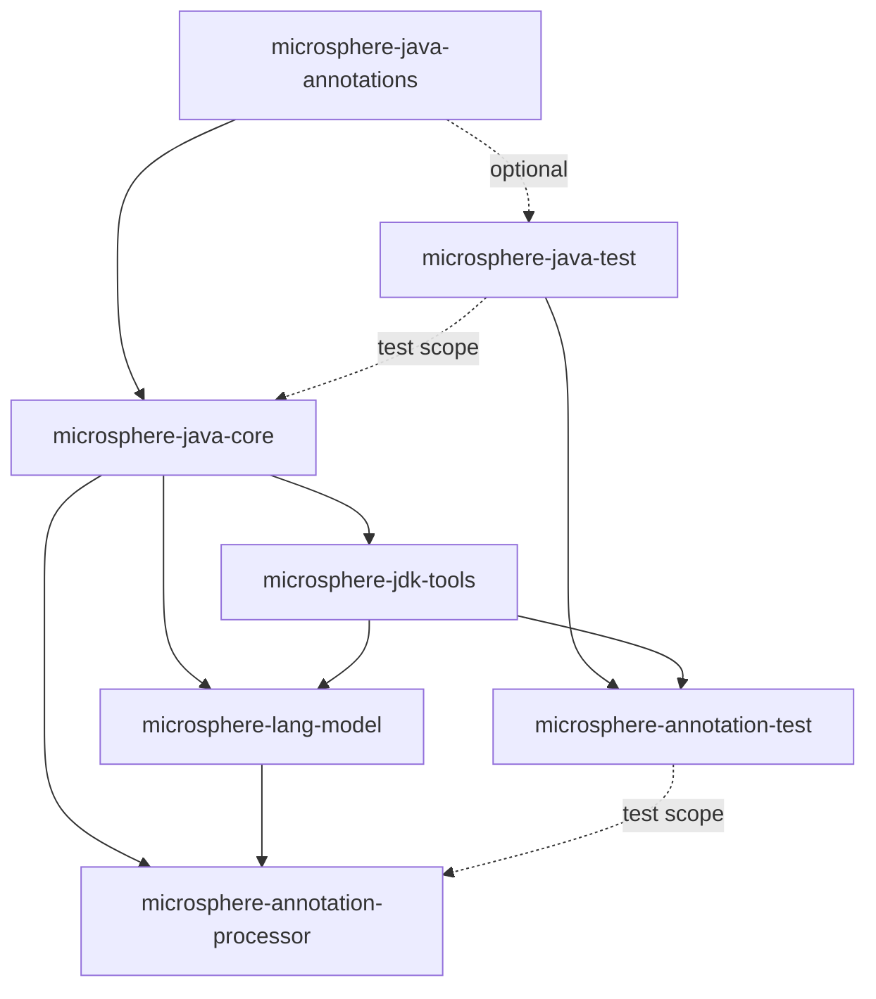

# Microsphere Java User Guide — `release` branch (`current`)

Audience: you want to **use** `microsphere-java` in an application or library — pick the right artifact, call the
right API, and know which JDK and which library version you may rely on.

Everything here is read from the **`release` branch** (`revision = 0.3.20-SNAPSHOT`, latest tagged release
`0.3.19`). For the Chinese version of every page, open the `zh/` subdirectory beside it.

* Index of all documentation and version lines: [../../README.md](../../README.md)
* Developer Guide (architecture, source analysis, patterns): [../developer-guide/README.md](../developer-guide/README.md)

---

## 1. Coordinates, version and compatibility at a glance

| Item | Value |
|------|-------|
| Group ID (all artifacts) | `io.github.microsphere-projects` |
| Version documented here | `0.3.20-SNAPSHOT` (source branch `release`); latest published release `0.3.19` |
| Build parent | `microsphere-build` `0.3.16` → `microsphere-java-parent` → every module |
| In-repo BOM | `microsphere-java-dependencies` (manages all seven module versions) |
| Package root | `io.microsphere.*` |
| Language level | Compiled at **Java 8** for every module |
| JDKs tested by CI | 8, 11, 17, 21, 25 |
| Runtime dependencies of `core` | **none required** — `jsr305`, `javax.annotation-api`, `slf4j-api`, `commons-logging` are optional |
| License | Apache License 2.0 |

Import the BOM so you never repeat a version:

```xml
<dependencyManagement>
    <dependencies>
        <dependency>
            <groupId>io.github.microsphere-projects</groupId>
            <artifactId>microsphere-java-dependencies</artifactId>
            <version>0.3.19</version>
            <type>pom</type>
            <scope>import</scope>
        </dependency>
    </dependencies>
</dependencyManagement>

<dependencies>
    <dependency>
        <groupId>io.github.microsphere-projects</groupId>
        <artifactId>microsphere-java-core</artifactId>
    </dependency>
</dependencies>
```

> [!IMPORTANT]
> **Compatibility is not uniform across the library.** The plain-utility packages (`util`, `collection`, `convert`,
> `reflect`, `event`, `json`) behave the same on every JDK from 8 to 25. The packages that touch JDK internals —
> `classloading`, `io.scanner`, `net`, `process`, `management`, and the whole annotation-processing toolchain
> (`microsphere-jdk-tools`, `microsphere-lang-model`, `microsphere-annotation-processor`) — have per-JDK behaviour,
> and each of those pages carries an explicit JDK matrix plus the `--add-exports` / `--add-opens` flags you need.

---

## 2. Module dependency graph



Read the graph bottom-up for usage: you depend on `core` for runtime utilities, on
`microsphere-annotation-processor` at compile time, and on the `*-test` modules only in `src/test`.

---

## 3. Pages

### 3.1 `microsphere-java-core` — 14 pages by package group

| Page | Packages (main sources) | Types | Use it when you need |
|------|-------------------------|-------|----------------------|
| [Utilities, constants and text](microsphere-java-core/util-and-constants.md) | `util`, `util.jar`, `constants`, `text`, `misc` | 45 | Strings, classes, class loaders, resources, service loading, assertions, versions, JARs, shared constants |
| [Collections and filters](microsphere-java-core/collections-and-filters.md) | `collection`, `filter` | 41 | Null-safe factories, immutable/unmodifiable views, singletons, empty objects, predicates and file filters |
| [Language abstractions](microsphere-java-core/language-abstractions.md) | `lang`, `lang.function`, `lang.invoke`, `invoke` | 18 | `Prioritized`, `Wrapper`, `Deprecation`, checked-exception-safe functional interfaces, lambda/method-handle introspection |
| [Reflection, types and beans](microsphere-java-core/reflection-and-beans.md) | `reflect`, `reflect.generics`, `internal.reflect`, `beans` | 26 | Method/field/constructor lookup, generic-type resolution, `JavaType`, bean introspection |
| [Type conversion](microsphere-java-core/type-conversion.md) | `convert`, `convert.multiple` | 52 | `Converter` SPI, string→number/boolean/date conversions, multi-value (array/collection/map) conversion |
| [Serialization](microsphere-java-core/serialization.md) | `io.serializer` | 18 | `Serializer` / `Deserializer` SPIs and binary round-tripping |
| [Event dispatching](microsphere-java-core/events.md) | `event` | 10 | `Event`, `EventListener`, `EventDispatcher`, conditional and generic listeners |
| [I/O, NIO, scanning and file filters](microsphere-java-core/io-and-scanning.md) | `io`, `io.event`, `io.scanner`, `io.filter`, `nio.file`, `nio.charset` | 21 | Stream/reader helpers, classpath/JAR/directory scanning, file watching |
| [Networking and URL protocols](microsphere-java-core/net-and-url-protocols.md) | `net`, `net.classpath`, `net.console` | 13 | `classpath:` and `console:` URL protocols, custom `URLStreamHandler` registration |
| [Logging](microsphere-java-core/logging.md) | `logging` | 9 | `Logger` facade and `LoggerFactory` delegation to SLF4J / Commons Logging / JUL |
| [Class loading and artifacts](microsphere-java-core/classloading-and-artifacts.md) | `classloading` | 16 | Detect a dependency's version at runtime, enforce banned artifacts |
| [JSON](microsphere-java-core/json.md) | `json` | 8 | Dependency-free `JSONObject` / `JSONArray` / `JSONTokener` |
| [Configuration property metadata](microsphere-java-core/configuration-metadata.md) | `metadata` | 9 | Read/load/generate configuration-property metadata for IDE support |
| [Concurrency, process, management and security](microsphere-java-core/concurrency-process-and-management.md) | `concurrent`, `process`, `management`, `management.builder`, `security` | 23 | Thread factories, executor helpers, process id and exit, MBean builders |

Chinese mirrors: [microsphere-java-core/zh/README.md](microsphere-java-core/zh/README.md).

### 3.2 Other modules

| Page | Module | What you get |
|------|--------|--------------|
| [microsphere-java-annotations](microsphere-java-annotations.md) | `microsphere-java-annotations` | Contract annotations (`@Since`, `@Nullable`, `@Nonnull`, `@Immutable`, `@ThreadSafe`, `@Experimental`, …) with zero runtime cost |
| [microsphere-java-test](microsphere-java-test.md) | `microsphere-java-test` | Test fixtures and JUnit 5 helpers; all dependencies are optional |
| [microsphere-annotation-test](microsphere-annotation-test.md) | `microsphere-annotation-test` | In-process `javac` harness for testing annotation processors |
| [microsphere-jdk-tools](microsphere-jdk-tools.md) | `microsphere-jdk-tools` | Portable access to `jdk.compiler` / `tools.jar` tooling across JDK 8 → 25 |
| [microsphere-lang-model](microsphere-lang-model.md) | `microsphere-lang-model` | Wrapper layer over `javax.lang.model` for processor authors |
| [microsphere-annotation-processor](microsphere-annotation-processor.md) | `microsphere-annotation-processor` | Compile-time generation of configuration-property metadata |

---

## 4. "Which page do I need?"

| Symptom / goal | Start here |
|----------------|------------|
| Need a null-safe `List`/`Map`/`Set` factory or an immutable view | [Collections and filters](microsphere-java-core/collections-and-filters.md) |
| Need to convert a `String` (or any value) to a target type | [Type conversion](microsphere-java-core/type-conversion.md) |
| Need to read a generic type argument, or invoke a method reflectively | [Reflection, types and beans](microsphere-java-core/reflection-and-beans.md) |
| Need to sort beans/listeners/handlers by priority | [Language abstractions](microsphere-java-core/language-abstractions.md) (`Prioritized`) |
| Need to load an SPI, a resource, or a class-path entry | [Utilities, constants and text](microsphere-java-core/util-and-constants.md) |
| Need to know which version of a dependency is present at runtime | [Class loading and artifacts](microsphere-java-core/classloading-and-artifacts.md) |
| Need a `classpath:` URL | [Networking and URL protocols](microsphere-java-core/net-and-url-protocols.md) |
| Need to watch a directory for changes | [I/O, NIO, scanning and file filters](microsphere-java-core/io-and-scanning.md) |
| Want a log facade without binding a backend | [Logging](microsphere-java-core/logging.md) |
| Need to react to a state change without coupling components | [Event dispatching](microsphere-java-core/events.md) |
| IDE autocompletion for your `@ConfigurationProperty` fields | [Configuration property metadata](microsphere-java-core/configuration-metadata.md) + [microsphere-annotation-processor](microsphere-annotation-processor.md) |
| `InaccessibleObjectException` / `--add-opens` errors at runtime | the JDK matrix in [Class loading and artifacts](microsphere-java-core/classloading-and-artifacts.md) and [Concurrency, process, management and security](microsphere-java-core/concurrency-process-and-management.md) |

---

## 5. Version policy you can rely on

* **Semantics**: `0.x` releases are still pre-1.0; the project keeps public APIs stable inside a `0.3.x` line and
  marks additions with `@Since`, removals/deprecations with `@Deprecated` (see
  [Language abstractions](microsphere-java-core/language-abstractions.md) for the `Deprecation` contract).
* **Nullability**: public and protected members across all modules carry `@Nonnull` / `@Nullable`; treat a
  documented `@Nonnull` return as an invariant, not a hope. See
  [microsphere-java-annotations](microsphere-java-annotations.md).
* **No forced transitive dependencies**: `core` runs with an empty classpath apart from `annotations`; every
  integration (SLF4J, Commons Logging, JMX, JPMS) is optional and detected at runtime.
* **JDK floor**: binaries are compiled against Java 8. Java 8 users get the same public API as Java 25 users; the
  differences are in JDK-internal capabilities, which degrade gracefully.

---

## 6. Where the code examples come from

Every example in these pages is adapted from the module's own test sources on the `release` branch
(`<module>/src/test/java/...`), and each example cites the test file it came from. If an example and the test
disagree, trust the test.
