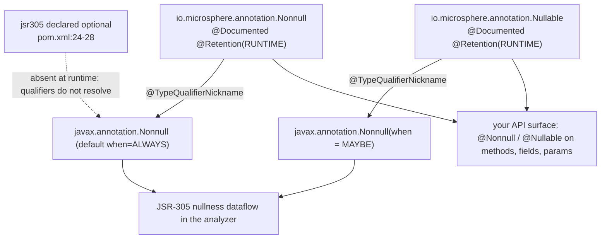

# Microsphere Java Annotations

| | |
|---|---|
| **Artifact** | `io.github.microsphere-projects:microsphere-java-annotations` (`0.3.20-SNAPSHOT`, `release` branch) |
| **Packages** | `io.microsphere.annotation` (6 types) · `io.microsphere.annotation.concurrent` (2 types) — 8 main-source types, no other code |
| **Contents** | 8 annotation interfaces + 6 JUnit 5 tests; **zero** classes, enums, interfaces or service registrations |
| **JDK level** | No `maven.compiler.*` / `<release>` property exists anywhere in the reactor — the bytecode level is inherited from the external parent `microsphere-build:0.3.16` (`pom.xml:6-10`); CI-tested on JDK 8 / 11 / 17 / 21 / 25 (Temurin) |
| **Compile dependency** | `com.google.code.findbugs:jsr305`, declared `optional` (`microsphere-java-annotations/pom.xml:24-28`) — nothing else, in-repo or third-party |
| **Retention spread** | `SOURCE` ×1 (`@Experimental`) · `CLASS` ×2 (`@ThreadSafe`, `@NotThreadSafe`) · `RUNTIME` ×5 (`@ConfigurationProperty`, `@Immutable`, `@Nonnull`, `@Nullable`, `@Since`) |

This module is the **contract layer** of Microsphere Java. It publishes eight annotations that say what the
library promises about a piece of code — "this never returns `null`", "this object's state never changes", "this API
appeared in 1.0.0", "this field is a configuration property" — without shipping any code that enforces those promises.
Everything else in the reactor may read them; nothing else in the reactor is required in order to use them.

**Reach for this artifact when** you want to state an invariant on your own API in the same vocabulary the Microsphere
libraries use (`@Nonnull` / `@Nullable` / `@Immutable`, imported by 74–99 main-source files each across the reactor),
or when you want your configuration keys collected into `META-INF/microsphere/configuration-properties.json` by
`@ConfigurationProperty`. Adding the jar costs nothing at runtime: no class in it is ever loaded, and the only code
that ever *reads* these annotations runs at compile time (the annotation processor) or in your own tests.

> [!NOTE]
> **Annotations never throw.** The library-wide policy of *silent degradation* (return a neutral value instead of
> raising) has an exact analogue here: no annotation in this module can fail, because none carries executable
> behaviour. `@Nonnull` does not insert a `NullPointerException`, `@ThreadSafe` does not add synchronisation, and
> `@ConfigurationProperty` does not bind a value. Enforcement is always a *separate* tool — a static analyzer, the
> annotation processor, or your own reflective code.

---

## 1. What this module is for, and why it is a separate artifact

| I want to… | Use | Who actually reads it |
|---|---|---|
| Promise a value is never `null` | `io.microsphere.annotation.Nonnull` | JSR-305-aware static analyzers (via `@TypeQualifierNickname`, `annotation/Nonnull.java:35`); humans; your tests via reflection |
| Promise a value may be `null` | `io.microsphere.annotation.Nullable` | Same, as `@javax.annotation.Nonnull(when = MAYBE)` (`annotation/Nullable.java:36`) |
| Promise an object is immutable | `io.microsphere.annotation.Immutable` | Documentation + reflective checks only — it carries **no** JSR-305 linkage (`annotation/Immutable.java:31-34`) |
| Promise a class is (not) thread-safe | `io.microsphere.annotation.concurrent.ThreadSafe` / `NotThreadSafe` | Bytecode scanners only — `CLASS` retention (`concurrent/ThreadSafe.java:28`, `concurrent/NotThreadSafe.java:27`) |
| Record when an API appeared | `io.microsphere.annotation.Since` | Your own reflective tooling; `RUNTIME` + `TYPE_USE` (`annotation/Since.java:42`, `:53`) |
| Flag a feature as removable | `io.microsphere.annotation.Experimental` | The compiler and IDEs only — `SOURCE` (`annotation/Experimental.java:37`) |
| Publish a configuration key | `io.microsphere.annotation.ConfigurationProperty` | `microsphere-annotation-processor` at compile time, then `io.microsphere.metadata.*` readers at runtime |

Four reasons the annotations live in their own module rather than inside `microsphere-java-core`:

1. **A leaf with no in-repo dependencies.** Its POM declares exactly one dependency, `jsr305`, and marks it optional
   (`microsphere-java-annotations/pom.xml:21-43`). It is therefore safe to put on *any* classpath, including one that
   must not see the runtime library.
2. **`core` consumes it in one direction only.** `microsphere-java-core` depends on it at **compile (non-optional)**
   scope (`microsphere-java-core/pom.xml:24-28`); the annotations module depends on nothing in the reactor. That
   one-way edge is why 138 main-source files across the reactor (267 imports) can carry these contracts without a
   dependency cycle.
3. **Compile-time tooling can load it without loading the library.** `microsphere-annotation-processor` reaches the
   annotation type through core (`microsphere-annotation-processor/pom.xml:24-28`), and matches it *by name* —
   `"io.microsphere.annotation.ConfigurationProperty"` (`.../processor/ConfigurationPropertyJSONElementVisitor.java:59`) —
   so a project can run the processor with only the annotation classes present.
4. **Test-support modules can opt out.** `microsphere-java-test` declares the dependency `optional`
   (`microsphere-java-test/pom.xml:24-28`), so consumers pick their own version rather than inheriting a forced one.

---

## 2. Coordinates

```xml
<dependency>
    <groupId>io.github.microsphere-projects</groupId>
    <artifactId>microsphere-java-annotations</artifactId>
    <version>0.3.20</version> <!-- newest published tag; 0.3.20-SNAPSHOT is this same line's working version -->
</dependency>
```

| Field | Value | Evidence |
|---|---|---|
| Group ID | `io.github.microsphere-projects` | `pom.xml:12` |
| Artifact ID | `microsphere-java-annotations` | `microsphere-java-annotations/pom.xml:14` |
| Version | `${revision}` = `0.3.20-SNAPSHOT` on `release` | `pom.xml:54`, `microsphere-java-annotations/pom.xml:15` |
| Position in the reactor | 3rd module built | `pom.xml:60` (modules `:57-67`) |
| Packaging | `jar` | `microsphere-java-annotations/pom.xml:16` |
| Parent | `microsphere-java-parent:${revision}` | `microsphere-java-annotations/pom.xml:5-10` |
| Build parent (grandparent) | `microsphere-build:0.3.16` | `pom.xml:6-10` |
| Only compile dependency | `com.google.code.findbugs:jsr305`, `optional`, **no `<version>`** | `microsphere-java-annotations/pom.xml:24-28` |
| Where that version comes from | imported BOM `microsphere-all-bom:0.3.13` | `microsphere-java-parent/pom.xml:22`, `:31-37` |
| Test dependency | `org.junit.jupiter:junit-jupiter` + `junit-jupiter-engine`, `test` scope | `microsphere-java-annotations/pom.xml:30-41` |
| Consumable BOM | `microsphere-java-dependencies` manages this artifact | `microsphere-java-dependencies/pom.xml:24-28` |

> [!IMPORTANT]
> The relationship with `microsphere-java-core` is the opposite of "not depended on". On `release`, **core does depend
> on this module at compile scope, and the dependency is not optional** (`microsphere-java-core/pom.xml:24-28`), so
> every consumer of `microsphere-java-core` transitively gets these eight annotations. What *is* optional is
> `jsr305` inside this module (`microsphere-java-annotations/pom.xml:27`) — and core asks for `jsr305` at **test**
> scope only (`microsphere-java-core/pom.xml:73-78`). Consequence: core compiles and runs with `io.microsphere.annotation.*`
> available but `javax.annotation.*` absent, which is legal because *using* an annotation never requires its
> meta-annotations to be on the classpath.

---

## 3. Version information and compatibility

| Fact | Value | Evidence |
|---|---|---|
| Release line | `release` branch | — |
| Working version | `0.3.20-SNAPSHOT` | `pom.xml:54` |
| Newest published tag | `0.3.20` | release notes / Maven Central |
| Declared `@since` (javadoc) | `1.0.0` on all six `io.microsphere.annotation` types | `annotation/ConfigurationProperty.java:33`, `annotation/Experimental.java:34`, `annotation/Immutable.java:29`, `annotation/Nonnull.java:30`, `annotation/Nullable.java:32`, `annotation/Since.java:40` |
| Declared `@since` for `concurrent` | **none** — the JCIP-derived pair carries no `@author`/`@since` javadoc | `annotation/concurrent/ThreadSafe.java:17-25`, `annotation/concurrent/NotThreadSafe.java:17-24` |
| JDK compatibility | 8, 11, 17, 21, 25 (Temurin) | `.github/workflows/maven-build.yml:25`, `:33` |
| Spring Framework range | 5.3.39 on JDK `[1.8,17)` via profile `java8-16`; 7.0.9 otherwise | `microsphere-java-parent/pom.xml:23`, `:54-62` (activation `:57`) |
| Bytecode level | Not set in this repository — inherited from `microsphere-build:0.3.16` | no `maven.compiler.*` / `<release>` property anywhere in the reactor |

Compatibility is unusually stable for this module because it is annotation-only:

| Concern | JDK 8 | JDK 9 / 11 / 17 / 21 / 25 | Evidence |
|---|---|---|---|
| Loading the annotation classes | works | works | no JDK-internal API is referenced anywhere in the 8 files |
| `@Since` on `TYPE_PARAMETER` / `TYPE_USE` | supported (Java 8 introduced both) | supported | `annotation/Since.java:52-53` |
| `@Nonnull` / `@Nullable` on `List<@Nonnull String>` | **compile error** — no `TYPE_USE` target | same | no `@Target` on `annotation/Nonnull.java:32-36`, `annotation/Nullable.java:34-38` |
| Reading `@Experimental` reflectively | `null`, always | `null`, always | `annotation/Experimental.java:37`, proved by `src/test/java/io/microsphere/annotation/ExperimentalTest.java:35` |
| Reading `@ThreadSafe` reflectively | `null` (`CLASS` retention) | `null` | `annotation/concurrent/ThreadSafe.java:28` |
| `javax.annotation.meta.*` resolution | needs `jsr305` on the classpath | same | `annotation/Nonnull.java:19`, `annotation/Nullable.java:19`, `:24` |

> [!TIP]
> Because nothing in the module can break across JDKs, treat the **retention policy**, not the JDK version, as the
> compatibility surface. The single decision that changes what a tool can observe is `SOURCE` / `CLASS` / `RUNTIME`,
> and all eight choices are pinned in §4–§8 below.

---

## 4. Nullability: `@Nonnull` and `@Nullable`

These two are the most widely used types in the whole reactor: `import io.microsphere.annotation.Nonnull` appears in
**99** main-source files and `…Nullable` in **76**, including every public API surface of `microsphere-java-core`.

### `@Nonnull` — annotation/Nonnull.java

```java
@Documented                       // :32
@Retention(RUNTIME)               // :33
@javax.annotation.Nonnull         // :34  ← JSR-305 qualifier it aliases
@TypeQualifierNickname            // :35  ← JSR-305: "this is a nickname for the qualifier above"
public @interface Nonnull {       // :36  ← note the lowercase second "n"
}
```

| Property | Value | Evidence |
|---|---|---|
| `@Target` | **absent** → applicable in every *declaration* context (type, field, method, parameter, constructor, local variable, package, annotation type); **not** applicable in type-use positions | `annotation/Nonnull.java:32-36` |
| `@Retention` | `RUNTIME` | `annotation/Nonnull.java:33` |
| `@Documented` | yes | `annotation/Nonnull.java:32` |
| Attributes | none — a true marker | `annotation/Nonnull.java:36-37` |
| JSR-305 linkage | `@javax.annotation.Nonnull` (default `when = ALWAYS`) + `@javax.annotation.meta.TypeQualifierNickname` | `annotation/Nonnull.java:19`, `:34-35` |
| License header | Spring-style `Copyright 2002-2019` (the other four types in the package use the ASF header) | `annotation/Nonnull.java:1-15` |

### `@Nullable` — annotation/Nullable.java

```java
@Documented                                 // :34
@Retention(RUNTIME)                         // :35
@javax.annotation.Nonnull(when = MAYBE)     // :36  ← "not definitely non-null" == nullable
@TypeQualifierNickname                      // :37
public @interface Nullable {                // :38
}
```

| Property | Value | Evidence |
|---|---|---|
| `@Target` | absent — same scope as `@Nonnull` | `annotation/Nullable.java:34-38` |
| `@Retention` | `RUNTIME` | `annotation/Nullable.java:35` |
| `@Documented` | yes | `annotation/Nullable.java:34` |
| Attributes | none | `annotation/Nullable.java:38-39` |
| JSR-305 linkage | `@javax.annotation.Nonnull(when = javax.annotation.meta.When.MAYBE)` + `@TypeQualifierNickname` | `annotation/Nullable.java:19`, `:24`, `:36-37` |

### How the JSR-305 aliasing works (and what it buys you)

`@TypeQualifierNickname` is the JSR-305 mechanism that says *"treat the annotation carrying me as a synonym for the
type qualifier I myself am annotated with"*. So a conforming analyzer reading

```java
@Nonnull public static Version ofVersion(@Nonnull String version);
```

resolves `io.microsphere.annotation.Nonnull` → `javax.annotation.Nonnull` and applies the JSR-305 nullness dataflow
rules, while your source keeps a library-neutral name that never collides with `javax.annotation.Nonnull`,
`org.springframework.lang.NonNull` or a JetBrains equivalent. `@Nullable` uses the same alias with the qualifier
*parameterised* (`when = MAYBE`) instead of replaced — the JSR-305 idiom for "this is not definitely non-null", chosen
over `javax.annotation.Nullable` so both annotations resolve through one qualifier type.



> [!WARNING]
> Two things are **not** provided by this design. (1) There is no package-wide default nullability: `@TypeQualifierDefault`
> appears nowhere in the reactor and the module ships no `package-info.java`, so "unannotated means non-null" is *not*
> encoded — annotate each element you care about. (2) The aliasing only helps tools that understand JSR-305 **and**
> have `jsr305` on their classpath; since `jsr305` is `optional` here (`microsphere-java-annotations/pom.xml:27`) and
> `test`-scoped in core (`microsphere-java-core/pom.xml:73-78`), a plain `core`-only runtime has neither the qualifiers
> nor the dataflow engine.

### Real usages to copy

| Context | Snippet | Evidence |
|---|---|---|
| Nullable return (documented, not implied) | `@Nullable public static ClassLoader getDefaultClassLoader()` | `microsphere-java-core/src/main/java/io/microsphere/util/ClassLoaderUtils.java:243-244` |
| Both, on a collection-returning method | `@Nonnull @Immutable public static Set<URL> getResources(@Nullable ClassLoader classLoader, @Nonnull ResourceType resourceType, String resourceName)` | `.../util/ClassLoaderUtils.java:667-669` |
| Nullable field | `@Nullable private final String preRelease;` | `.../util/Version.java:101-102` |
| Nonnull method | `@Nonnull public static Version getVersion(Class<?> targetClass)` | `.../util/Version.java:649-650` |
| Parameter annotation | `protected ClassPathResourceConfigurationPropertyLoader(@Nonnull String resourceName, @Nullable ClassLoader classLoader)` | `.../metadata/ClassPathResourceConfigurationPropertyLoader.java:63` |

---

## 5. Immutability: `@Immutable`

```java
@Documented            // annotation/Immutable.java:31
@Retention(RUNTIME)    // annotation/Immutable.java:32
public @interface Immutable {   // :33  — empty body: no attributes
}
```

| Property | Value | Evidence |
|---|---|---|
| Meaning | "its state cannot be seen to change by callers" | `annotation/Immutable.java:24-25` |
| `@Target` | absent → all declaration contexts, no type-use | `annotation/Immutable.java:31-34` |
| `@Retention` | `RUNTIME` | `annotation/Immutable.java:32` |
| `@Documented` | yes | `annotation/Immutable.java:31` |
| JSR-305 linkage | **none** — it does *not* alias `javax.annotation.concurrent.Immutable` | absence at `annotation/Immutable.java:17-34` (contrast `annotation/Nonnull.java:34-35`) |

That last row is the one that surprises people: `@Immutable` sits in `io.microsphere.annotation`, not in the
`concurrent` sub-package, and it is a *pure Microsphere marker*. A FindBugs/SpotBugs-style analyzer looking for
`javax.annotation.concurrent.Immutable` will not treat an `@Immutable`-annotated class as deeply immutable. It is used
instead as a readable, reflectively-visible companion to `@Nonnull` on returned collections:

| Context | Snippet | Evidence |
|---|---|---|
| Class-level | `@Immutable public class Version implements Comparable<Version>, Serializable` | `.../util/Version.java:90-91` |
| Method-level, with `@Nonnull` | `@Nonnull @Immutable public static Set<ClassLoader> getInheritableClassLoaders(…)` | `.../util/ClassLoaderUtils.java:1067-1069` |
| On an SPI static method | `@Nonnull @Immutable static List<ConfigurationProperty> loadAll()` | `.../metadata/ConfigurationPropertyLoader.java:89-91` |
| On a field (snapshot) | `@Immutable private static final Set<String> bootstrapClassPaths = initBootstrapClassPaths();` | `.../util/ClassPathUtils.java:60-61`, and `:63-64` for `classPaths` |

---

## 6. Thread safety: `@ThreadSafe` and `@NotThreadSafe`

```java
// annotation/concurrent/ThreadSafe.java
@Documented          // :26
@Target(TYPE)        // :27
@Retention(CLASS)    // :28
public @interface ThreadSafe {}   // :29

// annotation/concurrent/NotThreadSafe.java
@Documented          // :25
@Target(TYPE)        // :26
@Retention(CLASS)    // :27
public @interface NotThreadSafe {}   // :28
```

| Property | `@ThreadSafe` | `@NotThreadSafe` |
|---|---|---|
| Applies to | classes / interfaces / enums / annotation types only (`TYPE`) | same |
| Retention | `CLASS` — in the `.class` file, **not** visible to `Class.getAnnotation(...)` | `CLASS` |
| `@Documented` | yes (`:26`) | yes (`:25`) |
| Attributes | none | none |
| Semantic author | Brian Goetz / JCIP, credited in the file header (`:1-6`) | same |
| Cross-reference | `@see NotThreadSafe` (`:24`) | `@see ThreadSafe` (`:23`) |
| Used anywhere in `release`? | **no** | **no** |

The semantics are the JCIP ones, quoted verbatim in the javadoc: `@ThreadSafe` means "no sequences of accesses … may
put the object into an invalid state, regardless of the interleaving … and without requiring any additional
synchronization" (`annotation/concurrent/ThreadSafe.java:18-22`); `@NotThreadSafe` exists to warn about a class that
"might otherwise be assumed to be thread-safe" (`annotation/concurrent/NotThreadSafe.java:18-21`).

> [!WARNING]
> **Neither annotation is applied to any type in this repository.** A search of the whole `release` worktree finds
> `io.microsphere.annotation.concurrent` only in the two files that declare it — core's thread-safe utilities
> (`ClassLoaderUtils`, `ServiceLoaderUtils`) express safety through `static final` immutable fields and
> `ConcurrentHashMap` instead (e.g. `.../util/ClassLoaderUtils.java:92`, `.../util/ServiceLoaderUtils.java:140`). If
> you want the *library* to be documented as thread-safe, annotate your own types; do not grep for an in-repo example,
> because there is none.
>
> The two files also carry **unused, cross-named imports**: `ThreadSafe.java:9` imports
> `javax.annotation.concurrent.NotThreadSafe`, and `NotThreadSafe.java:9` imports `javax.annotation.concurrent.ThreadSafe`.
> Neither import is applied as a meta-annotation, so unlike `@Nonnull`/`@Nullable` this pair has **no JSR-305 aliasing**
> at all — the imports are leftovers.

Since `CLASS` retention erases the annotation before your program runs, the only honest uses are (a) compile-time and
bytecode analysis and (b) human readers. If you need a runtime-checkable claim, use `@Immutable` instead (§5), which is
`RUNTIME`.

---

## 7. Lifecycle and versioning: `@Since` and `@Experimental`

### `@Since` — annotation/Since.java

```java
@Retention(RUNTIME)      // :42
@Target({                // :43-54
    TYPE, FIELD, METHOD, PARAMETER, CONSTRUCTOR, LOCAL_VARIABLE,
    ANNOTATION_TYPE, PACKAGE, TYPE_PARAMETER, TYPE_USE
})
@Documented              // :55
public @interface Since {
    String module() default "";   // :61
    String value();               // :66  ← required, no default
}
```

| Property | Value | Evidence |
|---|---|---|
| Retention | `RUNTIME` | `annotation/Since.java:42` |
| Target | **all ten** element types — the widest of the eight | `annotation/Since.java:43-54` |
| `@Documented` | yes, declared last (`:55`) | `annotation/Since.java:55` |
| Mandatory attribute | `value()` — the version, e.g. `"1.0.0"` | `annotation/Since.java:66` |
| Optional attribute | `module()` — e.g. `"microsphere-java-core"` | `annotation/Since.java:61` |
| JSR-305 linkage | none | `annotation/Since.java:19-33` |

```java
@Since(module = "microsphere-java-core", value = "1.0.0")   // src/test/java/io/microsphere/annotation/SinceTest.java:30
```

Other real usages: `@Since(module = "microsphere-java-core", value = "1.0.0")` on a test fixture class in core
(`microsphere-java-core/src/test/java/io/microsphere/util/AnnotationUtilsTest.java:710`), `Since since();` as an
annotation-typed attribute of another annotation (`microsphere-java-test/src/main/java/io/microsphere/test/annotation/TestAnnotation.java:69`),
and `@Since("1.0.0")` supplied as that attribute's value (`.../test/service/TestServiceImpl.java:70`).

### `@Experimental` — annotation/Experimental.java

```java
@Documented        // :36
@Retention(SOURCE) // :37
@Target({ANNOTATION_TYPE, CONSTRUCTOR, FIELD, METHOD, TYPE})   // :38-44
public @interface Experimental {
    String description() default "";   // :50
}
```

| Property | Value | Evidence |
|---|---|---|
| Retention | `SOURCE` — never reaches the `.class` file | `annotation/Experimental.java:37` |
| Target | 5 contexts: `ANNOTATION_TYPE`, `CONSTRUCTOR`, `FIELD`, `METHOD`, `TYPE` | `annotation/Experimental.java:38-44` |
| Not applicable to | `PACKAGE`, `PARAMETER`, `LOCAL_VARIABLE`, `TYPE_PARAMETER`, `TYPE_USE` | same block |
| Attribute | `description()` (default `""`) | `annotation/Experimental.java:50` |
| Javadoc intent | "could be changed or even be removed in the future" | `annotation/Experimental.java:31` |
| Used in `release`? | exactly once — in its own test | `src/test/java/io/microsphere/annotation/ExperimentalTest.java:30` |

> [!NOTE]
> `ExperimentalTest` is the clearest statement of retention semantics in the whole module: it annotates its class with
> `@Experimental(description = "ExperimentalTest")` (`:30`) and then asserts the annotation is **absent** at runtime —
> `assertNull(ExperimentalTest.class.getAnnotation(Experimental.class))` (`:35`). The counterpart tests for the
> `RUNTIME` types assert the opposite (`NonnullTest.java:36`, `NullableTest.java:36`, `ImmutableTest.java:36`) and pass.

`@Since` and `@Experimental` are documented as companions (`@see Experimental` at `annotation/Since.java:39`): `@Since`
answers "when did this appear", `@Experimental` answers "how stable is it". Note that `@Since` is used in only **two**
main-source files across the reactor, while the *javadoc* `@since 1.0.0` tag is used everywhere — in this library the
annotation complements, and does not replace, the javadoc tag.

---

## 8. Configuration metadata: `@ConfigurationProperty`

```java
@Documented          // annotation/ConfigurationProperty.java:35
@Retention(RUNTIME)  // :36
@Target(FIELD)       // :37
public @interface ConfigurationProperty { … }   // :38
```

| Attribute | Type | Default | Meaning | Evidence |
|---|---|---|---|---|
| `name()` | `String` | `""` | property key; empty ⇒ inferred from the field's compile-time constant value | `annotation/ConfigurationProperty.java:60` |
| `type()` | `Class<?>` | `String.class` | declared property type | `:67` (its javadoc tag is misspelled `@reurn`, `:65`) |
| `defaultValue()` | `String` | `""` | value used when the property is unset | `:74` |
| `required()` | `boolean` | `false` | must be present | `:81` |
| `description()` | `String` | `""` | human doc; empty ⇒ the field's javadoc | `:88` |
| `source()` | `String[]` | `{}` | where the value may come from | `:95` |

| Constant | Value | Evidence |
|---|---|---|
| `SYSTEM_PROPERTIES_SOURCE` | `"system-properties"` | `annotation/ConfigurationProperty.java:43` |
| `ENVIRONMENT_VARIABLES_SOURCE` | `"environment-variables"` | `:48` |
| `APPLICATION_SOURCE` | `"application"` | `:53` |

Test pinning the three constants: `src/test/java/io/microsphere/annotation/ConfigurationPropertyTest.java:38-40`.

Annotated fields in core (the intended pattern — `public static final` constants holding property names):

```java
// microsphere-java-core/src/main/java/io/microsphere/security/SecurityUtils.java:44-45
@ConfigurationProperty(source = SYSTEM_PROPERTIES_SOURCE)
public static final String JAVA_SECURITY_POLICY_FILE_PROPERTY_NAME = "java.security.policy";

// .../util/ServiceLoaderUtils.java:132-138
@ConfigurationProperty(
        name = SERVICE_LOADER_CACHED_PROPERTY_NAME,
        defaultValue = DEFAULT_SERVICE_LOADER_CACHED_PROPERTY_VALUE,
        description = "Whether to cache the loaded services",
        source = SYSTEM_PROPERTIES_SOURCE
)
public static final boolean SERVICE_LOADER_CACHED = parseBoolean(getProperty(...));

// .../beans/BeanUtils.java:118-124 — name + defaultValue + a concatenated description
```

Other annotated fields: `.../util/ShutdownHookUtils.java:101`, `.../io/IOUtils.java:85`,
`.../io/StandardFileWatchService.java:125`, `.../process/ProcessExecutor.java:78`, `.../reflect/MethodUtils.java:121`,
`.../classloading/ManifestArtifactResourceResolver.java:128` and `:147`. Non-constant (instance) fields are also
annotated in the test-support model `microsphere-java-test/src/main/java/io/microsphere/test/model/ConfigurationPropertyModel.java:31-44`.

The annotation is **both** compile-time and runtime readable:

* Compile time — `ConfigurationPropertyAnnotationProcessor` (`@SupportedAnnotationTypes` at
  `microsphere-annotation-processor/src/main/java/io/microsphere/annotation/processor/ConfigurationPropertyAnnotationProcessor.java:77`,
  registered through `src/main/resources/META-INF/services/javax.annotation.processing.Processor:1`) visits each field,
  copies the six attributes and writes `META-INF/microsphere/configuration-properties.json`
  (`.../ConfigurationPropertyAnnotationProcessor.java:98-105`, `:150`; resource name from
  `microsphere-java-core/src/main/java/io/microsphere/constants/ResourceConstants.java:54`, file name `:43`).
* Runtime — reflective readers exist in test code: `field.isAnnotationPresent(ConfigurationProperty.class)` /
  `field.getAnnotation(ConfigurationProperty.class)` at
  `microsphere-java-test/src/test/java/io/microsphere/test/model/ConfigurationPropertyModelTest.java:84-85`.
  The shipped JSON output is readable at
  `microsphere-java-core/src/main/resources/META-INF/microsphere/configuration-properties.json:1-15`.

> [!IMPORTANT]
> Without the annotation processor on the compile classpath, `@ConfigurationProperty` is **inert documentation**: your
> fields carry it, nothing consumes it, and no `configuration-properties.json` is produced. The companion page is
> [microsphere-annotation-processor](microsphere-annotation-processor.md) — it covers the processing rounds,
> `Filer`/`Messager` usage and the shaded-artifact quirk.

---

## 9. Runnable examples (condensed from the real tests and sources)

```java
// 1. Retention decides visibility — src/test/java/io/microsphere/annotation/ExperimentalTest.java:30-35
@Experimental(description = "ExperimentalTest")   // SOURCE
class Demo { }
assertNull(Demo.class.getAnnotation(Experimental.class));      // erased before the class file

// 2. RUNTIME annotations are readable — src/test/java/io/microsphere/annotation/NonnullTest.java:31-36
@Nonnull class Doc { }
assertNotNull(Doc.class.getAnnotation(Nonnull.class));

// 3. Attributes survive reflection — src/test/java/io/microsphere/annotation/SinceTest.java:30-37
@Since(module = "microsphere-java-core", value = "1.0.0")
class SinceDemo { }
Since since = SinceDemo.class.getAnnotation(Since.class);
assertEquals("1.0.0", since.value());

// 4. The source constants are the vocabulary of source() —
//    src/test/java/io/microsphere/annotation/ConfigurationPropertyTest.java:38-40
assertEquals("system-properties", ConfigurationProperty.SYSTEM_PROPERTIES_SOURCE);
assertEquals("environment-variables", ConfigurationProperty.ENVIRONMENT_VARIABLES_SOURCE);
assertEquals("application", ConfigurationProperty.APPLICATION_SOURCE);

// 5. Idiomatic declaration site — microsphere-java-core/.../beans/BeanUtils.java:118-124
@ConfigurationProperty(
        name = BEAN_PROPERTIES_MAX_RESOLVED_DEPTH_PROPERTY_NAME,
        defaultValue = DEFAULT_BEAN_PROPERTIES_MAX_RESOLVED_DEPTH_PROPERTY_VALUE,
        description = "The maximum depth of resolving properties of a bean …"
)
public static final int BEAN_PROPERTIES_MAX_RESOLVED_DEPTH = getInteger(...);
```

---

## 10. Common pitfalls

1. **`RUNTIME` vs `CLASS` vs `SOURCE` is the whole API contract here.** `@Experimental` is `SOURCE`
   (`annotation/Experimental.java:37`) so *nothing* can see it after compilation — not reflection, not SpotBugs, not
   your IDE's inspection cache in another module. `@ThreadSafe` / `@NotThreadSafe` are `CLASS`
   (`annotation/concurrent/ThreadSafe.java:28`, `annotation/concurrent/NotThreadSafe.java:27`) so they exist in the
   bytecode but `getAnnotation()` always returns `null`. Only the five `RUNTIME` types are readable in a running JVM.
2. **Type-use placement compiles only for `@Since`.** `List<@Nonnull String>` is a compile error because `@Nonnull`
   declares no `@Target` and therefore no `ElementType.TYPE_USE` (`annotation/Nonnull.java:32-36`), while `@Since`
   lists `TYPE_USE` explicitly (`annotation/Since.java:53`). Put `@Nonnull` on the *method*, not inside the return type.
3. **Annotating a package works for some, fails for others.** `@Since` declares `PACKAGE` (`annotation/Since.java:51`)
   and `@Nonnull` / `@Nullable` / `@Immutable` allow it implicitly (no `@Target`); `@Experimental` (`:38-44`),
   `@ConfigurationProperty` (`@Target(FIELD)`, `:37`) and the `concurrent` pair (`@Target(TYPE)`) cannot be placed on
   a `package-info.java`.
4. **There is no default nullability scope.** No `@TypeQualifierDefault` exists anywhere in the reactor and the module
   has no `package-info.java`, so unannotated elements are simply unannotated — do not assume `@Nonnull`-by-default
   semantics the way some JSR-305 projects configure.
5. **`@Immutable` is not the JSR-305 `Immutable`.** It carries no meta-annotation (`annotation/Immutable.java:31-34`),
   so JSR-305-based tools will not treat the class as deeply immutable, and it does not imply thread-safety by itself.
   The `concurrent` package is where JCIP thread-safety language lives — and it is the package that never aliases
   JSR-305 either (§6).
6. **Omitting `name()` on `@ConfigurationProperty` requires a compile-time constant field.** The processor infers the
   name from `field.getConstantValue()` (`.../processor/ConfigurationPropertyJSONElementVisitor.java:119-122`), which is
   `null` for a non-`static final` or non-literal field; the resulting model constructor then throws
   `IllegalArgumentException` (`.../beans/ConfigurationProperty.java:120`, asserted by
   `microsphere-java-core/src/test/java/io/microsphere/beans/ConfigurationPropertyTest.java:62`). Always pass `name = …`
   on instance fields.
7. **`@ConfigurationProperty` needs the processor to be useful.** Its documented purpose is metadata generation
   (`annotation/ConfigurationProperty.java:30`); without `microsphere-annotation-processor` configured as a compiler
   annotation processor, the JSON resource never appears and runtime readers such as
   `AdditionalMetadataResourceConfigurationPropertyLoader` find nothing to load. See
   [microsphere-annotation-processor](microsphere-annotation-processor.md).
8. **`jsr305` is optional, so the JSR-305 alias may be unresolvable.** `@TypeQualifierNickname` and
   `javax.annotation.Nonnull` on `@Nonnull`/`@Nullable` (`annotation/Nonnull.java:19`, `:34-35`;
   `annotation/Nullable.java:19`, `:24`, `:36-37`) come from a dependency marked `optional`
   (`microsphere-java-annotations/pom.xml:24-28`). If you want the nullness dataflow, add `jsr305` (or an equivalent
   qualifier provider) yourself.
9. **No annotation enforces anything at runtime.** `@Nonnull` on a parameter does not throw when you pass `null`;
   `@ThreadSafe` does not synchronise. Consistent with the library's silent-degradation policy, the enforcement point
   is always elsewhere — in core the *checked* variants are explicit (`Assert.assertNotNull`, used at
   `.../beans/ConfigurationProperty.java:120`), so pair `@Nonnull` with an assertion when the guarantee must hold.
10. **Spelling, and one mandatory attribute.** The type is `Nonnull` (lower-case second letter), matching
    `javax.annotation.Nonnull` (`annotation/Nonnull.java:36`) rather than Spring's `NonNull`; a file needing both must
    fully qualify one — core's metadata types import Microsphere's `@Nonnull` and leave the JSR-305 name unimported
    (`.../metadata/ConfigurationPropertyLoader.java:21`). And `@Since(value = …)` has no default
    (`annotation/Since.java:66`): `@Since("1.0.0")` compiles, bare `@Since` does not; `module()` (`:61`) is the
    optional part.

---

## 11. See also

* [Configuration Metadata — `microsphere-java-core`](microsphere-java-core/configuration-metadata.md) — the readers and generators that consume `@ConfigurationProperty` output
* [Language Abstractions — `microsphere-java-core`](microsphere-java-core/language-abstractions.md) — `io.microsphere.lang.Deprecation`, the runtime model of lifecycle claims (it reads its own `getSince()` `Version`, `.../lang/Deprecation.java:111`, not `@Since`)
* [microsphere-annotation-processor](microsphere-annotation-processor.md) — the compile-time consumer of `@ConfigurationProperty`
* [Microsphere Java Annotations — Developer Guide](../developer-guide/microsphere-java-annotations.md) — retention rationale, consumer map and design patterns
* [中文版本](zh/microsphere-java-annotations.md)
* [Module index](README.md)
