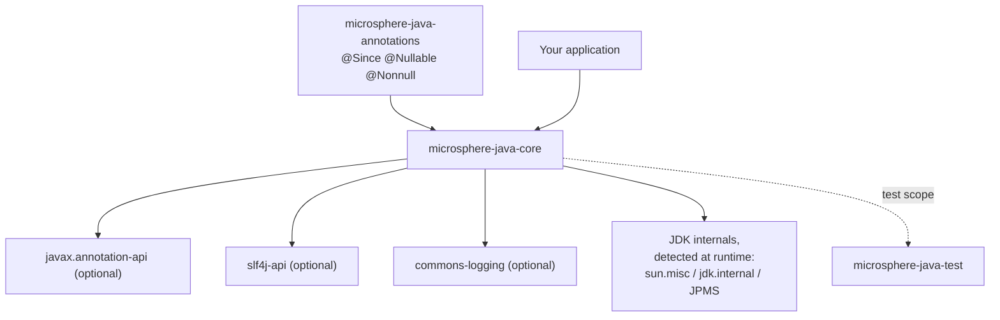

# `microsphere-java-core` — package-group index (User Guide)

Module: `io.github.microsphere-projects:microsphere-java-core` · Source line: `release` branch, `0.3.20-SNAPSHOT`
Java level: compiled at **Java 8**, CI-tested on JDK 8 / 11 / 17 / 21 / 25 · Compile dependency: `microsphere-java-annotations` only

`core` holds 686 main-source types in 34 packages, so it is documented as 14 pages, one per top-level package group.
Pick the group you need from the table below; Chinese versions of every page are in the [`zh/`](zh/README.md) subdirectory.

---

## 1. What `core` depends on

The optional integrations and the JDK-internals edge are what generate the per-page **compatibility ranges**: the
library probes the classpath and the JDK at runtime and degrades to a portable path when a capability is missing.

---

## 2. Pages and package coverage

| # | Page | Packages covered (main sources) | Types |
|---|------|--------------------------------|-------|
| 1 | [Utilities, constants and text](util-and-constants.md) | `io.microsphere.util`, `io.microsphere.util.jar`, `io.microsphere.constants`, `io.microsphere.text`, `io.microsphere.misc` | 45 |
| 2 | [Collections and filters](collections-and-filters.md) | `io.microsphere.collection`, `io.microsphere.filter` | 41 |
| 3 | [Language abstractions](language-abstractions.md) | `io.microsphere.lang`, `io.microsphere.lang.function`, `io.microsphere.lang.invoke`, `io.microsphere.invoke` | 18 |
| 4 | [Reflection, types and beans](reflection-and-beans.md) | `io.microsphere.reflect`, `io.microsphere.reflect.generics`, `io.microsphere.internal.reflect`, `io.microsphere.beans` | 26 |
| 5 | [Type conversion](type-conversion.md) | `io.microsphere.convert`, `io.microsphere.convert.multiple` | 52 |
| 6 | [Serialization](serialization.md) | `io.microsphere.io.serializer` | 18 |
| 7 | [Event dispatching](events.md) | `io.microsphere.event` | 10 |
| 8 | [I/O, NIO, scanning and file filters](io-and-scanning.md) | `io.microsphere.io`, `io.microsphere.io.event`, `io.microsphere.io.scanner`, `io.microsphere.io.filter`, `io.microsphere.nio.file`, `io.microsphere.nio.charset` | 21 |
| 9 | [Networking and URL protocols](net-and-url-protocols.md) | `io.microsphere.net`, `io.microsphere.net.classpath`, `io.microsphere.net.console` | 13 |
| 10 | [Logging](logging.md) | `io.microsphere.logging` | 9 |
| 11 | [Class loading and artifacts](classloading-and-artifacts.md) | `io.microsphere.classloading` | 16 |
| 12 | [JSON](json.md) | `io.microsphere.json` | 8 |
| 13 | [Configuration property metadata](configuration-metadata.md) | `io.microsphere.metadata` | 9 |
| 14 | [Concurrency, process, management and security](concurrency-process-and-management.md) | `io.microsphere.concurrent`, `io.microsphere.process`, `io.microsphere.management`, `io.microsphere.management.builder`, `io.microsphere.security` | 23 |

> [!NOTE]
> Type counts are the main-source file counts on the `release` branch, so a page may describe slightly fewer types
> than the number shown when several types live in one file.

---

## 3. Suggested reading order

**Day-to-day utility work** → 1 → 2 → 5 → 4
**Building a pluggable subsystem** → 3 (`Prioritized`, `Wrapper`) → 7 (events) → any SPI section of pages 5, 6, 10, 11, 13, 14
**Working with the classpath** → 1 (resource/service loading) → 8 (scanning) → 9 (URL protocols) → 11 (artifact detection)
**IDE-friendly configuration metadata** → 4 (`ConfigurationProperty`) → 13 → and the [annotation-processor page](../microsphere-annotation-processor.md)
**JDK 17+ / 21+ / 25 migration** → 11, 14, 8 and the JDK matrices inside 4 and 6

---

## 4. Version information for the whole module

| Release line | `core` status | Notes |
|--------------|---------------|-------|
| `0.1.x` – `0.2.x` | Historical | Package layout was still moving; `io.microsphere.lang` and `io.microsphere.invoke` were added during this period. Individual APIs carry `@Since` values from these lines — see each page's compatibility table. |
| `0.3.x` (current, up to `0.3.19` released / `0.3.20-SNAPSHOT`) | Active | Public API stabilized; the module gained library-wide `@Nonnull` / `@Nullable` contracts and null-safety degradation fixes. |
| `1.x` | Does not exist | No `release-1.x` branch in this repository; no `docs/1.x/` documentation is generated. |

Binary compatibility inside `0.3.x`: public and protected signatures are treated as API; additions are
version-stamped with `@Since`, and removed behaviour is documented on the owning page rather than silently changed.
